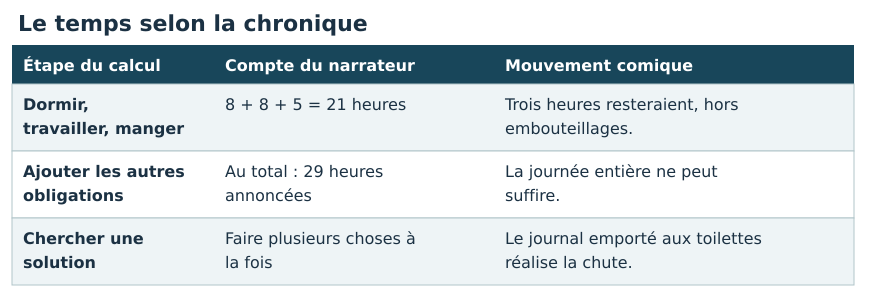

# ENS · MP-PC · Portugais (LE2) 2009 — Corrigé guidé

*Corrigé rédigé par IA, non officiel. Signalez toute erreur.*

**Rédaction** · GPT-6.2 Astra Ultra · vitesse non renseignée

**Révision** · GPT-6.2 Astra Ultra · vitesse non renseignée

**Retouches** · GPT-6.2 Astra Ultra · vitesse non renseignée

Épreuve commune aux ENS de Paris et de Cachan. Durée totale de deux heures. Le sujet demande la traduction de toute la chronique et une réponse en portugais sur la gestion du temps. La page 9 attribue le texte à Luís Fernando Veríssimo. Le rapport associé écrit « Erico Veríssimo ». Nous suivons la signature imprimée sur la chronique.

## Version — Les exigences de la vie moderne (qui peut bien supporter tout ça ?)

On dit que vous devez manger chaque jour une pomme pour le fer. Et une banane pour le potassium. Et aussi une orange pour la vitamine C. Une tasse de thé vert sans sucre pour prévenir le diabète.

Il faut boire chaque jour au moins deux litres d’eau. Et les éliminer, ce qui prend deux fois plus de temps.

Une aspirine chaque jour, paraît-il, prévient l’infarctus. Un verre de vin rouge aussi. Un verre de vin blanc stabilise le système nerveux. Une bière pour… je ne sais plus très bien pour quoi, mais ça fait du bien.

Il faut manger des fibres tous les jours. Beaucoup de fibres, énormément de fibres. Assez de fibres pour faire un pull. Vous devez prendre quatre à six repas légers par jour. Et n’oubliez jamais de mâcher chaque bouchée au moins cent fois. Rien que pour manger, cela fera environ cinq heures par jour.

Et n’oubliez pas de vous brosser les dents après avoir mangé. Autrement dit, il vous faut vous brosser les dents après la pomme, après la banane, après l’orange, après les six repas et, tant qu’il vous reste des dents, passer du fil dentaire, masser vos gencives, brosser votre langue et vous rincer la bouche avec du Plax. Encore mieux, agrandissez donc la salle de bains et profitez-en pour y installer une chaîne hi-fi, puisque, entre l’eau, les fibres et les dents, vous allez y passer plusieurs heures par jour.

Il faut dormir huit heures par nuit et en travailler huit autres dans la journée. Avec les cinq passées à manger, cela fait vingt et une heures. Il en reste trois, à condition de ne pas être pris dans les embouteillages.

Les statistiques prouvent que nous regardons la télé trois heures par jour. Vous, un peu moins, puisque vous allez marcher au moins une demi-heure tous les jours.

Et vous devez entretenir vos amitiés, car elles sont comme une plante : il faut les arroser chaque jour. Ce qui me fait me demander qui s’en occupera pendant que je serai en voyage.

Il faut aussi se tenir bien informé en lisant deux ou trois journaux par jour pour comparer les informations. Ah ! Et le sexe. Tous les jours, en prenant soin de ne pas tomber dans la routine.

D’après mon calcul, cela fait vingt-neuf heures par jour. La seule solution qui me vienne à l’esprit, c’est de faire plusieurs de ces choses en même temps !!!

Bon, il faut que j’y aille. Il est midi et, après la bière, le vin et la pomme, il faut que j’aille aux toilettes. Et tant qu’à y aller, j’emporte un journal… Salut.

> [!INDICATION]
> Le « on dit » initial gouverne l’accumulation des prescriptions. L’auteur en fait une satire par la répétition et l’exagération. La brusque panne de mémoire sur la bière poursuit la plaisanterie. Dans *vinte e uma*, il faut rétablir le substantif féminin *horas*. La langue se relâche jusqu’au très familier *Tchau* final.

## Question — Qual é a sua opinião sobre o tratamento do tempo nas sociedades modernas?

Na crónica, cada conselho parece ocupar apenas alguns minutos. O problema só se torna visível quando o narrador soma as obrigações e descobre que precisaria de vinte e nove horas por dia. A graça desse cálculo mostra como uma sociedade pode transformar até o descanso numa tarefa a cumprir. Ler o jornal, caminhar ou encontrar um amigo deixam de ser escolhas quando passam a figurar numa lista que nunca termina.

Parece-me importante distinguir a organização do tempo da tentativa de o preencher por completo. Um horário ajuda quem precisa de conciliar os estudos com os transportes. No entanto, uma conversa não vale mais por durar exatamente meia hora, e uma pausa não se justifica apenas por permitir trabalhar mais depois. Além disso, nem todos podem dispor do seu dia da mesma maneira. Uma pessoa que demora duas horas no trajeto entre casa e o emprego tem uma margem de escolha muito menor.

A resposta não consiste em fazer sempre duas coisas ao mesmo tempo, como sugere ironicamente o narrador. Também precisamos de decidir quais exigências podemos recusar e de criar condições coletivas para que sobre tempo de verdade.

> [!INDICATION]
> Le commentaire part du calcul impossible puis en tire un problème de choix et d’inégalité. Il formule une opinion distincte de la solution comique du narrateur.

[Cahier LE2, p. 9](https://www.ens.psl.eu/IMG/file/concours/2009/MP/2009_sujet_mp_pc_le2.pdf#page=9) · [Rapport du jury](https://www.ens.psl.eu/IMG/file/concours/2009/MP/mppc2009_ecrit_portugais_le2.pdf)
