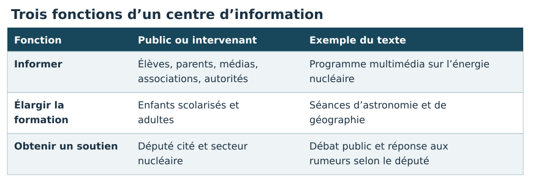

# ENS · MP-PC · Russe (LE2) 2009 — Corrigé brut

*Corrigé rédigé par IA, non officiel. Signalez toute erreur.*

**Rédaction** · GPT-6.2 Astra Ultra · vitesse non renseignée

Épreuve commune aux ENS de Paris et de Cachan. Durée totale de deux heures. La version vaut 12 points et les deux questions en russe 8 points. La dernière ligne du sujet interdit le dictionnaire.

## I. Version — Les centres d’information sur l’énergie nucléaire

Un centre d’information sur l’énergie nucléaire ouvrira à Voronej dans le cadre d’un programme de la société par actions Atomenergoprom et avec le soutien du groupe public Rosatom, a indiqué le service de presse du gouvernement régional. Selon notre interlocuteur, le centre de Voronej sera le deuxième après celui de Tomsk. Des centres analogues verront bientôt le jour dans d’autres régions où se trouvent des centrales nucléaires en service ou en construction ainsi que d’autres installations de l’industrie nucléaire.

« Le centre s’adresse à différents publics : les écoliers, leurs parents, les associations, les médias et les pouvoirs publics. Un programme multimédia spécialement conçu, intitulé “Voyage dans le monde de l’énergie nucléaire”, répondra à de nombreuses questions. Il sera présenté régulièrement aux visiteurs du centre. Les écoliers et les adultes pourront en outre suivre des séances spécialement consacrées à l’astronomie, à la géographie, à l’étude des pays et à d’autres thèmes. »

« La création de centres d’information sur l’énergie nucléaire est l’un des principaux moyens d’obtenir un soutien public et politique en faveur du secteur », estime Mikhaïl Grichankov, premier vice-président de la commission de la sécurité de la Douma d’État de Russie. « Je me souviens des résultats considérables obtenus après l’ouverture du centre d’information dans la région de Tcheliabinsk. Un tel centre offre aussi un lieu de débat public, ce qui permet d’apaiser les craintes qui subsistent et d’obtenir l’adhésion de la société. »

Selon lui, ces centres renforcent la sécurité de l’information du pays et contribuent à empêcher que ne se répandent sur Internet des rumeurs préjudiciables à l’image de l’industrie nucléaire et à celle de la Russie dans son ensemble.

## II.A. Что Вы знаете о производстве атомной энергии в России?

История атомной энергетики в России началась ещё в советское время. В 1954 году электростанция в Обнинске начала вырабатывать электричество для сети. К 2009 году атомные станции работали в нескольких регионах страны. Например, Нововоронежская АЭС находилась в том же регионе, где, по сообщению статьи, собирались открыть информационный центр. Такие предприятия давали электроэнергию и обеспечивали работой специалистов. Вместе с тем их эксплуатация требовала постоянного технического контроля, подготовки кадров и внимания к обращению с отходами. Поэтому жителям важно иметь доступ как к объяснениям отрасли, так и к независимой информации о работе станций.

## II.B. Согласны ли Вы с тем, что в наше время невозможно жить без атомной энергии?

Я не стал бы утверждать, что без атомной энергии невозможно жить. В стране, где много рек и подходящих площадок для гидроэлектростанций, условия одни, а там, где промышленность потребляет много электричества и других местных источников мало, совсем другие. Даже если государство решит отказаться от атомных станций, ему придётся заранее выяснить, чем заменить их мощность в холодный зимний вечер.

С другой стороны, само наличие атомной станции не снимает вопросов о стоимости, безопасности и долгосрочных обязательствах. Я бы сравнивал несколько решений: экономию электричества, развитие сетей, использование разных источников и постепенное изменение структуры производства. Важно сохранить надёжное снабжение и открыто обсудить, кто несёт расходы и риски каждого решения.

La date d’Obninsk est documentée par l’Agence internationale de l’énergie atomique. [AIEA, historique de la production d’électricité nucléaire, p. 1](https://www-pub.iaea.org/MTCD/Publications/PDF/te_1444_web.pdf)

[Cahier LE2, p. 10](https://www.ens.psl.eu/IMG/file/concours/2009/MP/2009_sujet_mp_pc_le2.pdf#page=10)
