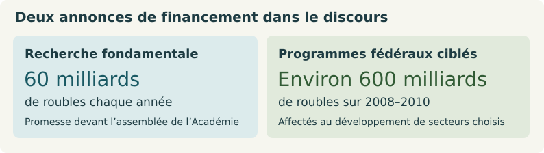

# ENS MP-PC — Russe (LV1) 2009 · Corrigé guidé

*Corrigé rédigé par IA, non officiel. Signalez toute erreur.*

**Rédaction** · GPT-6.2 Astra Ultra · vitesse non renseignée

Épreuve commune aux ENS de Paris, Lyon et Cachan, en deux heures sans dictionnaire. La version vaut douze points, les deux questions en russe huit points au total. L’article rapporte une intervention de mai 2008.

## 1. Version française

> [!INDICATION]
> Dans la première phrase, *перед общим собранием* dépend de *выступил* : le Premier ministre prend la parole devant l’assemblée. Le participe *пообещавший* se rapporte à lui. La tournure distributive *по 60 млрд рублей в год* fixe la somme promise chaque année.

**Poutine apporte son soutien à la recherche**

Après l’élection des nouveaux académiciens et membres de l’Académie des sciences de Russie, le Premier ministre Vladimir Poutine a pris la parole devant l’assemblée générale. Il a promis à la recherche fondamentale un soutien de fond : 60 milliards de roubles par an, ainsi que des logements pour les jeunes spécialistes et des équipements pour les laboratoires. […]

Vladimir Poutine a indiqué que le gouvernement avait alloué des moyens considérables au développement de domaines d’avenir tels que les nanotechnologies, les biotechnologies, l’énergie nucléaire, la recherche aérospatiale et plusieurs autres secteurs. « À eux seuls, les programmes fédéraux ciblés apporteront à ces projets quelque 600 milliards de roubles sur la période 2008-2010 », a-t-il déclaré.

Il a poursuivi en faisant observer que la recherche russe « ne saurait se passer de méthodes modernes d’organisation de la recherche ni du développement de la concurrence au sein de la communauté scientifique ». « C’est à cette condition seulement, a-t-il expliqué, que les investissements pourront accroître l’efficacité de notre secteur scientifique et déboucher sur des productions intellectuelles qui répondent à une demande tant à l’intérieur du pays que dans le monde. »

Dans le même temps, il a souligné que la situation générale des chercheurs en matière d’équipement scientifique moderne était « encore loin d’être idéale ». Ainsi, près de la moitié du matériel sur lequel travaillent les chercheurs de l’Académie des sciences de Russie a plus de onze ans, tandis que le matériel récent, de deux ans au plus, en représente à peine plus de 20 %.

Il a souligné qu’il s’agissait là de l’un des problèmes majeurs et que le gouvernement s’efforcerait d’y trouver des solutions. Dans cette perspective, a ajouté le Premier ministre, le gouvernement attend de la direction de l’Académie « des propositions étayées ».

*D’après NEWSru.com, 29 mai 2008.*

> [!INDICATION]
> Dans le passage sur le matériel, *почти половины* indique une part presque égale à la moitié et *превышает 11 лет* fixe un seuil d’âge. À la fin, *немногим больше* signifie « à peine plus de ». Ce sont des parts du matériel employé par les chercheurs de l’Académie, pas des proportions de chercheurs.

## 2. Questions

### 1. Какие, по-вашему, самые перспективные области в современной науке?

> [!INDICATION]
> *По-вашему* appelle un choix personnel. Poser un critère avant de nommer un domaine : perspectives pour la santé, pour l’énergie ou pour la production de connaissances. Un exemple d’usage et une difficulté scientifique valent mieux qu’une reprise de la liste du discours.

На мой взгляд, особенно перспективны исследования на стыке физики, химии и энергетики. Например, чтобы шире использовать солнечную и ветровую энергию, нужны накопители, которые долго служат и не требуют слишком дорогого сырья. Здесь важны как фундаментальные знания о свойствах вещества, так и испытания в реальных условиях. Батарея, прекрасно работающая в лаборатории, ещё не обязательно подойдёт для целого города.

Другой пример — методы ранней диагностики заболеваний. Чем раньше обнаружена болезнь, тем больше возможностей у врача и пациента. Однако хороший метод должен давать достаточно точный результат: частые ложные тревоги тоже могут навредить. В обоих случаях я назвал бы перспективной ту работу, в которой ясна общественная потребность и при этом остаётся серьёзный научный вопрос.

### 2. Что Вы знаете об условиях, в которых работают российские учёные?

> [!INDICATION]
> Ancrer les données dans leur institution et leur date. Employer *по данным статьи* pour le constat et *правительство обещало* pour les engagements. Puis expliquer concrètement comment l’ancienneté des appareils ou le logement peuvent influer sur le travail scientifique.

По данным статьи, в 2008 году условия работы в Российской академии наук были весьма неоднородными. Почти половина оборудования, которым пользовались учёные Академии, была старше одиннадцати лет. При этом доля сравнительно новых приборов, возрастом до двух лет, составляла чуть больше двадцати процентов. Сам по себе возраст ещё не говорит, что прибор непригоден. Но если оборудование часто выходит из строя, эксперимент приходится прерывать, и молодая группа может потерять несколько месяцев.

Правительство обещало деньги на фундаментальную науку, жильё молодым специалистам и оснащение лабораторий. Для начинающего исследователя возможность поселиться рядом с институтом порой не менее важна, чем новая установка. Статья сообщает об обещаниях и ожиданиях правительства. Чтобы судить об их выполнении, понадобились бы сведения о том, какие лаборатории действительно получили приборы и сколько молодых сотрудников смогли получить жильё.

[Cahier de deux heures, p. 6](https://www.ens.psl.eu/IMG/file/concours/2009/MP/2009_sujet_mp_pc_lv1.pdf#page=6)
