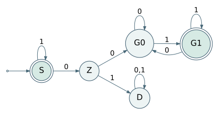
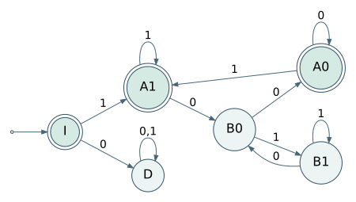
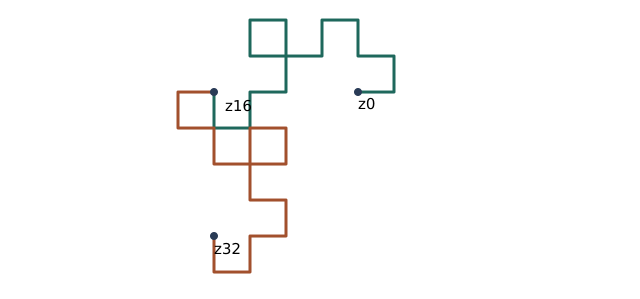

# ENS · MP · Informatique 2009 — corrigé brut

*Corrigé rédigé par IA, non officiel. Signalez toute erreur.*

**Rédaction** · GPT-6.2 Astra Ultra · vitesse non renseignée · 25 novembre 2026

Les mots sont indexés à partir de zéro. Un mot minimal, ou mot de Lyndon, est non vide et strictement inférieur à toute rotation obtenue en le coupant en deux morceaux non vides. Le repliage renverse à la fois l’ordre des lettres et leur valeur a ou b.

## Partie 1 · Mots minimaux et rotations

### Question 1.1 · Ordre lexicographique

Compléter chaque mot fini par une sentinelle infiniment répétée, strictement inférieure aux lettres. Deux mots distincts se comparent à leur première différence. Pour trois mots, la première des deux positions de différence successives prouve la transitivité, y compris lorsqu’elles coïncident. L’égalité, l’antisymétrie et la totalité s’ensuivent. Le mot vide est le minimum. Aucun maximum car $u<ua$ pour toute lettre $a$.
```text
PlusPetit(u,v)
    pour i de 0 à min(|u|,|v|)−1
        si u[i] diffère de v[i] : renvoyer u[i] < v[i]
    renvoyer |u| < |v|
```
Coût $O(1+\min(|u|,|v|))$.

### Question 1.2 · Test par rotations

```text
si n = |u| est nul : renvoyer faux
pour k de 1 à n−1
    si u n’est pas strictement plus petit que la rotation d’indice k
        renvoyer faux
renvoyer vrai
```
Lire la lettre $j$ de la rotation en $u[(k+j)\bmod n]$. Toutes les coupures non triviales sont testées. L’égalité rejette une puissance périodique. Temps $O(n^2)$, espace auxiliaire $O(1)$.

### Question 1.3 · Un bord interdit

Supposons $u=vw=rv$ avec $v$ bord propre non vide. Si $u$ était minimal, $vw<vr$, donc $w<r$. Les longueurs de $w,r$ sont égales, ainsi leur première différence demeure après concaténation de $v$ : $wv<rv=u$. Cette rotation contredit la minimalité. La réciproque est fausse sur deux lettres $a<b$ : $ba$ n’a pas de bord propre et $ab<ba$.

### Question 1.4 · Test par suffixes

Si $u=rv$ est minimal, $u<vr$ et $v$ n’est pas préfixe de $u$ par 1.3. La première différence se situe donc dans les $|v|$ premières lettres, d’où $u<v$. Inversement $u<v$ pour toute fin propre non vide donne $u<v<vr$ pour chaque coupure, puisque $v$ est préfixe propre de $vr$.

### Question 1.5 · Gain sur la comparaison

```text
si u est vide : renvoyer faux
pour k de 1 à |u|−1
    si PlusPetit(u, vue du suffixe commençant en k) est faux : renvoyer faux
renvoyer vrai
```
La correction est 1.4. Le budget maximal des comparaisons de positions est $\sum_{k=1}^{n-1}(n-k)=n(n-1)/2$ au lieu de $n(n-1)$ pour des comparaisons de rotations complètes. Ces plafonds sont exacts pour des balayages systématiques sans arrêt anticipé. Les versions avec arrêt anticipé peuvent s’arrêter plus tôt. L’ordre de grandeur reste quadratique, par exemple sur $a^{n-1}b$.

### Question 1.6 · Extrémités parmi les mots minimaux

La plus petite lettre $a$ est minimale et précède tout mot non vide, ou en est un préfixe. La plus grande lettre $z$ est minimale. Si $u$ est minimal de longueur au moins deux, il est strictement inférieur à son suffixe d’une lettre, qui vaut au plus $z$. D’où les deux extrémités.

### Question 1.7 · Produit de deux mots minimaux

Soient $v<w$ minimaux. D’abord $vw<w$. S’il existe une première lettre différente dans $v,w$, elle tranche déjà. Sinon $w=vt$ avec $t$ suffixe propre non vide et $w<t$, donc $vw<vt=w$. Un suffixe de $vw$ inclus dans $w$ est au moins $w$, donc dépasse $vw$. Tout autre suffixe propre s’écrit $sw$ pour une fin propre $s$ de $v$. Comme $v<s$ et $s$ est plus court, une différence stricte avant la fin de $s$ entraîne $vw<sw$. La caractérisation de 1.4 conclut.

### Question 1.8 · Trouver une coupure

Choisir pour $w$ le plus long suffixe propre minimal de $u$ ; la dernière lettre en est un. Écrire $u=vw$. Alors $v<u<w$. Si $v$ n’était pas minimal, prendre sa plus courte fin $s<v$. Elle est minimale : toute fin de $s$ strictement plus petite que $s$ serait une fin encore plus courte de $v$ inférieure à $v$. Ainsi $s<w$, et 1.7 ferait de $sw$ une fin propre minimale de $u$ plus longue que $w$. Contradiction.

### Question 1.9 · Énumérer sans doublons

```text
D[1] ← lettres de A
pour l de 2 à n
    pour k de 1 à l−1
        pour v dans D[k], w dans D[l−k]
            si v < w : insérer vw dans D[l] si absent
renvoyer les mots de l’union des D en ordre lexicographique
```
Employer un arbre de préfixes ordonné pour chaque $D[l]$ et un arbre global pour la sortie. Le dernier parcours est préfixe avant descendants et enfants par lettres croissantes. Toute insertion est correcte par 1.7 et toute solution est produite par 1.8. Pour alphabet fixé, chaque paire de mots de longueur totale au plus $n$ est examinée une fois, avec coût $O(n)$ comparaison et insertion. Si $M=M(n)$, coût $O(nM^2+n^2)$ et stockage $O(nM)$.

### Question 1.10 · Alphabet binaire

En longueurs exactes $1,2,3,4,5$, les effectifs sont $2,1,2,3,6$. Ainsi $M(n)=2,3,5,8,14$. À la longueur cinq les six mots sont $aaaab,aaabb,aabab,aabbb,ababb,abbbb$, vérifiables par les suffixes. Au-delà d’une lettre, la comparaison avec la dernière lettre force la première à être strictement plus petite : tout mot commence par $a$ et finit par $b$. À longueur $k\ge2$ il y en a donc au plus $2^{k-2}$ et au moins $k-1$, car les mots $a^jb^{k-j}$ pour $1\le j<k$ passent le test des suffixes. En sommant,
$$
2+n(n-1)/2\le M(n)\le 2^{n-1}+1.
$$

### Question 1.11 · Arrêt du successeur

Le mot initial autre que $b$ commence par $a$. Après recopie périodique, la recherche de droite à gauche rencontre donc un $a$ au plus tard en position zéro. Elle donne $q=p+1\in\{1,\ldots,n\}$. Remplissage et recherche prennent $O(n)$ temps au total et $O(1)$ espace supplémentaire.

### Question 1.12 · Validité et immédiateté du successeur

Posons $P=u^\infty$, $T=P[0:n]$, et $q-1$ la dernière position de $a$ dans $T$. Le résultat $v$ reprend les $q-1$ premières lettres, puis écrit $b$. Il est le plus petit mot de longueur au plus $n$ strictement supérieur à $T$ : les lettres suivantes de $T$ sont toutes $b$ et la première différence doit augmenter un $a$. Puis $T\ge u$, donc $v>u$.

La suite $P$ est inférieure ou égale à tous ses décalages lexicographiques : les décalages multiples de $|u|$ sont égaux et les autres comparent dès la première période $u$ à une rotation stricte. Pour un suffixe de $v$ commençant en $j>0$, comparer d’abord $P$ à son décalage $j$ sur $q-j$ positions. Soit un écart strict en faveur de $P$ intervient avant la fin, soit les préfixes sont égaux jusqu’à la dernière position. À cette position le suffixe reçoit $b$ au lieu de $a$, tandis que la partie gauche est un préfixe propre de $v$ encore identique à $P$. L’inégalité est donc stricte dans tous les cas. Par 1.4, $v$ est minimal.

Enfin, tout mot $s$ vérifiant $u<s\le T$ commence par $u$. S’il est préfixe de $T$, il est formé de périodes entières puis d’un préfixe de $u$. Ce dernier, ou $u$ si le préfixe est vide, est un bord propre. Sinon, après des périodes entières, le premier désaccord de $s$ avec $P$ est une lettre plus petite. Le suffixe de $s$ partant au début de cette période est alors plus petit que $s$, qui commence par $u$. Dans les deux cas $s$ n’est pas minimal. Aucun mot minimal n’est sauté.

### Question 1.13 · Factoriser avec une pile

```text
S ← pile vide
pour chaque lettre x de u
    empiler x
    tant que les deux derniers facteurs v,w vérifient v < w
        les remplacer par le facteur concaténé vw
renvoyer la pile du bas vers le haut
```
Tous les facteurs sont minimaux par 1.7 et leur concaténation est inchangée. Avant chaque empilement, la suite est décroissante au sens large. Seule sa dernière jonction peut être incorrecte et les fusions successives rétablissent l’invariant. Il y a au plus $n-1$ fusions, et $O(n)$ comparaisons de facteurs. En conservant des intervalles du mot original, coût $O(n^2)$ temps et $O(n)$ espace.

### Question 1.14 · Unicité de la factorisation

Supposons que le premier facteur $x$ d’une décomposition soit plus long que le premier facteur $y_1$ d’une autre. Alors $x=y_1\cdots y_{j-1}t$ avec $j\ge2$ et $t$ préfixe non vide de $y_j$. Comme $x$ est minimal et $y_1$ son préfixe propre, on a $y_1<x<t\le y_j$, contradiction avec $y_1\ge y_j$. Les premiers facteurs ont même longueur, donc sont égaux. Les supprimer et réitérer donne l’unicité. L’existence est assurée par 1.13.

## Partie 2 · Repliages et courbe du Dragon

### Question 2.1 · Construire un repliage

```text
U ← tableau vide
répéter n fois
    V ← tableau de longueur 2|U|+1
    pour j de 0 à |U|−1
        V[j] ← U[j]
        V[2|U|−j] ← lettre opposée de U[j]
    V[|U|] ← a
    U ← V
renvoyer U
```
Le résultat du tour $k$ est $u_k$ par la définition $u_{k+1}=u_ka\bar u_k$. Sa longueur est $2^k-1$. La somme des écritures est $\Theta(2^n)$, optimale pour une sortie explicite. L’espace est $O(2^n)$.

### Question 2.2 · Entrelacement

Définissons une suite $F$ par $F(4j)=a$, $F(4j+2)=b$, $F(2j+1)=F(j)$. La dernière règle diminue l’indice, donc définit bien toute la suite. Son préfixe de longueur $2^n-1$ est $u_n$. En effet, au centre $2^n-1$ on lit $a$ en enlevant les bits terminaux égaux à un. Pour $0\le i<2^n-1$, les lettres aux indices $i$ et $2^{n+1}-2-i$ sont opposées. Si $i=2j$, leurs demi-indices $j$ et $2^n-1-j$ sont de parités contraires pour $n\ge1$. Si $i$ est impair, la règle impaire réduit l’assertion aux indices miroirs du niveau précédent. Par récurrence, le préfixe satisfait exactement la définition du repliage. Cela établit les deux propriétés demandées.
```text
U ← vide
répéter n fois
    allouer V de longueur 2|U|+1
    écrire à V[2j] la lettre a si j est pair, b sinon
    écrire à V[2j+1] la lettre U[j] lorsque j < |U|
    U ← V
renvoyer U
```
Temps $\Theta(2^n)$.

### Question 2.3 · Calcul direct d’une lettre

```text
tant que i est impair : i ← (i−1)/2
si i est multiple de 4 : renvoyer a
sinon : renvoyer b
```
Chaque division emploie $F(2j+1)=F(j)$ et le test final applique la formule paire. Il y a $O(1+\log(i+1))$ opérations et un nombre constant de variables. Le pire cas se présente pour une longue suite de uns en poids faibles.

### Question 2.4 · Automate, poids faible en premier

Dans le diagramme, $S$ est initial et accepte le vide et les suites de uns. $Z$ attend le bit suivant le premier zéro. Un un dans $Z$ mène au puits $D$. Un zéro y fixe le résultat à $a$ et mène à $G_0$. Les états $G_0,G_1$ mémorisent ensuite seulement le dernier bit. Seul $G_1$ accepte, car une écriture non vide doit finir par le bit de poids fort un. Cela donne le test de 2.3 avec contrôle de l’écriture canonique.



### Question 2.5 · Automate, poids fort en premier

Notons $A_t,B_t$ les états qui mémorisent la lettre du nombre lu et son dernier bit $t$. L’état initial $I$ accepte le vide, rejette un zéro initial par le puits $D$ et envoie un un sur $A_1$. Lire ensuite un un conserve la lettre, car $F(2j+1)=F(j)$, et place l’indice d’état à un. Lire un zéro produit $A_0$ si le dernier bit était zéro et $B_0$ sinon, car $2j$ est multiple de quatre exactement lorsque $j$ est pair. Les états acceptants sont $I,A_0,A_1$. Le dessin indique toutes les transitions.



### Question 2.6 · Primitives sur un entier borné

```text
t ← et(incr(i), non(i))
renvoyer estnul(et(i, double(t)))
```
L’incrément efface les uns terminaux et allume le premier zéro ; le masque complémentaire supprime les autres bits du résultat. Le double isole donc le bit immédiatement supérieur. Si le premier zéro est absent ou s’il est en tête des $k$ bits, le double est nul, ce qui traduit le bit implicite nul. Coût constant dans le modèle prescrit.

### Question 2.7 · Tracé

```text
z ← (0,0) ; direction ← (1,0)
pour k de 0 à n−1
    t ← z + direction
    TraceLigne(z,t)
    z ← t
    si F(k) = a : direction ← (−direction.y, direction.x)
    sinon : direction ← (direction.y, −direction.x)
```
Avant le tour $k$, $z=z_k$ et la direction vaut $z_{k+1}-z_k$. Le quart de tour met à jour cet invariant. Pour $n=0$ aucun segment n’est tracé. Avec 2.3, l’ensemble des divisions sur les $n$ indices est $O(n)$ car au plus $\lceil n/2^r\rceil$ indices ont au moins $r$ uns terminaux, pour $r\le\log_2(n+1)$. Coût $O(n)$ et espace auxiliaire constant.

### Question 2.8 · Quart de tour au point de jonction

Pour $p=2^k$, les $p$ premiers segments ont pour virages $u_k$. Parcourus en sens opposé, leurs virages sont ceux de $\bar u_k$. Ce sont les virages de la deuxième portion d’après $u_{k+1}=u_ka\bar u_k$. Au point $z_p$, le pas d’arrivée, orienté vers $z_p$, subit le virage $+\pi/2$. Le pas de départ de la portion retournée est son opposé ; le transformer en pas réellement sortant exige donc $-\pi/2$. Ainsi pour $0\le j\le p$,
$$
z_{p+j}=z_p-i(z_{p-j}-z_p).
$$



### Question 2.9 · Sous-suite des points pairs

Écrivons $d_j=z_{j+1}-z_j$ et $s_j=\varphi(F(j))\in\{i,-i\}$. Le virage $F(j)$ se situe entre $d_j$ et $d_{j+1}$, donc $d_{j+1}=s_jd_j$. Posons $D_n=d_{2n}+d_{2n+1}$. Avec $t=s_{2n}$, 2.2 donne $s_{2n+1}=s_n$ et $s_{2n+2}=-t$. Donc $D_n=(1+t)d_{2n}$ et $D_{n+1}=(1-t)s_n t d_{2n}=s_nD_n$, car $t^2=-1$. Les $D_n$ suivent la même récurrence que $d_n$ et $D_0=1+i=(1+i)d_0$. En sommant, $z_{2n}=(1+i)z_n$. La similitude cherchée est $z\mapsto z/(1+i)$ et $z_{2^k}=(1+i)^k$.

### Question 2.10 · Parité d’un contact

Les pas unitaires alternent entre les axes horizontal et vertical, le premier étant horizontal. La parité de $\Re z_n+\Im z_n$ est donc celle de $n$. Deux visites au même point ont même parité. Si $n>0$, le pas qui arrive à $z_n$ et celui qui sort de $z_m$ sont sur des axes différents. Ainsi $z_{n-1}\ne z_{m+1}$.

### Question 2.11 · Les quatre voisins d’un contact

L’origine n’est pas revisitée : le plus petit retour positif aurait un indice pair $2q$ par 2.10 et 2.9 donnerait le retour antérieur $q$. À un contact $0<n<m$, les deux prédécesseurs sont sur un même axe à distance un du centre, les deux successeurs sur l’axe perpendiculaire. Il suffit de montrer que chacun des deux couples est formé de points distincts.

Choisir un contact fautif de couple $(n,m)$ minimal lexicographiquement. Si ses prédécesseurs sont égaux, ce contact antérieur a lui-même des successeurs égaux, contradiction. Donc les successeurs sont égaux. Si $n,m$ sont pairs, diviser leurs indices par deux donne un contact plus petit. Ses successeurs sont opposés à distance deux. Par 2.9, $z_{n+2},z_{m+2}$ seraient distants de $2\sqrt2$, alors que tous deux sont à distance un du successeur commun. Si $n,m$ sont impairs, appliquer la réduction aux indices pairs $n+1,m+1$ des successeurs communs. Le contact obtenu est encore strictement antérieur dans l’ordre lexicographique, même pour $n=1$ car le second indice diminue. Ses prédécesseurs distants de deux imposeraient $|z_{n-1}-z_{m-1}|=2\sqrt2$, impossible pour deux voisins de $z$. Aucune exception ne subsiste. Les deux couples opposés forment bien les diagonales d’un carré.

### Question 2.12 · Multiplicités maximales

Un segment parcouru deux fois dans le même sens donnerait un contact à successeurs identiques, interdit par 2.11. Parcouru en sens opposés, il donnerait un contact avec arrivée égale à un départ, interdit par 2.10. L’origine est visitée une seule fois. Ailleurs une visite utilise deux des quatre segments incidents et aucun segment n’est réutilisé ; il y a donc au plus deux visites. Un point intérieur à une arête du quadrillage ne peut appartenir à une autre arête distincte.
