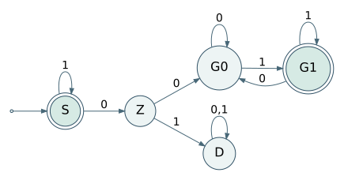
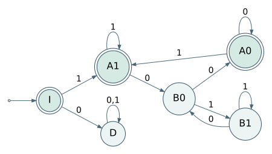
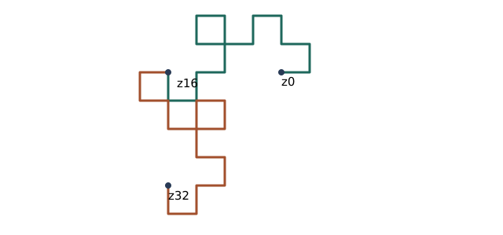

# ENS · MP · Informatique 2009 — corrigé guidé

*Corrigé rédigé par IA, non officiel. Signalez toute erreur.*

**Rédaction** · GPT-6.2 Astra Ultra · vitesse non renseignée · 25 novembre 2026

Une première famille d’algorithmes compare les mots à leurs rotations. Une seconde construit une suite dont chaque lettre commande un quart de tour. Les deux automates ci-dessous reconnaissent les écritures binaires canoniques, zéro ayant pour écriture le mot vide.

## Partie 1 · Mots minimaux et rotations

### Question 1.1 · Ordre lexicographique

Deux mots égaux sur la longueur du plus court se départagent par la longueur. Sinon la première lettre inégale décide. Cette règle est celle des suites lexicographiques munies d’un symbole de fin inférieur à toute lettre, donc compare toute paire et respecte la transitivité en regardant le premier désaccord. Le mot vide précède tout autre et on peut toujours prolonger un mot pour en avoir un plus grand.
```text
i ← 0
tant que i < min(|u|,|v|) et u[i] = v[i] : i ← i+1
si i = min(|u|,|v|) : renvoyer |u| < |v|
renvoyer u[i] < v[i]
```
On visite au plus la longueur du préfixe commun, plus une position.

### Question 1.2 · Test par rotations

Essayer chaque origine de lecture du mot placé sur un cercle et comparer à l’origine zéro :
```text
si u est vide : renvoyer faux
pour k de 1 à |u|−1
    comparer u à la lecture circulaire commençant en k
    si la comparaison donne égal ou supérieur : renvoyer faux
renvoyer vrai
```
Les $n-1$ tours possibles coûtent au plus $n$ comparaisons chacun. Les indices modulaires évitent de recopier le cercle.

### Question 1.3 · Un bord interdit

Une même portion apparaît aux deux extrémités. Tourner pour la placer devant les deux termes d’une comparaison permet de la supprimer à gauche. Les restes ont la même longueur, si bien que leur ordre strict résiste à l’ajout d’une même fin. Une autre rotation devient alors strictement inférieure au mot supposé minimal. L’absence d’un tel bord ne suffit pas : lire $ba$ dans l’autre ordre donne déjà plus petit.

### Question 1.4 · Test par suffixes

Au lieu de considérer toute la rotation, isoler le morceau qui passe en tête. Dans une rotation d’un mot minimal, on rencontre le premier désaccord avant la fin de ce morceau, sinon il serait un bord. La comparaison avec le suffixe suffit donc déjà. Réciproquement, être plus petit que le suffixe implique être plus petit que le suffixe prolongé par le début du mot.

### Question 1.5 · Gain sur la comparaison

Tester les fins sans les recopier :
```text
si |u| = 0 : renvoyer faux
pour chaque coupure k non triviale
    comparer les positions 0,… et k,… jusqu’au premier écart ou à la fin
    si la première lecture n’est pas strictement inférieure : renvoyer faux
renvoyer vrai
```
Il suffit de lire $n-1,n-2,\ldots,1$ positions au plus. Par comparaison avec $n$ positions pour chacune des $n-1$ rotations, le plafond du balayage est divisé par deux. Pour un long bloc de $a$ terminé par $b$, les préfixes communs obligent encore à un travail quadratique.

### Question 1.6 · Extrémités parmi les mots minimaux

Une lettre isolée passe tous les tests de rotations. Commencer par la plus petite rend celle-ci inférieure ou égale à tout mot. Pour la borne supérieure, comparer tout mot minimal de plusieurs lettres à sa dernière lettre, comme autorisé par 1.4. Celle-ci est elle-même au plus la plus grande de l’alphabet.

### Question 1.7 · Produit de deux mots minimaux

Le cas délicat est celui où le premier mot commence le second. En écrivant $w=vt$, la minimalité de $w$ assure $w<t$. Préfixer cette inégalité par $v$ montre que le nouveau mot précède déjà $w$. Si les deux mots diffèrent sur une lettre, cette conclusion est immédiate. Les suffixes du produit qui commencent dans $w$ sont donc tous trop grands. Pour ceux qui commencent dans $v$, la comparaison stricte du mot $v$ avec sa propre fin intervient avant la jonction et se conserve.

### Question 1.8 · Trouver une coupure

Chercher un facteur final aussi long que possible parmi les mots minimaux. Le morceau de gauche est plus petit que le mot entier, lui-même plus petit que le morceau final. S’il échouait au test des suffixes, choisir son plus court suffixe fautif. Ce suffixe ne pourrait échouer à son tour sans en fournir un encore plus court. Il serait donc minimal et pourrait se coller au facteur final par 1.7. Cela contredirait la maximalité de ce dernier.

### Question 1.9 · Énumérer sans doublons

Former les grandes longueurs après les petites et utiliser un dictionnaire pour identifier un même mot trouvé par des coupures différentes.
```text
initialiser les listes par longueur avec les lettres
pour taille de 2 à n
    pour chacune des coupures k et taille−k
        combiner les mots existants de ces deux longueurs
        garder leur concaténation si le mot gauche est plus petit
        enregistrer chaque mot distinct une seule fois
parcourir le dictionnaire global par ordre lexicographique
```
Les deux questions précédentes prouvent respectivement la validité et l’exhaustivité. Un arbre de préfixes à branches indexées par l’alphabet fixe permet comparaison et enregistrement en au plus $O(n)$ par paire. Il y a au plus $M(n)^2$ paires et $O(n^2)$ choix de longueurs, d’où la borne annoncée.

### Question 1.10 · Alphabet binaire

Énumérer par longueur donne d’abord les deux lettres puis $ab$, ensuite $aab,abb$, puis $aaab,aabb,abbb$, et six mots de longueur cinq. Les nombres cumulés sont $2,3,5,8,14$. Un mot minimal de plusieurs lettres doit précéder son suffixe d’une lettre et ne peut donc commencer par cette même lettre ni par une plus grande. Ses extrémités sont fixées à $a,b$ et il reste au plus $k-2$ choix binaires libres. Pour une minoration, choisir une seule transition de $a$ à $b$ en l’une des $k-1$ positions possibles. Ces mots précèdent tous leurs suffixes propres. La somme des deux bornes sur les longueurs donne celle de l’énoncé.

### Question 1.11 · Arrêt du successeur

Le tableau contient toujours le premier $a$ du mot d’entrée, même si aucune case nouvelle n’a été recopiée. La boucle qui saute les $b$ ne peut donc sortir du tableau. Sa position finale est une position valide, et la longueur renvoyée est comprise entre un et $n$. Chacune des deux boucles parcourt au plus le tableau.

### Question 1.12 · Validité et immédiateté du successeur

Compléter périodiquement le tableau jusqu’à $n$ puis y faire la plus petite augmentation lexicographique autorisée par la limite de longueur : changer son dernier $a$ en $b$ et s’arrêter là. Le résultat dépasse le remplissage, lequel prolonge le mot d’entrée. Pour voir qu’il est minimal, comparer une lecture depuis zéro à une lecture décalée de la répétition infinie du mot d’entrée. Celle depuis zéro ne peut perdre puisque chaque période est un mot minimal. Quand on s’arrête à la fin de la lecture décalée dans le mot de sortie, sa dernière lettre a été augmentée et celle de la lecture depuis zéro ne l’a pas été. Un avantage déjà acquis persiste et une égalité est départagée dans le sens strict voulu.

Reste l’intervalle entre le mot d’entrée et son remplissage. Un candidat de cet intervalle prolonge nécessairement l’entrée. S’il suit la répétition jusqu’à son propre terme, sa dernière période partielle fournit une fin qui est un début, ou bien il s’agit d’une puissance entière. S’il s’en écarte, sa première lettre différente doit diminuer. Le fragment partant au début de la période de cet écart est alors un suffixe plus petit que le candidat entier. Aucune de ces deux possibilités ne donne un mot minimal. Le résultat est donc bien le successeur immédiat.

### Question 1.13 · Factoriser avec une pile

Partir des lettres, qui sont toutes minimales. Une augmentation entre deux facteurs voisins autorise leur fusion. Après chaque lettre, corriger uniquement les augmentations au sommet :
```text
ajouter chaque intervalle d’une lettre à la pile
tant que le nouveau dernier facteur dépasse son prédécesseur
    réunir les deux intervalles et recommencer au sommet
```
La partie inférieure était déjà correctement ordonnée. Chaque fusion réduit la taille de la pile et conserve la concaténation et la minimalité du facteur. Au plus un échec de test par lettre et moins de $n$ fusions donnent $O(n)$ tests, chacun en $O(n)$ au pire.

### Question 1.14 · Unicité de la factorisation

Superposer les deux découpages. Si leurs premières coupures diffèrent, le plus long premier facteur finit à l’intérieur ou à la fin d’un facteur ultérieur de l’autre liste. Le morceau terminal ainsi compris est un suffixe propre du grand facteur et le dépasse par minimalité. Il est aussi préfixe du facteur ultérieur et ne le dépasse donc pas. Ce dernier serait strictement plus grand que le premier facteur de sa propre liste, ce que la décroissance interdit. Enlever le premier facteur commun et raisonner sur un mot plus court termine la preuve.

## Partie 2 · Repliages et courbe du Dragon

### Question 2.1 · Construire un repliage

Construire les deux moitiés en miroir, en inversant le sens de lecture et en échangeant $a,b$ :
```text
si n = 0 : renvoyer le mot vide
X ← NiemeRepliage(n−1)
renvoyer X suivi de a puis du retourné complémenté de X
```
L’appel récursif est unique et son résultat est réutilisé. Les tailles successives sont $1,3,7,\ldots,2^n-1$. Leur somme est du même ordre que la dernière, donc le coût est linéaire dans la taille du résultat.

### Question 2.2 · Entrelacement

Prendre le mot défini en recopiant la génération antérieure une case sur deux et en intercalant $a,b,a,b,\ldots$. Pour retrouver le pliage original, vérifier d’abord le centre, d’indice dont tous les bits valent un : ramener plusieurs fois une position impaire à son demi-indice conduit à zéro, donc à $a$. Autour du centre, deux positions miroirs paires donnent des lettres opposées par l’alternance. Deux positions miroirs impaires lisent deux positions miroirs de la génération antérieure, donc sont opposées par récurrence. Chaque génération se compose ainsi du préfixe ancien, d’un $a$ et du miroir complémenté.
```text
à chaque génération, parcourir les nouvelles positions j
    si j impair : copier l’ancienne case (j−1)/2
    sinon : écrire a pour j multiple de 4 et b sinon
```
En partant du vide et en répétant $n$ fois, on obtient le mot demandé en temps proportionnel à sa longueur.

### Question 2.3 · Calcul direct d’une lettre

Supprimer les bits de poids faible égaux à un jusqu’au premier zéro, en considérant des zéros implicites au-delà de l’écriture. Le bit juste au-dessus de ce premier zéro décide : zéro signifie $a$, un signifie $b$. L’implémentation divise par deux tant que le reste est un, puis teste le nombre restant modulo quatre. Elle s’arrête en un nombre d’étapes au plus égal au nombre de bits plus une.

### Question 2.4 · Automate, poids faible en premier

Parcourir d’abord les uns terminaux du nombre, qui se présentent ici au début de la lecture. Si l’entrée s’achève dans cet état, le bit décisif implicite vaut zéro. Sinon, après le premier zéro, le prochain bit doit être zéro pour une réponse $a$. Mémoriser ce résultat et vérifier encore que l’écriture finit bien par un, ou rejeter définitivement si ce bit décisif vaut un. Les boucles du diagramme codent les bits dont la valeur numérique ne dépend plus.



### Question 2.5 · Automate, poids fort en premier

À gauche du mot, vérifier en premier que l’écriture commence par un quand elle n’est pas vide. Après chaque préfixe, retenir sa parité et la réponse pour l’entier qu’il représente. Prolonger par un bit un transforme cet entier en son double plus un, donc préserve la lettre. Prolonger par zéro transforme un préfixe pair en multiple de quatre et un préfixe impair en nombre congru à deux modulo quatre. Ces deux règles remplissent entièrement le diagramme. Un double cercle correspond à la lettre $a$ ou au vide.



### Question 2.6 · Primitives sur un entier borné

On cherche un masque à un seul bit. La retenue de l’incrément repère le premier zéro du nombre et le complément du nombre supprime tout bit qui était déjà allumé. Doubler ce masque décale sa cible d’un cran. Tester que l’intersection avec l’entier est nulle signifie précisément que le bit décisif vaut zéro. L’arithmétique modulo $2^k$ traite aussi les dépassements, qui correspondent aux zéros implicites de l’écriture.

### Question 2.7 · Tracé

Partir de l’origine vers la droite. Après chaque segment, prendre sa fin pour nouveau départ et pivoter d’un angle droit selon la prochaine lettre. Une écriture équivalente est :
```text
position ← 0 ; pas ← 1
répéter pour j allant de 0 à n−1
    dessiner de position à position+pas
    position ← position+pas
    pas ← pas × (i si F(j)=a, sinon −i)
```
Chaque point tracé est celui de la récurrence complexe. La suite des lettres peut être produite en $O(n)$ calculs au total, ou en temps constant par indice avec les primitives de 2.6.

### Question 2.8 · Quart de tour au point de jonction

Remonter le premier chemin depuis son extrémité renverse l’ordre des virages et change chaque gauche en droite. On lit ainsi précisément la moitié droite du mot de repliage. Aligner les deux premiers pas au point de raccord impose alors un quart de tour dans le sens horaire autour de $z_p$. Les longueurs unitaires et tous les virages suivants coïncident, donc cette rotation donne toute la seconde portion.



### Question 2.9 · Sous-suite des points pairs

Grouper les pas deux à deux. La somme du premier couple vaut $1+i$. Pour deux couples consécutifs, leurs virages internes sont opposés, car les lettres aux indices pairs alternent. Le virage qui les sépare est celui du petit indice $n$, puisque les lettres impaires recopient toute la suite. Algébriquement, si le premier pas vaut $d$, le premier couple a somme $(1+t)d$ et le suivant $(1-t)s_ntd=s_n(1+t)d$, avec $t=\pm i$. Les pas groupés sont donc tous les pas originaux multipliés par $1+i$. Diviser les positions paires par ce nombre donne les positions ordinaires. Répéter sur les puissances de deux donne la formule demandée.

### Question 2.10 · Parité d’un contact

Colorier le quadrillage en damier. Chaque pas change de couleur, donc le numéro d’une visite fixe la couleur du point. Deux visites à un point ont des numéros de même parité. Pour cette parité donnée, l’arrivée utilise un axe et le départ utilise l’autre, d’où l’impossibilité d’avoir le même voisin avant l’une et après l’autre.

### Question 2.11 · Les quatre voisins d’un contact

S’il y avait un retour à zéro, choisir le premier : il se produirait à un rang pair et la similitude l’abaisserait à la moitié de ce rang. Tous les contacts sont donc des points où l’on peut examiner à la fois l’arrivée et le départ. Le damier impose déjà les axes perpendiculaires. Une seule obstruction au carré est possible : deux arrivées identiques ou deux sorties identiques.

Prendre une obstruction aussi précoce que possible, en ordonnant les deux indices. Des arrivées identiques déplaceraient l’obstruction au point précédent. Les sorties doivent donc être identiques. Si les deux indices sont pairs, la contraction par $1/(1+i)$ montre un contact antérieur dont les sorties forment un diamètre de longueur deux. Avant contraction les points deux pas plus loin seraient distants de $2\sqrt2$, alors qu’ils ont un voisin commun. Si les indices sont impairs, contracter plutôt la sortie commune, d’indices pairs. Les arrivées du contact contracté forment alors un diamètre de longueur deux. Avant contraction, il s’agit des deux points situés un pas avant le contact initial, tous deux voisins de ce même contact : leur distance ne peut dépasser deux. Les deux contradictions prouvent la propriété.

### Question 2.12 · Multiplicités maximales

À un point de double visite, les quatre voisins des deux passages sont déjà tous différents. Une arête ne peut donc servir une deuxième fois ni dans le même sens ni à rebours. Sur un sommet du quadrillage, chaque passage consomme une arrivée et un départ parmi quatre directions possibles. Il y a place pour deux passages au maximum. Sur le milieu d’un segment, l’unicité du segment donne même une seule visite.
