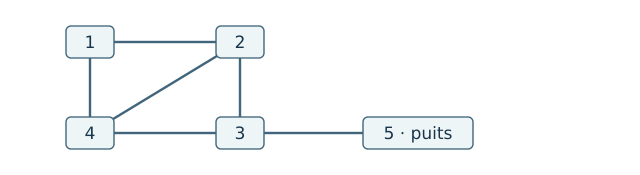
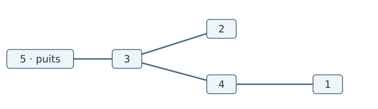

# ENS · MP · Mathématiques-informatique 2009 — corrigé brut

*Corrigé rédigé par IA, non officiel. Signalez toute erreur.*

**Rédaction** · GPT-6.2 Astra Ultra · vitesse non renseignée · 25 novembre 2026

**Révision** · GPT-6.2 Astra Ultra · vitesse non renseignée · 26 novembre 2026

Le graphe est fini et non orienté. On note $x_i$ le vecteur canonique du sommet $i$. Une configuration positive, au sens du sujet, a des hauteurs entières non négatives hors du puits. Le puits peut avoir une hauteur négative. Les précisions nécessaires aux questions 3.3, 3.8 et 4.3 sont explicitées à leur place.

## Partie 1 · Matrices du graphe

### Question 1.1 · Factorisation de la laplacienne

La colonne de $L$ correspondant à $\{i,j\}$, $i<j$, est $x_i-x_j$. Son produit par sa transposée apporte deux $1$ aux positions diagonales $ii,jj$ et deux $-1$ aux positions $ij,ji$. En sommant ces matrices de rang un sur les arêtes, on obtient exactement $A=LL^{\mathsf T}$.

### Question 1.2 · Quotient de Rayleigh

Si $Av=\lambda v$, on multiplie à gauche par $v^*$. Pour $v\ne0$,
$$
\lambda=\frac{\|L^{\mathsf T}v\|^2}{\|v\|^2}
=\frac{\sum_{\{i,j\}\in E}|v_i-v_j|^2}{\sum_i|v_i|^2}.
$$
Ceci prouve que toute valeur propre, même cherchée sur $\mathbb C$, est réelle et positive au sens large. Sur $\mathbb R$ les carrés ordinaires suffisent. Le vecteur constant montre que zéro est toujours atteint.

### Question 1.3 · Composantes connexes

L'énergie s'annule si et seulement si les extrémités de chaque arête portent la même valeur. Par propagation le long des chemins, le noyau est constitué des vecteurs constants sur chaque composante. Les indicatrices des $c$ composantes en forment une base. Le théorème du rang donne $\operatorname{rg}A=n-c$, donc $n-1$ si $G$ est connexe.

### Question 1.4 · Matrice enracinée

Posons $z_k=0$ et $z_i=v_i$ ailleurs. La nouvelle ligne $k$ est perpendiculaire aux autres et de norme $1$ ; leur bloc de produits scalaires est conservé. Ainsi $A_{G,k}=L_{G,k}L_{G,k}^{\mathsf T}$. Le quotient pour une valeur propre devient
$$
\lambda=\frac{|v_k|^2+\sum_{\{i,j\}\in E}|z_i-z_j|^2}{\sum_i|v_i|^2}.
$$
Si le numérateur est nul, $v_k=0$ et $z$ est constant sur le graphe connexe, donc $z=0$ et $v=0$. La matrice est de rang $n$.

### Question 1.5 · Liberté des générateurs

Les lignes de $A_{G,k}$ forment une base réelle. Ce sont $x_k$ et les vecteurs $\Delta_i-a_{ik}x_k$, $i\ne k$. Ajouter à chacune de ces lignes un multiple de $x_k$ est une opération inversible. On obtient la famille annoncée, donc elle est libre.

### Question 1.6 · Dénominateur entier commun

Pour $D=|\det A|>0$, la formule de la comatrice donne $b=D A^{-1}a\in\mathbb Z^n$. La division euclidienne de $b_i$ par $D$ écrit $b_i=Dq_i+r_i$, $0\le r_i<D$, y compris lorsque $b_i<0$. D'où $v_i=q_i+r_i/D$.

## Partie 2 · Groupe critique

### Question 2.1 · Sous-groupe engendré

Les combinaisons $\sum_i a_i g_i$, $a_i\in\mathbb Z$, contiennent zéro, les générateurs et les opposés de toutes leurs sommes. Elles forment un sous-groupe. Tout sous-groupe contenant les $g_i$ contient ces combinaisons par itération de l'addition et du passage à l'opposé. C'est donc le plus petit.

### Question 2.2 · Retrancher un générateur

La somme de toutes les lignes de $A$ est nulle, chaque colonne ayant une diagonale égale au nombre de ses entrées $-1$. Ainsi $\Delta_j=-\sum_{i\ne j}\Delta_i$ pour tout $j$. En conservant $x_k$, n'importe quelle ligne peut être omise.

### Question 2.3 · Relation d'équivalence

$u-u=0\in H$. Si $u-v\in H$, son opposé $v-u$ appartient à $H$. Si de plus $v-w\in H$, l'addition donne $u-w\in H$. On a respectivement réflexivité, symétrie et transitivité.

### Question 2.4 · Loi quotient

Si $u'=u+h$ et $v'=v+h'$ avec $h,h'\in H$, alors $u'+v'=u+v+(h+h')$ représente la même classe que $u+v$. La loi est donc définie indépendamment des choix. Associativité et commutativité passent aux classes ; $\bar0$ est neutre et $-\bar u=\overline{-u}$.

### Question 2.5 · Finitude

Soit $B$ la matrice à colonnes $x_k$ et $\Delta_i$ pour $i\ne k$. Son déterminant a une valeur absolue entière $D>0$ par 1.5. Comme $D B^{-1}$ est entière, $D\mathbb Z^n\subset B\mathbb Z^n=\Delta(G,k)$. Chaque classe possède un représentant à coordonnées dans $\{0,\ldots,D-1\}$, ce qui donne au plus $D^n$ classes.

### Question 2.6 · Transport d'un quotient

L'application $\bar u\mapsto\overline{\phi(u)}$ est bien définie puisque $\phi(H)$ contient les différences des images des représentants d'une même classe. Elle préserve la somme. L'application analogue construite avec $\phi^{-1}$ est son inverse.

### Question 2.7 · Indépendance de la racine

Notons $M=\langle\Delta_1,\ldots,\Delta_n\rangle$ et $Z_0=\{z\in\mathbb Z^n:\sum z_i=0\}$. On a $M\subset Z_0$. L'application $P_k(z)=z-(\sum z_i)x_k$ est l'identité sur $Z_0$ et annule $x_k$. Elle induit une surjection de $\mathbb Z^n$ sur $Z_0/M$ de noyau exactement $M+\mathbb Zx_k$. D'où $C(G,k)\simeq Z_0/M$ pour tout choix de $k$.

## Partie 3 · Stabilisation et récurrence

### Question 3.1 · Invariance

Un éboulement en $i\ne n$ remplace $u$ par $u-\Delta_i$. La différence est dans $M$, donc dans $\Delta(G,n)$. Le résultat se propage par récurrence sur la longueur d'une suite d'éboulements.

### Question 3.2 · Terminaison et unicité

Un sommet à distance $j>0$ du puits a au moins un voisin à distance $j-1$ et aucun à distance moindre. Son éboulement accroît strictement $(\mu_0,\ldots,\mu_\ell)$ dans l'ordre lexicographique. La masse totale est conservée, la hauteur du puits ne décroît pas et les autres hauteurs sont non négatives. Ces potentiels n'ont donc qu'un nombre fini de valeurs ; toute suite maximale finit à l'état stable.

Deux sommets distincts légalement éboulables le restent après l'éboulement de l'autre, et les deux ordres donnent le même vecteur. Par récurrence sur la longueur maximale restante, les stabilisations issues des deux premiers choix coïncident avec celle de ce successeur commun. D'où l'unicité. On écrit $s(u)$ pour l'état stable.

### Question 3.3 · Addition et propagation des grains

**a)** Une suite légale reste légale après addition d'une configuration non négative hors puits. Partant de $u+v$, effectuer la suite de $u$ en gardant $v$ en réserve, puis celle de $v$ en gardant $u'$ en réserve, aboutit à $u'+v'$.

**b)** La condition imprimée $v\ne0$ est insuffisante. Sur le chemin $1-n-2$ de puits central, des grains initialement en $1$ ne peuvent atteindre $2$. Le rapport signale la connexité manquante. La condition exacte est que le support hors puits de $v$ rencontre chaque composante de $G-\{n\}$. Elle exclut aussi le cas où tous les grains sont au puits. Pour prouver la suffisance, choisir un sommet occupé dans chaque composante, un arbre couvrant enraciné en ce sommet, et une profondeur maximale $h$. Poser $B=1+\max d_i$, $k=B^h$. Chaque racine a alors au moins $B^h$ grains. À profondeur $a<h$, faire ébouler chaque sommet $B^{h-a-1}$ fois. Il conserve au moins $B^{h-a-1}$ grains et transmet au moins autant à chaque enfant. À la fin, tous sont strictement positifs.

**c)** Utilisons comme témoin de récurrence une configuration dont le support rencontre chaque composante hors puits, ou supposons ce sous-graphe connexe et le témoin non nul hors puits. Si $u+v\to^*u$, on a $u+tv\to^*u$ pour tout $t$. Par (b), $kv\to^*w$ avec $w_i\ge1$ pour $i<n$. Pour $D=\max d_i$, $u+Dkv$ atteint $u+Dw=\delta+u'$ avec $u'$ positive. Sa stabilisation est $u$, par unicité. Réciproquement, si $\delta+u'\to^*u$, alors $v=\delta+u'-u$ est strictement positive hors puits car $u_i<d_i$, et $u+v\to^*u$.

Voici pourquoi la précision sur le témoin de récurrence importe aussi en (c). Prenons le chemin $a-s-b-c$ de puits $s$ et la pile $u=0$. Ajouter un grain en $a$ et en retrancher un au puits donne un témoin admis par la définition imprimée. Un seul éboulement de $a$ ramène à $u$. Pourtant, en partant de $\delta+u'$ avec $u'$ positive, la composante $\{b,c\}$ ne peut jamais se vider. Elle contient des grains au départ et tout éboulement en $b$ ou $c$ laisse au moins un grain à l’autre sommet. Donc (c) est faux avec ce témoin limité à une composante. La condition de support utilisée en (b) rétablit les deux sens.

### Question 3.4 · Ancêtre commun sans contrainte de hauteur

Écrire $u-v=\sum_{i<n}(a_i-b_i)\Delta_i$, les $a_i,b_i$ étant entiers non négatifs, à l'aide de 2.2. Alors $w=u+\sum b_i\Delta_i=v+\sum a_i\Delta_i$. Les deux listes de soustractions formelles conduisent de $w$ à $u$ et à $v$.

### Question 3.5 · Un ajout universel

Posons $t=s(2\delta)$ et $\varepsilon=2\delta-t$. Hors puits, $t_i\le d_i-1$, donc $\varepsilon_i\ge d_i+1$. De $2\delta\to^*t$ on déduit, en ajoutant $\delta-t$ qui est positive hors puits, $3\delta-t\to^*\delta$. Le point de départ est $\delta+\varepsilon$ et $\varepsilon\in M$ est la différence des extrémités de la première avalanche.

### Question 3.6 · Test avec la configuration universelle

Pour $u$ stable, $u+\varepsilon\to^*u$ suffit puisque $\varepsilon$ est un témoin strictement positif hors puits. Inversement, si $u$ est récurrent, écrire $u=s(\delta+u')$ par 3.3(c). De $\delta+u'+\varepsilon$ on atteint d'une part $\delta+u'$ puis $u$, d'autre part $u+\varepsilon$. L'unicité de la stabilisation donne $s(u+\varepsilon)=u$.

La stabilité de $u$ doit être testée avant cette équivalence. Sur une seule arête reliant le sommet ordinaire au puits, on a $\varepsilon=(2,-2)$ dans l’ordre (sommet, puits). La pile $u=(1,0)$ est instable. Deux éboulements légaux ramènent pourtant $u+\varepsilon$ à $u$.

### Question 3.7 · Représentant récurrent

Pour $z\in\mathbb Z^n$, prendre $k$ tel que $z+k\varepsilon\ge\delta$ hors puits. Son stabilisé $u$ est récurrent par 3.3(c), et $u-z\in M$ par 3.5 et 3.1. Pour l'unicité, deux représentants récurrents $u,v$ de même classe modulo $M$ ont par 3.4 un ancêtre formel commun $w$. Les deux listes de coups étant finies, ajouter $k\varepsilon$ à tous leurs états, pour $k$ assez grand, les rend positifs hors puits et leurs coups légaux. De $w+k\varepsilon$ on aboutit donc à $u+k\varepsilon$ ou $v+k\varepsilon$, puis respectivement à $u$ ou $v$ par répétition de 3.6. La stabilisation unique impose $u=v$.

### Question 3.8 · Groupe des récurrents

On identifie ici les configurations qui diffèrent seulement au puits, comme le précise le jury. Une autre convention consiste à imposer la somme totale zéro en ajustant la seule hauteur du puits. Par 3.7 et 2.7 les récurrents ainsi normalisés correspondent bijectivement à $Z_0/M\simeq C(G)$. Si $u,v$ sont récurrents, on atteint $s(u+v)$ depuis $u+v+\varepsilon$ en absorbant d'abord $\varepsilon$ par $u$. On peut également atteindre $s(u+v)+\varepsilon$ ; la stabilisation de ce dernier est donc $s(u+v)$. Par 3.6 il est récurrent. Comme stabiliser conserve la classe, $u\oplus v=s(u+v)$ réalise l'addition du quotient. Le neutre et les inverses correspondent à la classe nulle et aux classes opposées.

## Partie 4 · Coût des avalanches et arbres couvrants

### Question 4.1 · Masse stable

On a $\sum_{i<n}u_i\le\sum_{i<n}(d_i-1)=2m-d_n-(n-1)\le2m$. La somme des degrés compte deux incidences par arête.

### Question 4.2 · Unicité des nombres de coups

Si $a_i$ compte les éboulements de $i$, alors $u-v=\sum_{i<n}a_i\Delta_i$. L'indépendance de ces $n-1$ lignes (1.5) assure l'unicité de tous les coefficients. Par 3.2 toute avalanche complète issue de $u$ se termine au même $v$.

### Question 4.3 · Décompte par couches

La borne imprimée $\mu_{\ge i}|S_{>i}|$ pour **tous** les coups de la phase omet ceux de $S_i$. Un graphe réduit à une arête, avec un grain au sommet ordinaire, impose un coup pour $i=\ell=1$ alors que $S_{>1}$ est vide.

Durant la phase $i$, aucun sommet plus proche que $i$ ne joue. Chaque coup en $S_i$ envoie au moins un grain vers $S_{i-1}$. Il y a donc au plus $\mu_{\ge i}(u)$ tels coups et au plus autant de passages en (a) : aucune phase antérieure n'a importé de grain depuis les couches plus proches. Au début d'un passage, $S_{>i}$ est stable. Un premier sommet lointain jouant deux fois aurait reçu au moins $d_v+1$ grains puisqu'il avait au plus $d_v-1$ avant (a). Or chaque voisin a joué au plus une fois jusque-là, ceux en $S_i$ compris. Au plus $|S_{>i}|$ coups lointains ont donc lieu par passage. La borne corrigée est
$$
N_i\le\mu_{\ge i}(u)(1+|S_{>i}|)\le np,\qquad
\sum_i N_i\le\ell np.
$$
La borne globale attendue subsiste.

### Question 4.4 · Coût des opérations

La masse hors puits de $\delta$ est au plus $2m$. Celle de $\varepsilon=2\delta-s(2\delta)$ est au plus $4m$, et celle de $u+\varepsilon$ au plus $6m$. Le test nécessite donc au plus $6\ell nm$ éboulements si $\varepsilon$ est prêt, et $10\ell nm$ si l'on compte la stabilisation de $2\delta$. Pour deux récurrents, $u+v$ a au plus $4m$ grains hors puits, d'où $4\ell nm$ éboulements.

### Question 4.5 · Test thermique linéaire

$\beta=-\Delta_n=\sum_{i<n}\Delta_i$ touche chaque composante de $G-\{n\}$, chacune étant reliée au puits. Ainsi $u+\beta\to^*u$ suffit à la récurrence d'un $u$ stable. Pour la réciproque, si $u$ absorbe $\varepsilon$, alors $s(u+\beta)$ l'absorbe aussi, par les deux ordres d'addition de 3.8. C'est donc un récurrent de même classe modulo $M$ et de même masse que $u$, d'où $s(u+\beta)=u$ par 3.7. Les nombres de coups sont les coefficients de $\beta$ dans la famille libre, tous égaux à un.

Mettre en file les sommets devenus instables après l'ajout de $\beta$. Sortir chaque sommet prêt, distribuer ses grains, et mettre ses voisins en file au franchissement du seuil. Même pour un état stable non récurrent, aucun premier double éboulement n'est possible : en comptant le don initial du puits comme un coup, chaque voisin n'a donné qu'une fois et $u_i\le d_i-1$. Accepter si les $n-1$ sommets ordinaires ont joué. Chaque liste de voisins est parcourue au plus une fois, en temps $O(n+m)$ et en espace auxiliaire $O(n)$.

La même réserve qu’en 3.6 vaut pour le test thermique. Sur l’arête unique, $\beta=(1,-1)$ et la pile instable $(1,0)$ retrouve sa valeur après l’ajout de $\beta$ et un éboulement légal. Le test commence donc par vérifier $0\le u_i<d_i$ pour tout $i<n$, en temps $O(n)$.

### Question 4.6 · Vagues et rang de sélection

Chaque vague parallèle est une suite de coups légaux en ordre quelconque ; la terminaison générale s'applique. Pour un récurrent, chaque sommet hors puits joue une fois. Les $R_i$, avec $R_{-1}=\{n\}$, partitionnent donc le graphe. Si $k\in R_i$ reçoit $b=|V_k\cap R_{i-1}|$ grains de la vague précédente, sa hauteur $h$ à présent vérifie $h\ge d_k$ et $h-b<d_k$. Pour la première vague, utiliser le don du puits. Ainsi $0\le h-d_k<b$ : le voisin de rang $h-d_k$ en numérotation commençant à zéro existe.

### Question 4.7 · Construction de l'arbre

Chaque sommet ordinaire désigne un père de la vague précédente. En suivant les pères, l'indice de vague décroît jusqu'au puits. Le graphe retenu est connexe ; ses $n-1$ arêtes sont distinctes, chacune appartenant au seul enfant qui la choisit. C'est un arbre couvrant.

### Question 4.8 · Reconstruire les hauteurs

Dans l'arbre obtenu, la profondeur est l'indice de vague augmenté de un. Pour un sommet $v$ de profondeur $d>0$, notons $a_v$ le nombre de ses voisins dans $G$ aux profondeurs $<d$, et $r_v$ le rang du père, à partir de zéro, parmi ses voisins de profondeur $d-1$ triés. Avant le coup en $v$, il a reçu exactement $a_v$ grains. Or son excès désigne le père, donc $u_v+a_v-d_v=r_v$. Les hauteurs $u_v=d_v-a_v+r_v$ sont ainsi imposées par l'arbre ; la hauteur du puits est normalisée comme en 3.8.

### Question 4.9 · Inversion pour un arbre quelconque

Appliquer la formule de 4.8 à un arbre couvrant arbitraire enraciné en $n$. Si $b_v$ compte les voisins de profondeur $d-1$, on a $0\le r_v<b_v\le a_v\le d_v$. Les hauteurs initiales sont donc entières entre $0$ et $d_v-1$. Avant les apports de profondeur $d-1$, la hauteur de $v$ vaut au plus $d_v+r_v-b_v<d_v$. Une fois ces apports reçus elle vaut $d_v+r_v$. Par récurrence sur les profondeurs, les couches jouent exactement à leur tour et le rang choisit précisément le père prescrit. Tous jouent une fois, donc l'effet net compense $\beta$ et 4.5 assure la récurrence.

### Question 4.10 · Dénombrement

Les applications « pile récurrente vers arbre thermique » et « arbre enraciné au puits vers hauteurs reconstruites » sont inverses par 4.8–4.9. Ainsi le nombre d'arbres couvrants de $G$ est $|R(G)|=|C(G)|$. Fixer le puits ne change pas le choix des arêtes d'un arbre couvrant. Sur $G_0$, l'arête $35$ est imposée ; parmi les dix triplets d'arêtes du sous-graphe restant, seuls ses deux triangles ne le couvrent pas en arbre. Le nombre vaut donc huit.
