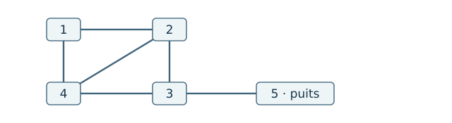
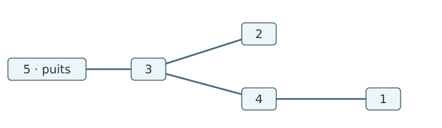

# ENS · MP · Mathématiques-informatique 2009 — corrigé guidé

*Corrigé rédigé par IA, non officiel. Signalez toute erreur.*

**Rédaction** · GPT-6.2 Astra Ultra · vitesse non renseignée · 25 novembre 2026

**Révision** · GPT-6.2 Astra Ultra · vitesse non renseignée · 26 novembre 2026

Les mêmes arêtes servent successivement à écrire une matrice, à faire tomber des grains et à choisir les branches d'un arbre. Les exemples utilisent le graphe $G_0$ du sujet et le puits 5. Un sommet ordinaire peut jouer dès que sa hauteur atteint son degré. La hauteur du puits est libre.

## Partie 1 · Matrices du graphe

### Question 1.1 · Factorisation de la laplacienne

Prenons une arête du graphe dessiné. Dans le produit de la ligne d'un sommet par elle-même, cette arête ajoute $1$ si elle touche ce sommet. Dans le produit des lignes de ses deux extrémités, elle ajoute $-1$. Ailleurs elle ajoute zéro. Ces contributions forment la diagonale des degrés et l'opposé de l'adjacence.

### Question 1.2 · Quotient de Rayleigh

Que mesure une coordonnée de $L^{\mathsf T}v$ ? La différence des valeurs de $v$ aux deux bouts d'une arête. L'identité $v^*Av=(L^{\mathsf T}v)^*(L^{\mathsf T}v)$ somme les carrés de leurs modules. Pour un vecteur propre, le membre de gauche vaut $\lambda\sum|v_i|^2$. Le dénominateur est strictement positif. Une valeur propre peut être nulle, par exemple pour $v=(1,\ldots,1)$.

### Question 1.3 · Composantes connexes

Attribuez une valeur au premier sommet d'une composante. L'appartenance au noyau impose cette valeur à chacun de ses voisins, puis de proche en proche à toute la composante. Réciproquement ces attributions annulent $L^{\mathsf T}v$. Chaque composante fournit un paramètre indépendant. Pour $c$ composantes on perd $c$ dimensions dans le noyau et il en reste $n-c$ pour l'image.

### Question 1.4 · Matrice enracinée

Dans la dernière colonne de la nouvelle matrice d'incidence figure seulement le $1$ de la racine. Il donne le terme $|v_k|^2$ dans l'énergie. Sur les anciennes colonnes, calculez les différences après avoir remplacé $v_k$ par zéro. Ces deux contributions donnent $\|L_{G,k}^{\mathsf T}v\|^2$. Leur somme s'annule uniquement si toutes les nouvelles valeurs coïncident avec celle de la racine, zéro, et si $v_k=0$. La factorisation et la division par $\|v\|^2$ donnent alors l'inversibilité et le quotient demandé.

### Question 1.5 · Liberté des générateurs

La racine remplace à la fois une ligne et une colonne. Les lignes restantes de la matrice inversible diffèrent des $\Delta_i$ seulement à la coordonnée $k$. Le vecteur $x_k$, déjà dans la famille, permet de remettre chacune de ces coordonnées à sa valeur initiale. Ces additions de lignes conservent le rang.

### Question 1.6 · Dénominateur entier commun

La difficulté est de traiter tous les signes avec le même dénominateur. Multipliez $v$ par $|\det A|$ pour obtenir un vecteur entier par Cramer. Prenez ensuite la partie entière de chaque $v_i$ : le reste vaut un entier divisé par $|\det A|$ et appartient à $[0,1[$. Un reste nul est possible.

## Partie 2 · Groupe critique

### Question 2.1 · Sous-groupe engendré

Dans un groupe additif on peut imposer $g_i$, son opposé et tous leurs multiples entiers. Les sommes de ces multiples sont alors obligatoires. Réciproquement ajouter ou soustraire deux sommes de ce type donne encore une telle somme. Cette double inclusion identifie le groupe engendré.

### Question 2.2 · Retrancher un générateur

Fixez la ligne à retirer et additionnez les autres. À chaque coordonnée, le bilan des $n$ lignes serait nul. L'opposé de la somme reconstruira donc la ligne retirée avec des coefficients entiers.

### Question 2.3 · Relation d'équivalence

Traduisez les trois propriétés en opérations dans $H$. La réflexivité emploie le neutre, la symétrie l'opposé, et la transitivité la simplification du terme intermédiaire dans $(u-v)+(v-w)$.

### Question 2.4 · Loi quotient

Changez les représentants un par un. Leur somme change d'un élément de $H$, ce qui préserve sa classe. On peut donc faire tous les calculs sur des représentants. Les identités du groupe $K$ s'y lisent directement, en particulier $\bar u+\overline{-u}=\bar0$.

### Question 2.5 · Finitude

Il suffit de borner le nombre de restes. La matrice carrée des générateurs étant inversible, sa comatrice montre que chaque vecteur $Dx_j$ appartient au sous-groupe, pour le même entier $D=|\det B|$. Réduisez alors chaque coordonnée d'un vecteur modulo $D$. La boîte finie obtenue rencontre toutes les classes.

### Question 2.6 · Transport d'un quotient

Cherchez l'image d'une classe $u+H$. L'additivité et la surjectivité de $\phi$ sur son image donnent exactement $\phi(u)+\phi(H)$. En repartant par $\phi^{-1}$, on retrouve la classe initiale. Cette bijection respecte les sommes.

### Question 2.7 · Indépendance de la racine

Traitez chaque classe à l'aide d'un représentant dont la somme des coordonnées vaut zéro. Soustraire $(\sum z_i)x_k$ le fournit sans changer sa classe dans $C(G,k)$. Deux tels représentants qui diffèrent d'une somme de lignes et d'un multiple de $x_k$ ont nécessairement ce multiple nul, puisque les lignes ont somme zéro. Le quotient de degré zéro par les lignes ne mentionne plus la racine.

## Partie 3 · Stabilisation et récurrence

### Question 3.1 · Invariance

Lorsqu'un sommet cède un grain à chacun de ses voisins, sa hauteur baisse de son degré. La variation est donc l'opposé d'une ligne de la laplacienne et disparaît dans le quotient. Chaque étape conserve ainsi la classe.

### Question 3.2 · Terminaison et unicité

**Pourquoi le processus s'arrête-t-il ?** Regardez d'abord le puits, puis ses voisins, puis la couche suivante. Quand on éboule en couche $j$, la première couche modifiée est $j-1$ et elle gagne des grains. Le nombre de grains hors du puits est borné par sa valeur initiale. Le puits reste compris entre sa hauteur initiale et la masse totale. Un vecteur de couches ne peut donc croître strictement indéfiniment.

**Deux premiers choix peuvent-ils changer la fin ?** Si $a,b$ sont tous deux prêts, jouer $a$ aide éventuellement $b$ et réciproquement. Après $a,b$ ou $b,a$ on se rejoint exactement. En appliquant la même propriété aux suites plus courtes qui restent, la terminaison permet une induction jusqu'à l'état stable unique.

### Question 3.3 · Addition et propagation des grains

**a)** Jouez les coups de la première pile en réservant tous les grains de la seconde. Puis inversez les rôles. Le sommet choisi dispose toujours de la quantité qui rendait son coup légal avant l'addition.

**b)** Le puits reçoit mais ne redistribue jamais. Une composante de $G-\{n\}$ initialement vide reste donc vide, même après multiplication des grains initiaux. Deux feuilles séparées par le puits suffisent à contredire l'énoncé sans hypothèse supplémentaire. Supposons désormais un sommet occupé dans chaque composante, comme le permet notamment la connexité hors puits relevée par le jury avec un témoin occupé hors puits. Enracinez un arbre de chaque composante à un sommet occupé. Si $B$ dépasse de un tous les degrés ou leur est supérieur d'au moins un, une réserve de $B^r$ grains finance $B^{r-1}$ coups, en laisse au moins $B^{r-1}$ et donne cette réserve à chaque enfant. Commencez avec le facteur $B^h$, $h$ la plus grande profondeur, et descendez jusqu'aux feuilles. Tous les sommets gardent au moins un grain.

**c)** Pour la suite, la récurrence emploie un témoin qui atteint chaque composante dans ce sens. Un témoin que $u$ absorbe peut lui être ajouté autant de fois que voulu en répétant la même avalanche. Par (b) et (a), assez de copies fournissent au moins $d_i$ grains sur tout sommet $i<n$. L'état intermédiaire est donc $\delta+u'$ avec $u'$ positive ; il se stabilise à $u$ puisqu'il est sur une branche d'une avalanche de fin unique. Dans l'autre sens, la différence entre $\delta+u'$ et l'état stable $u$ dépasse zéro en toute coordonnée hors puits. C'est le témoin recherché.

Voici pourquoi la précision sur le témoin de récurrence importe aussi en (c). Prenons le chemin $a-s-b-c$ de puits $s$ et la pile $u=0$. Ajouter un grain en $a$ et en retrancher un au puits donne un témoin admis par la définition imprimée. Un seul éboulement de $a$ ramène à $u$. Pourtant, en partant de $\delta+u'$ avec $u'$ positive, la composante $\{b,c\}$ ne peut jamais se vider. Elle contient des grains au départ et tout éboulement en $b$ ou $c$ laisse au moins un grain à l’autre sommet. Donc (c) est faux avec ce témoin limité à une composante. La condition de support utilisée en (b) rétablit les deux sens.

### Question 3.4 · Ancêtre commun sans contrainte de hauteur

Éliminez $\Delta_n$ grâce à la relation entre lignes. Séparez les coefficients positifs et négatifs de $u-v$. En déplaçant les deux sommes de part et d'autre, chaque côté devient une configuration augmentée d'une combinaison positive de lignes. La valeur commune peut donc atteindre les deux par soustractions, les hauteurs étant libres dans cette question.

### Question 3.5 · Un ajout universel

Stabilisez deux copies de $\delta$. Le résultat $t$ tient au-dessous du seuil en chaque sommet ordinaire. Ainsi $\delta-t$ est disponible comme réserve non négative. Rejouez la même avalanche en conservant cette réserve intacte. Vous partez de $2\delta+(\delta-t)=\delta+\varepsilon$ et arrivez à $t+\delta-t=\delta$. Chaque coordonnée ordinaire de $\varepsilon$ vaut au moins $d_i+1$.

### Question 3.6 · Test avec la configuration universelle

Partez d'un antécédent de $u$ contenant $\delta$. Si l'on ajoute $\varepsilon$ avant de stabiliser, on peut d'abord le faire absorber par $\delta$ selon 3.5. On peut aussi garder $\varepsilon$ en réserve jusqu'à atteindre $u+\varepsilon$. Les deux ordres ont la même fin stable, donc $u$ absorbe $\varepsilon$. Réciproquement, pour un état stable, cette absorption fournit le témoin demandé en 3.3.

La stabilité de $u$ doit être testée avant cette équivalence. Sur une seule arête reliant le sommet ordinaire au puits, on a $\varepsilon=(2,-2)$ dans l’ordre (sommet, puits). La pile $u=(1,0)$ est instable. Deux éboulements légaux ramènent pourtant $u+\varepsilon$ à $u$.

### Question 3.7 · Représentant récurrent

Une configuration de départ peut avoir des dettes. Ajoutez assez de copies de $\varepsilon$ pour couvrir toutes les dettes et disposer encore de $\delta$ hors du puits. Cette opération conserve la classe modulo les lignes, car $\varepsilon=2\delta-s(2\delta)$ est une somme de lignes. Stabiliser donne alors un représentant récurrent.

Pour comparer deux représentants, empruntez les deux chemins formels de 3.4. Leurs hauteurs les plus basses sont finies. Une même réserve $k\varepsilon$ rend donc chaque état intermédiaire positif et chaque coup légal. À la fin les récurrents absorbent la réserve copie après copie. Les deux fins d'une même stabilisation sont égales, puits compris.

### Question 3.8 · Groupe des récurrents

Pourquoi préciser la valeur du puits ? Elle peut être translatée d'un entier sans changer aucun coup légal et produirait une infinité de copies. Prenez les hauteurs ordinaires comme données et ajustez le puits pour que la somme totale soit zéro. Chaque classe de 2.7 possède alors son unique représentant récurrent par 3.7. Pour additionner deux représentants, stabilisez leur somme. Le résultat absorbe $\varepsilon$ car on peut laisser cet ajout en réserve pendant le calcul, ou le faire absorber par le premier représentant avant le calcul. Par 3.6 le résultat est récurrent. Sa classe est la somme des classes, d'où toutes les propriétés du groupe.

## Partie 4 · Coût des avalanches et arbres couvrants

### Question 4.1 · Masse stable

Chaque sommet stable ordinaire porte au plus son degré moins un. En sommant ces plafonds, puis en les majorant par la somme des degrés de tous les sommets, on obtient $2m$.

### Question 4.2 · Unicité des nombres de coups

Une avalanche est une liste ordonnée, mais son effet total consiste à soustraire une combinaison de lignes de la laplacienne. Les fins étant identiques, la différence des deux listes donne une combinaison nulle de lignes hors puits. Leur indépendance force un bilan nul pour chaque sommet séparément.

### Question 4.3 · Décompte par couches

Testez d'abord la dernière couche sur une seule arête : un unique grain tombe au puits en un coup, avec zéro sommet dans la zone strictement plus éloignée. Le produit imprimé compte uniquement le travail de cette zone.

**Couche en cours.** Chaque coup y évacue un grain ou plus vers une couche désormais en réserve. Le stock initialement disponible au-delà de cette frontière est au plus $\mu_{\ge i}(u)$. Il borne le nombre total de coups dans la couche, donc le nombre de tours.

**Zone extérieure.** Elle était stable avant chaque tour. Pour qu'un sommet y joue deux fois, il aurait besoin d'au moins $d_v+1$ apports. Avant le premier double passage, chaque voisin a fourni au plus un grain. Il y a donc au plus un coup par sommet extérieur et par tour. En ajoutant le travail de la couche en cours on obtient $\mu_{\ge i}(u)(1+|S_{>i}|)$. Avec $p$ grains, au plus $n$ pour le second facteur et $\ell$ phases, le total est au plus $\ell np$.

### Question 4.4 · Coût des opérations

Dans la borne $\ell np$, remplacez $p$ par le stock de départ. Une pile stable apporte au plus $2m$, la pile universelle au plus deux copies de $\delta$ donc $4m$. Tester une pile stable coûte au plus $6\ell nm$ coups après préparation. La préparation ajoute au plus $4\ell nm$. Additionner deux stables en coûte au plus $4\ell nm$.

### Question 4.5 · Test thermique linéaire

Imaginez que le puits joue une seule fois. Chaque voisin reçoit son grain et le puits perd son degré. Cette variation $\beta$ est la somme des lignes ordinaires. Si l'on revient à $u$, c'est un témoin de récurrence présent dans chaque composante. Inversement, un récurrent plus $\beta$ se stabilise sur un récurrent : l'absorption de $\varepsilon$ par $u$ se transporte après ajout et stabilisation, grâce à l'unicité de la fin. La classe modulo les lignes reste identique ; 3.7 force le retour à $u$. L'indépendance des lignes montre alors qu'on a joué exactement une fois partout.

Pour tester, utilisez une file et ajoutez chaque sommet lorsqu'il franchit son seuil. Un premier sommet jouant une seconde fois aurait eu besoin de plus de grains qu'il n'a de voisins avant ce deuxième coup, y compris le don du puits. La file traite donc au plus $n-1$ sommets et examine chaque arête au plus deux fois. Le verdict est positif si tous les sommets ordinaires ont joué.

La même réserve qu’en 3.6 vaut pour le test thermique. Sur l’arête unique, $\beta=(1,-1)$ et la pile instable $(1,0)$ retrouve sa valeur après l’ajout de $\beta$ et un éboulement légal. Le test commence donc par vérifier $0\le u_i<d_i$ pour tout $i<n$, en temps $O(n)$.

### Question 4.6 · Vagues et rang de sélection

Au début d'une vague, tous les sommets prêts peuvent être traités l'un après l'autre puisqu'ils s'entraident. L'algorithme doit s'arrêter, et sur un récurrent chacun aura joué exactement une fois. Pour trouver le père d'un sommet qui vient d'atteindre son seuil, regardez combien de voisins l'ont aidé pendant la dernière vague. S'ils sont $b$, son excès actuel est compris entre zéro et $b-1$, car il était sous le seuil avant ces apports. La liste triée contient bien le choix demandé.

### Question 4.7 · Construction de l'arbre

À partir d'un sommet quelconque, remontez le trait qui le relie à son père. Chaque remontée gagne une vague et finit au puits. Cela montre la connexité du dessin retenu. On a choisi exactement un trait par sommet autre que le puits, soit $n-1$ arêtes distinctes sur $n$ sommets : le dessin est un arbre.

### Question 4.8 · Reconstruire les hauteurs

L'arbre permet de relire les vagues par distance **dans l'arbre**. Comptez les grains reçus par $v$ depuis des couches plus proches en comptant les arêtes **du graphe** vers ces couches. Soustrayez ce nombre $a_v$ de la hauteur au moment du coup, qui était le degré augmenté du rang $r_v$ du père dans la dernière vague. On retrouve $u_v=d_v+r_v-a_v$. Deux récurrents distincts hors du puits ne peuvent donc avoir le même arbre.

### Question 4.9 · Inversion pour un arbre quelconque

Peut-on appliquer la formule à tout arbre ? Un père figure toujours dans la liste de la couche précédente, donc son rang $r_v$ est inférieur à la taille $b_v$ de cette liste. Le nombre total $a_v$ des voisins plus proches vérifie $b_v\le a_v\le d_v$. La hauteur construite est admissible. Un sommet attend : avant les $b_v$ derniers grains il reste strictement sous son seuil. Après ceux-ci son excès vaut le rang du père. En avançant couche après couche on reproduit l'arbre. Chaque sommet ayant joué exactement une fois après le puits, la pile revient à son état initial et réussit le test de récurrence.

### Question 4.10 · Dénombrement

L'injection de 4.8 empêche tout double comptage, la construction de 4.9 assure que chaque arbre apparaît. Le nombre cherché est donc celui des classes du groupe critique. Sur la première figure, la feuille $5$ impose l'arête $35$. Parmi les cinq arêtes du cœur à quatre sommets il faut en garder trois. Sur les dix possibilités, deux forment un triangle laissant un sommet isolé. Les huit autres donnent les huit piles récurrentes hors puits.
