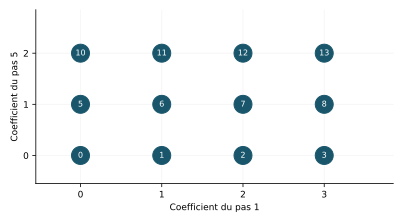

# ENS Paris, Lyon et Cachan — Mathématiques MPI 1, 2009 · Corrigé guidé

*Corrigé rédigé par IA, non officiel. Signalez toute erreur.*

**Rédaction** · GPT-6.2 Astra Ultra · vitesse non renseignée

**Révision** · GPT-6.2 Astra Ultra · vitesse non renseignée

Le problème établit le théorème de Freiman–Ruzsa–Chang pour les parties finies des entiers. On note $|A|$ le cardinal de $A$. Le rapport du jury corrige la parité, la densité et la définition de la tension. Les cas où d’autres majorations imprimées échouent sont examinés avant la preuve finale.

## I. Sommes de parties

### Question I.1.a

> [!INDICATION]
> Sommer une différence de deux coefficients consécutifs.

#### Solution

Par Pascal, $\binom jp=\binom{j+1}{p+1}-\binom j{p+1}$. La somme de $j=p$ à $n$ se télescope en $\binom{n+1}{p+1}$ puisque $\binom p{p+1}=0$.

### Question I.1.b

> [!INDICATION]
> Coder un t-uplet par des séparateurs et des objets identiques.

#### Solution

Aligner $N$ étoiles et $t-1$ barres. Les nombres d’étoiles dans les $t$ compartiments, vides permis, forment exactement les $t$-uplets de somme $N$. Choisir les positions des étoiles parmi $N+t-1$ donne $\binom{N+t-1}{N}$, aussi pour $N=0$.

### Question I.1.c

> [!INDICATION]
> Compter les mots ayant un profil donné.

#### Solution

Les $t^N$ mots de longueur $N$ sur $t$ lettres se répartissent suivant les effectifs de chaque lettre. Chaque profil de I.1.b est réalisé par au moins un mot et par au plus $N!$ mots, obtenus par permutation. D’où $t^N/N!\le\binom{N+t-1}{N}\le t^N$.

### Question I.2.a

> [!INDICATION]
> Pour viser g, intersecter A et un translaté de −B.

#### Solution

Pour $g\in G$, $A$ et $g-B$ ont des cardinaux de somme supérieure à $|G|$. Ils ont donc un point commun $a=g-b$, et $g=a+b$. Ainsi $G=A+B$.

### Question I.2.b

> [!INDICATION]
> Utiliser un groupe à deux éléments.

#### Solution

Dans $\mathbb Z/2\mathbb Z$, prendre $A=B=\{0\}$. Les deux cardinaux font deux au total mais $A+B=\{0\}$.

### Question I.3.a

> [!INDICATION]
> Regarder l’image d’un produit cartésien et deux de ses fibres partielles.

#### Solution

L’application $(a,b)\mapsto a+b$ est surjective sur $A+B$, donc $|A+B|\le|A||B|$. Fixer chaque coordonnée à tour de rôle exhibe dans l’image un translaté de $B$ et un de $A$. Ainsi $|A+B|\ge\max(|A|,|B|)$.

### Question I.3.b

> [!INDICATION]
> Décrire un n-uplet par ses multiplicités.

#### Solution

I.3.a appliquée à $jA$ et $A$ donne $|(j+1)A|\ge|jA|$. Si $A$ a $t$ éléments, chaque somme de $n$ termes est déterminée par un des $\binom{t+n-1}{n}$ profils de multiplicité. Plusieurs profils peuvent donner la même somme ce qui donne la majoration.

### Question I.4.a

> [!INDICATION]
> Suivre une chaîne strictement croissante dans le tableau des sommes.

#### Solution

Écrivons $a_1<\dots<a_m$ et $b_1<\dots<b_n$. La chaîne $a_1+b_1<\dots<a_m+b_1<a_m+b_2<\dots<a_m+b_n$ donne $m+n-1$ éléments distincts.

### Question I.4.b

> [!INDICATION]
> Comparer deux chemins monotones qui contournent un même petit carré.

#### Solution

De $(1,1)$ à $(m,n)$, tout chemin qui augmente un indice à chaque pas fournit $m+n-1$ sommes strictement croissantes. En cas d’égalité, sa liste est la liste ordonnée complète de $A+B$. Pour tout petit carré $(i,j)$, comparer deux chemins identiques sauf entre $(i,j)$ et $(i+1,j+1)$. Les termes intermédiaires sont donc égaux, soit $a_{i+1}+b_j=a_i+b_{j+1}$. Tous les écarts successifs des deux suites coïncident avec un même $d>0$, ce qui donne les deux progressions demandées.

### Question I.5.a

> [!INDICATION]
> Une translation stabilisatrice est déterminée par l’image d’un seul point.

#### Solution

Le stabilisateur $H$ contient zéro et est fermé par différence, puisque $g+A=A$ implique $-g+A=A$. Fixer $a\in A$ injecte $H$ dans $A$ par $h\mapsto h+a$. C’est un sous-groupe fini.

### Question I.5.b

> [!INDICATION]
> Examiner quand une réunion de translatés de même taille ne grossit pas.

#### Solution

Choisissons $b_0\in B$. Si $|A+B|=|A|$, alors chaque $A+b$ est tout $A+B=A+b_0$, d’où $b-b_0\in H$. Réciproquement, si $B\subset b_0+H$, tous les translatés $A+b$ sont égaux à $A+b_0$. Leur réunion a cardinal $|A|$.

### Question I.6

> [!INDICATION]
> Fixer une représentation de chaque différence avant de construire une injection.

#### Solution

I.3.a donne $|A-B|\ge\max(|A|,|B|)\ge\sqrt{|A||B|}$, d’où $d_R\ge0$. Pour chaque $s\in A-C$ choisissons une seule représentation $s=a_s-c_s$. L’application $(s,b)\mapsto(a_s-b,b-c_s)$ va de $(A-C)\times B$ vers $(A-B)\times(B-C)$. La somme des deux images détermine $s$, donc $a_s$, puis leur première composante détermine $b$. L’injection donne $|A-C||B|\le |A-B||B-C|$. Diviser par les facteurs de normalisation et prendre le logarithme donne l’inégalité triangulaire.

### Question I.7

> [!INDICATION]
> Étudier les égalités dans les bornes de la question précédente.

#### Solution

Si $d_R(A,B)=0$, alors $|A-B|=|A|=|B|$. I.5.b appliquée à $A,-B$ place $B$ dans une classe du stabilisateur $H$ de $A$. Or $|H|\le|A|=|B|$, donc $B$ remplit cette classe, et $a+H\subset A$ est aussi une égalité pour tout $a\in A$. Réciproquement, deux classes $a+H,b+H$ ont une différence $(a-b)+H$ de même cardinal, donc $d_R=0$.

## II. Valeurs entières des formes quadratiques

### Question II.1

> [!INDICATION]
> Considérer la matrice à colonnes entières et son inverse.

#### Solution

Une base entière a une matrice $V$ entière et un inverse entier car les vecteurs canoniques se décomposent à coefficients entiers. Comme leurs déterminants entiers se multiplient en un, $\det V=\pm1$. Inversement ce déterminant rend $V^{-1}=\operatorname{adj}(V)/\det V$ entière, d’où la propriété de base.

### Question II.2

> [!INDICATION]
> Réduire une coordonnée par une autre sans changer le réseau.

#### Solution

Si une seule coordonnée est non nulle, elle vaut $\pm1$ et l’on complète avec les autres vecteurs canoniques. Sinon choisissons une coordonnée non nulle de module minimal et réduisons une autre coordonnée non nulle modulo celle-ci à un reste de module strictement inférieur au diviseur. Cette opération élémentaire entière est inversible sur $\mathbb Z^n$, préserve le pgcd et diminue $s(v)$. L’hypothèse de récurrence complète le nouveau vecteur. L’opération inverse ramène une base entière dont $v$ est le premier vecteur.

### Question II.3

> [!INDICATION]
> Écrire la matrice de la forme composée.

#### Solution

Si $Q$ représente $\Phi$ et $U$ représente $u$, alors $\Phi(Ux)=x^TU^TQUx$. Son discriminant est $\det(U)^2\det Q$, y compris si $U$ est singulière.

### Question II.4.a

> [!INDICATION]
> Restreindre les candidats à un ensemble fini de points du réseau.

#### Solution

Sur la sphère unité, $\Phi$ continue a un minimum $\lambda>0$. Alors $\Phi(z)\ge\lambda\|z\|^2$. Pour $z$ entier non nul, $\|z\|\ge1$. Les $z$ tels que $\Phi(z)\le\Phi(e_1)$ sont en nombre fini et comprennent $e_1$. Leur minimum réalise donc l’infimum positif $m$.

### Question II.4.b

> [!INDICATION]
> Montrer que tout vecteur minimal est primitif.

#### Solution

Si $v_1=dz$ avec $|d|\ge2$, alors $\Phi(z)=m/d^2<m$, impossible. Ses coordonnées sont donc premières entre elles et II.2 le complète en base entière.

### Question II.4.c

> [!INDICATION]
> Compléter le carré dans la première coordonnée.

#### Solution

Soit $Q(\cdot,\cdot)$ la forme polaire et $y=\sum_{j\ge2}x_jv_j$. Posons $b=Q(v_1,y)/m$. Alors $\Phi(x_1v_1+y)=m(x_1+b)^2+\Phi(y)-mb^2$. On prend $L_1=x_1+b$ et $\Phi_1(x_2,\dots,x_n)=\Phi(y)-mb^2$. La valeur de $L_1$ en $(1,0,\dots,0)$ vaut un.

### Question II.4.d

> [!INDICATION]
> Annuler la première forme linéaire pour tester la positivité.

#### Solution

Pour $x'\ne0$, choisir $x_1=-b$. Le vecteur $x_1v_1+y$ est non nul, donc $\Phi_1(x')>0$. La base entière a déterminant $\pm1$ et le changement de variable $(x_1,x')\mapsto(x_1+b,x')$ a déterminant un. Dans ces variables la matrice est diagonale par blocs de blocs $m$ et $\Phi_1$, d’où $\operatorname{disc}\Phi=m\,\operatorname{disc}\Phi_1$.

### Question II.4.e

> [!INDICATION]
> Prendre un entier le plus proche possible de −b.

#### Solution

Pour $x'$ fixé, $L_1=x_1+b$. Un entier $x_1$ le plus proche de $-b$ satisfait $|x_1+b|\le1/2$, y compris dans le cas de deux choix.

### Question II.4.f

> [!INDICATION]
> Relever un vecteur minimal de la forme de dimension inférieure.

#### Solution

Choisir $x'\ne0$ entier avec $\Phi_1(x')=m_1$, puis $x_1$ comme en II.4.e. Le vecteur entier relevé est non nul, d’où $m\le m/4+m_1$, soit $m\le4m_1/3$.

### Question II.4.g

> [!INDICATION]
> Combiner la borne récurrente et la factorisation du discriminant.

#### Solution

En dimension un $m=\operatorname{disc}\Phi$. Avec $c=4/3$, l’hypothèse au rang $n-1$ donne $m\le c^{1+(n-2)/2}(\operatorname{disc}\Phi/m)^{1/(n-1)}$. En élevant à la puissance $n-1$ et en regroupant $m$, on obtient $m\le c^{(n-1)/2}(\operatorname{disc}\Phi)^{1/n}$.

### Question II.4.h

> [!INDICATION]
> Relever toute une base réduite du quotient.

#### Solution

Au rang un la base canonique convient. Au rang $n$, choisir la base de rang $n-1$ de l’hypothèse de récurrence pour $\Phi_1$. Relever chacun de ses vecteurs $z$ comme en II.4.e. Les relevés joints à $v_1$ forment une base entière par la matrice triangulaire par blocs. Chaque relevé a valeur au plus $\Phi_1(z)+m/4\le(4/3)\Phi_1(z)$ car $m\le4m_1/3\le4\Phi_1(z)/3$. Leur produit, fois $m$, est majoré par $(4/3)^{n-1+(n-1)(n-2)/2}m\operatorname{disc}\Phi_1=(4/3)^{n(n-1)/2}\operatorname{disc}\Phi$.

## III. Transformation de Fourier et sommes d’ensembles

### Question III.1

> [!INDICATION]
> Utiliser la série géométrique sans supposer que la classe est inversible.

#### Solution

Si $a=0$, les $N$ termes valent un. Sinon $\omega^a\ne1$ et $(\omega^a)^N=1$. La somme géométrique vaut donc zéro, même si $a$ a un diviseur commun avec $N$.

### Question III.2.a

> [!INDICATION]
> Substituer la définition de la transformée.

#### Solution

Dans $N^{-1}\sum_x\widehat f(x)\omega^{-ax}$, le coefficient de $f(b)$ est $N^{-1}\sum_x\omega^{(b-a)x}$, soit $\mathbf1_{a=b}$ par III.1. On retrouve $f(a)$.

### Question III.2.b

> [!INDICATION]
> Multiplier la formule d’inversion par la seconde fonction et sommer.

#### Solution

En sommant III.2.a multipliée par $g(a)$, la somme intérieure est $\sum_a g(a)\omega^{-ax}=\widehat g(-x)$. Ainsi $\sum_a f(a)g(a)=N^{-1}\sum_x\widehat f(x)\widehat g(-x)$.

### Question III.2.c

> [!INDICATION]
> Changer de variable après développement de la convolution.

#### Solution

Poser $b=a-t$ donne $\sum_{a,t}f(t)g(a-t)\omega^{ax}=\sum_{t,b}f(t)g(b)\omega^{tx}\omega^{bx}=\widehat f(x)\widehat g(x)$.

### Question III.3.a

> [!INDICATION]
> Employer successivement l’indicatrice et sa convolution par elle-même.

#### Solution

Posons $f=\mathbf1_A$. Pour toute fonction réelle $h$, III.2.b donne $\sum h^2=N^{-1}\sum|\widehat h|^2$ car $\widehat h(-x)=\overline{\widehat h(x)}$. Avec $h=f$ on trouve $|A|$. Avec $h=f*f$, $h(s)$ compte les couples de somme $s$, donc $\sum h^2$ compte les quadruplets d’égalités de sommes. Par III.2.c sa transformée vaut $\widehat f^2$, d’où la formule à la puissance quatre.

### Question III.3.b

> [!INDICATION]
> Reconnaître le nombre de représentations avec deux signes positifs et deux négatifs.

#### Solution

La fonction $H=f*f*\tilde f*\tilde f$, où $\tilde f(a)=f(-a)$, compte les représentations $a=a_1+a_2-a_3-a_4$. Sa transformée vaut $|\widehat f|^4$. L’expression demandée est $NH(a)$ par inversion. Elle est non nulle exactement sur $2A-2A$.

### Question III.4.a

> [!INDICATION]
> Ajouter une nouvelle fréquence et examiner son coefficient dans une relation.

#### Solution

Si $x$ n’est pas déjà choisi, sa réunion avec la famille maximale donne une relation non triviale à coefficients $-1,0,1$. Le coefficient de $x$ ne peut être nul car les anciens éléments sont indépendants. En isolant $x$, on obtient la somme signée voulue. Les fréquences déjà choisies et zéro ont aussi une telle représentation.

### Question III.4.b

> [!INDICATION]
> Additionner les représentants les plus proches de zéro.

#### Solution

La distance $d_N$ est sous-additive et invariante par changement de signe, en prenant des représentants de module minimal. Si $a\in\mathcal B(K,r/\kappa)$, III.4.a donne $d_N(ax)\le\sum_jd_N(ax_j)\le r$ pour chaque $x\in X$. Si $\kappa=0$, $X\subset\{0\}$ et la boule de Bohr est tout le groupe, sans avoir à diviser par zéro.

### Question III.5.a

> [!INDICATION]
> Calculer la dérivée seconde.

#### Solution

Pour $F(x)=e^{tx}$, $F''(x)=t^2e^{tx}\ge0$. La fonction est convexe pour tout réel $t$.

### Question III.5.b

> [!INDICATION]
> Exprimer y comme barycentre de −1 et 1.

#### Solution

Avec les poids $(1+y)/2$ et $(1-y)/2$, la convexité donne $e^{ty}\le(1+y)e^t/2+(1-y)e^{-t}/2=\cosh t+y\sinh t$.

### Question III.5.c

> [!INDICATION]
> Comparer les coefficients des séries de puissances paires.

#### Solution

On a $(2k)!\ge 2^k k!$, car le produit des facteurs pairs vaut $2^kk!$ et celui des impairs vaut au moins un. Terme à terme dans les séries positives, $\sum t^{2k}/(2k)!\le\sum(t^2/2)^k/k!=e^{t^2/2}$.

### Question III.6.a

> [!INDICATION]
> Écrire la partie réelle comme une somme de deux caractères opposés.

#### Solution

On obtient $\widehat g(x)=\tfrac N2\sum_j(c_j\mathbf1_{x=x_j}+\bar c_j\mathbf1_{x=-x_j})$. Aucune fréquence n’est nulle, par indépendance, donc $\sum_a g(a)=\widehat g(0)=0$. Pour un élément d’ordre deux les contributions opposées s’ajoutent au même point.

### Question III.6.b

> [!INDICATION]
> Identifier les fréquences qui peuvent coïncider avec leurs opposées.

#### Solution

Pour $N$ impair, l’indépendance garantit que les fréquences $x_j,-x_j$ sont toutes distinctes. Parseval donne alors $\sum_a g(a)^2=(N/2)\sum_j|c_j|^2$. Le rapport du jury ajoute précisément l’hypothèse $N$ impair. Sans elle, $N=2$, $x_1=1$, $c_1=i$ donnent $g=0$ et un membre droit égal à un. En général la contribution moyenne d’un éventuel $x_j=N/2$ est $(\Re c_j)^2$ au lieu de $|c_j|^2/2$.

Écrivons précisément le terme supplémentaire lorsque $N$ est pair. L’indépendance empêche que deux indices distincts représentent des fréquences égales ou opposées. Un seul indice $j_0$ peut donc vérifier $x_{j_0}=-x_{j_0}$, nécessairement $x_{j_0}=N/2$. Sa contribution à $g(a)$ est $(-1)^a\Re c_{j_0}$. L’orthogonalité des caractères donne alors
$$\frac1N\sum_a g(a)^2=\frac12\sum_j|c_j|^2+\frac12\Re(c_{j_0}^2),$$
le dernier terme étant omis si cet indice n’existe pas. Cette formule retrouve exactement le contre-exemple et la version corrigée du jury.

### Question III.6.c

> [!INDICATION]
> Développer chaque cosinus en deux exponentielles.

#### Solution

Chaque produit développé est une constante de phase multipliée par $\omega^{a\sum_{j\in J}\eta_jx_j}$ avec $\eta_j=\pm1$. Comme $J$ est non vide et la famille indépendante, la fréquence n’est jamais nulle. La somme en $a$ de chaque terme est nulle par III.1.

### Question III.6.d

> [!INDICATION]
> Majorer chacun des facteurs puis éliminer les produits de cosinus non constants.

#### Solution

Écrivons chaque terme de $g$ comme $r_j\cos(2\pi a\tilde x_j/N+\theta_j)$ avec $r_j=|c_j|$. Pour une éventuelle fréquence d’ordre deux, la phase ne contribue que par $\Re c_j$ et on peut prendre $r_j=|\Re c_j|$. En appliquant III.5.b aux facteurs de $e^{tg}$ puis III.6.c aux produits, on obtient $\mathbb E e^{tg}\le\prod_j\cosh(tr_j)\le e^{t^2\sum r_j^2/2}$, où $\mathbb E$ est la moyenne uniforme. Pour les fréquences ordinaires, $\mathbb E g^2$ contient $r_j^2/2$, et pour celle d’ordre deux elle contient $r_j^2$. Ainsi $\mathbb E e^{tg}\le e^{t^2\mathbb Eg^2}$ pour tout $N$.

### Question III.7.a

> [!INDICATION]
> Choisir comme coefficients les transformées de l’indicatrice puis sommer sur A.

#### Solution

Pour $c_j=\widehat f_A(x_j)$, $\sum_{a\in A}g(a)=\sum_j\Re(c_j\overline{\widehat f_A(x_j)})=\sum_j|c_j|^2=:S$. Sous l’hypothèse rectifiée de III.6.b, $S=2\mathbb Eg^2$, d’où l’identité du sujet. Pour $N$ pair l’égalité peut échouer à la fréquence d’ordre deux. Par exemple $N=2$, $A=\{0\}$, $x_1=1$ donnent $1$ à gauche et $2$ à droite.

### Question III.7.b

> [!INDICATION]
> Comparer Jensen sur A à la majoration exponentielle sur le groupe.

#### Solution

Écrivons $m=|A|$. Par Jensen, $\sum_{a\in A}e^{tg(a)}\ge m e^{tS/m}$. La majoration par $N e^{t^2 S/2}$ découle directement de la preuve de III.6.d, même pour $N$ pair. Avec $t=1/m$, cela donne $S\le2m^2\log(N/m)\le2m^2\log(1/\alpha)$. Sous l’hypothèse $N$ impair, $\sum g^2=NS/2\le Nm^2\log(1/\alpha)$ comme demandé. Le même exemple que III.7.a avec $\alpha=1/2$ exclut cette dernière borne sans correction de parité.

### Question III.7.c

> [!INDICATION]
> Minorer séparément chaque contribution de la famille indépendante.

#### Solution

Chaque fréquence choisie vérifie $|c_j|\ge\rho m$. Donc $\kappa\rho^2m^2\le S\le2m^2\log(1/\alpha)$ et $\kappa\le2\rho^{-2}\log(1/\alpha)$. Cette conclusion demeure vraie pour $N$ pair grâce à la borne sur $S$.

### Question III.8.a

> [!INDICATION]
> Appliquer Cauchy–Schwarz aux nombres de représentations des sommes.

#### Solution

Soit $m=|A|$, $\delta=m/N$ et $h=f_A*f_A$. Alors $\sum h=m^2$ et son support a cardinal $\sigma m$. Par Cauchy–Schwarz et III.3.a, $E:=\sum|\widehat f_A|^4=N\sum h^2\ge Nm^4/(\sigma m)=\delta^3N^4/\sigma\ge\alpha^3N^4/\sigma$.

### Question III.8.b

> [!INDICATION]
> Utiliser la densité effective pour la majoration sur les petites fréquences.

#### Solution

Hors de $X$, $|\widehat f_A|<\rho m$. Par III.3.a, $E_{\rm hors}:=\sum_{x\notin X}|\widehat f_A(x)|^4\le \rho^2m^2Nm=\delta^3N^4/(4\sigma)$, donc $E_{\rm hors}\le E/4$. La formule imprimée avec $\alpha$ exige $\alpha=\delta$, correction de densité mentionnée par le jury pour IV.4 et déjà nécessaire ici. En effet, pour $N=5$, $A=\{0,1\}$, la fréquence $2$ est hors de $X$ car $2\cos(2\pi/5)<1/\sqrt{3/2}$. Sa contribution est positive indépendamment de l’$\alpha>0$ choisi arbitrairement petit.

### Question III.8.c

> [!INDICATION]
> Comparer la transformée inverse au point a avec sa valeur en zéro.

#### Solution

Pour un représentant minimal $j$ de $b$, $|1-\omega^b|=2|\sin(\pi j/N)|\le2\pi d_N(b)$. Si $a\in\mathcal B(X,1/16)$, la différence entre $\sum_x|\widehat f_A(x)|^4\omega^{-ax}$ et $E$ a module au plus $(2\pi/16)E+2E_{\rm hors}\le(\pi/8+1/2)E<E$. La somme ne peut être nulle, d’où $a\in2A-2A$ par III.3.b.

### Question III.8.d

> [!INDICATION]
> Extraire une famille indépendante maximale dans le grand spectre.

#### Solution

Avec $\rho=1/(2\sqrt\sigma)$, III.7.c donne $d=|K|\le8\sigma\log(1/\alpha)$. Pour $d>0$, $r=(128\sigma\log(1/\alpha))^{-1}\le1/(16d)$. Donc $\mathcal B(K,r)\subset\mathcal B(X,1/16)\subset2A-2A$ par III.4.b et III.8.c. Pour $d=0$ on a directement $2A-2A=G$.

## IV. Progressions arithmétiques dans un ensemble de Bohr

### Question IV.1.a

> [!INDICATION]
> Rendre une coordonnée exactement égale à un.

#### Solution

Une coordonnée $\xi_j$ est non nulle modulo le premier $N$. Par Bézout on peut choisir $a,b_j$ avec $a\xi_j+Nb_j=1$. Prendre les autres $b_i=0$ convient car une famille contenant un a pour pgcd un.

### Question IV.1.b

> [!INDICATION]
> Compléter le vecteur primitif choisi sur la droite modulo N.

#### Solution

Le vecteur $v_1$ de IV.1.a appartient à $L$ et se réduit à $a\xi$ avec $a$ inversible modulo $N$. Complétons-le en une base entière $v_1,\ldots,v_n$ par II.2. La réduction de cette base modulo $N$ est inversible. Un élément entier appartient à $L$ exactement quand sa réduction est sur la droite engendrée par $v_1$. Ses coordonnées entières numéro $2$ à $n$ sont donc multiples de $N$ et la première est libre, comme annoncé.

### Question IV.1.c

> [!INDICATION]
> Calculer le discriminant de la norme tirée en arrière.

#### Solution

Soit $T$ de colonnes $v_1,Nv_2,\dots,Nv_n$. Son déterminant a module $N^{n-1}$ et $T\mathbb Z^n=L$. Pour $\Phi(z)=\|Tz\|^2$ le discriminant vaut $N^{2(n-1)}$. II.4.h donne une base entière $z_i$ avec $\prod_i\Phi(z_i)\le(4/3)^{n(n-1)/2}N^{2(n-1)}$. La base $w_i=Tz_i$ de $L$ vérifie donc $\prod_i\|w_i\|\le(4/3)^{n(n-1)/4}N^{n-1}$.

### Question IV.2.a

> [!INDICATION]
> Comparer la congruence vectorielle avec la taille de la différence.

#### Solution

Écrivons $w(\mu)=\sum_i\mu_iw_i$, de norme au plus $Nr$ par définition de $M$. Si $p(\mu)\equiv p(\nu)$, alors $w(\mu)-w(\nu)\equiv(p(\mu)-p(\nu))\xi\equiv0$ modulo $N$ composante par composante. Sa norme est au plus $2Nr<N$. Le seul vecteur de $N\mathbb Z^n$ dans cette boule est zéro. L’indépendance des $w_i$ impose $\mu=\nu$.

### Question IV.2.b

> [!INDICATION]
> Compter les entiers dans chaque intervalle centré.

#### Solution

Posons $h_i=Nr/(n\|w_i\|)$. L’ensemble $M$ a $\prod_i(2\lfloor h_i\rfloor+1)$ éléments. Chaque facteur est au moins $h_i$ (pour $h_i<1$ aussi). Par IV.2.a puis IV.1.c, $|P|=|M|\ge(Nr/n)^n/\prod_i\|w_i\|\ge N(r/n)^n(3/4)^{n(n-1)/4}$.

### Question IV.2.c

> [!INDICATION]
> Lire chacune des coordonnées du vecteur du réseau.

#### Solution

Chaque coordonnée de $w(\mu)$ a module au plus $\|w(\mu)\|\le Nr$ et représente $p(\mu)\xi_j$ modulo $N$. Donc $d_N(p(\mu)\xi_j)\le r$ pour tout $j$, exactement la condition de la boule de Bohr du sujet.

### Question IV.3

> [!INDICATION]
> Ramener la boîte centrée à la définition d’une progression.

#### Solution

Si $X$ contient une classe non nulle, énumérons ses $n$ éléments et choisissons des représentants $\xi_i$. Les entiers $\mu_i$ décrivent des intervalles de longueurs $2\lfloor h_i\rfloor+1$. En transférant les bornes inférieures dans l’origine, l’image modulo $N$ est une progression de dimension $n$, propre par IV.2.a, de la taille garantie en IV.2.b. IV.2.c assure son inclusion. Si $X=\{0\}$, prendre tout le groupe sous forme d’une progression de dimension un et taille $N$.

### Question IV.4

> [!INDICATION]
> Combiner les rayons en gardant le facteur dimensionnel et vérifier les fortes densités.

#### Solution

Prenons la densité effective $\alpha=|A|/N$ comme l’indique le rapport, et posons $s=\sigma\log(1/\alpha)$. Pour $s>0$, III.8.d et IV.3 fournissent directement une progression de dimension $k\le8s$ et de taille au moins $N[128sk(4/3)^{(k-1)/4}]^{-k}$ lorsque $k>0$ et $r<1/2$. Le facteur $k$ vient de IV.2.b. Voici comment obtenir la borne plus forte écrite avec une dimension éventuellement augmentée.

Si $k=0$ dans l’extraction de spectre, la boule entière est disponible. Plus généralement si $|A|>N/2$, I.2.a donne déjà $2A-2A=G$. On prend $d=1$, de taille $N$, dès que $8s\ge1$. Quand $8s<1$, la dimension positive demandée est impossible, même avec la densité effective. Par exemple $A=G\setminus\{0\}$ pour un grand premier $N$ donne $\sigma=N/(N-1)$ et $8s<1$. Dans ce cas la conclusion géométrique valable est que tout $G$ est disponible.

Supposons donc $\alpha\le1/2$. Reprenons III.7–8 avec $\rho^2=2/(5\sigma)$. Le poids des petites fréquences est au plus $2E/5$. Pour $a\in\mathcal B(X,1/8)$, la partie réelle de la somme de III.3.b est au moins $(3\cos(\pi/4)/5-2/5)E>0$. Une famille maximale de fréquences a donc taille $k\le5s$ et, si $k>0$, $\mathcal B(K,1/(8k))\subset2A-2A$. IV.3 fournit une progression de taille $N[8k^2(4/3)^{(k-1)/4}]^{-k}$. Posons $d=\lfloor8s\rfloor\ge k$. Ajouter $d-k$ directions de longueur un conserve la propreté et la taille.

Vérifions que cette taille est au moins $N[128s(4/3)^{(d-1)/4}]^{-d}$. Si $1\le k\le3$, $8k^2\le128s$ car $s\ge k/5$. Pour $k\ge4$, $d\ge\lfloor8k/5\rfloor\ge1.4k$. En logarithmes, il suffit de vérifier
\[
\log(8k^2)-1.4\log(25.6k)\le(0.96k-0.4)\log(4/3)/4.
\]
Le membre gauche est inférieur à $0.6\log k-2.45$. Par $\log k\le k/10+\log10-1$, il est au plus $0.06k-1.66$, inférieur au membre droit. Cela donne la borne imprimée dans tout le régime utile pour V.4.d. Si $\alpha\le1/2$ mais $K$ est vide, le groupe entier convient avec $d=1$.

## V. Théorème de Freiman–Ruzsa–Chang

### Question V.1.a

> [!INDICATION]
> Compléter les sommes par les mêmes termes.

#### Solution

Dans toute la partie on emploie la définition rectifiée par le jury : une égalité de sommes de $k$ éléments impose l’égalité des sommes des $k$ images. À une égalité de longueur $p\le k$, ajouter $k-p$ fois un point fixe de $A$ de chaque côté. La $k$-tension et la simplification des images ajoutées donnent la $p$-tension.

### Question V.1.b

> [!INDICATION]
> Transposer les termes négatifs avant d’appliquer la tension.

#### Solution

Deux écritures d’un même élément de $mA-nA$ donnent, en croisant les termes négatifs, une égalité de deux sommes de $m+n\le k$ termes. V.1.a assure l’égalité des sommes des images, donc la différence d’images prescrite est indépendante de l’écriture. Elle définit $F$ sur toute la partie, et sa valeur est imposée partout.

### Question V.1.c

> [!INDICATION]
> Compter le nombre de termes après développement.

#### Solution

Développer une égalité de $p$ sommes dans $mA-nA$ par les représentations de V.1.b puis transposer les termes négatifs. Chaque membre comporte $p(m+n)\le k$ termes de $A$. La tension transporte l’égalité vers $H$ et fournit exactement la $p$-tension de $F$.

### Question V.1.d

> [!INDICATION]
> Transférer les pas de la boîte un par un.

#### Solution

Écrivons $A=x_0+\sum_i[0,N_i-1]x_i$ (coefficients entiers). Pour $N_i\ge2$, la relation $(z+x_i)+x_0=z+(x_0+x_i)$ et la 2-tension donnent $f(z+x_i)-f(z)=f(x_0+x_i)-f(x_0)=:y_i$ pour tout pas intérieur de la boîte. Par itération $f(x_0+\sum n_ix_i)=f(x_0)+\sum n_i y_i$. Les dimensions de longueur un peuvent recevoir un pas nul. On retrouve donc la même boîte de dimension $d$ et taille formelle $M$. La propreté est également préservée lorsque $f$ est injective et la progression initiale propre.

### Question V.2.a

> [!INDICATION]
> Prolonger les deux bijections réciproques.

#### Solution

V.1.b–c prolongent la bijection $f$ et son inverse $g$ par les différences de sommes dans les deux sens. Sur chaque représentation, les compositions simplifient $g(f(a))=a$ et $f(g(b))=b$ terme à terme. Les prolongements sont donc des bijections inverses $p$-tendues. Si $m+n=0$ les deux parties se réduisent à zéro et la conclusion est directe.

### Question V.2.b

> [!INDICATION]
> Utiliser la bijection seule.

#### Solution

Pour $1\le m+n\le k$ on prend $p=1$ dans V.2.a. Une bijection entre $mA-nA$ et $mB-nB$ donne l’égalité des cardinaux. Pour $m=n=0$ les deux valent un.

### Question V.3.a

> [!INDICATION]
> Encadrer les sommes de k représentants dans un intervalle semi-ouvert.

#### Solution

Si les $k$ termes sont dans $I(j)$, leurs sommes entières appartiennent à $[(j-1)p,jp[$. Deux telles sommes congrues modulo $p$ sont égales, puisque l’intervalle a longueur $p$ et ne contient pas ses deux bornes. La restriction de la section $f$ est donc $k$-tendue.

### Question V.3.b

> [!INDICATION]
> Ranger les représentants après multiplication par u dans les k tranches.

#### Solution

Les $f(ux)$ pour $x\in A$ se répartissent en $k$ classes d’intervalle. Une tranche contient au moins $|A|/k$ éléments. Leur préimage $A(u)$ convient, puisque multiplication par $u$ et réduction finale modulo $N$ sont additives et que la section entre les deux est $k$-tendue sur cette tranche.

### Question V.3.c

> [!INDICATION]
> Écarter simultanément les multiples positifs de N et tenir compte du signe des différences.

#### Solution

Pour $z\ne0$, $f(uz)$ parcourt une fois $1,\ldots,p-1$ avec $u\ne0$. Il y a exactement $\lfloor(p-1)/N\rfloor$ multiples de $N$. Pour $D=kA-kA$, tous les éléments non nuls réunis écartent au plus $(|D|-1)\lfloor(p-1)/N\rfloor<p-1$ multiplicateurs si $N\ge|D|$. Choisissons-en un qui reste. Une égalité de sommes d’images modulo $N$ dit que la différence entière $h$ des deux sommes de représentants dans la tranche est un multiple de $N$ avec $|h|<p$. Si $h\ne0$, après échange des côtés $0<h<p$, donc $h=f(uz)$ pour une différence $z\ne0$ de $D$, ce qui est exclu. Ainsi $h=0$ et les sommes initiales sont égales modulo $p$. La réciproque est V.3.b. En complétant deux termes isolés par $k-1$ termes communs on obtient aussi l’injectivité. Les deux parties sont donc $k$-semblables.

### Question V.4.a

> [!INDICATION]
> Appliquer la borne dans les entiers.

#### Solution

I.4.a donne $|A+A|\ge2|A|-1$. Puisque $|A|\ge2$, $\sigma\ge2-1/|A|\ge3/2$.

### Question V.4.b

> [!INDICATION]
> Prévenir tout repliement des sommes modulo p.

#### Solution

Pour $k\ge1$, choisissons $p>k(\max A-\min A)$ (et $p>\max A-\min A$). Les sommes de $k$ termes appartiennent à un segment de longueur strictement inférieure à $p$. Deux de ces sommes sont congrues exactement lorsqu’elles sont égales. La réduction est injective sur $A$ et les deux sens sont $k$-tendus. Pour $k=0$ interprété comme somme vide, l’injectivité seule suffit.

### Question V.4.c

> [!INDICATION]
> Transporter le petit ensemble de différences dans un grand groupe premier.

#### Solution

Réduisons $A$ modulo un premier $p>2k(\max A-\min A)$ et notons $A'$ l’image. La réduction et sa réciproque préservent les relations de longueur $2k$, d’où $|kA'-kA'|=|kA-kA|\le\sigma^{2k}|A|<N$ par Plünnecke. V.3.b–c extraient de $A'$ un sous-ensemble de cardinal au moins $|A|/k$ qui est $k$-semblable à une partie de $\mathbb Z/N\mathbb Z$. Transporter par la section inverse donne le sous-ensemble $B$ demandé de $A$.

### Question V.4.d

> [!INDICATION]
> Suivre séparément la densité, le doublement et la tension disponible au retour.

#### Solution

Avec $k=8$ et le premier $N$ prescrit, V.4.c donne $B\subset A$ et une partie $B'$ de $\mathbb Z/N\mathbb Z$ qui lui est 8-semblable, $|B'|=|B|\ge|A|/8$. Sa densité $\alpha=|B'|/N$ satisfait $1/\alpha\le16\sigma^{16}$, et son doublement $\sigma'=|B'+B'|/|B'|\le8\sigma$ par V.2.b. Comme $\sigma\ge3/2$, $\log(1/\alpha)=O(\log\sigma)$ avec une constante absolue. De plus $\alpha<1/\sigma^{16}<1/2$. IV.4 fournit dans $2B'-2B'$ une progression propre de dimension $d=O(\sigma\log\sigma)$ et de taille au moins $N\exp(-C\sigma^2(\log\sigma)^2)$ : le logarithme de la perte est $d[\log(128\sigma'\log(1/\alpha))+(d-1)\log(4/3)/4]$, de l’ordre annoncé. La bijection induite entre $2B'-2B'$ et $2B-2B$ est 2-tendue dans chaque sens, car $2(2+2)=8$. V.1.d transfère donc la progression avec la même taille et la même propreté. Elle est dans $2A-2A$ et $N\ge|A|$, d’où les constantes demandées.

### Question V.5.a

> [!INDICATION]
> Compter les translatés disjoints à chaque agrandissement.

#### Solution

Par disjonction, $|P_{i+1}|=c|P_i|$ et $P_{i+1}\subset A+P_i$. Donc $|P_t|=c^t|P|$ et $P_t\subset(t+2)A-2A$. Plünnecke donne $c^t|P|\le\sigma^{t+4}|A|$. Comme $c\ge2\sigma$, $2^t\le\sigma^4|A|/|P|=\sigma^4/\beta$. Ce majorant fixe entraîne l’arrêt en temps fini.

### Question V.5.b

> [!INDICATION]
> Utiliser la maximalité du dernier ensemble de translations.

#### Solution

Tout $a\in A$ appartient à $S_t$ ou bien $a+P_t$ rencontre un $s+P_t$ avec $s\in S_t$ par maximalité. Dans les deux cas $a\in S_t+(P_t-P_t)$. Or $P_t=P+S'_0+\cdots+S'_{t-1}$, d’où l’inclusion annoncée après soustraction.

### Question V.5.c

> [!INDICATION]
> Construire la boîte, calculer sa taille, puis tester la seconde borne imprimée sur un ensemble dissocié.

#### Solution

Si $S=\{s_1,\dots,s_h\}$, alors $S-S\subset\{\sum_{i=1}^h\eta_i s_i:\eta_i\in\{-1,0,1\}\}$, progression de taille $3^h$ et dimension $h$. Pour $S_t$ utiliser une boîte de coefficients $0,1$. Si les longueurs de $P$ sont $N_i$, $P-P$ admet les longueurs $2N_i-1$, de produit au plus $2^d\beta|A|$. Par V.5.b une boîte contenant $A$ a donc
\[
 \delta\le d+c(t+1),\qquad
 \log(\tau/|A|)\le d\log 2+\log\beta+c(t+1)\log 3 .
\]
Avec V.5.a, $t\le\log_2(\sigma^4/\beta)$. Ces estimations suffisent pour V.6.

La seconde borne imprimée $\log(\tau/|A|)\le c_2(d+\log(\sigma/\beta))$ ne peut valoir pour toutes les données. Prenons $A=\{1,2,4,\dots,2^{n-1}\}$ et $P=\{0\}$ représentée par une direction de longueur un, donc $d=1$, $\beta=1/n$ et $\sigma\le n$. Cette borne imposerait $\tau\le n^{O(1)}$. Or une boîte de taille $\tau$ a au plus $\log_2\tau$ directions de longueur supérieure à un. Pour $m=\lfloor n/2\rfloor$, son ensemble de $m$-sommes a au plus $\tau m^{\log_2\tau}$ éléments, en multipliant chacune des longueurs utiles par au plus $m$. Les sommes de $m$ puissances de deux distinctes sont toutes différentes par écriture binaire, donc il en faut au moins $\binom nm\ge2^n/(n+1)$. Une taille polynomiale imposerait $2^n/(n+1)\le\exp(O((\log n)^2))$, impossible. Le facteur de l’ordre de $\sigma$ intervenant dans la construction ne peut donc être simplement supprimé de la majoration générale.

Même la première borne prise littéralement avec $\beta$ libre peut avoir un membre droit négatif. Par exemple avec $A=\{0,\ldots,n-1\}$ et $P=2A-2A$, $d=1$, $\beta=(4n-3)/n$ et $\log(\sigma/\beta)\to-\log2$. Alors $d+\sigma\log(\sigma/\beta)\to 1-2\log2<0$. Les estimations constructives ci-dessus traitent aussi ce cas.

Dans le contre-exemple, les sommes de deux puissances distinctes ont deux chiffres non nuls en base deux. Les doubles d’une puissance ont un seul chiffre non nul. Ainsi les $n(n+1)/2$ paires non ordonnées ont toutes des sommes différentes et $\sigma=(n+1)/2$. Avec $\beta=1/n$, le logarithme de $\sigma/\beta$ est donc bien de l’ordre de $\log n$ alors que les sommes de $\lfloor n/2\rfloor$ puissances distinctes exigent le nombre de points établi ci-dessus.

### Question V.6

> [!INDICATION]
> Injecter dans les deux bornes constructives les paramètres garantis en V.4.d.

#### Solution

Pour $|A|\ge2$, choisissons la progression de V.4.d. On a $d=O(\sigma\log\sigma)$, $\log(1/\beta)\le C\sigma^2(\log\sigma)^2$, et $\beta\le\sigma^4$ car $P\subset2A-2A$. Donc $t+1=O(\sigma^2(\log\sigma)^2)$ par V.5.a et $c=\lceil2\sigma\rceil=O(\sigma)$. Les deux bornes constructives de V.5.c donnent $\delta=O(\sigma^3(\log\sigma)^2)$ et $\log(M/|A|)=O(\sigma^3(\log\sigma)^2)$, avec une constante absolue commune. Pour un singleton, $\sigma=1$. La convention usuelle d’une boîte de dimension zéro (somme vide) donne $\delta=0$ et $M=1$. La définition du cahier imposant $d>0$, son énoncé littéral pour ce seul cas exige cette convention ou une exclusion des singletons.
