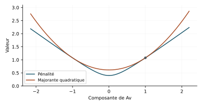

# ENS Paris, Lyon et Cachan — Mathématiques MPI 2, 2009 · Corrigé guidé

*Corrigé rédigé par IA, non officiel. Signalez toute erreur.*

**Rédaction** · GPT-6.2 Astra Ultra · vitesse non renseignée

**Révision** · GPT-6.2 Astra Ultra · vitesse non renseignée

Le sujet part de la convexité et construit trois régularisations d’une image. Le rapport du jury demande de justifier l’existence des minima et la convergence des suites. On traite explicitement le pas nul autorisé par la partie 3.

Le livret place les questions aux pages imprimées 3 à 7. Pour lire le PDF présenté en doubles pages, suivre les numéros imprimés. Le rapport relève notamment deux difficultés reprises ici, la preuve de la stricte convexité et le passage des incréments à la convergence de la suite. [Sujet officiel](https://www.ens.psl.eu/IMG/file/concours/2009/MP/2009_sujet_mp_math_mpi2.pdf) · [Rapport du jury](https://www.ens.psl.eu/IMG/file/concours/2009/MP/mp2009_ecri_mathmpi2.pdf)

## 1. Convexité

### Question 1.1.a

> [!INDICATION]
> Ramener la recherche à une boule fermée assez grande.

#### Solution

Comme $F(u)\to+\infty$ avec $\|u\|$, choisir $R>0$ tel que $F(u)>F(0)$ si $\|u\|>R$. Sur la boule fermée de rayon $R$, compacte dans $\mathbb R^N$, la fonction continue atteint son minimum. Celui-ci est au plus $F(0)$, il est donc global.

### Question 1.1.b

> [!INDICATION]
> Tester une fonction qui dépend de la distance à la sphère unité.

#### Solution

La fonction continue coercive $F(u)=(\|u\|^2-1)^2$ s’annule sur toute la sphère unité. Il peut donc y avoir plusieurs minima. En revanche, pour une fonction strictement convexe, deux minimiseurs distincts auraient un milieu de valeur strictement inférieure au minimum. D’où l’unicité sous l’hypothèse supplémentaire.

### Question 1.2.a

> [!INDICATION]
> Comparer la pente d’une corde à la dérivée à son extrémité.

#### Solution

Pour $0<t<1$, la convexité donne $[F(u+t(v-u))-F(u)]/t\le F(v)-F(u)$. Quand $t\downarrow0$, le quotient tend vers $\langle\nabla F(u),v-u\rangle$. Ainsi $F(v)\ge F(u)+\langle\nabla F(u),v-u\rangle$.

### Question 1.2.b

> [!INDICATION]
> Appliquer l’hypothèse en un même point de tangence.

#### Solution

Posons $w=(1-t)u+tv$. Les deux minorations de $F(u),F(v)$ par leur tangente en $w$, multipliées respectivement par $1-t$ et $t$, s’ajoutent. Le terme linéaire est nul car $(1-t)(u-w)+t(v-w)=0$. Il reste $F(w)\le(1-t)F(u)+tF(v)$ pour tout $0\le t\le1$.

### Question 1.3

> [!INDICATION]
> Pour conserver une inégalité stricte, utiliser un point intérieur fixe du segment.

#### Solution

Si $F$ est strictement convexe et $u\ne v$, posons $w=(u+v)/2$. Par 1.2.a, $F(u)+\langle\nabla F(u),(v-u)/2\rangle\le F(w)<(F(u)+F(v))/2$. D’où l’inégalité stricte du sujet. Réciproquement, pour $0<t<1$ et $u\ne v$, les deux extrémités diffèrent de $w=(1-t)u+tv$. Les deux inégalités de tangente employées en 1.2.b sont alors strictes et leurs poids positifs, ce qui fournit la stricte convexité.

### Question 1.4.a

> [!INDICATION]
> Chercher un point critique qui est un maximum.

#### Solution

Pour $F(u)=-\|u\|^2$, le gradient s’annule en zéro et toute valeur en $u\ne0$ est strictement inférieure à $F(0)$. Le point critique n’est donc pas nécessairement un minimum.

### Question 1.4.b

> [!INDICATION]
> Appliquer le minorant affine issu de la convexité.

#### Solution

Si $\nabla F(u)=0$ et $F$ est convexe, 1.2.a donne $F(v)\ge F(u)$ pour tout $v$. Cette condition est donc suffisante et, par différentiabilité sur l’espace entier, nécessaire.

### Question 1.5.a

> [!INDICATION]
> Additionner les deux inégalités de tangentes réciproques.

#### Solution

Par 1.2.a, $F(v)-F(u)\ge\langle\nabla F(u),v-u\rangle$ et $F(u)-F(v)\ge\langle\nabla F(v),u-v\rangle$. Après addition et changement de signe, $\langle\nabla F(u)-\nabla F(v),u-v\rangle\ge0$.

### Question 1.5.b

> [!INDICATION]
> Comparer les dérivées de la restriction de F à une droite.

#### Solution

Soit $h(t)=F(u+t(v-u))$. Pour $s<t$, l’hypothèse de monotonie du gradient aux deux points donne $(t-s)(h'(t)-h'(s))\ge0$. Donc $h'$ est croissante. Par le théorème des accroissements finis, les pentes des cordes successives sont croissantes, et $h$ est convexe. En prenant $t\in[0,1]$ on obtient la convexité de $F$ le long de chaque segment.

### Question 1.6

> [!INDICATION]
> Appliquer le critère de dérivée seconde sur chaque droite.

#### Solution

Pour $h(t)=F(u+tv)$, $h''(t)=\langle\nabla^2 F(u+tv)v,v\rangle$. Si $F$ est convexe, toute restriction est convexe, d’où $h''(0)\ge0$ pour tout $u,v$. Réciproquement, la positivité de toutes ces formes quadratiques assure $h''(t)\ge0$ sur toute droite, donc ses restrictions, puis $F$, sont convexes.

## 2. Régularisation quadratique

### Question 2.1

> [!INDICATION]
> Différencier les carrés comme des produits scalaires.

#### Solution

La fonction $F_\lambda$ est un polynôme de degré deux, donc $C^2$. Sa différentielle en $u$ sur $h$ vaut $2\langle u-f,h\rangle+2\lambda\langle Au,Ah\rangle$. Ainsi $\nabla F_\lambda(u)=2(u-f+\lambda A^*Au)$ et $\nabla^2F_\lambda(u)=2(I+\lambda A^*A)$.

### Question 2.2

> [!INDICATION]
> Évaluer la Hessienne sur un vecteur quelconque non nul.

#### Solution

Pour $h\ne0$, la forme hessienne vaut $2\|h\|^2+2\lambda\|Ah\|^2>0$ puisque $\lambda\ge0$. La fonction est strictement convexe, y compris si $A$ a un noyau ou si $\lambda=0$.

### Question 2.3

> [!INDICATION]
> Établir d’abord l’existence puis employer l’équation du gradient.

#### Solution

La borne $F_\lambda(u)\ge\|u-f\|^2$ donne la coercivité. Le minimum existe par 1.1.a et est unique par stricte convexité. D’après 1.4.b et 2.1, il est caractérisé par $(I+\lambda A^*A)u_\lambda=f$. La matrice est inversible car sa forme quadratique est définie positive.

### Question 2.4.a

> [!INDICATION]
> Comparer l’énergie minimale à l’énergie de f.

#### Solution

La minimalité donne $\|u_\lambda-f\|^2\le F_\lambda(u_\lambda)\le F_\lambda(f)=\lambda\|Af\|^2$. Donc $u_\lambda\to f$ lorsque $\lambda\downarrow0$.

### Question 2.4.b

> [!INDICATION]
> Comparer cette fois avec un vecteur du noyau de A.

#### Solution

En testant zéro, $\lambda\|Au_\lambda\|^2\le F_\lambda(u_\lambda)\le\|f\|^2$. Pour $\lambda\to+\infty$ il s’ensuit $Au_\lambda\to0$.

### Question 2.5

> [!INDICATION]
> Soustraire les deux équations et tester sur la différence des solutions.

#### Solution

Pour $d=u_\lambda^1-u_\lambda^2$ on a $d+\lambda A^*Ad=f_1-f_2$. Par produit scalaire avec $d$, $\|d\|^2+\lambda\|Ad\|^2\le\|f_1-f_2\|\|d\|$. Ainsi $\|d\|\le\|f_1-f_2\|$, y compris si $d=0$. La constante un est atteinte si les données diffèrent d’un élément du noyau de $A$, par exemple d’un multiple de $e$.

## 3. Régularisation à croissance linéaire

### Question 3.1

> [!INDICATION]
> Calculer la dérivée scalaire de la pénalité et identifier la transposée.

#### Solution

Écrivons $p(s)=\sqrt{\varepsilon^2+s^2}$, $p'(s)=s/p(s)$. Pour $\varepsilon>0$ elle est lisse. On a $G(u)=\tfrac12\|u-f\|^2+\sum_i p((Au)_i)$, donc $DG(u)h=\langle u-f,h\rangle+\sum_i p'((Au)_i)(Ah)_i$. Avec $B(u)_i=p'((Au)_i)$ il vient $\nabla G(u)=u-f+A^*B(u)$.

### Question 3.2

> [!INDICATION]
> Montrer que la pénalité est convexe et que le terme quadratique est strictement convexe.

#### Solution

La dérivée seconde $p''(s)=\varepsilon^2/(\varepsilon^2+s^2)^{3/2}>0$ montre la convexité de $p$ et donc de $u\mapsto p((Au)_i)$. Avec le terme quadratique, $G$ est strictement convexe. Sa continuité et $G(u)\ge\tfrac12\|u-f\|^2$ assurent l’existence d’un minimum. Ce minimum est unique et coïncide avec l’unique solution de $u-f+A^*B(u)=0$ par 1.4.b.

### Question 3.3

> [!INDICATION]
> Écrire la condition d’optimalité avant de diviser par le pas.

#### Solution

Pour tout $\tau\ge0$, $G_n(v)=\tau G(v)+\tfrac12\|v-u^n\|^2$ est continue, coercive et strictement convexe. Son unique minimiseur vérifie $u^{n+1}-u^n=-\tau\nabla G(u^{n+1})$. Lorsque $\tau>0$, la division donne $(u^{n+1}-u^n)/\tau=-u^{n+1}+f-A^*B(u^{n+1})$. L’énoncé permet aussi $\tau=0$. Dans ce cas seule la relation sans division a un sens et elle donne $u^{n+1}=u^n$.

### Question 3.4

> [!INDICATION]
> Tester le minimum de chaque étape au point précédent, puis sommer.

#### Solution

La minimalité donne $\tau G(u^{n+1})+\tfrac12\|u^{n+1}-u^n\|^2\le\tau G(u^n)$. Pour $m\ge1$, la somme des carrés jusqu’à $m-1$ est au plus $2\tau(G(u^0)-G(u^m))\le2\tau G(u^0)$, car $G\ge0$. Les sommes partielles croissantes sont bornées, donc la série converge. En particulier les incréments tendent vers zéro.

### Question 3.5

> [!INDICATION]
> Enfermer les itérés dans un sous-niveau borné.

#### Solution

Pour $\tau>0$, 3.4 donne $G(u^n)\le G(u^0)$. Comme $\frac12\|u^n-f\|^2\le G(u^n)$, la suite est bornée. Pour $\tau=0$ elle est constante, donc également bornée.

### Question 3.6

> [!INDICATION]
> Identifier toute valeur d’adhérence par l’équation sans division.

#### Solution

Supposons $\tau>0$. La suite est bornée en dimension finie. Si $u^{n_j}\to v$, les incréments tendent vers zéro, donc $u^{n_j+1}\to v$ aussi. L’équation de 3.3 et la continuité du gradient donnent $\tau\nabla G(v)=0$. Ainsi $v$ est l’unique minimiseur de 3.2. Une suite bornée ayant une seule valeur d’adhérence converge vers elle, car une sous-suite restant à distance positive aurait une autre valeur d’adhérence. En revanche, pour $\tau=0$ l’itération reste à $u^0$ et ne converge vers le minimiseur que si elle y débute. Par exemple, pour $f=0$ le minimiseur est zéro et $u^0=e$ reste fixe.

On peut quantifier cette convergence. Notons $u_*$ le minimiseur. Le gradient de la somme des pénalités est monotone par 1.5.a. Le terme quadratique donne donc
$$\langle\nabla G(x)-\nabla G(u_*),x-u_*\rangle\ge\|x-u_*\|^2.$$
Appliquons cette inégalité à $x=u^{n+1}$ et utilisons $u^n=x+\tau\nabla G(x)$ et $\nabla G(u_*)=0$. Il vient $(1+\tau)\|x-u_*\|^2\le \langle u^n-u_*,x-u_*\rangle$. Cauchy–Schwarz donne $\|u^n-u_*\|\le(1+\tau)^{-n}\|u^0-u_*\|$. Le facteur vaut exactement un lorsque le pas est nul.

### Question 3.7

> [!INDICATION]
> Examiner la restriction de la pénalité à une droite passant par zéro.

#### Solution

Pour $\varepsilon=0$, la pénalité devient $\sum_i|(Au)_i|$. Comme $A\ne0$, prenons $h$ tel que $Ah\ne0$. Sur la droite $th$, la pénalité vaut $|t|\|Ah\|_1$ et ses dérivées latérales en zéro sont opposées et non nulles. Le terme quadratique lisse ne supprime pas ce saut. $G$ n’est donc pas différentiable sur tout $X$.

## 4. Méthode de type quasi-Newton

### Question 4.1

> [!INDICATION]
> Identifier la matrice diagonale de pondération.

#### Solution

Posons $D(u)=\operatorname{diag}(1/p((Au)_i))$. Ses coefficients diagonaux sont positifs et $C(u)=D(u)A$. Alors $\langle Av,C(u)v\rangle=\sum_i(Av)_i^2/p((Au)_i)\ge0$. Ainsi $\mathcal A(u)=I+A^*D(u)A$ est symétrique et sa forme quadratique majore $\|v\|^2$.

### Question 4.2

> [!INDICATION]
> Annuler le gradient de la quadratique en sa première variable.

#### Solution

Pour $u$ fixé, la Hessienne en $v$ de $\mathcal G(v,u)$ est $\mathcal A(u)\ge I$. La quadratique est coercive strictement convexe. Son unique minimum en $v$ satisfait $\nabla G(u)+\mathcal A(u)(v-u)=0$. Comme $B(u)=C(u)u$, la simplification donne $v-f+A^*C(u)v=0$. Avec $u=u^n$, il existe donc à chaque étape un seul $u^{n+1}$, déterminé par $(I+A^*C(u^n))u^{n+1}=f$.

### Question 4.3.a

> [!INDICATION]
> Mettre au même dénominateur.

#### Solution

Pour deux nombres $a,b>0$, $a-b+(b^2-a^2)/(2a)=(b-a)^2/(2a)\ge0$. Les $a_i,b_i$ du texte sont positifs. Cette identité vaut aussi pour leurs carrés, ce qui servira dans la question suivante.

### Question 4.3.b

> [!INDICATION]
> Comparer les deux pénalités composante par composante, puis développer les carrés.

#### Solution

Posons $s=(Au)_i$, $r=(Av)_i$. L’identité de 4.3.a appliquée à $a=p(s)$ et $b=p(r)$, soit aux carrés des racines notées $a_i,b_i$ dans l’énoncé, donne $p(r)\le p(s)+(r^2-s^2)/(2p(s))$. Développons $r^2-s^2=2s(r-s)+(r-s)^2$. En sommant et en ajoutant le développement exact de $\tfrac12\|v-f\|^2$ autour de $u$, on trouve $G(v)\le G(u)+\langle v-u,\nabla G(u)\rangle+\tfrac12\langle v-u,\mathcal A(u)(v-u)\rangle=\mathcal G(v,u)$. Il y a égalité pour $v=u$.

Pour lire la figure, la différence entre la majorante et la pénalité vaut exactement $[p(r)-p(s)]^2/(2p(s))$. Avec $s=1$ et $\varepsilon=0{,}4$, elle s’annule en $r=1$ et en $r=-1$. Aux deux contacts, les dérivées coïncident puisque la différence est un carré différentiable qui s’annule.

### Question 4.4

> [!INDICATION]
> Évaluer la baisse d’une quadratique autour de son minimiseur exact.

#### Solution

Puisque $\mathcal G(\cdot,u^n)$ a son minimum en $u^{n+1}$ et sa Hessienne $\mathcal A(u^n)\ge I$, on a $\mathcal G(u^n,u^n)-\mathcal G(u^{n+1},u^n)\ge\tfrac12\|u^{n+1}-u^n\|^2$. Par 4.3.b le premier terme vaut $G(u^n)$ et le second majore $G(u^{n+1})$. La somme télescope, et $\sum_n\|u^{n+1}-u^n\|^2\le2G(u^0)$. Les incréments convergent donc vers zéro.

### Question 4.5

> [!INDICATION]
> Passer à la limite dans le système linéaire le long d’une sous-suite.

#### Solution

La décroissance de $G$ et sa coercivité donnent une suite bornée. Si $u^{n_j}\to v$, 4.4 entraîne $u^{n_j+1}\to v$. La continuité de $C$ pour $\varepsilon>0$ permet de passer à la limite dans 4.2 et donne $v-f+A^*C(v)v=0$, donc $\nabla G(v)=0$. L’unicité du minimiseur et la compacité des suites bornées à extraction près assurent la convergence de toute la suite vers ce minimiseur.

## 5. Régularisation non différentiable

### Question 5.1.a

> [!INDICATION]
> Maximiser séparément sur chaque coordonnée du cube.

#### Solution

Pour $\|v\|_\infty\le1$, $\langle v,Au\rangle\le\sum_i|(Au)_i|$, avec égalité en prenant $v_i=\operatorname{sgn}((Au)_i)$ et zéro aux composantes nulles. Donc $\sup_{\|v\|_\infty\le1}L(u,v)=\frac12\|f-u\|^2+\|Au\|_1=H(u)$.

### Question 5.1.b

> [!INDICATION]
> Compléter le carré en u et utiliser la symétrie de A.

#### Solution

On a $\langle v,Au\rangle=\langle Av,u\rangle$. Le développement de $\tfrac12\|u-(f-Av)\|^2$ donne $\tfrac12\|u\|^2-\langle u,f-Av\rangle+\tfrac12\|f-Av\|^2$. En soustrayant le dernier terme puis en ajoutant $\tfrac12\|f\|^2$, on retrouve $L(u,v)$. Cela prouve la formule demandée.

### Question 5.1.c

> [!INDICATION]
> Associer au point projeté un maximiseur du problème dual.

#### Solution

Pour $v$ fixé, l’infimum en $u$ vaut $d(v)=(\|f\|^2-\|f-Av\|^2)/2$ et il est atteint uniquement en $f-Av$. Comme $w$ est le projeté de $f$ sur $K=A\{\|v\|_\infty\le1\}$, un $v_*$ du cube tel que $Av_*=w$ maximise $d$. Sous l’égalité (5), $\min H=d(v_*)$. Le minimum de $H$ existe par continuité et coercivité. Tout minimiseur $u$ vérifie $d(v_*)\le L(u,v_*)\le H(u)=d(v_*)$, donc minimise la quadratique $L(\cdot,v_*)$. Il vaut nécessairement $f-w$. L’existence assure réciproquement que $f-w$ est bien ce minimiseur.

### Question 5.2

> [!INDICATION]
> Utiliser l’inégalité de projection pour construire un point-selle.

#### Solution

Posons $u_*=f-w$ et choisissons $v_*$ comme ci-dessus. Pour chaque $v$ du cube, $Av\in K$ et $\langle f-w,Av-w\rangle\le0$. Par symétrie, $L(u_*,v)-L(u_*,v_*)=\langle u_*,Av-w\rangle\le0$. D’autre part $u_*=f-Av_*$ minimise $L(\cdot,v_*)$. Ainsi $L(u_*,v)\le L(u_*,v_*)\le L(u,v_*)$ pour tout $u,v$ admissible. En prenant les bornes et en utilisant l’inégalité générale $\sup_v\inf_u L\le\inf_u\sup_v L$, on obtient l’égalité (5), les deux côtés valant $L(u_*,v_*)$.

Vérifions le point selle sur un exemple à deux composantes. Prenons $A=\left(\begin{smallmatrix}1&-1\\-1&1\end{smallmatrix}\right)$ et $f=(5,0)$. Alors $K=\{(s,-s): |s|\le2\}$ et la distance au carré vaut $(5-s)^2+s^2$. Le minimum sur le segment est atteint en $s=2$, donc $w=(2,-2)$ et $u_*=(3,2)$. Ici $v_*=(1,-1)$ convient. Le coût primal vaut $4+2=6$ et la valeur duale vaut $(25-13)/2=6$.
