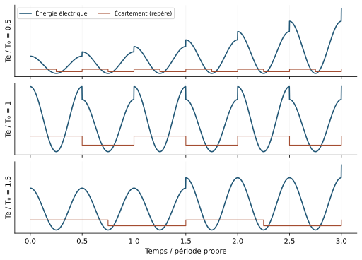
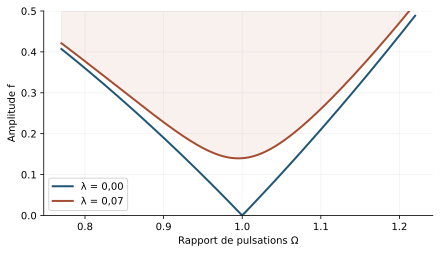
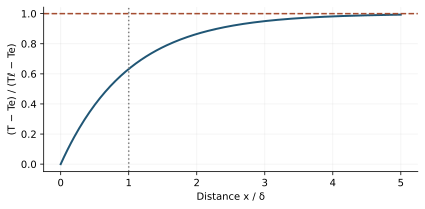
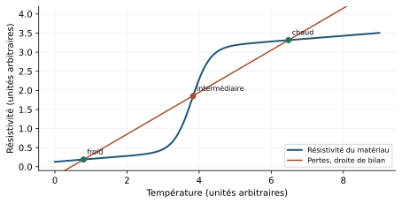
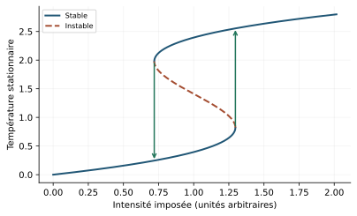
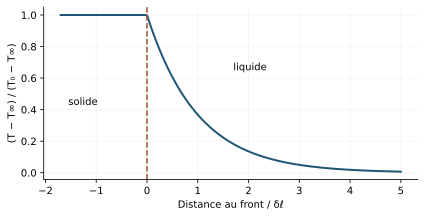
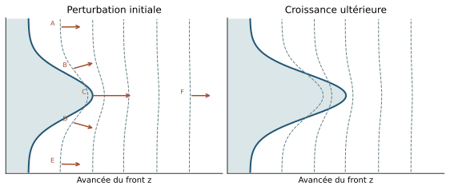
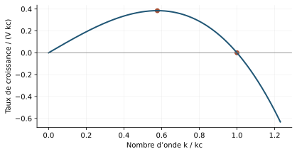

# ENS de Paris, Lyon et Cachan MP 2009 — Physique MPI · Corrigé guidé

*Corrigé rédigé par IA, non officiel. Signalez toute erreur.*

**Lecture du rapport du jury** · GPT-6.2 Astra Ultra · vitesse non renseignée

**Rédaction** · GPT-6.2 Astra Ultra · vitesse non renseignée

## Physique des instabilités — Oscillateur paramétrique, filament et solidification

## I · Énergie d’un circuit modulé

### Question 1 — Travail à charge fixée

**Indication.** Écrire l’énergie comme une fonction de la charge conservée et de l’écartement.

Pour un condensateur plan, $C(e)=C_0 e_0/e$. L’énergie électrostatique à charge $q$ est donc $U_{\rm el}=q^2 e/(2C_0e_0)$. Pendant le saut, la charge reste constante. Passer de $e_0-\Delta e$ à $e_0+\Delta e$ apporte $\Delta U_{\rm el}=\epsilon q^2/C_0$ avec $\epsilon=\Delta e/e_0$. Le travail de séparation est positif.

### Question 2 — Commutation au passage par zéro

**Indication.** À cet instant la tension aux bornes du condensateur est nulle pour les deux capacités.

Pour $q=0$, le champ, l’énergie électrique et sa variation lors du changement d’écartement sont nuls. Si le circuit oscille, son énergie à cet instant est magnétique, stockée dans la bobine. L’action mécanique sur les plaques ne prélève alors aucune énergie électrique.

### Question 3 — Sens de la synchronisation

**Indication.** Comparer les travaux des deux mouvements de sens contraires.

Écarter les plaques au maximum de $|q|$ fournit une énergie proportionnelle à $q^2$. Le rapprochement ferait perdre de l’énergie pour une charge non nulle. Le placer au passage par zéro rend cette perte nulle. Sur un cycle de modulation l’énergie totale augmente ainsi du travail fourni au seul saut utile, si les pertes électriques sont négligées.

### Question 4 — Énergie pour une excitation à la demi-période

**Indication.** Tracer $q^2$ puis ajouter les changements instantanés aux instants de commutation.

Entre commutations, l’énergie passe continûment de la forme électrique à la forme magnétique puis revient. Au maximum de charge, la séparation donne un saut vers le haut du rapport $g=(1+\epsilon)/(1-\epsilon)$. Au zéro de charge, le rapprochement laisse $U_{\rm el}=0$. Pour $T_e=T_0/2$, chaque lobe de $q^2$ bénéficie d’un saut à son sommet et les maxima juste après les sauts augmentent géométriquement dans le modèle idéal synchrone.

### Question 5 — Deux autres périodes de modulation

**Indication.** Tester les instants de retour $T_e/2$ dans la fonction $q^2\propto\cos^2(2\pi t/T_0)$.

On conserve des créneaux de rapport cyclique moitié et le premier écartement au sommet de charge. Pour $T_e=T_0$, le rapprochement survient $T_0/2$ plus tard, à un autre sommet de $|q|$. L’énergie gagne un facteur $g$ puis son inverse et l’enveloppe ne croît pas en moyenne. Pour $T_e=3T_0/2$, le rapprochement à $3T_0/4$ tombe à un zéro de charge et le prochain écartement à $3T_0/2$ tombe à un sommet. Il y a donc un gain tous les trois lobes, plus lent que pour Q4. Ces tracés supposent une modulation faible et le verrouillage de phase de la construction.

### Question 6 — Équation électrique du montage

**Indication.** Le signe de $\cos(\omega_et+\pi)$ se combine avec le passage de la source au premier membre.

Choisissons $u=q/C$ et $i=\dot q$ en convention récepteur pour le condensateur et la branche $L,r$. Le multiplieur joue le rôle de source de tension $u_s$. La maille s’écrit $L\ddot q+r\dot q+q/C=u_s$ avec $u_s=kU_e\cos(\omega_et+\pi)q/C$. Ainsi $\omega_0=1/\sqrt{LC}$, $2\lambda\omega_0=r/L$ et $2f=kU_e$. On obtient $\ddot q+2\lambda\omega_0\dot q+\omega_0^2[1+2f\cos(\omega_e t)]q=0$. Le terme d’excitation multiplie la charge.

## II · Pendule à point de suspension mobile

### Question 7 — Pesanteur apparente dans le repère mobile

**Indication.** La force d’entraînement est opposée à l’accélération du repère.

Étudions la masse de l’encensoir dans le repère lié au point de suspension, en translation sans rotation par rapport au laboratoire supposé galiléen. Avec $\mathbf e_z$ vers le bas, l’accélération du repère est $\ddot h\,\mathbf e_z$. La force d’inertie vaut $-m\ddot h\,\mathbf e_z$. Elle se combine au poids en $mg_{\rm eff}\mathbf e_z$, où $g_{\rm eff}=g_0-\ddot h=g_0+\omega_e^2h(t)$. La tension reste radiale.

### Question 8 — Paramètres du pendule

**Indication.** Projeter la force effective sur la tangente ou prendre son moment.

Le moment du poids apparent autour du point de suspension vaut $-m\ell g_{\rm eff}\sin\theta$. Avec le moment d’inertie $m\ell^2$, $\ddot\theta+(g_{\rm eff}/\ell)\sin\theta=0$. Pour $h=h_0\cos\omega_et$, cela donne $\omega_0=\sqrt{g_0/\ell}$ et $f=h_0\omega_e^2/(2g_0)$. Ainsi l’excitation module le coefficient de rappel.

### Question 9 — Équation de Mathieu

**Indication.** Conserver le produit de l’excitation imposée et de la petite variable dynamique.

Au démarrage, $|\theta|\ll1$ en radians et $\sin\theta=\theta+O(\theta^3)$. On obtient $\ddot\theta+\omega_0^2[1+2f\cos(\omega_et)]\theta=0$. L’état vertical $\theta=0$ reste une solution exacte. L’instabilité désigne l’amplification d’une petite perturbation autour de cet état.

### Question 10 — Calcul du déterminant de Floquet

**Indication.** Développer le signal sur deux quadratures indépendantes afin de laisser libre la phase de l’oscillation.

Écrivons $\theta=e^{\mu\omega_0t}[A\cos\omega t+B\sin\omega t]$, $\omega=\omega_e/2$ et $\Omega=\omega/\omega_0$. Les produits par $\cos2\omega t$ apportent au fondamental respectivement $+\cos\omega t/2$ et $-\sin\omega t/2$. Après abandon de l’harmonique trois, les coefficients vérifient, avec $H=\mu^2+1-\Omega^2$,
$$(H+f)A+2\mu\Omega B=0,\qquad -2\mu\Omega A+(H-f)B=0.$$
Une oscillation non nulle exige $H^2-f^2+4\mu^2\Omega^2=0$, soit $\mu^4+2(1+\Omega^2)\mu^2+(1-\Omega^2)^2-f^2=0$.

### Question 11 — Condition de croissance

**Indication.** Regarder si l’une des deux racines en $\mu^2$ peut produire un exposant réel positif.

Les racines en $u=\mu^2$ sont $u_\pm=-(1+\Omega^2)\pm\sqrt{4\Omega^2+f^2}$. Seule $u_+$ peut être positive. Cela exige $f^2>(1-\Omega^2)^2$. Il existe alors une solution $\mu>0$ et son amplitude croît. L’égalité est la frontière de stabilité de l’approximation à un harmonique.

### Question 12 — Diagramme de stabilité

**Indication.** Représenter d’abord la valeur absolue en distinguant $\Omega<1$ et $\Omega>1$.

Pour $f\ge0$, la limite est $f_c(\Omega)=|1-\Omega^2|$. Dans le domaine de validité proche de $\Omega=1$, la région située au-dessus de cette courbe est instable, celle en dessous est stable. À $f$ fixé et petit, la bande instable vérifie $\sqrt{1-f}<\Omega<\sqrt{1+f}$.

### Question 13 — À la résonance et en dehors

**Indication.** Comparer le gain par cycle pour des actions restant en phase ou se décalant.

À $\Omega=1$, le seuil est nul dans le modèle non amorti. Une excitation arbitrairement faible peut amplifier une perturbation synchronisée. Hors résonance, le déphasage accumulé entre modulation et oscillation empêche le gain systématique si $f<|1-\Omega^2|$. Augmenter $f$ élargit le domaine d’instabilité.

### Question 14 — Largeur de la bande principale

**Indication.** Préciser si l’axe des pulsations représente l’excitation ou l’oscillation de demi-fréquence.

Avec $\omega_e=2\omega_0(1+\varepsilon)$, $\Omega=1+\varepsilon$ et $|1-\Omega^2|\simeq2|\varepsilon|$. La bande est donc $|\varepsilon|<f/2$. En pulsation d’excitation, le demi-écart par rapport à $2\omega_0$ est $f\omega_0$, et la largeur totale vaut $\Delta\omega_e\simeq2f\omega_0$. En pulsation de réponse $\omega=\omega_e/2$, la largeur totale est $f\omega_0$. Cette distinction lève l’ambiguïté de notation de la question.

### Question 15 — Taille de la troisième harmonique

**Indication.** Le fondamental est résonnant, tandis que l’harmonique trois est loin de la pulsation propre.

Posons $\theta=\theta_0\cos\omega t+\theta_1\cos3\omega t$. La projection à $3\omega$ donne $(\omega_0^2-9\omega^2)\theta_1+f\omega_0^2\theta_0=0$, après omission de $5\omega$. À la résonance, $\theta_1/\theta_0\simeq f/8$. L’amplitude relative de l’harmonique trois est donc du premier ordre en $f$. Son retour au fondamental est multiplié par $f$ supplémentaire, soit un effet du second ordre. C’est cette hiérarchie qui justifie la projection de Q10 près du seuil.

### Question 16 — Introduction de la dissipation

**Indication.** Le couple dissipatif doit toujours produire une puissance négative.

Divisons le moment résistant $-2\lambda m\ell^2\omega_0\dot\theta$ par $m\ell^2$ dans l’équation angulaire. Dans la limite des petites oscillations,
$$\ddot\theta+2\lambda\omega_0\dot\theta+\omega_0^2[1+2f\cos(\omega_et)]\theta=0.$$
Pour $f=0$, l’enveloppe sous-amortie décroît comme $e^{-\lambda\omega_0t}$.

### Question 17 — Seuil en présence de frottement

**Indication.** Chercher directement une amplitude périodique constante sur la frontière.

À la frontière, l’exposant de croissance vaut zéro. Avec les quadratures de Q10, l’amortissement contribue alors $+2\lambda\Omega B$ à la projection en cosinus et $-2\lambda\Omega A$ à celle en sinus. Le déterminant nul devient $(1-\Omega^2+f)(1-\Omega^2-f)+4\lambda^2\Omega^2=0$. Ainsi $f_c^2=(1-\Omega^2)^2+4\lambda^2\Omega^2$. À $\Omega=1$, le seuil atteint $2\lambda$.

### Question 18 — Rétrécissement de la zone instable

**Indication.** À excitation imposée, résoudre l’inégalité sur le désaccord à la résonance.

Écrivons $\Omega=1+\varepsilon$ près de la résonance. Au premier ordre pertinent pour $f,\lambda,\varepsilon$ petits, $f_c^2\simeq4(\varepsilon^2+\lambda^2)$. La bande existe alors pour $f>2\lambda$ et sa largeur en $\Omega$ vaut $\sqrt{f^2-4\lambda^2}$, contre $f$ sans dissipation. En pulsation d’excitation, il faut multiplier par $2\omega_0$.

### Question 19 — Rôle physique de la nouvelle courbe

**Indication.** La différence entre seuil minimal et seuil en $\Omega=1$ n’apparaît qu’au-delà de l’approximation dominante.

La courbe $f_c=\sqrt{(1-\Omega^2)^2+4\lambda^2\Omega^2}$ est relevée et son minimum arrondi. L’instabilité se situe encore au-dessus. Pour faible $\lambda$, le minimum exact est à $\Omega=\sqrt{1-2\lambda^2}$ et vaut $2\lambda\sqrt{1-\lambda^2}$. Il est donc proche du seuil $2\lambda$ à résonance. Le transfert d’énergie doit désormais compenser les pertes à chaque cycle.

## III · Énergie et entropie du filament

### Question 20 — Conductivités métalliques

**Indication.** Ne pas confondre les dimensions des deux coefficients de transport.

À température ambiante, la conductivité électrique d’un bon métal est de l’ordre de $10^7\ \mathrm{S\,m^{-1}}$ et sa conductivité thermique est typiquement de l’ordre de $10^2\ \mathrm{W\,m^{-1}\,K^{-1}}$. Le cuivre a des valeurs plus élevées que le fer, mais ces échelles suffisent ici.

### Question 21 — Lois locales d’Ohm et de Fourier

**Indication.** Le sens du flux thermique doit être cohérent avec le second principe.

Le courant électrique vérifie $\mathbf j_e=\gamma\mathbf E$ et la densité de flux thermique $\mathbf j_{\rm cd}=-\lambda\nabla T$. Le signe négatif porte la chaleur vers les températures décroissantes. Ces lois locales linéaires supposent le matériau isotrope et décrivent ici les réponses aux gradients électrique et thermique.

### Question 22 — Travail électrique reçu

**Indication.** Employer la résistance de la tranche, non celle de tout le filament.

La tranche de longueur $dx$ et de section $A$ a pour résistance $dR=dx/(\gamma A)$. En convention récepteur, le générateur lui fournit pendant $dt$ le travail $\delta^2W=I^2 dR\,dt=I^2dx\,dt/(\gamma A)$. Le même résultat suit de $\mathbf j_e\cdot\mathbf E\,A\,dx\,dt$.

### Question 23 — Bilan d’énergie local du filament

**Indication.** Faire apparaître les deux aires distinctes de transfert, la section et la surface latérale.

Le système fermé est la tranche fixe $[x,x+dx]$, de masse $\mu A dx$. Son stockage par unité de temps est $\mu cA dx\,\partial_tT$. Le flux axial net entrant est $-\partial_x(Aj_{\rm cd})dx=\lambda A T_{xx}dx$. La perte latérale est $2\pi ah(T-T_e)dx$, tandis que le travail électrique reçu est $\rho I^2 dx/A$ par seconde. On obtient
$$\partial_tT=D\,\partial_x^2T-\alpha(T-T_e)+\beta\rho I^2,\quad D=\lambda/(\mu c),\quad \alpha=2h/(\mu ca),\quad\beta=1/(\mu cA^2).$$
La source Joule entre ici par le premier principe, comme puissance électrique.

### Question 24 — Température stationnaire sur le demi-axe

**Indication.** Exclure la solution exponentielle croissante avant d’appliquer la condition au contact.

Définissons $\delta=\sqrt{D/\alpha}=\sqrt{\lambda a/(2h)}$ et $\Theta_\infty=\beta\rho I^2/\alpha$. Avec $\Theta=T-T_e$, l’EDO est $\delta^2\Theta''-\Theta=-\Theta_\infty$. Sa solution bornée à droite est $\Theta_\infty+B e^{-x/\delta}$. La condition $T(0)=T_e$ fixe $B=-\Theta_\infty$. D’où $T=T_e+\Theta_\infty(1-e^{-x/\delta})$.

### Question 25 — Valeur du plateau thermique

**Indication.** Au plateau, la conduction axiale et sa divergence sont nulles.

Le profil part de zéro pour $T-T_e$, croît avec une pente initiale $\Theta_\infty/\delta$ et s’aplatit vers le plateau. En remplaçant $A=\pi a^2$, $\Theta_\infty=\rho I^2/(2\pi a h A)=\rho I^2/(2\pi^2a^3h)$. La température limite est $T_\ell=T_e+\Theta_\infty$. Loin du contact, la puissance Joule par unité de longueur est intégralement évacuée sur le côté.

### Question 26 — Flux axial en régime stationnaire

**Indication.** L’absence de stockage n’implique la constance du flux axial que s’il n’existe aucune source ni perte latérale.

Le flux selon $+x$ vaut $Aj_{\rm cd}=-\lambda A\Theta_\infty e^{-x/\delta}/\delta$. Il est négatif et son module diminue en s’éloignant de l’extrémité froide. Il n’est pas conservé le long du fil car chaque tranche reçoit une source électrique et échange de la chaleur latéralement. Le bilan de toute l’énergie reste vérifié à chaque position.

### Question 27 — Bilan entropique stationnaire

**Indication.** Séparer le stockage de l’entropie de sa production.

L’entropie de la tranche est constante au cours du temps. Le second principe s’écrit donc $0=\delta^2 S_{\rm éch}+\delta^2 S_c$, avec $\delta^2 S_c\ge0$. L’échange est compté algébriquement, positif vers le système. Une création interne stationnaire doit être compensée par une exportation nette d’entropie.

### Question 28 — Entropie franchissant la face gauche

**Indication.** La température à utiliser est celle de la face considérée.

Dans le sens $+x$, l’entropie transportée par conduction au niveau de la face gauche est $\delta^2 S_e=A j_{\rm cd}(x)dt/T(x)$. On conserve le signe algébrique du flux. Dans le profil de Q24, ce terme est négatif puisque le flux physique ressort par l’extrémité froide.

### Question 29 — Entropie sortant de la tranche

**Indication.** La surface d’échange latéral donne sur un thermostat à température imposée.

La sortie algébrique par la face droite est $A j_{\rm cd}(x+dx)dt/T(x+dx)$. Le thermostat latéral reçoit en plus $2\pi ah[T(x)-T_e]dx\,dt$, soit une entropie divisée par $T_e$. Avec la convention du sujet qui attribue à la tranche et son contact l’irréversibilité de l’interface, on additionne ces deux termes. Les compter à la même température ferait perdre la contribution du contact.

### Question 30 — Trois contributions à la production d’entropie

**Indication.** Développer la dérivée du flux d’entropie avant d’éliminer la dérivée du flux d’énergie.

Les sorties moins l’entrée fournissent, par longueur et par temps, $\sigma=\partial_x(Aj_{\rm cd}/T)+2\pi ah(T-T_e)/T_e$. Le bilan d’énergie stationnaire donne $\partial_x(Aj_{\rm cd})=\rho I^2/A-2\pi ah(T-T_e)$. En développant la dérivée du quotient puis en utilisant Fourier,
$$\sigma=\frac{\rho I^2}{AT}+\frac{\lambda A}{T^2}(T')^2+2\pi ah(T-T_e)\left(\frac1{T_e}-\frac1T\right).$$
Le travail électrique n’est pas un flux d’entropie entrant. La production Joule apparaît lorsqu’on utilise la conservation de l’énergie pour évaluer l’entropie qui sort.

### Question 31 — Sources d’irréversibilité

**Indication.** Vérifier la non-négativité de chaque terme indépendamment.

Le premier terme est la dissipation électrique par effet Joule, le deuxième le transport thermique sous gradient interne. Le dernier représente le transfert avec écart fini de température vers le gaz. Il est proportionnel à $(T-T_e)^2/(TT_e)$ et reste positif quelle que soit la direction de l’échange.

### Question 32 — Condition d’équilibre thermodynamique

**Indication.** Un équilibre requiert l’annulation simultanée de toutes les productions positives.

Pour des coefficients strictement positifs, l’annulation de la somme exige $I=0$, $T'=0$ et $T=T_e$. Avec la condition au contact, cela signifie une température uniforme égale au milieu extérieur et aucun courant. Un profil permanent sous courant est un état stationnaire dissipatif.

### Question 33 — Conduction thermique seule

**Indication.** On peut discuter le signe du coefficient en imposant un gradient arbitraire par des conditions de bord.

Avec $I=0$ et $h=0$, il reste $\sigma=\lambda A(T')^2/T^2$. Une expérience maintenant un gradient non nul doit respecter le second principe $\sigma\ge0$, ce qui impose $\lambda\ge0$. Pour un milieu effectivement conducteur, $\lambda>0$. Un flux spontané remontant le gradient serait incompatible avec ce bilan.

### Question 34 — Irréversibilité d’un contact thermique

**Indication.** Additionner la variation d’entropie des deux côtés d’un transfert de même énergie.

Si une chaleur positive $\delta Q$ passe d’une surface chaude à $T_h$ vers une surface froide à $T_c$, le gain total d’entropie est $\delta Q(1/T_c-1/T_h)>0$. La contribution latérale de Q30 en est un exemple, avec la loi d’échange $\dot Q=hS(T_h-T_c)$. Le transfert limite réversible demande un écart de température infinitésimal.

### Question 35 — Temps de relaxation électrique

**Indication.** Employer une densité volumique en mètres cubes dans la relation SI.

Un métal possède environ un électron de conduction par atome, soit $N\sim10^{28}$ à $10^{29}\ \mathrm{m^{-3}}$. La loi de Drude statique donne $\tau=m_e\gamma_0/(Ne^2)$. Avec $\gamma_0\sim10^7\ \mathrm{S\,m^{-1}}$, $m_e\simeq9{,}1\times10^{-31}\ \mathrm{kg}$ et $e\simeq1{,}6\times10^{-19}\ \mathrm C$, on trouve quelques $10^{-15}$ à quelques $10^{-14}\ \mathrm s$, typiquement $10^{-14}\ \mathrm s$.

### Question 36 — Puissance moyenne à haute fréquence

**Indication.** La partie imaginaire de la conductivité ne fournit pas de travail moyen sur une période.

Pour un champ complexe d’amplitude $E_0$, la puissance moyenne absorbée par unité de volume est $\tfrac12\mathrm{Re}\,\gamma(\omega)|E_0|^2$. Avec la loi indiquée, $\mathrm{Re}\,\gamma=\gamma_0/[1+(\omega\tau)^2]$. À $\omega\tau\gg1$, elle tend vers zéro comme $\omega^{-2}$ et le courant est presque en quadrature avec le champ. La dissipation résiduelle est petite à fréquence finie, nulle à l’ordre dominant de cette limite.

### Question 37 — Isoler la création d’entropie interne

**Indication.** Une même chaleur échangée est divisée par deux températures si le contact présente un écart fini.

Le bilan avec un environnement à $T_e$ est $dS=\delta Q/T_e+\delta S_c$. En ajoutant puis retranchant $\delta Q/T$, on retrouve $dS=\delta Q/T+\delta S_c^{\rm int}$ avec $\delta S_c^{\rm int}=\delta S_c-\delta Q(1/T-1/T_e)$. La quantité soustraite est la production au contact pour un échange thermique spontané, positive pour les deux sens physiques de transfert.

### Question 38 — Conditions de réversibilité

**Indication.** Séparer les conditions de réversibilité à l’intérieur du système et à sa frontière.

Une transformation réversible est quasi statique et ne comporte ni dissipation interne ni production d’entropie aux contacts. Face à un thermostat de température constante, un échange non nul doit se produire à $T=T_e$ à la limite réversible, donc sur une isotherme. En isolation thermique, la branche réversible est adiabatique et isentropique. Ce sont les deux types de branches du cycle de Sadi Carnot. La relation entropique $dS=\delta Q_{\rm rev}/T$ est due à Clausius. Une succession de sources de températures voisines permet également un échange réversible à température variable.

## IV · Équilibres multiples et hystérésis

### Question 39 — Droite de fonctionnement à courant imposé

**Indication.** Le dépôt Joule est proportionnel à la résistivité si l’intensité est fixée.

À température uniforme et stationnaire, $\alpha(T-T_e)=\beta\rho(T)I^2$. On cherche donc les intersections de $\rho(T)$ avec $y(T)=p(T-T_e)$, où $p=\alpha/(\beta I^2)=2\pi ahA/I^2=2\pi^2a^3h/I^2$. La droite passe par $(T_e,0)$ et son ordonnée à l’origine est $-pT_e$. Quand le courant augmente, elle pivote en diminuant de pente.

### Question 40 — Nombre de points stationnaires

**Indication.** Faire pivoter la droite autour de son intersection avec l’axe des températures.

Depuis $(T_e,0)$, les deux tangentes à la courbe sigmoïde définissent deux courants critiques. Pour un faible courant, la droite de forte pente coupe la branche froide en un point. Dans la plage intermédiaire on obtient trois intersections, froide, intermédiaire et chaude. Pour un fort courant, la faible pente ne coupe plus que la branche chaude. Aux tangences, deux solutions se confondent, en plus du point encore isolé. Le cas $I=0$ donne directement $T=T_e$.

### Question 41 — Dynamique linéarisée autour d’une solution

**Indication.** Utiliser l’équation du point fixe avant d’examiner les petits écarts.

Posons $T=T^*+\xi$ et développons $\rho(T)=\rho(T^*)+\rho'(T^*)\xi+O(\xi^2)$. La compensation des termes stationnaires laisse $\dot\xi=\beta I^2[\rho'(T^*)-p]\xi$ avec $p=\alpha/(\beta I^2)$. Le facteur demandé est donc $\beta I^2$, positif, et les deux pentes à comparer sont celle du matériau et celle de la droite de bilan.

### Question 42 — Critère graphique de stabilité

**Indication.** Vérifier le signe du taux exponentiel dans l’équation de Q41.

Une petite perturbation décroît si $\rho'(T^*)<p$. Si $\rho'(T^*)>p$, la puissance Joule supplémentaire domine l’évacuation et la perturbation croît. Avec trois intersections, les points froid et chaud sont stables, le point médian est instable. Une tangence annule le terme linéaire et marque la limite des branches.

### Question 43 — Diagramme température-courant

**Indication.** Étudier $I$ comme fonction de $T$ évite une inversion multivaluée de la courbe.

On peut paramétrer la courbe par $T$, avec $I(T)=\sqrt{\alpha(T-T_e)/[\beta\rho(T)]}$. Sa dérivée est du signe de $\rho-(T-T_e)\rho'$ donc de $p-\rho'$ en un point stationnaire. Le tracé $T^*(I)$ comporte deux portions croissantes stables reliées par une portion de pente négative instable. Les deux rebroussements correspondent aux tangences de Q40. Comme seule compte $I^2$, le diagramme complet est symétrique en $I$.

### Question 44 — Cycle de température observable

**Indication.** Après chaque perte de stabilité, chercher quel autre point fixe stable existe pour le même courant.

En augmentant lentement $|I|$ depuis zéro, le système suit la branche froide jusqu’au seuil supérieur $I_\uparrow$, puis saute vers la branche chaude. À la descente, il reste chaud jusqu’au seuil inférieur $I_\downarrow<I_\uparrow$. L’oscilloscope montre les deux branches stables et les transitions rapides entre elles, formant une boucle d’hystérésis. Un balayage doit descendre sous $I_\downarrow$ et monter au-dessus de $I_\uparrow$. Depuis zéro, son amplitude crête doit donc atteindre le seuil supérieur.

### Question 45 — Générateur de tension imposée

**Indication.** À tension imposée, remplacer la puissance $RI^2$ par $U^2/R$ sur la longueur alimentée.

Pour une longueur de filament $\ell_f$ soumise à la tension $U$, le champ uniforme vaut $E=U/\ell_f$. La puissance Joule par longueur est $AE^2/\rho(T)$. Le bilan stationnaire donne $\rho(T)(T-T_e)=AU^2/(2\pi ah\ell_f^2)$ ou $\rho(T)=aU^2/[2h\ell_f^2(T-T_e)]$. On cherche l’intersection de la courbe croissante de résistivité avec une hyperbole décroissante sur $T>T_e$. Elle est unique pour $U\ne0$.

### Question 46 — Rétroaction à tension fixée

**Indication.** Comparer le sens de variation des puissances entrante et sortante.

Si la température augmente légèrement, la résistivité croît. À $U$ imposé, la puissance Joule $U^2/R$ baisse et la puissance évacuée vers le gaz augmente. Le déséquilibre produit donc un refroidissement. La perturbation opposée déclenche le réchauffement. Ce retour est stabilisant pour toute tension où le modèle croissant de $\rho(T)$ s’applique.

## V · Thermodynamique de la solidification

### Question 47 — Dimension de la tension superficielle

**Indication.** Utiliser soit la création d’aire soit le saut de pression pour contrôler les unités.

L’énergie de création d’une aire est $\delta W=\gamma\,dS$. Ainsi $[\gamma]=\mathrm{J\,m^{-2}}=\mathrm{N\,m^{-1}}=\mathrm{kg\,s^{-2}}$. Le quotient $\gamma/R$ possède bien la dimension d’une pression, comme dans la loi de Laplace.

### Question 48 — Potentiels chimiques au premier ordre

**Indication.** La surpression de courbure n’est appliquée qu’au solide dans la construction du sujet.

Le liquide reste à $P_0$ et le solide est à $P_s=P_0+2\gamma/R$. Posons $\delta T=T^*-T_0$ et $\mu_0=\mu_\ell(P_0,T_0)=\mu_s(P_0,T_0)$. La relation $d\mu=v_m\,dP-s_m\,dT$ donne $\mu_\ell\simeq\mu_0-s_{m,\ell}\delta T$ et $\mu_s\simeq\mu_0+v_{m,s}(2\gamma/R)-s_{m,s}\delta T$. Les coefficients sont ceux du point plan de référence.

### Question 49 — Abaissement de la température de fusion

**Indication.** Convertir simultanément le volume et l’entropie molaires en grandeurs massiques.

L’égalité des deux potentiels fournit $(s_{m,\ell}-s_{m,s})\delta T=-v_{m,s}\,2\gamma/R$. Avec $s_{m,\ell}-s_{m,s}=M_{\rm mol}L/T_0$ au premier ordre et $v_{m,s}=M_{\rm mol}/\rho$, on obtient
$$T^*=T_0\left(1-\frac{2\gamma}{\rho L R}\right).$$
La courbure convexe du solide abaisse donc la température de coexistence. Le remplacement de $T^*$ par $T_0$ dans le coefficient entropique ne change que l’ordre suivant.

### Question 50 — Homogénéité de Gibbs–Thomson

**Indication.** Comparer l’énergie surfacique à l’énergie de fusion dans une couche d’épaisseur $R$.

Le produit $\rho L$ est une densité d’énergie en $\mathrm{J\,m^{-3}}$. Multiplié par $R$, il vaut une énergie par aire, comme $\gamma$. La correction $2\gamma/(\rho LR)$ est donc sans dimension et le membre droit conserve l’unité kelvin.

### Question 51 — Limite plane

**Indication.** Faire tendre la courbure, et non le rayon, vers zéro.

Pour une surface plane, le rayon de courbure tend vers l’infini. La surpression $2\gamma/R$ et la correction de température s’annulent. On retrouve alors $P_s=P_\ell=P_0$ et $T^*=T_0$, valeurs de coexistence choisies comme référence.

### Question 52 — Orientation du gradient thermique

**Indication.** Distinguer le sens du gradient de celui du flux de Fourier.

La solidification libère une chaleur latente positive. L’interface voisine de $T_0$ est plus chaude que le liquide sous-refroidi éloigné à $T_\infty<T_0$. Vers le liquide, la température décroît donc lorsque $z$ augmente. Le gradient pointe en sens contraire de l’avancée dans le liquide et la chaleur s’évacue selon $+z$.

### Question 53 — Condition de Stefan

**Indication.** Sur la face solide de la boîte, la normale extérieure est dirigée vers les $z$ décroissants.

Pendant $dt$, le front d’aire $S$ solidifie la masse $\rho S Vdt$, qui libère $\rho LSVdt$. La chaleur quittant une mince boîte autour du front est $S(j_\ell-j_s)dt$, avec chaque flux signé selon la normale du solide vers le liquide. En négligeant le stockage dans cette boîte d’épaisseur infinitésimale,
$$\rho LV=j_\ell-j_s=\lambda_s(\partial_zT)_{-}-\lambda_\ell(\partial_zT)_{+}.$$
La discontinuité de flux est ainsi fixée par la vitesse de solidification.

## VI · Front plan en régime stationnaire

### Question 54 — Équation dans le référentiel du front

**Indication.** Lors d’une dérivée à position fixe dans le laboratoire, la coordonnée $Z$ diminue.

Dans le laboratoire, $\partial_t T|_z=D\partial_z^2 T$. Introduisons $Z=z-Vt$ et le même temps $t$. La règle de chaîne donne $\partial_t|_z=\partial_t|_Z-V\partial_Z$ et $\partial_z=\partial_Z$. L’équation devient $\partial_t T|_Z-V\partial_Z T=D\partial_Z^2T$. La convection apparente résulte du changement de repère.

### Question 55 — Profil du liquide dans le repère mobile

**Indication.** L’état loin du front fixe immédiatement le terme constant.

En régime stationnaire, $D_\ell\theta_\ell''+V\theta_\ell'=0$. Les solutions sont une constante et une exponentielle $e^{-Z/\delta_\ell}$ avec $\delta_\ell=D_\ell/V$. Loin du front on impose $T_\infty$ et à $Z=0$ la température plane $T_0$. Ainsi $\theta_\ell(Z)=T_\infty+(T_0-T_\infty)e^{-Z/\delta_\ell}$ pour $Z>0$.

### Question 56 — Température de la phase solide

**Indication.** La même température est donnée à deux abscisses différentes d’une solution exponentielle monotone.

Dans le solide, $\theta_s$ a la forme $A+B e^{-VZ/D_s}$. Les conditions $\theta_s(0)=T_0$ au front et $\theta_s(-Vt)=T_0$ au centre du solide imposent $B=0$ pour $t>0$. Ainsi $\theta_s=T_0$ sur tout le côté solide et le flux de chaleur y est nul dans cette solution.

### Question 57 — Allure du profil stationnaire

**Indication.** Raccorder les valeurs au front, puis vérifier si les pentes doivent se raccorder.

De $Z=-Vt$ à $0$, la température égale $T_0$. Elle reste continue à travers le front, puis décroît exponentiellement vers $T_\infty$. La pente présente une discontinuité au front. Celle du côté liquide vaut $-(T_0-T_\infty)/\delta_\ell$, conformément à la chaleur latente libérée.

### Question 58 — Épaisseur de diffusion

**Indication.** Comparer le temps disponible avant l’arrivée du front au temps du transport diffusif.

À $Z=\delta_\ell$, l’excès thermique par rapport au bain lointain ne vaut plus que $(T_0-T_\infty)/e$. On peut également égaler le temps de diffusion sur une distance $d$, $d^2/D_\ell$, au temps de parcours du front $d/V$. On retrouve $d=\delta_\ell=D_\ell/V$. Plus le front avance vite, plus la couche thermique est mince.

### Question 59 — Sous-refroidissement compatible

**Indication.** La vitesse apparaît des deux côtés du bilan et se simplifie.

En Q53, la pente solide est nulle et la pente liquide est donnée en Q57. Il vient $\rho L V=\lambda_\ell(T_0-T_\infty)/\delta_\ell$. Or $\delta_\ell=D_\ell/V$ et $D_\ell=\lambda_\ell/(\rho c)$. Pour $V>0$, la simplification donne $L=c(T_0-T_\infty)$, donc $\Delta=c(T_0-T_\infty)/L=1$. Toute autre valeur exige une autre solution que ce front plan stationnaire.

## VII · Instabilité de Mullins et Sekerka

### Question 60 — Densité de flux autour d’une pointe

**Indication.** La direction se lit sur la normale locale et la norme sur l’espacement des isothermes.

Les vecteurs $\mathbf j=-\lambda_\ell\nabla T$ coupent les isothermes à angle droit et pointent vers le liquide froid. Sur la figure 10, en A et E ils sont presque horizontaux vers la droite. En B ils pointent vers la droite et vers le haut, en D vers la droite et vers le bas. Sur l’axe, C et F donnent des vecteurs horizontaux vers la droite. Les isothermes étant plus serrées en C, le flux y est plus intense qu’en F ou sur les parties presque planes.

### Question 61 — Amplification d’une bosse

**Indication.** Relier le resserrement des isothermes à la vitesse normale locale du front.

À la pointe, la chaleur est extraite plus efficacement par le liquide que sur les flancs. Le bilan de Stefan autorise localement une plus grande vitesse de solidification pour ce flux accru. La bosse pénètre donc davantage dans le liquide froid et peut renforcer la concentration du flux. Ce mécanisme déstabilise les perturbations assez larges pour échapper au lissage capillaire.

### Question 62 — Évolution ultérieure de la perturbation

**Indication.** La fréquence $\omega$ règle la phase de l’onde, tandis que la partie réelle de l’exposant règle son amplitude.

Un instant plus tard, le sommet a avancé davantage que la partie presque plane. Le réseau d’isothermes s’incurve davantage près de la saillie et y reste resserré. Dans l’ansatz du cahier, l’enveloppe est proportionnelle à $e^{\sigma t}$. La perturbation est donc amplifiée pour $\sigma>0$, amortie pour $\sigma<0$ et neutre à l’ordre linéaire pour $\sigma=0$.

### Question 63 — Spectre des perturbations

**Indication.** La position de la coupure et celle du maximum correspondent à deux longueurs différentes.

Posons $B=d_0\delta_\ell(1+n)>0$. Pour $k\ge0$, $\sigma(k)=Vk(1-Bk^2)$ démarre linéairement, culmine à $k_m=1/\sqrt{3B}$ puis s’annule à $k_c=1/\sqrt B$. Les modes $0<k<k_c$ croissent et les modes $k>k_c$ sont amortis. Le mode $k=0$ correspond à une perturbation uniforme et demeure neutre dans cette loi.

### Question 64 — Plus petite longueur qui peut croître

**Indication.** Inverser le sens de l’inégalité lorsque l’on passe du nombre d’onde à la longueur d’onde.

Puisque $k=2\pi/\lambda$, la coupure est $\lambda_c=2\pi\sqrt{d_0\delta_\ell(1+n)}$. Les structures de longueur d’onde strictement supérieure peuvent croître. À la coupure, le taux est nul. La longueur privilégiée par la croissance linéaire la plus rapide vaut $\lambda_m=\sqrt3\,\lambda_c$.

### Question 65 — Propriétés de l’eau liquide

**Indication.** Distinguer la capacité massique de la capacité rapportée à un volume.

Au voisinage de la fusion, $c\simeq4{,}2\times10^3\ \mathrm{J\,kg^{-1}\,K^{-1}}$ et $\rho\simeq10^3\ \mathrm{kg\,m^{-3}}$. Ainsi sa capacité thermique volumique est d’environ $4{,}2\times10^6\ \mathrm{J\,m^{-3}\,K^{-1}}$.

### Question 66 — Longueurs capillaire et thermique

**Indication.** La diffusivité thermique est la conductivité divisée par la capacité volumique.

Pour $T_0\simeq273\ \mathrm K$, $\gamma=3\times10^{-2}\ \mathrm{J\,m^{-2}}$ et $L=3\times10^5\ \mathrm{J\,kg^{-1}}$, $d_0=\gamma T_0c/(\rho L^2)\simeq3{,}8\times10^{-10}\ \mathrm m$. Avec $\lambda_\ell\simeq1\ \mathrm{W\,m^{-1}\,K^{-1}}$, $D_\ell=\lambda_\ell/(\rho c)\simeq2{,}4\times10^{-7}\ \mathrm{m^2\,s^{-1}}$. Pour $V=10\ \mu\mathrm{m\,s^{-1}}$, $\delta_\ell=D_\ell/V\simeq2{,}4\times10^{-2}\ \mathrm m$.

### Question 67 — Ordre de grandeur d’une structure dendritique

**Indication.** Comparer la longueur de coupure et la longueur du mode dominant au même ordre de grandeur.

Les conductivités données conduisent à $n=\lambda_s/\lambda_\ell\simeq1$. La longueur de coupure vaut alors $\lambda_c\simeq2\pi\sqrt{2(3{,}8\times10^{-10})(2{,}4\times10^{-2})}\ \mathrm m\simeq2{,}7\times10^{-5}\ \mathrm m$. Le mode le plus rapide donne près de $4{,}6\times10^{-5}\ \mathrm m$. Une échelle typique initiale est donc de quelques dizaines de micromètres, sans prédire la forme finale non linéaire.

### Question 68 — Rôle stabilisant de la tension de surface

**Indication.** Faire tendre $\gamma$ vers zéro dans la loi de dispersion pour isoler ce qu’elle supprime.

Le coefficient $d_0$ est proportionnel à $\gamma$. Une tension de surface plus forte augmente l’énergie nécessaire pour courber l’interface et abaisse la température de coexistence des pointes convexes. Dans la dispersion, elle renforce le terme négatif en $k^3$, diminue $k_c$ et augmente $\lambda_c$. La capillarité stabilise donc les courtes longueurs d’onde tandis que la concentration du flux thermique favorise la croissance des perturbations longues.
