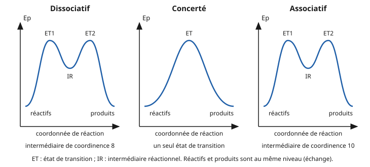
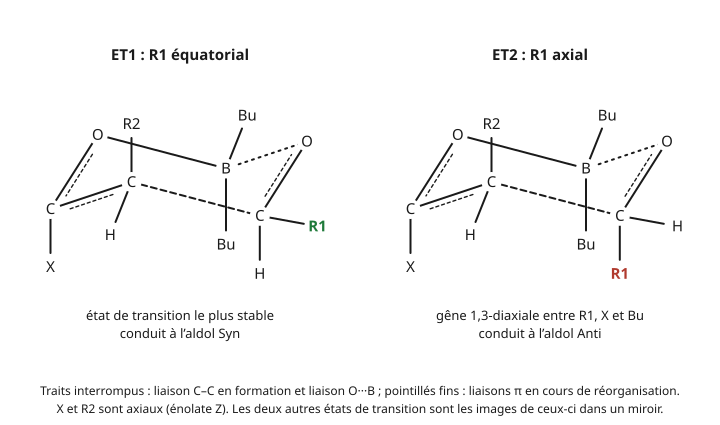
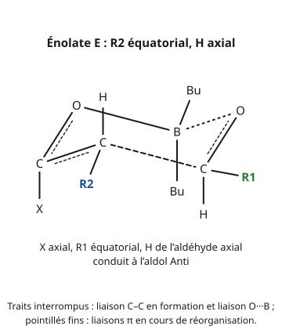
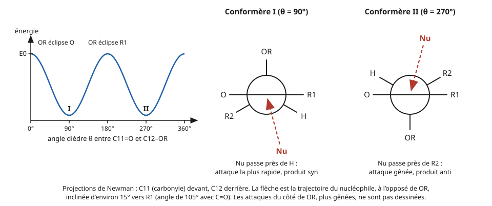

# ENS PC — Chimie 2009 · Corrigé brut

*Corrigé rédigé par IA, non officiel. Signalez toute erreur.*

**Rédaction** · modèle exact non renseigné (famille Claude) · effort non renseigné · vitesse non renseignée

**Révision (tour 2)** · modèle exact non renseigné (famille Claude) · effort non renseigné · vitesse non renseignée · 28 novembre 2026

## Problème 1 — Les agents de contraste en IRM

## Problème 1, partie A — Conception d'un agent de contraste

### Question 1.A.I.1 — Configuration électronique de l'ion gadolinium(III)

Le tableau 1 donne, pour l'atome, $E(4f)=-59\ \mathrm{eV} < E(5d)=-28\ \mathrm{eV} < E(6s)=-22\ \mathrm{eV}$ (la 6p, à $-17$ eV, est vide). Les électrons les moins liés sont ceux des orbitales occupées les plus hautes : on retire d'abord les deux électrons 6s, puis l'électron 5d. Les sept électrons 4f, beaucoup plus profonds, restent en place.

$$\boxed{\mathrm{Gd^{3+}} : [\mathrm{Xe}]\,4f^7}$$

### Question 1.A.I.2 — Énergies d'ionisation et stabilité du degré +III

Les trois premières énergies d'ionisation croissent régulièrement ($593$, $1167$, $1990\ \mathrm{kJ\,mol^{-1}}$) : on arrache des électrons de valence externes (6s, 6s, 5d) à un édifice de plus en plus chargé, donc de plus en plus attracteur.

La quatrième fait un saut : $I_4 = 4250\ \mathrm{kJ\,mol^{-1}}$, soit plus du double de $I_3$ et davantage que la somme $I_1+I_2+I_3 = 3750\ \mathrm{kJ\,mol^{-1}}$. Le quatrième électron doit en effet être arraché à la sous-couche 4f, très profonde ($-59$ eV) et de surcroît à demi remplie ($4f^7$, configuration particulièrement stable : sept spins parallèles, énergie d'échange maximale).

Former $\mathrm{Gd^{3+}}$ coûte $3750\ \mathrm{kJ\,mol^{-1}}$, que compense l'énergie de solvatation ou l'énergie réticulaire d'un cation trois fois chargé ; passer à $\mathrm{Gd^{4+}}$ coûterait à lui seul plus que les trois ionisations précédentes, ce qu'aucune stabilisation chimique ne compense. **Le degré +III est donc le degré d'oxydation stable du gadolinium.**

### Question 1.A.I.3 — Spin total et choix du gadolinium

Dans $\mathrm{Gd^{3+}}$ ($4f^7$), la règle de Hund place les sept électrons dans les sept orbitales 4f, spins parallèles. Chaque électron a $s=1/2$, donc le nombre quantique de spin total vaut

$$\boxed{S = 7\times\tfrac12 = \tfrac72}$$

La multiplicité de spin est $2S+1 = 8$ ; la projection $M_S$ prend les huit valeurs de $-7/2$ à $+7/2$.

Analyse bloc par bloc : une sous-couche de nombre quantique secondaire $\ell$ compte $2\ell+1$ orbitales, donc au plus $2\ell+1$ électrons célibataires (sous-couche à demi remplie).

- bloc s : 1 électron célibataire au plus, $S_{\max}=1/2$ ;
- bloc p : 3, $S_{\max}=3/2$ ;
- bloc d : 5, $S_{\max}=5/2$ (par exemple $\mathrm{Mn^{2+}}$ ou $\mathrm{Fe^{3+}}$ haut spin) ;
- bloc f : 7, $S_{\max}=7/2$.

Le spin maximal s'obtient donc dans le bloc f, pour une configuration $f^7$. Parmi les ions $4f^7$ ($\mathrm{Eu^{2+}}$, $\mathrm{Gd^{3+}}$, $\mathrm{Tb^{4+}}$), seul $\mathrm{Gd^{3+}}$ est au degré d'oxydation stable de son élément ; les ions $5f^7$ des actinides sont radioactifs. De plus, les orbitales 4f sont internes : elles participent peu aux liaisons, et la complexation ne provoque pas d'appariement des spins (contrairement au bloc d, où un champ fort de ligands peut donner un complexe bas spin). **Le gadolinium(III) est le meilleur choix.**

### Question 1.A.II.1.a — Équations-bilans des réactions 5 et 6

Réaction 5 (six ligands ammoniac) :

$$\mathrm{[Ni(H_2O)_6]^{2+} + 6\,NH_3 = [Ni(NH_3)_6]^{2+} + 6\,H_2O}$$

Réaction 6 (trois ligands éthylènediamine, notée en $=\mathrm{H_2N{-}CH_2{-}CH_2{-}NH_2}$, bidentate) :

$$\mathrm{[Ni(H_2O)_6]^{2+} + 3\,en = [Ni(en)_3]^{2+} + 6\,H_2O}$$

### Question 1.A.II.1.b — Contribution principale à l'effet chélate

Les couples de réactions donnant la même sphère de coordination sont (1 ; 2) : deux N et quatre O, (3 ; 4) : quatre N et deux O, (5 ; 6) : six N. Pour chaque couple, on calcule l'écart « ligand chélatant moins ligands monodentates » à 25 °C, en $\mathrm{kJ\,mol^{-1}}$ :

| Couple | $\Delta(\Delta_rG^\circ)$ | $\Delta(\Delta_rH^\circ)$ | $-\Delta(T\Delta_rS^\circ)$ |
|---|---|---|---|
| 2 − 1 | $-13{,}1$ | $-5{,}1$ | $-8{,}0$ |
| 4 − 3 | $-30{,}9$ | $-11{,}3$ | $-19{,}6$ |
| 6 − 5 | $-49{,}3$ | $-17$ | $-32{,}3$ |

Dans les trois cas le complexe chélaté est plus stable ($\Delta(\Delta_rG^\circ)<0$) et la relation $\Delta_rG^\circ=\Delta_rH^\circ-T\Delta_rS^\circ$ est bien vérifiée. Le terme entropique représente à chaque fois environ les deux tiers du gain ($8{,}0/13{,}1$, $19{,}6/30{,}9$, $32{,}3/49{,}3$), le terme enthalpique un tiers seulement.

**L'effet chélate est principalement d'origine entropique.**

### Question 1.A.II.1.c — Interprétation moléculaire

Avec l'ammoniac, la réaction 1 consomme deux molécules de ligand et libère deux molécules d'eau : le nombre d'entités indépendantes en solution ne change pas (3 de chaque côté). Avec l'éthylènediamine, la réaction 2 consomme une seule molécule de ligand et libère toujours deux molécules d'eau : on passe de 2 à 3 entités. Pour le couple (5 ; 6), on passe de 7 à 7 entités avec l'ammoniac, de 4 à 7 avec l'éthylènediamine.

Le ligand chélatant augmente donc le nombre de particules libres, c'est-à-dire le nombre de degrés de liberté de translation et le nombre de micro-états accessibles : l'entropie de réaction est plus grande. On peut le dire autrement : une fois le premier atome d'azote fixé, le second est maintenu au voisinage immédiat du métal (forte concentration locale), et sa fixation ne coûte plus la perte d'entropie de translation d'une molécule libre.

### Question 1.A.II.1.d — Évolution de l'enthalpie standard (réactions 2, 4, 6)

Les enthalpies standard valent $-37{,}7$, $-76{,}6$ et $-117\ \mathrm{kJ\,mol^{-1}}$ pour un, deux et trois ligands éthylènediamine, soit $-37{,}7$, $-38{,}3$ et $-39\ \mathrm{kJ\,mol^{-1}}$ par ligand : l'enthalpie de réaction est quasiment **proportionnelle au nombre de ligands fixés**.

Interprétation : chaque étape remplace deux liaisons $\mathrm{Ni{-}OH_2}$ par deux liaisons $\mathrm{Ni{-}N}$. La réaction est exothermique parce que l'azote d'une amine, moins électronégatif que l'oxygène de l'eau, est meilleur donneur : la liaison $\mathrm{Ni{-}N}$ est plus forte que la liaison $\mathrm{Ni{-}O}$. La proportionnalité traduit l'additivité des énergies de liaison : les trois substitutions sont à peu près indépendantes. Le léger accroissement de l'exothermicité par étape ($-37{,}7$, puis $-38{,}9$, puis $-40{,}4\ \mathrm{kJ\,mol^{-1}}$) s'accorde avec un champ de ligands qui se renforce à mesure que l'azote remplace l'oxygène.

On note enfin que chaque éthylènediamine est un peu plus exothermique que deux ammoniacs ($-37{,}7$ contre $-32{,}6\ \mathrm{kJ\,mol^{-1}}$) : une amine primaire est plus donneuse que l'ammoniac, et la répulsion entre les deux azotes voisins est déjà « payée » dans le ligand libre, alors qu'il faut rapprocher deux molécules d'ammoniac indépendantes.

### Question 1.A.II.1.e — Évolution de l'entropie standard (réactions 2 et 6)

Le terme $T\Delta_rS^\circ$ vaut $+4{,}2\ \mathrm{kJ\,mol^{-1}}$ pour la réaction 2 et $-16{,}0\ \mathrm{kJ\,mol^{-1}}$ pour la réaction 6 (et $+0{,}8$ pour la réaction 4). L'entropie n'est donc pas additive, contrairement à l'enthalpie : chaque ligand supplémentaire contribue moins favorablement ($+4{,}2$, puis $-3{,}4$, puis $-16{,}8\ \mathrm{kJ\,mol^{-1}}$).

Réaction 2 : le bilan fait apparaître une particule supplémentaire (2 donnent 3), d'où une entropie positive ; elle reste faible, car le ligand perd en se fixant sa translation propre et ses rotations internes (la chaîne $\mathrm{N{-}C{-}C{-}N}$ est figée dans un cycle à cinq chaînons), et l'eau libérée rejoint un liquide structuré par liaisons hydrogène.

Réaction 6 : on gagne trois particules (4 donnent 7), mais trois ligands sont immobilisés, et deux effets s'ajoutent quand la sphère se remplit :

- un effet statistique : le premier ligand dispose de douze arêtes de l'octaèdre pour se fixer, le troisième d'une seule, alors que le nombre de façons de se dissocier augmente ;
- un effet de rigidité : le complexe tris-chélaté est encombré et rigide, ses liaisons plus fortes vibrent moins librement (compensation entre enthalpie et entropie).

Le terme $T\Delta_rS^\circ$ de la réaction 6 est ainsi négatif, mais beaucoup moins que celui de la réaction 5 ($-48{,}3\ \mathrm{kJ\,mol^{-1}}$), qui immobilise six molécules d'ammoniac : l'avantage entropique du chélate, mis en évidence en A.II.1.b, croît bien avec le nombre de cycles formés ($+8{,}0$, $+19{,}6$, $+32{,}3\ \mathrm{kJ\,mol^{-1}}$).

### Question 1.A.II.2.a — Réorganisation du ligand A : enthalpie

Le ligand A libre adopte en solution une conformation étendue (chaîne en zigzag, liaisons en conformation décalée anti), dans laquelle les doublets non liants des quatre azotes sont éloignés les uns des autres et solvatés par l'eau (liaisons hydrogène $\mathrm{N\cdots H{-}O}$).

Pour l'enrouler autour du métal, il faut :

- passer à des conformations gauches, plus hautes en énergie (contraintes de torsion et gênes stériques) ;
- rapprocher quatre doublets non liants (quatre dipôles) qui convergent vers la même région de l'espace : répulsion électrostatique ;
- rompre une partie des liaisons hydrogène avec le solvant (désolvatation des azotes).

Ces trois contributions coûtent de l'énergie : $\Delta H^\circ_{\text{réorg}}(\mathrm{A})>0$.

### Question 1.A.II.2.b — Réorganisation du ligand A : entropie

La chaîne libre explore un très grand nombre de conformations (rotations autour de onze liaisons simples du squelette) ; le ligand réorganisé est bloqué dans une seule conformation, celle qui présente les quatre azotes au métal. Le nombre de micro-états accessibles diminue fortement :

$$\boxed{\Delta S^\circ_{\text{réorg}}(\mathrm{A})<0}$$

### Question 1.A.II.2.c — Réorganisation du ligand B

Le ligand B est cyclique : ses quatre azotes sont déjà maintenus proches et orientés vers la cavité, et le cycle n'a que peu de conformations accessibles. Il est **préorganisé**.

- Entropie : il n'y a presque pas de liberté conformationnelle à perdre, $\Delta S^\circ_{\text{réorg}}(\mathrm{B})\approx 0$ (faiblement négative), donc nettement supérieure à celle de A.
- Enthalpie : la répulsion entre doublets et les contraintes de conformation ont été payées lors de la synthèse du macrocycle ; de plus les azotes, tournés vers une cavité étroite, sont moins bien solvatés que ceux de A, donc moins coûteux à désolvater. $\Delta H^\circ_{\text{réorg}}(\mathrm{B})$ est faible, nettement inférieure à celle de A.

### Question 1.A.II.2.d — Étape 2 : hypothèse et signes

Hypothèse : après réorganisation, les deux ligands présentent au nickel le même environnement, quatre atomes d'azote d'amines dans la même géométrie, formant des cycles chélates de même taille (cinq et six chaînons). L'étape 2 forme donc les mêmes quatre liaisons $\mathrm{Ni{-}N}$ et libère le même nombre de molécules d'eau (quatre) : ses grandeurs thermodynamiques sont pratiquement identiques pour A et B.

Signes pour cette étape :

- $\Delta H^\circ_2<0$ : quatre liaisons $\mathrm{Ni{-}N}$ remplacent quatre liaisons $\mathrm{Ni{-}O}$ moins fortes (voir A.II.1.d) ;
- $\Delta S^\circ_2>0$ : deux entités (le cation hydraté et le ligand déjà figé) en donnent cinq (le complexe et quatre molécules d'eau), sans perte conformationnelle puisque celle-ci a été comptée dans l'étape 1.

### Question 1.A.II.2.e — Nature de l'effet macrocycle

Le tableau 4 donne, de A à B :

$$\Delta(\Delta_rH^\circ) = -61{,}9-(-44{,}4) = -17{,}5\ \mathrm{kJ\,mol^{-1}}$$

$$\Delta(\Delta_rS^\circ) = 85{,}8-66{,}5 = +19{,}3\ \mathrm{J\,K^{-1}\,mol^{-1}} \quad\text{soit}\quad -T\Delta(\Delta_rS^\circ)\approx -5{,}8\ \mathrm{kJ\,mol^{-1}}$$

$$\Delta(\Delta_rG^\circ)\approx -23{,}3\ \mathrm{kJ\,mol^{-1}}$$

ce qui correspond bien à l'écart de $4{,}1$ unités sur $\log K^\circ$ ($RT\ln 10\approx 5{,}7\ \mathrm{kJ\,mol^{-1}}$ à 25 °C).

L'étape 2 étant commune, ces écarts sont ceux de la réorganisation :

- la réaction avec B est plus exothermique parce que B n'a pas à payer le coût enthalpique de réorganisation (répulsions entre doublets, conformations gauches, désolvatation) ;
- elle est plus favorable entropiquement parce que B ne perd pas de liberté conformationnelle.

**L'effet macrocycle est à la fois enthalpique et entropique, avec ici une contribution enthalpique dominante** (environ les trois quarts de l'écart d'enthalpie libre), à la différence de l'effet chélate, essentiellement entropique. Il traduit la préorganisation du ligand.

### Question 1.A.III.1 — Réaction parasite de la cyclisation

Après la première $\mathrm{S_N2}$, l'intermédiaire porte une extrémité $\mathrm{{-}CH_2{-}CH_2{-}Br}$ électrophile et des amines nucléophiles. La fermeture du cycle à douze chaînons (attaque de l'amine terminale de la même molécule) est lente ; elle est concurrencée par la **substitution intermoléculaire** : l'amine d'une autre molécule attaque le carbone bromé, ce qui conduit à des dimères, puis à des oligomères et polymères linéaires (polycondensation).

S'y ajoutent les polyalkylations des amines secondaires, elles aussi nucléophiles (par exemple la fermeture d'un petit cycle pipérazine à six chaînons, cinétiquement facile).

### Question 1.A.III.2 — Rôle de la haute dilution

Notons I l'intermédiaire monoalkylé. La cyclisation est un acte intramoléculaire, d'ordre 1 ; la réaction parasite est bimoléculaire, d'ordre 2 :

$$v_{\text{cycl}} = k_c\,[\mathrm{I}] \qquad v_{\text{inter}} = k_i\,[\mathrm{I}]\,[\text{amine}]$$

$$\boxed{\frac{v_{\text{cycl}}}{v_{\text{inter}}} = \frac{k_c}{k_i\,[\text{amine}]}}$$

Ce rapport augmente quand les concentrations diminuent : diluer ralentit les deux réactions, mais beaucoup plus la réaction intermoléculaire. La haute dilution favorise donc cinétiquement la cyclisation.

### Question 1.A.III.3 — Rôle des sels de nickel

L'ion $\mathrm{Ni^{2+}}$ complexe les quatre azotes de la tétraamine linéaire, qui s'enroule autour de lui : c'est un **effet de matrice** (effet « template »). Les deux extrémités de la chaîne sont maintenues proches l'une de l'autre, dans la géométrie du futur macrocycle. Après la première substitution, le carbone bromé se trouve au voisinage immédiat de l'amine terminale restante : la probabilité de rencontre intramoléculaire augmente (entropie d'activation moins défavorable), et la fermeture du cycle est accélérée par rapport aux réactions intermoléculaires.

Le métal fait donc, pendant la synthèse, le travail de préorganisation décrit en A.II.2 ; il stabilise aussi le produit macrocyclique sous forme de complexe.

### Question 1.A.III.4 — Transposition industrielle

Non, ce mode opératoire se transpose mal à la production de grandes quantités de ligand pur :

- la haute dilution impose des volumes de solvant énormes pour peu de produit (réacteurs immenses, coût d'achat, de chauffage, de recyclage et de traitement du solvant) et des réactions lentes, donc une productivité très faible ;
- le macrocycle est obtenu sous forme de complexe de nickel, que l'effet macrocycle rend justement très stable : il faut une étape supplémentaire de démétallation, difficile, puis éliminer toute trace de nickel, toxique, ce qui est indispensable pour un produit injecté à un patient ;
- les sels métalliques ajoutent un coût et des effluents à retraiter.

L'industrie recourt à d'autres stratégies de cyclisation qui évitent ces deux contraintes.

### Question 1.A.III.5 — Synthèse du DOTA

**Étape 1 : quatre N-alkylations.** Le macrocycle est traité par quatre équivalents (léger excès) de bromoacétate de méthyle $\mathrm{Br{-}CH_2{-}CO_2Me}$, en présence d'une base (carbonate de potassium ou triéthylamine en excès) dans un solvant polaire aprotique (acétonitrile). Chaque amine secondaire attaque par son doublet le carbone portant le brome ($\mathrm{S_N2}$, favorisée sur ce carbone primaire activé par le groupe carbonyle voisin) ; la base neutralise HBr, qui sinon protonerait les amines et bloquerait la réaction.

$$\mathrm{R_2NH + Br{-}CH_2{-}CO_2Me + B \longrightarrow R_2N{-}CH_2{-}CO_2Me + BH^+ + Br^-}$$

On obtient le tétraester. La quaternarisation est limitée par la stœchiométrie et par l'encombrement de l'amine tertiaire formée.

**Étape 2 : saponification des quatre esters.** Soude aqueuse en excès, à chaud :

$$\mathrm{R_2N{-}CH_2{-}CO_2Me + HO^- \longrightarrow R_2N{-}CH_2{-}CO_2^- + MeOH}$$

On obtient directement la forme tétracarboxylate du DOTA, celle de la figure 1 ; une acidification ménagée donne l'acide si on veut l'isoler.

On utilise l'ester et non l'acide bromoacétique : l'acide protonerait les amines, et le carboxylate formé serait un mauvais électrophile.

## Problème 1, partie B — Les agents de contraste dans l'organisme

### Question 1.B.I.1 — Décroissance de l'intensité de fluorescence

Les deux désexcitations sont des actes élémentaires monomoléculaires parallèles :

$$\frac{\mathrm{d}[\mathrm{C^*}]}{\mathrm{d}t} = -(k_1+k_2)\,[\mathrm{C^*}]$$

$$[\mathrm{C^*}](t) = [\mathrm{C^*}]_0\,\exp\big(-(k_1+k_2)\,t\big)$$

L'intensité étant proportionnelle à $[\mathrm{C^*}]$ :

$$\boxed{I(t) = I_0\,\exp(-k_{obs}\,t) \qquad k_{obs}=k_1+k_2}$$

où $I_0$ est l'intensité à la fin de l'irradiation. La durée de vie de l'état excité est $\tau = 1/k_{obs}$.

### Question 1.B.I.2 — Fréquence de vibration d'une liaison

Le système de deux masses $m_A$ et $m_B$ reliées par un ressort de raideur $\kappa$ équivaut à un oscillateur harmonique de masse réduite $\mu$ :

$$\mu = \frac{m_A\,m_B}{m_A+m_B}$$

$$\boxed{\nu = \frac{1}{2\pi}\sqrt{\frac{\kappa}{\mu}}}$$

### Question 1.B.I.3 — Même raideur pour O–H et O–D

L'hydrogène et le deutérium sont deux isotopes : même charge nucléaire, même cortège électronique, seule la masse du noyau diffère (un neutron de plus). Or la raideur $\kappa$ mesure la courbure de l'énergie potentielle de la liaison au voisinage de la distance d'équilibre, et cette énergie potentielle est d'origine électronique et électrostatique : elle ne dépend que des charges des noyaux et des électrons, pas des masses. Les liaisons $\mathrm{O{-}H}$ et $\mathrm{O{-}D}$ ont donc la même structure électronique, la même longueur et la même constante de raideur ; seule $\mu$ change.

### Question 1.B.I.4 — Signe de la constante α

Masses réduites (en unité de masse atomique) :

$$\mu_{\mathrm{OH}} = \frac{16\times 1}{17}\approx 0{,}94 \qquad \mu_{\mathrm{OD}} = \frac{16\times 2}{18}\approx 1{,}78$$

À raideur égale, $\nu_{\mathrm{OH}}/\nu_{\mathrm{OD}} = \sqrt{\mu_{\mathrm{OD}}/\mu_{\mathrm{OH}}}\approx\sqrt{1{,}9}\approx 1{,}37$ : la liaison $\mathrm{O{-}H}$ vibre plus vite que la liaison $\mathrm{O{-}D}$.

D'après l'énoncé, la désexcitation non radiative est d'autant plus rapide que la fréquence des modes de vibration est grande : $k_2(\mathrm{H_2O})>k_2(\mathrm{D_2O})$. La constante radiative $k_1$, propre à l'état électronique du complexe, ne dépend pas de l'isotope. Donc

$$\Delta k_{obs} = k_2(\mathrm{H_2O})-k_2(\mathrm{D_2O}) > 0$$

et, comme $n>0$ :

$$\boxed{\alpha>0}$$

La proportionnalité à $n$ se comprend ainsi : chaque molécule d'eau coordinée apporte ses oscillateurs $\mathrm{O{-}H}$, qui contribuent additivement à la désexcitation.

### Question 1.B.I.5 — Valeur non entière de n

Avec 15 % d'incertitude, $n = 1{,}1\pm 0{,}2$ est compatible avec la valeur entière $n=1$ attendue pour $[\mathrm{Gd(DTPA)(H_2O)}]^{2-}$.

Au-delà de l'incertitude, deux interprétations chimiques :

- la mesure est une moyenne sur l'ensemble des complexes : un équilibre entre une forme très majoritaire à une molécule d'eau et une forme minoritaire à deux molécules d'eau (un bras carboxylate momentanément décoordiné) donne une valeur moyenne non entière légèrement supérieure à 1 ;
- les molécules d'eau de la seconde sphère de coordination, liées par liaisons hydrogène aux carboxylates du ligand et proches du métal, contribuent faiblement à la désexcitation sans être coordinées.

### Question 1.B.I.6 — Spectres infrarouges avec l'eau légère et l'eau lourde

Avec le ligand $\mathrm{H_2O}$, le spectre présente la bande d'élongation $\mathrm{O{-}H}$ vers $3300$–$3600\ \mathrm{cm^{-1}}$. Avec $\mathrm{D_2O}$, cette bande disparaît et est remplacée par la bande d'élongation $\mathrm{O{-}D}$, déplacée vers les bas nombres d'onde d'un facteur $\sqrt{\mu_{\mathrm{OD}}/\mu_{\mathrm{OH}}}\approx 1{,}37$ :

$$\sigma_{\mathrm{OD}}\approx\frac{3400}{1{,}37}\approx 2500\ \mathrm{cm^{-1}}$$

soit une bande vers $2400$–$2600\ \mathrm{cm^{-1}}$. La bande de déformation de l'eau (vers $1600\ \mathrm{cm^{-1}}$) est déplacée de la même façon (vers $1200\ \mathrm{cm^{-1}}$). Les bandes du ligand DTPA ne changent pas.

### Question 1.B.II.1.a — Constantes des équilibres de relargage

Le premier équilibre est l'inverse de la formation du complexe. Chacun des suivants s'obtient en lui ajoutant une protonation supplémentaire du ligand, de constante $1/K_5$, puis $1/K_4$, etc. (l'acidité $K_5$ relie $\mathrm{HZ^{4-}}$ et $\mathrm{Z^{5-}}$) :

$$\boxed{\begin{aligned}
\tilde K_0 &= \frac{1}{\beta} \\
\tilde K_A &= \frac{1}{\beta K_5} \\
\tilde K_B &= \frac{1}{\beta K_5K_4} \\
\tilde K_C &= \frac{1}{\beta K_5K_4K_3} \\
\tilde K_D &= \frac{1}{\beta K_5K_4K_3K_2} \\
\tilde K_E &= \frac{1}{\beta K_5K_4K_3K_2K_1}
\end{aligned}}$$

### Question 1.B.II.1.b — Carré de la concentration en gadolinium libre

Notons $h=[\mathrm{H_3O^+}]$. Tout le gadolinium et tout le ligand proviennent du complexe : chaque ion $\mathrm{Gd^{3+}}$ relargué a libéré un ligand, qui se trouve sous l'une de ses six formes acido-basiques. La conservation de la matière s'écrit donc

$$[\mathrm{Gd^{3+}}] = [\mathrm{Z^{5-}}]+[\mathrm{HZ^{4-}}]+[\mathrm{H_2Z^{3-}}]+[\mathrm{H_3Z^{2-}}]+[\mathrm{H_4Z^-}]+[\mathrm{H_5Z}]$$

Chaque terme s'exprime avec la constante de l'équilibre de relargage correspondant (activité de l'eau égale à 1) :

$$[\mathrm{Z^{5-}}] = \tilde K_0\,\frac{[\mathrm{Gd(Z)^{2-}}]}{[\mathrm{Gd^{3+}}]} \qquad [\mathrm{H}_i\mathrm{Z}^{(5-i)-}] = \tilde K_i\,\frac{[\mathrm{Gd(Z)^{2-}}]\,h^i}{[\mathrm{Gd^{3+}}]}$$

où $\tilde K_1,\dots,\tilde K_5$ désignent $\tilde K_A,\dots,\tilde K_E$. En reportant et en multipliant par $[\mathrm{Gd^{3+}}]$ :

$$[\mathrm{Gd^{3+}}]^2 = [\mathrm{Gd(Z)^{2-}}]\left(\tilde K_0+\tilde K_A\,h+\tilde K_B\,h^2+\tilde K_C\,h^3+\tilde K_D\,h^4+\tilde K_E\,h^5\right)$$

Avec les expressions de la question précédente, $\tilde K_i = \dfrac{1}{\beta\,K_5K_4\cdots K_{5-i+1}}$, d'où

$$\boxed{[\mathrm{Gd^{3+}}]^2_{\text{relargué}} = \frac{[\mathrm{Gd(Z)^{2-}}]}{\beta}\left[1+\sum_{i=1}^{5}\frac{h^i}{\prod_{j=0}^{i-1}K_{5-j}}\right]}$$

Le produit $\prod_{j=0}^{i-1}K_{5-j}$ vaut bien $K_5$ pour $i=1$, $K_5K_4$ pour $i=2$, et ainsi de suite jusqu'à $K_5K_4K_3K_2K_1$.

### Question 1.B.II.1.c — Constante de stabilité apparente

Si le relargage est faible, la quantité de complexe dissociée est négligeable devant la quantité introduite : $[\mathrm{Gd(Z)^{2-}}]\approx C_0$. La relation précédente devient

$$\boxed{[\mathrm{Gd^{3+}}]_{\text{relargué}} = \sqrt{\frac{C_0}{\beta_{app}}} \qquad \beta_{app} = \frac{\beta}{1+\displaystyle\sum_{i=1}^{5}\frac{h^i}{\prod_{j=0}^{i-1}K_{5-j}}}}$$

$\beta_{app}$ est la constante de l'équilibre global $\mathrm{Gd^{3+}} + \mathrm{Z'} = \mathrm{Gd(Z)^{2-}}$, où $\mathrm{Z'}$ désigne le ligand libre toutes formes confondues. Elle diminue quand le milieu devient plus acide : les protons entrent en compétition avec le gadolinium pour le ligand.

### Question 1.B.II.1.d — Valeur à pH 7,4 et stabilité

À $\mathrm{pH}=7{,}4$, le logarithme du terme d'indice $i$ vaut $\sum \mathrm{p}K - i\,\mathrm{pH}$ :

- $i=1$ : $10{,}4-7{,}4 = 3{,}0$ ;
- $i=2$ : $10{,}4+8{,}8-14{,}8 = 4{,}4$ ;
- $i=3$ : $19{,}2+4{,}4-22{,}2 = 1{,}4$ ;
- $i=4$ : $23{,}6+2{,}5-29{,}6 = -3{,}5$ ;
- $i=5$ : $26{,}1+1{,}8-37{,}0 = -9{,}1$.

Le terme $i=2$ ($10^{4{,}4}\approx 2{,}5\times 10^{4}$) domine : c'est celui de l'espèce $\mathrm{H_2Z^{3-}}$, prédominante puisque $\mathrm{p}K_3 = 4{,}4<7{,}4<\mathrm{p}K_4 = 8{,}8$. Le terme suivant ($10^{3}$) n'en représente que 4 %, les autres (dont le 1) sont négligeables. On retient donc

$$\beta_{app}\approx\frac{\beta\,K_5K_4}{h^2} \qquad \log\beta_{app}\approx 22{,}4-4{,}4$$

$$\boxed{\log\beta_{app}\approx 18{,}0}$$

La constante apparente reste gigantesque. Pour une concentration $C_0 = 10^{-3}\ \mathrm{mol\,L^{-1}}$ par exemple, $[\mathrm{Gd^{3+}}] = \sqrt{10^{-3}/10^{18}} = 10^{-10{,}5}\approx 3\times 10^{-11}\ \mathrm{mol\,L^{-1}}$ : le relargage est infime (ce qui valide l'hypothèse de la question précédente). **Vis-à-vis du seul pH, l'agent de contraste est stable dans le milieu physiologique.**

### Question 1.B.II.2 — Effet des cations métalliques dissous

En présence d'un cation $\mathrm{M}^{n+}$, le ligand libéré par le gadolinium peut aussi se trouver sous la forme du complexe $\mathrm{M(Z)}^{p+}$, avec $[\mathrm{M(Z)}^{p+}] = \beta_M\,[\mathrm{M}^{n+}]\,[\mathrm{Z^{5-}}]$. La conservation de la matière devient

$$[\mathrm{Gd^{3+}}] = [\mathrm{Z^{5-}}]\left(1+\sum_{i=1}^{5}\frac{h^i}{\prod_{j=0}^{i-1}K_{5-j}}+\beta_M\,[\mathrm{M}^{n+}]\right)$$

Comme $[\mathrm{Z^{5-}}] = \dfrac{[\mathrm{Gd(Z)^{2-}}]}{\beta\,[\mathrm{Gd^{3+}}]}$ et, pour un relargage faible, $[\mathrm{Gd(Z)^{2-}}]\approx C_0$ :

$$\boxed{[\mathrm{Gd^{3+}}]_{\text{relargué}} = \sqrt{\frac{C_0}{\beta_{physio}}} \qquad \beta_{physio} = \frac{\beta}{1+\displaystyle\sum_{i=1}^{5}\frac{h^i}{\prod_{j=0}^{i-1}K_{5-j}}+\beta_M\,[\mathrm{M}^{n+}]}}$$

où $[\mathrm{M}^{n+}]$ est la concentration en cation libre, supposée fixée par le milieu physiologique (le cation est en large excès devant le ligand libéré). S'il y a plusieurs cations ($\mathrm{Ca^{2+}}$, $\mathrm{Cu^{2+}}$, $\mathrm{Zn^{2+}}$), on ajoute un terme $\beta_{M}[\mathrm{M}^{n+}]$ par cation. Cette compétition (transmétallation) abaisse encore la stabilité apparente : $\beta_{physio}<\beta_{app}$.

### Question 1.B.II.3.a — Dose létale calculée chez la souris

La concentration létale en gadolinium libre est $[\mathrm{Gd^{3+}}]_{\ell} = 10\ \mathrm{\mu mol\,L^{-1}} = 10^{-5}\ \mathrm{mol\,L^{-1}}$. La concentration sanguine en agent de contraste qui la produit vaut

$$C_0 = \beta_{physio}\,[\mathrm{Gd^{3+}}]_{\ell}^2 = 10^{7{,}0}\times\left(10^{-5}\right)^2 = 1{,}0\times 10^{-3}\ \mathrm{mol\,L^{-1}}$$

(le relargage, 1 % de $C_0$, est bien faible). Un kilogramme de souris contient $70\ \mathrm{mL}$ de sang :

$$\text{dose létale} = C_0\times V_{\text{sang par kg}} = 1{,}0\times 10^{-3}\times 70\times 10^{-3}$$

$$\boxed{\text{dose létale calculée} = 7{,}0\times 10^{-5}\ \mathrm{mol\,kg^{-1}}}$$

soit $70\ \mathrm{\mu mol\,kg^{-1}}$ (environ $2{,}8\ \mathrm{\mu mol}$ pour une souris de 40 g, qui possède $2{,}8\ \mathrm{mL}$ de sang).

### Question 1.B.II.3.b — Écart à la dose létale réelle

La dose létale réelle ($5{,}0\times 10^{-3}\ \mathrm{mol\,kg^{-1}}$) est environ 70 fois plus élevée que la valeur calculée : l'agent est bien moins toxique que ne le prévoit la thermodynamique.

Le calcul suppose que tous les équilibres de relargage sont établis. Or la dissociation du complexe (décoordination d'un ligand octadentate, transmétallation) est **cinétiquement lente** : le complexe est inerte. Dans le même temps, l'agent de contraste, très hydrophile, est éliminé rapidement par les reins. L'équilibre thermodynamique n'a pas le temps de s'établir : la quantité de gadolinium réellement libérée est très inférieure à la valeur d'équilibre. La toxicité est sous contrôle cinétique.

S'y ajoute un effet de distribution : le produit diffuse hors du sang dans tout le liquide extracellulaire, de sorte que sa concentration réelle est plus faible que celle calculée sur le seul volume sanguin.

### Question 1.B.II.3.c — Volume à injecter à un patient

Dose admise : cinquante fois moins que la dose létale,

$$d = \frac{5{,}0\times 10^{-3}}{50} = 1{,}0\times 10^{-4}\ \mathrm{mol\,kg^{-1}}$$

Pour un patient de 70 kg : $n = 1{,}0\times 10^{-4}\times 70 = 7{,}0\times 10^{-3}\ \mathrm{mol}$. Avec une solution à $0{,}5\ \mathrm{mol\,L^{-1}}$ :

$$V = \frac{n}{c} = \frac{7{,}0\times 10^{-3}}{0{,}5}$$

$$\boxed{V\approx 14\ \mathrm{mL}}$$

Le volume sanguin (5 L) donne seulement la concentration initiale dans le sang, $7{,}0\times 10^{-3}/5\approx 1{,}4\times 10^{-3}\ \mathrm{mol\,L^{-1}}$ : un ordre de grandeur auquel le relargage d'équilibre resterait de l'ordre de $10^{-5}\ \mathrm{mol\,L^{-1}}$, d'où l'importance de l'inertie cinétique et de l'élimination rapide.

## Problème 1, partie C — Effet de l'agent de contraste sur l'image IRM

### Question 1.C.1 — Trois mécanismes d'échange et leurs profils

On note L le ligand (DTPA ou DOTA), les charges étant omises.

**Mécanisme dissociatif** (analogue à une $\mathrm{S_N1}$), deux actes élémentaires, avec un intermédiaire de coordinence réduite (huit) :

$$\mathrm{[GdL(H_2O)_a] \;\underset{k_{-1}}{\overset{k_1}{\rightleftharpoons}}\; [GdL] + H_2O_{(a)}}$$

$$\mathrm{[GdL] + H_2O_{(b)} \;\overset{k_2}{\longrightarrow}\; [GdL(H_2O)_b]}$$

**Mécanisme concerté** (analogue à une $\mathrm{S_N2}$), un seul acte élémentaire bimoléculaire, sans intermédiaire :

$$\mathrm{[GdL(H_2O)_a] + H_2O_{(b)} \;\overset{k}{\longrightarrow}\; [GdL(H_2O)_b] + H_2O_{(a)}}$$

**Mécanisme associatif**, deux actes élémentaires, avec un intermédiaire de coordinence augmentée (dix) :

$$\mathrm{[GdL(H_2O)_a] + H_2O_{(b)} \;\underset{k_{-1}}{\overset{k_1}{\rightleftharpoons}}\; [GdL(H_2O)_a(H_2O)_b]}$$

$$\mathrm{[GdL(H_2O)_a(H_2O)_b] \;\overset{k_2}{\longrightarrow}\; [GdL(H_2O)_b] + H_2O_{(a)}}$$

Profils d'énergie potentielle : réactifs et produits étant identiques (aux étiquettes a et b près), l'état initial et l'état final sont au même niveau et chaque profil est symétrique. Les mécanismes dissociatif et associatif présentent deux états de transition de même hauteur encadrant un intermédiaire réactionnel (minimum local) ; le mécanisme concerté présente un seul état de transition.

### Question 1.C.2 — Lois de vitesse

On note C le complexe et $v$ la vitesse d'échange.

**Dissociatif.** L'intermédiaire $\mathrm{[GdL]}$, très réactif, est capté par une molécule d'eau quelconque du solvant (la probabilité que ce soit précisément la molécule a est négligeable). L'étape cinétiquement déterminante est la dissociation :

$$\boxed{v = k_1\,[\mathrm{C}]}$$

**Concerté.** Acte élémentaire bimoléculaire :

$$\boxed{v = k\,[\mathrm{C}]\,[\mathrm{H_2O}]}$$

**Associatif.** L'approximation des états quasi stationnaires appliquée à l'intermédiaire I de coordinence dix donne $k_1[\mathrm{C}][\mathrm{H_2O}] = (k_{-1}+k_2)[\mathrm{I}]$, d'où

$$v = k_2\,[\mathrm{I}] = \frac{k_1k_2}{k_{-1}+k_2}\,[\mathrm{C}]\,[\mathrm{H_2O}]$$

Les deux molécules d'eau de l'intermédiaire jouant des rôles symétriques, $k_2 = k_{-1}$ :

$$\boxed{v = \frac{k_1}{2}\,[\mathrm{C}]\,[\mathrm{H_2O}]}$$

### Question 1.C.3 — Limite de l'étude des ordres partiels

L'eau est le solvant : sa concentration (environ $55\ \mathrm{mol\,L^{-1}}$) est constante et ne peut pas être modifiée. Il y a dégénérescence de l'ordre : les trois lois de vitesse se réduisent à la même forme

$$v = k_{eau}\,[\mathrm{C}]$$

avec $k_{eau}=k_1$ (dissociatif), $k\,[\mathrm{H_2O}]$ (concerté) ou $k_1[\mathrm{H_2O}]/2$ (associatif). L'expérience donne dans tous les cas un ordre 1 par rapport au complexe et ne donne pas accès à l'ordre partiel par rapport à l'eau : elle ne permet pas de trancher.

### Question 1.C.4 — Constante de vitesse et complexe activé

La vitesse de formation de C est celle de la décomposition du complexe activé :

$$v = k^{\ddagger}\,[\mathrm{AB}^{\ddagger}] = \nu\,[\mathrm{AB}^{\ddagger}]$$

La constante d'équilibre entre réactifs et complexe activé s'écrit avec les activités $a=\gamma c/c^\circ$ :

$$K^{\ddagger} = \frac{a_{\ddagger}}{a_A\,a_B} = \frac{\gamma^{\ddagger}\,[\mathrm{AB}^{\ddagger}]\,c^\circ}{\gamma_A\gamma_B\,[\mathrm{A}]\,[\mathrm{B}]}$$

d'où $[\mathrm{AB}^{\ddagger}] = K^{\ddagger}\,\dfrac{\gamma_A\gamma_B}{\gamma^{\ddagger}c^\circ}\,[\mathrm{A}][\mathrm{B}]$. En identifiant avec $v = k\,[\mathrm{A}][\mathrm{B}]$ :

$$\boxed{k = \nu\,K^{\ddagger}\,\frac{\gamma_A\gamma_B}{\gamma^{\ddagger}\,c^\circ}}$$

### Question 1.C.5 — Cas où hν est petit devant k_BT

Pour $h\nu\ll k_BT$, $1-\exp\left(-\dfrac{h\nu}{k_BT}\right)\approx\dfrac{h\nu}{k_BT}$, donc

$$K^{\ddagger}\approx\frac{k_BT}{h\nu}\,K$$

La fréquence $\nu$ se simplifie :

$$\boxed{k = \frac{k_BT}{h}\,K\,\frac{\gamma_A\gamma_B}{\gamma^{\ddagger}\,c^\circ}}$$

Le mode de vibration le long de la coordonnée de réaction est « mou » (fréquence faible) : c'est celui qui conduit à la rupture du complexe activé.

### Question 1.C.6 — Équation d'Eyring

Quand $\nu\to+\infty$, $\exp(-h\nu/k_BT)\to 0$ et $K^{\ddagger}\to K$. La définition de l'énoncé donne donc

$$-RT\ln K = \Delta_rG^{0\ddagger} \qquad K = \exp\left(-\frac{\Delta_rG^{0\ddagger}}{RT}\right)$$

$K$ est la constante d'équilibre de formation du complexe activé privé de son degré de liberté le long de la coordonnée de réaction. En reportant dans le résultat précédent :

$$k = \frac{k_BT}{h\,c^\circ}\,\frac{\gamma_A\gamma_B}{\gamma^{\ddagger}}\,\exp\left(-\frac{\Delta_rG^{0\ddagger}}{RT}\right)$$

Approximation : en solution diluée, supposée idéale, les coefficients d'activité valent 1 (ou du moins $\gamma_A\gamma_B/\gamma^{\ddagger}\approx 1$). Alors

$$\boxed{k = \frac{k_BT}{h\,c^\circ}\,\exp\left(-\frac{\Delta_rG^{0\ddagger}}{RT}\right)}$$

Homogénéité : $k_BT/h$ est en $\mathrm{s^{-1}}$, donc $k$ est en $\mathrm{L\,mol^{-1}\,s^{-1}}$, comme il se doit pour un acte bimoléculaire.

### Question 1.C.7 — Acte élémentaire monomoléculaire

Pour $\mathrm{A}\rightleftharpoons\mathrm{A}^{\ddagger}\to\mathrm{C}$, la constante d'équilibre est $K^{\ddagger} = \gamma^{\ddagger}[\mathrm{A}^{\ddagger}]/(\gamma_A[\mathrm{A}])$ : la concentration unitaire se simplifie. Le même raisonnement donne

$$\boxed{k = \frac{k_BT}{h}\,\exp\left(-\frac{\Delta_rG^{0\ddagger}}{RT}\right)}$$

en $\mathrm{s^{-1}}$ : le facteur $1/c^\circ$ disparaît.

### Question 1.C.8 — Sens physique du volume d'activation

D'après (1), $\ln k = \ln\dfrac{k_BT}{h}-\dfrac{\Delta_rG^{0\ddagger}}{RT}$. Comme $\left(\dfrac{\partial G}{\partial P}\right)_T = V$, on a $\left(\dfrac{\partial\ln k}{\partial P}\right)_T = -\dfrac{\Delta_rV^{\ddagger}}{RT}$, ce qui s'intègre en la formule (2) si $\Delta_rV^{\ddagger}$ ne dépend pas de la pression.

$\Delta_rV^{\ddagger}$ est donc la différence entre le volume molaire (partiel) du complexe activé et celui des réactifs, solvatation comprise : c'est la variation de volume du système quand il passe des réactifs à l'état de transition.

- $\Delta_rV^{\ddagger}>0$ : l'état de transition est plus volumineux que les réactifs (une liaison s'allonge ou se rompt) ; une augmentation de pression ralentit la réaction.
- $\Delta_rV^{\ddagger}<0$ : l'état de transition est plus compact (une liaison se forme, deux entités se rapprochent) ; la pression accélère la réaction.

### Question 1.C.9 — Mécanisme de l'échange

Observations (tableau 5), identiques pour les deux complexes :

- $\Delta_rV^{\ddagger}>0$ et grand ($+12{,}5$ et $+10{,}5\ \mathrm{cm^3\,mol^{-1}}$, à comparer au volume molaire de l'eau, $18\ \mathrm{cm^3\,mol^{-1}}$) ;
- $\Delta_rS^{0\ddagger}>0$ et grand ($+53$ et $+49\ \mathrm{J\,K^{-1}\,mol^{-1}}$) ;
- $\Delta_rH^{0\ddagger}\approx 50\ \mathrm{kJ\,mol^{-1}}$, nettement positif.

Analyse : l'état de transition occupe plus de volume que le complexe de départ, et il est plus désordonné. C'est ce qu'on attend si, dans l'état de transition, la liaison $\mathrm{Gd{-}OH_2}$ est en train de se rompre : la molécule d'eau s'éloigne (dilatation) et commence à acquérir ses degrés de liberté de translation et de rotation propres (gain d'entropie), sans qu'aucune autre molécule ne soit venue se fixer. Un état de transition où une molécule d'eau entrerait dans la sphère de coordination donnerait au contraire un volume et une entropie d'activation négatifs.

Conclusion : **l'échange suit le mécanisme dissociatif**, l'étape cinétiquement déterminante étant le départ de la molécule d'eau coordinée. C'est cohérent avec la structure de ces complexes : le gadolinium y est déjà nonacoordiné (huit atomes donneurs du ligand et une molécule d'eau), il n'y a pas de place pour une dixième liaison.

Vérification de cohérence avec la formule monomoléculaire de C.7 : $k = \dfrac{k_BT}{h}\exp\left(\dfrac{\Delta_rS^{0\ddagger}}{R}\right)\exp\left(-\dfrac{\Delta_rH^{0\ddagger}}{RT}\right)$ donne, à 25 °C, $3{,}3\times 10^{6}\ \mathrm{s^{-1}}$ pour le complexe de DTPA et $4{,}2\times 10^{6}\ \mathrm{s^{-1}}$ pour celui de DOTA, en accord avec la dernière colonne du tableau (calcul fait à la machine, hors des conditions de l'épreuve).

### Question 1.C.10 — Signe de l'enthalpie d'activation

Pour atteindre l'état de transition du mécanisme dissociatif, il faut étirer puis rompre la liaison $\mathrm{Gd{-}OH_2}$, interaction forte entre un cation trois fois chargé et le doublet (le dipôle) de l'eau. Cette rupture coûte de l'énergie et n'est compensée par la formation d'aucune nouvelle liaison, puisque la molécule entrante n'intervient qu'après. D'où $\Delta_rH^{0\ddagger}>0$, de l'ordre de $50\ \mathrm{kJ\,mol^{-1}}$.

### Question 1.C.11 — Paramètres d'activation des deux autres mécanismes

**Mécanisme associatif.** Dans l'état de transition, une molécule d'eau du solvant entre dans la sphère de coordination : le système se contracte et perd les degrés de liberté de translation d'une molécule. On attend des valeurs opposées à celles du mécanisme dissociatif :

$$\Delta_rV^{\ddagger}<0,\ \text{de l'ordre de } -10\ \mathrm{cm^3\,mol^{-1}} \qquad \Delta_rS^{0\ddagger}<0,\ \text{de l'ordre de } -50\ \mathrm{J\,K^{-1}\,mol^{-1}}$$

**Mécanisme concerté.** La liaison avec la molécule entrante se forme pendant que la liaison avec la molécule sortante se rompt : contraction et dilatation se compensent, de même que gain et perte de désordre. On attend

$$\Delta_rV^{\ddagger}\approx 0 \qquad \Delta_rS^{0\ddagger}\approx 0$$

c'est-à-dire des valeurs de quelques unités seulement, plutôt faiblement négatives puisque l'état de transition associe deux entités.

### Question 1.C.12 — Détermination expérimentale de l'enthalpie et de l'entropie d'activation

Avec $\Delta_rG^{0\ddagger} = \Delta_rH^{0\ddagger}-T\Delta_rS^{0\ddagger}$, l'équation (1) (sous sa forme monomoléculaire, adaptée à la constante $k_{eau}$ en $\mathrm{s^{-1}}$) se linéarise en

$$\boxed{\ln\frac{k}{T} = \ln\frac{k_B}{h}+\frac{\Delta_rS^{0\ddagger}}{R}-\frac{\Delta_rH^{0\ddagger}}{R}\,\frac{1}{T}}$$

On mesure $k$ à différentes températures (par exemple par RMN), et on trace $\ln(k/T)$ en fonction de $1/T$. Si les points sont alignés ($\Delta_rH^{0\ddagger}$ et $\Delta_rS^{0\ddagger}$ indépendants de $T$ sur l'intervalle), la pente vaut $-\Delta_rH^{0\ddagger}/R$ et l'ordonnée à l'origine $\ln(k_B/h)+\Delta_rS^{0\ddagger}/R$.

Pour un acte bimoléculaire, on trace de même $\ln(k\,c^\circ/T)$.

### Question 1.C.13 — Détermination expérimentale du volume d'activation

D'après (2), $\ln k = \ln k_0-\dfrac{\Delta_rV^{\ddagger}}{RT}\,P$. On mesure la constante de vitesse à température constante sous différentes pressions (cellule haute pression), et on trace $\ln k$ en fonction de $P$ : on obtient une droite de pente $-\Delta_rV^{\ddagger}/(RT)$.

Ordre de grandeur : avec $\Delta_rV^{\ddagger}\approx 12\ \mathrm{cm^3\,mol^{-1}}$ et $RT\approx 2{,}5\ \mathrm{kJ\,mol^{-1}}$, il faut une pression de l'ordre de $2\times 10^{8}\ \mathrm{Pa}$ (deux mille bars) pour que $\Delta_rV^{\ddagger}P/RT$ soit de l'ordre de 1 : des pressions très élevées sont nécessaires.

### Question 1.C.14 — Application au contraste en IRM

Raisonnement étape par étape.

1. L'IRM détecte les protons des molécules d'eau. Le complexe de gadolinium ($S=7/2$) agit sur le signal de l'eau qui lui est coordinée, et l'échange rapide transmet cet effet à toute l'eau environnante : le signal est d'autant plus intense que $k_{eau}$ est grande (énoncé).
2. L'échange est dissociatif : sa vitesse $v = k_{eau}[\mathrm{C}]$ ne dépend pas de la concentration en eau, et $k_{eau}$ est très grande (quelques $10^{6}\ \mathrm{s^{-1}}$). Chaque complexe « traite » ainsi plusieurs millions de molécules d'eau par seconde, à condition que de l'eau soit disponible autour de lui pour remplacer celle qui part.
3. Les cellules cancéreuses sont fortement irriguées et hydratées : elles reçoivent davantage d'agent de contraste, apporté par le sang, et contiennent davantage d'eau. Le nombre de molécules d'eau qui passent par la sphère de coordination du gadolinium par unité de temps et de volume, $k_{eau}[\mathrm{C}]$, y est donc plus grand, et ces molécules sont plus nombreuses à être détectées.

Conclusion : les zones cancéreuses envoient un signal plus intense et **apparaissent en blanc** sur l'image, les tissus sains, moins irrigués, apparaissant en gris.

## Problème 2 — Synthèse d'une molécule antibiotique

## Problème 2, partie A — Synthèse du synthon A

### Question 2.A.I.1.a — Stéréodescripteurs et chiralité du composé 0

Le composé 0 est un tartrate de diéthyle : $\mathrm{EtO_2C{-}CH(OH){-}CH(OH){-}CO_2Et}$. Il possède deux carbones asymétriques, C2 et C3.

Classement des substituants de C2 (règles de Cahn, Ingold et Prelog) : $\mathrm{OH}$ (O, numéro atomique le plus élevé) > $\mathrm{CO_2Et}$ (carbone portant O, O, O) > C3 (carbone portant O, C, H) > H.

Sur le dessin de l'énoncé, le groupe hydroxyle de C2 est en arrière du plan (trait hachuré), l'atome d'hydrogène est donc vers l'avant. La séquence $\mathrm{OH}\to\mathrm{CO_2Et}\to\mathrm{C3}$ tourne, sur la figure, dans le sens inverse des aiguilles d'une montre ; comme le substituant de plus faible priorité pointe vers l'observateur, on inverse : sens des aiguilles d'une montre, descripteur **R**.

Pour C3, le classement est le même ($\mathrm{OH}>\mathrm{CO_2Et}>\mathrm{C2}>\mathrm{H}$). Le groupe hydroxyle est en avant (trait gras), l'hydrogène en arrière ; la séquence $\mathrm{OH}\to\mathrm{CO_2Et}\to\mathrm{C2}$ tourne dans le sens des aiguilles d'une montre : descripteur **R**.

$$\boxed{\text{composé 0 : } (2R,3R)}$$

Chiralité : la molécule possède un axe de symétrie d'ordre 2 (dans le plan de la figure, perpendiculaire à la liaison C2–C3 en son milieu), ce qui explique que les deux carbones aient le même descripteur, mais elle n'a ni plan ni centre de symétrie. Son image dans un miroir est le stéréoisomère $(2S,3S)$, qui ne lui est pas superposable : **le composé 0 est chiral**. Le stéréoisomère achiral serait le composé méso $(2R,3S)$.

### Question 2.A.I.1.b — Rôle de l'orthoester, produit 2, solvant anhydre

**Rôle de l'orthoester.** Il protège le diol : les deux groupes hydroxyle secondaires sont engagés dans un cycle 1,3-dioxolane (orthoformiate cyclique 1). Sans cette protection, la réduction des deux esters donnerait un tétraol dont les quatre fonctions alcool ne pourraient plus être traitées séparément ; de plus les hydrogènes acides des alcools détruiraient une partie de l'hydrure (dégagement de dihydrogène, alcoolates peu solubles). Grâce à la protection, seuls les deux alcools primaires issus de la réduction sont libres dans 2 et pourront être benzylés sélectivement. L'orthoester résiste au milieu basique et réducteur ; il servira en outre de relais lors de l'étape au trichlorure de phosphore.

**Produit 2.** L'aluminohydrure de lithium réduit chaque ester en alcool primaire (après hydrolyse) :

$$\mathrm{R{-}CO_2Et \;\xrightarrow{\;1)\ LiAlH_4\quad 2)\ H_2O\;}\; R{-}CH_2OH + EtOH}$$

2 est le 2-éthoxy-4,5-bis(hydroxyméthyl)-1,3-dioxolane, de géométrie trans inchangée : les carbones asymétriques ne sont pas touchés (leur descripteur devient S, uniquement parce que l'ordre de priorité des substituants change). Le carbone de l'orthoester n'est pas un centre stéréogène : le reste du cycle (carbones 4 et 5 de même descripteur, substituants trans) possède un axe d'ordre 2 qui passe par ce carbone et échange ses deux positions libres ; placer le groupe éthoxy sur l'une ou sur l'autre donne la même molécule.

**THF anhydre.** L'ion hydrure réagit violemment avec l'eau et tout solvant protique ($\mathrm{H^- + H_2O\to H_2 + HO^-}$) : le réactif serait détruit, avec un dégagement de dihydrogène inflammable. Le THF est aprotique, inerte vis-à-vis de l'hydrure, et sa basicité de Lewis solvate le cation lithium, ce qui dissout le réactif.

### Question 2.A.I.1.c — Structure de 3 et intérêt de la benzylation

L'hydrure de sodium déprotone les deux alcools primaires de 2 ; les alcoolates obtenus réagissent avec le bromure de benzyle par $\mathrm{S_N2}$ (synthèse de Williamson). 3 est le diéther benzylique :

$$\boxed{\text{3 : 4,5-bis(benzyloxyméthyl)-2-éthoxy-1,3-dioxolane, trans}}$$

soit un cycle dioxolane portant $\mathrm{OEt}$ sur le carbone 2 et deux groupes $\mathrm{{-}CH_2{-}O{-}CH_2Ph}$ en trans sur les carbones 4 et 5. Décompte : $3+2+2+14 = 21$ C, 5 O, 26 H, en accord avec $\mathrm{C_{21}H_{26}O_5}$.

**Pourquoi protéger avant** $\mathrm{PCl_3}$ **?** Le trichlorure de phosphore transforme les alcools en chlorures d'alkyle : les deux alcools primaires de 2 seraient chlorés. Protégés sous forme d'éthers benzyliques, inertes vis-à-vis de $\mathrm{PCl_3}$ et des bases, ils sont conservés ; seul l'orthoester réagit. Le groupe benzyle sera retiré plus tard par hydrogénolyse (passage de 6 à 7).

### Question 2.A.I.1.d — Intermédiaire anionique et mécanisme de sa formation

**Structure.** Le groupe formyle de 4 est transféré au méthanol (transestérification) : il reste l'alcoolate secondaire, voisin du carbone chloré.

$$\boxed{\text{intermédiaire : } \mathrm{BnO{-}CH_2{-}CH(O^-){-}CH(Cl){-}CH_2{-}OBn}}$$

Les deux carbones asymétriques gardent la configuration qu'ils ont dans 4.

**Mécanisme.**

1. Équilibre acido-basique avec le solvant : $\mathrm{CO_3^{2-} + CH_3OH \rightleftharpoons HCO_3^- + CH_3O^-}$. Il fournit une faible concentration d'ion méthanolate, bon nucléophile.
2. Addition : un doublet de l'oxygène du méthanolate attaque le carbone électrophile du formiate, le doublet $\pi$ de $\mathrm{C{=}O}$ bascule sur l'oxygène ; on obtient un intermédiaire tétraédrique $\mathrm{R{-}O{-}CH(O^-){-}OCH_3}$.
3. Élimination : un doublet de l'oxygène chargé reforme la liaison $\mathrm{C{=}O}$ et la liaison entre le carbone et l'oxygène du substrat se rompt : départ de l'alcoolate secondaire $\mathrm{RO^-}$ et formation de $\mathrm{HCOOCH_3}$.

Un formiate est un ester très électrophile et peu encombré ; le méthanol, solvant en très large excès, déplace la transestérification.

### Question 2.A.I.1.e — Stéréochimie de l'époxyde 5 et rôle de PCl3

**Formation de 5.** L'alcoolate attaque le carbone voisin porteur du chlore : substitution nucléophile intramoléculaire $\mathrm{S_N2}$ (réaction de Williamson interne). L'oxygène attaque en anti du chlore, ce qui impose une conformation où $\mathrm{O^-}$ et Cl sont antipériplanaires, et la configuration du carbone attaqué est **inversée** (inversion de Walden). Le carbone qui porte l'oxygène n'est pas touché. La réaction est stéréospécifique : l'intermédiaire, de configuration relative « érythro », conduit au seul époxyde **trans**, de configuration $(2S,3S)$, dans lequel les deux groupes $\mathrm{CH_2OBn}$ sont de part et d'autre du cycle (les deux H aussi, comme sur le dessin de l'énoncé).

**Rôle de** $\mathrm{PCl_3}$. Il arrache le groupe éthoxy de l'orthoester 3 et engendre un cation dioxolanylium (stabilisé par les deux oxygènes) ; l'ion chlorure ouvre ce cation par $\mathrm{S_N2}$ sur l'un des deux carbones du cycle, avec **inversion** : l'un des carbones garde son oxygène, sous forme de formiate, l'autre porte désormais un chlore du côté opposé à celui qu'occupait l'oxygène. Les deux carbones étant équivalents par l'axe d'ordre 2, les deux ouvertures donnent le même produit 4, de configuration $(2S,3R)$ : S pour le carbone du formiate, R pour le carbone chloré.

Le carbone chloré subit donc deux inversions successives (action de $\mathrm{PCl_3}$, puis fermeture du cycle) : au total, l'oxygène de l'époxyde s'y trouve du même côté que l'oxygène du diol de départ. Les deux liaisons $\mathrm{C{-}O}$ de l'époxyde reproduisent la configuration du diol $(R,R)$ initial, d'où l'époxyde trans, chiral et énantiomériquement pur. Si l'on avait activé directement l'un des groupes hydroxyle (une seule inversion à la fermeture), on aurait obtenu l'époxyde cis, composé méso achiral : l'information de chiralité du tartrate aurait été perdue. **C'est donc l'inversion provoquée par** $\mathrm{PCl_3}$ **qui fixe la géométrie trans de 5.**

### Question 2.A.I.2.a — Ouverture de l'époxyde : nombre de stéréoisomères

L'organomagnésien se comporte comme un nucléophile carboné ($\mathrm{CH_3^{\delta-}{-}Mg^{\delta+}}$) : le groupe méthyle attaque un carbone de l'époxyde en anti de la liaison $\mathrm{C{-}O}$ ($\mathrm{S_N2}$), qui se rompt ; on obtient un alcoolate magnésien, puis l'alcool après hydrolyse. L'attaque est stéréospécifique : inversion sur le carbone attaqué, rétention sur l'autre.

L'époxyde 5 possède un axe de symétrie d'ordre 2 qui échange ses deux carbones : ils sont équivalents (homotopiques), et l'attaque sur l'un ou sur l'autre conduit à la même molécule. On obtient donc **un seul stéréoisomère** :

$$\boxed{\text{6 : } \mathrm{BnO{-}CH_2{-}CH(OH){-}CH(CH_3){-}CH_2{-}OBn},\ (2R,3R)}$$

Le groupe hydroxyle et le groupe méthyle y ont la disposition relative du triol 7 de l'énoncé (ouverture anti d'un époxyde trans). L'époxyde cis (méso) aurait donné deux énantiomères en mélange racémique.

### Question 2.A.I.2.b — Acétalisation : structure de 8, mécanisme, rôle de l'APTS

**Structure de 8.** Le triol 7 réagit avec la propanone pour donner un acétal cyclique. Un cycle à cinq chaînons (1,3-dioxolane) impose d'engager les deux groupes hydroxyle voisins, celui du carbone 1 et celui du carbone 2. L'alcool primaire du carbone 4 reste libre :

$$\boxed{\text{8 : } \mathrm{HO{-}CH_2{-}CH(CH_3){-}}[\text{2,2-diméthyl-1,3-dioxolan-4-yle}],\ \mathrm{C_8H_{16}O_3}}$$

Les deux carbones asymétriques ne sont pas modifiés. La formule de 9, $\mathrm{C_8H_{14}O_3}$, confirme ce squelette à huit carbones.

**Mécanisme (toutes les étapes sont des équilibres).**

1. Protonation de l'oxygène de la propanone par l'acide : $\mathrm{(CH_3)_2C{=}O + H^+ \rightleftharpoons (CH_3)_2C{=}OH^+}$ ; le carbone devient plus électrophile.
2. Addition nucléophile de l'alcool primaire (un doublet de l'oxygène attaque le carbone), puis perte d'un proton : on obtient un hémiacétal $\mathrm{(CH_3)_2C(OH)(OR)}$.
3. Protonation du groupe hydroxyle de l'hémiacétal, qui devient un bon groupe partant.
4. Départ d'une molécule d'eau, assisté par un doublet de l'oxygène voisin : ion oxocarbénium $\mathrm{(CH_3)_2C{=}O^+R}$, stabilisé par mésomérie.
5. Addition intramoléculaire du second groupe hydroxyle (celui du carbone 2) sur le carbone de l'oxocarbénium : fermeture du cycle à cinq chaînons.
6. Perte du proton, qui régénère le catalyseur.

Bilan : $\text{triol} + \mathrm{(CH_3)_2CO} \rightleftharpoons \text{8} + \mathrm{H_2O}$. L'équilibre est déplacé par l'excès de propanone.

**Rôle de l'APTS.** C'est un acide fort soluble en milieu organique, utilisé en quantité catalytique : il active le carbonyle (étape 1) et transforme le groupe hydroxyle de l'hémiacétal en bon groupe partant (étape 3). Sa base conjuguée, non nucléophile, n'interfère pas.

**Autres structures envisageables.**

- un cycle à six chaînons (1,3-dioxane), en engageant les groupes hydroxyle des carbones 2 et 4 ; l'alcool primaire du carbone 1 serait alors libre ;
- un cycle à sept chaînons (1,3-dioxépane), en engageant les deux alcools primaires des carbones 1 et 4.

La réaction étant sous contrôle thermodynamique, c'est l'acétal le plus stable qui se forme : avec une cétone, le dioxolane l'emporte (dans un dioxane, l'un des deux méthyles serait en position axiale).

### Question 2.A.I.2.c.i — Structure de 9 et nature de la réaction

Entre 8 ($\mathrm{C_8H_{16}O_3}$) et 9 ($\mathrm{C_8H_{14}O_3}$), la molécule perd deux atomes d'hydrogène : l'alcool primaire est oxydé en aldéhyde.

$$\boxed{\text{9 : } \mathrm{OHC{-}CH(CH_3){-}}[\text{2,2-diméthyl-1,3-dioxolan-4-yle}]}$$

C'est une **oxydation ménagée** : $\mathrm{R{-}CH_2OH = R{-}CHO + 2\,H^+ + 2\,e^-}$, le chrome(VI) du chlorochromate étant réduit. L'acétal et les carbones asymétriques sont conservés.

Quantités : $1{,}40\ \mathrm{g}$ de 8 ($M = 160\ \mathrm{g\,mol^{-1}}$) représentent $8{,}75\ \mathrm{mmol}$ ; $3{,}76\ \mathrm{g}$ de PCC ($M\approx 215{,}5\ \mathrm{g\,mol^{-1}}$) représentent $17{,}4\ \mathrm{mmol}$, soit deux équivalents d'oxydant.

### Question 2.A.I.2.c.ii — Réaction parasite en présence d'eau

En présence d'eau, l'aldéhyde 9 s'hydrate en diol géminé $\mathrm{R{-}CH(OH)_2}$, que le chrome(VI) oxyde à son tour : on obtiendrait l'**acide carboxylique** (suroxydation). C'est pour s'arrêter à l'aldéhyde que l'on travaille avec le PCC dans le dichlorométhane anhydre, la verrerie séchée à l'étuve.

L'eau, en milieu légèrement acide (le PCC l'est), risquerait aussi d'hydrolyser l'acétal.

### Question 2.A.I.2.c.iii — Rôle du tamis moléculaire

Le tamis moléculaire est un aluminosilicate poreux qui piège dans ses pores (400 pm) les petites molécules, en particulier l'eau (traces présentes dans le milieu et eau produite par la réaction), tandis que les molécules organiques, plus grosses, n'y entrent pas. C'est un desséchant : il maintient le milieu anhydre et évite la suroxydation.

Il offre en outre un support solide sur lequel se déposent les résidus de chrome réduit, ce qui facilite la filtration.

### Question 2.A.I.2.c.iv — Modifications spectrales de 8 à 9

**Infrarouge.**

- disparition de la bande large d'élongation $\mathrm{O{-}H}$ de l'alcool ($3300$–$3600\ \mathrm{cm^{-1}}$) ;
- apparition d'une bande intense d'élongation $\mathrm{C{=}O}$ d'aldéhyde ($1650$–$1730\ \mathrm{cm^{-1}}$, vers $1725\ \mathrm{cm^{-1}}$ pour un aldéhyde non conjugué), et des bandes $\mathrm{C{-}H}$ de l'aldéhyde vers $2720$ et $2820\ \mathrm{cm^{-1}}$.

**RMN du proton.**

- disparition du signal du proton de l'alcool ($0{,}7$–$5{,}5$ ppm, échangeable) et du signal des deux protons de $\mathrm{CH_2{-}OH}$ (vers $3{,}5$ ppm) ;
- apparition du signal du proton aldéhydique à $9{,}5$–$10{,}0$ ppm, intégrant pour 1 H, doublet de faible constante de couplage (un seul proton voisin) ;
- déblindage du proton porté par le carbone voisin du carbonyle et, plus faiblement, du doublet du méthyle.

### Question 2.A.I.2.c.v — Test caractéristique de 9

La 2,4-dinitrophénylhydrazine (2,4-DNPH) donne avec 9 un précipité jaune orangé d'hydrazone, caractéristique du groupe carbonyle (absent de 8).

Pour caractériser plus précisément l'aldéhyde, on utilise son caractère réducteur : la liqueur de Fehling donne à chaud un précipité rouge brique d'oxyde de cuivre(I), le réactif de Tollens un miroir d'argent.

### Question 2.A.I.2.d.i — Spectre infrarouge de 10 et structure de 11

**Composé 10.**

- $3470\ \mathrm{cm^{-1}}$ : élongation $\mathrm{O{-}H}$ de l'alcool ;
- $3060\ \mathrm{cm^{-1}}$ : élongation $\mathrm{C{-}H}$ aromatique (groupe phényle de l'oxazolidinone) ;
- $2900\ \mathrm{cm^{-1}}$ : élongation $\mathrm{C{-}H}$ des carbones tétraédriques ;
- $1780\ \mathrm{cm^{-1}}$ : élongation $\mathrm{C{=}O}$ du carbamate cyclique (domaine des esters, $1700$–$1790$) ;
- $1695\ \mathrm{cm^{-1}}$ : élongation $\mathrm{C{=}O}$ du groupe acyle porté par l'azote (domaine des amides, $1650$–$1700$).

**Composé 11.** Il ne reste que la bande $\mathrm{O{-}H}$ ($3405\ \mathrm{cm^{-1}}$) et la bande $\mathrm{C{-}H}$ ($2900\ \mathrm{cm^{-1}}$) : les deux bandes $\mathrm{C{=}O}$ et la bande aromatique ont disparu. L'oxazolidinone tout entière a donc été détachée, et le carbonyle auquel elle était liée a été réduit. La structure de 12 (ester pivalique d'un alcool primaire) le confirme :

$$\boxed{\text{11 : } \mathrm{HO{-}CH_2{-}CH(CH_3){-}CH(OH){-}CH(CH_3){-}}[\text{2,2-diméthyl-1,3-dioxolan-4-yle}]}$$

C'est un diol (un alcool primaire, un alcool secondaire) ; les quatre carbones asymétriques de la chaîne gardent la géométrie qu'ils ont dans 10.

### Question 2.A.I.2.d.ii — Nature de la réaction, THF distillé, argon

**Nature.** C'est une **réduction** : le borohydrure de lithium, donneur d'hydrure, réduit le groupe acyle porté par l'azote en alcool primaire, en libérant l'oxazolidinone (auxiliaire chiral, récupérable). La réduction est chimiosélective : le carbonyle exocyclique, le plus électrophile, est attaqué, l'acétal n'est pas touché.

**THF fraîchement distillé.** La distillation (sur un desséchant) élimine l'eau, ainsi que les peroxydes et le stabilisant du solvant commercial : l'eau détruirait le borohydrure.

**Argon.** L'atmosphère inerte évite l'entrée de l'humidité de l'air (et du dioxygène), d'autant qu'à $-40\ \mathrm{°C}$ la vapeur d'eau atmosphérique se condenserait dans le ballon.

### Question 2.A.I.2.d.iii — Quantité de borohydrure

On utilise $15{,}4/7{,}0 = 2{,}2$ équivalents de $\mathrm{LiBH_4}$.

Besoin théorique par molécule de 10 : deux ions hydrure pour réduire le groupe acyle en alcoolate (passage par l'aldéhyde), plus un ion hydrure détruit par l'hydrogène acide du groupe hydroxyle de 10 (dégagement de $\mathrm{H_2}$), soit trois ions hydrure. Un ion $\mathrm{BH_4^-}$ en porte quatre : $0{,}75$ équivalent suffirait en théorie.

On emploie un net excès parce que les hydrures successifs d'un même borohydrure sont de moins en moins réactifs (alcoxyborohydrures encombrés), parce que la basse température, choisie pour la sélectivité, ralentit la réaction, et pour compenser les traces d'eau. L'excès garantit une conversion totale ; il est détruit lors de l'hydrolyse.

### Question 2.A.I.2.d.iv — Passage de 11 à 12

12 est l'ester de l'alcool primaire de 11 et de l'acide 2,2-diméthylpropanoïque (acide pivalique).

Réactif : **chlorure de 2,2-diméthylpropanoyle** $\mathrm{(CH_3)_3C{-}COCl}$, 1,0 à 1,1 équivalent. Conditions : **pyridine** (ou triéthylamine) en excès, dans le dichlorométhane anhydre, à 0 °C, sous atmosphère inerte.

Justifications :

- un chlorure d'acyle donne une estérification totale et rapide, alors que l'estérification par l'acide carboxylique est un équilibre limité (rendement de l'ordre de 67 % pour un alcool primaire en mélange équimolaire) et exige un catalyseur acide qui détruirait l'acétal ;
- la base piège le chlorure d'hydrogène formé (qui hydrolyserait l'acétal) et la pyridine joue le rôle de catalyseur nucléophile ;
- le groupe tertiobutyle, très encombrant, rend le réactif sélectif de l'alcool primaire, le moins encombré ; la basse température et la stœchiométrie limitent l'acylation de l'alcool secondaire ;
- le milieu doit être anhydre, le chlorure d'acyle étant hydrolysé par l'eau.

### Question 2.A.I.2.e — Configurations absolues des centres de C

On numérote la chaîne de C à partir de l'aldéhyde : C1 ($\mathrm{CHO}$), C2 ($\mathrm{CH{-}CH_3}$), C3 ($\mathrm{CH{-}OTBS}$), C4 ($\mathrm{CH{-}CH_3}$), C5 ($\mathrm{CH{-}OTHP}$), C6 ($\mathrm{CH_3}$). Les centres stéréogènes à décrire sont C2, C3, C4 et C5.

**C2.** Priorités : C1 (O, O, H) > C3 (O, C, H) > $\mathrm{CH_3}$ > H. Le méthyle est en arrière, l'hydrogène vers l'avant. Sur le dessin, $\mathrm{C1}\to\mathrm{C3}\to\mathrm{CH_3}$ tourne dans le sens inverse des aiguilles d'une montre ; H étant vers l'observateur, on inverse : **R**.

**C3.** Priorités : O > C2 > C4 > H. C2 et C4 portent tous deux (C, C, H) ; au rang suivant, la branche prioritaire de C2 est C1 (O, O, H), celle de C4 est C5 (O, C, H) : C2 l'emporte. Le groupe $\mathrm{OTBS}$ est en avant, H en arrière. $\mathrm{O}\to\mathrm{C2}\to\mathrm{C4}$ tourne dans le sens inverse des aiguilles d'une montre : **S**.

**C4.** Priorités : C3 et C5 portent tous deux (O, C, H) ; au rang suivant, l'oxygène de C3 est lié à un silicium, celui de C5 à un carbone : C3 > C5 > $\mathrm{CH_3}$ > H. Le méthyle est en arrière, H vers l'avant. $\mathrm{C3}\to\mathrm{C5}\to\mathrm{CH_3}$ tourne dans le sens des aiguilles d'une montre ; on inverse : **S**.

**C5.** Priorités : O > C4 (C, C, H) > C6 (H, H, H) > H. Le méthyle C6 est en arrière, H vers l'avant. $\mathrm{O}\to\mathrm{C4}\to\mathrm{C6}$ tourne dans le sens des aiguilles d'une montre ; on inverse : **S**.

$$\boxed{\text{C : } (2R,3S,4S,5S)}$$

### Question 2.A.I.3.a.i — Rôle de l'amine

La diisopropyléthylamine est une **base** : elle arrache le proton porté par le carbone en $\alpha$ du carbonyle de S, rendu plus acide par la complexation du bore sur l'oxygène, et piège ainsi l'acide triflique sous forme de triflate d'ammonium.

Très encombrée, elle est non nucléophile : elle n'attaque pas le carbonyle et ne se lie pas durablement à l'acide de Lewis boré, ce qui la laisse disponible pour la déprotonation. Le léger excès (1,2 équivalent) assure une énolisation complète.

### Question 2.A.I.3.a.ii — Mécanisme de formation de l'énolate de bore

1. **Complexation.** Un doublet non liant de l'oxygène du carbonyle exocyclique de S attaque l'atome de bore, déficient en électrons (lacune), de $\mathrm{(n\text{-}Bu)_2B{-}OTf}$ ; l'ion triflate $\mathrm{CF_3SO_3^-}$, excellent nucléofuge, part. On obtient un ion acyloxonium $\mathrm{R{-}C({=}O^+{-}BBu_2){-}CH_2CH_3}$, dans lequel les hydrogènes en $\alpha$ sont beaucoup plus acides.
2. **Déprotonation.** Le doublet de l'azote de l'amine arrache un proton du $\mathrm{CH_2}$ en $\alpha$ ; le doublet de la liaison $\mathrm{C{-}H}$ forme la double liaison $\mathrm{C{=}C}$ et le doublet $\pi$ de $\mathrm{C{=}O^+}$ se rabat sur l'oxygène, qui retrouve sa neutralité.

$$\mathrm{S + Bu_2B{-}OTf + (i\text{-}Pr)_2NEt \longrightarrow T + (i\text{-}Pr)_2NEtH^+ + TfO^-}$$

T est l'énolate de bore $\mathrm{CH_3{-}CH{=}C(O{-}BBu_2){-}N}$ de configuration Z : le méthyle et le groupe $\mathrm{O{-}BBu_2}$ sont du même côté de la double liaison, ce qui éloigne le méthyle de l'oxazolidinone encombrante.

### Question 2.A.I.3.b.i — Les quatre états de transition avec un énolate Z

L'état de transition est un cycle à six centres en conformation chaise : B, O (énolate), C (porteur de X), C (porteur de $\mathrm{R_2}$), C (aldéhyde, porteur de $\mathrm{R_1}$), O (aldéhyde). L'énoncé impose X et $\mathrm{R_2}$ en position axiale (de part et d'autre du plan moyen, puisque portés par deux sommets voisins). Il reste deux choix :

- la position du groupe $\mathrm{R_1}$ de l'aldéhyde : équatoriale ou axiale (l'aldéhyde présente l'une ou l'autre de ses faces) ;
- la face de l'énolate qui est attaquée, ce qui revient à dessiner la chaise ou son image dans un miroir.

D'où quatre états de transition : $\mathrm{ET_1}$ ($\mathrm{R_1}$ équatorial) et $\mathrm{ET_2}$ ($\mathrm{R_1}$ axial), représentés ci-dessous, et leurs images dans un miroir $\mathrm{ET_1'}$ et $\mathrm{ET_2'}$.

### Question 2.A.I.3.b.ii — Produit issu de chaque état de transition

Raisonnons sur la liaison $\mathrm{C{-}C}$ qui se forme, entre le carbone porteur de $\mathrm{R_2}$ et le carbone de l'aldéhyde.

**État de transition à** $\mathrm{R_1}$ **équatorial.** Un substituant équatorial est antipériplanaire à la liaison du cycle issue du sommet voisin : $\mathrm{R_1}$ est donc anti du carbone porteur de X. La chaîne $\mathrm{X{-}C{-}C(R_2){-}C(O){-}R_1}$ est déjà en zigzag dans l'état de transition. Sur le carbone de l'aldéhyde, l'hydrogène est axial ; sur le carbone voisin, $\mathrm{R_2}$ est axial : ces deux substituants sont de part et d'autre du plan de la chaîne (positions trans-diaxiales). L'oxygène de l'aldéhyde (futur groupe hydroxyle) est donc du même côté que $\mathrm{R_2}$ : après hydrolyse de la liaison $\mathrm{O{-}B}$, on obtient un aldol **Syn**. $\mathrm{ET_1}$ et son image $\mathrm{ET_1'}$ donnent les deux énantiomères Syn.

**État de transition à** $\mathrm{R_1}$ **axial.** Les rôles de H et de $\mathrm{R_1}$ sont échangés sur le carbone de l'aldéhyde, dont la configuration est donc inversée, celle de l'autre carbone étant inchangée : on obtient un aldol **Anti**. $\mathrm{ET_2}$ et $\mathrm{ET_2'}$ donnent les deux énantiomères Anti.

### Question 2.A.I.3.b.iii — Stabilité relative des états de transition

Dans une chaise, les substituants axiaux portés par les sommets 1, 3 et 5 sont du même côté et se gênent (interactions 1,3-diaxiales).

- $\mathrm{R_1}$ axial ($\mathrm{ET_2}$, $\mathrm{ET_2'}$) : $\mathrm{R_1}$ se trouve du même côté que le groupe X axial et que le groupe butyle axial porté par le bore. Ces répulsions 1,3-diaxiales sont d'autant plus fortes que le cycle est compact (liaisons $\mathrm{B{-}O}$ courtes). Ces états de transition sont **déstabilisés**.
- $\mathrm{R_1}$ équatorial ($\mathrm{ET_1}$, $\mathrm{ET_1'}$) : seul un hydrogène est axial sur le carbone de l'aldéhyde, la gêne est minimale. Ces états de transition sont **les plus stables**.

Dans le modèle (groupes X, $\mathrm{R_1}$ et $\mathrm{R_2}$ achiraux), $\mathrm{ET_1}$ et $\mathrm{ET_1'}$ sont énantiomères, donc de même énergie ; de même pour $\mathrm{ET_2}$ et $\mathrm{ET_2'}$.

### Question 2.A.I.3.b.iv — Sélectivité Syn à basse température

À $-78\ \mathrm{°C}$, l'aldolisation n'est pas renversable : la réaction est sous **contrôle cinétique**. Les proportions des produits sont fixées par les vitesses de formation, donc par les énergies relatives des états de transition : le produit majoritaire est celui qui passe par l'état de transition le plus bas. Ce sont $\mathrm{ET_1}$ et $\mathrm{ET_1'}$ ($\mathrm{R_1}$ équatorial), qui conduisent au couple d'énantiomères Syn. La basse température accentue la sélectivité, le rapport des vitesses valant $\exp(\Delta\Delta G^{\ddagger}/RT)$.

### Question 2.A.I.3.b.v — Proportion des deux énantiomères Syn

$\mathrm{ET_1}$ et $\mathrm{ET_1'}$ sont images l'un de l'autre dans un miroir : tant que les réactifs sont achiraux, ils ont exactement la même énergie, donc les deux énantiomères Syn se forment à la même vitesse.

$$\boxed{50\ \%\ \text{de chaque énantiomère Syn (mélange racémique)}}$$

### Question 2.A.I.3.b.vi — Influence de l'encombrement de X

Le rapport Syn/Anti **augmente** avec l'encombrement de X. Le groupe X axial n'interagit avec $\mathrm{R_1}$ que dans les états de transition à $\mathrm{R_1}$ axial (interaction 1,3-diaxiale), ceux qui mènent aux aldols Anti. Plus X est volumineux, plus ces états de transition sont déstabilisés, plus l'écart d'énergie d'activation $\Delta\Delta G^{\ddagger}$ avec les états de transition Syn est grand, et, sous contrôle cinétique, plus le rapport $\mathrm{Syn/Anti} = \exp(\Delta\Delta G^{\ddagger}/RT)$ est élevé.

### Question 2.A.I.3.c.i — Absence des stéréoisomères Anti de 10

Dans l'énolate T, le groupe X est l'oxazolidinone substituée, très volumineuse, et le bore porte deux groupes butyle. Dans les états de transition à $\mathrm{R_1}$ axial, le reste de l'aldéhyde 9 (lui-même ramifié) subirait des interactions 1,3-diaxiales très fortes avec l'oxazolidinone et avec un butyle. L'écart d'énergie avec les états de transition Syn est si grand qu'à basse température, sous contrôle cinétique, les stéréoisomères Anti ne se forment pas en quantité détectable.

### Question 2.A.I.3.c.ii — Stéréoisomère 10'

Il reste les deux états de transition Syn, qui correspondent à l'attaque de l'une ou de l'autre face de l'énolate. 10' est donc **l'autre aldol Syn** : il diffère de 10 par l'inversion simultanée des deux carbones asymétriques créés par l'aldolisation (le carbone porteur du groupe hydroxyle et le carbone porteur du méthyle en $\alpha$ du carbonyle), tous les autres centres (ceux de l'aldéhyde 9 et ceux de l'oxazolidinone) étant inchangés.

Par rapport au dessin de 10 dans l'annexe A, où le groupe hydroxyle est en avant du plan et le méthyle en $\alpha$ du carbonyle en arrière, 10' présente le groupe hydroxyle en arrière et ce méthyle en avant ; le reste du dessin est identique. Avec les descripteurs : ces deux carbones sont $(R)$ pour le carbone en $\alpha$ et $(S)$ pour le carbone de l'alcool dans 10, $(S)$ et $(R)$ dans 10'.

10 et 10' ne sont pas énantiomères mais **diastéréoisomères**, puisque les autres centres ne sont pas inversés.

### Question 2.A.I.3.c.iii — Rapport 11 pour 1 et limite du modèle

Non : le modèle, qui traite X, $\mathrm{R_1}$ et $\mathrm{R_2}$ comme de simples groupes encombrants, prévoit correctement l'absence d'aldols Anti, mais il prévoit deux aldols Syn en proportions égales (états de transition images l'un de l'autre). Or on observe 11 pour 1, soit environ 92 % de 10.

La propriété négligée est la **chiralité** des groupes : X (l'oxazolidinone porte deux carbones asymétriques) et le reste carboné de l'aldéhyde 9 sont chiraux et énantiomériquement purs. Les deux faces de l'énolate ne sont plus équivalentes : les substituants méthyle et phényle de l'oxazolidinone encombrent l'une d'elles, et l'aldéhyde approche préférentiellement par l'autre. Les deux états de transition Syn deviennent diastéréoisomères, d'énergies différentes, et l'un des deux aldols Syn est majoritaire : c'est le principe de l'auxiliaire chiral.

(L'énoncé nomme $\mathrm{R_2}$ le second groupe ; dans cette réaction $\mathrm{R_2}$ est un méthyle, achiral, et c'est le groupe de l'aldéhyde qui est chiral.)

### Question 2.A.I.3.c.iv — Aldolisation avec l'énolate E

Avec l'énolate E, le méthyle ($\mathrm{R_2}$) et l'hydrogène échangent leurs positions sur le carbone nucléophile : dans la chaise, $\mathrm{R_2}$ devient équatorial et H axial. L'état de transition le plus stable garde le reste de l'aldéhyde 9 en position équatoriale (pour éviter les interactions 1,3-diaxiales avec l'oxazolidinone et le butyle), et l'attaque se fait sur la même face de l'énolate, celle que l'oxazolidinone laisse libre. On le dessine donc comme l'état de transition de gauche de la figure 2, en échangeant $\mathrm{R_2}$ et H sur le sommet correspondant : X axial sur le carbone de l'énolate lié à l'oxygène ; sur le carbone nucléophile, H axial et le méthyle équatorial ; sur le carbone de l'aldéhyde, H axial et le reste de 9 équatorial ; un butyle axial et un butyle équatorial sur le bore.

Le carbone de l'alcool se forme avec la même configuration que dans 10, mais le carbone en $\alpha$ du carbonyle a la configuration inverse : on aurait obtenu l'aldol **Anti**, épimère de 10 sur le carbone porteur du méthyle en $\alpha$ du carbonyle (groupe hydroxyle et méthyle de part et d'autre du plan de la chaîne en zigzag).

### Question 2.A.II.1.a.i — Formule de Lewis du phosphite de triéthyle

Le phosphore possède cinq électrons de valence : il forme trois liaisons simples $\mathrm{P{-}O}$ et garde **un doublet non liant**. Chaque oxygène forme deux liaisons simples ($\mathrm{P{-}O}$ et $\mathrm{O{-}C}$) et porte deux doublets non liants.

$$\mathrm{:\!P(O{-}CH_2{-}CH_3)_3}$$

Tous les atomes respectent la règle de l'octet, sans charge formelle. Le phosphore, de type $\mathrm{AX_3E}$, est pyramidal.

### Question 2.A.II.1.a.ii — Sites nucléophiles et électrophiles

**Phosphite de triéthyle.** Site nucléophile : le doublet non liant du phosphore (atome volumineux et polarisable, c'est le site le plus nucléophile) ; les doublets des oxygènes le sont moins. Sites électrophiles : le phosphore lui-même et les carbones $\mathrm{CH_2}$ liés aux oxygènes, peu réactifs tant que l'oxygène n'est pas activé.

**Bromoacétate d'éthyle.** Sites électrophiles : le carbone lié au brome (liaison $\mathrm{C{-}Br}$ polarisée, brome bon nucléofuge, réactivité exaltée par le carbonyle voisin) et le carbone du groupe ester. Sites nucléophiles (faibles) : les doublets des oxygènes et du brome.

### Question 2.A.II.1.a.iii — Mécanisme de formation du phosphonate

**Étape 1,** $\mathrm{S_N2}$. Le doublet du phosphore attaque le carbone porteur du brome, à l'opposé de la liaison $\mathrm{C{-}Br}$, qui se rompt :

$$\mathrm{(EtO)_3P + Br{-}CH_2{-}CO_2Et \longrightarrow (EtO)_3P^+{-}CH_2{-}CO_2Et + Br^-}$$

**Étape 2,** $\mathrm{S_N2}$. Dans l'ion phosphonium, les carbones $\mathrm{CH_2}$ des groupes éthoxy sont devenus électrophiles (l'oxygène est lié à un phosphore chargé positivement). L'ion bromure attaque l'un d'eux ; la liaison $\mathrm{O{-}C}$ se rompt et son doublet forme la liaison $\mathrm{P{=}O}$ :

$$\mathrm{(EtO)_3P^+{-}CH_2{-}CO_2Et + Br^- \longrightarrow (EtO)_2P({=}O){-}CH_2{-}CO_2Et + CH_3{-}CH_2{-}Br}$$

La formation de la liaison $\mathrm{P{=}O}$, très forte, et le départ du bromoéthane, volatil, rendent la réaction totale.

### Question 2.A.II.1.b — Rôle et intérêt de l'hydrure de sodium

**Rôle.** L'hydrure de sodium est une base forte : l'ion hydrure arrache un proton du groupe $\mathrm{CH_2}$ situé entre le phosphore et l'ester, acide parce que le carbanion formé est stabilisé à la fois par le groupe $\mathrm{P{=}O}$ et par le groupe ester (mésomérie). Ce carbanion est le nucléophile qui attaque ensuite la cétone.

**Intérêt.**

- la déprotonation est totale et irréversible : l'acide conjugué de la base est le dihydrogène, qui se dégage ;
- le sous-produit gazeux ne pollue pas le milieu ;
- l'ion hydrure de NaH est une base très peu nucléophile : il n'attaque pas le groupe ester, alors qu'une base comme l'ion hydroxyde le saponifierait et qu'un alcoolate pourrait le transestérifier.

### Question 2.A.II.2.a — Réaction quantitative entre le LDA et D

Le LDA est une base très forte : le $\mathrm{p}K_a$ du couple diisopropylamine/amidure est voisin de 36. Les hydrogènes du groupe $\mathrm{CH_2}$ de D, situé entre le phosphore et le système diénique, sont nettement plus acides ($\mathrm{p}K_a$ de l'ordre de 20 au plus) : le carbanion formé est stabilisé par le groupe phosphonate et par délocalisation sur les deux doubles liaisons conjuguées jusqu'au carbonyle de l'ester (vinylogie).

L'écart de $\mathrm{p}K_a$ dépasse une quinzaine d'unités : la constante de la réaction acido-basique, $10^{\Delta\mathrm{p}K_a}$, est supérieure à $10^{15}$. La déprotonation est **quantitative**. Le LDA, très encombré, n'est pas nucléophile et n'attaque pas l'ester.

### Question 2.A.II.2.b — Structure du composé 13

Le carbanion de D attaque le carbonyle de l'aldéhyde C ; l'élimination du phosphate de diéthyle crée une double liaison $\mathrm{C{=}C}$ entre le carbone de l'aldéhyde et le carbone qui portait le phosphore, de configuration E (réaction E-sélective). Les deux doubles liaisons E de D sont conservées :

$$\boxed{\text{13 : } \mathrm{R{-}CH{=}CH{-}CH{=}CH{-}CH{=}CH{-}CO_2Et}\ \text{(tout E)}}$$

où R est la chaîne de C : $\mathrm{R = CH_3{-}CH(OTHP){-}CH(CH_3){-}CH(OTBS){-}CH(CH_3){-}}$, dont les quatre carbones asymétriques sont inchangés. 13 est un ester triénique conjugué.

### Question 2.A.II.2.c — De 13 au synthon A

A possède six doubles liaisons conjuguées terminées par un aldéhyde, un groupe hydroxyle libre à la place du groupe $\mathrm{OTHP}$, et conserve le groupe $\mathrm{OTBS}$. À partir de 13 (trois doubles liaisons, ester), on propose :

1. **Réduction de l'ester en alcool allylique** : $\mathrm{LiAlH_4}$ dans l'éther ou le THF anhydre, à basse température, puis hydrolyse (réactif de l'annexe A pour le passage de 1 à 2). On obtient $\mathrm{R{-}(CH{=}CH)_3{-}CH_2OH}$.
2. **Oxydation ménagée en aldéhyde** : PCC dans le dichlorométhane anhydre (conditions du passage de 8 à 9), qui s'arrête à l'aldéhyde. On obtient $\mathrm{R{-}(CH{=}CH)_3{-}CHO}$.
3. **Seconde réaction de Horner-Wadsworth-Emmons** avec un deuxième équivalent de D déprotoné par le LDA : $\mathrm{R{-}(CH{=}CH)_6{-}CO_2Et}$, tout E.
4. **Réduction de l'ester** : $\mathrm{LiAlH_4}$ dans les mêmes conditions, puis hydrolyse : alcool allylique terminal.
5. **Oxydation ménagée** de cet alcool par le PCC en milieu anhydre : aldéhyde hexaénique. L'alcool secondaire est encore protégé par le groupe THP, il n'est donc pas oxydé.
6. **Déprotection du groupe THP** : méthanol, acide en quantité catalytique (précision de l'énoncé). Le groupe TBS, plus robuste dans ces conditions douces, est conservé. On obtient l'alcool secondaire libre.

On obtient A. Les groupes $\mathrm{OTBS}$ et $\mathrm{OTHP}$ résistent aux hydrures, au PCC et aux bases. **Limite de cette séquence** : à l'étape 6, l'aldéhyde est en présence de méthanol et d'un acide, il peut donc s'acétaliser en partie. Cette réaction est renversable et l'aldéhyde, très conjugué, y est peu sensible ; une hydrolyse douce en fin de traitement le régénère.

**Variantes hors programme.** L'ordre qui évite ce risque (déprotéger après l'étape 3, réduire l'ester, puis oxyder en dernier) exige d'oxyder l'alcool allylique sans toucher l'alcool secondaire libre : aucun réactif du programme de PC ne le permet, le PCC oxyderait les deux alcools. Le réactif usuel de cette oxydation sélective est le dioxyde de manganèse $\mathrm{MnO_2}$, qui est hors programme. De même, l'hydrure de diisobutylaluminium (DIBAL-H), couramment employé pour réduire un ester conjugué en alcool allylique, est hors programme : il n'est pas nécessaire ici, $\mathrm{LiAlH_4}$ suffit.

## Problème 2, partie B — Synthèse du synthon B

### Question 2.B.I.1 — Deux diastéréoisomères possibles

L'ion hydrure s'additionne sur le carbone C11 du carbonyle, trigonal plan ; après hydrolyse, la cétone est réduite en alcool secondaire et C11 devient un carbone asymétrique. L'hydrure peut attaquer l'une ou l'autre face du plan du carbonyle. La molécule 15 possède déjà des carbones asymétriques (C6, C8, C12, C14), dont C12 voisin du carbonyle : les deux faces ne sont pas équivalentes (faces diastéréotopiques) et les deux produits, de configurations opposées en C11 et identiques ailleurs, sont des **diastéréoisomères**, formés a priori en quantités inégales.

Avec la chaîne dessinée en zigzag comme sur la figure 3 de l'énoncé :

- l'un porte le groupe hydroxyle de C11 en avant du plan, du même côté que l'oxygène O20 porté par C12 : diastéréoisomère 11,12-syn, de configuration $(11R)$ ;
- l'autre porte le groupe hydroxyle de C11 en arrière du plan : diastéréoisomère 11,12-anti, de configuration $(11S)$.

Descripteur de C11 : $\mathrm{OH}$ > C12 (O, C, H) > C10 (C, H, H) > H.

### Question 2.B.I.2 — Projection de Newman selon C11–C12

On regarde la molécule modèle dans l'axe C11–C12, C11 devant. Le carbone C11, trigonal, porte O et $\mathrm{R_1}$, qui apparaissent en projection à 180° l'un de l'autre. Le carbone C12, tétraédrique, porte $\mathrm{OR}$, $\mathrm{R_2}$ et H, à 120° les uns des autres ; en tournant dans le sens trigonométrique à partir de $\mathrm{OR}$ on rencontre $\mathrm{R_2}$ puis H (ce sens fixe la configuration de C12, celle du dessin de l'énoncé). La conformation est repérée par l'angle dièdre $\theta$ entre $\mathrm{C11{=}O}$ et $\mathrm{C12{-}OR}$. Les deux projections de la figure 3 ci-dessous en donnent deux exemples.

### Question 2.B.I.3 — Énergie des conformères et conformères les plus stables

D'après (H1) et (H2), les seules répulsions sont celles de $\mathrm{OR}$ avec l'oxygène du carbonyle et avec $\mathrm{R_1}$, de même énergie maximale $E_0$ quand les groupes sont éclipsés.

- $\theta = 0°$ : $\mathrm{OR}$ éclipse O, énergie maximale $E_0$ ;
- $\theta = 180°$ : $\mathrm{OR}$ éclipse $\mathrm{R_1}$, énergie maximale $E_0$ ;
- $\theta = 90°$ et $\theta = 270°$ : $\mathrm{OR}$ est perpendiculaire au plan du carbonyle, le plus loin possible à la fois de O et de $\mathrm{R_1}$ : énergie minimale.

La courbe est périodique de période 180°, avec deux maxima égaux et deux minima égaux. **Les deux conformères les plus stables, de même énergie dans ce modèle, sont ceux où la liaison** $\mathrm{C12{-}OR}$ **est perpendiculaire au plan du carbonyle** :

- conformère I ($\theta = 90°$) : $\mathrm{R_2}$ est du côté de O, H du côté de $\mathrm{R_1}$ ;
- conformère II ($\theta = 270°$) : $\mathrm{R_2}$ est du côté de $\mathrm{R_1}$, H du côté de O.

### Question 2.B.I.4 — Angle d'attaque de 105°

Le nucléophile apporte un doublet (orbitale haute occupée) qui interagit avec l'orbitale basse vacante du carbonyle, l'orbitale $\pi^*$. Celle-ci a son plus gros coefficient sur le carbone, ce qui explique l'attaque sur cet atome, et présente un plan nodal entre C et O : ses lobes sur le carbone sont inclinés vers l'extérieur, à l'opposé de l'oxygène.

Une approche à 90° donnerait un recouvrement liant avec le lobe du carbone mais aussi un recouvrement antiliant avec le lobe de signe opposé porté par l'oxygène, ainsi qu'une répulsion avec les électrons de l'orbitale $\pi$ occupée et des doublets de l'oxygène. En s'écartant de l'oxygène (angle obtus, voisin de 105°), le nucléophile maximise le recouvrement avec le lobe du carbone et minimise ces interactions défavorables. Cet angle annonce d'ailleurs la géométrie tétraédrique du produit (environ 109°).

### Question 2.B.I.5 — Attaques possibles sur les conformères stables

Le nucléophile approche C11 dans le plan perpendiculaire au plan du carbonyle qui contient la liaison $\mathrm{C{=}O}$, en faisant un angle de 105° avec elle : en projection de Newman, sa trajectoire est presque perpendiculaire à l'axe O–C11–$\mathrm{R_1}$, inclinée d'une quinzaine de degrés **vers** $\mathrm{R_1}$ (à l'opposé de l'oxygène). Elle passe donc près du substituant de C12 situé du côté de $\mathrm{R_1}$ sur la face attaquée.

Pour chaque conformère, deux faces sont possibles, soit quatre attaques :

- conformère I, face opposée à $\mathrm{OR}$ : la trajectoire passe près de H (le plus petit substituant), à 45° de lui environ et à 75° de $\mathrm{R_2}$ ;
- conformère II, face opposée à $\mathrm{OR}$ : la trajectoire passe près de $\mathrm{R_2}$ ;
- conformères I et II, face de $\mathrm{OR}$ : la trajectoire longe le groupe $\mathrm{OR}$, le plus volumineux, pratiquement éclipsé avec elle.

Les deux premières sont représentées par les flèches de la figure 4.

### Question 2.B.I.6 — Produit majoritaire sous contrôle cinétique

Sous contrôle cinétique, le produit majoritaire est issu de l'attaque la plus rapide, donc la moins gênée : l'attaque du **conformère I par la face opposée à** $\mathrm{OR}$, où le nucléophile ne rencontre que l'hydrogène de C12. Viennent ensuite l'attaque du conformère II à l'opposé de $\mathrm{OR}$ (gêne de $\mathrm{R_2}$), puis les attaques du côté de $\mathrm{OR}$.

Produit : après l'attaque, C11 porte le nucléophile (en bas sur la figure 4, à l'opposé de $\mathrm{OR}$), l'oxygène et $\mathrm{R_1}$ se relevant vers le haut. $\mathrm{R_1}$ se trouve alors en anti de $\mathrm{R_2}$ : la chaîne $\mathrm{R_1{-}C11{-}C12{-}R_2}$ est en zigzag, et l'oxygène de C11 (futur groupe hydroxyle) et le groupe $\mathrm{OR}$ de C12, décalés de 60°, sont **du même côté** du plan de cette chaîne.

Lorsque le nucléophile est un hydrure, le produit majoritaire, après hydrolyse, est donc l'alcool dont le groupe hydroxyle en C11 et le groupe $\mathrm{OR}$ en C12 sont en relation **syn** (chaîne en zigzag). L'attaque du conformère II donnerait le diastéréoisomère anti.

### Question 2.B.I.7.a — Identification de 16a et 16b

Dans 15, C12 porte l'oxygène O20 du dioxane (groupe $\mathrm{OR}$), la chaîne C13 ($\mathrm{R_2}$) et un hydrogène ; $\mathrm{R_1}$ est la chaîne C10. Le L-sélectride est un donneur d'hydrure très encombré (trois groupes sec-butyle sur le bore) : il est très sensible à la gêne stérique, et la réaction, non renversable, est sous contrôle cinétique. D'après le modèle :

- **16a, majoritaire**, est le diastéréoisomère **11,12-syn**, de configuration $(11R)$ : groupe hydroxyle de C11 en avant du plan sur le dessin de la figure 3 de l'énoncé, du même côté que O20 ;
- **16b, minoritaire**, est le diastéréoisomère 11,12-anti, de configuration $(11S)$, issu de l'attaque plus gênée.

Confirmation : dans le synthon B, le groupe $\mathrm{OTBS}$ porté par ce carbone est dessiné en avant du plan, comme l'oxygène voisin du dioxane ; c'est bien la configuration de 16a que requiert la synthèse.

### Question 2.B.I.7.b — Influence de la température et structure de 16

Sous contrôle cinétique, le rapport des produits est le rapport des constantes de vitesse des deux attaques :

$$\frac{[\text{16a}]}{[\text{16b}]} = \frac{k_a}{k_b} = \exp\left(\frac{\Delta\Delta G^{\ddagger}}{RT}\right) \qquad \Delta\Delta G^{\ddagger} = \Delta G^{\ddagger}_b-\Delta G^{\ddagger}_a>0$$

Il augmente quand la température diminue : à basse température, les molécules n'ont plus assez d'énergie pour franchir la barrière la plus haute, et la voie de plus basse énergie d'activation l'emporte de plus en plus. C'est ce que l'on observe : 3 pour 1 à 0 °C, 5 pour 1 à $-78\ \mathrm{°C}$, un seul produit à $-110\ \mathrm{°C}$.

Complément chiffré (hors des conditions de l'épreuve) : le rapport 3 pour 1 à 273 K correspond à $\Delta\Delta G^{\ddagger} = RT\ln 3\approx 2{,}5\ \mathrm{kJ\,mol^{-1}}$, ce qui prévoit $4{,}7$ pour 1 à 195 K, en bon accord avec l'expérience, et environ 6 pour 1 à 163 K. La sélectivité totale observée à $-110\ \mathrm{°C}$ dépasse cette prévision : à très basse température, la population des conformères réactifs et l'encombrement effectif du réactif (agrégation, solvatation) évoluent aussi dans un sens favorable.

**Structure de 16.** À $-110\ \mathrm{°C}$ on obtient uniquement 16a :

$$\boxed{\text{16 : alcool } (11R),\ \mathrm{C_{32}H_{56}O_7Si}}$$

c'est-à-dire la structure de 15 dans laquelle le carbonyle C11 est remplacé par $\mathrm{CH{-}OH}$, le groupe hydroxyle étant en avant du plan (chaîne en zigzag de la figure 3 de l'énoncé), en relation syn avec O20 ; l'éther benzylique, les deux acétals et l'éther silylé $\mathrm{OTBS}$ de C16 sont inchangés.

### Question 2.B.II.1 — Passage de 16 à 18

**Composé 17.** Le seul groupe hydroxyle libre de 16, celui de C11, est silylé par le chlorure de tertiobutyldiphénylsilyle (réaction de protection de l'énoncé, avec $\mathrm{X = Cl}$) :

$$\boxed{\text{17 : 16 dans lequel } \mathrm{C11{-}OH} \text{ est devenu } \mathrm{C11{-}OTPS}}$$

17 porte donc deux éthers silylés différents : $\mathrm{OTPS}$ secondaire en C11 et $\mathrm{OTBS}$ primaire en C16.

**Composé 18.** Avec un seul équivalent d'ion fluorure, à 0 °C, seul le groupe TBS, le plus réactif (moins encombré, et porté par un carbone primaire), est retiré :

$$\boxed{\text{18 : } \mathrm{C16{-}OH} \text{ libre (alcool primaire)},\ \mathrm{C11{-}OTPS} \text{ conservé}}$$

**Intérêt de la séquence.** C'est un échange de groupes protecteurs : au départ, l'alcool primaire de C16 est protégé et l'alcool secondaire de C11 libre ; à l'arrivée, c'est l'inverse. On peut alors transformer sélectivement l'alcool primaire de C16 (mésylate, iodure, phosphonate) sans toucher à l'alcool de C11, protégé par un groupe plus robuste que le TBS. La force motrice de la déprotection est la formation de la liaison $\mathrm{Si{-}F}$, très forte.

### Question 2.B.II.2.a — Structure de 19, mécanisme, rôle de la triéthylamine

**Structure.** L'alcool primaire de 18 est transformé en ester sulfonique (mésylate) :

$$\boxed{\text{19 : } \mathrm{C16{-}O{-}SO_2{-}CH_3},\ \text{le reste de 18 étant inchangé}}$$

**Mécanisme.**

1. Un doublet de l'oxygène de l'alcool attaque l'atome de soufre du chlorure de mésyle, très électrophile (lié à deux oxygènes et à un chlore) ; l'ion chlorure, bon nucléofuge, part. On obtient l'ion oxonium $\mathrm{R{-}O^+(H){-}SO_2CH_3}$.
2. La triéthylamine arrache le proton de l'oxonium : formation du mésylate et du chlorure de triéthylammonium.

$$\mathrm{R{-}OH + CH_3SO_2Cl + Et_3N \longrightarrow R{-}O{-}SO_2CH_3 + Et_3NH^+ + Cl^-}$$

(Avec une amine tertiaire, une variante passe par la déprotonation préalable du chlorure de mésyle en sulfène $\mathrm{CH_2{=}SO_2}$, sur lequel s'additionne l'alcool ; le bilan est le même.)

**Rôle de la triéthylamine.** C'est une base : elle piège le chlorure d'hydrogène formé. Sans elle, le milieu deviendrait acide et détruirait les fonctions sensibles de la molécule (les deux acétals, l'éther silylé) ; la neutralisation rend en outre la réaction totale.

### Question 2.B.II.2.b — Structure de 20 et intérêt du mésylate

**Structure.** L'ion iodure, bon nucléophile, déplace le groupe mésylate par $\mathrm{S_N2}$ sur le carbone primaire C16 :

$$\mathrm{R{-}CH_2{-}OSO_2CH_3 + I^- \longrightarrow R{-}CH_2{-}I + CH_3SO_3^-}$$

$$\boxed{\text{20 : } \mathrm{C16H_2{-}I},\ \mathrm{C_{42}H_{59}O_6ISi}}$$

Décompte : 26 C pour le squelette de 15 (benzyle, chaîne, deux acétals) et 16 C pour le groupe TPS, soit 42 C ; 6 O ; 1 I ; 1 Si.

**Intérêt du chlorure de mésyle.** L'ion hydroxyde est un très mauvais groupe partant (base forte) : l'ion iodure ne peut pas substituer directement le groupe hydroxyle d'un alcool. Le rendre partant par protonation exigerait un acide fort (HI), incompatible avec les acétals et les éthers silylés. Le mésylate est au contraire un excellent nucléofuge (base conjuguée d'un acide fort, charge délocalisée sur trois oxygènes), formé en milieu basique doux. Dans la propanone, le mésylate de sodium précipite, ce qui déplace la substitution.

L'iodure 20 réagit ensuite avec l'anion du phosphite de diméthyle (déprotoné par NaH) pour donner le phosphonate 21 de l'annexe C.

### Question 2.B.II.3 — Structures de 22 et 23

**Composé 22.** Le LDA arrache un proton du carbone C16 de 21, en $\alpha$ du phosphore ; le carbanion attaque l'aldéhyde de G et l'élimination du phosphate crée une double liaison $\mathrm{C{=}C}$ de configuration E entre C16 et le carbone de l'ancien aldéhyde :

$$\boxed{\text{22 : } \mathrm{[\ldots]{-}C15H_2{-}C16H{=}CH{-}[G']}\ (E)}$$

où $[\ldots]$ désigne le squelette de 21 (éther benzylique, deux acétals, $\mathrm{OTPS}$ en C11) et $[\mathrm{G'}]$ le reste de G : le cycle 1,3-dioxane portant le phényle (acétal de benzylidène), lié par le carbone qui portait le groupe $\mathrm{CHO}$, et sa chaîne latérale $\mathrm{{-}CH(OTBS){-}CH_2{-}CH_2{-}OTBS}$. Les carbones asymétriques des deux partenaires sont conservés.

**Composé 23.** Le fluorure de tétrabutylammonium en large excès (dix équivalents) retire les trois groupes silylés (un TPS, deux TBS) :

$$\boxed{\text{23 : triol, } \mathrm{C_{40}H_{58}O_{10}}}$$

soit 22 dans lequel $\mathrm{C11{-}OTPS}$ et les deux $\mathrm{OTBS}$ de la chaîne latérale sont devenus trois groupes hydroxyle. Décompte : 26 C (squelette de 21 jusqu'à C16) et 14 C (reste de G) donnent 40 C ; 5 O d'un côté, 2 O du dioxane et 3 groupes hydroxyle de l'autre donnent 10 O ; douze insaturations (deux cycles benzéniques, trois cycles acétals, une double liaison), ce qui correspond bien à 58 H.

### Question 2.B.II.4.a — Volume de solution d'hydroxyde de lithium et structure de 25

**Quantité.** $n(\mathrm{LiOH}) = 1{,}66\ \mathrm{mL}\times 1\ \mathrm{mol\,L^{-1}} = 1{,}66\ \mathrm{mmol}$ pour $1{,}51\ \mathrm{mmol}$ de 24, soit $1{,}1$ équivalent. C'est la quantité nécessaire pour saponifier **une seule** fonction ester, avec un léger excès qui assure une conversion complète sans permettre d'en saponifier une seconde.

**Structure de 25.** 24 possède deux fonctions ester : un acétate ($\mathrm{CH_3{-}CO{-}O{-}CH_2{-}}$) et une lactone à six chaînons. La saponification de l'acétate ferait perdre deux atomes de carbone (départ de l'ion acétate) ; or le nombre de carbones est inchangé. C'est donc la **lactone** qui est ouverte :

$$\mathrm{lactone + HO^- \longrightarrow {-}CH_2{-}COO^- \;+\; HO{-}CH_2{-}}$$

$$\boxed{\text{25 : hydroxy-acide, } \mathrm{{-}CH_2{-}COOH} \text{ et } \mathrm{{-}CH_2{-}OH} \text{ portés par le cycle pyranique}}$$

L'acétate, les éthers silylés, l'acétal mixte méthylique et les deux acétals sont conservés. La formule de 26, $\mathrm{C_{42}H_{80}O_{13}Si_2}$ (41 C pour 25 plus le carbone du méthyle introduit ensuite), confirme cette structure. La lactone réagit plus vite que l'acétate : un ester cyclique est plus électrophile qu'un ester acyclique et son ouverture libère la contrainte du cycle ; la basse température, le temps court et la stœchiométrie préservent l'acétate.

### Question 2.B.II.4.b — Ajout de chlorure d'ammonium

L'ion ammonium ($\mathrm{p}K_a = 9{,}2$) neutralise l'excès d'ions hydroxyde : $\mathrm{NH_4^+ + HO^- \to NH_3 + H_2O}$. Cela **arrête la réaction** au bout de 20 minutes, avant que l'acétate ne soit saponifié à son tour, et ramène le milieu à un pH voisin de la neutralité (tampon ammonium/ammoniac).

On choisit un acide faible parce que la molécule porte des fonctions sensibles aux acides forts (acétals, acétal mixte, éthers silylés) et que l'hydroxy-acide pourrait relactoniser en milieu acide. À ce pH, le carboxylate n'est presque pas protoné. Il reste $1{,}66 - 1{,}51 = 0{,}15\ \mathrm{mmol}$ d'ions hydroxyde, que l'ion ammonium, en large excès, transforme en ammoniac ; l'énoncé ne donne pas la concentration de la solution de chlorure d'ammonium, mais pour 5 à 25 mmol d'ions ammonium le tampon a un pH de $9{,}2 + \log(0{,}15/5) \approx 7{,}7$ à $9{,}2 + \log(0{,}15/25) \approx 7{,}0$. Avec un $\mathrm{p}K_a$ voisin de 4,8 pour l'acide carboxylique (valeur usuelle, non fournie), la fraction protonée $1/(1+10^{\mathrm{pH}-\mathrm{p}K_a})$ vaut de 0,1 % à 0,6 % : la réaction $\mathrm{RCO_2^- + NH_4^+ \rightleftharpoons RCO_2H + NH_3}$ a une constante de $10^{4{,}8-9{,}2} \approx 10^{-4{,}4}$ seulement. C'est l'extraction par la phase organique, où seule la forme acide, très lipophile, est soluble, qui déplace cet équilibre vers l'acide 25.

### Question 2.B.II.4.c — Ajout d'éther diéthylique

L'éther diéthylique est le **solvant d'extraction**. Le mélange THF–eau est homogène ; l'ajout d'un grand volume d'éther, non miscible à l'eau, fait apparaître deux phases. Le produit organique 25 passe dans la phase éthérée, les espèces minérales ($\mathrm{Li^+}$, $\mathrm{Cl^-}$, $\mathrm{NH_4^+}$, $\mathrm{NH_3}$) restent dans la phase aqueuse. Après décantation, séchage de la phase organique et évaporation du solvant (très volatil), on isole 25.

### Question 2.B.II.5.a — Formule de Lewis et stabilité du diazométhane

Le diazométhane compte $4+2\times 1+2\times 5 = 16$ électrons de valence, soit huit doublets. On peut écrire deux formes mésomères dans lesquelles C et N respectent l'octet :

$$\mathrm{H_2C{=}N^+{=}N^-\;\longleftrightarrow\;H_2C^-{-}N^+{\equiv}N}$$

Dans la première, l'azote terminal porte deux doublets non liants et la charge négative ; dans la seconde, c'est le carbone qui porte un doublet non liant et la charge négative, l'azote terminal gardant un doublet. L'azote central porte toujours la charge positive.

Stabilité : la molécule est stabilisée par cette délocalisation électronique (la charge négative est répartie entre le carbone et l'azote terminal), et tous les atomes de la deuxième période y ont leur octet. La seconde forme montre le caractère basique et nucléophile du carbone.

### Question 2.B.II.5.b — Mécanisme de l'estérification et structure de 26

**Mécanisme.**

1. Réaction acido-basique : le doublet du carbone du diazométhane arrache le proton de l'acide carboxylique.

$$\mathrm{R{-}COOH + H_2C^-{-}N^+{\equiv}N \longrightarrow R{-}COO^- + H_3C{-}N^+{\equiv}N}$$

2. $\mathrm{S_N2}$ : un doublet d'un oxygène de l'ion carboxylate attaque le carbone de l'ion méthyldiazonium, et la liaison $\mathrm{C{-}N}$ se rompt en libérant le diazote.

$$\mathrm{R{-}COO^- + H_3C{-}N^+{\equiv}N \longrightarrow R{-}COO{-}CH_3 + N_2}$$

**Structure de 26.** C'est l'ester méthylique de 25 :

$$\boxed{\text{26 : } \mathrm{{-}CH_2{-}COOCH_3} \text{ et } \mathrm{{-}CH_2{-}OH} \text{ portés par le cycle pyranique},\ \mathrm{C_{42}H_{80}O_{13}Si_2}}$$

L'alcool primaire, trop peu acide pour protoner le diazométhane, n'est pas méthylé ; le reste de la molécule est inchangé. On retrouve dans 30 le groupe $\mathrm{{-}CH_2{-}CO_2Me}$ ainsi créé.

### Question 2.B.II.5.c — Force motrice

La force motrice est la **formation de diazote**, molécule extrêmement stable (liaison triple) et gazeuse : c'est un nucléofuge exceptionnel, son dégagement rend la seconde étape irréversible et s'accompagne d'une forte augmentation d'entropie. La réaction est totale, à froid et sans catalyseur acide, ce qui convient à une molécule aussi fragile.

### Question 2.B.II.6.a — Deux équivalents de phosphonate lithié

Le phosphonate lithié $\mathrm{(MeO)_2P(O)CH_2Li}$ est un carbanion, à la fois base forte et nucléophile. Le composé 30 porte un acide carboxylique libre :

- le **premier équivalent** est consommé par une réaction acido-basique, bien plus rapide que les additions : il déprotone l'acide carboxylique en carboxylate de lithium (et redonne le méthylphosphonate de diméthyle) ;
- le **second équivalent** joue le rôle de nucléophile : il attaque le carbonyle de l'ester $\mathrm{{-}CH_2{-}CO_2Me}$ (addition), puis l'ion méthanolate est éliminé, ce qui donne le $\beta$-cétophosphonate $\mathrm{{-}CH_2{-}CO{-}CH_2{-}P(O)(OMe)_2}$ du synthon B.

L'hydrolyse finale reprotone le carboxylate. Le $\beta$-cétophosphonate formé, acide, est en outre déprotoné dans le milieu basique (par le méthanolate libéré), ce qui le protège d'une seconde addition.

### Question 2.B.II.6.b — Autres sites d'attaque possibles

Autres sites électrophiles de 30 :

- le carbonyle du second ester méthylique, $\mathrm{{-}CO_2Me}$ directement porté par le cycle pyranique : il est beaucoup plus **encombré** (carbone secondaire du cycle, flanqué du groupe $\mathrm{OTBS}$ volumineux et de la chaîne voisine), alors que l'ester $\mathrm{{-}CH_2{-}CO_2Me}$ est dégagé ; avec seulement deux équivalents de réactif à basse température, il n'est pas attaqué ;
- le carbone du groupe carboxyle : une fois déprotoné, le carboxylate, chargé négativement et stabilisé par mésomérie, n'est plus électrophile et repousse le carbanion ;
- le carbonyle de la cétone formée : le $\beta$-cétophosphonate est déprotoné en énolate dans le milieu, ce qui le protège.

Les acétals et les éthers silylés ne sont pas sensibles aux nucléophiles basiques.

## Problème 2, partie C — Fin de la synthèse de l'amphotéricine B

### Question 2.C — Couplage des synthons A et B

**Analyse.** Dans le précurseur, A et B sont reliés par deux liaisons : une fonction ester (lactone du macrocycle) entre l'acide carboxylique de B et le groupe hydroxyle secondaire libre de A, et une double liaison $\mathrm{C{=}C}$ entre l'aldéhyde de A et le carbone du $\beta$-cétophosphonate de B, qui porte la chaîne polyénique à sept doubles liaisons. Par ailleurs la cétone voisine est devenue un alcool, les groupes TBS et les deux acétals isopropylidène ont disparu, l'ester méthylique est devenu un acide carboxylique ; l'acétal mixte méthylique est conservé.

**Séquence proposée.**

1. **Estérification** entre l'acide carboxylique de B et l'alcool secondaire de A. L'estérification directe en milieu acide est exclue (équilibre limité, fonctions sensibles aux acides) : on active l'acide en chlorure d'acyle (chlorure de thionyle en présence de pyridine, qui capte le chlorure d'hydrogène formé) ou en anhydride, puis on le fait réagir avec l'alcool en présence de pyridine, à froid et en milieu anhydre. L'aldéhyde et le cétophosphonate ne réagissent pas avec l'alcool dans ces conditions. On relie ainsi les deux synthons par la liaison ester.
2. **Macrocyclisation par réaction de Horner-Wadsworth-Emmons intramoléculaire.** Une base (hydrure de sodium dans le THF anhydre, comme dans la figure 1 de l'énoncé) déprotone le $\mathrm{CH_2}$ situé entre le phosphore et la cétone, très acide ; le carbanion attaque l'aldéhyde de l'autre extrémité et l'élimination du phosphate ferme le cycle en créant la septième double liaison, de configuration E, conjuguée à la cétone. On opère à **haute dilution** pour favoriser la réaction intramoléculaire devant les réactions intermoléculaires (argument cinétique du problème 1, question A.III.2).
3. **Réduction de la cétone conjuguée en alcool** : borohydrure de sodium dans le méthanol à basse température (addition 1,2 sur le carbonyle). Les esters ne sont pas réduits. On obtient le groupe hydroxyle allylique du bas du macrocycle.
4. **Retrait des groupes silylés** : fluorure de tétrabutylammonium en excès (déprotection de l'énoncé), qui libère les trois groupes hydroxyle protégés par TBS (un venant de A, deux venant de B).
5. **Retrait des deux acétals isopropylidène** : méthanol, acide en quantité catalytique, à température ambiante (transacétalisation). Dans le méthanol, l'acétal mixte méthylique du cycle pyranique est conservé.
6. **Saponification de l'ester méthylique** : hydroxyde de lithium aqueux en quantité contrôlée dans le THF à 0 °C, puis acidification douce, comme pour le passage de 24 à 25, afin de ne pas ouvrir la lactone du macrocycle, plus encombrée.

On obtient le précurseur. L'ordre inverse des étapes 1 et 2 serait moins favorable : la base de la réaction de Horner-Wadsworth-Emmons serait d'abord consommée par l'acide carboxylique libre, et la fermeture finale du cycle par estérification d'un alcool secondaire encombré serait difficile.

**Variantes hors programme.** Les réactifs ci-dessus sont ceux du programme de PC ; sur une molécule aussi fragile, ils ont des limites : la formation du chlorure d'acyle libère un acide que la pyridine doit capter pour préserver les acétals et les éthers silylés, et le borohydrure de sodium seul peut aussi donner un peu d'addition 1,4 sur la cétone conjuguée. En pratique, on emploie des conditions plus douces, toutes hors programme : activation de l'acide par le dicyclohexylcarbodiimide en présence de 4-diméthylaminopyridine (étape 1), carbonate de potassium en présence d'un éther-couronne comme base (étape 2), ajout de chlorure de cérium au borohydrure de sodium pour favoriser l'addition 1,2 (étape 3). Elles ne sont pas attendues d'un candidat.
