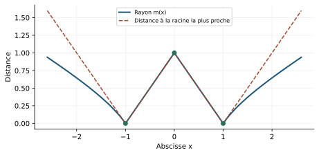
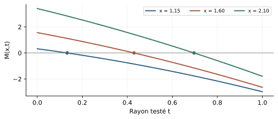
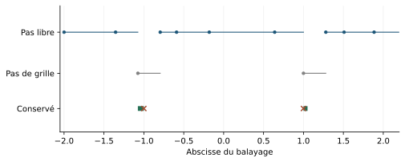

# ENS de Paris, Lyon et Cachan PC 2009 — Mathématiques · Corrigé guidé

*Corrigé rédigé par IA, non officiel. Signalez toute erreur.*

**Rédaction** · GPT-6.2 Astra Ultra · vitesse non renseignée

## Calcul certifié des racines réelles par intervalles d’exclusion

## A · Fonction d’exclusion associée au polynôme

### Question A.1 — Existence du rayon d’exclusion

**Indication.** Ne pas exiger que la dérivée en zéro soit strictement négative pour établir la stricte décroissance.

Pour $t\ge0$, tous les coefficients soustraits dans $M(x,t)$ sont positifs ou nuls. Le coefficient de $t^n$ vaut $|P^{(n)}|/n!=|a_n|>0$. Pour $0\le s<t$, ce dernier terme suffit donc à rendre $M(x,s)>M(x,t)$. La fonction est continue, $M(x,0)=|P(x)|\ge0$ et $M(x,t)\to-\infty$ lorsque $t\to+\infty$. Elle possède un unique zéro $m(x)\ge0$, strictement positif si $P(x)\ne0$.

### Question A.2 — Un exemple où apparaissent trois angles

**Indication.** Simplifier le radical à l’intérieur de $[-1,1]$ avant de dériver.

Pour $P(x)=x^2-1$, l’équation est $t^2+2|x|t-|x^2-1|=0$. Sa solution non négative est $m(x)=-|x|+\sqrt{x^2+|x^2-1|}$. Lorsque $|x|\le1$, elle se réduit à $1-|x|$. Lorsque $|x|\ge1$, elle vaut $\sqrt{2x^2-1}-|x|$. Ces formules se raccordent en $\pm1$. Elles sont dérivables sur les quatre intervalles ouverts découpés par $-1,0,1$. À $-1$, les dérivées gauche et droite valent $-1,+1$ respectivement. À $0$ elles valent $+1,-1$, et à $1$ elles valent $-1,+1$. La fonction est donc partout continue et possède les dérivées unilatérales demandées.

### Question A.3 — Zéros de la fonction d’exclusion

**Indication.** Évaluer l’équation de définition en $t=0$.

Si $P(x)=0$, alors $M(x,0)=0$, donc l’unicité de A.1 donne $m(x)=0$. Inversement, $m(x)=0$ impose $|P(x)|=M(x,0)=0$. Les deux ensembles de zéros coïncident.

### Question A.4 — Exclure les racines d’un intervalle ouvert

**Indication.** L’inégalité est stricte à l’intérieur du rayon, ce qui laisse ouvertes les extrémités.

La formule de Taylor d’un polynôme est exacte à l’ordre $n$. Elle donne $P(y)=P(x)+\sum_{k=1}^n P^{(k)}(x)(y-x)^k/k!$. L’inégalité triangulaire inverse implique $|P(y)|\ge|P(x)|-\sum_{k=1}^n|P^{(k)}(x)|\,|y-x|^k/k!=M(x,|y-x|)$. Si $|y-x|<m(x)$, la stricte décroissance en $t$ donne $M(x,|y-x|)>M(x,m(x))=0$. L’intervalle ouvert $(x-m(x),x+m(x))$ ne contient donc aucune racine.

### Question A.5 — Comparer le rayon à la distance aux racines

**Indication.** Appliquer la propriété d’exclusion à la racine la plus proche.

Si $m(x)>d(x,Z)$, une racine réalisant le minimum, qui existe puisque $Z$ est fini non vide, appartiendrait à l’intervalle ouvert interdit de A.4. C’est impossible. On a donc $m(x)\le d(x,Z)$ pour tout réel $x$, y compris pour les racines où les deux membres s’annulent.

### Question A.6.1 — Persistance des signes autour d’un zéro positif

**Indication.** Maintenir les deux arguments $t$ fixes quand on fait varier $y$.

Si $m(x)>\varepsilon$, $m(x)-\varepsilon$ et $m(x)+\varepsilon$ sont deux arguments non négatifs qui encadrent strictement le zéro. La décroissance donne $M(x,m(x)+\varepsilon)<0<M(x,m(x)-\varepsilon)$. Pour chaque argument fixé, $y\mapsto M(y,t)$ est continue comme somme de valeurs absolues de polynômes. Chaque inégalité stricte persiste dans un voisinage de $x$. Prenons pour $\eta$ le plus petit de leurs deux rayons.

### Question A.6.2 — Voisinage de la borne zéro

**Indication.** Le zéro $m(y)$ est d’emblée non négatif.

Si $m(x)\le\varepsilon$, la stricte décroissance donne encore $M(x,m(x)+\varepsilon)<0$. Par continuité en la première variable, il existe $\eta>0$ tel que $M(y,m(x)+\varepsilon)<0$ pour $|y-x|<\eta$. L’argument inférieur pourrait être négatif et n’est pas nécessaire pour cette conclusion.

### Question A.6.3 — Continuité globale

**Indication.** Prendre une marge sur la tolérance pour traiter aussi l’égalité $m(x)=\varepsilon$.

Fixons une précision $\delta>0$ et utilisons les deux questions précédentes avec $\varepsilon=\delta/2$. Si $m(x)>\varepsilon$, les signes de A.6.1 et la monotonie encadrent $m(y)$ entre $m(x)-\varepsilon$ et $m(x)+\varepsilon$. Sinon, A.6.2 donne $0\le m(y)<m(x)+\varepsilon$ et $m(x)\le\varepsilon$. Dans les deux cas $|m(y)-m(x)|<\delta$ pour $y$ assez proche. Cela inclut le cas $m(x)=0$.

### Question A.7.1 — Équation aux différences finies

**Indication.** Utiliser $ab-cd=a(b-d)+(a-c)d$ avant de diviser par $h$.

Écrivons l’identité $M(t,m(t))=0$ pour $t=x+h$ et $t=x$, puis soustrayons. Dans chaque différence de produits, insérons le produit intermédiaire $|P^{(k)}(x+h)|m(x)^k$. Avec $\Delta_h f=[f(x+h)-f(x)]/h$, il vient
$$\Delta_h|P|-\sum_{k=1}^{n}\frac{|P^{(k)}(x+h)|}{k!}\Delta_h(m^k)-\sum_{k=1}^{n-1}\frac{m(x)^k}{k!}\Delta_h|P^{(k)}|=0.$$
La seconde somme s’arrête à $n-1$ car $P^{(n)}$ est constant.

### Question A.7.2 — Dérivée en un point régulier

**Indication.** Isoler le quotient de $m$ avant de prendre sa limite, afin de démontrer son existence.

Lorsque tous les $P^{(k)}(x)$ pour $0\le k<n$ sont non nuls, leurs signes restent fixes localement. Pour $a=m(x+h)$ et $b=m(x)$, $a^k-b^k=(a-b)\sum_{i=0}^{k-1}a^ib^{k-1-i}$. A.6.3 montre que le coefficient de $\Delta_hm$ dans A.7.1 tend vers $D=\sum_{k=1}^n|P^{(k)}(x)|m(x)^{k-1}/(k-1)!>0$. On peut donc diviser puis passer à la limite. On obtient
$$m'(x)=\frac{\operatorname{sgn}(P(x))P'(x)-\sum_{k=2}^{n}\operatorname{sgn}(P^{(k-1)}(x))P^{(k)}(x)m(x)^{k-1}/(k-1)!}{\sum_{k=1}^{n}|P^{(k)}(x)|m(x)^{k-1}/(k-1)!}.$$
Le décalage d’indice vient de la dérivation du coefficient d’ordre $k-1$.

### Question A.7.3 — Dérivées unilatérales aux points critiques

**Indication.** La seule source de changement unilatéral est la valeur absolue d’un coefficient qui s’annule.

Si $P(x)\ne0$, alors $m(x)>0$ et le terme d’ordre $n$ garantit $D>0$, même lorsque $P'(x)=0$. Chaque fonction $|P^{(k)}|$ possède des dérivées à gauche et à droite. En un zéro de $P^{(k)}$, elles valent respectivement $-|P^{(k+1)}(x)|$ et $+|P^{(k+1)}(x)|$. Dans A.7.1, on peut donc isoler $\Delta_hm$ puis prendre séparément les deux limites. Elles ne coïncident pas nécessairement. Pour $P(x)=x^2-1$, le point non racine $x=0$ de A.2 en est un exemple.

### Question A.7.4 — Comportement à une racine simple

**Indication.** La simplicité de la racine permet de diviser par une dérivée première non nulle.

Soit $z$ une racine simple. Par A.5, $m(z+h)\le|h|$. En développant l’identité de définition près de $z$, son premier membre est $|P(z+h)|=|P'(z)|\,|h|+o(|h|)$. La somme des termes d’ordre au moins deux en $m$ est $O(h^2)$, car les coefficients sont bornés au voisinage. D’où $|P'(z+h)|m(z+h)=|P'(z)|\,|h|+o(|h|)$ et $m(z+h)/|h|\to1$. Comme $m(z)=0$, les dérivées à gauche et à droite valent $-1$ et $+1$.

### Question A.8 — Constante de Lipschitz égale à un

**Indication.** Appliquer le théorème des accroissements finis entre deux points singuliers successifs.

Aux points réguliers, chaque terme du numérateur de A.7.2 est, en module, un terme du dénominateur. L’inégalité triangulaire donne $|m'|\le1$. L’union des zéros des $P^{(k)}$, $0\le k<n$, est finie car ces polynômes sont non nuls. Découpons $[x,y]$ à ces points. Sur chaque sous-intervalle, $m$ est continue jusqu’aux bords et dérivable à l’intérieur. Le théorème des accroissements finis majore sa variation par la longueur du sous-intervalle. La somme donne $|m(y)-m(x)|\le|y-x|$.

### Question A.9.1 — Équation vérifiée par les deux limites

**Indication.** Pour chaque dérivée, séparer la puissance de $|x|$ qu’elle porte de celle du rayon d’exclusion.

Divisons $M(x,m(x))=0$ par $|a_n|\,|x|^n$ lorsque $|x|\to\infty$. On a $|P(x)|/(|a_n||x|^n)\to1$, et $|P^{(k)}(x)|/(|a_n||x|^{n-k})\to n!/(n-k)!$. Avec les limites admises $m_\pm$ de $m(x)/|x|$, chacune vérifie $1-\sum_{k=1}^n\binom nk m_\pm^k=0$. La valeur absolue explique pourquoi la même équation apparaît aux deux extrémités.

### Question A.9.2 — Pente du rayon d’exclusion à l’infini

**Indication.** Ajouter le terme de rang zéro pour reconnaître le binôme.

La somme binomiale vaut $(1+m_\pm)^n-1$. L’équation devient $(1+m_\pm)^n=2$. Comme $m_\pm\ge0$, la seule solution admissible est $m_-=m_+=2^{1/n}-1>0$. En particulier $m(x)\to+\infty$ aux deux extrémités.

### Question A.10 — Comparabilité des deux distances

**Indication.** L’absence de zéros de $f$ ne suffit sur tout $\mathbb R$ qu’après avoir contrôlé les deux infinis.

Hors de $Z$, $f(x)=m(x)/d(x,Z)$ est continue et strictement positive. Au voisinage d’une racine simple $z$, celle-ci est l’unique racine la plus proche. A.7.4 donne $m(x)/|x-z|\to1$, donc le prolongement $f(z)=1$ est continu. À l’infini, $d(x,Z)/|x|\to1$ car $Z$ est fini, d’où $f(x)\to2^{1/n}-1>0$. Hors d’un grand compact, $f$ est donc minorée par la moitié de cette limite. Sur le compact, elle atteint un minimum strictement positif. Le plus petit de ces deux nombres fournit $\alpha_n>0$ tel que $\alpha_n d(x,Z)\le m(x)$ pour le polynôme fixé.

## B · Bornes sur les racines réelles

### Question B.1 — Racine positive du polynôme majorant

**Indication.** La division par $r^n$ rend tous les termes variables monotones dans le même sens.

Pour $r>0$, posons $H(r)=\sum_{k=0}^{n-1}|a_k|/r^{n-k}$. Au moins un coefficient est non nul. La fonction $H$ est continue, strictement décroissante de $+\infty$ vers zéro. L’équation $Q(r)=r^n[1-H(r)]=0$ équivaut à $H(r)=1$ et admet donc une unique solution positive $r_*$. Un possible zéro en $r=0$ n’intervient pas.

### Question B.2 — Contrôle de toutes les racines

**Indication.** Utiliser le module de l’identité satisfaite par une racine.

Pour toute racine $z\ne0$, l’identité $z^n=-\sum_{k<n}a_k z^k$ donne $1\le H(|z|)$. Par décroissance, $|z|\le r_*$. Si $Q(r)>0$ et $r>0$, alors $H(r)<1$ et $r>r_*$. Les racines nulles vérifient aussi la borne et $x_0=\max_{z\in Z}|z|\le r$.

### Question B.3 — Borne par la somme des coefficients

**Indication.** Distinguer au départ les racines de module au plus un.

Soit $z$ une racine avec $|z|>1$. Alors $|z|^n\le\sum_{k<n}|a_k||z|^k\le|z|^{n-1}\sum_{k<n}|a_k|$. Après division, $|z|\le\sum_{k<n}|a_k|$. Les autres racines sont déjà bornées par un. Donc $x_0\le\max(1,\sum_{k=0}^{n-1}|a_k|)$.

### Question B.4 — Faire apparaître les différences de coefficients

**Indication.** Le facteur choisi ajoute la racine un et fait télescoper les coefficients.

Le polynôme $(X-1)P(X)$ est unitaire de degré $n+1$, ses autres coefficients sont $a_{n-1}-1$, puis $a_{k-1}-a_k$ pour $1\le k<n$, et $-a_0$. La somme de leurs modules vaut $S=|a_{n-1}-1|+\sum_{k=1}^{n-1}|a_k-a_{k-1}|+|a_0|$. L’inégalité triangulaire sur le chemin $1,a_{n-1},\ldots,a_0,0$ donne $S\ge1$. B.3 appliquée au produit borne donc ses racines, en particulier celles de $P$, par $S$.

### Question B.5 — Borne par les rapports successifs

**Indication.** Le dernier coefficient autorise un facteur un au lieu de deux car il ferme la somme géométrique.

Posons $a_n=1$ et $R=\max(\{2a_k/a_{k+1}:1\le k\le n-1\}\cup\{a_0/a_1\})$ pour $n\ge2$. Les coefficients sont positifs. Pour $1\le k<n$, les inégalités en cascade donnent $a_k/R^{n-k}\le2^{-(n-k)}$. Pour $k=0$, $a_0/R^n\le a_1/R^{n-1}\le2^{-(n-1)}$. Ainsi
$$H(R)\le\sum_{j=1}^{n-1}2^{-j}+2^{-(n-1)}=1.$$
Par B.1–2, $x_0\le r_*\le R$. Pour $n=1$, le rayon exact est $|a_0|$, ce qui traite directement le cas où la liste des rapports intermédiaires est vide.

### Question B.6 — Deux exemples qui inversent le classement

**Indication.** Des coefficients presque constants favorisent les différences, une progression géométrique contrôle les rapports.

Pour $P=X^3+X^2+X+1$, B.4 donne $1$ et B.5 donne $\max(2,2,1)=2$. La première borne est même atteinte par $-1$. Pour $P=X^3+2X^2+4X+8$, B.4 donne $|2-1|+|4-8|+|2-4|+8=15$, tandis que B.5 donne $\max(4,4,2)=4$. Les polynômes ont des coefficients strictement positifs et possèdent une racine réelle.

## C · Algorithme d’exclusion

### Question C.1 — Le balayage franchit la borne supérieure

**Indication.** Établir une minoration uniforme du déplacement par itération.

Lorsqu’une recherche sur la grille est nécessaire, A.9 assure $m(y_n+k\varepsilon)\to\infty$ lorsque $k\to\infty$. Un premier indice admissible existe donc. Dans un pas d’exclusion, l’avancement est $m(y_n)\ge\varepsilon/2$. Dans un pas de grille, il vaut $k\varepsilon\ge\varepsilon$. Ainsi $y_n\ge -R+n\varepsilon/2$. Tout entier $n>4R/\varepsilon$ assure $y_n>R$.

### Question C.2 — Aucune racine n’est perdue

**Indication.** Un point à distance exactement $m$ peut être une racine, d’où le choix des extrémités.

Montrons par récurrence que les racines de $[-R,y_n[$ sont dans $F_{n,\varepsilon}$. L’initialisation est vide. Dans un pas d’exclusion, $m(y_n)>0$ et $[y_n,y_{n+1}[$ est libre de racines par A.4. Dans un pas de grille, $m(y_{n+1})\ge\varepsilon/2$ et $(y_{n+1}-m(y_{n+1}),y_{n+1}[$ est libre de racines. Le reste éventuel de $[y_n,y_{n+1}[$ est précisément le segment fermé ajouté, extrémité gauche de l’intervalle d’exclusion comprise. Le cas où ce segment est vide est donc couvert. Pour $y_{n_0}>R$, l’invariant donne $Z\subset F_{n_0,\varepsilon}$, même si une racine coïncide avec une borne initiale.

### Question C.3 — Tout point gardé est proche d’une racine

**Indication.** Utiliser le seuil au dernier centre pour couvrir la dernière demi-maille du segment conservé.

Considérons un segment ajouté lors d’une recherche de grille. Écrivons $u_j=y_n+j\varepsilon$ et $y_{n+1}=u_k$. La minimalité de $k$ impose $m(u_j)<\varepsilon/2$ pour $0\le j<k$. La borne droite du segment est $u_k-m(u_k)\le u_k-\varepsilon/2=u_{k-1}+\varepsilon/2$. Chaque point $x$ du segment est donc à distance au plus $\varepsilon/2$ d’un des $u_j$, $j<k$. A.8 donne $m(x)\le m(u_j)+|x-u_j|<\varepsilon$. A.10 implique $d(x,Z)\le m(x)/\alpha_n\le\varepsilon/\alpha_n$. L’union des segments reste donc incluse dans $Z_\varepsilon$.

### Question C.4 — Calcul approché avec rayons certifiés

**Indication.** Prévoir une marge sur la maille et le seuil afin que l’erreur numérique ne soit pas comptée deux fois.

Une surestimation du rayon pourrait supprimer une racine. À chaque point testé $y$, calculons par dichotomie $0\le L(y)\le m(y)\le U(y)$ avec $U(y)-L(y)\le\eta=\varepsilon/8$. On part de $0$ et d’une borne haute trouvée par doublements jusqu’à $M(y,t)\le0$, puis on conserve les signes de $M$. Une racine reconnue par $P(y)=0$ donne $L=U=0$.

Pour préserver les inclusions de C.2–3 avec la précision initialement demandée, prenons un seuil $s=\varepsilon/4$ et une maille $2s$. Si $L(y)\ge s$, avançons de $L(y)$. Sinon, parcourons la grille jusqu’au premier $u_k$ tel que $L(u_k)\ge s$ et gardons, s’il existe, le segment $[y,u_k-L(u_k)]$. Les rayons exclus restent inférieurs à $m$, l’avancement est au moins $s$ et la grille termine car $m\to\infty$. Tout point gardé est à distance au plus $s$ d’un ancien nœud de grille où $m\le L+\eta<s+\eta$. Ainsi $m(x)\le2s+\eta<\varepsilon$ et le résultat reste inclus dans $Z_\varepsilon$. En arithmétique flottante, les signes utilisés pour la dichotomie demandent eux aussi un encadrement fiable.
