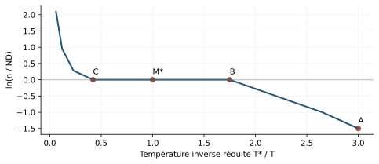
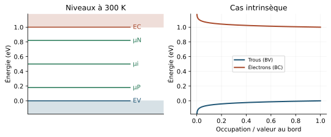
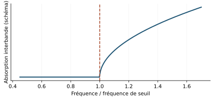
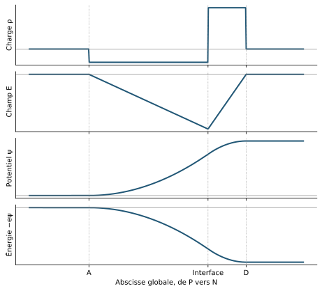
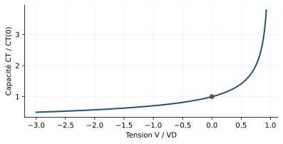
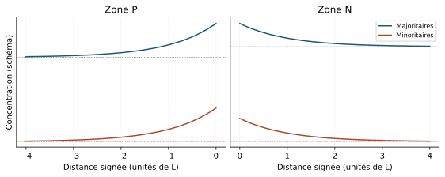
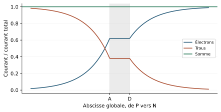
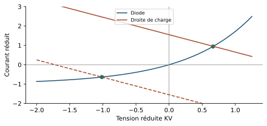

# ENS de Lyon et de Cachan PC 2009 — Physique PC2 · Corrigé brut

*Corrigé rédigé par IA, non officiel. Signalez toute erreur.*

**Lecture du rapport du jury** · GPT-6.2 Astra Ultra · vitesse non renseignée

**Rédaction** · GPT-6.2 Astra Ultra · vitesse non renseignée

## Semiconducteurs, photorésistance et jonction PN

## I.A · Semiconducteur intrinsèque

### Question I.A.1 — Densité électronique d’un métal

Prenons un électron de conduction par atome et le cuivre comme métal représentatif. Avec $\rho\simeq8{,}9\ \mathrm{g\,cm^{-3}}$ et $M\simeq64\ \mathrm{g\,mol^{-1}}$, $n_M\simeq \rho N_A/M=8{,}4\times10^{22}\ \mathrm{cm^{-3}}$. On retiendra $10^{23}\ \mathrm{cm^{-3}}$, ordre de grandeur de la densité atomique d’un solide.

### Question I.A.2 — Densité électronique intrinsèque

La loi de dérive donne $\sigma\simeq en\mu$, à un facteur d’ordre un près pour les deux types de porteurs du semiconducteur. Alors $n_i/n_M\simeq(\sigma_{SC}/\sigma_M)(\mu_M/\mu_{SC})=10^{-11}\times10^{-2}$. On obtient environ $10^{10}\ \mathrm{cm^{-3}}$.

### Question I.A.3 — Densité du gaz parfait

À une pression de $10^5\ \mathrm{Pa}$ et vers $273$ à $300\ \mathrm K$, la loi des gaz donne $n_{GP}=P/(k_BT)\simeq2{,}5\times10^{25}\ \mathrm{m^{-3}}$. Il y a un million de centimètres cubes dans un mètre cube, donc $n_{GP}\simeq2{,}5\times10^{19}\ \mathrm{cm^{-3}}$.

### Question I.A.4 — Gaz dilué de porteurs

Les trois concentrations vérifient $n_i\ll n_{GP}\ll n_M$. Pour $n_i\sim10^{10}\ \mathrm{cm^{-3}}$, la séparation moyenne vaut $n_i^{-1/3}\sim5\ \mu\mathrm m$. Les porteurs sont très espacés et les états de conduction faiblement occupés. Si l’on néglige le réseau et que les interactions résiduelles sont faibles, on peut donc traiter cette population comme un gaz classique dilué. Une densité égale à celle d’un gaz aux conditions standard ne constitue aucun critère d’idéalité.

### Question I.A.5 — Échelle thermique du gap

L’égalité d’échelles $k_BT_G\simeq E_G$ donne $T_G\simeq 1/(8{,}62\times10^{-5})\ \mathrm K=1{,}16\times10^4\ \mathrm K$. Ainsi $\alpha_G=T_G/T_a\simeq39$. À température ambiante, une excitation sur toute la bande interdite puise dans la queue de la distribution. Cette échelle énergétique n’est pas un seuil net et un cristal réel peut fondre bien auparavant.

## I.B · Dopage

### Question I.B.1 — Énergie d’ionisation des dopants

Avec $\delta_D=\delta_A=0{,}01\ \mathrm{eV}$, le critère $k_BT_{\rm dop}\sim\delta$ conduit à $T_{\rm dop}\sim116\ \mathrm K$ et $\alpha_{\rm dop}\sim0{,}39$. À $300\ \mathrm K$ l’ionisation des dopants est donc bien plus aisée que l’excitation à travers le gap. Le cahier adopte dans ce régime l’approximation d’ionisation complète.

### Question I.B.2 — Les trois domaines de température

**a)** Sur l’axe inverse $T^*/T$, $T^*/T_G\simeq0{,}026$ est à gauche du point de fonctionnement et $T^*/T_{\rm dop}\simeq2{,}6$ à droite. Ces repères sont des ordres de grandeur. **b)** Sur le plateau à $T^*=T_a$, chaque donneur fournit un électron et $n_{\rm dop}\simeq N_D=10^{16}\ \mathrm{cm^{-3}}$.

**c)** On peut mesurer la tension de Hall à courant et induction fixés en variant la température. Dans le domaine à un porteur dominant, $|R_H|=1/(en)$ fournit directement $n$. Dans la région intrinsèque, les deux mobilités entrent dans l’analyse. **d)** Pour une diode stable on vise le plateau $C$–$B$. Une thermorésistance exploite une portion à forte pente, vers le gel des donneurs ou dans la montée intrinsèque, si elle est accessible au matériau.

### Question I.B.3 — Idéalité dans le domaine extrinsèque

Entre $A$ et $C$, $n$ reste au plus de l’ordre de $10^{16}\ \mathrm{cm^{-3}}$. L’espacement correspondant est d’environ $46\ \mathrm{nm}$, grand devant une maille cristalline. Pour le dopage modéré envisagé, l’occupation des états de conduction reste faible. L’approximation de gaz de porteurs indépendants et non dégénérés est cohérente dans le domaine du modèle.

## I.C · Équilibre des porteurs

### Question I.C.1 — Loi d’action de masse

Multiplions $n=N_e e^{\beta(\mu-E_C)}$ par $p=N_t e^{\beta(E_V-\mu)}$. Le potentiel chimique disparaît et $np=N_eN_t e^{-\beta E_G}\equiv K_e(T)$. À température donnée et matériau fixé, ce produit est le même à l’équilibre, y compris lorsque le dopage redistribue les deux concentrations.

### Question I.C.2 — Potentiel chimique

La division des deux lois donne $n/p=(N_e/N_t)\exp[\beta(2\mu-E_C-E_V)]$. Il en résulte $\mu=(E_C+E_V)/2+(k_BT/2)\ln[nN_t/(pN_e)]$. La correction logarithmique fixe le sens du déplacement par rapport au milieu du gap.

### Question I.C.3 — Cas intrinsèque et influence de la température

**a)** La création d’une paire impose $p_i=n_i$, donc $n_i=\sqrt{N_eN_t}\exp[-E_G/(2k_BT)]$. **b)** Pour $N_e=N_t$, le logarithme de I.C.2 s’annule et $\mu_i=(E_V+E_C)/2$.

**c)** À $300\ \mathrm K$, $\exp[-1/(2\times0{,}02585)]\simeq4{,}0\times10^{-9}$. Avec $N_e=10^{19}\ \mathrm{cm^{-3}}$, $n_i\simeq4\times10^{10}\ \mathrm{cm^{-3}}\ll N_D$. **d)** À $10T_a$, le préfacteur est multiplié par $10^{3/2}$ et l’exponentielle vaut $0{,}145$. Le modèle donne $n_i\simeq4{,}6\times10^{19}\ \mathrm{cm^{-3}}\gg N_D$. Il s’agit d’une extrapolation du modèle de bandes à gap constant.

### Question I.C.4 — Deux types de conducteurs dopés

**a)** En zone N, la neutralité donne $n_N-p_N=N_D$. Avec $p_Nn_N=n_i^2$ et $N_D\gg n_i$, $n_N\simeq N_D$ et $p_N\simeq n_i^2/N_D\ll n_N$. La loi de population donne $\mu_N=E_C-k_BT\ln(N_e/N_D)$.

**b)** En zone P, $p_P-n_P=N_A$ entraîne $p_P\simeq N_A$ et $n_P\simeq n_i^2/N_A\ll p_P$. La bande de valence donne $\mu_P=E_V+k_BT\ln(N_t/N_A)$. Les signes des déplacements traduisent le type de porteur majoritaire.

### Question I.C.5 — Position des trois potentiels

Prenons $E_V=0$, $E_C=1\ \mathrm{eV}$ et le dopage symétrique de la première partie. À $300\ \mathrm K$, $k_BT\ln(10^{19}/10^{16})\simeq0{,}179\ \mathrm{eV}$. Les trois niveaux sont donc situés dans le gap selon $\mu_P\simeq0{,}179<\mu_i=0{,}500<\mu_N\simeq0{,}821\ \mathrm{eV}$. Le dopage N rapproche le potentiel chimique de la conduction.

### Question I.C.6 — Occupation des bandes dans le cristal intrinsèque

Au-dessus de $E_C$, $f_e(E)=\exp[-\beta(E-\mu_i)]$ décroît quand on monte en énergie. Au-dessous de $E_V$, $f_t(E)=\exp[\beta(E-\mu_i)]$ décroît quand on descend. Pour des densités d’états symétriques, les deux courbes se correspondent par réflexion autour de $\mu_i$, avec la même valeur au bord de leur bande. Les intégrales pondérées comptent autant d’électrons excités que de trous laissés, ce qui conserve le nombre total d’électrons.

### Question I.C.7 — Lire la courbe de gel et d’ionisation

En allant des grandes vers les petites valeurs de $T^*/T$, on chauffe le cristal. Initialement les électrons restent liés aux donneurs. Sur $A$–$B$ leur libération fait croître $n$. Sur $B$–$C$ les donneurs sont épuisés et $n\simeq N_D$, donc $\ln(n/N_D)\simeq0$. Plus à gauche, l’excitation de paires à travers le gap devient dominante et $n$ recommence à croître.

## II.A · Absorption de la lumière

### Question II.A.1 — Seuil d’absorption interbande

Il faut $h\nu\ge E_G$. Pour $E_G=1\ \mathrm{eV}$, la fréquence minimale est $\nu_G=2{,}42\times10^{14}\ \mathrm{Hz}$ et la longueur d’onde dans le vide vérifie $\lambda_0\le hc/E_G\simeq1{,}24\ \mu\mathrm m$. Le seuil se situe dans le proche infrarouge. Les photons visibles satisfont tous le critère énergétique.

### Question II.A.2 — Flux lumineux et densité photonique

Dans le matériau, les photons avancent à $v=c/N_{SC}$. Leur flux numérique vaut $v\rho_\nu(x)$ par unité de surface, où $\rho_\nu$ désigne leur densité. En multipliant par l’énergie d’un photon, $\Phi_\nu(x)=h\nu(c/N_{SC})\rho_\nu(x)$. Une même unité de longueur doit servir pour la vitesse, le flux et la densité.

### Question II.A.3 — Bilan d’absorption dans une tranche

Entre $x$ et $x+dx$, la diminution de flux photonique compense $K_\nu\rho_\nu\,dx$ absorptions par unité d’aire et de temps. Ainsi $v\rho_\nu'=-K_\nu\rho_\nu$ et $\Phi_\nu'=-\Phi_\nu/\ell$ avec $\ell=v/K_\nu=c/(N_{SC}K_\nu)$. Sur une distance $\ell$, la fraction transmise est $1/e$ en milieu uniforme.

### Question II.A.4 — Profil lumineux en profondeur

L’intégration donne $\Phi_\nu(x)=\Phi_\nu(0)e^{-x/\ell}$ et $\rho_\nu(x)=\rho_\nu(0)e^{-x/\ell}$. La fraction du flux d’entrée absorbée entre la surface et une profondeur $H$ vaut $1-e^{-H/\ell}$.

### Question II.A.5 — Franchissement de l’interface

Une partie du faisceau incident peut être réfléchie. À incidence normale et pour une interface diélectrique simple depuis l’air, la réflectance en intensité est approximativement $\mathcal R=[(N_{SC}-1)/(N_{SC}+1)]^2$. On a donc $\Phi_\nu(0)\simeq(1-\mathcal R)\Phi_\nu^{\rm ext}$. L’égalité avec le flux extérieur est une approximation si la réflexion est négligeable ou compensée.

### Question II.A.6 — Variation du coefficient d’absorption

Dans le modèle parfait de transitions interbandes, $K_\nu$ est nul sous $\nu_G$. Près du seuil, peu de couples état initial occupé et état final libre sont accessibles. Quand la fréquence augmente, le domaine accessible s’ouvre et l’absorption apparaît, généralement croissante près du seuil. Les seules données du sujet ne déterminent ni la pente ni la forme du spectre loin du seuil.

### Question II.A.7 — Une énergie suffisante ne garantit pas l’absorption

Pour passer d’un état d’énergie $E$ à un état d’énergie $E+h\nu$, l’état initial doit contenir un électron et le final être disponible. Si le final dans la bande de conduction est déjà occupé avec les mêmes nombres quantiques, la transition est interdite par le principe de Pauli. Un trou au point de départ empêche aussi cette absorption.

### Question II.A.8 — Création locale de paires

Si chaque photon interbande absorbé crée une paire, le taux volumique est $\gamma_\nu(x)=K_\nu\rho_\nu(x)=\Phi_\nu(x)/(h\nu\ell)$. Il décroît avec la profondeur. Un régime stationnaire sous flux continu requiert aussi la recombinaison électron-trou, dont le bilan compense alors la génération nette.

### Question II.A.9 — Transport entre régions inégalement éclairées

Le gradient de photogénération produit des concentrations de porteurs variables avec $x$. Électrons et trous diffusent des régions riches vers les régions pauvres. Il faudrait ajouter à leurs bilans les divergences des flux de diffusion, avec des conditions de recombinaison aux surfaces.

### Question II.A.10 — Ordres de grandeur optiques

**a)** Une couche de $H$ comparable à quelques $\ell$ absorbe une fraction appréciable du flux. Par exemple $H=2{,}3\ell$ en absorbe 90 %. Une épaisseur bien supérieure ajoute surtout du matériau faiblement éclairé, une épaisseur très faible laisse passer l’essentiel. **b)** Pour $N_{SC}=3$ et $\ell=10^{-6}\ \mathrm m$, $K_\nu=c/(N_{SC}\ell)\simeq10^{14}\ \mathrm{s^{-1}}$.

**c)** À un mètre d’une source isotrope de $100\ \mathrm W$, le flux maximal est $100/(4\pi)\simeq8\ \mathrm{W\,m^{-2}}$. En prenant $h\nu$ de l’ordre de $1$ à $2\ \mathrm{eV}$ et $v=10^8\ \mathrm{m\,s^{-1}}$, cela donne $\rho_\nu(0)\sim10^5$ à $10^6\ \mathrm{cm^{-3}}$ et $\gamma_\nu(0)\sim10^{19}$ à $10^{20}\ \mathrm{cm^{-3}\,s^{-1}}$. Ces estimations sont à multiplier par la fraction de puissance effectivement rayonnée dans le domaine utile et transmise.

## II.B · Réponse temporelle

### Question II.B.1 — Signe du terme de génération thermique

Une recombinaison demande la rencontre d’un électron et d’un trou, d’où un taux proportionnel à $np$. La génération thermique inverse persiste dans le noir. Elle doit compenser la recombinaison à l’équilibre $np=n_i^2$. Le bilan de création spontanée est donc $-a(np-n_i^2)$, négatif en excès de porteurs et positif en déficit.

### Question II.B.2 — Proportionnalité au flux lumineux

À fréquence étroite fixée, le nombre de photons incidents par seconde est proportionnel à la puissance lumineuse. À rendement d’absorption et probabilité de création constants, la génération volumique s’écrit $b\Phi$. Cette loi suppose un régime sans saturation optique et une géométrie inchangée.

### Question II.B.3 — Bilans des deux espèces

Chaque événement crée ou retire exactement un porteur de chaque type. Pour une densité uniforme, $\dot n=\dot p=b\Phi-a(np-n_i^2)$. En soustrayant, $n-p=n^0-p^0$ reste constant. Cette conservation reflète la neutralité initiale avec les dopants fixes.

### Question II.B.4 — Équation intrinsèque

Dans le cristal pur initialement à l’équilibre, $n^0=p^0=n_i$. La différence conservée impose $p(t)=n(t)$. D’où $\dot n=b\Phi+a n_i^2-a n^2$. Le terme quadratique explique que le retour ne soit pas en général une exponentielle simple de $n$.

### Question II.B.5 — Allumage et limite des petits signaux

**a)** Après l’allumage, $\dot n=a(n_1^2-n^2)$ avec $n(0)=n_i$ et $n_1^2=n_i^2+b\Phi_1/a$. **b)** L’équilibre physique est $n=p=n_1$. Il est stable puisque la dérivée du membre droit en $n_1$ vaut $-2an_1$.

**c)** Avec $x=n/n_1$, $\dot x=(1-x^2)/(2\tau_1)$ et $\tau_1=1/(2an_1)$. L’intégration donne $(1+x)/(1-x)=[(1+x_0)/(1-x_0)]e^{t/\tau_1}$. Le temps $\tau_1$ dépend de l’éclairement par $n_1$. **d)** Si $n_1/n_i=1+\epsilon_1$, alors $b\Phi_1/(a n_i^2)=2\epsilon_1+\epsilon_1^2\ll1$. La linéarisation donne $\delta\dot n+\delta n/\tau_i=b\Phi_1$ avec $\tau_i=1/(2an_i)$. On retrouve à faible flux le temps propre du matériau à température fixée.

### Question II.B.6 — Extinction de l’éclairement

**a)** À l’extinction, $\Phi=0$, $n(0)=n_1$ et $\dot n=a(n_i^2-n^2)<0$ tant que $n>n_i$. **b)** Pour $y=n/n_i$, $\dot y=(1-y^2)/(2\tau_i)$. En intégrant $\partial_t\ln|(1+y)/(1-y)|=1/\tau_i$, on trouve $F(y)=F(y_0)e^{t/\tau_i}$ avec $y_0=n_1/n_i>1$. Le rapport $F$ reste négatif tandis que $n$ décroît vers $n_i$.

### Question II.B.7 — Comparaison des temps opérationnels

Le rapport $y_0$ augmente avec le flux initial. Les deux temps à $1-1/e$ décroissent lorsque l’excursion augmente et $\tau^\uparrow\le\tau^\downarrow$. La photorésistance répond donc plus rapidement à l’allumage qu’à l’extinction pour une même excursion de concentration. À faible flux, $y_0\to1$ et les deux formules tendent vers $\tau_i$. Cette mesure à fraction fixée n’est pas le temps de décroissance de la toute dernière portion du transitoire.

## II.C · Comparaison aux mesures

### Question II.C.1 — Loi statique et confrontation aux mesures

**a)** À géométrie fixée, $R\propto1/\sigma$ et, dans le cristal intrinsèque, $\sigma=e(\mu_e+\mu_t)n$. À l’équilibre éclairé, $1/R^2\propto n_i^2+b\Phi/a$. En posant $A=b/(a n_i^2)$, $(R_0/R)^2=(1+A\Phi)/(1+A\Phi_0)$.

**b)** La figure 4 montre une partie presque rectiligne pour les points à fort flux, avec une courbure à bas flux. Le modèle rend compte d’une tendance presque affine sur une plage limitée. Si $\Phi_0$ est bien le flux mesuré avec $R_0$, il impose aussi $(R_0/R)^2\le\Phi/\Phi_0$ pour $\Phi\ge\Phi_0$. Les échelles imprimées donnent vers la droite environ $2{,}3\times10^6$ pour $8{,}5\times10^3$ en abscisse. Cet écart de normalisation empêche une validation quantitative par la seule rectitude apparente.

**c)** Si la lumière ajoute $\Delta n=\Delta p=\delta$, alors $s_i=\delta/n_i$ et $s_{\rm dop}=(\mu_e+\mu_t)\delta/(\mu_e n_N^0+\mu_t p_N^0)$. À excès comparable et mobilités de mêmes ordres, $n_N^0\simeq N_D\gg n_i$ réduit la sensibilité relative. Le matériau intrinsèque est préférable dans ce cadre.

### Question II.C.2 — Mesurer les temps sur la résistance

**a)** L’éclairement fait baisser $R$ et l’obscurité la fait remonter. Le minimum décroît lorsque le flux augmente. La descente de $R$ à l’allumage devient très rapide pour la courbe (c), tandis que la remontée demeure progressive. Cela traduit l’asymétrie prévue. La grandeur prédite directement est $n\propto1/R$, ce qui déforme les temps lus sur $R$.

**b)** Dans l’obscurité, près du plateau final, $\delta R$ et $\delta n$ sont proportionnels. Sur la courbe (a), l’écart résiduel diminue d’un facteur de l’ordre de $e$ en un temps de l’ordre de la seconde. On estime ainsi $\tau_i\sim1\ \mathrm s$, avec une incertitude sensible sur l’asymptote. **c)** Alimenter la photorésistance par une petite source de courant constant $I_0$ et mesurer à l’oscilloscope la tension à ses bornes. On lit $u(t)=I_0R(t)$. Une source de tension avec une résistance série très supérieure à $R$ approxime aussi ce montage.

## III.A.a · Électrostatique de la zone dépeuplée

### Question III.A.a.1 — Champ dans la zone de charge d’espace

Prenons $X$ orienté de P vers N. L’équation de Gauss est $\mathcal E'=\rho/\varepsilon$. En utilisant $\mathcal E(X_A)=\mathcal E(X_D)=0$, on obtient $\mathcal E=-eN_A(X-X_A)/\varepsilon$ pour $X_A<X<0$ et $\mathcal E=eN_D(X-X_D)/\varepsilon$ pour $0<X<X_D$. Ailleurs le champ est nul. Son sens est celui des $X$ décroissants.

### Question III.A.a.2 — Raccordement à l’interface métallurgique

Il n’y a aucune charge surfacique en $X=0$, seulement un saut de densité volumique dans le même matériau. La composante normale du champ est donc continue. Ses deux valeurs donnent $N_A(-X_A)=N_D X_D$, autrement dit les deux couches de charge fixe portent des charges opposées de même module.

### Question III.A.a.3 — Potentiel dans les quatre régions

Avec $\psi(X_A)=0$ et $\psi'=-\mathcal E$, le potentiel est nul pour $X\le X_A$. Côté P dépeuplé, $\psi=eN_A(X-X_A)^2/(2\varepsilon)$. Côté N dépeuplé, $\psi=V_D-eN_D(X_D-X)^2/(2\varepsilon)$, où $V_D=\psi(X_D)$. Pour $X\ge X_D$, $\psi=V_D$. Le raccord en zéro fixe $V_D$ par les deux paraboles.

### Question III.A.a.4 — Énergie électrostatique de l’électron

Un électron porte $q=-e$. En prenant l’énergie nulle là où $\psi=0$, $E_p(X)=-e\psi(X)$. En joules, le dénivelé énergétique de P vers N est donc $-eV_D$. Le profil de l’électron s’obtient en retournant verticalement celui du potentiel.

### Question III.A.a.5 — Lire les profils électrostatiques

**a)** Le champ forme un triangle négatif entre $X_A$ et $X_D$, sa pointe étant à l’interface. **b)** Le potentiel croît horizontalement raccordé aux plateaux, d’abord convexe puis concave, car $\psi''=-\rho/\varepsilon$. **c)** L’énergie de l’électron décroît entre deux plateaux, avec les courbures opposées. Le schéma aligne les quatre quantités en abscisse. La dissymétrie des largeurs traduit la neutralité des charges fixes.

### Question III.A.a.6 — Courbure des bandes et barrière

Tous les niveaux électroniques locaux reçoivent le même décalage $-e\psi(X)$. Ainsi $E_C$ et $E_V$ descendent de P vers N en restant séparés par le même gap. À l’équilibre, le potentiel électrochimique est constant. Un électron majoritaire qui voudrait diffuser de N vers P doit gravir une barrière d’énergie $eV_D$. La force électrique sur cet électron est dirigée vers N.

### Question III.A.a.7 — Largeur d’équilibre

La diffusion des porteurs majoritaires découvre les ions fixes. Le champ qu’ils créent produit une dérive opposée à la diffusion des électrons et des trous. La largeur stationnaire est celle pour laquelle les courants de dérive et de diffusion s’annulent pour chacune des deux espèces. Un champ trop faible laisserait la diffusion agrandir la région dépeuplée.

### Question III.A.a.8 — Potentiel de diffusion

L’intégrale $V_D=-\int_{X_A}^{X_D}\mathcal E\,dX$ est l’aire du triangle de champ prise positive. L’intégration des deux tronçons donne
$$V_D=\frac{e}{2\varepsilon}(N_A X_A^2+N_D X_D^2).$$
Cette différence est positive avec les orientations retenues.

### Question III.A.a.9 — Nombre d’inconnues

À dopages et permittivité donnés, les inconnues sont $X_A$, $X_D$ et $V_D$. L’électrostatique apporte la neutralité $-N_A X_A=N_D X_D$ et la relation quadratique précédente. La définition $W=X_D-X_A$ introduit une nouvelle variable avec sa définition. Une information supplémentaire sur l’équilibre des porteurs est nécessaire pour fixer numériquement l’échelle de la zone.

### Question III.A.a.10 — Largeur et partage de la zone dépeuplée

La neutralité et $W=X_D-X_A$ donnent $X_A=-N_DW/(N_A+N_D)$ et $X_D=N_AW/(N_A+N_D)$. En substituant dans l’énergie électrostatique de III.A.a.8,
$$W=\sqrt{\frac{2\varepsilon V_D}{e}\left(\frac1{N_A}+\frac1{N_D}\right)}.$$
La zone s’étend principalement dans la partie la moins dopée, où davantage de longueur est nécessaire pour découvrir la même charge surfacique.

## III.A.b · Potentiel de diffusion

### Question III.A.b.1 — Courants de diffusion et de conduction

Pour des porteurs de charge $q=se$, le flux particulaire diffusif est $-D\,dc/dX$. Le courant de diffusion est donc $J_D=-seD\,dc/dX$. La vitesse de dérive vaut $s\mu_{\rm el}\mathcal E$ et le courant associé $J_C=e\mu_{\rm el}c\mathcal E$ pour les deux signes de charge. Ici $\mu_{\rm el}=eD/(k_BT)=KD$.

### Question III.A.b.2 — Courant en fonction du potentiel

En remplaçant $\mathcal E=-d\psi/dX$ et $\mu_{\rm el}=KD$, le courant selon $+X$ devient $J=-eD[s\,dc/dX+Kc\,d\psi/dX]$. Le coefficient $K=e/(k_BT)$ est en inverse de volts, donc les deux termes entre crochets ont la dimension d’un gradient de concentration.

### Question III.A.b.3 — Tension de contact et loi de Boltzmann

En l’absence de courant, $dc/c+sK\,d\psi=0$. De A à D, $\ln(c_D/c_A)=-sKV_D$. Pour les électrons $s=-1$, $c_D\simeq N_D$ et $c_A\simeq n_i^2/N_A$, donc $KV_D=\ln(N_AN_D/n_i^2)$. Pour les trous le rapport et le signe sont inversés, ce qui restitue exactement la même tension.

### Question III.A.b.4 — Valeur du potentiel de diffusion

Pour cette jonction, $N_A=10^{15}$, $N_D=10^{18}$ et $n_i=10^{10}$ en $\mathrm{cm^{-3}}$. Ainsi $N_AN_D/n_i^2=10^{13}$ et $V_D=(k_BT/e)\,13\ln10\simeq0{,}774\ \mathrm V$ à $300\ \mathrm K$. Le quotient dans le logarithme est sans dimension.

### Question III.A.b.5 — Largeur numérique et approximation continue

Avec $\varepsilon\simeq10\varepsilon_0$, $N_A=10^{21}\ \mathrm{m^{-3}}$ et $N_D=10^{24}\ \mathrm{m^{-3}}$, on trouve $W\simeq9{,}3\times10^{-7}\ \mathrm m$, soit environ $0{,}93\ \mu\mathrm m$. La largeur totale dépasse largement la maille atomique et reste petite devant les dimensions macroscopiques du dispositif. Le côté N n’occupe qu’environ $W/1000$, de l’ordre du nanomètre. Le modèle abrupt continu y exige donc davantage de prudence.

### Question III.A.b.6 — Intensité du champ

Le champ moyen en module vaut $V_D/W\simeq8{,}4\times10^5\ \mathrm{V\,m^{-1}}$ et le maximum triangulaire le double, environ $1{,}7\times10^6\ \mathrm{V\,m^{-1}}$. On peut comparer cette valeur au champ critique de claquage du matériau, qui fixe le domaine de validité du modèle de transport. À l’échelle d’une maille $d$, l’énergie $e\mathcal E d$ se compare aussi au gap ou à $k_BT$.

## III.B.a · Capacité de transition

### Question III.B.a.1 — Largeur sous polarisation

La barrière électrostatique devient $V_D-V$. L’expression de III.A.a.10 donne $W(V)=W_0\sqrt{1-V/V_D}$ pour $V<V_D$. La polarisation directe rétrécit la zone dépeuplée, tandis que la polarisation inverse l’élargit.

### Question III.B.a.2 — Charge fixe découverte en zone N

L’intégration du dopage ionisé sur le volume $SX_D$ donne $Q^+=eS N_DX_D=eS[N_AN_D/(N_A+N_D)]W(V)$. Le module de la charge négative découverte côté P est identique. Les deux charges diminuent lorsque $V$ augmente.

### Question III.B.a.3 — Capacité différentielle de transition

Posons $N_{\rm eff}=N_AN_D/(N_A+N_D)$. Puisque $W^2=2\varepsilon(V_D-V)/(eN_{\rm eff})$, $dW/dV=-\varepsilon/(eN_{\rm eff}W)$. Avec la définition du sujet, $C_T=-dQ^+/dV=\varepsilon S/W(V)$. On retrouve la forme d’une capacité plane et son entrefer effectif varie avec la tension.

### Question III.B.a.4 — Capacité normalisée

On obtient $C_T/C_T^0=(1-V/V_D)^{-1/2}$. La courbe passe par $(0,1)$, croît et reste convexe. Vers les tensions inverses élevées elle décroît vers zéro. La divergence formelle à $V=V_D$ signale la fin du modèle de déplétion et de faible déséquilibre.

### Question III.B.a.5 — Ordre de grandeur à polarisation nulle

Pour $S=1\ \mathrm{mm^2}=10^{-6}\ \mathrm{m^2}$, $\varepsilon=8{,}85\times10^{-11}\ \mathrm{F\,m^{-1}}$ et $W_0\simeq9{,}3\times10^{-7}\ \mathrm m$, $C_T^0\simeq9{,}6\times10^{-11}\ \mathrm F$, soit environ $96\ \mathrm{pF}$.

### Question III.B.a.6 — Accord électrique d’un résonateur

Une diode varicap polarisée en inverse fournit une capacité réglable par une tension continue. Dans un circuit $LC$, $f_0=1/(2\pi\sqrt{LC})$ peut donc être ajustée électriquement. La polarisation inverse garde le courant de conduction faible.

### Question III.B.a.7 — Courant en régime variable

Toute variation de tension modifie la charge découverte et engendre un courant capacitif. Au voisinage de $V_{\rm st}$, $\delta i_T=C_T(V_{\rm st})\,d\delta V/dt$. Ce courant s’ajoute à la conduction, modifie l’impédance alternative et participe aux transitoires de commutation.

## III.B.b · Électroneutralité

### Question III.B.b.1 — Neutralité locale des zones extérieures

En zone P entièrement ionisée, $e[p_P(y)-n_P(y)-N_A]=0$. En zone N, $e[p_N(x)-n_N(x)+N_D]=0$. Elles s’appliquent dans les parties électriquement neutres, aux abscisses locales $y$ et $x$ comptées à partir des frontières.

### Question III.B.b.2 — Égalité des excès locaux

Soustrayons les deux égalités valables à l’équilibre des mêmes égalités sous polarisation. Les dopants fixes disparaissent. Il vient $\Delta p_P=\Delta n_P$ et $\Delta p_N=\Delta n_N$ en chaque point des régions respectives.

### Question III.B.b.3 — Concentrations de référence et petites variations relatives

En zone P, la même variation absolue est divisée par $p_P^0\simeq N_A$ pour les majoritaires et par $n_P^0=n_i^2/N_A$ pour les minoritaires. Leur rapport vaut $n_i^2/N_A^2\ll1$. En zone N on obtient $n_i^2/N_D^2\ll1$. En faible injection, les densités majoritaires peuvent être évaluées à leur valeur d’équilibre pour calculer les concentrations minoritaires de bord.

## III.B.c · Franchissement de la barrière

### Question III.B.c.1 — Rapports des concentrations aux frontières

Sous faible déséquilibre, la loi quasi boltzmannienne s’applique avec la chute $V_D-V$. Pour les trous, $p_N(X_D)/p_P(X_A)=e^{-K(V_D-V)}$. Pour les électrons, le même rapport réduit s’obtient en inversant les bords, $n_P(X_A)/n_N(X_D)=e^{-K(V_D-V)}$. Dans les deux cas, il vaut $(n_i^2/N_AN_D)e^{KV}$.

### Question III.B.c.2 — Excès injectés au bord

En remplaçant les concentrations majoritaires de bord par $p_P^0=N_A$ et $n_N^0=N_D$, on obtient $p_N(X_D)=(n_i^2/N_D)e^{KV}$ et $n_P(X_A)=(n_i^2/N_A)e^{KV}$. Après soustraction des valeurs d’équilibre, $\Delta p_N=(n_i^2/N_D)(e^{KV}-1)=\Delta n_N$ et $\Delta n_P=(n_i^2/N_A)(e^{KV}-1)=\Delta p_P$. Le terme $-1$ assure l’annulation lorsque $V=0$.

## III.B.d · Diffusion et recombinaison

### Question III.B.d.1 — Du taux bilinéaire à la durée de vie

Avec un excès commun $\delta$ dans une zone neutre, $np-n_i^2=(n^0+p^0)\delta+\delta^2$. En faible injection, le taux de disparition devient $a(n^0+p^0)\delta=\delta/\tau$. Le modèle bilinéaire correspond donc à $\tau^{-1}=a(n^0+p^0)$, approximativement $aN_A$ en zone P et $aN_D$ en zone N. Le taux de disparition a le signe opposé au taux de création algébrique.

### Question III.B.d.2 — Équations stationnaires de diffusion

Dans une tranche de zone neutre, le gain diffusif d’une espèce minoritaire par unité de volume est $D\Delta c''$, la perte $\Delta c/\tau$. Leur égalité donne $D_t\Delta p_N''-\Delta p_N/\tau_t=0$ en $x$ et $D_e\Delta n_P''-\Delta n_P/\tau_e=0$ en $y$. Les longueurs correspondantes sont $L_t=\sqrt{D_t\tau_t}$ et $L_e=\sqrt{D_e\tau_e}$.

### Question III.B.d.3 — Excès minoritaires dans chaque zone

La solution de $\Delta c''-\Delta c/L^2=0$ est une somme d’exponentielles. Loin de la jonction l’excès doit s’annuler, ce qui élimine la branche croissante. Avec les données de bord,
$$\Delta p_N(x)=\frac{n_i^2}{N_D}(e^{KV}-1)e^{-x/L_t},\qquad
\Delta n_P(y)=\frac{n_i^2}{N_A}(e^{KV}-1)e^{-y/L_e}.$$
Les deux coordonnées locales augmentent lorsqu’on s’éloigne de la zone dépeuplée.

### Question III.B.d.4 — Profils des quatre populations

Pour $V>0$, les deux espèces minoritaires présentent un excès positif maximal au bord, qui décroît exponentiellement en s’éloignant. Les majoritaires ont exactement le même excès local sur leur niveau de base beaucoup plus élevé. On peut donc tracer en P $n_P=n_P^0+\Delta n_P$, $p_P=N_A+\Delta n_P$, et en N $p_N=p_N^0+\Delta p_N$, $n_N=N_D+\Delta p_N$. Les profils ne sont pas prolongés par ces lois à l’intérieur de la zone de charge d’espace.

## III.B.e · Caractéristique statique

### Question III.B.e.1 — Courants des minoritaires et orientation des axes

En N, $x$ pointe vers $+X$, donc $J^t_{N,x}=-eD_t\,dp_N/dx=+eD_t(n_i^2/N_D)(e^{KV}-1)e^{-x/L_t}/L_t$. En P, $y$ pointe vers $-X$. Le courant électronique suivant $+y$ vaut $J^e_{P,y}=+eD_e\,dn_P/dy=-eD_e(n_i^2/N_A)(e^{KV}-1)e^{-y/L_e}/L_e$. Les deux vecteurs pointent en réalité vers $+X$ en polarisation directe.

### Question III.B.e.2 — Courants à l’intérieur de la zone dépeuplée

Adoptons $+X$ pour les deux composantes du tracé. Le courant électronique augmente depuis zéro en venant de la zone P lointaine vers A. Le courant de trous décroît depuis son maximum en D jusqu’à zéro loin dans N. Dans la zone entre A et D, la continuité stationnaire de chaque espèce sans génération-recombinaison impose un palier séparé pour chaque composante, au niveau de la valeur de bord correspondante.

### Question III.B.e.3 — Courants majoritaires par complément

Le courant total $J$ est indépendant de $X$. En N, le courant électronique majoritaire vaut $J-J_N^t(x)$ et monte jusqu’à $J$ quand les trous injectés se recombinent. En P, le courant majoritaire de trous vaut $J-J^e_{P,X}(y)$ et rejoint $J$ loin de la zone dépeuplée. Ces deux courbes complètent les courants minoritaires pour donner une somme horizontale partout.

### Question III.B.e.4 — Caractéristique stationnaire

Additionnons les deux courants constants de la zone dépeuplée, calculés chacun du côté où il est minoritaire. Cela donne
$$J=J_{\rm inv}(e^{KV}-1),\qquad J_{\rm inv}=e n_i^2\left(\frac{D_t}{N_D L_t}+\frac{D_e}{N_A L_e}\right)>0.$$
À $V=0$ le courant s’annule. En direct il croît exponentiellement. En inverse, pour $-KV\gg1$ et avant le claquage, il approche $-J_{\rm inv}$.

### Question III.B.e.5 — Droite de charge du générateur

La courbe $I=SJ_{\rm inv}(e^{KV}-1)$ passe par l’origine, avec un plateau inverse et une montée directe. La loi de maille donne $I=(U-V)/R$. Le point de fonctionnement est l’intersection unique de la caractéristique croissante et de cette droite décroissante. Lorsque $U$ parcourt $[-U_0,+U_0]$, la droite se translate parallèlement et le point parcourt continûment l’arc entre les intersections extrêmes. Les tensions de diode aux bornes de l’arc vérifient $V+RSJ_{\rm inv}(e^{KV}-1)=\pm U_0$.

## III.C.a · Conditions dynamiques de bord

### Question III.C.a.1 — Conditions de bord au premier ordre

Au bord P, $n_P(0,t)=n_P^0 e^{K(V_{\rm st}+\delta V)}$, et au bord N, $p_N(0,t)=p_N^0 e^{K(V_{\rm st}+\delta V)}$. Puisque $|K\delta V|\ll1$, les deux expressions sont respectivement $n_P^0 e^{KV_{\rm st}}(1+K\delta V)$ et $p_N^0 e^{KV_{\rm st}}(1+K\delta V)$, à l’ordre un. Ici les zéros sont les origines des axes locaux en A et en D.

### Question III.C.a.2 — Amplitudes complexes injectées

Écrivons $\delta V(t)=\mathrm{Re}(\widetilde V e^{j\omega t})$. Au bord de chaque zone, $c_{\rm st}(0)=c^0e^{KV_{\rm st}}$. Ainsi $n_P(X_A,t)=n_{P,\rm st}(X_A)[1+\mathrm{Re}(K\widetilde V e^{j\omega t})]$, et $p_N(X_D,t)=p_{N,\rm st}(X_D)[1+\mathrm{Re}(K\widetilde V e^{j\omega t})]$. Les amplitudes au bord sont en phase avec la tension.

## III.C.b · Diffusion dynamique

### Question III.C.b.1 — Diffusion et recombinaison en régime variable

Le bilan local complet est $\partial_t c=D\,\partial_X^2 c-(c-c^0)/\tau$. Retranchons l’équation vérifiée par $c_{\rm st}$. Il reste $\partial_t\delta c=D\,\partial_X^2\delta c-\delta c/\tau$. La concentration dynamique obéit à cette équation dans chacune des zones neutres, avec sa coordonnée locale.

### Question III.C.b.2 — Longueur de diffusion complexe

Pour $\delta c=\widetilde c(X)e^{j\omega t}$, l’équation donne $\widetilde c''-[(1+j\Omega)/L^2]\widetilde c=0$, où $L^2=D\tau$ et $\Omega=\omega\tau$. Si elle est écrite $\widetilde c''-\widetilde c/\ell^2=0$, la longueur complexe est $\ell=L/\sqrt{1+j\Omega}$, avec la branche de partie réelle positive.

### Question III.C.b.3 — Rôle de la fréquence

Pour $\Omega\ll1$, $\ell\simeq L$ et l’excès peut suivre presque partout la solution statique. Pour $\Omega\gg1$, le nombre d’onde d’atténuation $\sqrt{1+j\Omega}/L\simeq(1+j)\sqrt{\omega/(2D)}$. La perturbation ne pénètre alors que sur une distance $\sqrt{2D/\omega}$ et se déphase sur cette même échelle.

### Question III.C.b.4 — Profil au premier ordre en pulsation

L’extinction à grande distance sélectionne $k=-\sqrt{1+j\Omega}/L\simeq-(1+j\Omega/2)/L$. À distance $X$ fixée,
$$z(X)\simeq z(0)e^{-X/L}\left(1-j\frac{\Omega X}{2L}\right).$$
Le profil conserve au premier ordre l’atténuation statique et présente un retard de phase $\Omega X/(2L)$ croissant avec la distance au bord.

## III.C.c · Admittance petit signal

### Question III.C.c.1 — Amplitude de concentration à l’entrée

La condition linéarisée de III.C.a donne $z(0)=c_{\rm st}(0)K\widetilde V$. La concentration à utiliser est la concentration totale minoritaire stationnaire en bord de zone, avec sa dépendance en polarisation continue.

### Question III.C.c.2 — Courant dynamique d’une espèce

Le courant selon la coordonnée locale est $-qD\,z'(X)$. Avec $s_\Omega=\sqrt{1+j\Omega}$, il vaut $\delta\widetilde{\mathcal J}(X)=(qD/L)s_\Omega c_{\rm st}(0)K\widetilde V\,e^{-s_\Omega X/L}$. Au bord, $\delta\widetilde{\mathcal J}(0)\simeq(qD/L)(1+j\Omega/2)c_{\rm st}(0)K\widetilde V$. La projection du courant électronique côté P sur l’axe global change son signe local.

### Question III.C.c.3 — Somme des courants et précision sur la formule imprimée

Après projection selon $+X$, les deux contributions s’ajoutent. Pour des durées de vie communes $\tau$, le résultat au premier ordre est
$$\delta\widetilde J=J_{\rm inv}e^{KV_{\rm st}}(1+j\omega\tau/2)K\widetilde V
=(J_{\rm st}+J_{\rm inv})(1+j\omega\tau/2)K\widetilde V.$$
La formule (III.C-18) imprimée avec $J_{\rm st}$ seul se retrouve en direct lorsque $e^{KV_{\rm st}}\gg1$. À polarisation arbitraire, la dérivée de la caractéristique impose le terme $+J_{\rm inv}$, même à $V_{\rm st}=0$. Si les deux durées de vie diffèrent, la partie imaginaire fait intervenir leur moyenne pondérée par les deux contributions conductives.

### Question III.C.c.4 — Admittance petit signal

Posons $g_d=KJ_{\rm inv}e^{KV_{\rm st}}$, conductance par unité de surface. L’admittance surfacique vaut $Y_d=\delta\widetilde J/\widetilde V=g_d+j\omega g_d\tau/2$ à l’ordre étudié. Pour la surface $S$, on obtient une résistance $r_d=1/(Sg_d)$ en parallèle avec une capacité de diffusion $C_d=Sg_d\tau/2$.

### Question III.C.c.5 — Mesure de la conductance sur la courbe statique

La pente locale de la caractéristique en densité au point $V_{\rm st}$ donne $g_d=(dJ/dV)_{V_{\rm st}}$. On peut la mesurer par deux points très proches de part et d’autre de la polarisation. Pour une caractéristique en ampères et non en densité, la pente est $Sg_d$.

### Question III.C.c.6 — Stockage des porteurs et durée de vie

La composante imaginaire positive traduit un courant en quadrature qui charge et décharge l’excès de minoritaires stocké dans les zones neutres. À fréquence assez basse, après soustraction de la capacité de transition, $\tau=2\,\mathrm{Im}\,Y_d/(\omega\,\mathrm{Re}\,Y_d)$. On peut donc appliquer une petite tension harmonique connue, mesurer amplitude et phase du courant et vérifier la proportionnalité à $\omega$.

### Question III.C.c.7 — Association des deux capacités

La variation de la même tension entre les deux bornes modifie simultanément la charge dépeuplée et les charges mobiles stockées. Les courants correspondants s’ajoutent, donc $C_d$ et $C_T$ sont en parallèle, elles-mêmes en parallèle avec $r_d$. L’admittance totale de la diode s’écrit $1/r_d+j\omega(C_T+C_d)$ dans le domaine du modèle.
