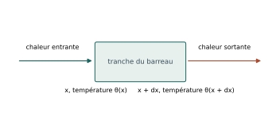
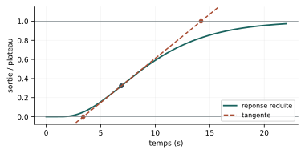
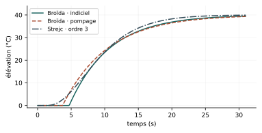
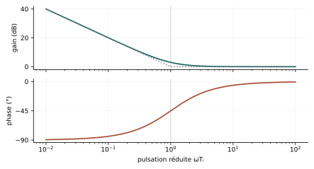
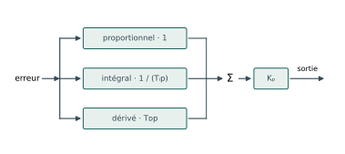

# X-ENS · PSI · Modélisation 2009 — corrigé guidé

*Corrigé rédigé par IA, non officiel. Signalez toute erreur.*

**Rédaction** · GPT-6.2 Astra Ultra · vitesse non renseignée · 25 novembre 2026

**Asservissement des transferts thermiques dans un four industriel.** Le cahier étudie le thermocouple, l’identification expérimentale d’une conduite, son modèle diffusif et le réglage de la température. Les lectures des figures 9, 11, 19 et 20 sont données à la précision du scan.

## Repères de résolution

Employer les kelvins dans les bilans d’entropie. Pour l’identification, séparer le retard de transport de la constante de temps du modèle ajusté. Dans les correcteurs, lire le module et la phase à la même pulsation et convertir les décibels en gain linéaire avant les calculs.

## I. Séparation des circuits et essais de mesure

### Question 1 · Étanchéité du générateur de vapeur

**Indication.** Repérer ce que les deux circuits doivent échanger et le rôle de la paroi des tubes.

#### Solution

Les tubes séparent le fluide primaire du circuit secondaire. La chaleur traverse la paroi pour produire de la vapeur, mais les fluides doivent rester séparés. Une fuite permettrait notamment à du fluide primaire potentiellement radioactif de contaminer le secondaire et compromettrait le maintien des conditions de pression. L'intégrité de cette barrière est donc une exigence de sûreté.

### Question 2 · Rôle du volet

**Indication.** La vitesse de rotation du ventilateur est fixée. Quel autre paramètre peut faire varier le débit ?

#### Solution

L'ouverture du volet modifie la section de passage et les pertes de charge aérauliques. Elle règle le point de fonctionnement du ventilateur, donc le débit et la vitesse de l'air dans la conduite. On peut ainsi faire varier le temps de transport de la chaleur jusqu'au capteur.

### Question 3 · Flux et entropie échangée

**Indication.** Faire un bilan d'énergie stationnaire, puis diviser chaque chaleur reçue par la température du côté où elle traverse la frontière.

#### Solution

Sans source volumique ni perte latérale, le flux entrant $\Sigma J_q(x)$ égale le flux sortant $\Sigma J_q(x+dx)$, donc $J_q$ est uniforme. En notant $\theta$ la température absolue, l'entropie reçue de l'extérieur par la tranche pendant $dt$ vaut

$$
\delta S_e=\Sigma J_q\,dt\left(\frac1{\theta(x)}-\frac1{\theta(x+dx)}\right)
=-\Sigma J_q\frac{\partial(1/\theta)}{\partial x}\,dx\,dt+o(dx\,dt).
$$

L'orientation des flux compte : la chaleur qui quitte la face de droite porte une entropie sortante.

### Question 4 · Production d'entropie par conduction

**Indication.** En régime stationnaire, la production interne compense exactement l'entropie échangée.

#### Solution

Le bilan $dS=\delta S_e+\delta S_c=0$ donne $\sigma=\delta S_c/(\Sigma dx\,dt)=\boldsymbol J_q\cdot\nabla(1/\theta)$. Par Fourier, $\boldsymbol J_q=-\lambda\nabla\theta$, donc

$$
\sigma=\lambda\frac{|\nabla\theta|^2}{\theta^2}\ge0.
$$

L'unité est $\mathrm{W\,m^{-3}\,K^{-1}}$. Cette production mesure l'irréversibilité du transfert à travers une différence de température. Elle s'annule pour un champ de température uniforme.

### Question 5 · Production d'entropie par effet Joule

**Indication.** Associer la conservation du courant et la puissance volumique du champ électrique.

#### Solution

La conservation stationnaire de la charge impose $\nabla\cdot\boldsymbol J_e=0$, donc $J_e$ est uniforme pour une section constante. La puissance reçue par la tranche vaut $\boldsymbol J_e\cdot\boldsymbol E\,\Sigma dx$. La dissipation électrique pure à la température $\theta$ donne, avec $\boldsymbol E=-\nabla V$ et $\boldsymbol J_e=\gamma\boldsymbol E$,

$$
\sigma=\frac{\boldsymbol J_e\cdot\boldsymbol E}{\theta}
=\frac{\gamma |\boldsymbol E|^2}{\theta}
=\frac{|\boldsymbol J_e|^2}{\gamma\theta}\ge0 .
$$

### Question 6 · Forces thermodynamiques

**Indication.** Dans le cas couplé, observer ce que devient la production si les deux forces s'annulent.

#### Solution

Les forces conjuguées aux deux flux sont $\boldsymbol\varphi_q=\nabla(1/\theta)$ et $\boldsymbol\varphi_e=-\nabla V/\theta$. Si toutes deux sont nulles, $\sigma=\boldsymbol J_q\cdot\boldsymbol\varphi_q+\boldsymbol J_e\cdot\boldsymbol\varphi_e=0$ et, selon les lois linéaires données, les deux flux sont nuls. Un transport dissipatif requiert une force non nulle au moins. Dans un matériau couplé, une seule des deux forces peut entraîner les deux flux.

### Question 7 · Coefficients de transport couplé

**Indication.** Exploiter successivement la loi d'Ohm à température uniforme et la loi de Fourier en circuit ouvert.

#### Solution

Pour $\nabla\theta=0$, la loi d'Ohm impose $L_3=\gamma\theta$. En circuit ouvert, $\nabla V=-\epsilon\nabla\theta$, donc $\boldsymbol\varphi_e=-\epsilon\theta\boldsymbol\varphi_q$. De $0=L_2\boldsymbol\varphi_q+L_3\boldsymbol\varphi_e$ on déduit $L_2=\epsilon\theta L_3=\gamma\epsilon\theta^2$. Enfin $\boldsymbol J_q=-\lambda\nabla\theta=\lambda\theta^2\boldsymbol\varphi_q$, d'où

$$
L_1=\lambda\theta^2+\gamma\epsilon^2\theta^3,\qquad
L_2=\gamma\epsilon\theta^2,\qquad L_3=\gamma\theta .
$$

Le déterminant $L_1L_3-L_2^2=\lambda\gamma\theta^3$ est positif.

### Question 8 · Tension du thermocouple

**Indication.** Intégrer la loi du circuit ouvert le long de chaque matériau en conservant l'orientation de M et N.

#### Solution

En circuit ouvert $dV=-\epsilon_i(\theta)\,d\theta$ dans le matériau $i$. Suivons le trajet de $N$ à $M$ dans le sens de la figure 8. Les parties dans un même métal se combinent puisque les deux extrémités $M,N$ sont à la même température. Il reste la contribution du conducteur A et le trajet inverse dans B :

$$
E_S=V(M)-V(N)=\int_{\theta_1}^{\theta_2}[\epsilon_A(\theta)-\epsilon_B(\theta)]\,d\theta .
$$

La tension s'annule si les jonctions sont isothermes ou si les deux coefficients sont égaux sur l'intervalle.

### Question 9 · Sensibilité du capteur

**Indication.** Comparer les tensions induites par la même petite variation de température.

#### Solution

L'ordre de grandeur est $1\,\mathrm{mV\,K^{-1}}$ pour un semi-conducteur contre $10\,\mu\mathrm{V\,K^{-1}}$ pour un métal, soit un rapport d'environ $100$. Ce qui fixe la sensibilité du thermocouple est la différence des deux coefficients. Un couple bien choisi utilisant un semi-conducteur donne donc une tension mesurable plus grande pour la même variation thermique, ce qui facilite la résolution en température.

### Question 10 · Origine du retard

**Indication.** Suivre un volume d'air chauffé de la résistance jusqu'à la position du capteur.

#### Solution

Il s'agit du transport de chaleur par convection forcée, plus précisément de l'advection de l'air chauffé par le ventilateur. Le temps de parcours crée un retard observé avant que l'élévation de température devienne résoluble.

### Question 11 · Vitesse de l'air

**Indication.** Lire le début de la montée sur le zoom. Porter le bruit autour de zéro dans l'incertitude du retard.

#### Solution

Les fluctuations de base persistent jusqu'à environ $3$ à $3{,}4\,\mathrm s$ avant une hausse soutenue (figures 9 et 11). Pour $L=0{,}60\,\mathrm m$, $v=L/t_d$ donne environ $0{,}18$ à $0{,}20\,\mathrm{m\,s^{-1}}$, soit près de $0{,}2\,\mathrm{m\,s^{-1}}$. Un seuil de lecture plus tardif inclurait une partie de la montée thermique du système.

## II. Identification sur les réponses expérimentales

### Question 12 · Paramètres du modèle de Broïda

**Indication.** Séparer le facteur exponentiel du premier ordre rationnel.

#### Solution

Dans $H_B(p)=K_Be^{-\tau_Bp}/(1+T_Bp)$, $\tau_B$ représente le temps mort effectif et $T_B$ la constante de temps de la montée qui lui succède. À $t=\tau_B+T_B$, la réponse atteint $1-e^{-1}$, soit environ $63\%$, de son niveau final.

### Question 13 · Choix d'un premier ordre retardé

**Indication.** Comparer le plateau, l'amorce et la monotonie de la réponse expérimentale à la forme du modèle.

#### Solution

La sortie reste proche de zéro au début, puis augmente vers un plateau voisin de $40\,^{\circ}\mathrm C$ sans dépassement marqué ni oscillation entretenue. Un retard suivi d'une évolution du premier ordre reproduit ces caractéristiques. Le léger arrondi initial de la courbe mesurée indique la limite du modèle autour du début de la montée.

### Question 14 · Gain statique

**Indication.** Appliquer le théorème de la valeur finale à la réponse à l'échelon de quarante degrés.

#### Solution

Avec $\Theta_E(p)=\theta_E/p$, $p\Theta_S(p)=\theta_E K_Be^{-\tau_B p}/(1+T_Bp)$. Le premier ordre a son pôle en $-1/T_B<0$ et le retard fini n'introduit aucun pôle. La valeur finale existe et vaut $\lim_{p\to0}p\Theta_S(p)=\theta_EK_B$. La mesure donne environ $40\,^{\circ}\mathrm C$ pour un échelon de $40\,^{\circ}\mathrm C$, d'où $K_B\simeq1$.

### Question 15 · Réponse de Broïda

**Indication.** Inverser d'abord la réponse du premier ordre sans retard, puis décaler son origine.

#### Solution

Par décomposition $1/[p(1+T_Bp)]=1/p-T_B/(1+T_Bp)$. Le retard donne

$$
\theta_S(t)=\theta_EK_B\left(1-e^{-(t-\tau_B)/T_B}\right)Y(t-\tau_B).
$$

L'origine de la température est celle du sujet, qui a soustrait la température avant chauffage.

### Question 16 · Identification à deux niveaux

**Indication.** Écrire le temps qui correspond à une fraction donnée du plateau, puis éliminer le retard.

#### Solution

À la fraction $f$, $t_f=\tau_B-T_B\ln(1-f)$. Donc

$$
T_B=\frac{t_{40}-t_{28}}{\ln(0{,}72/0{,}60)}\simeq5{,}49(t_{40}-t_{28}),
\qquad \tau_B=t_{28}+T_B\ln(0{,}72)\simeq2{,}80t_{28}-1{,}80t_{40}.
$$

Ces arrondis donnent les constantes $5{,}5$, $2{,}8$ et $1{,}8$ annoncées. Les indices 28 et 40 correspondent à des pourcentages du plateau.

### Question 17 · Lecture de la courbe indicielle

**Indication.** Tracer les horizontales à 11,2 et 16 degrés sur la figure 11.

#### Solution

Pour un plateau de $40\,^{\circ}\mathrm C$, le zoom donne $t_{28}\simeq6{,}7\,\mathrm s$ et $t_{40}\simeq7{,}8\,\mathrm s$. On trouve alors $T_B\simeq6{,}0\,\mathrm s$ et $\tau_B\simeq4{,}7\,\mathrm s$. Une variation d'un dixième de seconde de la lecture se répercute davantage sur $T_B$, calculé à partir d'une différence. Le temps mort de ce modèle ajusté ne coïncide pas nécessairement avec le premier écart observable en Q11.

### Question 18 · Limite de stabilité en pompage

**Indication.** Évaluer le dénominateur en boucle fermée sur l'axe imaginaire.

#### Solution

Pour la rétroaction négative unitaire, l'équation caractéristique est $1+C_BH_B(p)=0$. À la limite oscillatoire de pulsation $\omega_p>0$, $C_BH_B(j\omega_p)=-1$. Autrement dit le module est $1$ et la phase est $-\pi$ modulo $2\pi$.

### Question 19 · Constantes par essai de pompage

**Indication.** Utiliser d'abord le module, puis la phase au premier franchissement.

#### Solution

Posons $g=C_BK_B>0$. L'égalité de module impose $g^2=1+(\omega_pT_B)^2$. La phase au premier franchissement vaut $-\omega_p\tau_B-\arctan(\omega_pT_B)=-\pi$. Ainsi

$$
T_B=\frac{\sqrt{g^2-1}}{\omega_p},\qquad
\tau_B=\frac{\pi-\arctan\sqrt{g^2-1}}{\omega_p}.
$$

Les autres déterminations de la phase ajouteraient $2\pi/\omega_p$ au retard et ne décrivent pas le premier seuil observé.

### Question 20 · Résultat de l'essai fermé

**Indication.** Garder les angles en radians pour utiliser la pulsation fournie.

#### Solution

Avec $g=3{,}5$ et $\omega_p=0{,}5\,\mathrm{rad\,s^{-1}}$, on obtient $T_B=\sqrt{11{,}25}/0{,}5\simeq6{,}71\,\mathrm s$ et $\tau_B\simeq3{,}72\,\mathrm s$. Les deux identifications utilisent des critères différents et ne doivent pas donner exactement les mêmes paramètres pour un modèle approché.

### Question 21 · Identité géométrique

**Indication.** Multiplier le polynôme fini par X − 1/α et décaler un indice.

#### Solution

Pour $\alpha\ne0$,

$$
\left(\tfrac1\alpha-X\right)\sum_{k=1}^n\alpha^kX^{k-1}
=\sum_{k=1}^n\alpha^{k-1}X^{k-1}-\sum_{k=1}^n\alpha^kX^k
=1-\alpha^n X^n.
$$

C'est l'identité demandée, écrite avec le signe moins incorporé dans le premier facteur.

### Question 22 · Réponse indicielle du modèle de Strejc

**Indication.** Mettre le retard de côté et poser X = 1 + Tₛp. La décomposition se télescope.

#### Solution

Écrivons $A=\theta_EK_S$, $T=T_S$, $\tau=\tau_S$ et $X=1+Tp$. Pour l'entrée en échelon,

$$
\frac1{p(1+Tp)^n}=\frac1p-T\sum_{j=1}^n\frac1{(1+Tp)^j}.
$$

En multipliant par $p$, le membre de droite vaut $1-(X-1)\sum_{j=1}^n X^{-j}=X^{-n}$, par Q21. Avec $u=(t-\tau)/T$, l'inversion des puissances et la translation de $\tau$ donnent

$$
\theta_S(t)=A\left(1-e^{-u}\sum_{j=0}^{n-1}\frac{u^j}{j!}\right)Y(t-\tau).
$$

### Question 23 · Dérivées de la réponse

**Indication.** Dériver le produit de l'exponentielle et de la somme. Les termes consécutifs se simplifient.

#### Solution

Pour $t>\tau$, en posant $m=n-1$,

$$
\dot\theta_S=\frac A T\frac{e^{-u}u^m}{m!},\qquad
\ddot\theta_S=\frac A{T^2}\frac{e^{-u}}{m!}(mu^{m-1}-u^m).
$$

Pour $n=1$, la parenthèse de la seconde formule signifie $-1$. Les deux dérivées sont nulles pour $t<\tau$. À la jonction, ces formules décrivent les dérivées usuelles à droite ou à gauche. Pour $n=1$, la pente passe de zéro à $A/T$.

### Question 24 · Point d'inflexion

**Indication.** Rechercher la pente maximale sur la branche où la réponse commence réellement à évoluer.

#### Solution

Pour $n\ge2$, la pente augmente pour $0<u<n-1$ puis diminue. Le point d'inflexion intérieur est donc $t_i=\tau_S+(n-1)T_S$. Lorsque $n=1$, la réponse retardée est concave dès son départ : elle ne possède pas d'inflexion intérieure. On prolonge la construction de la tangente en prenant la tangente à droite en $t_i=\tau_S$.

### Question 25 · Ordonnée et pente à l'inflexion

**Indication.** Évaluer la réponse et sa dérivée au même temps réduit m = n − 1.

#### Solution

Posons $m=n-1$, $P_m=\sum_{j=0}^m m^j/j!$ et $D_m=e^{-m}m^m/m!$, avec $0^0=1$ pour cette évaluation limite. On obtient

$$
\theta_S(t_i)=A(1-e^{-m}P_m),\qquad
\dot\theta_S(t_i)=\frac A{T_S}D_m .
$$

Pour $n=1$, cela donne respectivement $0$ et la pente à droite $A/T_S$.

### Question 26 · Tangente et temps caractéristiques

**Indication.** La pente de la tangente vaut aussi le saut total divisé par le temps qui sépare ses deux intersections.

#### Solution

La tangente a pour équation $y=\theta_S(t_i)+\dot\theta_S(t_i)(t-t_i)$. Les intersections avec $0$ et $A$ sont $t_U$ et $t_U+t_A$. D'où $t_A=A/\dot\theta_S(t_i)$ et $t_U=t_i-\theta_S(t_i)/\dot\theta_S(t_i)$. En utilisant Q25,

$$
\frac{T_S}{t_A}=D_m,\qquad
\frac{t_U-\tau_S}{t_A}=m D_m-1+e^{-m}\sum_{j=0}^{m}\frac{m^j}{j!}.
$$

Le remplacement $m=n-1$ donne les deux expressions du sujet, puisque $mD_m=e^{1-n}(n-1)^n/(n-1)!$.

### Question 27 · Table de Strejc

**Indication.** Commencer par le premier ordre, dont la tangente rejoint directement la valeur finale après une constante de temps.

#### Solution

En évaluant les relations de Q26 :

| Ordre $n$ | $(t_U-\tau_S)/t_A$ | $T_S/t_A$ |
|---|---:|---:|
| 1 | $0$ | $1$ |
| 2 | $3/e-1\simeq0{,}1036$ | $1/e\simeq0{,}3679$ |
| 3 | $9e^{-2}-1\simeq0{,}2180$ | $2e^{-2}\simeq0{,}2707$ |

### Question 28 · Ordre et retard de Strejc

**Indication.** Appliquer la règle de sélection annoncée avant de calculer le retard résiduel.

#### Solution

On mesure $t_U/t_A=3{,}4/10{,}8\simeq0{,}315$. Parmi les valeurs disponibles en Q27, $0{,}2180$ est la plus grande inférieure à ce rapport. On retient $n=3$ et

$$
T_S=0{,}27067\times10{,}8\simeq2{,}92\,\mathrm s,\qquad
\tau_S=3{,}4-0{,}21802\times10{,}8\simeq1{,}05\,\mathrm s.
$$

Le résultat respecte $0<\tau_S<T_S$. Le modèle du troisième ordre adoucit lui-même le début de la montée.

### Question 29 · Comparaison des modèles identifiés

**Indication.** Examiner d'abord les niveaux finaux, puis agrandir la zone de départ où les formes se distinguent.

#### Solution

Les trois courbes de la figure 14 tendent vers le même plateau et reproduisent l'essentiel de la montée. Les réponses de Broïda restent strictement nulles jusqu'à leurs retards respectifs, puis démarrent avec une pente non nulle. La réponse de Strejc d'ordre trois commence plus tôt et avec une pente nulle, ce qui restitue mieux la courbure initiale. Les différences entre Broïda indiciel et Broïda pompage sont particulièrement visibles près du départ. Le bruit expérimental limite la portée des comparaisons point par point.

## III. Modèle de diffusion thermique

### Question 30 · Flux de Fourier

**Indication.** La loi relie un flux par unité de surface au gradient local de température.

#### Solution

Dans la géométrie unidimensionnelle, $\boldsymbol J_q=-\lambda\partial_x\theta\,\boldsymbol e_x$. Le flux est en $\mathrm{W\,m^{-2}}$ et $\lambda$ en $\mathrm{W\,m^{-1}\,K^{-1}}$. Son signe traduit une diffusion des régions plus chaudes vers les régions plus froides.

### Question 31 · Bilan local d'énergie

**Indication.** Comparer le flux entrant au flux sortant. Contrôler si la capacité donnée est massique ou volumique.

#### Solution

Pour une section $S$, la différence des puissances reçues est $S[J_q(x)-J_q(x+dx)]=\lambda S\,dx\,\partial_{xx}\theta$ au premier ordre. Si $C_p$ est la capacité **massique**, le stockage vaut $\rho C_pS\,dx\,\partial_t\theta$. On obtient

$$
\partial_t\theta=a\partial_{xx}\theta,\qquad a=\lambda/(\rho C_p).
$$

L'énoncé qualifie $C_p$ de capacité « volumique ». Si ce mot est pris littéralement, le stockage utilise directement $C_p$, en $\mathrm{J\,m^{-3}\,K^{-1}}$, et la formule devient $a=\lambda/C_p$. Dans les deux conventions la diffusivité est en $\mathrm{m^2\,s^{-1}}$. Le modèle de connaissance imposé ici retient la diffusion axiale sans terme d'advection.

### Question 32 · Équation dans le domaine de Laplace

**Indication.** Transformer en temps en conservant la variable x. Utiliser la température initiale retranchée.

#### Solution

La condition $\theta(x,0)=0$ donne $p\Theta(x,p)=a\partial_{xx}\Theta(x,p)$. Le problème est donc

$$
\partial_{xx}\Theta-\frac pa\Theta=0,\qquad
\Theta(0,p)=E(p),\qquad\partial_x\Theta(L,p)=0.
$$

La première condition correspond à la température d'entrée imposée, la seconde au flux diffusif axial nul en sortie.

### Question 33 · Solution en cosinus hyperbolique

**Indication.** Tester séparément l'équation différentielle et les deux conditions aux limites.

#### Solution

En posant $s=\sqrt{p/a}$, la solution proposée est $\Theta(x,p)=E(p)\cosh((L-x)s)/\cosh(Ls)$. Sa dérivée seconde vaut $s^2\Theta$, sa valeur à $x=0$ est $E$ et sa dérivée à $x=L$ contient $\sinh 0=0$. Elle vérifie donc les trois relations de Q32. Dans le demi-plan réel $p>0$, le dénominateur est strictement positif.

### Question 34 · Transfert en bout de conduite

**Indication.** Identifier la sortie avec la température en x = L dans la solution précédente.

#### Solution

Comme $S(p)=\Theta(L,p)$,

$$
H(p)=\frac{S(p)}{E(p)}=\frac1{\cosh(\beta\sqrt p)},\qquad \beta=\frac L{\sqrt a}.
$$

Le gain en régime permanent vaut $H(0)=1$. Cette fonction a une infinité de pôles et n'est pas une fraction rationnelle de degré fini.

### Question 35 · Deux pôles pour les basses fréquences

**Indication.** Dans le produit donné, quelles constantes de temps correspondent aux deux pôles les plus proches de l'origine ?

#### Solution

Le produit a pour facteurs $1+c_j\beta^2 p$ avec $c_j=4/[\pi^2(2j+1)^2]$. Les deux modes les plus lents correspondent à $j=0,1$. En gardant ces deux facteurs comme le suggère l'énoncé, on obtient

$$
H_2(p)=\frac1{(1+4\beta^2p/\pi^2)(1+4\beta^2p/(9\pi^2))}.
$$

Les pôles omis ont des constantes de temps plus courtes et leur gain est voisin de $1$ dans la bande suffisamment basse. Le mot « mieux » dépend du critère : pour reproduire exactement le développement *local* du dénominateur à l'ordre deux, le Taylor de $\cosh$ donnerait plutôt $1/[1+\beta^2p/2+\beta^4p^2/24]$. La première formule conserve les deux pôles physiques dominants.

## IV. Asservissement de la température

### Question 36 · Conversion tension–température

**Indication.** Suivre le produit des gains sur un tour de boucle et distinguer le transfert de sortie de l'équation caractéristique.

#### Solution

Le gain de la résistance transforme une tension en température, donc $[G]=\mathrm{K\,V^{-1}}$. Le capteur de retour a pour gain $1/G$. Le gain de boucle est $C(p)G H(p)/G=C(p)H(p)$. Les pôles en boucle fermée sont déterminés par $1+C(p)H(p)=0$, indépendamment de $G\ne0$. Le transfert entre la consigne de tension et la température de sortie garde, lui, son facteur de conversion $G$.

### Question 37 · Correcteur proportionnel et marge de phase

**Indication.** Déterminer la pulsation à laquelle le procédé a une phase de −135°, puis compenser l'atténuation à cette pulsation.

#### Solution

Un correcteur positif $C_P$ déplace uniquement le gain. Une marge de $45^\circ$ impose un passage à $0$ dB à la phase $-135^\circ$. La figure 19 donne environ $0{,}65\,\mathrm{rad\,s^{-1}}$ et une atténuation proche de $17$ dB. On choisit $20\log_{10}C_P\simeq17$, soit $C_P\simeq7$. Une lecture entre $16$ et $18$ dB donne environ $6{,}3$ à $7{,}9$.

### Question 38 · Erreur statique en régulation proportionnelle

**Indication.** Évaluer la boucle ouverte à la pulsation nulle. Le procédé a un gain statique égal à un.

#### Solution

Pour un échelon de consigne $u_0$ et une boucle stable, l'erreur au comparateur vaut $\varepsilon_\infty=u_0/(1+C_P H(0))=u_0/(1+C_P)$. Aucun $C_P$ fini ne produit une erreur rigoureusement nulle pour $u_0\ne0$. La limite $C_P\to\infty$ ne constitue pas un réglage réalisable et réduirait la marge de phase du système. Le proportionnel seul ne remplit pas simultanément les deux exigences.

### Question 39 · Action intégrale et précision

**Indication.** Un pôle à l'origine change la classe de la boucle. Vérifier la stabilité avant d'appliquer le théorème de la valeur finale.

#### Solution

Avec $C(p)=1/(T_Ip)$, le gain de boucle tend vers l'infini à l'origine. Pour la boucle fermée stable, $\varepsilon_\infty=\lim_{p\to0}u_0/[1+C(p)H(p)]=0$. L'action intégrale permet donc de suivre une consigne constante sans écart permanent.

### Question 40 · Réglage de l'intégrateur

**Indication.** Ajouter −90° à la phase du procédé. Calculer ensuite le module nécessaire à la même fréquence.

#### Solution

Pour obtenir $45^\circ$ de marge, il faut $\arg H(j\omega_c)=-45^\circ$. La figure 19 donne $\omega_c\simeq0{,}11\,\mathrm{rad\,s^{-1}}$ et un gain de l'ordre de $-1{,}5$ à $-2$ dB, soit $|H|\simeq0{,}80$ à $0{,}84$. À la coupure, $|H|/(T_I\omega_c)=1$, donc $T_I=|H|/\omega_c\simeq7$ à $8\,\mathrm s$. Le réglage utilise la valeur linéaire du module et non le nombre de décibels.

### Question 41 · Intégrateur électronique

**Indication.** Reconnaître le montage à condensateur dans la contre-réaction. Envisager le comportement d'un amplificateur réel.

#### Solution

Un amplificateur opérationnel avec une résistance d'entrée et un condensateur de contre-réaction réalise l'intégrateur inverseur. Si sa contre-réaction locale est ouverte, le grand gain en boucle ouverte amplifie la moindre tension différentielle et la sortie rejoint une limite d'alimentation. Si c'est la boucle de régulation globale qui s'ouvre, une erreur persistante est intégrée jusqu'à saturation. La reprise peut alors être retardée par la charge accumulée.

### Question 42 · Diagramme du PI

**Indication.** Factoriser le numérateur pour repérer le pôle à l'origine et le zéro.

#### Solution

On a $C(p)=K_P(1+T_Ip)/(T_Ip)$. Avant $\omega_z=1/T_I$, le gain asymptotique est $20\log_{10}K_P-20\log_{10}(\omega T_I)$, de pente $-20$ dB/décade. Après le zéro, il est constant à $20\log_{10}K_P$. La phase $\arctan(\omega T_I)-90^\circ$ passe de $-90^\circ$ à $0^\circ$ et vaut $-45^\circ$ au zéro. L'intégration annule l'erreur statique de poursuite d'un échelon si la boucle est stable. À une pulsation de coupure fixée, le retard de phase du PI réduit la marge, mais il reste faible si le zéro est placé suffisamment en dessous de la coupure.

### Question 43 · Coupure à mi-puissance du procédé

**Indication.** Poser x = ω² dans l'équation de module. Seule la racine positive a un sens.

#### Solution

Comme $H(0)=1$, la coupure à $-3$ dB, au sens usuel de mi-puissance, vérifie $(1+T_1^2\omega^2)(1+T_2^2\omega^2)=2$. Avec $S=T_1^2+T_2^2$, $P=T_1^2T_2^2$, l'équation $Px^2+Sx-1=0$ donne

$$
\omega_{-3\mathrm{dB}}=\sqrt{\frac{2}{S+\sqrt{S^2+4P}}}.
$$

La rationalisation évite de soustraire deux nombres proches. La figure 19 suggère une pulsation de l'ordre de $0{,}17\,\mathrm{rad\,s^{-1}}$.

### Question 44 · Gain du PI à la coupure

**Indication.** Le choix de la pulsation du zéro impose une valeur simple de ωTᵢ.

#### Solution

On impose $1/T_I=\omega_{-3\mathrm{dB}}/10$, donc $\omega_{-3\mathrm{dB}} T_I=10$. À cette pulsation, $|H|=1/\sqrt2$ et $|C|=K_P\sqrt{1+10^{-2}}$. La condition de gain unitaire s'écrit $K_P\sqrt{1{,}01}/\sqrt2=1$, donc

$$
K_P=\sqrt{2/1{,}01}\simeq1{,}41 .
$$

### Question 45 · Critères du PI

**Indication.** Lire la phase là où la courbe de Black coupe le niveau zéro décibel.

#### Solution

La coupure à $0$ dB sur la figure 20 se situe vers $-70^\circ$ à $-75^\circ$, ce qui donne une marge d'environ $105^\circ$ à $110^\circ$, supérieure aux $45^\circ$ exigés. Le lieu reste éloigné du point critique et la boucle fermée est stable. L'intégrateur donne alors une erreur nulle en régime permanent pour une consigne constante. Les deux critères chiffrés de la figure 18 sont satisfaits.

### Question 46 · Structure parallèle du PID

**Indication.** Séparer les trois termes de la somme avant d'appliquer le gain global.

#### Solution

Le même signal d'erreur alimente trois branches en parallèle, de transferts respectifs $1$, $1/(T_Ip)$ et $T_Dp$. Leurs trois sorties sont additionnées puis le résultat est multiplié par $K_P$. On reconstitue $C(p)=K_P[1+1/(T_Ip)+T_Dp]$. La figure jointe représente aussi la variante filtrée de Q48.

### Question 47 · Effet du terme dérivé

**Indication.** Une pente de l'erreur peut être non nulle alors que sa valeur instantanée est encore faible.

#### Solution

L'action dérivée réagit aux variations de l'erreur. Son avance de phase autour de la bande utile permet souvent un réglage à bande passante plus large avec un amortissement convenable, et donc un temps de réponse plus court. La rapidité effective dépend du réglage de la boucle complète. Le terme dérivé seul ne modifie pas le gain statique.

### Question 48 · Dérivée filtrée

**Indication.** Comparer les limites à basse et à haute fréquence du terme proposé.

#### Solution

La dérivée parfaite a un gain qui croît sans borne avec la fréquence. Elle amplifie le bruit des mesures et sa réponse à une discontinuité est impulsionnelle. La dérivée réalisable est $T_Dp/(1+aT_Dp)$. Son comportement est dérivé lorsque $\omega\ll1/(aT_D)$ et son gain est borné à $1/a$ à haute fréquence. On prend $0<a<1$ pour repousser le pôle du filtre au-delà de $1/T_D$ et garder une bande dérivée utile.

### Question 49 · Fonctions des quatre amplificateurs

**Indication.** Pour chaque entrée inverseuse, lire l'impédance d'entrée et celle de retour. Examiner aussi les trois entrées qui se rejoignent au dernier étage.

#### Solution

AO1 est un inverseur de gain $-1$ avec deux résistances $R_1$ égales. AO2 est un intégrateur inverseur, avec $R_2$ en entrée et $C_2$ en retour. AO3 est un dérivateur inverseur filtré, avec $R_3$ en série avec $C_3$ en entrée et $R_4$ en retour. AO4 est un amplificateur sommateur inverseur : les trois signaux passent chacun par $R_5$ vers le même nœud virtuel, avec une seule résistance $R_6$ en retour. Il forme l'opposé d'une somme pondérée.

### Question 50 · Paramètres électriques du PID

**Indication.** Écrire les trois tensions intermédiaires puis appliquer la loi des nœuds à la dernière entrée inverseuse.

#### Solution

Les rapports intermédiaires sont

$$
\frac{V_1}{V_e}=-1,\qquad \frac{V_2}{V_e}=-\frac{1}{R_2C_2p},\qquad
\frac{V_3}{V_e}=-\frac{R_4C_3p}{1+R_3C_3p}.
$$

Comme $V_s=-(R_6/R_5)(V_1+V_2+V_3)$, l'identification avec le PID filtré donne

$$
K_P=\frac{R_6}{R_5},\qquad T_I=R_2C_2,\qquad T_D=R_4C_3,\qquad a=R_3/R_4.
$$

$R_1$ disparaît puisque le premier étage utilise deux résistances égales. On réalise $a<1$ avec $R_3<R_4$. L'unité des deux constantes $RC$ est la seconde.
