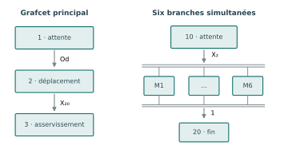
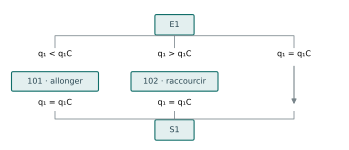
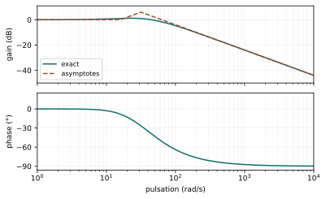
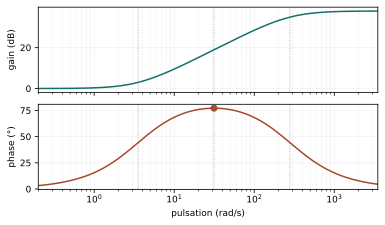
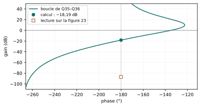

# X-ENS · PSI · Sciences industrielles 2009 — corrigé guidé

*Corrigé rédigé par IA, non officiel. Signalez toute erreur.*

**Rédaction** · GPT-6.2 Astra Ultra · vitesse non renseignée · 25 novembre 2026

**Révision** · GPT-6.2 Astra Ultra · vitesse non renseignée · 26 novembre 2026

**Projet astronomique Darwin.** Le cahier CX9614 étudie une plate-forme de Stewart entre un télescope et les poutres de la station. Les mouvements lents doivent orienter l’instrument. Les vibrations rapides doivent être filtrées pour préserver la mesure interférométrique.

## Repères de résolution

Distinguer les mouvements absolus des deux embases et leur mouvement relatif. Les critères de précision, de rapidité et de stabilité se vérifient sur des grandeurs différentes. La question 37 demande de lire une courbe fournie. Le calcul indépendant à partir du correcteur permet de vérifier cette lecture.

## I. Besoin et commande séquentielle

### Question 1 · Taille du télescope équivalent

**Indication.** Interpréter les 85 m comme la corde entre deux télescopes consécutifs.

#### Solution

L’hexagone régulier est inscrit dans le cercle de la figure 5. Pour l’angle au centre de $60^\circ$, la corde vaut $2R\sin30^\circ=R$. Ainsi $R=85$ m et le périmètre du cercle équivalent est $2\pi R\simeq534$ m. Le besoin de 500 m est atteint. Ce cercle caractérise l’écartement des télescopes en interférométrie.

### Question 2 · Milieu extérieur et fonction FS3

**Indication.** Suivre chaque liaison du diagramme de la figure 7 jusqu’à son élément extérieur.

#### Solution

FS3 relie la plate-forme à l’assemblage de poutres. Elle demande de **s’adapter mécaniquement à l’assemblage de poutres**, sur lequel se fixe l’embase inférieure. La bulle vide en bas à droite, reliée par FS5 « s’adapter à l’énergie », représente **la source d’énergie** alimentant la plate-forme.

### Question 3 · Actionneur linéaire

**Indication.** Relier le courant, le champ et la variation d’entrefer.

#### Solution

Le courant dans une bobine produit un flux dans le circuit ferromagnétique. La pièce mobile est attirée vers la position de moindre réluctance, ce qui réduit l’entrefer et produit une translation. Pour commander les deux sens, l’actionneur peut associer une force de rappel ou des actions magnétiques opposées. Une inversion du courant d’un simple électroaimant à noyau doux conserve le sens de l’attraction.

### Question 4 · Synchronisation du Grafcet principal

**Indication.** Repérer l’étape qui demande le mouvement et celle qui en signale la fin.

#### Solution

Sur DR1, la transition **2 vers 3** est $X_{20}$, fin du déplacement d’ensemble. Sous l’étape **10**, la réceptivité est $X_2$, demande d’exécution de « Bouger plate forme ». Après les six macro-étapes en parallèle, la réceptivité de convergence peut être **1**. Le franchissement nécessite que les six sorties $S_1,\ldots,S_6$ soient actives, conformément à la synchronisation en ET. Écrire explicitement $X_{S_1}\land\cdots\land X_{S_6}$ sur cette transition donne le même résultat. La transition imprimée « 2 s / $X_3$ » ramène alors l’exécutant à 10 après l’activation de l’asservissement.

### Question 5 · Choix de branche d’un bras

**Indication.** Prévoir le cas où le bras a déjà atteint sa consigne.

#### Solution

Sur DR2, les trois réceptivités au départ de $E_1$, de gauche à droite, sont $q_1<q_{1C}$ pour aller à 101 et allonger, $q_1>q_{1C}$ pour aller à 102 et raccourcir, puis $q_1=q_{1C}$ pour rejoindre directement $S_1$. Les deux transitions de fin déjà imprimées ont également la condition d’égalité. Les trois tests initiaux sont disjoints et couvrent chaque valeur.

### Question 6 · Gabarit du filtre

**Indication.** Comparer la transmission des mouvements lents et celle des mouvements rapides.

#### Solution

Le plateau à 0 dB signifie une amplitude de sortie égale à l’entrée à basse fréquence. La courbe demandée ne monte pas au-dessus de ce plateau. Sa cassure est en $\omega_c=2\pi\times5\simeq31{,}4$ rad/s. Une pente de $-40$ dB/décade divise l’amplitude par 100 chaque fois que la fréquence est multipliée par dix. À $100\omega_c$ la chute asymptotique atteint 80 dB.

## II. Limites de l’amortissement passif

### Question 7 · Filtres électroniques

**Indication.** Choisir un réseau dissipatif ou réactif, puis un montage avec alimentation extérieure.

#### Solution

Une résistance et un condensateur forment un passe-bas RC passif lorsque la sortie est prise aux bornes du condensateur. Un amplificateur opérationnel alimenté, associé à des résistances et à des condensateurs, permet de réaliser un filtre actif tel qu’un passe-bas de Sallen–Key.

### Question 8 · Transmission entre les embases

**Indication.** Les efforts élastique et visqueux dépendent des déplacements relatifs.

#### Solution

Le ressort et l’amortisseur en parallèle exercent sur la masse $M\ddot z_8=k_T(z_7-z_8)+c_T(\dot z_7-\dot z_8)$. Les déplacements sont mesurés autour de l’équilibre. À conditions initiales nulles,

$$
H(p)=\frac{Z_8(p)}{Z_7(p)}=\frac{k_T+c_Tp}{Mp^2+c_Tp+k_T}.
$$

### Question 9 · Pulsation et amortissement passifs

**Indication.** Diviser par la raideur puis identifier les coefficients de $p$ et $p^2$.

#### Solution

On trouve $\omega_0=\sqrt{k_T/M}$ et $\xi=c_T/(2\sqrt{Mk_T})$. Le numérateur réduit est $1+2\xi p/\omega_0$, le dénominateur $1+2\xi p/\omega_0+(p/\omega_0)^2$. Le frottement intervient dans les deux polynômes parce que la base de l’amortisseur se déplace.

### Question 10 · Valeur de la cassure

**Indication.** Convertir la fréquence demandée en radians par seconde.

#### Solution

Avec $k_T=10^6$ N/m et $M=1000$ kg, $\omega_0=\sqrt{1000}=31{,}62$ rad/s, soit 5,03 Hz. L’écart à $\omega_c=31{,}42$ rad/s est voisin de 0,66 %. Le choix de raideur place bien la pulsation propre au voisinage de la cassure demandée.

### Question 11 · Diagrammes de Bode de DR3

**Indication.** Pour l’amortissement unité, le dénominateur a un pôle double.

#### Solution

Avec $x=\omega/\omega_0$, $H(j\omega)=(1+2jx)/(1+jx)^2$. Les courbes exactes sont

$$
G=10\log_{10}(1+4x^2)-20\log_{10}(1+x^2),\qquad
\varphi=\arctan(2x)-2\arctan x.
$$

Le zéro en $\omega_0/2=15{,}81$ rad/s introduit une pente de $+20$ dB/décade. Le pôle double à 31,62 rad/s la ramène à $-20$ dB/décade. Avant le zéro, la pente asymptotique est nulle. En $x=1$, $G\simeq0{,}97$ dB et $\varphi\simeq-26{,}6^\circ$. La phase tend vers $0^\circ$ à basse fréquence et $-90^\circ$ à haute fréquence. Le dessin donne les tracés à reporter sur DR3.

### Question 12 · Compromis de l’amortisseur passif

**Indication.** Suivre séparément le pic autour de la fréquence propre et l’asymptote de haute fréquence.

#### Solution

Une petite valeur de $\xi$, telle que 0,01, laisse un pic considérable. Elle éloigne toutefois le zéro $\omega_0/(2\xi)$ et prolonge la zone de filtrage proche de $-40$ dB/décade. Une grande valeur, telle que 2, réduit fortement le pic et relève la transmission des vibrations rapides. Pour tout $\xi>0$, $|H|\sim2\xi\omega_0/\omega$ à très haute fréquence, d’où seulement $-20$ dB/décade. Même le dépassement très faible à fort amortissement est bien présent puisque $|H|^2-1=(2x^2-x^4)/[(1-x^2)^2+4\xi^2x^2]$.

### Question 13 · Choix d’une action active

**Indication.** Comparer le cas amorti au cas où le zéro serait supprimé.

#### Solution

Avec $c_T>0$, le zéro de la transmission passive dégrade la pente finale. Avec $c_T=0$, la pente redevient $-40$ dB/décade, mais la résonance du modèle sans pertes est non bornée. Une rétroaction en force permet de modifier l’amortissement sans introduire ce zéro dans la transmission finale.

## III. Cinématique et dynamique des six bras

### Question 14 · Possibilité de relier efforts et déplacements

**Indication.** Compter les composantes du mouvement utile et les efforts effectivement transmis.

#### Solution

Chaque bras sans masse, articulé par deux rotules, transmet une force axiale décrite par un seul scalaire. Six bras fournissent six inconnues d’effort. Le solide supérieur possède six équations scalaires de dynamique et son déplacement relatif possède six composantes. Au voisinage de la configuration cubique régulière, les six directions et leurs bras de levier donnent une matrice de rang six. Les variations de longueur, les lois d’effort et ces équations déterminent le comportement de la plate-forme. Cette justification suppose une pose régulière.

Pour vérifier le rang au repos, prenons les trois arêtes comme axes. Les deux bras parallèles à $x$ ont des attaches supérieures séparées du vecteur $(0,L,-L)$, au signe près. Si les six longueurs sont instantanément constantes, la différence des vitesses axiales de ces deux attaches donne $L(\Omega_y+\Omega_z)=0$ pour la rotation relative. Les deux autres paires donnent $\Omega_z+\Omega_x=0$ et $\Omega_x+\Omega_y=0$. La rotation est donc nulle. Il reste une vitesse de translation dont les trois projections sur les arêtes sont nulles. Le noyau de la jacobienne est réduit à zéro.

### Question 15 · Distance entre les deux plans

**Indication.** Placer l’origine à un sommet du cube et écrire les plans des deux triangles.

#### Solution

Dans les axes des arêtes du cube de côté $L$, les trois attaches inférieures appartiennent au plan $x+y+z=L$ et les supérieures au plan $x+y+z=2L$. La normale unitaire commune est $(1,1,1)/\sqrt3$. La distance entre ces plans, égale à $O_7O_8$, est donc $Z=L/\sqrt3$.

### Question 16 · Vitesse d’allongement d’un bras

**Indication.** Dériver la norme du vecteur entre les deux rotules.

#### Solution

De $\overrightarrow{B_iA_i}=q_i\mathbf u_i$ et $\mathbf u_i\cdot\dot{\mathbf u}_i=0$, on tire $\dot q_i=(\mathbf V_{A_i,8}-\mathbf V_{B_i,7})\cdot\mathbf u_i$. La composition des vitesses sur chaque solide donne

$$
\dot q_i=(\mathbf V_{O_8,8}-\mathbf V_{O_7,7})\cdot\mathbf u_i+
(\overrightarrow{A_iO_8}\times\boldsymbol\Omega_8-\overrightarrow{B_iO_7}\times\boldsymbol\Omega_7)\cdot\mathbf u_i.
$$

Toutes les vitesses absolues sont prises par rapport au repère 0.

### Question 17 · Torseur relatif au même point

**Indication.** Transporter la vitesse de l’embase 7 au point $O_8$.

#### Solution

Le champ des vitesses de 7 donne $\mathbf V_{O_8,7}=\mathbf V_{O_7,7}+\overrightarrow{O_8O_7}\times\boldsymbol\Omega_7$. Ainsi $\Delta\mathbf V=\mathbf V_{O_8,8}-\mathbf V_{O_8,7}$ et $\Delta\boldsymbol\Omega=\boldsymbol\Omega_8-\boldsymbol\Omega_7$ sont les deux éléments du torseur cinématique relatif en $O_8$. S’ils sont nuls, tout point des deux embases suit le même champ rigide. Les distances $B_iA_i$ sont alors conservées et les six $\dot q_i$ sont nulles.

### Question 18 · Jacobienne cinématique

**Indication.** Réordonner le produit mixte pour que la rotation figure en dernier.

#### Solution

Posons $\mathbf r_i=\overrightarrow{O_8A_i}$. Dans la base $b_8$, la ligne $i$ de $J$ est

$$
J_{i,:}=\bigl(u_{ix},u_{iy},u_{iz},(\mathbf r_i\times\mathbf u_i)_x,(\mathbf r_i\times\mathbf u_i)_y,(\mathbf r_i\times\mathbf u_i)_z\bigr).
$$

En effet $(\overrightarrow{A_iO_8}\times\Delta\boldsymbol\Omega)\cdot\mathbf u_i=(\mathbf r_i\times\mathbf u_i)\cdot\Delta\boldsymbol\Omega$. L’empilement des six égalités donne $\dot{\mathbf q}=J(\Delta\mathbf V,\Delta\boldsymbol\Omega)^{\mathsf T}$ en notation par blocs.

### Question 19 · Direction des forces des bras

**Indication.** Isoler un bras sans masse soumis aux réactions de ses deux rotules.

#### Solution

Les rotules ne transmettent aucun couple. L’équilibre du bras sous deux forces impose que celles-ci soient opposées et portées par la droite $A_iB_i$. En notant $f_i$ la composante algébrique vers l’embase supérieure, $\mathbf f_i=f_i\mathbf u_i$. La dualité des puissances fournit alors le torseur en $O_8$ par $J^{\mathsf T}\mathbf f$.

### Question 20 · Torseur dynamique de l’embase

**Indication.** Transporter l’accélération et le moment en ne conservant que le premier ordre.

#### Solution

En notant $\mathbf r=\overrightarrow{O_8G_8}=h\mathbf z_8$, la résultante vaut $\mathbf R_d=M(\ddot{\mathbf X}_8+\ddot{\boldsymbol\theta}_8\times\mathbf r)$. Le moment dynamique au centre de masse vaut $\mathbf I_{G_8}\ddot{\boldsymbol\theta}_8$. Au point demandé,

$$
\boldsymbol\delta_{O_8}=\mathbf I_{G_8}\ddot{\boldsymbol\theta}_8+\mathbf r\times\mathbf R_d.
$$

Les termes centripètes et gyroscopiques contiennent des produits de petites vitesses. Ils sont d’ordre deux et disparaissent de cette linéarisation.

### Question 21 · Raideur et rétroaction intégrale

**Indication.** Exprimer la force en fonction de l’allongement avant d’appliquer la transposée de la Jacobienne.

#### Solution

L’équation de chaque bras donne $(1+g/p)f_i=-kq_i$, où $q_i$ désigne ici la variation de longueur autour de $L$. Posons $Y_8=(\mathbf X_8,\boldsymbol\theta_8)^{\mathsf T}$ et $Y_7^*=(\mathbf X_7+\overrightarrow{O_8O_7}\times\boldsymbol\theta_7,\boldsymbol\theta_7)^{\mathsf T}$. Alors $\mathbf q=J(Y_8-Y_7^*)$. Le PFD devient

$$
\left(p^2[M]+\frac{p}{p+g}[K]\right)Y_8=\frac{p}{p+g}[K]Y_7^*,\qquad [K]=kJ^{\mathsf T}J.
$$

La matrice est symétrique, et $v^{\mathsf T}[K]v=k\|Jv\|^2$.

### Question 22 · Pente de transmission active

**Indication.** À très haute fréquence, comparer le terme inertiel et la raideur.

#### Solution

Lorsque $|p|\gg g$, $p/(p+g)$ tend vers 1. L’inertie domine alors à gauche et $Y_8\simeq p^{-2}[M]^{-1}[K]Y_7^*$. Un facteur 10 sur la fréquence divise l’amplitude principale par 100. La pente de $-40$ dB/décade satisfait le critère de filtrage haute fréquence de FS1.

## IV. Transmission en translation et en rotation

### Question 23 · Deux transmissions découplées

**Indication.** Diviser chaque raideur modale par la masse ou l’inertie correspondante.

#### Solution

Après simplification du facteur commun $p$ dans les équations à conditions initiales nulles, $\mu_1=2k/M=1000$ s$^{-2}$ et $\mu_2=(2kL^2/3)/(B_8+Mh^2)=30000/(83+1000h^2)$ s$^{-2}$, avec $h$ en mètres. Les transmissions sont

$$
Z_8/Z_7=\frac{1000}{p^2+50p+1000},\qquad
\Theta_8/\Theta_7=\frac{\mu_2}{p^2+50p+\mu_2}.
$$

### Question 24 · Condition d’absence de résonance

**Indication.** Minimiser le carré du module du dénominateur en fonction de la fréquence au carré.

#### Solution

Avec $x=\omega^2$, $|\mu-\omega^2+jg\omega|^2=\mu^2+(g^2-2\mu)x+x^2$. Ce polynôme est croissant sur $x\ge0$ exactement si $g^2\ge2\mu$. Pour un amortissement positif, **$g\ge\sqrt{2\mu}$** donne donc l’absence de pic. Cela équivaut à $\xi=g/(2\sqrt\mu)\ge1/\sqrt2$.

### Question 25 · Meilleure altitude du centre de gravité

**Indication.** Repérer ce qui dépend de la hauteur et dans quel sens la fréquence change.

#### Solution

La pulsation propre de translation $\sqrt{\mu_1}=31{,}62$ rad/s est déjà voisine de 31,42 rad/s et indépendante de $h$. En rotation, $\sqrt{\mu_2}$ est maximale pour **$h=0$** et décroît avec $|h|$. Même à zéro elle ne vaut que 19,0 rad/s. C’est donc le meilleur choix pour rapprocher les deux cassures du gabarit. L’écart résiduel en rotation demeure.

### Question 26 · Résonance pour l’altitude imposée

**Indication.** Vérifier la condition d’amortissement pour chacun des deux mouvements.

#### Solution

À $h=0{,}20$ m, $\mu_2=243{,}90$ s$^{-2}$. Les seuils $\sqrt{2\mu_1}$ et $\sqrt{2\mu_2}$ valent 44,72 et 22,09 s$^{-1}$. Le retour $g=50$ s$^{-1}$ dépasse les deux. Les deux mouvements satisfont le niveau « pas de résonance ».

### Question 27 · Atténuation du mouvement lent

**Indication.** Convertir les hertz en pulsation avant de lire la figure 18.

#### Solution

À 1,5 Hz, $\omega=3\pi=9{,}425$ rad/s. L’amplitude en rotation est multipliée par $\mu_2/\sqrt{(\mu_2-\omega^2)^2+g^2\omega^2}=0{,}492$. Le gain est $-6{,}17$ dB et l’amplitude de sortie perd environ **51 %**. La figure 18 donne environ $-6$ dB. Le mouvement de réglage est donc déjà sensiblement atténué à cette fréquence.

## V. Performances de la boucle de commande

### Question 28 · Boucle ouverte équivalente

**Indication.** Réduire d’abord la petite boucle de retour en force.

#### Solution

Le bloc avant la masse reçoit son entrée à travers une rétroaction $g/p$. Le gain de cette boucle interne est $1/(1+g/p)=p/(p+g)$. La chaîne directe entre l’écart de position et $Z_8$ vaut alors

$$
H_0(p)=2k\frac{p}{p+g}\frac1{Mp^2}=\frac{\mu_1}{p(p+g)}=\frac{1000}{p(p+50)}.
$$

Sa fermeture unitaire donne bien $1000/(p^2+50p+1000)$.

### Question 29 · Performances avant correction

**Indication.** Utiliser l’intégrateur déjà présent et lire le module et la phase au même point.

#### Solution

La position suit une consigne échelon sans erreur statique car $H_0$ est de classe 1. Pour une perturbation constante **introduite à l’entrée du procédé**, le correcteur unité laisse une erreur de module égal à la perturbation dans les unités d’entrée. Les figures 20–21 ne dessinent pas cette entrée perturbatrice. L’insertion en amont du procédé est celle qui motive la correction intégrale de la partie 4. La coupure vérifie $\omega^2(\omega^2+50^2)=1000^2$, d’où $\omega_0=18{,}73$ rad/s, inférieure à 31,42. Sa marge de phase vaut $90^\circ-\arctan(18{,}73/50)=69{,}5^\circ$. La marge de gain du modèle est infinie car la phase n’atteint $-180^\circ$ qu’à l’infini. La coupure, la valeur de phase visée et la compensation de la perturbation demandent une modification.

### Question 30 · Gain proportionnel pour 45 degrés

**Indication.** Un gain réel positif déplace le module sans changer la phase.

#### Solution

Le gain unité doit être atteint là où $\arg H_0=-135^\circ$. La phase vaut $-90^\circ-\arctan(\omega/g)$, ce qui impose $\omega=g=50$ rad/s. Ainsi $C_0=1/|H_0(jg)|=\sqrt2\,g^2/\mu_1=3{,}536$.

### Question 31 · Coupure du correcteur proportionnel

**Indication.** La condition de phase fixe déjà la nouvelle coupure.

#### Solution

La pulsation $\omega_0=50$ rad/s dépasse la valeur prescrite $2\pi\,5=31{,}42$ rad/s. Avec ce réglage, la marge de phase est bien $45^\circ$. Le correcteur proportionnel ne peut ajuster simultanément phase et coupure ni annuler l’erreur produite par une perturbation constante à l’entrée du procédé.

### Question 32 · Correction intégrale seule

**Indication.** Ajouter le retard de phase intégral à celui du procédé.

#### Solution

Avec $C=1/(T_i p)$, la phase de la boucle devient $-180^\circ-\arctan(\omega/g)$. À toute coupure finie et positive, la marge de phase est **négative**. Modifier $T_i$ déplace le croisement sans créer d’avance. Ce réglage ne satisfait pas le cahier des charges.

### Question 33 · Intégrale et avance de phase

**Indication.** Attribuer une fonction distincte aux deux facteurs du correcteur.

#### Solution

Le facteur $K/p$ donne un gain statique infini au correcteur. Avec une boucle stable, l’erreur de consigne échelon et celle due à une perturbation constante en amont du procédé tendent vers zéro. Pour $0<a<1$, le zéro $-1/T$ précède le pôle $-1/(aT)$. Le facteur d’avance fournit une phase positive réglable autour de la coupure. On peut donc viser $45^\circ$ et régler séparément le niveau de gain. Il reste à contrôler la marge de gain par le calcul ou sur le diagramme fourni.

### Question 34 · Diagrammes du correcteur d’avance

**Indication.** Écrire la différence des arguments de deux nombres complexes du premier ordre.

#### Solution

$C_{\rm ap}=(1+Tp)/(1+aTp)$. Son Bode asymptotique commence à 0 dB, monte de $20$ dB/décade entre $1/T$ et $1/(aT)$, puis atteint le plateau $20\log_{10}(1/a)$. La phase $\varphi=\arctan(T\omega)-\arctan(aT\omega)$ part de zéro et y revient. L’annulation de sa dérivée donne $T^2\omega_m^2=1/a$. Au sommet,

$$
\omega_m=1/(T\sqrt a),\qquad \sin\varphi_m=(1-a)/(1+a),\qquad |C_{\rm ap}(j\omega_m)|=1/\sqrt a.
$$

### Question 35 · Réglage du zéro et du pôle

**Indication.** Centrer l’avance maximale sur la coupure demandée.

#### Solution

Pour $\omega_c=10\pi$ rad/s, le procédé et l’intégrateur apportent $-180^\circ-\arctan(\omega_c/50)$. Afin d’obtenir $-135^\circ$, l’avance nécessaire est $\varphi_m=45^\circ+\arctan(\omega_c/50)=77{,}14^\circ$. Avec $\omega_m=\omega_c$,

$$
a=\frac{1-\sin\varphi_m}{1+\sin\varphi_m}\simeq0{,}01270,\qquad
T=\frac1{\omega_c\sqrt a}\simeq0{,}2825\ {\rm s}.
$$

Les cassures de l’avance sont proches de 3,54 et 279 rad/s.

### Question 36 · Réglage de l’amplitude

**Indication.** Imposer le gain unité au croisement, en tenant compte du module du correcteur d’avance.

#### Solution

$\lvert H_0(j\omega_c)\rvert=1000/[\omega_c\sqrt{50^2+\omega_c^2}]\simeq0{,}5390$. La condition est $(K/\omega_c)(1/\sqrt a)|H_0(j\omega_c)|=1$. Ainsi

$$
K=\frac{\omega_c\sqrt a}{|H_0(j\omega_c)|}\simeq6{,}57\ {\rm s}^{-1}.
$$

### Question 37 · Marge de gain et contrôle du diagramme fourni

**Indication.** Lire la branche descendante à $-180^\circ$, puis vérifier ce croisement avec la fonction de transfert.

#### Solution

**Lecture demandée.** Sur la figure 23, la branche descendante coupe la verticale $-180^\circ$ vers **$-85$ à $-90$ dB**. La marge graphique vaut donc environ **87 dB**. La branche qui s’approche de $-180^\circ$ à très basse fréquence a un gain croissant et atteint cette phase seulement à la limite.

**Vérification pour les coefficients de Q35–Q36.** La boucle écrite dans le sujet est $L(p)=K\mu_1(1+Tp)/[p^2(p+g)(1+aTp)]$. Son croisement de phase à fréquence positive vérifie $\arctan(T\omega)-\arctan(aT\omega)=\arctan(\omega/g)$, soit

$$
\omega_{180}^2=\frac{g(1-a)T-1}{aT^2}.
$$

On obtient $\omega_{180}=113{,}03$ rad/s, $|L(j\omega_{180})|=0{,}1231$ et **$M_G=18{,}19$ dB**. Les paramètres écrits et la courbe imprimée conduisent donc à deux valeurs incompatibles. Le calcul à la pulsation réelle de croisement écarte une simple incertitude de lecture.

### Question 38 · Bilan du cahier des charges

**Indication.** Vérifier la condition stricte sur la marge de gain dans les deux jeux de résultats.

#### Solution

La consigne échelon et la perturbation constante en entrée de procédé ont une erreur finale nulle avec le correcteur intégral et la boucle stable. Le réglage de Q35–Q36 fournit une coupure de 31,42 rad/s et $45^\circ$ de marge de phase. **Sur la figure 23 fournie**, la marge lue dépasse 20 dB et tous les critères de la grille sont satisfaits. **Pour le correcteur effectivement calculé**, la marge de 18,19 dB se situe 1,81 dB sous le seuil. Ces coefficients ne valident donc pas le cahier complet malgré la précision, la coupure et la phase obtenues.
