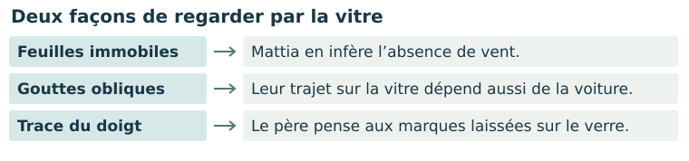
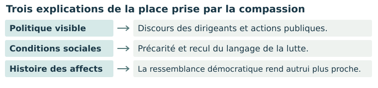
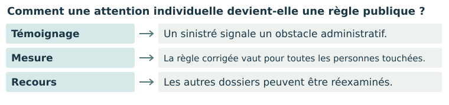

# X · MP-PC · Italien 2009 — Corrigé guidé

*Corrigé rédigé par IA, non officiel. Signalez toute erreur.*

**Rédaction** · GPT-6.2 Astra Ultra · vitesse non renseignée

Les deux cahiers durent chacun une heure trente, sans dictionnaire. La version se rédige en français. Les deux réponses au texte français se rédigent en italien. Le sujet donne à titre indicatif 120 à 150 mots pour la première et 180 à 200 pour la seconde.

## V. Version française

*Storto* prend un sens spatial. Mattia décrit un effet du mouvement et son père se demande ce que signifie ici *colpa*. Garder la reprise de « faute ». *Mettere in folle* signifie « mettre au point mort ». La note du sujet précise le sens de *nel Ventennio*, sous le régime fasciste.

**La nouvelle école**

« En vrai, la pluie ne tombe pas de travers », dit Mattia, qui regardait par la vitre latérale, arrachant son père à ses pensées.

« Quoi ? » fit Pietro, secouant instinctivement la tête.

« Dehors, il n’y a pas de vent. Sinon, les feuilles des arbres bougeraient aussi », poursuivit Mattia.

Son père s’efforça de suivre son raisonnement. À vrai dire, tout cela lui était indifférent et il soupçonnait que ce n’était qu’une lubie de plus de son fils.

« Et alors ? demanda-t-il.

— Sur la vitre, les gouttes descendent de biais, mais c’est juste un effet de notre mouvement. En mesurant l’angle par rapport à la verticale, on pourrait même calculer leur vitesse de chute. »

Mattia suivit du doigt la trajectoire d’une goutte. Il approcha son visage du pare-brise et souffla dessus. Puis, de l’index, il traça une ligne dans la buée.

« Ne souffle pas sur les vitres, ça laisse des marques », le gronda son père.

Mattia parut ne pas l’avoir entendu.

« Si on ne voyait rien à l’extérieur de la voiture, si on ne savait pas qu’on est en mouvement, il n’y aurait aucun moyen de savoir si c’est la faute des gouttes ou si c’est la nôtre, fit Mattia.

— La faute de quoi ? lui demanda son père, déconcerté et un peu agacé.

— Si elles tombent de travers comme ça. »

Pietro Balossino acquiesça d’un air grave, sans comprendre. Ils étaient arrivés. Il mit la voiture au point mort et serra le frein à main. Mattia ouvrit la portière et une bouffée d’air frais pénétra dans l’habitacle.

« Je viens te chercher à une heure », dit Pietro.

Mattia fit oui de la tête. M. Balossino se pencha un peu en avant pour l’embrasser, mais sa ceinture le retint. Il s’adossa de nouveau à son siège et regarda son fils descendre et refermer la portière derrière lui.

La nouvelle école était située dans un beau quartier résidentiel sur la colline. Le bâtiment avait été construit sous le fascisme et, malgré les rénovations récentes, il faisait toujours tache au milieu de toutes ces villas somptueuses. Un parallélépipède de béton blanc, avec quatre rangées horizontales de fenêtres équidistantes et deux escaliers de secours en fer peint en vert.

*Paolo Giordano, La Solitude des nombres premiers, 2008.*

## 1. Qual è il posto della compassione nella vita politica attuale secondo l’autrice?

Le rôle de la compassion dépasse l’usage stratégique des émotions. Relier *frattura*, *insicurezza* et *protezione* au recul du lexique socialiste et aux formes modernes de précarité, puis remonter à Rousseau et à Tocqueville.

Secondo Revault d’Allonnes la compassione ha invaso il campo politico. Dirigenti di ogni schieramento parlano a nome di chi soffre, mentre iniziative pubbliche cercano di rendere visibile la miseria per cambiare le decisioni dei governi. Nel linguaggio comune si parla ormai di insicurezza, di protezione e di fratture sociali più spesso che di lotta fra classi. Il declino delle ideologie che mettevano al centro lo sfruttamento dei lavoratori contribuisce a spiegare questa trasformazione, insieme alla disoccupazione e alla precarietà. L’autrice individua tuttavia una radice più profonda. Per Tocqueville l’uguaglianza crescente delle condizioni permette di riconoscere nell’altro un proprio simile e rende più facile partecipare alla sua sofferenza. Questa analisi riprende l’intuizione di Rousseau, per il quale la pietà precede e alimenta la formazione del legame sociale.

*126 mots.*

## 2. È possibile o auspicabile governare senza provare compassione?

Répondre aux deux adjectifs de la question, *possibile* et *auspicabile*. L’exemple compare l’écoute nécessaire d’une victime et la décision d’un service qui doit aussi traiter les dossiers de personnes inconnues.

È possibile governare senza provare compassione, almeno nel senso limitato di riscuotere imposte, emanare ordini e far rispettare norme. Ritengo però poco auspicabile una politica incapace di ascoltare la sofferenza concreta. Dopo un’alluvione, un impiegato può applicare correttamente il regolamento e chiedere a una famiglia di presentare documenti distrutti insieme alla casa. Ascoltare quella famiglia aiuta a scoprire un difetto che nessuna tabella riassuntiva aveva segnalato.

D’altra parte, il dolore più visibile non è necessariamente il più grave. Un sindaco colpito dal racconto di una persona davanti alle telecamere potrebbe concederle immediatamente un aiuto e lasciare in attesa vicini altrettanto bisognosi. Perciò chiederei che dall’ascolto nascesse una modifica valida per tutti: accettare prove alternative, rendere pubblici i criteri e permettere di contestare un rifiuto. Un’emozione particolare può così migliorare un’istituzione senza trasformare la generosità del governante in un privilegio distribuito a piacere.

A mio giudizio, ai cittadini non serve sapere se un ministro abbia pianto davvero. Serve sapere che qualcuno ha preso sul serio il problema, che la risposta è equa e che raggiungerà anche chi non ha la forza di raccontare pubblicamente la propria storia.

*186 mots.*

Le fac-similé rassemble l’extrait de L’Homme compassionnel (2008), aux pages 1 et 2 du PDF, et celui de La solitudine dei numeri primi (2008), à la page 8. Le rapport spécifique de l’italien n’a pas été retrouvé.

[Cahier de version](https://www.alloschool.com/assets/documents/course-286/x-ens-mp-pc-2009-langues-vivantes.pdf#page=8) · [Cahier d’expression](https://www.alloschool.com/assets/documents/course-286/x-ens-mp-pc-2009-langues-vivantes.pdf#page=1) · [Cahier d’expression publié par l’UPLS](https://upls.fr/wp-content/uploads/2010/07/f2009514212750.pdf)
