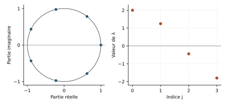

# École polytechnique MP — Deuxième composition de mathématiques 2009 · Corrigé guidé

*Corrigé rédigé par IA, non officiel. Signalez toute erreur.*

**Rédaction** · GPT-6.2 Astra Ultra · vitesse non renseignée

**Révision (tour 1)** · GPT-6.2 Astra Ultra · vitesse non renseignée · 26 novembre 2026

L’épreuve étudie la somme des deux translations opposées d’une suite bilatérale. On suit les mêmes solutions sur trois espaces différents avant de retrouver le noyau au moyen d’une série de Fourier.

## Première partie. Bases adaptées à la matrice de transfert

### Question 1.a

> [!INDICATION]
> Choisir la racine extérieure selon le signe de la trace.

#### Solution

Le polynôme caractéristique de $T_\lambda$ est $z^2-\lambda z+1$, dont les racines sont réciproques. Pour $|\lambda|>2$, posons $\mu=(\lambda+\operatorname{sgn}(\lambda)\sqrt{\lambda^2-4})/2$, de module $(|\lambda|+\sqrt{\lambda^2-4})/2>1$. Pour chacune des racines $z$, $T_\lambda(1,z)=(z,-1+\lambda z)=(z,z^2)=z(1,z)$. Les vecteurs $f_{\lambda,1}=(1,\mu)$ et $f_{\lambda,2}=(1,\mu^{-1})$, de première composante un, forment une base puisque les racines diffèrent.

### Question 1.b

> [!INDICATION]
> Choisir la racine située dans le demi-plan supérieur.

#### Solution

Pour $|\lambda|<2$, les deux racines sont $\mu=(\lambda+i\sqrt{4-\lambda^2})/2$ et $\bar\mu$. On a $|\mu|^2=(\lambda^2+4-\lambda^2)/4=1$, donc $\bar\mu=\mu^{-1}$, et $\operatorname{Im}\mu>0$. Les mêmes vecteurs $(1,\mu)$ et $(1,\mu^{-1})$ donnent la base requise par la vérification de 1.a.

### Question 1.c

> [!INDICATION]
> Fixer le premier coefficient du vecteur généralisé puis résoudre la première ligne.

#### Solution

Pour $\lambda=2$, choisir $f_{2,1}=(1,1)$ et $f_{2,2}=(1,2)$. Leurs images sont $(1,1)$ et $(2,3)=f_{2,1}+f_{2,2}$. Le déterminant des deux colonnes vaut un.

### Question 1.d

> [!INDICATION]
> Adapter le vecteur généralisé à la valeur propre opposée.

#### Solution

Pour $\lambda=-2$, prendre $f_{-2,1}=(1,-1)$ et $f_{-2,2}=(1,0)$. Les images sont $(-1,1)=-f_{-2,1}$ et $(0,-1)=f_{-2,1}-f_{-2,2}$. Ces colonnes ont encore pour déterminant un.

## Deuxième partie. Suites bilatérales et conditions de périodicité

### Question 2.a

> [!INDICATION]
> Passer du couple consécutif au suivant et aussi au précédent.

#### Solution

Écrire $v_k=(x_k,x_{k+1})^T$. L’équation $(Ax)_k=\lambda x_k$ pour tout $k$ est équivalente à $x_{k+2}=\lambda x_{k+1}-x_k$, soit $v_{k+1}=T_\lambda v_k$. Comme $\det T_\lambda=1$, cette récurrence s’itère vers les deux infinis et donne $v_k=T_\lambda^k v_0$ pour tout $k\in\mathbb Z$. Réciproquement la formule des puissances entraîne la récurrence, donc l’équation demandée.

### Question 2.b

> [!INDICATION]
> Identifier les deux données initiales indépendantes.

#### Solution

L’application linéaire $x\mapsto(x_0,x_1)$ du noyau vers $\mathbb C^2$ est injective par 2.a. Toute paire initiale fournit une suite unique par la même récurrence, en avant et en arrière, d’où la surjectivité. Le noyau a dimension deux.

### Question 3.a

> [!INDICATION]
> Reprendre la première composante des puissances dans la base propre.

#### Solution

Écrivons $v_0=\alpha_1f_{\lambda,1}+\alpha_2 f_{\lambda,2}$. Pour $|\lambda|\ne2$, les valeurs propres sont non nulles, donc $T_\lambda^kv_0=\mu^k\alpha_1f_{\lambda,1}+\mu^{-k}\alpha_2 f_{\lambda,2}$ pour tout entier relatif $k$. La première composante de chaque vecteur propre vaut un. Ainsi $x_k=\mu^k\alpha_1+\mu^{-k}\alpha_2$.

### Question 3.b

> [!INDICATION]
> Élever à une puissance entière une matrice unipotente de taille deux.

#### Solution

Dans la base de 1.c, $T_2=I+J$ avec $Jf_{2,2}=f_{2,1}$ et $Jf_{2,1}=0$. Comme $J^2=0$, $(I+J)^k=I+kJ$ pour tout $k\in\mathbb Z$, y compris les entiers négatifs par $(I+J)^{-1}=I-J$. La première composante donne $x_k=\alpha_1+(k+1)\alpha_2$.

### Question 3.c

> [!INDICATION]
> Extraire le signe avant de prendre la puissance.

#### Solution

Dans la base de 1.d, $T_{-2}=-(I-J)$, avec la même matrice nilpotente $J$ de carré nul. Ainsi $T_{-2}^k=(-1)^k(I-kJ)$ pour tout entier relatif. La première composante est $x_k=(-1)^k(\alpha_1+(1-k)\alpha_2)$.

### Question 4

> [!INDICATION]
> Imposer le retour du couple initial au bout de N pas.

#### Solution

La périodicité équivaut à $T_\lambda^Nv_0=v_0$. Pour des racines distinctes, les coordonnées vérifient $(\mu^N-1)\alpha_1=(\mu^{-N}-1)\alpha_2=0$. Une suite non nulle existe exactement quand $\mu^N=1$ et les deux modes sont alors périodiques. Pour $\lambda=2$, 3.b impose $N\alpha_2=0$, et les constantes forment une droite. Pour $\lambda=-2$, la suite 3.c doit d’abord être bornée, donc $\alpha_2=0$. Le mode $((-1)^k)_k$ est périodique de période divisant $N$ exactement si $N$ est pair.

Les valeurs sont donc $\lambda_j=2\cos(2\pi j/N)$ pour $0\le j\le\lfloor N/2\rfloor$. Pour $0<j<N/2$, une base de suites est $\big((e^{2i\pi jk/N})_{k\in\mathbb Z},(e^{-2i\pi jk/N})_{k\in\mathbb Z}\big)$, les deux modes étant indépendants par 2.b. Pour $j=0$ la base est la suite constante un. Pour $j=N/2$ entier elle est la suite alternée.

## Troisième partie. Normes et images sur les espaces de suites

### Question 5

> [!INDICATION]
> Ajuster les phases pour atteindre la norme, ou en approcher la valeur.

#### Solution

La série bilinéaire du sujet converge absolument et $|\langle x,u\rangle|\le\|x\|_1\|u\|_\infty$. Les deux formes sont linéaires continues. Pour $x$ fixé, choisir $u_k=\bar x_k/|x_k|$ si $x_k\ne0$ et zéro sinon. Cette suite de norme au plus un donne $\langle x,u\rangle=\|x\|_1$. Pour $u$ fixé, la suite unité portée par l’indice $k$ donne une valeur absolue $|u_k|$, donc la norme est au moins le supremum de ces valeurs, même s’il n’est pas atteint. Les normes respectives des formes sur $E_1$ et $E_\infty$ sont $\|u\|_\infty$ et $\|x\|_1$.

### Question 6

> [!INDICATION]
> Tester les majorations sur une masse ponctuelle et sur une constante.

#### Solution

Les translations des indices préservent chacune des deux normes, donc la somme des deux translations envoie chaque espace dans lui-même et $\|A_1\|,\|A_\infty\|\le2$. Pour $\delta_0\in E_1$, $A\delta_0=\delta_{-1}+\delta_1$ est de norme deux. Pour la suite constante $u=1\in E_\infty$, $Au=2u$. Les deux majorations sont des égalités et les endomorphismes sont continus.

### Question 7.a

> [!INDICATION]
> Développer le binôme des deux translations inverses.

#### Solution

Soit $(Sx)_k=x_{k+1}$. Alors $A=S+S^{-1}$ et les deux termes commutent. Le binôme donne $(A^nx)_k=\sum_{p=0}^n\binom np x_{k-n+2p}$. Par inégalité triangulaire puis translation des indices dans les sommes positives, $\sum_k|(A^nx)_k|\le\sum_p\binom np\sum_k|x_{k-n+2p}|=2^n\sum_k|x_k|$. Cet énoncé reste valable en valeurs étendues pour $x\in E$.

### Question 7.b

> [!INDICATION]
> Sommer la série géométrique en norme d’opérateur.

#### Solution

Dans l’espace de Banach des endomorphismes continus de $E_1=\ell^1(\mathbb Z)$, $\sum_{n\ge0}\|\lambda^{-n}A_1^n\|\le\sum_{n\ge0}(2/|\lambda|)^n<\infty$. La somme définit donc l’opérateur $B_\lambda$ du sujet. Si $S_m$ est la somme partielle et $U=A_1/\lambda$, alors $(I-U)S_m=S_m(I-U)=I-U^{m+1}$, dont le dernier terme tend vers zéro en norme après soustraction de $I$. À la limite $B_\lambda^{-1}=I-A_1/\lambda$ des deux côtés.

La convergence en norme se chiffre dès les sommes finies. Pour $p>m$, on a $\|S_p-S_m\|\le\sum_{j=m+1}^{p}(2/|\lambda|)^j$. Après passage à la limite, $\|B_\lambda-S_m\|\le(2/|\lambda|)^{m+1}/(1-2/|\lambda|)$. Cette estimation justifie les deux passages à la limite dans les identités de produit.

### Question 8.a

> [!INDICATION]
> Une suite sommable tend vers zéro aux deux extrémités.

#### Solution

Pour $|\lambda|>2$, 7.b rend $A_1-\lambda I$ inversible. Aux deux valeurs $\pm2$, les formes de 3.b–c ont module constant ou croissent comme $|k|$, sauf pour la suite nulle. Pour $|\lambda|<2$, une suite sommable a $v_k\to0$ lorsque $k\to+\infty$. Les coordonnées de $v_k$ dans la base fixe de 1.b valent $\mu^k\alpha_1,\mu^{-k}\alpha_2$. Elles doivent tendre toutes deux vers zéro alors que leurs modules sont $|\alpha_1|,|\alpha_2|$. Les deux coefficients sont donc nuls. Le noyau est $\{0\}$ pour tout réel $\lambda$.

### Question 8.b

> [!INDICATION]
> Imposer seulement la bornitude des deux côtés.

#### Solution

Si $|\lambda|>2$, $\|A_\infty u\|_\infty\le2\|u\|_\infty$ interdit tout vecteur propre non nul. Pour $|\lambda|<2$, les deux modes $k\mapsto\mu^k$ et $k\mapsto\mu^{-k}$ sont bornés et forment une base du noyau par 3.a. Pour $\lambda=2$ ou $-2$, le coefficient du terme linéaire en $k$ doit être nul par 3.b–c. Reste la droite des suites constantes pour $2$, celle des multiples de $((-1)^k)_k$ pour $-2$.

### Question 9

> [!INDICATION]
> Chercher une forme continue non nulle qui annule l’image.

#### Solution

Pour $|\lambda|>2$, 7.b assure que l’image est $E_1$. Si $|\lambda|\le2$, 8.b fournit $u\ne0$ tel que $A_\infty u=\lambda u$. La forme $\ell(x)=\langle x,u\rangle$ est continue et non nulle par 5. Les séries absolument convergentes peuvent être réindexées, d’où $\langle A_1x,u\rangle=\langle x,A_\infty u\rangle$. Il s’ensuit que $\ell((A_1-\lambda I)x)=0$. L’image est contenue dans le noyau fermé propre de $\ell$, donc son adhérence aussi. La densité équivaut à $|\lambda|>2$.

On peut donner un point explicitement séparé de l’image. Pour $|\lambda|\le2$, prenons $t$ tel que $2\cos t=\lambda$ et $u_k=e^{ikt}$. La forme $\ell$ ci-dessus est de norme un, vaut un en $\delta_0$ et s’annule sur l’image. Ainsi $\|\delta_0-y\|_1\ge1$ pour tout $y$ de l’image. Comme $0$ appartient à l’image, la distance de $\delta_0$ à celle-ci vaut exactement $1$, y compris aux deux valeurs $\lambda=\pm2$.

## Quatrième partie. Une transformation de Fourier

### Question 10

> [!INDICATION]
> Extraire un coefficient par orthogonalité des exponentielles.

#### Solution

La série $\varphi_x(t)=\sum_kx_ke^{ikt}$ converge normalement sur $\mathbb R$ puisque $\sum_k|x_k|<\infty$. On peut intégrer terme à terme sur une période après multiplication par $e^{-int}$. L’intégrale de $e^{i(k-n)t}$ vaut $2\pi$ si $k=n$, zéro sinon. Le résultat est $2\pi x_n$.

### Question 11

> [!INDICATION]
> Réindexer séparément les deux translations.

#### Solution

Par convergence absolue, $\sum_k x_{k-1}e^{ikt}=e^{it}\varphi_x(t)$ et $\sum_k x_{k+1}e^{ikt}=e^{-it}\varphi_x(t)$. Donc $\varphi_{A_1x}(t)=2\cos(t)\varphi_x(t)$.

### Question 12

> [!INDICATION]
> Appliquer directement l’inverse de l’opérateur déjà calculé.

#### Solution

Soit $y=B_\lambda x$. Par 7.b, $x=y-A_1y/\lambda$. Par linéarité et 11, $\varphi_x(t)=(1-2\cos t/\lambda)\varphi_y(t)$. Sous $|\lambda|>2$ le facteur ne s’annule à aucun point. D’où $\varphi_{B_\lambda x}(t)=\lambda\varphi_x(t)/(\lambda-2\cos t)$.

### Question 13

> [!INDICATION]
> Examiner les zéros du multiplicateur avant toute division.

#### Solution

Si $A_1x=\lambda x$, on a $(2\cos t-\lambda)\varphi_x(t)=0$ pour tout $t$. Le premier facteur ne s’annule qu’en un nombre fini de points par période, éventuellement aucun. Sur le complément dense, $\varphi_x$ est donc nulle. Elle l’est partout par continuité. L’extraction des coefficients en 10 donne $x_n=0$ pour chaque entier $n$, ce qui redémontre 8.a.

Pour $\lambda=2$, le point $t=0$ est un zéro du multiplicateur ; pour $\lambda=-2$, c’est $t=\pi$. Prendre une suite de points voisins où le multiplicateur est non nul impose aussi $\varphi_x(0)=0$ ou $\varphi_x(\pi)=0$. Cette étape empêche de perdre les deux valeurs limites en divisant l’identité de 11.
