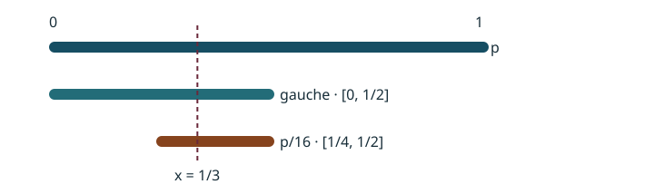

# X · MP · Informatique (option) 2009 — corrigé brut

*Corrigé rédigé par IA, non officiel. Signalez toute erreur.*

**Rédaction** · GPT-6.2 Astra Ultra · vitesse non renseignée · 25 novembre 2026

Langage choisi : OCaml. Les entiers naturels s’écrivent en base paire, chiffre des unités en tête. Les opérations sur les coefficients de Bernstein restent exactes du premier chiffre au verdict final.

## I. Grands entiers

### Question 1 · Construire un chiffre

Le seul zéro superflu serait le chiffre de poids fort d’une écriture de zéro.

```ocaml
type nat = int list
let base = 10000
let cons_nat c n = if c = 0 && n = [] then [] else c :: n
```

### Question 2 · Addition

L’appel interne calcule la valeur des deux suffixes augmentée de la retenue. Le chiffre émis est le reste modulo la base.

```ocaml
let chiffre = function [] -> (0, []) | h :: t -> (h, t)
let add_nat a b =
  let rec somme a b r =
    match a, b with
    | [], [] -> cons_nat r []
    | _ ->
        let x, u = chiffre a and y, v = chiffre b in
        let s = x + y + r in
        cons_nat (s mod base) (somme u v (s / base))
  in somme a b 0
```

La somme locale atteint au plus $2B-1$ pour $B=\mathtt{base}$. Une seule visite par colonne donne un coût linéaire.

### Question 3 · Comparaison

Les queues portent les poids dominants. Leur égalité seule oblige à comparer les unités.

```ocaml
let rec cmp_nat a b = match a, b with
  | [], [] -> 0
  | [], _ -> -1
  | _, [] -> 1
  | x :: u, y :: v ->
      let k = cmp_nat u v in
      if k <> 0 then k else if x < y then -1 else if x > y then 1 else 0
```

Chaque paire de chiffres coûte un temps constant.

### Question 4 · Soustraction

L’emprunt $r$ est retranché dans la colonne courante. Un résultat négatif reçoit $B$ et transmet un nouvel emprunt.

```ocaml
let sous_nat a b =
  let rec difference a b r = match a, b with
    | [], [] when r = 0 -> []
    | [], _ -> invalid_arg "difference negative"
    | x :: u, _ ->
        let y, v = chiffre b in
        let s = x - y - r in
        if s < 0 then cons_nat (s + base) (difference u v 1)
        else cons_nat s (difference u v 0)
  in difference a b 0
```

À chaque étape $-B\le s<B$. L’hypothèse $a\ge b$ exclut un emprunt final. Le coût est linéaire.

### Question 5 · Division euclidienne par deux

Si la queue vaut $2q+r$, la liste entière vaut $2Bq+Br+x$. Il reste à diviser $Br+x$ par deux.

```ocaml
let rec div2_nat = function
  | [] -> ([], 0)
  | x :: u ->
      let q, r = div2_nat u in
      let s = r * base + x in
      (cons_nat (s / 2) q, s mod 2)
```

Le chiffre du quotient est inférieur à $B$, même si $r=1$. La division de 1 renvoie bien la liste vide et le reste 1.

### Question 6 · Opposé

Changer uniquement le signe préserve la valeur absolue.

```ocaml
type z = {signe : int; nat : nat}
let neg_z z = {z with signe = -z.signe}
```

### Question 7 · Addition signée

Avec des signes égaux, additionner les modules. Sinon, retrancher le plus petit module du plus grand et conserver le signe de ce dernier.

```ocaml
let add_z a b =
  if a.signe = b.signe then {a with nat = add_nat a.nat b.nat}
  else if cmp_nat a.nat b.nat >= 0 then {a with nat = sous_nat a.nat b.nat}
  else {b with nat = sous_nat b.nat a.nat}
```

### Question 8 · Multiplication par une puissance de deux

Doubler $p$ fois le module conserve le signe.

```ocaml
let rec mul_puiss2_z p z =
  if p = 0 then z
  else mul_puiss2_z (p - 1) {z with nat = add_nat z.nat z.nat}
```

### Question 9 · Extraction de la valuation

Diviser le module non nul tant que le reste est nul. Le premier reste 1 désigne un module impair qu’il faut conserver entier.

```ocaml
let decomp_puiss2_z z =
  let rec extraire p n =
    let q, r = div2_nat n in
    if r = 1 then ({z with nat = n}, p)
    else extraire (p + 1) q
  in if z.nat = [] then invalid_arg "valuation de zero" else extraire 0 z.nat
```

## II. Nombres dyadiques

### Question 10 · Division par deux

Décrémenter l’exposant garde la mantisse impaire ou nulle.

```ocaml
type dya = {m : z; e : int}
let div2_dya d = {d with e = d.e - 1}
```

### Question 11 · Somme normalisée

Ramener les termes à l’exposant minimal $e$. La nouvelle mantisse est $2^{e_a-e}m_a+2^{e_b-e}m_b$. Réinjecter sa valuation dans l’exposant, sauf pour zéro.

```ocaml
let add_dya a b =
  let e = min a.e b.e in
  let m = add_z (mul_puiss2_z (a.e - e) a.m)
                (mul_puiss2_z (b.e - e) b.m) in
  if m.nat = [] then {m; e = 0}
  else let u, p = decomp_puiss2_z m in {m = u; e = e + p}
```

### Question 12 · Différence

L’opposé d’un dyadique s’obtient en opposant sa mantisse. L’addition assure ensuite la normalisation.

```ocaml
let sous_dya a b = add_dya a {b with m = neg_z b.m}
```

## III. Listes à deux bouts

### Question 13 · Vide

La longueur logique est la somme des deux compteurs positifs ou nuls.

```ocaml
type ldb = {lg : int; g : dya list; ld : int; d : dya list}
let ldb_vide = {lg = 0; g = []; ld = 0; d = []}
let ldb_est_vide l = l.lg = 0 && l.ld = 0
```

### Question 14 · Premier élément

Si $g$ est vide, l’équilibre donne $l_d\le1$. La précondition impose un singleton droit.

```ocaml
let premier_g l = match l.g, l.d with
  | x :: _, _ | [], [x] -> x
  | _ -> invalid_arg "liste vide ou incorrecte"
```

### Question 15 · Miroir

Échanger les moitiés et leurs compteurs coûte $O(1)$, puisque le miroir de $g\,\mathrm{rev}(d)$ vaut $d\,\mathrm{rev}(g)$.

```ocaml
let inverse_ldb l = {lg = l.ld; g = l.d; ld = l.lg; d = l.g}
```

### Question 16 · Rééquilibrage

Conserver l’objet si les deux inégalités sont satisfaites. Sinon reconstruire sa séquence logique, la couper après $\lfloor n/2\rfloor$ éléments et ranger la seconde moitié à rebours.

```ocaml
let c = 3
let trop_long a b = a >= 2 && (a - 2) / c >= b
let invariant_ldb l =
  if not (trop_long l.lg l.ld || trop_long l.ld l.lg) then l
  else
    let n = l.lg + l.ld in
    let rec coupe k acc xs =
      if k = 0 then (List.rev acc, xs)
      else match xs with
        | h :: t -> coupe (k - 1) (h :: acc) t
        | [] -> invalid_arg "longueur incorrecte"
    in
    let g, suite = coupe (n / 2) [] (l.g @ List.rev l.d) in
    {lg = n / 2; g; ld = n - n / 2; d = List.rev suite}
```

La constante $c$ est paramétrable. Le test calcule $a>cb+1$ par division entière. Chaque parcours lors d’une réparation est linéaire.

### Question 17 · Ajouter à gauche

Prépendre à $g$, incrémenter $l_g$ et réparer si nécessaire.

```ocaml
let ajoute_g x l = invariant_ldb {l with g = x :: l.g; lg = l.lg + 1}
```

### Question 18 · Retirer à gauche

Si $g$ est vide, le singleton de droite devient une liste vide. Les opérations droites se déduisent par symétrie.

```ocaml
let enleve_g l = match l.g, l.d with
  | _ :: g, _ -> invariant_ldb {l with g; lg = l.lg - 1}
  | [], [_] -> ldb_vide
  | _ -> invalid_arg "liste vide ou incorrecte"
let ajoute_d x l = inverse_ldb (ajoute_g x (inverse_ldb l))
let enleve_d l = inverse_ldb (enleve_g (inverse_ldb l))
```

### Question 19 · Coût moyen des insertions

Pour $c=3$, le premier rééquilibrage a lieu à $n=2$. Après une réparation à taille $m$ paire les compteurs valent $m/2$ chacun. Le premier dépassement se produit à $l_g=3m/2+2$, soit à $n=2m+2$. Les tailles sont donc $2,6,14,30,\ldots$, de terme $2^{j+1}-2$ pour $j\ge1$.

Jusqu’à $N$, la somme de ces tailles est $O(N)$ par série géométrique, en plus des $N$ tests constants. Chaque insertion coûte au moins un temps constant. Le coût total est $\Theta(N)$ et le coût amorti par insertion $\Theta(1)$.

## IV. Polynômes de Bernstein

### Question 20 · Certificat de signe

Par récurrence sur $k$, les $B_i^k(x)$ sont positifs ou nuls sur $[0,1]$, car les termes extérieurs valent zéro et la récurrence utilise $x$ et $1-x$. Une combinaison à coefficients positifs ou nuls est donc positive ou nulle.

Pour $p=\langle2,-1,2\rangle$, les trois termes donnent $2(1-x)^2-2x(1-x)+2x^2=6(x-1/2)^2+1/2$. Ce polynôme est strictement positif malgré son coefficient central négatif.

### Question 21 · Certifier les deux moitiés

Les raffinements ont tous leurs coefficients positifs. Les identités (3) et (4) couvrent respectivement $[0,1/2]$ et $[1/2,1]$. Ainsi $I(p)\ge0$ sur tout l’intervalle.

### Question 22 · Procédure bornée

Tester d’abord les coefficients puis, si nécessaire et encore autorisé, certifier les deux moitiés.

```ocaml
type poly = ldb
let profondeur_max = 12
let test_pos p =
  let positif d = d.m.nat = [] || d.m.signe = 1 in
  let rec certifie h p =
    if List.for_all positif p.g && List.for_all positif p.d then true
    else if h = 0 then false
    else certifie (h - 1) (raffine_g p) && certifie (h - 1) (raffine_d p)
  in certifie profondeur_max p
```

Les raffinements sont les fonctions données par le sujet. Le paramètre entier décroît jusqu’à zéro. Par induction sur ce paramètre, chaque réponse vraie certifie la propriété grâce aux questions 20 et 21. Une réponse fausse signifie que le budget n’a pas permis de conclure. Au plus $2^{h+1}-1$ nœuds sont visités pour une borne $h$.

### Question 23 · Homogénéité

La différence décalée est coefficient par coefficient, donc $D(cp)=cD(p)$. L’intégration de $a$ et de $u=(u_0,\ldots,u_{r-1})$ donne les $r+1$ coefficients $a+\sum_{i<j}u_i$ pour $0\le j\le r$. Cette formule suit de la définition récursive en retirant le dernier coefficient. Elle établit $\mathrm{integre}(ca,cu)=c\,\mathrm{integre}(a,u)$.

Le raffinement gauche du vide est vide. Pour un polynôme non vide, appliquer l’hypothèse d’homogénéité au raffinement de sa différence, de taille moindre. La division par deux commute avec $c$, le premier coefficient se multiplie par $c$ et l’homogénéité de l’intégration termine la récurrence. Le miroir est une permutation des coefficients, donc commute avec $c$. Les deux miroirs dans le raffinement droit donnent la seconde égalité.

### Question 24 · Un certificat toujours hors d’atteinte

Pour $p=\langle1,-2,4\rangle$, on obtient $I(p)=(1-x)^2-4x(1-x)+4x^2=(1-3x)^2$. Le raffinement gauche a pour coefficients $(1,-1/2,1/4)$, car la différence $(-3,6)$ se raffine à gauche en $(-3,3/2)$ puis s’intègre après division par deux.



Par l’identité admise, le fils droit de ce fils gauche vaut $p/16$. À profondeur $2j$, le chemin alternant gauche et droite atteint $16^{-j}p$, et à profondeur $2j+1$, $16^{-j}\mathrm{raffine}_g(p)$, par la question 23. Chacun contient un coefficient strictement négatif. Tout budget fini laisse donc un échec sur ce chemin. La conjonction de la question 22 ne peut renvoyer vrai pour ce carré.

[Sujet](https://www.wikiprepa.fr/concours/data/x_option-info_mp_2009.pdf) · [Rapport](https://www.doc-solus.fr/prepa/sci/adc/pdf/rapports.pdf/2009/MP_INFO_X_1_2009.rapport.pdf) · [Autre exemplaire](https://www.doc-solus.fr/prepa/sci/adc/pdf/enonces.pdf/2009/MP_INFO_X_1_2009.enonce.pdf)
