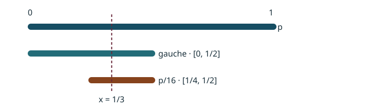

# X · MP · Informatique (option) 2009 — corrigé guidé

*Corrigé rédigé par IA, non officiel. Signalez toute erreur.*

**Rédaction** · GPT-6.2 Astra Ultra · vitesse non renseignée · 25 novembre 2026

Langage choisi : OCaml. Les entiers naturels s’écrivent en base paire, chiffre des unités en tête. Les opérations sur les coefficients de Bernstein restent exactes du premier chiffre au verdict final.

## I. Grands entiers

### Question 1 · Construire un chiffre

En base dix, la liste [0 ; 1] représente dix. Le zéro des unités y est indispensable. En revanche le chiffre 0 posé devant la liste vide représente encore zéro, dont l’écriture est vide.

```ocaml
type nat = int list
let base = 10000
let cons_nat c n = if c = 0 && n = [] then [] else c :: n
```

### Question 2 · Addition

Que devient une colonne quand sa somme vaut exactement la base ? Elle donne zéro ici et une unité à la colonne suivante. Quand un opérande est épuisé, ses chiffres implicites sont nuls. Quand les deux sont épuisés, une retenue éventuelle suffit à terminer.

```ocaml
let chiffre = function [] -> (0, []) | h :: t -> (h, t)
let add_nat a b =
  let rec somme a b r =
    match a, b with
    | [], [] -> cons_nat r []
    | _ ->
        let x, u = chiffre a and y, v = chiffre b in
        let s = x + y + r in
        cons_nat (s mod base) (somme u v (s / base))
  in somme a b 0
```

La somme locale atteint au plus $2B-1$ pour $B=\mathtt{base}$. Une seule visite par colonne donne un coût linéaire.

### Question 3 · Comparaison

En base dix, comparer 29 et 31 à partir des unités donnerait le mauvais signe. Le retour de récursion fournit le verdict sur les dizaines et au-delà. Une fin de liste face à une liste non vide départage immédiatement deux naturels canoniques.

```ocaml
let rec cmp_nat a b = match a, b with
  | [], [] -> 0
  | [], _ -> -1
  | _, [] -> 1
  | x :: u, y :: v ->
      let k = cmp_nat u v in
      if k <> 0 then k else if x < y then -1 else if x > y then 1 else 0
```

Chaque paire de chiffres coûte un temps constant.

### Question 4 · Soustraction

Suivre $100-1$ en base dix. Les deux premières colonnes donnent 9 après emprunt et la dernière se réduit à zéro. La construction canonique au retour supprime précisément ce zéro de poids fort.

```ocaml
let sous_nat a b =
  let rec difference a b r = match a, b with
    | [], [] when r = 0 -> []
    | [], _ -> invalid_arg "difference negative"
    | x :: u, _ ->
        let y, v = chiffre b in
        let s = x - y - r in
        if s < 0 then cons_nat (s + base) (difference u v 1)
        else cons_nat s (difference u v 0)
  in difference a b 0
```

À chaque étape $-B\le s<B$. L’hypothèse $a\ge b$ exclut un emprunt final. Le coût est linéaire.

### Question 5 · Division euclidienne par deux

Pour 31 en base dix, diviser 3 donne quotient 1 et reste 1. Reste alors à diviser 11, ce qui fournit le chiffre 5 et le reste final 1. Le résultat est bien 15 et 1. Cette fois, la propagation se fait depuis les poids forts.

```ocaml
let rec div2_nat = function
  | [] -> ([], 0)
  | x :: u ->
      let q, r = div2_nat u in
      let s = r * base + x in
      (cons_nat (s / 2) q, s mod 2)
```

Le chiffre du quotient est inférieur à $B$, même si $r=1$. La division de 1 renvoie bien la liste vide et le reste 1.

### Question 6 · Opposé

Les signes $+1$ et $-1$ sont tous deux licites pour zéro. Il est donc possible d’appliquer le même changement à toute entrée.

```ocaml
type z = {signe : int; nat : nat}
let neg_z z = {z with signe = -z.signe}
```

### Question 7 · Addition signée

Pour $-7+5$, le module de gauche gagne de deux unités et le résultat garde le signe moins. Pour $-5+5$ la même règle donne un module nul, avec un signe autorisé.

```ocaml
let add_z a b =
  if a.signe = b.signe then {a with nat = add_nat a.nat b.nat}
  else if cmp_nat a.nat b.nat >= 0 then {a with nat = sous_nat a.nat b.nat}
  else {b with nat = sous_nat b.nat a.nat}
```

### Question 8 · Multiplication par une puissance de deux

Après $j$ tours, le module courant vaut $2^j$ fois le module initial. Le paramètre décroissant compte les doublements restants. Aucune puissance machine de deux n’a besoin d’être formée.

```ocaml
let rec mul_puiss2_z p z =
  if p = 0 then z
  else mul_puiss2_z (p - 1) {z with nat = add_nat z.nat z.nat}
```

### Question 9 · Extraction de la valuation

Pour $-40$, les divisions exactes conduisent à $-20,-10,-5$. La division suivante a un reste 1. Il faut renvoyer $-5$ et 3. À chaque division exacte le module entier positif décroît strictement.

```ocaml
let decomp_puiss2_z z =
  let rec extraire p n =
    let q, r = div2_nat n in
    if r = 1 then ({z with nat = n}, p)
    else extraire (p + 1) q
  in if z.nat = [] then invalid_arg "valuation de zero" else extraire 0 z.nat
```

## II. Nombres dyadiques

### Question 10 · Division par deux

Un exposant négatif représente déjà une fraction. Passer de $-2$ à $-3$ transforme $3/4$ en $3/8$, sans toucher au grand entier.

```ocaml
type dya = {m : z; e : int}
let div2_dya d = {d with e = d.e - 1}
```

### Question 11 · Somme normalisée

Pour $3/4+1/4$, les exposants coïncident mais la somme des mantisses est 4. La réduction rend $1\times2^0$. Pour $3/4-3/4$, le résultat nul doit court-circuiter l’extraction de la valuation.

```ocaml
let add_dya a b =
  let e = min a.e b.e in
  let m = add_z (mul_puiss2_z (a.e - e) a.m)
                (mul_puiss2_z (b.e - e) b.m) in
  if m.nat = [] then {m; e = 0}
  else let u, p = decomp_puiss2_z m in {m = u; e = e + p}
```

### Question 12 · Différence

L’exposant de $-3/4$ est encore celui de $3/4$. Changer le signe de l’exposant produirait une autre valeur. On réutilise le traitement de l’annulation de la question 11.

```ocaml
let sous_dya a b = add_dya a {b with m = neg_z b.m}
```

## III. Listes à deux bouts

### Question 13 · Vide

Interpréter la liste comme $g$ suivi de l’inverse de $d$. Pour que leur concaténation soit vide, chacune des deux moitiés doit être vide.

```ocaml
type ldb = {lg : int; g : dya list; ld : int; d : dya list}
let ldb_vide = {lg = 0; g = []; ld = 0; d = []}
let ldb_est_vide l = l.lg = 0 && l.ld = 0
```

### Question 14 · Premier élément

Une liste de longueur 1 admet deux répartitions. Tester la tête de gauche suffit dès qu’elle existe. Dans la deuxième répartition, le premier et le dernier élément logique coïncident.

```ocaml
let premier_g l = match l.g, l.d with
  | x :: _, _ | [], [x] -> x
  | _ -> invalid_arg "liste vide ou incorrecte"
```

### Question 15 · Miroir

Avec $g=[1,2]$ et $d=[5,4,3]$, l’échange fait lire $5,4,3,2,1$ dans le sens logique. Chaque morceau garde exactement sa structure physique.

```ocaml
let inverse_ldb l = {lg = l.ld; g = l.d; ld = l.lg; d = l.g}
```

### Question 16 · Rééquilibrage

La vérification doit être constante sur une liste équilibrée. Sur une liste à réparer, matérialiser d’abord l’ordre de lecture évite de perdre le sens de la partie droite. Les nouvelles longueurs diffèrent d’au plus un, ce qui établit les deux inégalités pour tout $c\ge2$.

```ocaml
let c = 3
let trop_long a b = a >= 2 && (a - 2) / c >= b
let invariant_ldb l =
  if not (trop_long l.lg l.ld || trop_long l.ld l.lg) then l
  else
    let n = l.lg + l.ld in
    let rec coupe k acc xs =
      if k = 0 then (List.rev acc, xs)
      else match xs with
        | h :: t -> coupe (k - 1) (h :: acc) t
        | [] -> invalid_arg "longueur incorrecte"
    in
    let g, suite = coupe (n / 2) [] (l.g @ List.rev l.d) in
    {lg = n / 2; g; ld = n - n / 2; d = List.rev suite}
```

La constante $c$ est paramétrable. Le test calcule $a>cb+1$ par division entière. Chaque parcours lors d’une réparation est linéaire.

### Question 17 · Ajouter à gauche

Le compteur mémorisé doit évoluer en même temps que la liste. La réparation éventuelle déplace les éléments en gardant leur ordre logique.

```ocaml
let ajoute_g x l = invariant_ldb {l with g = x :: l.g; lg = l.lg + 1}
```

### Question 18 · Retirer à gauche

Après un retrait gauche, c’est le côté droit qui risque de devenir trop long. Réappliquer le test d’équilibre couvre ce cas. Le singleton physique de droite demande un traitement explicite.

```ocaml
let enleve_g l = match l.g, l.d with
  | _ :: g, _ -> invariant_ldb {l with g; lg = l.lg - 1}
  | [], [_] -> ldb_vide
  | _ -> invalid_arg "liste vide ou incorrecte"
let ajoute_d x l = inverse_ldb (ajoute_g x (inverse_ldb l))
let enleve_d l = inverse_ldb (enleve_g (inverse_ldb l))
```

### Question 19 · Coût moyen des insertions

Partir de $(0,0)$. À $(2,0)$ la reconstruction donne $(1,1)$. Ensuite $(4,1)$ reste légal, tandis que $(5,1)$ est refait en $(3,3)$. Plus généralement, juste après une réparation de taille paire $m$, la moitié droite reste égale à $m/2$. La première longueur totale qui oblige à réparer est $(3m/2+2)+m/2=2m+2$. Par récurrence les longueurs de réparation sont $2^{j+1}-2$ pour $j\ge1$.

Jusqu’à $N$, la somme de ces tailles est $O(N)$ par série géométrique, en plus des $N$ tests constants. Chaque insertion coûte au moins un temps constant. Le coût total est $\Theta(N)$ et le coût amorti par insertion $\Theta(1)$.

## IV. Polynômes de Bernstein

### Question 20 · Certificat de signe

Au rang zéro le polynôme de base vaut 1. Pour passer au rang suivant, on multiplie les deux termes précédents par des quantités comprises entre zéro et un avant de les additionner. En pondérant ces fonctions par des coefficients positifs ou nuls, aucune valeur négative ne peut apparaître.

Pour $p=\langle2,-1,2\rangle$, les trois termes donnent $2(1-x)^2-2x(1-x)+2x^2=6(x-1/2)^2+1/2$. Ce polynôme est strictement positif malgré son coefficient central négatif.

### Question 21 · Certifier les deux moitiés

Appliquer le test de la question 20 à chaque triplet raffiné. Pour une abscisse $y$ dans la première moitié, utiliser $x=2y$ dans (3). Dans la seconde, prendre $x=2y-1$ dans (4). Le point milieu appartient aux deux certificats.

### Question 22 · Procédure bornée

Un grand entier de module nul est positif ou nul même si son champ signe vaut $-1$. Il suffit de balayer les deux listes physiques dans leur ordre local. Si le test échoue au niveau courant, les deux sous-intervalles doivent chacun fournir une preuve.

```ocaml
type poly = ldb
let profondeur_max = 12
let test_pos p =
  let positif d = d.m.nat = [] || d.m.signe = 1 in
  let rec certifie h p =
    if List.for_all positif p.g && List.for_all positif p.d then true
    else if h = 0 then false
    else certifie (h - 1) (raffine_g p) && certifie (h - 1) (raffine_d p)
  in certifie profondeur_max p
```

Les raffinements sont les fonctions données par le sujet. Le paramètre entier décroît jusqu’à zéro. Par induction sur ce paramètre, chaque réponse vraie certifie la propriété grâce aux questions 20 et 21. Une réponse fausse signifie que le budget n’a pas permis de conclure. Au plus $2^{h+1}-1$ nœuds sont visités pour une borne $h$.

### Question 23 · Homogénéité

Calculer les trois premiers coefficients de l’intégration donne $a,a+u_0,a+u_0+u_1$. En général le coefficient $j$ est $a+\sum_{i<j}u_i$. Pour le prouver, la définition préfixe $a$ puis ajoute $u_{j-1}$ au coefficient $j-1$ de l’intégrale du préfixe plus court. Multiplier toutes les données, y compris $a$, par $c$ multiplie donc chaque coefficient par $c$. De même les différences $u_{i+1}-u_i$ sont homogènes.

Le raffinement gauche du vide est vide. Pour un polynôme non vide, appliquer l’hypothèse d’homogénéité au raffinement de sa différence, de taille moindre. La division par deux commute avec $c$, le premier coefficient se multiplie par $c$ et l’homogénéité de l’intégration termine la récurrence. Le miroir est une permutation des coefficients, donc commute avec $c$. Les deux miroirs dans le raffinement droit donnent la seconde égalité.

### Question 24 · Un certificat toujours hors d’atteinte

Le zéro de $I(p)=(1-3x)^2$ se trouve en $1/3$. Le triplet initial échoue déjà au test de signe. Calculer ses différences $(-3,6)$ puis leur raffinement gauche $(-3,3/2)$. Diviser par deux donne $(-3/2,3/4)$. En intégrant à partir de 1, on retrouve le triplet gauche $(1,-1/2,1/4)$ qui échoue lui aussi.



Par l’identité admise, le fils droit de ce fils gauche vaut $p/16$. À profondeur $2j$, le chemin alternant gauche et droite atteint $16^{-j}p$, et à profondeur $2j+1$, $16^{-j}\mathrm{raffine}_g(p)$, par la question 23. Chacun contient un coefficient strictement négatif. Tout budget fini laisse donc un échec sur ce chemin. La conjonction de la question 22 ne peut renvoyer vrai pour ce carré.

[Sujet](https://www.wikiprepa.fr/concours/data/x_option-info_mp_2009.pdf) · [Rapport](https://www.doc-solus.fr/prepa/sci/adc/pdf/rapports.pdf/2009/MP_INFO_X_1_2009.rapport.pdf) · [Autre exemplaire](https://www.doc-solus.fr/prepa/sci/adc/pdf/enonces.pdf/2009/MP_INFO_X_1_2009.enonce.pdf)
