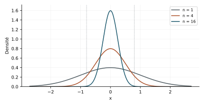

# École polytechnique MP — Première composition de mathématiques 2009 · Corrigé brut

*Corrigé rédigé par IA, non officiel. Signalez toute erreur.*

**Rédaction** · GPT-6.2 Astra Ultra · vitesse non renseignée

**Révision** · GPT-6.2 Astra Ultra · vitesse non renseignée

Le sujet traite d’abord de la dilatation d’une fonction puis des moments de produits de convolution. Le rapport de jury demande notamment de justifier les échanges de sommes en question 5 et le contrôle des queues en question 12.a.

## Première partie. Exponentielle du générateur des dilatations

### Question 1

La règle de composition donne $\frac d{dt}f(e^tx)=e^txf'(e^tx)$. En $t=0$ on obtient $xf'(x)=(Af)(x)$.

### Question 2

Chaque monôme est propre pour $A$, puisque $A(x^j)=jx^j$. Donc $A^n(x^j)=j^nx^j$ pour $n\ge1$, et l’itérée d’ordre zéro est l’identité. La série exponentielle sur ce monôme est absolument convergente, de somme $e^{jt}x^j$. Un polynôme $f=\sum_{j=0}^m a_jx^j$ est une somme finie de tels monômes ; la série converge absolument et vaut $\sum_{j=0}^m a_j(e^tx)^j=f(e^tx)$.

### Question 3

Pour toute fonction lisse, $(xf)^{(n)}=xf^{(n)}+nf^{(n-1)}$ car toutes les dérivées de $x$ après la première sont nulles. C’est l’identité d’opérateurs $D^nX=XD^n+nD^{n-1}$.

### Question 4

On a $A(X^kD^kf)=kX^kD^kf+X^{k+1}D^{k+1}f$. En partant de $\mu_{1,1}=1$ et en posant les coefficients hors triangle égaux à zéro, la récurrence est $\mu_{n,k}=k\mu_{n-1,k}+\mu_{n-1,k-1}$. Elle établit l’identité recherchée et la positivité pour $1\le k\le n$. Les deux bords restent égaux à un : $\mu_{n,1}=\mu_{n,n}=1$.

### Question 5

Appliquons l’identité de 4 au monôme $u^k$ et évaluons en $u=1$. Sa positivité donne $k^n=\sum_{j=1}^{\min(k,n)}\mu_{n,j}k!/(k-j)!\ge k!\mu_{n,k}$ pour $n\ge k\ge1$. Ainsi la série intérieure $\sum_{n\ge k}\mu_{n,k}t^n/n!$ converge absolument pour tout $t$, par comparaison avec $e^{k|t|}/k!$. Pour un polynôme $f$ de degré $m$, seuls $1\le k\le m$ contribuent. On peut donc regrouper la série de 2 selon ces $k$ et obtenir $f(e^tx)=f(x)+\sum_{k\ge1}x^kf^{(k)}(x)\sum_{n\ge k}\mu_{n,k}t^n/n!$.

### Question 6

Pour $k\ge1$, $|ka_k|^{1/k}=k^{1/k}|a_k|^{1/k}$ et $k^{1/k}\to1$. La formule de Cauchy–Hadamard donne les mêmes rayons de convergence, y compris zéro ou l’infini. Le terme constant n’affecte pas ce rayon.

### Question 7.a

Pour $|x|<R$, $|(e^t-1)x|\to0<R-|x|$. Par continuité un $\gamma_x>0$ convient. On peut le choisir de façon plus restrictive pour que $(e^{|t|}-1)|x|<R-|x|$ pour $|t|<\gamma_x$, utile dans la suite. En $x=0$, tout $\gamma_x$ convient.

### Question 7.b

La propriété (P) au point $x$ avec $h=x(e^t-1)$ donne $f(e^tx)=f(x)+\sum_{k\ge1}x^kf^{(k)}(x)(e^t-1)^k/k!$. Posons $\lambda_{n,k}=n!\,[t^n]\big((e^t-1)^k/k!\big)$, indépendants de $f$. La série intérieure est entière car c’est un produit fini d’exponentielles. En la substituant dans la somme de Taylor, dans son ordre indiqué, on obtient la formule demandée. Explicitement $\lambda_{n,k}=(n!/k!)\sum_{j_1+\cdots+j_k=n,\ j_i\ge1}(j_1!\cdots j_k!)^{-1}$.

### Question 7.c

L’expression de 7.b est nulle pour $n<k$. Fixons $k\ge1$, prenons $x=1$ et le polynôme $f(u)=(u-1)^k/k!$. Au point $1$, seule la dérivée d’ordre $k$ est non nulle, de valeur un. En comparant les identités 5 et 7.b, on a $\sum_{n\ge k}\mu_{n,k}t^n/n!=\sum_{n\ge k}\lambda_{n,k}t^n/n!$ au voisinage de zéro. Unicité des coefficients de Taylor en $t$ donne $\lambda_{n,k}=\mu_{n,k}$.

### Question 7.d

Dans 7.b chaque produit d’inverses de factorielles est au plus un. Les compositions sont obtenues en plaçant $k-1$ séparateurs parmi $n-1$ intervalles, donc $\lambda_{n,k}\le(n!/k!)\binom{n-1}{k-1}\le2^{n-1} n!/k!\le2^n n!/(k-1)!$.

### Question 7.e

Choisissons $0<r<R$ (par exemple $R/2$ si $R<\infty$, sinon $r=1$), $\alpha=r/2$ et $\eta=\log2$. Pour $|x|<\alpha$, $|t|<\eta$, on a $|x|(e^{|t|}-1)<r/2<R-|x|$. Par positivité des $\lambda_{n,k}$, la somme en $n$ des valeurs absolues vaut $|f^{(k)}(x)|[|x|(e^{|t|}-1)]^k/k!$. La somme en $k$ converge par convergence absolue à l’intérieur du rayon de la série de Taylor de (P). Ainsi la double série demandée est absolument sommable.

La quantité positive sommée en $n$ à $k$ fixé se calcule en évaluant la série génératrice en $|t|$. On obtient exactement la série de Taylor absolue des dérivées en $x$, évaluée en $|x|(e^{|t|}-1)$. L’argument reste valable même si certains $f^{(k)}(x)$ changent de signe.

### Question 7.f

Dans ce rectangle, 7.e permet d’intervertir et de regrouper les sommes, et (P) s’applique à $h=x(e^t-1)$. Avec 7.c et 4, la somme selon $k$ à $n$ fixé est $\sum_{k=1}^n \mu_{n,k}x^k f^{(k)}(x)=(A^n f)(x)$. En ajoutant le terme d’ordre zéro, $\sum_{n\ge0}(t^n/n!)(A^nf)(x)=f(e^tx)=(\Phi_tf)(x)$.

## Deuxième partie. Moments des convolutions et concentration

### Question 8

Sur $|x|\ge1$, $|x^kf(x)|\le\|x^{k+2}f\|_\infty/|x|^2$, majorant intégrable. Sur le segment restant, la continuité donne l’intégrabilité. Ainsi chaque moment est absolument convergent.

### Question 9.a

Pour tout $x$ fixé, $|f(x-y)g(y)|\le\|f\|_\infty |g(y)|$ et $g$ est intégrable par 8 avec $k=0$. Le produit est continu en $y$, donc intégrable.

### Question 9.b

La convolution est continue par convergence dominée, avec le majorant de 9.a lorsque $x$ varie. En écrivant $x=(x-y)+y$, on a, pour tout $k$, $|x^k(f*g)(x)|\le\sum_{p=0}^k\binom kp\|u^pf(u)\|_\infty\int |y|^{k-p}|g(y)|dy$, borne indépendante de $x$. Ainsi $f*g\in F$. Pour calculer son moment, chaque terme après développement est absolument intégrable sur le plan : par $u=x-y$, son intégrale absolue est le produit $\|u^pf(u)\|_1\|y^{k-p}g(y)\|_1<\infty$. Fubini donne donc $m_k(f*g)=\sum_{p=0}^k\binom kp m_p(f)m_{k-p}(g)$, soit $\gamma_{k,p}=\binom kp$.

### Question 10

Pour deux éléments de $F_0$, positivité et 9.b donnent $m_0(f*g)=1$, $m_1(f*g)=0$ et $m_2(f*g)=m_2(f)+2m_1(f)m_1(g)+m_2(g)=m_2(f)+m_2(g)$. La convolution reste donc dans $F_0$. Par récurrence, $m_0(F_n)=1$, $m_1(F_n)=0$ et $m_2(F_n)=\sum_{i=1}^n m_2(f_i)$.

### Question 11

Pour $u=ax$, $dx=du/a$ et $x^k=u^k/a^k$. Ainsi $m_k(T_af)=a^{-k}m_k(f)$.

### Question 12.a

Posons $h_n=T_nF_n$, positive de masse un. Par 10–11, $m_2(h_n)=n^{-2}\sum_i m_2(f_i)\le C/n$. Sur $|x|\ge\alpha$, $1\le x^2/\alpha^2$. Donc les deux queues positives ont ensemble une masse au plus $C/(n\alpha^2)$ et tendent chacune vers zéro.

### Question 12.b

La masse de $h_n=T_nF_n$ vaut un. Pour $\varepsilon>0$, choisir $\alpha>0$ tel que $|h(x)-h(0)|\le\varepsilon$ sur $|x|\le\alpha$. Alors $|\int h h_n-h(0)|\le\varepsilon+2\|h\|_\infty C/(n\alpha^2)$. Prendre la limite supérieure puis $\varepsilon\downarrow0$ montre que l’intégrale tend vers $h(0)$. Cette preuve utilise la masse des queues sans supposer de majorant intégrable commun aux densités.

Dans le cas gaussien du dessin, $F_n$ a pour variance $n$. La densité $T_nF_n$ a pour variance $n/n^2=1/n$. Sa hauteur en zéro est $\sqrt{n/(2\pi)}$, ce qui explique pourquoi la majoration des queues convient même si la hauteur maximale augmente.

### Question 13.a

Comme $m_0(f)=1$, l’inégalité de Cauchy–Schwarz pour $x^2$ et $1$ dans $L^2(f(x)dx)$ donne $m_2(f)^2\le m_4(f)m_0(f)=m_4(f)$.

### Question 13.b

Pour $f,g\in F_0$, les termes portant un premier moment s’annulent, d’où $m_4(f*g)=m_4(f)+6m_2(f)m_2(g)+m_4(g)$. Appliqué à $F_{n-1}$ et $f_n$ avec 10, cela ajoute $m_4(f_n)+6\sum_{i<n}m_2(f_i)m_2(f_n)$. L’initialisation $n=1$ et la récurrence donnent $m_4(F_n)=\sum_{i\le n}m_4(f_i)+6\sum_{i<j\le n}m_2(f_i)m_2(f_j)$.

### Question 13.c

Une condition suffisante est $\sup_i m_4(f_i)\le D<\infty$. Par 13.b et l’hypothèse $m_2(f_i)\le C$, on a $m_4(F_n)\le nD+3n(n-1)C^2$. Par 11 et la majoration $1\le x^4/\alpha^4$ sur $x\ge\alpha$, $\int_\alpha^\infty T_nF_n\le[nD+3n(n-1)C^2]/(\alpha^4n^4)=O_\alpha(n^{-2})$, donc la série converge. Plus généralement, il suffit que $\sum_i m_4(f_i)/i^3<\infty$, puisque l’échange de sommes positives donne $\sum_n n^{-4}\sum_{i\le n}m_4(f_i)=\sum_i m_4(f_i)\sum_{n\ge i}n^{-4}$ et la queue est $O(i^{-3})$.

La condition uniforme sur le quatrième moment peut même à elle seule fournir le contrôle des seconds moments. En effet 13.a donne $m_2(f_i)\le\sqrt D$. La contribution des paires dans $n^{-4}m_4(F_n)$ est alors au plus $3D(n-1)/n^3$, sommable.
