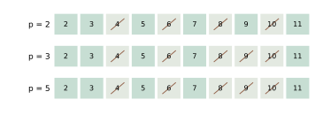
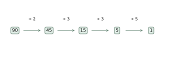
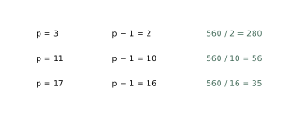

# École polytechnique · PSI et PT · Informatique 2009 · Corrigé guidé

*Corrigé rédigé par IA, non officiel. Signalez toute erreur.*

**Rédaction** · GPT-6.2 Astra Ultra · vitesse non renseignée · 25 novembre 2026

**À propos des nombres premiers.** Le langage choisi est Python. Les tableaux globaux `premier`, `facteur`, `alpha` et `carmichael` ont une capacité suffisante et sont remplis depuis la case 0. Les opérations `//` et `%` sont la division entière et le reste. La primitive `sqrt` du sujet renvoie la racine carrée entière.

## Repères

Une valeur présente plusieurs fois dans la factorisation désigne un même premier avec une multiplicité supérieure à un. Cette distinction intervient à la fois dans la reconnaissance des puissances et dans la caractérisation des nombres de Carmichael.

## I · Nombres premiers

### Question 1 · Appliquer la définition d’un nombre premier

**Indication.** Un diviseur propre compris entre 2 et n − 1 suffit pour conclure.

#### Solution

```python
def estPremier(n):
    for d in range(2, n):
        if n % d == 0:
            return 0
    return 1
```

Le domaine demandé est $n\geqslant2$. Pour 2, la boucle est vide et la réponse est 1. Si aucun entier essayé ne divise $n$, seuls 1 et $n$ le divisent. Le pire temps est $O(n)$.

### Question 2 · Énumérer les premiers jusqu’à la borne incluse

**Indication.** Remplir les cases depuis la première position disponible en parcourant les entiers dans l’ordre.

#### Solution

```python
def petitsPremiers(n):
    longueur = 0
    for m in range(2, n + 1):
        if estPremier(m):
            premier[longueur] = m
            longueur += 1
    return longueur
```

À tout instant, le préfixe de longueur `longueur` contient dans l’ordre tous les nombres premiers déjà rencontrés. Pour $n=17$, ce préfixe est $[2,3,5,7,11,13,17]$ et la valeur retournée est 7.

### Question 3 · Tester les seuls diviseurs premiers nécessaires

**Indication.** Quand arrive un impair m, tous les nombres premiers qui pourraient diviser m sans dépasser sa racine sont déjà dans le tableau.

#### Solution

```python
def petitsPremiers2(n):
    premier[0] = 2
    longueur = 1
    for m in range(3, n + 1, 2):
        j = 1
        limite = sqrt(m)
        while j < longueur and premier[j] <= limite:
            if m % premier[j] == 0:
                break
            j += 1
        else:
            premier[longueur] = m
            longueur += 1
    return longueur
```

La primitive `sqrt` rend la racine carrée entière. On saute l’indice 0 contenant 2 puisque $m$ est impair. La clause Python `else` de la boucle s’exécute quand aucun diviseur n’a provoqué de `break`. L’égalité à la borne permet de rejeter, par exemple, $49=7^2$.

### Question 4 · Cribler par additions

**Indication.** Le deuxième caillou part du premier multiple strictement supérieur au nombre premier repéré. Le décaler régulièrement du même nombre suffit.

#### Solution

```python
def petitsPremiers3(n):
    raye = [False for i in range(n + 1)]
    longueur = 0
    for p in range(2, n + 1):
        if not raye[p]:
            premier[longueur] = p
            longueur += 1
            multiple = p + p
            while multiple <= n:
                raye[multiple] = True
                multiple += p
    return longueur
```

Les deux boucles emploient uniquement des comparaisons et des additions pour progresser. À l’arrivée en $p$, toute valeur composée a déjà été rayée par un de ses facteurs premiers plus petits. Une valeur non rayée est donc première. Rayer à nouveau une case ne change rien. Après le dernier marquage utile, le parcours extérieur recueille encore les premiers restants.



### Question 5 · Factoriser par divisions successives

**Indication.** Après avoir trouvé un facteur, essayer de nouveau le même diviseur pour conserver les multiplicités.

#### Solution

```python
def factoriser(n):
    petitsPremiers3(n)
    reste = n
    j = 0
    longueur = 0
    while reste > 1:
        p = premier[j]
        if reste % p == 0:
            facteur[longueur] = p
            longueur += 1
            reste //= p
        else:
            j += 1
    return longueur
```

Le produit des nombres déjà enregistrés, multiplié par le reste, vaut toujours $n$. Dès que le reste vaut 1, la factorisation est complète. Le tableau des premiers allant jusqu’à $n$, les essais ne peuvent dépasser sa partie utile. Pour 90, le résultat est $[2,3,3,5]$ et la fonction renvoie 4.



### Question 6 · Factoriser sans table et arrêter tôt

**Indication.** Les candidats sont 2 puis tous les entiers impairs dans l’ordre. Si la racine du reste est franchie, il subsiste au plus un facteur.

#### Solution

```python
def factoriser2(n):
    reste = n
    d = 2
    longueur = 0
    while d * d <= reste:
        while reste % d == 0:
            facteur[longueur] = d
            longueur += 1
            reste //= d
        d = 3 if d == 2 else d + 2
    if reste > 1:
        facteur[longueur] = reste
        longueur += 1
    return longueur
```

Lors d’une division réussie, un candidat composé serait divisible par un premier plus petit déjà éliminé du reste. Chaque facteur enregistré est donc premier. À la sortie, un reste composé posséderait un facteur premier au plus égal à sa racine, ce qui contredirait l’invariant des essais. Pour une puissance pure, le reste peut devenir 1 et aucun facteur 1 n’est ajouté.

## II · Reconnaître les puissances

### Question 7 · Regrouper les facteurs égaux

**Indication.** Comme les facteurs sont triés, toutes les copies d’un même premier forment un seul bloc.

#### Solution

```python
def calculerAlpha(n):
    longueur = factoriser2(n)
    j = 0
    groupes = 0
    while j < longueur:
        p = facteur[j]
        debut = j
        while j < longueur and facteur[j] == p:
            j += 1
        alpha[groupes] = j - debut
        groupes += 1
    return groupes
```

Pour $90=2\cdot3^2\cdot5$, les exposants dans l’ordre sont $[1,2,1]$ et le nombre renvoyé est 3. Le regroupement prend un temps linéaire en la longueur de la liste de facteurs.

### Question 8 · Reconnaître une puissance d’exposant donné

**Indication.** Un même exposant doit pouvoir être extrait de toutes les multiplicités.

#### Solution

```python
def estPuissance(n, b):
    groupes = calculerAlpha(n)
    for i in range(groupes):
        if alpha[i] % b != 0:
            return 0
    return 1
```

Si chaque exposant est divisible par $b$, le produit des mêmes premiers élevés aux exposants divisés par $b$ est une racine entière. Réciproquement, prendre une puissance $b$ multiplie toutes les multiplicités par $b$. Le cas $b=1$ accepte tous les entiers du domaine.

### Question 9 · Reconnaître un carré sans factoriser

**Indication.** La racine carrée entière donne directement le seul candidat possible.

#### Solution

Poser $r=\lfloor\sqrt{n}\rfloor$, avec la primitive entière du sujet. L’entier $n$ est un carré exactement lorsque $r^2=n$. En effet, $r^2\leqslant n<(r+1)^2$. Le contrôle par produit entier est exact, y compris sur une borne carrée.

## III · Nombres de Carmichael

### Question 10 · Tester la définition de Carmichael

**Indication.** Vérifier séparément que le nombre est impair, composé, sans facteur carré, et que chaque premier satisfait la divisibilité demandée.

#### Solution

```python
def estCarmichael(c):
    if c % 2 == 0:
        return 0
    longueur = factoriser2(c)
    if longueur < 2:
        return 0
    for j in range(longueur):
        p = facteur[j]
        if j > 0 and p == facteur[j - 1]:
            return 0
        if (c - 1) % (p - 1) != 0:
            return 0
    return 1
```

Les répétitions sont consécutives car les facteurs sont triés. Par exemple $561=3\cdot11\cdot17$, et $2,10,16$ divisent 560. Un nombre premier est éliminé par le test de longueur. Un composé carré, comme 9, est éliminé par le test d’égalité entre facteurs voisins.



### Question 11 · Énumérer les produits de trois premiers distincts

**Indication.** Imposer des indices strictement croissants afin que chaque produit ne soit visité qu’une fois.

#### Solution

```python
def calculerCarmichael3(n):
    nb_premiers = petitsPremiers3(n)
    longueur = 0
    for a in range(1, nb_premiers):
        p = premier[a]
        if p * p * p >= n:
            break
        for b in range(a + 1, nb_premiers):
            q = premier[b]
            if p * q * q >= n:
                break
            for d in range(b + 1, nb_premiers):
                r = premier[d]
                c = p * q * r
                if c > n:
                    break
                if all((c - 1) % (x - 1) == 0 for x in (p, q, r)):
                    carmichael[longueur] = c
                    longueur += 1
    return longueur
```

L’indice 0 désigne 2 et est volontairement omis. Les deux premiers arrêts sont valables car $p<q<r$ entraîne $p^3<pq^2<pqr$. L’égalité $pqr=n$ reste testée. Le crible initial calcule la liste de premiers demandée. Les produits retenus remplissent le tableau sans doublon. La question ne prescrit aucun ordre pour cette sortie.

### Question 12 · Cribler tous les nombres de Carmichael

**Indication.** Une progression associée à p sélectionne simultanément les multiples de p qui vérifient $p-1\mid i-1$. Chaque p ne doit être enlevé qu’une fois par case.

#### Solution

```python
def calculerCarmichael(n):
    t = list(range(n + 1))
    nb_premiers = petitsPremiers3(n)
    limite = sqrt(n)
    for j in range(1, nb_premiers):
        p = premier[j]
        if p >= limite:
            break
        i = p * p
        pas = p * (p - 1)
        while i <= n:
            t[i] //= p
            i += pas
    longueur = 0
    for i in range(3, n + 1):
        if t[i] == 1:
            carmichael[longueur] = i
            longueur += 1
    return longueur
```

Dans la progression, $i=p[p+k(p-1)]$, donc $p\mid i$ et $i\equiv1\pmod{p-1}$. Deux premiers distincts peuvent être divisés dans une même case indépendamment de l’ordre. Chaque premier passe une seule fois dans cette case. Un facteur répété ou non conforme laisse donc un reste supérieur à 1. Les primes elles-mêmes ne sont jamais atteintes puisque le parcours commence en $p^2$.

Vérifions la borne stricte du sujet. Si $i$ est de Carmichael et $p\mid i$, écrivons $i=pm$. Alors $m\equiv1\pmod{p-1}$, puisque $p\equiv1\pmod{p-1}$. Le cofacteur $m$ n’est ni 1 (nombre composé) ni $p$ (facteurs distincts). Ainsi $m\geqslant2p-1$. Pour $p\geqslant5$, $p(2p-1)\geqslant(p+1)^2$, donc $p<\lfloor\sqrt i\rfloor$. Pour $p=3$, la seule valeur $i=3m$ qui pourrait encore manquer à cette borne est $i=15$ ($m=5$). Or $5-1$ ne divise pas 14. Tous les facteurs d’un véritable Carmichael sont donc rencontrés, même avec $p<\lfloor\sqrt n\rfloor$. La dernière lecture renvoie les solutions en ordre croissant.
