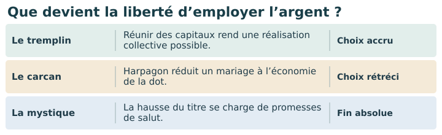

# Banque PT — Français A 2010 · Corrigé brut

*Corrigé rédigé par IA, non officiel. Signalez toute erreur.*

**Rédaction** · GPT-6.2 Astra Ultra · vitesse non renseignée

**Révision (tour 1)** · GPT-6.2 Astra Ultra · vitesse non renseignée

[Énoncé officiel](https://www.banquept.fr/documents/2010/fr_a_pt_2010.pdf) · [Rapport du jury](https://www.banquept.fr/documents/ecrit/rapport/2010/rapport_fra_a_ecrit_2010.pdf) · [Programme officiel](https://www.education.gouv.fr/bo/2009/27/esrs0900270a.html) · [Grille de la session](https://www.banquept.fr/documents/livret/2010/Livret_PT_2010.pdf#page=12)

Épreuve de quatre heures sur « L’argent ». Georg Simmel, Philosophie de l’argent (partie analytique, chapitre III, sections 1 et 2, traduction de Sabine Cornille et Philippe Ivernel) · Émile Zola, L’Argent · Molière, L’Avare.

## Sujet

Pascal Bruckner, Misère de la prospérité, Grasset, 2002, p. 221.

« L’argent doit rester un tremplin, non un carcan, et encore moins une mystique. De ce qu’il permet de tout évaluer, faut-il en faire un absolu, placer notre existence toute entière sous sa juridiction ? Lorsque le gain devient le but suprême, amasser tient lieu de vivre. »

Quelles réflexions vous inspirent ces propos de Pascal Bruckner dans son essai Misère de la prospérité (éditions Grasset, 2002, p.221) ? Vous vous appuierez sur les œuvres au programme et sur vos lectures personnelles liées au thème.

## Dissertation

Quand Harpagon a perdu sa cassette, il se demande comment il pourra continuer à vivre. Pourtant il n’a pas encore eu le temps d’éprouver une seule des privations que pourrait entraîner cette perte. La disparition de l’argent l’atteint déjà comme celle d’un être aimé. Pascal Bruckner demande que l’argent garde le rôle d’un « tremplin ». Le moyen qui permet de franchir une distance devient « carcan » lorsqu’il entrave les mouvements qu’il devait favoriser, « mystique » lorsqu’on lui confie le soin de donner sa raison à l’existence. Comment un instrument si souple en vient-il à commander à celui qui l’emploie ? La difficulté sera de comprendre ce renversement sans méconnaître les libertés réelles que l’argent procure.

Un bon tremplin se juge à ce qu’il permet d’atteindre. Dans L’Argent, les projets de l’ingénieur Hamelin ne peuvent être réalisés par la seule force d’une idée juste. Des transports et des communications demandent des travaux dont le coût dépasse les moyens de la plupart des particuliers. Le projet d’une banque capable de recueillir des fonds dispersés donne à ces plans une chance de sortir des cartons. La monnaie rend ici possible une coopération entre des gens que rien n’oblige à se connaître. Leur mise commune peut se transformer en réalisations dont chacun isolément aurait été incapable. Voilà déjà une raison de prendre l’image du tremplin au sérieux, sans accorder pour autant à celui qui détient les capitaux le mérite de l’ingénieur ou celui des travailleurs.

Simmel analyse dans sa Philosophie de l’argent cette puissance singulière du moyen. Un outil ordinaire est fait pour atteindre une fin assez déterminée. L’argent peut entrer dans de très nombreuses séries de fins. Celui qui dispose d’une somme peut différer son choix et adapter sa conduite à une circonstance nouvelle. Tant qu’il la garde disponible, plusieurs possibilités demeurent ouvertes. Cette liberté intéresse aussi ceux qui manquent d’argent. Cléante voudrait aider Mariane et sa mère, mais sa dépendance à l’égard d’Harpagon le pousse à rechercher un prêt dans des conditions ruineuses. Condamner en toute circonstance le désir d’argent reviendrait à confondre le besoin d’une marge d’action avec le besoin de posséder pour posséder. Un homme privé de moyens ne cesse pas pour autant d’être soumis à la juridiction des prix.

C’est néanmoins le pouvoir de suspendre le choix qui donne à l’argent son emprise. Une fois la somme dépensée, les possibles qu’elle représentait se réduisent à celui que l’on a retenu. Qui prend goût à leur multiplicité ne voudra plus rien acheter. Le comique d’Harpagon naît en partie de là. Il peut marier sa fille sans dot, et cette économie lui paraît une raison d’écarter toute autre considération. Valère essaie de lui faire entendre ce que le bonheur de la jeune fille pourrait exiger. Le père retourne obstinément à l’avantage comptable. Il a encore la faculté de choisir mais il n’a plus qu’une réponse. Au dénouement, la prise en charge des frais par Anselme rendra les mariages acceptables à ses yeux. Les désirs des enfants auront trouvé satisfaction à la condition de ne lui rien coûter. Le carcan n’est donc pas seulement une contrainte imposée du dehors par la rareté. Il peut être produit, au cœur même de l’abondance, par l’habitude de traduire toute question dans une unité unique.

Zola donne à ce mécanisme une échelle collective. La progression du cours des titres de l’Universelle devrait être un signe parmi d’autres de la confiance accordée à l’entreprise. Elle devient peu à peu l’objectif dont dépend la poursuite de l’aventure. Pour nombre de souscripteurs, le meilleur argument en faveur d’une hausse nouvelle est la hausse qui vient d’avoir lieu. Une mesure finit ainsi par prendre la place des réalités qu’elle était censée mesurer. Les travaux, leurs délais et leur avenir passent au second plan. Lorsque la valeur des titres s’effondre, la perte se propage dans les foyers de gens qui avaient donné à ces signes le pouvoir de décider de leur avenir. La juridiction de l’argent n’est alors que trop concrète, jusque pour ceux qui n’ont pris aucune des décisions essentielles.

Mais pourquoi parler de « mystique » ? La sottise d’un mauvais calcul n’expliquerait pas la force d’adhésion que peint le romancier. Saccard ne se contente pas d’additionner. Il communique à ses interlocuteurs l’image grandiose d’un avenir auquel ils pourraient participer. Le projet de l’Universelle se charge d’espérances religieuses et politiques tournées vers l’Orient. L’argent offre un équivalent général, puis l’imagination lui prête une promesse de salut général. Ce saut n’a plus rien d’une opération comptable. Madame Caroline demeure sensible à la fécondité des projets d’Hamelin sans partager toutes les certitudes de Saccard. Sa position fait apparaître la différence entre croire en une entreprise dont on peut examiner les fins et attendre d’une hausse qu’elle donne raison à toute une existence.

La Fontaine fournit dans Le Savetier et le Financier une épreuve simple du rapport entre le gain et la vie. Le savetier chantait lorsqu’il gagnait son pain au jour le jour. Un don d’argent devrait lui procurer du repos. Or il prend peur pour le trésor reçu, prête l’oreille aux bruits de la nuit et perd son sommeil comme ses chansons. En rendant la somme, il accomplit un choix raisonnable dont le prix précisément ne se laisse pas exprimer dans cette somme. Faut-il en conclure que tout don appauvrit celui qui le reçoit ? La fable montre plutôt qu’une amélioration se juge à l’existence concrète de celui qu’elle devait servir. Préserver sa voix peut être, pour le savetier, une meilleure affaire que conserver le capital.

Nous pouvons donc faire nôtre l’injonction de Bruckner si nous ne la réduisons pas à une morale de la sobriété personnelle. Le problème touche aussi les institutions qui distribuent les moyens d’agir et les récits qui transforment les prix en promesses. L’argent soutient la liberté lorsqu’on peut encore nommer ce que l’on cherche à en faire et discuter la valeur de cette fin avec d’autres. Quand ces questions s’éteignent, l’argent ne procure plus le pouvoir d’accomplir un projet. Le projet d’en avoir davantage se substitue à tous les autres. Entre amasser et vivre, la différence tient alors à cette faculté de renoncer à une somme pour quelque chose qui importe.

