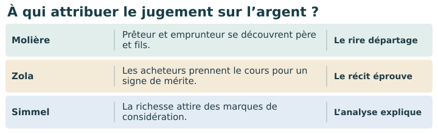

# Banque PT — Français B 2010 · Corrigé guidé

*Corrigé rédigé par IA, non officiel. Signalez toute erreur.*

**Rédaction** · GPT-6.2 Astra Ultra · vitesse non renseignée

**Révision (tour 1)** · GPT-6.2 Astra Ultra · vitesse non renseignée

[Énoncé officiel](https://www.banquept.fr/documents/2010/fr_b_pt_2010.pdf) · [Rapport du jury](https://www.banquept.fr/documents/ecrit/rapport/2010/rapport_fra_b_ecrit_2010.pdf) · [Programme officiel](https://www.education.gouv.fr/bo/2009/27/esrs0900270a.html) · [Grille de la session](https://www.banquept.fr/documents/livret/2010/Livret_PT_2010.pdf#page=12)

Épreuve de quatre heures sur « L’argent ». Georg Simmel, Philosophie de l’argent (partie analytique, chapitre III, sections 1 et 2, traduction de Sabine Cornille et Philippe Ivernel) · Émile Zola, L’Argent · Molière, L’Avare.

## Sujet

Marcel Hénaff, Le Prix de la vérité, Seuil, 2002. Le prénom Marcel est celui de l’auteur et du sujet officiel.

L’extrait commence sur la garde, page 1, par « Le soupçon qui porte sur l’argent » et s’achève page 4 par « démographiques ou épidémiologiques ». Les questions figurent page 5. Les pages 6 à 8 sont sans texte d’épreuve.

Vous résumerez en 180 mots (+ ou – 10%) cet extrait du livre de Marcel Hénaff ; vous indiquerez clairement le nombre exact de mots utilisés. (8 points)

## Préparer le résumé

Reliez le pouvoir d’acquérir à la possibilité de renverser les signes du mérite. La liberté de conversion explique à la fois l’attrait de la somme disponible et l’imposture. Gardez de la place pour le dernier mouvement : la dématérialisation modifie le jugement affectif alors même que les effets prennent une ampleur nouvelle. Le décompte distingue les unités séparées par apostrophe et trait d’union.

## Résumé

On peut abhorrer la violence en lui reconnaissant une grandeur tragique. L’argent, lui, inspire du mépris. Il procure honneurs et biens sans exiger mérite ni audace. Sa domination retourne les valeurs avec la complicité de ceux qui acceptent le marché. Cette indifférence le rend séduisant. Qui échange un domaine contre une somme réserve son choix entre des emplois innombrables.

Mais cette liberté de conversion permet aussi des substitutions trompeuses. Le prix imite la valeur, la position achetée appelle des égards immérités et une acquisition instantanée remplace de longs efforts. Ce pouvoir de traduire toute chose rend possible toute trahison.

Les succès de la monnaie dans les échanges, la rémunération et les investissements ont-ils dissipé le soupçon ? Ses perfectionnements ouvrent des possibilités nouvelles aux abus mêmes dont on voudrait la distinguer. Plus abstrait, l’argent éveille moins les images qui rendaient ses méfaits sensibles. Un détournement financier frappe moins les esprits qu’un vol matériel, même si les dommages sont plus grands. La généralisation des marchés et la puissance boursière donnent aux mouvements financiers les dimensions de phénomènes naturels.

*180 mots.*

En vous référant précisément aux œuvres étudiées, vous direz si le mépris de l’argent qu’évoque Marcel Hénaff y paraît partagé ou non.

## Préparer la dissertation

**Qui est censé partager le mépris ?**

Distinguez le jugement d’un personnage, le regard que l’auteur construit sur lui et l’effet sur le public. Un personnage odieux peut aimer l’argent sans que la pièce méprise toute rémunération.

**Qu’est-ce que mépriser ?**

Hénaff compare l’argent à des maux que l’on redoute ou condamne sans leur refuser une grandeur tragique. Cherchez dans chaque genre les moyens de manifester ou de suspendre le jugement de bassesse.

**Comment exploiter le point de vue de Simmel ?**

La richesse attire la considération au-delà de ce qu’elle achète. Servez-vous de cette analyse pour expliquer le mécanisme de l’imposture évoquée par Hénaff, puis demandez si expliquer revient à mépriser.

## Dissertation

Harpagon aime son argent. Nous rions de lui. Est-il évident que nous méprisons ce qu’il aime ? Tout le problème que pose le rapprochement de Molière avec le texte d’Hénaff tient dans cet écart. Le mépris estime que quelque chose est bas ou indigne. Il diffère aussi bien de la crainte qu’inspire une puissance que de la critique portée contre un usage. Hénaff en suit la trace dans une tradition qui soupçonne l’argent de pouvoir tout obtenir sans courage et de transformer les apparences sans changer les êtres. Les œuvres au programme donnent-elles à entendre le même jugement ? Encore faut-il écouter successivement ceux qui le prononcent, ceux que la fiction donne à juger et l’auteur qui organise leur rencontre.

L’argent semble d’abord propre à une comédie de la bassesse. Lorsque Frosine sollicite Harpagon après lui avoir expliqué tout ce que lui vaudrait son mariage avec Mariane, elle éprouve la différence entre l’accueil des compliments et celui d’une dépense. Le vieil homme recevait avec plaisir les flatteries portant sur sa vigueur et sa jeunesse. Or Frosine finit par évoquer un procès dans lequel son manque d’argent la met en difficulté. Dès que son besoin devient précis, Harpagon élude la demande. Un homme qui semblait vivre des paroles de sa visiteuse se dérobe quand elle cherche une aide en retour. L’argent tient donc bien dans cette scène le rôle d’un révélateur de petitesse. La disproportion entre le soin apporté par Frosine à son entreprise et le mouvement de recul qui répond à sa demande invite le public à juger cette conduite. Pourtant c’est précisément parce qu’une rétribution serait compréhensible que son refus excite le rire. Mépriser la seule demande d’argent ferait manquer le ressort de la scène.

Chez Zola, le crédit paraît parfois capable de produire les impostures qu’Hénaff attribue à la monnaie. Un cours élevé passe auprès des nouveaux souscripteurs pour la preuve que les anciens ont bien jugé, puis les nouveaux achats semblent donner raison aux premiers. Le chiffre acquiert de l’autorité par le seul fait qu’on y croit. Ainsi se forment des réputations de compétence ou d’infaillibilité que la réalité des entreprises ne suffirait pas à justifier. Saccard a parfaitement compris quelle puissance réside dans cette attente réciproque. Cependant les petits porteurs ruinés par la chute de l’Universelle ne sont pas tous présentés comme des êtres méprisables. Le récit prend le temps de faire apparaître ce que des ménages avaient engagé dans leur placement. Le système peut être critiqué, les responsables jugés et les victimes plaintes, sans que ces trois attitudes se confondent.

Il faut d’ailleurs distinguer le pouvoir que prête un personnage à l’argent du jugement que le texte fait porter sur ce pouvoir. Harpagon découvre que le jeune emprunteur qu’il allait pressurer est son propre fils. Cléante découvre en même temps quel était le prêteur. Chacun lance à l’autre l’accusation que lui inspire sa position dans le marché. Le fils reproche au père les conditions de l’emprunt. Le père reproche au fils de courir après l’argent. Le public sait ce dont chacun avait besoin et ce que chacun ignorait. Il peut donc discerner une forte dissymétrie là où les deux répliques se répondent presque terme à terme. Le discrédit attaché au gain obtenu sans service rendu vise très précisément le prêteur qui profite de la nécessité. La demande de Cléante ne mérite pas automatiquement la même sévérité.

Simmel aide à comprendre pourquoi ces œuvres se prêtent si peu à une sentence globale. Dans les premières sections du troisième chapitre de la partie analytique, il analyse l’argent comme un moyen susceptible de s’insérer dans une multitude de séries de fins. Disposer de lui, c’est disposer de choix encore indéterminés. On comprend alors que l’on puisse le désirer au-delà de chaque objet effectivement convoité. L’avare prend plaisir à tenir en réserve cet ensemble de possibles. Le prodigue, par une conduite apparemment opposée, peut chercher sa satisfaction dans l’acte de dépenser lui-même, indépendamment de ce qu’il obtient. L’analyse rassemble ces conduites sous une question précise. À quel moment le moyen acquiert-il pour lui-même l’intérêt que la fin semblait seule devoir posséder ? Simmel donne à penser un phénomène dont le mépris ne dirait guère que l’impression produite sur un observateur.

Cette transformation se vérifie aussi dans le prestige qui accompagne la richesse. La personne fortunée reçoit souvent du crédit au sens moral et social de ce mot, en sus des biens qu’elle peut effectivement payer. Ce supplément éclaire la remarque d’Hénaff sur les marques de respect que l’argent procure sans les mériter. Il permet également de mieux comprendre l’intérêt dramatique de Saccard. On peut reconnaître chez lui une énergie d’invention réelle tout en voyant que le prestige de la fortune lui fait accorder davantage de confiance que ne le justifieraient ses garanties. En montrant les rêves de l’ingénieur Hamelin et le regard à la fois inquiet et passionné de madame Caroline, Zola laisse au lecteur les moyens de distinguer les entreprises rendues possibles par le crédit et les succès d’apparence qui les mettent en péril.

Le dénouement de L’Avare donne un dernier moyen d’éprouver la formule. Pour que les jeunes gens puissent épouser qui ils aiment, Anselme assume les frais des mariages. Les dépenses consenties rendent possible ce que la dévotion d’Harpagon à sa cassette empêchait. Est-ce la pièce qui s’est dédite ? Le rire a toujours visé une certaine manière d’estimer les hommes et les choses. Ce qui fait rire chez le père n’est plus risible chez celui qui dépense pour rendre ses enfants heureux. La scène départage donc deux conduites plus sévèrement que ne le ferait un blâme indifférent à ce dont l’argent est le moyen.

Les œuvres partagent la perception d’une imposture lorsque la possession fait passer pour mérités des avantages qu’elle suffit à acheter. Mais la comédie distribue son rire entre des personnages, le roman éprouve des institutions à leurs effets contraires, et le philosophe recherche la forme commune à la liberté de choisir et à la fascination pour le moyen. Aucun de ces gestes ne se résume à mépriser la monnaie. Ce qui les rapproche d’Hénaff est plus précis et plus exigeant : ils obligent à demander, devant un prestige ou une humiliation, ce que l’argent a réellement changé dans la valeur de la personne que nous regardons.

