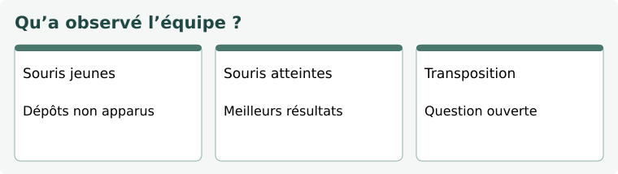
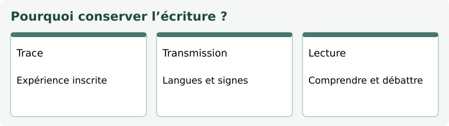
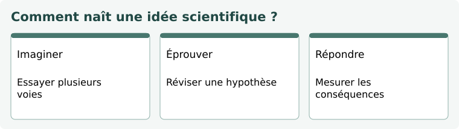
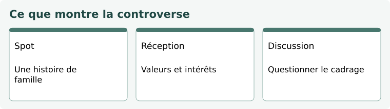

# Banque PT — Langue vivante A 2010 · Corrigé guidé

*Corrigé rédigé par IA, non officiel.*

**Rédaction** · GPT-6.2 Astra Ultra · vitesse non renseignée

**Révision** · GPT-6.2 Astra Ultra · vitesse non renseignée

L’épreuve dure trois heures. Chaque candidat traite la langue choisie à l’inscription. La version française vaut 10 points. La question a demande 80 à 100 mots pour 4 points. La question b demande 200 à 250 mots pour 6 points.

[Sujet](https://www.banquept.fr/documents/2010/lv_a_pt_2010.pdf) · [Rapport du jury](https://www.banquept.fr/documents/ecrit/rapport/2010/rapport_lv_a_ecrit_2010.pdf) · [Grille du livret](https://www.banquept.fr/documents/livret/2010/Livret_PT_2010.pdf#page=12)

## Allemand

*Kann Handystrahlung Alzheimer verhindern?*

Die Zeit, janvier 2010, pages 2–3. La version est page 2. Le rapport allemand occupe les pages 1–2. Il invite à répondre à la question personnelle posée et à organiser le développement.

La réponse a comporte deux demandes, les résultats observés chez les souris et une appréciation personnelle. Garder le conditionnel pour l’intérêt éventuel chez l’humain. La question b porte sur le téléphone en général.

### Version française

De « In wie weit die Handystrahlung gesundheitsschädlich ist » à « sieben bis neun Monate lang ».

À ce jour, les scientifiques n’ont pas pu déterminer avec certitude dans quelle mesure les rayonnements des téléphones portables nuisent à la santé. Dans les années quatre-vingt encore, beaucoup craignaient que leur utilisation ne provoque des maladies à grande échelle. Cela ne s’est pas produit. On sait cependant aujourd’hui que le rayonnement émis par ces appareils agit sur les cellules du cerveau. Une expérience de laboratoire menée à l’université de Tampa, en Floride, laisse penser que cet effet pourrait aussi être bénéfique. Le résultat est surprenant.

Dans cette université, une équipe réunie autour de Gary Arendash expose des souris au rayonnement de téléphones portables. Résultat, le rayonnement a empêché l’apparition de la maladie d’Alzheimer chez ces animaux et atténué l’affection cérébrale chez ceux qui étaient déjà atteints. Comme le rapportent les médecins dans le Journal of Alzheimer’s Disease, le rayonnement a même amélioré la mémoire de souris en bonne santé.

On ne sait pas encore précisément ce qui produit ces effets, écrivent les médecins. Ils estiment néanmoins que leurs résultats présentent aussi un intérêt pour l’être humain. Les chercheurs du centre universitaire de recherche sur la maladie d’Alzheimer ont inclus près de cent souris dans leurs essais. Il s’agissait pour la plupart de souris servant de modèles de la maladie d’Alzheimer, autrement dit d’animaux génétiquement modifiés dans le cerveau desquels se forment les dépôts caractéristiques du peptide bêta-amyloïde.

Les souris se trouvaient dans des cages disposées autour d’une antenne. Celle-ci émettait un rayonnement électromagnétique d’une fréquence de 918 mégahertz, usuelle pour les téléphones portables, à raison d’une heure deux fois par jour pendant sept à neuf mois.

### Question a

*Was passiert genau, wenn die Mäuse Handystrahlungen bekommen? Was denken Sie darüber?*

Bei jungen Modellmäusen entstanden die erwarteten Ablagerungen im Gehirn nicht, und ihre geistigen Fähigkeiten blieben erhalten. Ältere, bereits erkrankte Mäuse hatten weniger Ablagerungen und schnitten in den Tests ähnlich gut wie gesunde Tiere ab. Auch gesunde Mäuse erzielten nach der Bestrahlung bessere Ergebnisse bei Gedächtnisaufgaben. Ich finde den Unterschied zwischen diesen drei Beobachtungen wichtig. Die Studie wirft eine interessante Frage über die Vorgänge im Gehirn auf, doch die Ursachen sind noch unklar. Ein solcher Versuch an Mäusen reicht meines Erachtens nicht aus, um Menschen mit Alzheimer eine Behandlung zu empfehlen.

**90 mots**

### Question b

*Würden Sie ohne Telefon leben können? Warum?*

Eine Woche ohne Telefon könnte ich mir gut vorstellen. Ich würde Verabredungen genauer planen und müsste es aushalten, auf manche Fragen erst am nächsten Tag eine Antwort zu bekommen. Beim Essen oder beim Gespräch mit Freunden wäre das sogar angenehm. Wenn niemand jederzeit erreichbar ist, schenkt man dem Menschen gegenüber vielleicht mehr Aufmerksamkeit. Auf Dauer würde ich ein Telefon jedoch vermissen, und zwar vor allem wegen der Stimme am anderen Ende.

Eine Freundin, die in einer anderen Stadt lebt, kann mir ihre Neuigkeiten in einem Brief erzählen. Ob sie sich über eine Veränderung wirklich freut oder sich Sorgen macht, höre ich manchmal schon an ihrem ersten Satz. Ein Gespräch lässt Raum für Nachfragen, die mir beim Schreiben nicht eingefallen wären. Auch in einem dringenden Fall möchte ich nicht erst jemanden suchen müssen, der für mich anruft. Für diesen Zweck genügt ein einfaches Gerät, das zuverlässig funktioniert.

Das eigentliche Problem ist für mich daher weniger das Telefon als die Erwartung, es müsse ständig eingeschaltet und jede Nachricht sofort beantwortet werden. Ich kann mit meiner Familie vereinbaren, wann wir gut zu erreichen sind, und das Gerät während der Arbeit beiseitelegen. Ohne ständige Unterbrechung zu leben halte ich für möglich und wünschenswert. Ganz auf das Telefon zu verzichten würde dagegen bedeuten, auf eine Verbindung zu verzichten, die mir in manchen Augenblicken besonders wichtig ist.

**221 mots**

## Anglais

*Wanted: green engineers*

The Economist, 13 novembre 2009, pages 4–5. La version porte sur deux passages discontinus en gras, dont le dernier paragraphe page 5. Rapport anglais, pages 3–5 du PDF.

Dans le premier extrait, rendre à la fois la construction, l’exploitation et le contrôle des installations. Le dernier extrait se tourne vers le choix de formation d’une personne jeune. Pour b, se demander ce que doit signifier une priorité dans le travail scientifique.

### Version française

Deux extraits à traduire, de « The nuclear industry » à « designers and engineers », puis de « It’s all very well » à « education in engineering ».

L’industrie nucléaire est, elle aussi, aux prises avec des difficultés de main-d’œuvre, à tous les niveaux de qualification. Ces dernières décennies, très peu de pays occidentaux ont formé des ingénieurs nucléaires. Si cette industrie reprend son expansion, elle aura besoin, au cours des dix prochaines années, de milliers d’ingénieurs qui sont aujourd’hui introuvables. Et si les constructeurs et les exploitants ont du mal à trouver des ingénieurs spécialisés, il en ira de même pour les organismes de contrôle. Or ceux-ci seront indispensables si l’on veut qu’une nouvelle génération de centrales nucléaires bénéficie de la confiance du public et la mérite.

Les énergies renouvelables ne rencontrent pas ces difficultés de façon aussi pressante. Les industries du solaire et de l’éolien tirent parti de la production en série, ce que ne permettent pas de la même manière les grandes installations du nucléaire ou du captage du carbone. Voilà une des raisons pour lesquelles les pouvoirs publics apprécient les énergies renouvelables, qui créent des emplois. La rénovation des logements pour en améliorer l’efficacité énergétique présente également cet avantage à grande échelle. […] Malgré cela, le secteur des renouvelables devra lui aussi rivaliser avec d’autres pour recruter des concepteurs et des ingénieurs.

C’est très bien de recycler, de harceler ses parents pour qu’ils consomment moins de carburant et de rêver de vacances où l’on n’aura pas besoin de prendre l’avion. Mais ce qu’un jeune qui a des capacités peut faire de mieux pour aider notre civilisation à se passer des combustibles fossiles, c’est suivre une formation d’ingénieur.

### Question a

*In what ways does green engineering provide new career opportunities?*

New energy systems need people who can design, build, operate and inspect them. Nuclear power requires specialists on both sides of the regulatory process, while carbon capture draws on surveying and engineering skills already used in other industries. Wind and solar power create manufacturing jobs, and renovating homes requires skilled work in many different places. Research and education can prepare students for these roles. Engineers whose previous jobs are disappearing may also bring useful experience, provided that there are opportunities to adapt their skills to unfamiliar projects.

**87 mots**

### Question b

*To what extent should the work of scientists and engineers be primarily concerned with improving our living environment? Discuss.*

Improving the places where people live should carry considerable weight when public authorities decide which engineering projects to fund. A system that keeps homes warm while using less energy benefits households that struggle with bills as well as the wider environment. Engineers can make that benefit tangible by working with the residents who will use the system. A design that performs well in a demonstration may be too expensive to maintain in an ordinary home.

I would be more cautious about requiring every scientist to show an immediate improvement in living conditions. Research into a physical phenomenon may be worth pursuing before anyone knows how to use it. If funding always went to the proposal with the most attractive short-term promise, we could lose the knowledge and the people needed to solve a problem nobody has yet identified. Even the article’s concern with staffing suggests that a research programme helps by training people as well as by producing inventions.

There are nevertheless responsibilities that travel with this freedom. Scientists and engineers can investigate harmful consequences, explain uncertainty clearly and listen when a community questions the distribution of costs. For an energy company, improving the living environment should influence decisions about each new installation. For a laboratory, it may be a longer-term public purpose. That difference leaves room for curiosity while still asking who will benefit and who might bear the cost.

**231 mots**

## Arabe

*الكتابة أهم ما قدمه السومريون للبشرية*

Sara Taleb Al-Souhail, Al-Watan Al-Arabi, novembre 2009, page 6. Les bornes et les deux questions sont page 7. Rapport d’arabe, page 6 du PDF.

Le jeu sur ifhām (faire comprendre) et īhām (donner l’illusion) commande la version et l’essai. La version s’arrête au nom d’Irak, avant l’hypothèse sur l’origine des Sumériens. La première question porte sur l’idée d’ensemble. En b, discuter les exigences distinctes d’une explication scientifique et d’un texte littéraire.

### Version française

De « الكتابة هي سجل الحياة الكامل » à « منذ العصر الإسلامي ».

L’écriture est le registre complet de la vie, avec ses aspects négatifs et positifs, le bien et le mal, les réformes et les constructions, la ruine et la désolation, les élans de l’esprit et la chute au plus bas de la déchéance. Elle est tout. Plus l’écriture est réaliste, sans pour autant s’abandonner à la réalité, plus elle cherche à donner une impulsion puissante qui permette à l’homme d’accéder à une conscience équilibrée, plus grande est la part de raison que l’on peut tirer de cette forme de production écrite. Nous en concluons que l’écriture, littéraire ou scientifique, est un moyen de faire comprendre et non de donner le change. Plus l’auteur se rapproche d’une manière simple et naturelle de s’exprimer, mieux il peut donner au lecteur une image d’un texte intelligible et lui montrer comment aborder les éléments de sa vie d’être humain, qui est le but premier. De là l’importance de l’invention de l’écriture.

Les Arabes ont célébré le cinq-millième anniversaire de l’invention de l’écriture cunéiforme sumérienne. La célébration s’est tenue au Musée irakien de Bagdad, à l’occasion de la dernière fête d’Akitu. Autrefois, en Mésopotamie, les Akkadiens donnaient le nom de « Kalam » à leur pays, celui de « Ma » est attesté en sumérien au sens de « la terre », tandis que les anciens Égyptiens l’appelaient « Neherina » et les Grecs « Mésopotamie ». Il est connu sous le nom d’Irak depuis l’époque islamique.

### Question a

*بينوا الفكرة الأساسية للنص.*

تعرض الكاتبة الكتابة بوصفها وسيلة لحفظ تجربة البشر وإيصال المعنى إلى القارئ، ثم تعود إلى إسهام السومريين في تاريخها. فاختراع الكتابة المسمارية أتاح تسجيل الكلام على ألواح بقيت بعد أن انقطع استعمال السومرية في الحياة اليومية. كما أن نظام الكتابة انتقل إلى لغات أخرى، ولذلك ينبغي التمييز بين لغة شعب وطريقة تدوين ما يقوله. ويجمع المقال بين قيمة الوضوح عند الكاتب المعاصر وقيمة الأثر المكتوب للمؤرخ الذي يحاول أن يفهم مجتمعا مضى. ففي الحالتين تصل الكتابة بين أشخاص لا يلتقون في الزمن أو المكان.

**84 mots**

### Question b

*تقول الكاتبة « الكتابة أدبية أم علمية، هي وسيلة للإفهام لا للإيهام ». ناقشوا هذا الرأي.*

أتفق مع الكاتبة في أن من يكتب يتحمل مسؤولية تجاه قارئه. فإذا وصف باحث نتيجة تجربة من غير أن يبين ما قاسه وما استنتجه، تعذر على غيره أن يراجع حكمه. وقد تكون الكلمة المتخصصة أدق من كلمة مألوفة، لكن من واجبه أن يشرح معناها حين يخاطب قراء يلتقون بها للمرة الأولى. فالوضوح لا يقتضي حذف صعوبة الفكرة، بل يقتضي أن يعرف القارئ في أي موضع تكمن هذه الصعوبة.

أما في الأدب فقد يحتاج الكاتب إلى شيء من الغموض ليجعلنا ننتبه إلى تجربة لا نستطيع تلخيصها في خبر مباشر. قد يصف روائي بيتا بعد رحيل أهله ولا يذكر الحزن باسمه، ومع ذلك يفهم القارئ من الصمت والأشياء المتروكة أكثر مما يفهم من جملة تصرح بأن صاحب البيت حزين. مثل هذا النص يمنح القارئ دورا في بناء المعنى، ومن الخطأ أن نعد كل سؤال يتركه عجزا عن الإفهام.

ومع ذلك يوجد فرق بين قراءة تتطلب المشاركة وعبارة صيغت لتوهم القارئ بعمق لا وجود له. فالإيهام قد يجعل فرضية علمية تبدو يقينا من غير دليل، بينما يعرف قارئ الرواية منذ البداية أنه أمام عالم متخيل. وأستطيع بعد قراءة جيدة لقصيدة أن أذكر الكلمات التي جعلتني أفهمها على نحو معين، حتى إذا قرأها غيري على نحو مختلف. وفي مقال علمي أستطيع أن أرجع إلى الدليل الذي استند إليه صاحبه. لذلك أرى أن الكتابة الناجحة تمنح القارئ وسيلة للوصول إلى المعنى أو لمناقشته، سواء أكان الطريق إليه مباشرا أم احتاج إلى خيال وصبر.

**228 mots**

## Espagnol

*Imaginación y ciencia*

Espéculo, mars–juillet 1997, entretien avec le physicien Antonio Fernández Rañada, pages 8–9. Rapport d’espagnol page 7 du PDF.

L’orateur reprend à Flaubert une image de l’absorption entière dans une activité. Traduire la « relation causale » et conserver le paradoxe entre échapper au monde et chercher à le comprendre. L’essai doit justifier la place accordée aux émotions.

### Version française

De « Es una idea interesante » à « como la clonación ».

C’est une idée intéressante. Einstein disait quelque chose de semblable, que la science et l’art sont les deux moyens d’échapper à la réalité. C’est vrai. Ce sont des activités très enrichissantes et, lorsqu’on parvient à comprendre quelque chose, si modeste que ce soit, c’est même enivrant. Démocrite disait déjà qu’il valait mieux découvrir une relation de cause à effet que recevoir la couronne de Perse. Il ne fait aucun doute que l’activité scientifique peut être, elle aussi, une plongée dans une « orgie perpétuelle », en apparence bien différente de celle de l’écrivain. Mais cette « orgie perpétuelle » consiste au fond à être au monde, en essayant de comprendre ce qui est à la fois si proche et si lointain. Cela peut surprendre ceux qui voient la science de l’extérieur. C’est pourtant une façon de voir le monde, de se mesurer à des problèmes, et elle est très gratifiante, très prenante. Dans certains cas, on peut en venir à se désintéresser des autres, à s’enfermer dans sa tour d’ivoire. Cette attitude est probablement plus grave chez un scientifique que chez un écrivain, bien que ce dernier ait une très grande influence sur la société. S’enfermer dans sa tour d’ivoire en oubliant les conséquences que peuvent avoir ses propres actes peut, selon le domaine où l’on travaille, être de peu d’importance ou se révéler très dommageable. C’est le cas pour de grandes questions comme celle du clonage.

### Question a

*Analice Usted en este texto la relación que establece el autor entre el arte (o la literatura) y la ciencia.*

Para el físico entrevistado, tanto el artista como el científico necesitan imaginar configuraciones que todavía no existen. La idea valiosa suele surgir después de muchos ensayos y de una revisión crítica, aunque desde fuera parezca una inspiración repentina. Ambas actividades permiten apartarse de la experiencia inmediata para volver a mirar el mundo y comprenderlo mejor. También pueden absorber a quien las practica hasta aislarlo de los demás. El autor subraya que ese aislamiento puede tener consecuencias especialmente graves cuando un descubrimiento científico influye en la vida de otras personas.

**89 mots**

### Question b

*¿Piensa Usted que, realmente, «las emociones, costumbres y estilos» de los investigadores enriquecen su actividad científica? Justifique su opinión.*

Creo que las emociones enriquecen la investigación cuando ayudan a formular una pregunta que, de otro modo, habría pasado inadvertida. Una persona que ha visto cómo se vacía un río en verano puede querer saber qué ha cambiado en su cuenca. Su preocupación no demuestra ninguna hipótesis, pero le da una razón para volver al mismo lugar, reunir datos durante años y conversar con quienes lo conocen. La paciencia también tiene una historia personal.

Las costumbres y los estilos de trabajo influyen en la manera de mirar. Un investigador acostumbrado a dibujar quizá detecte una forma que otra persona descubre comparando cifras. Si ambos explican cómo llegaron a sus observaciones, la diferencia se convierte en una oportunidad de comprobarlas. Por el contrario, un equipo en el que todos valoran la misma explicación puede dejar de mirar los resultados que le resultan incómodos. La simpatía por una idea también puede hacernos defenderla demasiado tiempo.

Por eso distinguiría el origen de una propuesta de las razones para aceptarla. Ni el entusiasmo de su autor ni la belleza de una demostración dispensan de someterla a crítica. Una institución enriquece su trabajo cuando da entrada a experiencias distintas y, al mismo tiempo, concede a cualquier persona la posibilidad de pedir pruebas. Así, la objetividad se construye entre investigadores que no tienen por qué sentir ni pensar de la misma manera.

**226 mots**

## Italien

*Maledetto lo spot Renault*

La Repubblica, mai 2009. Article, pages 10–11, version page 10. Le rapport complet publié se termine page 7 après l’espagnol. L’article 153 ne donne aucun lien de rapport écrit italien pour 2010.

Respecter les changements de voix. Le propos sur la polygamie est attribué à l’archevêque et celui sur le préjudice touristique au maire. En b, distinguer représenter une évolution sociale et convaincre d’acheter un produit.

### Version française

De « Mi è capitato » à « il nostrano Chinotto ».

« Il m’est arrivé de voir un spot télévisé qui, pour vanter la capacité d’accueil d’une voiture, fait l’éloge de la polygamie. Voilà qui est inadmissible dans un pays où la monogamie est considérée comme une valeur indiscutable, mais où, malheureusement, toutes les conditions culturelles sont déjà réunies pour que la polygamie soit légitimée. » Des paroles incendiaires, donc, malgré le ton léger et ironique du spot.

Une autre polémique a cependant éclaté il y a quelques jours. Elle risque même de devenir une véritable rengaine et a été surnommée la « guerre du Coca-Cola ».

Dans le style des dessins d’enfant, le spot raconte l’histoire de Giulia, une petite fille qui vit à Pise et affirme que, pour sa part, elle reste optimiste en temps de crise. Car elle connaît la valeur de choses qui, comme les liens affectifs et la famille, ne coûtent finalement pas grand-chose. « Au lieu de partir dans un village de vacances, je préfère passer mes vacances chez ma grand-mère. Au lieu du restaurant, je préfère la sauce à la viande de maman… », accompagnée naturellement d’un bon Coca. Or voilà qu’un maire de Vénétie, Marco Sarto, premier magistrat de Caorle, a décidé de s’en prendre à la petite Giulia, « coupable » de causer un tort immense au tourisme. Il a demandé à Coca-Cola de retirer le spot, tandis que les commerçants de Caorle menacent déjà de boycotter le Coca-Cola et de relancer notre boisson locale, le chinotto.

### Question a

*Secondo Lei, la pubblicità ha una vera influenza sulle nostre scelte?*

Secondo me la pubblicità influenza soprattutto ciò che ricordiamo quando dobbiamo scegliere. In un negozio potrei riconoscere una marca grazie a una storia divertente, pur avendo dimenticato il prezzo annunciato. Questo vantaggio non basta però a determinare ogni acquisto. Il costo, l’esperienza di chi ha già usato il prodotto e le necessità concrete della famiglia possono contare di più. Le proteste raccontate nell’articolo mostrano inoltre che uno spot non controlla la propria interpretazione. Lo stesso messaggio può suscitare simpatia in un cliente e indurre un altro a scegliere una marca diversa.

**91 mots**

### Question b

*[La pubblicità] « capta i segnali di cambiamento ». Lei pensa che la pubblicità possa essere un buon mezzo per far riflettere la gente sulla nostra società e sul suo evolversi?*

Uno spot può farci notare un cambiamento proprio perché deve raccontare una storia in pochi secondi. Nel caso della Renault, il padre accompagna diversi figli alle loro attività. Alcuni spettatori riconoscono una giornata normale in una famiglia allargata, mentre l’arcivescovo vi legge un giudizio morale. La discussione rende visibile una domanda che il prodotto, da solo, non avrebbe posto: quali famiglie vengono considerate abbastanza comuni da poter comparire in una pubblicità senza bisogno di spiegazioni?

La storia di Giulia offre un secondo esempio. Passare le vacanze dalla nonna può rappresentare un piacere accessibile durante una crisi. Per un comune che vive del turismo, le stesse parole sembrano svalutare un’attività economica. Confrontare queste interpretazioni aiuta a capire come un’immagine della felicità domestica possa toccare interessi molto diversi. Non occorre dare ragione al sindaco per chiedersi perché abbia reagito in quel modo.

Il limite sta nello scopo commerciale del messaggio. Chi vende una bibita seleziona le immagini capaci di creare affetto per il marchio. Non deve spiegare come vive davvero una famiglia con un reddito ridotto. Userei quindi la pubblicità come punto di partenza per una conversazione, insieme a testimonianze e dati che permettano di controllarne le semplificazioni. La riflessione comincia quando lo spettatore torna a guardare ciò che lo spot ha lasciato fuori dall’inquadratura.

**213 mots**
