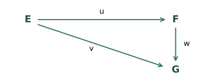
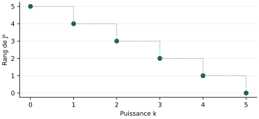

# Banque PT — Mathématiques A 2010 · Corrigé guidé

*Corrigé rédigé par IA, non officiel. Signalez toute erreur.*

**Rédaction** · GPT-6.2 Astra Ultra · vitesse non renseignée

Le préliminaire et les quatre parties conduisent à caractériser les matrices nilpotentes par une équation de commutateur. Les matrices propres de la multiplication à gauche sont elles-mêmes des éléments de l’espace des matrices. [Sujet officiel](https://www.banquept.fr/documents/2010/math_a_pt_2010.pdf) · [Rapport du jury](https://www.banquept.fr/documents/ecrit/rapport/2010/rapport_math_a_ecrit_2010.pdf) · [Grille des coefficients](https://www.banquept.fr/documents/livret/2010/Livret_PT_2010.pdf#page=12)

Le rapport signale des confusions entre le dual et les matrices inversibles, ainsi qu’entre un vecteur propre colonne et une matrice propre. On précisera donc l’espace de départ de chaque application et les dimensions utilisées.

## Questions préliminaires

### Préliminaire 1 · Linéarité des trois applications

> [!INDICATION]
> Le produit matriciel est bilinéaire. Fixer $A$ et ne faire varier que l’autre facteur.

Pour $M,N\in\mathcal M_n(\mathbb R)$ et $\alpha,\beta\in\mathbb R$, $A(\alpha M+\beta N)=\alpha AM+\beta AN$. Ainsi $\phi_A:M\mapsto AM$ est linéaire, de même que $M\mapsto MA$. Leur différence $\gamma_A:M\mapsto AM-MA$ est linéaire. La trace étant la somme des coefficients diagonaux, elle est linéaire. Donc $\tau_A:M\mapsto\operatorname{Tr}(AM)$ est une forme linéaire à valeurs réelles.

### Préliminaire 2 · Dimension et dual

> [!INDICATION]
> Une matrice a $n^2$ coefficients libres. Que devient cette dimension lorsqu’on passe au dual en dimension finie ?

Les $n^2$ unités matricielles $E_{ij}$ constituent une base, par lecture des coefficients. Donc $\dim\mathcal M_n(\mathbb R)=n^2$. La base duale est constituée des $n^2$ formes $M\mapsto M_{ij}$, d’où $\dim\mathcal M_n(\mathbb R)^*=n^2$.

### Préliminaire 3 · Théorème de la base incomplète

> [!INDICATION]
> Préciser dans quel ensemble on peut choisir les vecteurs ajoutés.

Dans un espace vectoriel de dimension finie, toute famille libre peut être complétée en une base. Plus précisément, si une famille génératrice est donnée, on peut choisir parmi ses vecteurs ceux qu’on adjoint à la famille libre. On les ajoute tant que l’espace engendré est strictement plus petit que l’espace entier.

## Partie I

### I.1 · Diagonalisation de la première matrice

> [!INDICATION]
> Lire les valeurs propres sur la diagonale et compter les dimensions.

$A=\left(\begin{smallmatrix}1&3\\0&2\end{smallmatrix}\right)$ est triangulaire, de valeurs propres réelles distinctes $1$ et $2$. Elle est diagonalisable. Des vecteurs propres correspondants sont respectivement $(1,0)$ et $(3,1)$.

### I.2 · Base propre de la matrice de taille quatre

> [!INDICATION]
> Écrire $B(x,y,z,t)$. Pour la valeur $2$, les deux dernières coordonnées sont libres.

On a $B(x,y,z,t)=(x+3z,y+3t,2z,2t)$. La valeur $1$ donne $z=t=0$ et l’espace engendré par $(1,0,0,0),(0,1,0,0)$. La valeur $2$ donne $x=3z,y=3t$ et l’espace engendré par $(3,0,1,0),(0,3,0,1)$. Ces quatre vecteurs forment une base car la réunion de bases de deux espaces propres distincts est libre. Ainsi $B$ est diagonalisable.

### I.3.a · La base canonique des matrices

> [!INDICATION]
> Recomposer une matrice à partir de ses quatre coefficients.

Toute matrice $M=(m_{ij})$ s’écrit $\sum_{i,j=1}^2m_{ij}E_{ij}$. Dans une telle somme, le coefficient de $E_{ij}$ est uniquement déterminé par la case $(i,j)$. La famille ordonnée $\mathcal E=(E_{11},E_{12},E_{21},E_{22})$ est donc une base.

### I.3.b · Images des quatre unités matricielles

> [!INDICATION]
> Le produit $AM$ transforme chaque colonne de $M$ par $A$.

Le vecteur canonique $(1,0)$ est fixé et $(0,1)$ devient $(3,2)$. Ainsi
$$\phi_A(E_{11})=E_{11},\quad \phi_A(E_{12})=E_{12},\quad
\phi_A(E_{21})=3E_{11}+2E_{21},\quad
\phi_A(E_{22})=3E_{12}+2E_{22}.$$

### I.3.c · Matrice de la multiplication à gauche

> [!INDICATION]
> Les quatre images précédentes fournissent les quatre colonnes dans l’ordre fixé par le sujet.

Dans la base $\mathcal E$, la matrice de $\phi_A$ est
$$\begin{pmatrix}1&0&3&0\\0&1&0&3\\0&0&2&0\\0&0&0&2\end{pmatrix}=B.$$

### I.3.d · Une base de matrices propres

> [!INDICATION]
> Traduire les coordonnées des vecteurs propres de $B$ en combinaisons des $E_{ij}$.

La base de I.2 se traduit dans $\mathcal M_2(\mathbb R)$ par les matrices $E_{11},E_{12}$ pour la valeur propre $1$, puis $3E_{11}+E_{21},3E_{12}+E_{22}$ pour la valeur propre $2$. Les quatre forment une base propre de $\phi_A$ et établissent sa diagonalisation.

## Partie II

### II.1 · Une colonne non nulle appartient au noyau

> [!INDICATION]
> Passer de l’égalité matricielle à une colonne qui ne soit pas nulle.

Si $M\ne0$ et $AM=\lambda M$, on a $(A-\lambda I_n)M=0$. Au moins une colonne $X$ de $M$ est non nulle et satisfait $(A-\lambda I_n)X=0$. Le noyau étant non trivial, $A-\lambda I_n$ n’est pas inversible.

### II.2 · Première inclusion des spectres

> [!INDICATION]
> Traduire « valeur propre de $\phi_A$ » en une équation du type précédent.

Soit $\lambda$ une valeur propre réelle de $\phi_A$. Une matrice non nulle $M$ vérifie $AM=\lambda M$. Par II.1, $A-\lambda I_n$ a un noyau non nul. Donc $\lambda$ est valeur propre de $A$.

### II.3 · Placer un vecteur propre dans une colonne

> [!INDICATION]
> Les colonnes nulles restent nulles sous la multiplication par $A$.

Si $AX=\mu X$ avec $X\ne0$, plaçons $X$ en colonne $j$ de $M$, les autres colonnes étant nulles. Le produit $AM$ remplace cette colonne par $\mu X$ et préserve les colonnes nulles. Donc $\phi_A(M)=\mu M$. Comme $M\ne0$, c’est une matrice propre de $\phi_A$.

### II.4 · Égalité des spectres

> [!INDICATION]
> Combiner les deux inclusions au lieu de recompter les dimensions.

II.2 donne $\operatorname{Sp}_{\mathbb R}(\phi_A)\subseteq\operatorname{Sp}_{\mathbb R}(A)$ et II.3 donne l’inclusion réciproque. Les deux ensembles coïncident, y compris si le spectre réel est vide.

### II.5 · Base propre par colonnes

> [!INDICATION]
> Pour chaque vecteur de la base propre de $A$, considérer séparément chacune des $n$ positions de colonne.

Soit $X_1,\ldots,X_n$ une base propre réelle de $A$, de valeurs $\lambda_i$. Notons $M_{ij}$ la matrice portant $X_i$ en colonne $j$ et zéro ailleurs. Par II.3, elle est propre pour $\lambda_i$. Toute matrice admet une unique décomposition dans cette famille puisque chacune de ses colonnes admet une unique décomposition dans la base $(X_i)$. Les $n^2$ matrices $M_{ij}$ forment donc une base propre de $\phi_A$.

## Partie III

### III.1 · La factorisation implique l’inclusion des noyaux

> [!INDICATION]
> Que vaut $w(u(x))$ sur le noyau de $u$ ?

Si $v=w\circ u$ et $u(x)=0$, alors $v(x)=w(0)=0$ par linéarité. Donc $\ker u\subseteq\ker v$.

### III.2.a · Base adaptée au noyau

> [!INDICATION]
> Le noyau a déjà sa propre base. Compléter et appliquer le théorème du rang.

Choisissons une base de $\ker u$, de cardinal $n-p$. Le théorème de la base incomplète permet d’ajouter $p$ vecteurs pour en faire une base de $E$. En mettant les vecteurs ajoutés en tête, on obtient $(e_1,\ldots,e_n)$ avec $(e_{p+1},\ldots,e_n)$ base du noyau. Le théorème du rang donne $\dim\operatorname{Im}u=n-(n-p)=p$. Cela couvre aussi le noyau nul et l’application nulle.

### III.2.b · Une base de l’image

> [!INDICATION]
> Vérifier que les $p$ images engendrent, puis utiliser la dimension déjà calculée.

Pour $x=\sum_{i=1}^n c_i e_i$, on a $u(x)=\sum_{i=1}^p c_i u(e_i)$, car les derniers vecteurs sont dans le noyau. Ainsi $f_i=u(e_i)$, $1\le i\le p$, engendrent $\operatorname{Im}u$. Cette famille de $p$ vecteurs y est une base, son cardinal étant égal à la dimension.

### III.2.c · Construction de la factorisation

> [!INDICATION]
> Définir l’application sur une base de $F$, puis vérifier l’égalité sur les deux groupes de vecteurs de la base de $E$.

Complétons $f_1,\ldots,f_p$ en une base $f_1,\ldots,f_r$ de $F$. Les valeurs $w(f_i)=v(e_i)$ pour $i\le p$ et $w(f_i)=0$ pour $i>p$ définissent une unique application linéaire sur cette base. Pour $i\le p$, $w(u(e_i))=v(e_i)$. Pour $i>p$, $u(e_i)=0$ et $v(e_i)=0$ par l’inclusion des noyaux. Les deux applications coïncident sur la base de $E$, donc $v=w\circ u$. Avec III.1, l’équivalence est démontrée.

## Partie IV

### IV.1 · Valeur propre d’une puissance

> [!INDICATION]
> Conserver le même vecteur propre, même pour une valeur complexe.

Si $AX=\lambda X$ avec $X\in\mathbb C^n$ non nul, une récurrence donne $A^kX=\lambda^kX$ pour tout $k\ge1$. Le même vecteur non nul montre que $\lambda^k$ est valeur propre de $A^k$.

### IV.2.a · Spectre d’une matrice nilpotente

> [!INDICATION]
> Utiliser une puissance nulle et justifier que zéro est effectivement atteint.

Si $A^p=0$, IV.1 impose $\lambda^p=0$ pour toute valeur propre complexe, donc $\lambda=0$. En outre $A$ ne peut être inversible car alors $A^p$ le serait. Son noyau est donc non nul et $0$ est effectivement valeur propre.

### IV.2.b · Trace d’une matrice nilpotente

> [!INDICATION]
> La trace est la somme des valeurs propres complexes avec leurs multiplicités.

Sur $\mathbb C$, le polynôme caractéristique est scindé et toutes ses racines sont nulles d’après IV.2.a. Il vaut donc $X^n$. Son coefficient de $X^{n-1}$ étant $-\operatorname{Tr}A$, la trace vaut zéro.

### IV.3.a · Produit de matrices qui commutent

> [!INDICATION]
> La commutation permet de regrouper les facteurs dans chaque puissance.

Si $AM=MA$, une récurrence donne $(AM)^p=A^pM^p=0$ pour un exposant $p$ de nilpotence de $A$. Ainsi $AM$ est nilpotente.

### IV.3.b · Inclusion des noyaux du commutateur et de la trace

> [!INDICATION]
> Interpréter chaque noyau au moyen de l’équation qui le définit.

Si $M\in\ker\gamma_A$, alors $AM=MA$. Le produit $AM$ est nilpotent par IV.3.a, et sa trace est nulle par IV.2.b. Ainsi $\tau_A(M)=0$ et $\ker\gamma_A\subseteq\ker\tau_A$.

### IV.3.c.i · Somme des carrés des coefficients

> [!INDICATION]
> Calculer une case diagonale de $K^\mathsf T K$.

La case $(j,j)$ vaut $\sum_{i=1}^n k_{ij}^2$. En sommant sur $j$ et en permutant ces deux sommes finies, on trouve $\operatorname{Tr}(K^\mathsf TK)=\sum_{i=1}^n\sum_{j=1}^n k_{ij}^2$.

### IV.3.c.ii · Produit scalaire sur les matrices

> [!INDICATION]
> Développer la trace comme à la question précédente avec deux matrices différentes.

On obtient $\langle M,N\rangle=\operatorname{Tr}(M^\mathsf TN)=\sum_{i,j}m_{ij}n_{ij}$. L’expression est bilinéaire et symétrique. Pour $M=N$, c’est une somme de carrés réels, nulle exactement quand tous les coefficients sont nuls. C’est donc un produit scalaire.

### IV.3.c.iii · Représentation d’une forme linéaire par une trace

> [!INDICATION]
> Le produit scalaire contient une transposée que l’expression demandée absorbe dans $U$.

Dans cet espace euclidien de dimension finie, toute forme linéaire $\varphi$ s’écrit de manière unique $\varphi(M)=\langle K,M\rangle$ pour une matrice $K$. Explicitement $k_{ij}=\varphi(E_{ij})$, puisque les $E_{ij}$ constituent une base orthonormale. Avec $U=K^\mathsf T$, il vient $\varphi(M)=\operatorname{Tr}(UM)$ pour tout $M$. En particulier $u_{ij}=\varphi(E_{ji})$.

### IV.3.c.iv · Factoriser la forme trace

> [!INDICATION]
> Appliquer III à l’application commutateur et à la forme trace. Identifier ensuite la forme obtenue sur l’espace d’arrivée.

L’inclusion de IV.3.b et le théorème de III, avec $u=\gamma_A$ et $v=\tau_A$, donnent une forme linéaire $w:\mathcal M_n(\mathbb R)\to\mathbb R$ telle que $\tau_A=w\circ\gamma_A$. Par IV.3.c.iii il existe $B$ telle que $w(N)=\operatorname{Tr}(BN)=\tau_B(N)$. D’où $\tau_A=\tau_B\circ\gamma_A$.

### IV.3.d · Identifier la matrice du commutateur

> [!INDICATION]
> Déplacer circulairement les facteurs sous la trace. Pour conclure, tester la forme linéaire sur toutes les unités matricielles.

Pour toute $M$, l’égalité précédente donne
$$\operatorname{Tr}(AM)=\operatorname{Tr}(BAM)-\operatorname{Tr}(BMA)
=\operatorname{Tr}\big((BA-AB)M\big),$$
car $\operatorname{Tr}(BMA)=\operatorname{Tr}(ABM)$. Donc $\operatorname{Tr}((A-BA+AB)E_{ij})=0$ pour tous $i,j$. Comme $\operatorname{Tr}(TE_{ij})=T_{ji}$, tous les coefficients de $A-BA+AB$ s’annulent et $A=BA-AB$.

### IV.4.a · Commutateur d’une puissance

> [!INDICATION]
> Pour le passage de $k$ à $k+1$, ajouter et retrancher $A^kBA$.

Pour $k=1$, la relation est précisément $BA-AB=A$. Si $BA^k-A^kB=kA^k$, alors
$$BA^{k+1}-A^{k+1}B=(BA^k-A^kB)A+A^k(BA-AB)
=kA^{k+1}+A^{k+1}.$$
Par récurrence, l’égalité vaut pour tout $k\ge1$.

### IV.4.b · Condition pour obtenir un vecteur propre

> [!INDICATION]
> L’égalité caractéristique est déjà établie. Vérifier la condition qui entre dans la définition d’un vecteur propre.

Par IV.4.a, $\gamma_B(A^k)=kA^k$. La matrice $A^k$ est donc un vecteur propre de $\gamma_B$ si et seulement si $A^k\ne0$. La valeur propre associée est alors $k$.

### IV.4.c · La relation entraîne la nilpotence

> [!INDICATION]
> Comparer le nombre de valeurs propres qui découlerait de puissances toutes non nulles à la dimension de l’espace des matrices.

Si $A^k\ne0$ pour tous les $k=1,\ldots,n^2+1$, l’endomorphisme $\gamma_B$ de l’espace de dimension $n^2$ posséderait $n^2+1$ valeurs propres distinctes. Le polynôme caractéristique de degré $n^2$ ne peut avoir autant de racines. Une de ces puissances est donc nulle et $A$ est nilpotente. Avec IV.3.d, cela démontre l’équivalence annoncée.

