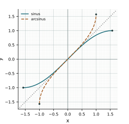
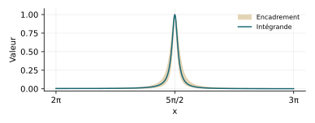

# Banque PT — Mathématiques C 2010 · Corrigé guidé

*Corrigé rédigé par IA, non officiel. Signalez toute erreur.*

**Rédaction** · GPT-6.2 Astra Ultra · vitesse non renseignée · 26 novembre 2026

La Banque PT a programmé cet écrit le mardi 4 mai 2010, de 14 h à 18 h. La garde interdit la calculatrice. Le code imprimé est 10PT30. La garde demande une feuille de papier millimétré. Les questions figurent aux pages 1 à 4 du PDF de 4 pages. En admissibilité, le coefficient de Mathématiques C est de 3 pour l’ENS Cachan et de 6 pour l’École polytechnique. [Sujet](https://www.banquept.fr/documents/2010/math_c_pt_2010.pdf) · [Rapport du jury](https://www.banquept.fr/documents/ecrit/rapport/2010/rapport_math_c_ecrit_2010.pdf) · [Livret de la Banque PT, p. 8, 9 et 12](https://www.banquept.fr/documents/livret/2010/Livret_PT_2010.pdf)

## I. Arcsinus et solutions polynomiales

### Question I.1.a

> [!INDICATION]
> Utiliser le signe de la dérivée à l’intérieur du segment.

#### Solution

Sur $[-\pi/2,\pi/2]$, $f(x)=\sin x$ a pour dérivée $\cos x$, strictement positive à l’intérieur. Le théorème des accroissements finis donne donc la stricte croissance, de $-1$ à $1$.

### Question I.1.b

> [!INDICATION]
> Associer stricte monotonie et continuité.

#### Solution

La stricte croissance assure l’injectivité. La continuité et les valeurs aux deux bornes assurent, par le théorème des valeurs intermédiaires, que l’image est $[-1,1]$. Ainsi $f$ est bijective entre les deux segments.

### Question I.1.c.i

> [!INDICATION]
> Vérifier que la dérivée initiale ne s’annule pas au point antécédent.

#### Solution

Pour $x\in]-1,1[$, l’antécédent $u=f^{-1}(x)$ est strictement compris entre $-\pi/2$ et $\pi/2$. On a $f'(u)=\cos u>0$. Le théorème de dérivation des réciproques donne la dérivabilité de $f^{-1}$ en $x$.

### Question I.1.c.ii

> [!INDICATION]
> Choisir le signe de la racine sur la branche principale.

#### Solution

Comme $\sin u=x$ et $\cos u>0$, $\cos u=\sqrt{1-x^2}$. Ainsi $(f^{-1})'(x)=1/f'(u)=1/\sqrt{1-x^2}$.

### Question I.1.c.iii

> [!INDICATION]
> Étudier la puissance négative sur un intervalle de positivité.

#### Solution

La dérivée trouvée est la composition de $x\mapsto1-x^2$ et de $s\mapsto s^{-1/2}$, de classe $C^\infty$ pour $s>0$. Donc $(f^{-1})'$ est de classe $C^\infty$ sur $]-1,1[$, de même que $f^{-1}$.

### Question I.1.d

> [!INDICATION]
> Échanger les coordonnées de chaque point du sinus.

#### Solution

La courbe du sinus va de $(-\pi/2,-1)$ à $(\pi/2,1)$ par l’origine et a des tangentes horizontales aux extrémités. Sa symétrique par rapport à $y=x$ relie $(-1,-\pi/2)$ à $(1,\pi/2)$, avec des tangentes verticales aux extrémités. Les deux graphes ont pour tangente commune $y=x$ à l’origine.

### Question I.2.a

> [!INDICATION]
> Composer sur l’intervalle ouvert.

#### Solution

Pour $\alpha\ne0$, $g_\alpha(x)=\cos(\alpha\arcsin x)$ est de classe $C^\infty$ sur $]-1,1[$ par composition de fonctions de classe $C^\infty$. Elle y est donc de classe $C^2$.

### Question I.2.b

> [!INDICATION]
> Introduire une notation pour l’angle.

#### Solution

Posons $\theta=\alpha\arcsin x$ et $D=1-x^2>0$. La règle de la chaîne donne $g_\alpha'(x)=-\alpha\sin\theta/\sqrt D$.

### Question I.2.c

> [!INDICATION]
> Dériver aussi le facteur issu de la réciproque.

#### Solution

Comme $(D^{-1/2})'=xD^{-3/2}$ et $\theta'=\alpha D^{-1/2}$, on a
$$g_\alpha''(x)=-\frac{\alpha^2\cos\theta}{D}-\frac{\alpha x\sin\theta}{D^{3/2}}.$$

### Question I.2.d

> [!INDICATION]
> Multiplier la dérivée seconde par le facteur D.

#### Solution

Le résultat précédent donne $Dg_\alpha''=-\alpha^2g_\alpha+xg_\alpha'$. Ainsi $(1-x^2)g_\alpha''-xg_\alpha'+\alpha^2g_\alpha=0$ sur l’intervalle ouvert.

### Question I.2.e.i

> [!INDICATION]
> Comparer les coefficients de degré n après deux dérivations.

#### Solution

Pour $y=\sum a_nx^n$ dans son disque de convergence, le coefficient de $x^n$ du membre gauche est $(n+2)(n+1)a_{n+2}+(\alpha^2-n^2)a_n$. Ainsi $a_{n+2}=(n^2-\alpha^2)a_n/[(n+2)(n+1)]$, y compris pour $n=0,1$. Les données initiales donnent $a_0=1$, $a_1=0$.

### Question I.2.e.ii

> [!INDICATION]
> Partir de la seconde condition initiale.

#### Solution

La récurrence relie les coefficients d’une même parité. Comme $a_1=0$, une récurrence immédiate donne $a_{2p+1}=0$ pour tout $p\ge0$.

### Question I.2.e.iii

> [!INDICATION]
> Multiplier les relations aux rangs pairs.

#### Solution

En partant de $a_0=1$, la multiplication successive fournit $a_{2p}=\prod_{j=0}^{p-1}((2j)^2-\alpha^2)/(2p)!$. Le produit vide pour $p=0$ vaut un.

### Question I.2.e.iv

> [!INDICATION]
> Vérifier d’abord si la série s’arrête.

#### Solution

Si $|\alpha|=2m$ est un entier pair positif, le facteur $j=m$ annule la suite des coefficients après le rang $2m$. Le rayon du polynôme est infini. Sinon tous les coefficients pairs sont non nuls et $|a_{2p+2}/a_{2p}|\to1$. Le critère du quotient sur la série en $x^2$ donne le rayon $1$ en $x$. La série obtenue résout l’équation car la dérivation terme à terme est valable sur ce disque. Par unicité pour l’équation linéaire sur $]-1,1[$, ses données initiales l’identifient à $g_\alpha$.

### Question I.2.f

> [!INDICATION]
> Regarder le terme de plus haut degré, puis construire la parité voulue.

#### Solution

Pour un polynôme non nul de degré $m$, le coefficient dominant de l’équation est $(\alpha^2-m^2)a_m$. Il faut donc $|\alpha|=m\in\mathbb N^*$ puisque $\alpha\ne0$. Réciproquement, pour une telle valeur, prendre le coefficient initial de même parité que $m$ égal à un et celui de l’autre parité nul. La récurrence conserve tous les rangs de la bonne parité jusqu’à $m$, puis s’arrête. On obtient un polynôme de degré $m$. Le polynôme nul est toujours solution.

### Question I.3

> [!INDICATION]
> Choisir le signe du cosinus de l’angle principal.

#### Solution

Pour $x\in[-1,1]$, $\arcsin x\in[-\pi/2,\pi/2]$, donc son cosinus est positif ou nul. Ainsi $g_1(x)=\sqrt{1-x^2}$, y compris aux deux bornes.

### Question I.4.a

> [!INDICATION]
> Employer la formule en sinus carré.

#### Solution

L’identité $\cos(2u)=1-2\sin^2u$ en $u=\arcsin x$ donne $g_2(x)=1-2x^2$ pour $-1\le x\le1$.

### Question I.4.b

> [!INDICATION]
> Lire les coefficients dans le polynôme.

#### Solution

Le développement est $1-2x^2$, avec coefficients $1$ au rang zéro, $-2$ au rang deux et zéro ailleurs. Son rayon de convergence est infini.

### Question I.5.a

> [!INDICATION]
> Doubler l’angle à chaque étape.

#### Solution

Pour $P_k(x)=\cos(2^k\arcsin x)$, on a $P_1=1-2x^2$, puis $P_k=2P_{k-1}^2-1$ pour $k\ge2$. Cette opération double le degré sans annuler le terme dominant. Par récurrence, $P_k$ est polynomial de degré $2^k$.

### Question I.5.b

> [!INDICATION]
> Isoler le monôme de plus haut degré du carré.

#### Solution

Le terme dominant de $2P_{k-1}^2$ a pour coefficient $2c_{k-1}^2$. La constante soustraite ne l’affecte pas. Donc $c_1=-2$ et $c_k=2c_{k-1}^2$ pour $k\ge2$.

### Question I.5.c.i

> [!INDICATION]
> Prendre m égal à zéro et à un dans la relation trigonométrique.

#### Solution

Pour tout $x\in[-\pi,\pi]$, $T_0(\cos x)=\cos0=1$ et $T_1(\cos x)=\cos x$. Comme le cosinus parcourt $[-1,1]$, on peut écrire $T_0(X)=1$, $T_1(X)=X$ sur ce segment.

### Question I.5.c.ii

> [!INDICATION]
> Additionner deux cosinus d’angles distants de 2x.

#### Solution

Par l’identité somme-produit, $\cos((m+2)x)+\cos(mx)=2\cos x\cos((m+1)x)$. En utilisant la définition de $T_m$ à chacun des trois rangs, on obtient exactement la relation annoncée.

### Question I.5.c.iii

> [!INDICATION]
> Comparer les degrés dans la relation de récurrence.

#### Solution

Comme $X=\cos x$ parcourt $[-1,1]$, $T_{m+2}(X)=2XT_{m+1}(X)-T_m(X)$. Par récurrence à partir de $1,X$, ces expressions sont polynomiales de degrés $m$. Au pas de récurrence, le premier terme a degré $m+2$, le second $m$. Le coefficient dominant double à chaque pas à partir de $T_1$. Il vaut donc $2^{m-1}$ pour $m\ge1$, et $1$ pour $m=0$.

### Question I.5.c.iv

> [!INDICATION]
> Composer T avec le polynôme d’angle double.

#### Solution

Posons $m=2^{k-1}$. L’angle $2\arcsin x$ appartient à $[-\pi,\pi]$, donc $P_k(x)=T_m(1-2x^2)$. Son coefficient dominant est $2^{m-1}(-2)^m=(-1)^m2^{2^k-1}$. Ainsi $c_1=-2$ et $c_k=2^{2^k-1}$ pour $k\ge2$.

## II. Série de Fourier de la fonction périodisée

### Question II.1.a

> [!INDICATION]
> Reprendre l’angle double.

#### Solution

La restriction de $\widetilde g$ à $[-1,1]$ vaut $\cos(2\arcsin x)=1-2x^2$ par I.4.a.

### Question II.1.b

> [!INDICATION]
> Comparer les valeurs aux deux bornes d’une période.

#### Solution

Le polynôme est continu sur le segment et prend la même valeur $-1$ en $-1$ et en $1$. La périodisation de période deux raccorde donc continûment les morceaux, y compris en chaque entier impair.

### Question II.2

> [!INDICATION]
> Choisir la pulsation π et fixer la convention du terme constant.

#### Solution

Écrivons la série $a_0+\sum_{n\ge1}(a_n\cos(n\pi x)+b_n\sin(n\pi x))$. La parité impose $b_n=0$. La moyenne est $a_0=\int_0^1(1-2x^2)\,dx=1/3$. Pour $n\ge1$, posons $q=n\pi$. Deux intégrations par parties donnent $\int_0^1 x^2\cos(qx)\,dx=2(-1)^n/q^2$, car $\sin q=0$ et $\int_0^1x\sin(qx)\,dx=-(-1)^n/q$. Comme l’intégrale du cosinus seul est nulle, $a_n=2\int_0^1(1-2x^2)\cos(qx)\,dx=8(-1)^{n+1}/(n^2\pi^2)$. Dans la convention où la série commence par $a_0/2$, le coefficient d’indice zéro vaut $2/3$.

### Question II.3

> [!INDICATION]
> Vérifier les hypothèses en chaque raccord.

#### Solution

La fonction est périodique, continue sur $\mathbb R$ et de classe $C^1$ par morceaux sur chaque période. Par Dirichlet, les sommes partielles convergent en tout point vers la moyenne des limites latérales. Par continuité cette moyenne vaut $\widetilde g(x)$, soit $1-2x^2$ sur tout $[-1,1]$, bornes incluses.

### Question II.4.i

> [!INDICATION]
> Évaluer au raccord où les signes alternés s’éliminent.

#### Solution

En $x=1$, $\widetilde g(1)=-1$ et $\cos(n\pi)=(-1)^n$. Ainsi $-1=1/3-(8/\pi^2)\sum_{n\ge1}1/n^2$, d’où $\sum_{n\ge1}n^{-2}=\pi^2/6$.

### Question II.4.ii

> [!INDICATION]
> Retrancher les rangs pairs de la somme totale.

#### Solution

La sous-série paire représente le quart de la somme des inverses des carrés. Par convergence absolue, $\sum_{n\ge0}(2n+1)^{-2}=(1-1/4)\pi^2/6=\pi^2/8$.

## III. Convergence d’une intégrale oscillante

### Question III.1

> [!INDICATION]
> Minorer l’intégrande sur la queue sans remplacer le cosinus par une limite.

#### Solution

L’intégrande $1/(1+x^\beta\cos^2x)$ est continue et positive sur $[0,\infty[$. Pour $x\ge1$ et $0<\beta\le1$, elle est au moins $1/(1+x^\beta)\ge1/(2x^\beta)$. L’intégrale de comparaison diverge, donc $I_\beta=+\infty$.

### Question III.2.a

> [!INDICATION]
> Relier les intégrales tronquées aux sommes partielles par positivité.

#### Solution

Notons $I_{k,\beta}$ l’intégrale sur $[k\pi,(k+1)\pi]$. La somme des $N$ premières tranches vaut l’intégrale jusqu’à $N\pi$. Si l’intégrale converge, cette sous-suite converge. Réciproquement, la positivité encadre une intégrale tronquée en $R\in[N\pi,(N+1)\pi]$ entre deux sommes partielles consécutives. Série et intégrale ont donc la même nature et la même valeur en cas de convergence.

### Question III.2.b

> [!INDICATION]
> Conserver le cosinus et borner la puissance.

#### Solution

Sur la tranche $k\ge1$, $(k\pi)^\beta\le x^\beta\le((k+1)\pi)^\beta$. En multipliant par $\cos^2x\ge0$, en ajoutant un puis en inversant, on obtient les bornes ponctuelles. L’intégration donne
$$\int_{k\pi}^{(k+1)\pi}\frac{dx}{1+((k+1)\pi)^\beta\cos^2x}\le I_{k,\beta}\le\int_{k\pi}^{(k+1)\pi}\frac{dx}{1+(k\pi)^\beta\cos^2x}.$$

### Question III.2.c

> [!INDICATION]
> Effectuer la substitution sur un segment avant de prendre la limite.

#### Solution

Pour $0\le x<u<\pi/2$, la tangente est un changement croissant différentiable avec $t=\tan x$, $dx=dt/(1+t^2)$ et $\cos^2x=1/(1+t^2)$. Lorsque $u\uparrow\pi/2$, l’extrémité $\tan u$ tend vers l’infini. Ainsi
$$J=\int_0^\infty\frac{dt}{t^2+1+C^2}=\frac1{\sqrt{1+C^2}}\left[\arctan\frac{t}{\sqrt{1+C^2}}\right]_0^\infty=\frac{\pi}{2\sqrt{1+C^2}}.$$

### Question III.2.d

> [!INDICATION]
> Calculer les deux intégrales encadrantes sur une période entière.

#### Solution

Par périodicité du cosinus carré et symétrie autour de $\pi/2$, l’intégrale de $1/(1+C^2\cos^2x)$ sur une tranche entière vaut $2J$. Ainsi
$$\frac{\pi}{\sqrt{1+((k+1)\pi)^\beta}}\le I_{k,\beta}\le\frac{\pi}{\sqrt{1+(k\pi)^\beta}}.$$
Les deux bornes sont équivalentes à $\pi^{1-\beta/2}k^{-\beta/2}$. Par comparaison à la série de Riemann et par III.1, l’intégrale converge pour $\beta>2$ et diverge pour $0<\beta\le2$.
