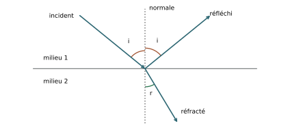
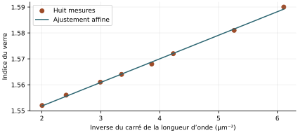
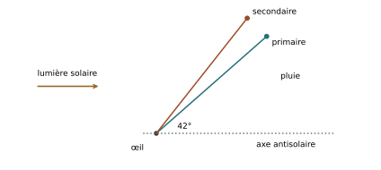
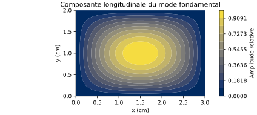

# Banque PT — Physique A 2010 · Corrigé brut

*Corrigé rédigé par IA, non officiel. Signalez toute erreur.*

**Rédaction** · GPT-6.2 Astra Ultra · vitesse non renseignée · 27 novembre 2026

L’écrit dure quatre heures. La calculatrice est autorisée. L’énoncé se termine à la page 9 du fichier de 12 pages. Le rapport demande notamment d’exploiter les huit indices du verre pour tester la loi de Cauchy. Les coefficients d’admissibilité sont 6 à l’École polytechnique et 3 à l’ENS Cachan. [Sujet](https://www.banquept.fr/documents/2010/phys_a_pt_2010.pdf) · [Rapport du jury](https://www.banquept.fr/documents/ecrit/rapport/2010/rapport_phys_a_ecrit_2010.pdf) · [Grille de la Banque PT](https://www.banquept.fr/documents/livret/2010/Livret_PT_2010.pdf#page=12).

## A. Prisme et spectromètre (30 %)

### Question A.I.1

Le rayon incident et la normale au point d’incidence définissent le plan d’incidence. Les rayons réfléchi et réfracté sont dans ce plan. Le rayon réfléchi fait avec la normale un angle de même valeur absolue que celui d’incidence. Les angles du rayon incident dans le milieu 1 et du rayon transmis dans le milieu 2 satisfont $n_1\sin i=n_2\sin r$. En choisissant de mesurer les deux angles du rayon incident et du réfléchi de la même normale orientée vers le milieu 1, ils sont opposés.

### Question A.I.2.1

L’air est d’indice un. À l’entrée, $\sin i=n\sin r$. À la sortie, $n\sin r'=\sin i'$. Le triangle formé par les deux faces et le segment du rayon dans le verre a pour angles $A,\pi/2-r,\pi/2-r'$. Leur somme vaut $\pi$, donc $A=r+r'$. L’incidence peut être oblique dans la section perpendiculaire à l’arête.

### Question A.I.2.2

Avec la convention du sujet, la première déviation vaut $i-r$ et la seconde $i'-r'$. Ainsi $D=i+i'-(r+r')=i+i'-A$.

### Question A.I.3

Posons $g(r)=\arcsin(n\sin r)$. Alors $D=g(r)+g(A-r)-A$. À un minimum intérieur, $g'(r)=g'(r')$, avec $g'(r)=n\cos r/\sqrt{1-n^2\sin^2r}$. Le carré de cette dérivée vaut $n^2(1-u)/(1-n^2u)$, strictement croissant en $u=\sin^2r$ car $n>1$. Dans l’intervalle des angles physiques il vient $|r|=|r'|$. Comme $r+r'=A>0$, $r=r'=A/2$, puis $i=i'$. La marche du rayon est symétrique.

### Question A.I.4

Au minimum, $i=(A+D_m)/2$ et $r=A/2$. Donc $n=\sin[(A+D_m)/2]/\sin(A/2)$. Au goniomètre, on repère la direction directe du collimateur, puis on vise une raie monochromatique déviée. En tournant le prisme on cherche le rebroussement de cette raie. L’écart angulaire avec la direction directe donne $D_m$. L’angle $A$ est connu ou mesuré par réflexion sur les deux faces.

### Question A.II.1

En posant $X_j=1/\lambda_j^2$, la loi proposée devient $n=a+bX$. Les huit mesures s’alignent à la précision expérimentale. La pente de la droite des moindres carrés est $b=\sum(X_j-\bar X)(n_j-\bar n)/\sum(X_j-\bar X)^2$ et son ordonnée à l’origine $a=\bar n-b\bar X$. Pour les longueurs d’onde en nanomètres, on trouve $a=1{,}5336$ et $b=9{,}10\,10^3\ \mathrm{nm}^2$. L’écart maximal sur un indice est $8{,}0\,10^{-4}$.

### Question A.II.2

On obtient $D_m(\lambda)=2\arcsin[n(\lambda)\sin(A/2)]-A$. Le minimum dépend de la longueur d’onde car l’indice en dépend. Ici $b>0$, donc les courtes longueurs d’onde ont l’indice et la déviation les plus grands.

### Question A.II.3

Le tableau fournit $n_0=1{,}561$. Ainsi $i_0=\arcsin(n_0\sin30^\circ)=51{,}31^\circ$. Le rayon de référence est dévié de $2i_0-A=42{,}61^\circ$.

### Question A.II.4

La relation $\sin i_0=n\sin r$ donne $dr=-(\tan r/n)\,dn$. Comme $dr'=-dr$, la seconde face donne $\cos i'\,di'=\sin r'\,dn+n\cos r'\,dr'=(\sin r'+\cos r'\tan r)\,dn$. À la longueur d’onde de référence, $r=r'=A/2$ et $i'=i_0$. Avec $dD=di'$ on obtient alors
$$\left.\frac{dD}{d\lambda}\right|_{\lambda_0}=\frac{2\sin(A/2)}{\cos i_0}\frac{dn}{d\lambda},\qquad \frac{dn}{d\lambda}=-\frac{2b}{\lambda^3}.$$
La forme particulière du facteur géométrique est locale autour de $\lambda_0$.

### Question A.II.5.1

Chaque point de la fente placée au foyer objet de $O_1$ donne un faisceau parallèle. Le prisme en change la direction d’un angle dépendant de la longueur d’onde. L’objectif $O_2$ transforme chaque direction émergente en une position dans son plan focal image. Une source ponctuelle à plusieurs couleurs fournit ainsi plusieurs images.

### Question A.II.5.2

Le rayon issu du centre émerge suivant la direction de référence déviée de $42{,}61^\circ$. L’axe de $O_2$ représenté sur la figure suit cette direction, donc l’image est centrée au foyer image de $O_2$. La largeur angulaire incidente vaut $\ell/f'$. La dérivée $di'/di=-1$ conserve cette largeur en valeur absolue. L’objectif de même focale redonne une largeur $f'(\ell/f')=\ell$, dans l’approximation paraxiale autour du rayon central.

### Question A.II.5.3

Orientons l’abscisse de l’écran dans le sens des déviations croissantes, avec origine à l’image centrale. Au premier ordre, $x=f'D'_0(\lambda-\lambda_0)$. Le résultat de A.II.4 donne $D'_0=-1{,}51\,10^{-4}\ {\rm rad\,nm}^{-1}$. Les centres sont donc à $+1{,}51\,10^{-4}f'$ pour 577 nm et $-1{,}51\,10^{-4}f'$ pour 579 nm. Pour que les deux images de largeur $\ell=10^{-6}$ m se touchent sans se recouvrir, il faut $2f'|D'_0|(1\ {\rm nm})=\ell$, soit $f'=3{,}32$ mm. Une focale plus longue les sépare davantage. Ce critère ne considère que la largeur géométrique imposée par le sujet.

### Question A.II.5.4

Les images monochromatiques contiguës forment une bande colorée. Du côté des faibles déviations on voit le rouge, puis l’orange, le jaune, le vert, le bleu et enfin le violet, du côté des fortes déviations. Une source blanche à spectre continu produit une bande continue, élargie par la largeur de fente.

### Question A.II.5.5

Un réseau de diffraction placé entre le collimateur et la lunette sépare les couleurs dans les ordres non nuls. En incidence normale, au pas $d$, les maxima satisfont $d\sin\theta_m=m\lambda$. Un objectif permet à nouveau leur observation dans un plan focal.

## B. Principe de l’arc-en-ciel (25 %)

### Question B.I

Les deux passages air-verre et verre-air apportent ensemble une rotation de $2(i-r)$. La réflexion interne apporte $\pi-2r$ car, dans une sphère, la corde fait le même angle avec les deux rayons aux points d’impact. La rotation totale vaut $\pi+2i-4r$. Le retour parallèle en sens inverse impose $2i-4r=0$. En incidence paraxiale Snell donne $i\simeq nr$, d’où $n=2$.

### Question B.II.1.1

L’angle à l’axe antisolaire est le supplément de la rotation précédente, soit $D_1=4r-2i$. Comme $\sin i=x=h/R$ et $\sin r=x/n$, on a $D_1(x)=4\arcsin(x/n)-2\arcsin x$. Sa dérivée vaut $4/\sqrt{n^2-x^2}-2/\sqrt{1-x^2}$. Elle s’annule lorsque $4(1-x^2)=n^2-x^2$, soit $x_m=\sqrt{(4-n^2)/3}$. Positive avant cette valeur et négative après, elle y donne un maximum. Pour $n=1{,}337$, $x_m=0{,}8588$ et $D_{1m}=41{,}50^\circ$.

### Question B.II.1.2

Avec $x_m=\sqrt{(9-n^2)/8}=0{,}9495$, la relation $D_2=\pi+2\arcsin x-6\arcsin(x/n)$ donne $D_{2m}=51{,}93^\circ$. C’est un minimum, car la dérivée $2/\sqrt{1-x^2}-6/\sqrt{n^2-x^2}$ passe du négatif au positif.

### Question B.II.2.1

Au voisinage d’un extremum de $D(x)$, un intervalle de hauteurs incidentes donne une plage très étroite de directions émergentes. La concentration de rayons est particulièrement lumineuse sur le cône correspondant. Une réflexion interne forme le premier arc. À chaque réflexion, seule une partie de la lumière reste dans la goutte. L’arc secondaire exige deux réflexions et reçoit moins de lumière.

### Question B.II.2.2

Le Soleil est derrière l’observateur et la pluie devant lui. Les directions des gouttes vues sur l’arc forment un cône de sommet l’œil et d’axe orienté à l’opposé du Soleil. Dans une coupe passant par cet axe, les gouttes colorées se trouvent à environ $42^\circ$ ou $52^\circ$ de l’axe antisolaire.

### Question B.II.2.3

Les calculs avec l’indice moyen donnent $41{,}5^\circ$ pour le premier arc et $51{,}9^\circ$ pour le second. Le second cône a une plus grande ouverture, donc l’arc secondaire est extérieur au primaire.

### Question B.II.2.4

À l’équinoxe le Soleil culmine à $90^\circ-45^\circ=45^\circ$ au-dessus de l’horizon parisien simplifié. Le point antisolaire est $45^\circ$ sous l’horizon. Même le bord rouge du primaire, à environ $42{,}4^\circ$, culmine sous l’horizon. Un observateur au sol face à un horizon dégagé ne peut donc pas le voir à midi. Un avion ou un observatoire dominant des gouttes situées en contrebas change la géométrie.

### Question B.II.2.5

L’eau est dispersive. Les gouttes qui renvoient la lumière vers l’œil à l’angle de concentration ne sont donc pas les mêmes pour toutes les couleurs. B.II.1.1 donne pour le violet $40{,}57^\circ$ et pour le rouge $42{,}44^\circ$, soit $1{,}87^\circ$ d’écart. Depuis l’intérieur du cône vers l’extérieur, on passe du violet au bleu, au vert, au jaune, à l’orange puis au rouge.

### Question B.II.2.6

Les directions du primaire sont limitées du côté extérieur par son maximum. Les directions du secondaire commencent à son minimum, du côté extérieur de ce dernier. Entre les deux, les rayons ayant subi une ou deux réflexions ne parviennent donc pas à l’œil dans le modèle géométrique. Le fond y apparaît plus sombre.

## C. Propagation guidée (45 %)

### Question C.I.1

Pour une loi d’Ohm locale $\mathbf j=\sigma\mathbf E$, un conducteur parfait a une résistivité nulle. Un courant fini y est compatible avec $\mathbf E=\mathbf0$ dans le volume. Il ne s’en déduit pas l’annulation des courants de surface.

### Question C.I.2

La loi $\nabla\times\mathbf E=-\partial_t\mathbf B$ entraîne $\partial_t\mathbf B=\mathbf0$ dans le métal. Un champ statique préexistant peut subsister. Sa partie harmonique variable est nulle, et le sujet fixe ensuite à zéro le champ intérieur.

### Question C.I.3

En l’absence de charges et de courants, $\nabla\cdot\mathbf E=\nabla\cdot\mathbf B=0$, $\nabla\times\mathbf E=-\partial_t\mathbf B$ et $\nabla\times\mathbf B=\mu_0\varepsilon_0\partial_t\mathbf E$. En appliquant le rotationnel à chacune des deux dernières et en utilisant $\nabla\times\nabla\times\mathbf U=\nabla(\nabla\cdot\mathbf U)-\Delta\mathbf U$, on trouve $\Delta\mathbf U-c^{-2}\partial_t^2\mathbf U=0$ pour $\mathbf U=\mathbf E,\mathbf B$. Ici $c=1/\sqrt{\mu_0\varepsilon_0}$ est la célérité des ondes électromagnétiques dans le vide non borné.

### Question C.I.4

Écrivons $\gamma=\alpha+j\beta$ dans $e^{-\gamma z}e^{j\omega t}$. L’amplitude est multipliée par $e^{-\alpha z}$ et la phase vaut $\omega t-\beta z$. Pour une onde progressive sans pertes, $\alpha=0$ et $\beta\ne0$. Avec atténuation et propagation, $\alpha>0$ et $\beta\ne0$. Une solution évanescente décroissante a $\gamma=\alpha>0$ réel et aucune progression de phase selon $z$. À la coupure, $\gamma=0$ constitue le cas limite.

### Question C.I.5

Une phase constante $\omega t-kz$ se déplace à $\omega/k$. Pour $\omega>0$ et une propagation vers $+z$, $k>0$. Sur les champs complexes $\partial_t$ équivaut à la multiplication par $j\omega$, et $\partial_z$ à la multiplication par $-jk$.

### Question C.I.6

Avec $B_z=0$, Maxwell–Faraday donne $\partial_yE_z+jkE_y=-j\omega B_x$ et $-jkE_x-\partial_xE_z=-j\omega B_y$. Maxwell–Ampère donne $jkB_y=j\omega E_x/c^2$ et $-jkB_x=j\omega E_y/c^2$. Ce sont les quatre équations demandées. Elles concernent les amplitudes complexes, avec le facteur $e^{j(\omega t-kz)}$ commun.

### Question C.I.7

D’après C.I.3, $\partial_x^2 E_z+\partial_y^2 E_z-k^2E_z+(\omega/c)^2E_z=0$. Ainsi $\Delta_\perp E_z+K^2E_z=0$ avec $K^2=\omega^2/c^2-k^2$. Pour un mode propagatif du guide rectangulaire, on choisit la racine positive.

### Question C.I.8

Un contour infinitésimal à cheval sur la paroi donne la continuité du champ électrique tangentiel. Un cylindre aplati donne celle de la composante normale de $\mathbf B$. Ces composantes étant nulles côté métal, on a du côté vide $\mathbf E_t=\mathbf0$ et $B_n=0$. Une charge ou un courant surfacique permet en revanche des discontinuités de $E_n$ ou de $\mathbf B_t$.

### Question C.II.1

La composante $E_{0z}$ est tangentielle sur chacun des quatre murs. Donc $E_{0z}(0,y)=E_{0z}(a,y)=0$ ainsi que $E_{0z}(x,0)=E_{0z}(x,b)=0$. Il s’agit de conditions de Dirichlet homogènes.

### Question C.II.2.1

En substituant $E_z=E_{0z}(x,y)e^{j(\omega t-kz)}$ dans C.I.7 et en simplifiant, il vient $(\partial_x^2+\partial_y^2)E_{0z}=(k^2-\omega^2/c^2)E_{0z}$.

### Question C.II.2.2

Chaque produit trigonométrique proposé vérifie $\partial_x^2 E_{0z}=-k_1^2 E_{0z}$ et $\partial_y^2 E_{0z}=-k_2^2 E_{0z}$. Une amplitude non nulle impose donc $k_1^2+k_2^2=K^2$. À $x=0$ subsiste le facteur $B'$, qui doit être nul puisque le facteur en $y$ ne s’annule pas partout. De même à $y=0$, $D'=0$. Les fonctions linéaires que donnerait un nombre d’onde transverse nul seraient nulles aux deux bords, donc identiquement nulles.

### Question C.II.2.3

À $x=a$ et $y=b$, il faut $k_1=n\pi/a$, $k_2=m\pi/b$. Il suffit de retenir $n,m\ge1$, un changement de signe s’absorbant dans l’amplitude. Pour un mode transverse magnétique $\mathrm{TM}_{nm}$, $B_z=0$ et $E_z$ possède $n$ demi-ondes selon $x$, $m$ selon $y$. Le nombre d’onde longitudinal positif vaut
$$k=\sqrt{\frac{\omega^2}{c^2}-\pi^2\left(\frac{n^2}{a^2}+\frac{m^2}{b^2}\right)}.$$
La coupure du mode vaut $f_{nm}=(c/2)\sqrt{(n/a)^2+(m/b)^2}$. La plus basse est celle du mode $(1,1)$. La propagation longitudinale requiert $f>f_{11}$.

### Question C.II.2.4

Écrivons $u=k_1x$, $v=k_2y$, $K^2=k_1^2+k_2^2$ et omettons le facteur longitudinal et temporel commun. En remplaçant $E_{0z}=E_0\sin u\sin v$ dans les relations issues de C.I.6, on trouve
$$E_{0x}=-\frac{jk k_1 E_0}{K^2}\cos u\sin v,\qquad E_{0y}=-\frac{jk k_2 E_0}{K^2}\sin u\cos v,$$
$$B_{0x}=\frac{j\omega k_2 E_0}{c^2K^2}\sin u\cos v,\qquad B_{0y}=-\frac{j\omega k_1 E_0}{c^2K^2}\cos u\sin v.$$
Sur $x=0,a$, les facteurs $\sin u$ annulent $E_y,E_z,B_x$. Sur $y=0,b$, les facteurs $\sin v$ annulent $E_x,E_z,B_y$. Ce sont précisément les champs imposés en C.I.8.

### Question C.II.2.5

À un point de la section où le champ est non nul, la phase est $\omega t-kz$ à une constante près. La condition $d(\omega t-kz)=0$ donne
$$v_\varphi=\frac{\omega}{k}=\frac{c}{\sqrt{1-(2\pi f_{nm}/\omega)^2}}>c.$$
Elle dépend de $\omega$, donc le guide est dispersif même si le vide ne l’est pas. Une phase sinusoïdale seule ne transporte pas d’information individualisée. La vitesse de groupe est $d\omega/dk=c^2 k/\omega<c$.

### Question C.II.2.6

Pour $a=0{,}030$ m, $b=0{,}020$ m, la coupure minimale en mode TM vaut $(c/2)\sqrt{(1/a)^2+(1/b)^2}=9{,}0\ {\rm GHz}$. À $f=2f_{11}$, $v_\varphi=c/\sqrt{1-1/4}=2c/\sqrt3\simeq3{,}46\,10^8\ {\rm m\,s^{-1}}$.
