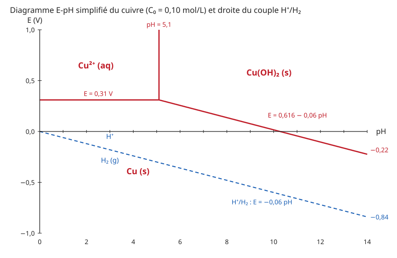

# Banque PT PT — Physique C - Chimie 2010 · Corrigé brut

*Corrigé rédigé par IA, non officiel. Signalez toute erreur.*

**Rédaction** · modèle exact non renseigné (famille Claude) · effort non renseigné · vitesse non renseignée

**Révision (tour 2)** · modèle exact non renseigné (famille Claude) · effort non renseigné · vitesse non renseignée · 28 novembre 2026

Épreuve de 2 heures, calculatrice autorisée, sur le cuivre et ses minerais : 29 questions, repérées comme dans l'énoncé de I.1.1 à III.2.4, en trois parties indépendantes (traitement de minerais complexes, analyse d'un laiton, liqueur de Fehling), avec une feuille annexe à rendre (diagramme potentiel-pH du cobalt et du manganèse, à compléter). Les 29 questions sont traitées. L'énoncé demande trois chiffres significatifs. Conformément aux valeurs de l'annexe, on prend $\dfrac{RT\ln 10}{F} = 0{,}06\ \mathrm{V}$ et $\mathrm{p}K_e = 14$ à 25 °C. Trois points de l'énoncé sont signalés à leur place : l'ordonnée 1,35 V portée sur l'annexe pour le couple $\mathrm{MnO_2/Mn^{2+}}$ (question I.2.2.5), la quantité d'acide restant après l'électrolyse (question II.2.5) et les deux valeurs du produit de solubilité de l'hydroxyde de cuivre (question III.1.3).

[Sujet officiel (archive)](https://www.banquept.fr/documents/2010/phys_c_pt_2010.zip) · [Rapport du jury](https://www.banquept.fr/documents/ecrit/rapport/2010/rapport_phys_c_ecrit_2010.pdf)

## Partie I — Étude de minerais complexes

### Question I.1.1 — Solubilité d'un hydroxyde en fonction du pH

L'hydroxyde se dissout selon

$$\mathrm{M(OH)_{2\,(s)}} = \mathrm{M^{2+}_{(aq)}} + 2\,\mathrm{HO^-_{(aq)}} \qquad K_s = [\mathrm{M^{2+}}]\,[\mathrm{HO^-}]^2$$

Le pH étant imposé par ailleurs, la solubilité est la concentration du cation dans la solution saturée, $S = [\mathrm{M^{2+}}]$. Avec $[\mathrm{HO^-}] = K_e/[\mathrm{H_3O^+}]$ :

$$\boxed{S = \frac{K_s}{[\mathrm{HO^-}]^2} = \frac{K_s\,[\mathrm{H_3O^+}]^2}{K_e^2}}$$

En prenant l'opposé du logarithme décimal, $\mathrm{p}S = -\log S$ :

$$\boxed{\mathrm{p}S = \mathrm{p}K_s - 2\,\mathrm{p}K_e + 2\,\mathrm{pH} = \mathrm{p}K_s - 28 + 2\,\mathrm{pH}}$$

$S$ est bien une concentration ($K_s$ et $K_e$ sont sans dimension, les concentrations étant rapportées à $c^\circ = 1\ \mathrm{mol\cdot L^{-1}}$). La solubilité est divisée par 100 quand le pH augmente d'une unité. La relation ne vaut que si le solide est présent, c'est-à-dire tant que $S$ reste inférieure à la concentration totale du cation.

### Question I.1.2 — Applications aux hydroxydes de cuivre et de cobalt

Pour l'hydroxyde de cuivre, $\mathrm{p}K_{s1} = 18{,}8$ :

$$\boxed{\mathrm{p}S_1 = 2\,\mathrm{pH} - 9{,}20 \qquad S_1 = 10^{\,9{,}20 - 2\,\mathrm{pH}}\ \mathrm{mol\cdot L^{-1}}}$$

Pour l'hydroxyde de cobalt, $\mathrm{p}K_{s2} = 14{,}8$ :

$$\boxed{\mathrm{p}S_2 = 2\,\mathrm{pH} - 13{,}2 \qquad S_2 = 10^{\,13{,}2 - 2\,\mathrm{pH}}\ \mathrm{mol\cdot L^{-1}}}$$

Les deux droites $\mathrm{p}S = f(\mathrm{pH})$ sont parallèles, de pente 2, décalées de 2 unités de pH : à pH donné, l'hydroxyde de cuivre est $10^4$ fois moins soluble que celui de cobalt.

### Question I.1.3 — Zone de pH de précipitation sélective

*Cuivre.* Précipiter au moins 99,9 % du cuivre, c'est laisser en solution au plus 0,1 % de la concentration initiale :

$$[\mathrm{Cu^{2+}}] = S_1 \leqslant 10^{-3} \times 1{,}0\cdot10^{-1} = 1{,}0\cdot10^{-4}\ \mathrm{mol\cdot L^{-1}}$$

$$\mathrm{p}S_1 = 2\,\mathrm{pH} - 9{,}20 \geqslant 4{,}00 \iff \mathrm{pH} \geqslant 6{,}60$$

*Cobalt.* Ne pas précipiter plus de 0,1 % du cobalt, c'est garder en solution au moins 99,9 % de la concentration initiale :

$$[\mathrm{Co^{2+}}] = S_2 \geqslant 0{,}999 \times 1{,}0\cdot10^{-2}\ \mathrm{mol\cdot L^{-1}}$$

$$\mathrm{p}S_2 = 2\,\mathrm{pH} - 13{,}2 \leqslant 2{,}00 \iff \mathrm{pH} \leqslant 7{,}60$$

(le terme $-\log 0{,}999 = 4\cdot10^{-4}$ est sans effet sur le troisième chiffre : la borne est pratiquement le pH de début de précipitation de $\mathrm{Co(OH)_2}$, valeur 7,6 portée sur l'annexe).

Les deux conditions sont compatibles :

$$\boxed{6{,}60 \leqslant \mathrm{pH} \leqslant 7{,}60}$$

Dans cette zone, large d'une unité de pH, le cuivre est précipité à plus de 99,9 % sous forme de $\mathrm{Cu(OH)_2}$ et le cobalt reste en solution à plus de 99,9 %. À titre de repère, l'hydroxyde de cuivre commence à précipiter à $\mathrm{pH} = (9{,}20 + 1{,}00)/2 = 5{,}10$.

### Question I.2.1.1 — Tracé du diagramme potentiel-pH du cuivre

Espèces : $\mathrm{Cu_{(s)}}$ (degré 0), $\mathrm{Cu^{2+}_{(aq)}}$ et $\mathrm{Cu(OH)_{2\,(s)}}$ (degré +II). Convention de frontière : la concentration de l'espèce dissoute vaut $C_0 = 1{,}0\cdot10^{-1}\ \mathrm{mol\cdot L^{-1}}$.

*Frontière $\mathrm{Cu^{2+}/Cu(OH)_2}$* (même degré d'oxydation, frontière verticale). L'hydroxyde apparaît quand $C_0\,[\mathrm{HO^-}]^2 = K_s$, soit $\mathrm{p}S_1 = -\log C_0 = 1{,}00$ :

$$\boxed{\mathrm{pH} = \frac{9{,}20 + 1{,}00}{2} = 5{,}10}$$

*Frontière $\mathrm{Cu^{2+}/Cu}$* ($\mathrm{pH} \leqslant 5{,}10$), demi-équation $\mathrm{Cu^{2+} + 2\,e^- = Cu}$ :

$$E = E^\circ(\mathrm{Cu^{2+}/Cu}) + \frac{0{,}06}{2}\log C_0 = 0{,}34 - 0{,}03$$

$$\boxed{E = 0{,}310\ \mathrm{V}}$$

*Frontière $\mathrm{Cu(OH)_2/Cu}$* ($\mathrm{pH} \geqslant 5{,}10$), demi-équation $\mathrm{Cu(OH)_2 + 2\,H^+ + 2\,e^- = Cu + 2\,H_2O}$. Le solide étant présent, $[\mathrm{Cu^{2+}}] = K_s\,h^2/K_e^2$ :

$$E = 0{,}34 + 0{,}03\,\log\frac{K_s\,h^2}{K_e^2} = 0{,}34 + 0{,}03\,(28 - 18{,}8) - 0{,}06\,\mathrm{pH}$$

$$\boxed{E = 0{,}616 - 0{,}06\,\mathrm{pH}\quad(\mathrm{V})}$$

Vérification : à $\mathrm{pH} = 5{,}10$, $0{,}616 - 0{,}306 = 0{,}310\ \mathrm{V}$, le diagramme est continu ; à $\mathrm{pH} = 14$, $E = -0{,}224\ \mathrm{V}$. La valeur $0{,}616\ \mathrm{V}$ est le potentiel standard du couple $\mathrm{Cu(OH)_2/Cu}$.

### Question I.2.1.2 — Domaines des espèces du cuivre

- $\mathrm{Cu_{(s)}}$ (degré 0) : domaine d'existence sous les deux segments, aux bas potentiels, pour tout pH.
- $\mathrm{Cu^{2+}_{(aq)}}$ (degré +II) : domaine de prédominance au-dessus du segment horizontal, pour $\mathrm{pH} < 5{,}10$.
- $\mathrm{Cu(OH)_{2\,(s)}}$ (degré +II) : domaine d'existence au-dessus du segment oblique, pour $\mathrm{pH} > 5{,}10$.

Ces trois domaines sont portés sur la figure 1. Pour un solide on parle de domaine d'existence, pour une espèce dissoute de domaine de prédominance.

### Question I.2.2.1 — Frontière du couple H+/H2 et attaque par l'acide sulfurique

Demi-équation $\mathrm{2\,H^+_{(aq)} + 2\,e^- = H_{2\,(g)}}$, avec $E^\circ = 0\ \mathrm{V}$ et $P(\mathrm{H_2}) = P^\circ = 1\ \mathrm{bar}$ :

$$E = 0 + \frac{0{,}06}{2}\log\frac{h^2}{P(\mathrm{H_2})/P^\circ}$$

$$\boxed{E = -0{,}06\,\mathrm{pH}\quad(\mathrm{V})}$$

C'est une droite passant par l'origine et par le point $(14\ ;\ -0{,}84\ \mathrm{V})$ ; $\mathrm{H^+}$ (ou l'eau) est au-dessus, $\mathrm{H_2}$ au-dessous (figures 1 et 2).

L'acide sulfurique à $0{,}5\ \mathrm{mol\cdot L^{-1}}$, diacide fort, donne $h = 1{,}0\ \mathrm{mol\cdot L^{-1}}$, soit $\mathrm{pH} = 0$ et $E(\mathrm{H^+/H_2}) = 0\ \mathrm{V}$. À ce pH :

- le cobalt ($E = -0{,}34\ \mathrm{V}$) et le manganèse ($E = -1{,}23\ \mathrm{V}$, valeurs de l'annexe) ont leur domaine entièrement sous la droite : leurs domaines sont disjoints de celui de $\mathrm{H^+}$, ils sont oxydés,

$$\mathrm{Co_{(s)} + 2\,H^+_{(aq)} = Co^{2+}_{(aq)} + H_{2\,(g)}} \qquad \mathrm{Mn_{(s)} + 2\,H^+_{(aq)} = Mn^{2+}_{(aq)} + H_{2\,(g)}}$$

- le cuivre a sa frontière à $+0{,}31\ \mathrm{V}$, au-dessus de la droite : le domaine du cuivre métallique et celui de $\mathrm{H^+}$ ont une partie commune pour tout pH (la frontière du cuivre, $0{,}616 - 0{,}06\,\mathrm{pH}$ au-delà de pH 5,1, reste $0{,}616\ \mathrm{V}$ au-dessus de celle de l'hydrogène).

$$\boxed{\text{Le cuivre n'est pas attaqué par l'acide sulfurique : on le récupère par filtration.}}$$

La solution résiduelle, très acide, contient les ions $\mathrm{Co^{2+}}$ et $\mathrm{Mn^{2+}}$.

### Question I.2.2.2 — Frontières de l'élément chlore pour pH > 2

Pour $\mathrm{pH} > 2$, les espèces à considérer sont $\mathrm{Cl^-}$ (degré −I) et, au degré +I, l'acide hypochloreux $\mathrm{HClO}$ et sa base conjuguée $\mathrm{ClO^-}$. L'énoncé ne fixe pas de concentration de tracé pour le chlore : on adopte, par choix du corrigé, la convention d'égalité des concentrations des deux espèces dissoutes sur chaque frontière, qui donne des droites indépendantes de la concentration totale.

*Frontière $\mathrm{HClO/ClO^-}$* : verticale, à $\mathrm{pH} = \mathrm{p}K_a = 7{,}5$, au-dessus des deux autres frontières.

*Frontière $\mathrm{HClO/Cl^-}$* ($2 < \mathrm{pH} \leqslant 7{,}5$), demi-équation $\mathrm{HClO + H^+ + 2\,e^- = Cl^- + H_2O}$ :

$$E = 1{,}50 + \frac{0{,}06}{2}\log\frac{[\mathrm{HClO}]\,h}{[\mathrm{Cl^-}]}$$

$$\boxed{E = 1{,}50 - 0{,}03\,\mathrm{pH}\quad(\mathrm{V})}$$

*Frontière $\mathrm{ClO^-/Cl^-}$* ($\mathrm{pH} \geqslant 7{,}5$), demi-équation $\mathrm{ClO^- + 2\,H^+ + 2\,e^- = Cl^- + H_2O}$ :

$$E = 1{,}73 + \frac{0{,}06}{2}\log\frac{[\mathrm{ClO^-}]\,h^2}{[\mathrm{Cl^-}]}$$

$$\boxed{E = 1{,}73 - 0{,}06\,\mathrm{pH}\quad(\mathrm{V})}$$

Points de tracé : $(2\ ;\ 1{,}44\ \mathrm{V})$, $(7{,}5\ ;\ 1{,}28\ \mathrm{V})$ et $(14\ ;\ 0{,}89\ \mathrm{V})$. Les deux droites se raccordent à $\mathrm{pH} = 7{,}5$ ($1{,}50 - 0{,}225 = 1{,}275\ \mathrm{V}$ et $1{,}73 - 0{,}45 = 1{,}28\ \mathrm{V}$), ce qui confirme la cohérence des données : $E^\circ(\mathrm{ClO^-/Cl^-}) = E^\circ(\mathrm{HClO/Cl^-}) + 0{,}03\,\mathrm{p}K_a$.

Sur la figure 2, les segments du cobalt et du manganèse situés au-delà de pH 7,6 et 8,6 sont retracés avec leur pente théorique de $-0{,}06$ V par unité de pH ; l'annexe de l'énoncé les dessine un peu moins inclinés (environ $-0{,}05$ V par unité de pH), sans conséquence sur les conclusions. La bande colorée entre pH 2 et pH 3,40 anticipe la réponse à la question I.2.2.5, où elle est établie.

### Question I.2.2.3 — Espèces stables du chlore dans chaque domaine

Pour $\mathrm{pH} > 2$ (figure 2) :

- **sous les deux frontières obliques**, pour tout pH : l'ion chlorure $\mathrm{Cl^-}$ (degré −I) ;
- **au-dessus, pour $\mathrm{pH} < 7{,}5$** : l'acide hypochloreux $\mathrm{HClO}$ (degré +I) ;
- **au-dessus, pour $\mathrm{pH} > 7{,}5$** : l'ion hypochlorite $\mathrm{ClO^-}$ (degré +I).

Le dichlore (degré 0) n'a pas de domaine de stabilité dans cet intervalle de pH : il s'y dismute en chlore +I et chlore −I.

### Question I.2.2.4 — Dismutation du dichlore

**Définition.** Une dismutation est une réaction d'oxydoréduction dans laquelle une même espèce est à la fois l'oxydant et le réducteur : l'élément, pris à un degré d'oxydation intermédiaire, passe pour partie à un degré supérieur et pour partie à un degré inférieur.

**Milieu très acide.** Demi-équations :

$$\mathrm{Cl_2 + 2\,e^- = 2\,Cl^-} \qquad E^\circ = 1{,}36\ \mathrm{V}$$

$$\mathrm{2\,HClO + 2\,H^+ + 2\,e^- = Cl_2 + 2\,H_2O} \qquad E^\circ = 1{,}63\ \mathrm{V}$$

Le dichlore oxydant (premier couple) réagit sur le dichlore réducteur (second couple) ; après division par 2 :

$$\boxed{\mathrm{Cl_{2} + H_2O = HClO + H^+ + Cl^-}}$$

Un électron est échangé pour cette écriture :

$$\log K_1^\circ = \frac{1 \times (1{,}36 - 1{,}63)}{0{,}06} = -4{,}50$$

$$\boxed{K_1^\circ = 10^{-4{,}50} = 3{,}16\cdot10^{-5}}$$

**Milieu très basique.** $\mathrm{HClO}$ est sous forme $\mathrm{ClO^-}$ et les protons sont captés par $\mathrm{HO^-}$ :

$$\boxed{\mathrm{Cl_{2} + 2\,HO^- = ClO^- + Cl^- + H_2O}}$$

Ce bilan est la somme de la réaction précédente, de $\mathrm{HClO = ClO^- + H^+}$ ($K_a$) et de deux fois $\mathrm{H^+ + HO^- = H_2O}$ ($1/K_e$) :

$$K_2^\circ = \frac{K_1^\circ\,K_a}{K_e^2} = 10^{-4{,}50 - 7{,}5 + 28}$$

$$\boxed{K_2^\circ = 1{,}00\cdot10^{16}}$$

**Conclusion.** En milieu très acide, la dismutation est très défavorable ($K_1^\circ \ll 1$) : le dichlore y est stable, et c'est la réaction inverse (médiamutation de $\mathrm{HClO}$ et $\mathrm{Cl^-}$) qui est favorable. En milieu basique elle est quantitative ($K_2^\circ \gg 1$) : le dichlore n'y existe pas, c'est la réaction de préparation de l'eau de Javel. Le dichlore n'a donc de domaine de stabilité qu'aux faibles pH. Pour des concentrations unité, les frontières $1{,}63 - 0{,}06\,\mathrm{pH}$ et $1{,}36\ \mathrm{V}$ se coupent à $\mathrm{pH} = 4{,}5$ ; ce domaine se rétrécit quand les concentrations diminuent, ce qui est compatible avec la limite $\mathrm{pH} = 2$ admise par l'énoncé.

### Question I.2.2.5 — Précipitation sélective d'un métal par oxydation

La solution résiduelle contient $\mathrm{Co^{2+}}$ et $\mathrm{Mn^{2+}}$ en milieu très acide. Oxydés, ils donnent des solides : $\mathrm{MnO_2}$ pour le manganèse, $\mathrm{Co(OH)_3}$ pour le cobalt. On compare donc, pour $2 < \mathrm{pH} < 7{,}5$, la frontière $\mathrm{HClO/Cl^-}$ aux frontières de ces deux couples (figure 2).

*Manganèse.* Demi-équation $\mathrm{MnO_2 + 4\,H^+ + 2\,e^- = Mn^{2+} + 2\,H_2O}$, de pente $-0{,}12$ V par unité de pH. L'annexe porte l'ordonnée $1{,}35\ \mathrm{V}$ à pH 0, soit $E = 1{,}35 - 0{,}12\,\mathrm{pH}$. On signale que les données de l'énoncé conduisent plutôt à $1{,}23 - 0{,}03\log C_0 = 1{,}29\ \mathrm{V}$ : l'écart de $0{,}06\ \mathrm{V}$ correspond à un facteur $0{,}06$ au lieu de $0{,}03$ devant le logarithme. Il est sans conséquence ici : avec l'une ou l'autre valeur, cette frontière est sous celle du chlore pour tout pH positif ($1{,}50 - 0{,}03\,\mathrm{pH} > 1{,}35 - 0{,}12\,\mathrm{pH}$). **$\mathrm{HClO}$ oxyde toujours $\mathrm{Mn^{2+}}$ en $\mathrm{MnO_2}$.**

*Cobalt.* Demi-équation $\mathrm{Co(OH)_3 + 3\,H^+ + e^- = Co^{2+} + 3\,H_2O}$. Avec $[\mathrm{Co^{3+}}] = K_s(\mathrm{Co(OH)_3})\,h^3/K_e^3$ et $[\mathrm{Co^{2+}}] = C_0 = 1{,}0\cdot10^{-2}\ \mathrm{mol\cdot L^{-1}}$ :

$$E = 1{,}80 + 0{,}06\,\log\frac{10^{-40{,}5}\,h^3}{10^{-42} \times 10^{-2}} = 2{,}01 - 0{,}18\,\mathrm{pH}\quad(\mathrm{V})$$

Cette droite part bien du point $(1{,}17\ ;\ 1{,}80\ \mathrm{V})$ et arrive à $0{,}64\ \mathrm{V}$ à $\mathrm{pH} = 7{,}6$, en accord avec l'annexe à la précision du tracé (on y lit environ $0{,}67\ \mathrm{V}$). Elle coupe la frontière du chlore pour

$$1{,}50 - 0{,}03\,\mathrm{pH} = 2{,}01 - 0{,}18\,\mathrm{pH} \iff \mathrm{pH} = \frac{0{,}51}{0{,}15} = 3{,}40$$

Pour $\mathrm{pH} < 3{,}40$, la frontière du cobalt est au-dessus de celle du chlore : $\mathrm{HClO}$ et $\mathrm{Co^{2+}}$ ont un domaine commun, le cobalt(II) n'est pas oxydé. Au-delà, il le serait.

$$\boxed{2 < \mathrm{pH} < 3{,}40\ :\ \text{l'acide hypochloreux HClO oxyde le seul manganèse, qui précipite en } \mathrm{MnO_2}}$$

$$\mathrm{Mn^{2+} + HClO + H_2O = MnO_{2\,(s)} + Cl^- + 3\,H^+}$$

**Mise en œuvre.** On remonte le pH de la solution acide vers 2,5 par ajout de carbonate de sodium ($\mathrm{CO_3^{2-} + 2\,H^+ = CO_2 + H_2O}$), puis on ajoute l'hypochlorite de sodium : à ce pH, inférieur à $\mathrm{p}K_a = 7{,}5$, l'élément chlore au degré +I est sous forme $\mathrm{HClO}$. À $\mathrm{pH} = 2{,}5$, $E(\mathrm{HClO/Cl^-}) = 1{,}43\ \mathrm{V}$, contre $1{,}05\ \mathrm{V}$ pour le manganèse et $1{,}56\ \mathrm{V}$ pour le cobalt. La réaction libère des protons : il faut maintenir le pH par de nouveaux ajouts de carbonate. Le dioxyde de manganèse, insoluble à tout pH, est isolé par filtration.

**L'autre métal** reste en solution sous forme d'ions cobalt(II) $\mathrm{Co^{2+}}$ : à ce pH, très inférieur à 7,6, l'hydroxyde $\mathrm{Co(OH)_2}$ ne précipite pas.

### Question I.2.2.6 — Obtention du cobalt en milieu basique

La solution résiduelle ne contient plus, comme métal, que le cobalt(II). On la rend basique (carbonate de sodium, base de $\mathrm{p}K_{a2} = 10{,}3$) et on ajoute un excès d'hypochlorite : pour $\mathrm{pH} > 7{,}6$, le cobalt(II) précipite en $\mathrm{Co(OH)_2}$, et pour $\mathrm{pH} > 7{,}5$ le chlore +I est sous forme $\mathrm{ClO^-}$.

Frontière $\mathrm{Co(OH)_3/Co(OH)_2}$ (demi-équation $\mathrm{Co(OH)_3 + H^+ + e^- = Co(OH)_2 + H_2O}$), par continuité à $\mathrm{pH} = 7{,}6$ où $E = 2{,}01 - 0{,}18 \times 7{,}6 = 0{,}64\ \mathrm{V}$ :

$$E = 1{,}10 - 0{,}06\,\mathrm{pH}\quad(\mathrm{V})$$

Frontière $\mathrm{ClO^-/Cl^-}$ : $E = 1{,}73 - 0{,}06\,\mathrm{pH}$. Les deux droites sont parallèles et celle du chlore est $0{,}63\ \mathrm{V}$ au-dessus de celle du cobalt pour tout pH basique : les domaines de $\mathrm{ClO^-}$ et de $\mathrm{Co(OH)_2}$ sont disjoints (figure 2). L'hypochlorite oxyde donc quantitativement le cobalt(II) en cobalt(III) :

$$\mathrm{2\,Co(OH)_{2\,(s)} + ClO^- + H_2O = 2\,Co(OH)_{3\,(s)} + Cl^-}$$

soit, à partir des ions de la solution, $\mathrm{2\,Co^{2+} + ClO^- + 4\,HO^- + H_2O = 2\,Co(OH)_3 + Cl^-}$.

$$\boxed{\text{On recueille l'hydroxyde de cobalt(III) } \mathrm{Co(OH)_3},\ \text{solide isolé par filtration.}}$$

Justification de la pureté : le cuivre a été retiré à la question I.2.2.1 et le manganèse à la question I.2.2.5 ; les autres espèces présentes ($\mathrm{Na^+}$, $\mathrm{Cl^-}$, $\mathrm{SO_4^{2-}}$, carbonates, excès de $\mathrm{ClO^-}$) restent en solution. L'excès d'hypochlorite garantit que tout le cobalt est au degré +III. Les trois métaux sont ainsi séparés : cuivre métallique, $\mathrm{MnO_2}$ et $\mathrm{Co(OH)_3}$.

## Partie II — Analyse d'un laiton

### Question II.1.1 — pH initial du mélange

Concentrations juste après mélange (volume total $100\ \mathrm{mL}$), avant toute réaction :

$$[\mathrm{Cu^{2+}}]_0 = \frac{90 \times 10^{-3}}{100} = 9{,}00\cdot10^{-4}\ \mathrm{mol\cdot L^{-1}} \qquad [\mathrm{NH_3}]_0 = \frac{10 \times 5}{100} = 0{,}500\ \mathrm{mol\cdot L^{-1}}$$

Le pH est imposé par la base faible $\mathrm{NH_3}$, de concentration $c = 0{,}500\ \mathrm{mol\cdot L^{-1}}$ :

$$\mathrm{NH_3 + H_2O = NH_4^+ + HO^-} \qquad K_b = \frac{K_e}{K_a} = 10^{-4{,}8}$$

En supposant la base peu protonée ($[\mathrm{NH_4^+}] = [\mathrm{HO^-}] = \omega \ll c$) et l'autoprotolyse de l'eau négligeable :

$$\omega = \sqrt{K_b\,c} = \sqrt{10^{-4{,}8} \times 0{,}500} = 2{,}82\cdot10^{-3}\ \mathrm{mol\cdot L^{-1}}$$

$$\mathrm{pH} = 7 + \frac12\,\mathrm{p}K_a + \frac12\log c = 7 + 4{,}6 - 0{,}15$$

$$\boxed{\mathrm{pH} \approx 11{,}4}$$

(valeur calculée 11,449, soit 11,4 avec trois chiffres significatifs). Vérification : $\omega/c = 0{,}56\ \%$, la base est bien très peu protonée, et $\mathrm{pH} > \mathrm{p}K_a + 1$ ; $\omega \gg 10^{-7}$, l'autoprotolyse est négligeable. La résolution exacte de $\omega^2 = K_b\,(c - \omega)$ donne le même résultat.

### Question II.1.2 — Affinité chimique et sens d'évolution

**Définition.** Pour une réaction d'équation $\sum_i \nu_i\,\mathrm{A}_i = 0$ et d'avancement $\xi$, l'affinité chimique est

$$\boxed{\mathcal{A} = -\sum_i \nu_i\,\mu_i = -\left(\frac{\partial G}{\partial \xi}\right)_{T,P} = -\Delta_r G}$$

et s'écrit, avec le quotient de réaction $Q_r$ :

$$\mathcal{A} = \mathcal{A}^\circ - RT\ln Q_r = RT\ln\frac{K^\circ}{Q_r}$$

**Critère d'évolution.** À température et pression fixées, le second principe impose pour une évolution spontanée $\mathrm{d}G = -\mathcal{A}\,\mathrm{d}\xi < 0$ :

$$\boxed{\mathcal{A}\,\mathrm{d}\xi > 0}$$

Si $\mathcal{A} > 0$ ($Q_r < K^\circ$), le système évolue dans le sens direct ; si $\mathcal{A} < 0$ ($Q_r > K^\circ$), dans le sens inverse ; l'équilibre correspond à $\mathcal{A} = 0$.

**Application.** Pour la réaction (1) :

$$Q_r = \frac{[\mathrm{Cu(NH_3)_4^{2+}}]\,(c^\circ)^4}{[\mathrm{Cu^{2+}}]\,[\mathrm{NH_3}]^4}$$

À l'instant initial, le complexe n'est pas encore formé :

$$\boxed{Q_{r,i} = 0 < K = 10^{12{,}3}}$$

L'affinité est positive (elle tend vers $+\infty$) : le système évolue spontanément dans le **sens direct**, celui de la formation du complexe.

### Question II.1.3 — Bilan de matière et concentration du complexe

Tableau d'avancement volumique $x$ (en $\mathrm{mol\cdot L^{-1}}$) :

| | $\mathrm{Cu^{2+}}$ | $\mathrm{NH_3}$ | $\mathrm{Cu(NH_3)_4^{2+}}$ |
|---|---|---|---|
| état initial | $9{,}00\cdot10^{-4}$ | $0{,}500$ | $0$ |
| équilibre | $9{,}00\cdot10^{-4} - x_{eq}$ | $0{,}500 - 4\,x_{eq}$ | $x_{eq}$ |

$$K = \frac{x_{eq}}{(9{,}00\cdot10^{-4} - x_{eq})\,(0{,}500 - 4\,x_{eq})^4} = 10^{12{,}3}$$

La constante est très grande et l'ammoniac en très large excès (il en faudrait $3{,}6\cdot10^{-3}\ \mathrm{mol\cdot L^{-1}}$, on en a $0{,}500$) : la réaction est quasi totale et l'ion cuivre(II) est le réactif limitant. On simplifie donc l'équation en posant $x_{eq} \approx [\mathrm{Cu^{2+}}]_0$ dans tous les termes sauf la différence $9{,}00\cdot10^{-4} - x_{eq}$ :

$$\boxed{x_{eq} = [\mathrm{Cu(NH_3)_4^{2+}}]_{eq} \approx 9{,}00\cdot10^{-4}\ \mathrm{mol\cdot L^{-1}}}$$

Il reste $[\mathrm{NH_3}]_{eq} = 0{,}500 - 3{,}6\cdot10^{-3} = 0{,}4964 \approx 0{,}496\ \mathrm{mol\cdot L^{-1}}$ : l'ammoniac est à peine consommé, et le pH calculé à la question II.1.1 n'est pratiquement pas modifié.

### Question II.1.4 — Concentration des ions cuivre(II) libres

La concentration résiduelle se déduit de la constante, les autres concentrations étant connues :

$$[\mathrm{Cu^{2+}}]_{eq} = \frac{x_{eq}}{K\,[\mathrm{NH_3}]_{eq}^4} = \frac{9{,}00\cdot10^{-4}}{10^{12{,}3} \times (0{,}4964)^4}$$

$$\boxed{[\mathrm{Cu^{2+}}]_{eq} = 7{,}43\cdot10^{-15}\ \mathrm{mol\cdot L^{-1}}}$$

L'hypothèse de réaction quasi totale est validée : la fraction de cuivre non complexée vaut $[\mathrm{Cu^{2+}}]_{eq}/[\mathrm{Cu^{2+}}]_0 \approx 8\cdot10^{-12}$.

**Conclusion.** En présence d'ammoniac en excès, il n'existe pratiquement plus d'ions cuivre(II) « libres » : tout le cuivre(II) est engagé dans le complexe. C'est aussi pourquoi l'hydroxyde ne précipite pas malgré le pH de 11,4 : $[\mathrm{Cu^{2+}}]\,[\mathrm{HO^-}]^2 = 7{,}43\cdot10^{-15} \times (2{,}82\cdot10^{-3})^2 \approx 6\cdot10^{-20}$, inférieur à $K_s = 10^{-18{,}8} \approx 1{,}6\cdot10^{-19}$.

### Question II.1.5 — Détection de traces de cuivre(II)

Le rapport $[\mathrm{Cu(NH_3)_4^{2+}}]/[\mathrm{Cu^{2+}}] = K\,[\mathrm{NH_3}]^4$ ne dépend que de la concentration d'ammoniac : avec $[\mathrm{NH_3}] \approx 0{,}5\ \mathrm{mol\cdot L^{-1}}$ il vaut $1{,}2\cdot10^{11}$, quelle que soit la quantité de cuivre. **Même à l'état de traces, le cuivre(II) est donc transformé quantitativement en complexe.** Comme ce complexe est d'un bleu intense, bien plus coloré que l'ion cuivre(II) hydraté, bleu pâle, sa couleur reste perceptible à très faible concentration : l'ajout d'ammoniac en excès est un test sensible de la présence d'ions cuivre(II), dont l'absence de coloration prouve la disparition.

### Question II.2.1 — pH de la solution avant l'attaque

Les $10\ \mathrm{mL}$ d'acide nitrique à $18\ \mathrm{mol\cdot L^{-1}}$ apportent $n(\mathrm{HNO_3}) = 18 \times 10\cdot10^{-3} = 0{,}180\ \mathrm{mol}$, dilués dans $V = 360\ \mathrm{mL}$ :

$$c = \frac{0{,}180}{0{,}360} = 0{,}500\ \mathrm{mol\cdot L^{-1}}$$

L'acide étant fort, $h = c$ :

$$\boxed{\mathrm{pH} = -\log c = -\log 0{,}500 = 0{,}301}$$

(L'acide sulfurique ajouté n'est pas pris en compte, comme le demande l'énoncé.)

### Question II.2.2 — Quantité et masse de cuivre dans l'échantillon

Avec $n(\mathrm{Cu}) = n(\mathrm{Zn}) = n$ et une masse totale $m = 150\ \mathrm{mg}$ :

$$m = n\,\bigl(M(\mathrm{Cu}) + M(\mathrm{Zn})\bigr) \quad\Longrightarrow\quad n = \frac{0{,}150}{63{,}54 + 65{,}37} = \frac{0{,}150}{128{,}91}$$

$$\boxed{n(\mathrm{Cu}) = 1{,}16\cdot10^{-3}\ \mathrm{mol}}$$

$$m_T(\mathrm{Cu}) = n\,M(\mathrm{Cu}) = 1{,}164\cdot10^{-3} \times 63{,}54$$

$$\boxed{m_T(\mathrm{Cu}) = 73{,}9\ \mathrm{mg}}$$

soit 49,3 % de la masse du laiton (le zinc, un peu plus lourd, en représente 50,7 %).

### Question II.2.3 — Attaque du cuivre par l'acide nitrique

Demi-équations :

$$\mathrm{NO_3^- + 4\,H^+ + 3\,e^- = NO + 2\,H_2O} \qquad E^\circ = 0{,}96\ \mathrm{V}$$

$$\mathrm{Cu^{2+} + 2\,e^- = Cu} \qquad E^\circ = 0{,}34\ \mathrm{V}$$

En combinant deux fois la première et trois fois la seconde (six électrons échangés) :

$$\boxed{\mathrm{3\,Cu_{(s)} + 2\,NO_3^-{}_{(aq)} + 8\,H^+_{(aq)} = 3\,Cu^{2+}_{(aq)} + 2\,NO_{(g)} + 4\,H_2O}\qquad(2)}$$

(charges : $-2 + 8 = +6$ de chaque côté). À l'équilibre les potentiels des deux couples sont égaux, d'où :

$$\log K_T^\circ = \frac{n\,\bigl(E^\circ(\mathrm{NO_3^-/NO}) - E^\circ(\mathrm{Cu^{2+}/Cu})\bigr)}{0{,}06} = \frac{6 \times (0{,}96 - 0{,}34)}{0{,}06} = 62{,}0$$

$$\boxed{K_T^\circ = 1{,}00\cdot10^{62}}$$

**Conclusion.** La réaction est quantitative : tout le cuivre de l'échantillon passe en solution sous forme d'ions $\mathrm{Cu^{2+}}$, l'acide nitrique étant en très large excès ($0{,}180\ \mathrm{mol}$ pour $1{,}16\cdot10^{-3}\ \mathrm{mol}$ de cuivre). C'est l'ion nitrate, et non l'ion $\mathrm{H^+}$, qui oxyde le cuivre : on a vu à la question I.2.2.1 qu'un acide à anion non oxydant ne l'attaque pas.

### Question II.2.4 — Origine du gaz roux

La réaction (2) dégage du monoxyde d'azote $\mathrm{NO}$, gaz incolore. Au-dessus de la solution, il rencontre le dioxygène de l'air qui l'oxyde spontanément et rapidement en dioxyde d'azote, gaz roux :

$$\boxed{\mathrm{2\,NO_{(g)} + O_{2\,(g)} = 2\,NO_{2\,(g)}}}$$

Les vapeurs rousses apparaissent donc au contact de l'atmosphère, et non au sein de la solution. Ce gaz étant toxique, la manipulation se fait sous hotte.

### Question II.2.5 — pH après ajout de la solution ammoniacale

Quantité d'ammoniac ajoutée : $n(\mathrm{NH_3}) = 5 \times 40\cdot10^{-3} = 0{,}200\ \mathrm{mol}$ ; volume final $400\ \mathrm{mL}$.

Quantité d'acide fort présente. L'énoncé ne la donne pas après l'attaque et l'électrolyse : on retient, par choix du corrigé, la quantité initiale $n(\mathrm{H^+}) = 0{,}180\ \mathrm{mol}$. L'attaque n'en consomme que $\tfrac83\,n(\mathrm{Cu}) = 3{,}1\cdot10^{-3}\ \mathrm{mol}$, soit 1,7 %, et l'oxydation de l'eau à l'anode pendant l'électrolyse en restitue l'essentiel.

L'ammoniac réagit quantitativement sur l'acide fort ($K = 1/K_a = 10^{9{,}2}$) :

$$\mathrm{NH_3 + H^+ = NH_4^+}$$

| | $\mathrm{NH_3}$ | $\mathrm{H^+}$ | $\mathrm{NH_4^+}$ |
|---|---|---|---|
| état initial (mol) | $0{,}200$ | $0{,}180$ | $0$ |
| état final (mol) | $0{,}020$ | $\approx 0$ | $0{,}180$ |

La solution est un mélange tampon $\mathrm{NH_4^+/NH_3}$ :

$$\mathrm{pH} = \mathrm{p}K_a + \log\frac{n(\mathrm{NH_3})}{n(\mathrm{NH_4^+})} = 9{,}2 + \log\frac{0{,}020}{0{,}180}$$

$$\boxed{\mathrm{pH} = 8{,}25}$$

Le rapport des quantités de matière suffit, le volume n'intervient pas. En tenant compte des protons consommés par l'attaque puis restitués à l'anode (bilan net $-\tfrac23\,n(\mathrm{Cu})$, soit $n(\mathrm{H^+}) = 0{,}1792\ \mathrm{mol}$), on trouverait 8,26 : l'approximation est sans conséquence.

### Question II.2.6 — Seuil de détection des ions cuivre(II)

Selon l'hypothèse de l'énoncé, la concentration d'ammoniac disponible est

$$[\mathrm{NH_3}] = \frac{0{,}200}{0{,}400} = 0{,}500\ \mathrm{mol\cdot L^{-1}}$$

C'est une hypothèse de l'énoncé : d'après la question II.2.5, seuls $0{,}020\ \mathrm{mol}$ (soit $0{,}050\ \mathrm{mol\cdot L^{-1}}$) sont réellement sous forme $\mathrm{NH_3}$. La conclusion n'en dépend pas : même avec cette valeur, $K\,[\mathrm{NH_3}]^4 \approx 1{,}2\cdot10^{7}$ et la complexation reste quantitative.

La complexation étant quantitative (question II.1.4), la concentration du complexe est pratiquement égale à la concentration totale des ions cuivre(II) restés en solution. La coloration est visible si $[\mathrm{Cu(NH_3)_4^{2+}}] \geqslant 10^{-5}\ \mathrm{mol\cdot L^{-1}}$ : la plus petite concentration d'ions cuivre(II) détectable est donc

$$\boxed{[\mathrm{Cu^{2+}}]_{\min} = 1{,}00\cdot10^{-5}\ \mathrm{mol\cdot L^{-1}}}$$

dans les $400\ \mathrm{mL}$ (soit $1{,}11\cdot10^{-5}\ \mathrm{mol\cdot L^{-1}}$ rapportée aux $360\ \mathrm{mL}$ de la solution électrolysée).

Concentration en ions libres après complexation, à ce seuil :

$$[\mathrm{Cu^{2+}}] = \frac{[\mathrm{Cu(NH_3)_4^{2+}}]}{K\,[\mathrm{NH_3}]^4} = \frac{1{,}00\cdot10^{-5}}{10^{12{,}3} \times (0{,}500)^4}$$

$$\boxed{[\mathrm{Cu^{2+}}] = 8{,}02\cdot10^{-17}\ \mathrm{mol\cdot L^{-1}}}$$

**Conclusion.** Il ne reste pratiquement aucun ion cuivre(II) libre : le cuivre résiduel est entièrement sous forme de complexe, ce qui justifie d'identifier la concentration du complexe à celle du cuivre restant. Le seuil correspond à $1{,}00\cdot10^{-5} \times 0{,}400 = 4{,}00\cdot10^{-6}\ \mathrm{mol}$, soit $0{,}254\ \mathrm{mg}$ de cuivre, c'est-à-dire 0,34 % des $73{,}9\ \mathrm{mg}$ de l'échantillon. L'absence de coloration bleue garantit donc que l'électrolyse a déposé plus de 99,6 % du cuivre : le test est assez sensible pour valider le dosage, la pesée de la cathode donnant alors la masse de cuivre à mieux que 0,4 % près.

## Partie III — La liqueur de Fehling

### Question III.1.1 — Formule du sulfate de cuivre hydraté

La masse molaire du solide hydraté est le produit de sa masse volumique par son volume molaire :

$$M = \rho\,V_m = 2{,}284 \times 109{,}28 = 249{,}6\ \mathrm{g\cdot mol^{-1}}$$

Or $M(\mathrm{CuSO_4}) = 63{,}5 + 32 + 4 \times 16 = 159{,}5\ \mathrm{g\cdot mol^{-1}}$ et $M(\mathrm{H_2O}) = 18\ \mathrm{g\cdot mol^{-1}}$ :

$$n = \frac{M - M(\mathrm{CuSO_4})}{M(\mathrm{H_2O})} = \frac{249{,}6 - 159{,}5}{18} = 5{,}01$$

$$\boxed{n = 5\ :\ \text{sulfate de cuivre pentahydraté } \mathrm{CuSO_4,\,5\,H_2O}}$$

de masse molaire $159{,}5 + 90 = 249{,}5\ \mathrm{g\cdot mol^{-1}}$.

### Question III.1.2 — pH de la solution n° 1 et rôle du milieu acide

Concentration de l'acide sulfurique dans la solution n° 1 :

$$c = \frac{18 \times 5\cdot10^{-3}}{1} = 9{,}00\cdot10^{-2}\ \mathrm{mol\cdot L^{-1}}$$

On le traite comme un diacide fort, hypothèse que l'énoncé admet dans sa première partie et que l'on reprend ici : $h = 2c = 0{,}180\ \mathrm{mol\cdot L^{-1}}$ (l'acidité propre de l'ion cuivre(II) hydraté est négligée).

$$\boxed{\mathrm{pH} = -\log(2c) = -\log 0{,}180 = 0{,}745}$$

(En tenant compte de la seconde acidité réelle de l'acide sulfurique, qui n'est pas forte, et des ions sulfate apportés par le sulfate de cuivre, qui captent une partie des protons, on trouverait un pH plus élevé, compris entre 1 et 2 ; la conclusion est la même.)

**Pourquoi un milieu acide.** Pour éviter la précipitation de l'hydroxyde de cuivre $\mathrm{Cu(OH)_2}$, très peu soluble ($K_s = 10^{-18{,}6}$) : en milieu acide, la concentration en ions hydroxyde est trop faible pour que le produit $[\mathrm{Cu^{2+}}]\,[\mathrm{HO^-}]^2$ atteigne $K_s$, et la solution se conserve limpide.

### Question III.1.3 — pH maximal pour une solution limpide

Le sulfate se dissocie entièrement :

$$[\mathrm{Cu^{2+}}] = \frac{m}{M\,V} = \frac{35}{249{,}5 \times 1} = 0{,}140\ \mathrm{mol\cdot L^{-1}}$$

La solution reste limpide tant que $[\mathrm{Cu^{2+}}]\,[\mathrm{HO^-}]^2 < K_s$, soit

$$[\mathrm{HO^-}] < \sqrt{\frac{K_s}{[\mathrm{Cu^{2+}}]}} = \sqrt{\frac{10^{-18{,}6}}{0{,}140}} = 1{,}34\cdot10^{-9}\ \mathrm{mol\cdot L^{-1}}$$

$$\mathrm{pH}_{\max} = \mathrm{p}K_e - \frac12\bigl(\mathrm{p}K_s + \log[\mathrm{Cu^{2+}}]\bigr) = 14 - \frac{18{,}6 - 0{,}853}{2}$$

$$\boxed{\mathrm{pH}_{\max} = 5{,}13}$$

Le pH de la solution n° 1 (0,745) est très inférieur à cette limite. On signale que cette partie donne $\mathrm{p}K_s(\mathrm{Cu(OH)_2}) = 18{,}6$ alors que la première partie donnait 18,8 ; on utilise ici la valeur de la partie III (avec 18,8, on trouverait 5,03).

### Question III.2.1 — Demi-équation du couple du cuivre en milieu basique

Le cuivre est au degré +II dans le complexe $\mathrm{CuL_4^{6-}}$ ($+2 + 4 \times (-2) = -6$) et au degré +I dans l'oxyde cuivreux $\mathrm{Cu_2O}$. La formation d'un $\mathrm{Cu_2O}$ demande deux atomes de cuivre, donc deux électrons et la libération de huit ligands ; l'oxygène et les charges s'équilibrent avec $\mathrm{HO^-}$ :

$$\boxed{\mathrm{2\,CuL_4^{6-} + 2\,HO^- + 2\,e^- = Cu_2O_{(s)} + 8\,L^{2-} + H_2O}}$$

Vérification : cuivre $2 = 2$ ; ligands $8 = 8$ ; oxygène $2 = 1 + 1$ ; hydrogène $2 = 2$ ; charges $-12 - 2 - 2 = -16$ à gauche et $8 \times (-2) = -16$ à droite.

### Question III.2.2 — Bilan de la réaction d'oxydoréduction

Les deux demi-équations mettent en jeu deux électrons ; on les additionne (oxydation du glucose en ion gluconate, réduction du complexe) :

$$\mathrm{C_6H_{12}O_6 + 3\,HO^- = C_6H_{11}O_7^- + 2\,H_2O + 2\,e^-}$$

$$\mathrm{2\,CuL_4^{6-} + 2\,HO^- + 2\,e^- = Cu_2O + 8\,L^{2-} + H_2O}$$

$$\boxed{\mathrm{C_6H_{12}O_6 + 2\,CuL_4^{6-} + 5\,HO^- = C_6H_{11}O_7^- + Cu_2O_{(s)} + 8\,L^{2-} + 3\,H_2O}}$$

Vérification : charges $-12 - 5 = -17$ et $-1 - 16 = -17$ ; hydrogène $12 + 5 = 17$ et $11 + 6 = 17$ ; oxygène (hors ligands) $6 + 5 = 11$ et $7 + 1 + 3 = 11$. Une mole de glucose donne une mole d'oxyde cuivreux, précipité rouge brique.

### Question III.2.3 — Teneur en glucose de l'échantillon

Masses molaires : $M(\mathrm{Cu_2O}) = 2 \times 63{,}5 + 16 = 143\ \mathrm{g\cdot mol^{-1}}$ et $M(\mathrm{C_6H_{12}O_6}) = 72 + 12 + 96 = 180\ \mathrm{g\cdot mol^{-1}}$.

D'après le bilan de la question III.2.2, le glucose étant le réactif limitant (la liqueur est en excès) :

$$n(\text{glucose}) = n(\mathrm{Cu_2O}) = \frac{8\cdot10^{-3}}{143} = 5{,}59\cdot10^{-5}\ \mathrm{mol}$$

Masse de glucose dans les $10\ \mathrm{mL}$ : $m = 5{,}59\cdot10^{-5} \times 180 = 1{,}01\cdot10^{-2}\ \mathrm{g}$. Teneur massique :

$$t = \frac{m(\mathrm{Cu_2O})}{M(\mathrm{Cu_2O})} \times \frac{M(\mathrm{C_6H_{12}O_6})}{V} = \frac{1{,}01\cdot10^{-2}}{10\cdot10^{-3}}$$

$$\boxed{t = 1{,}01\ \mathrm{g\cdot L^{-1}} \quad (5{,}59\cdot10^{-3}\ \mathrm{mol\cdot L^{-1}})}$$

Le résultat est donné avec trois chiffres comme le demande l'énoncé, mais la masse d'oxyde (« 8 mg ») n'est connue qu'à un chiffre : la teneur est d'environ $1\ \mathrm{g\cdot L^{-1}}$.

### Question III.2.4 — Conclusion sur l'hyperglycémie

La teneur trouvée, $1{,}01\ \mathrm{g\cdot L^{-1}}$, est inférieure au seuil de $1{,}26\ \mathrm{g\cdot L^{-1}}$ :

$$\boxed{t = 1{,}01\ \mathrm{g\cdot L^{-1}} < 1{,}26\ \mathrm{g\cdot L^{-1}}\ :\ \text{pas d'hyperglycémie}}$$

sous l'hypothèse de l'énoncé selon laquelle le résultat obtenu sur l'urine se transpose au sang. Le seuil correspondrait à $10{,}0\ \mathrm{mg}$ d'oxyde cuivreux : la conclusion tient malgré le seul chiffre significatif de la masse recueillie (8 mg, c'est-à-dire entre 7,5 et 8,5 mg).
