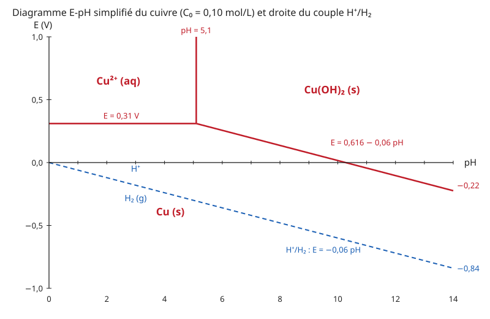

# Banque PT PT — Physique C - Chimie 2010 · Corrigé guidé

*Corrigé rédigé par IA, non officiel. Signalez toute erreur.*

**Rédaction** · modèle exact non renseigné (famille Claude) · effort non renseigné · vitesse non renseignée

**Révision (tour 2)** · modèle exact non renseigné (famille Claude) · effort non renseigné · vitesse non renseignée · 28 novembre 2026

## Présentation du sujet

**Thème.** Le cuivre et ses minerais, entièrement en solution aqueuse. L'épreuve dure 2 heures, **calculatrice autorisée**, et comporte 29 questions repérées de I.1.1 à III.2.4, réparties en trois parties indépendantes dont l'énoncé donne le poids. Une feuille annexe est à rendre avec la copie : le diagramme potentiel-pH simplifié du cobalt et du manganèse, sur lequel on trace le diagramme du cuivre, la droite du couple $\mathrm{H^+/H_2}$ et les frontières de l'élément chlore. Les résultats numériques sont demandés avec trois chiffres significatifs.

- *Partie I (11 questions, 47 % des points)* : précipitation sélective des hydroxydes de cuivre et de cobalt (I.1.1 à I.1.3), diagramme potentiel-pH du cuivre (I.2.1.1 et I.2.1.2), séparation du cuivre, du cobalt et du manganèse par attaque acide puis par l'élément chlore (I.2.2.1 à I.2.2.6).
- *Partie II (11 questions, 36 % des points)* : le complexe tétraamminecuivre(II), pH d'une base faible, affinité chimique, bilan de matière (II.1.1 à II.1.5) ; dosage du cuivre d'un laiton par attaque nitrique et électrolyse, seuil de détection des ions cuivre(II) restants (II.2.1 à II.2.6).
- *Partie III (7 questions, 17 % des points)* : composition de la liqueur de Fehling (III.1.1 à III.1.3) et dosage du glucose (III.2.1 à III.2.4).

**Notions mobilisées.** Solubilité et produit de solubilité, précipitation sélective, diagrammes potentiel-pH (tracé, conventions de frontière, superposition), dismutation, constante d'une réaction d'oxydoréduction, pH d'un acide fort, d'une base faible et d'un mélange tampon, complexation, affinité chimique et critère d'évolution, bilans de matière, équilibrage d'une réaction d'oxydoréduction en milieu basique. Le programme est celui en vigueur à la session 2010, antérieur à la réforme de 2013-2014 ; il couvre les deux années de préparation.

**Difficulté.** Les calculs sont courts, mais le sujet est long pour deux heures et la question I.2.2 demande de raisonner sur quatre diagrammes superposés. Les points délicats sont la zone de pH de la question I.1.3, le choix du pH de la question I.2.2.5, le pH de la question II.2.5 et l'équilibrage en milieu basique de la question III.2.1.

**Gestion du temps.** Environ 55 minutes pour la partie I, 40 minutes pour la partie II et 20 minutes pour la partie III, en gardant 5 minutes pour relire et vérifier que l'annexe est complétée. Les parties étant indépendantes, la partie III, courte et peu abordée, rapporte vite des points.

> [!JURY]
> Le rapport 2010 décrit un sujet plutôt copieux, consacré à l'élément cuivre et assez ciblé, puisqu'il porte globalement sur la chimie des solutions aqueuses ; la plupart des candidats n'ont guère apprécié ce choix, qui fait pourtant appel aux connaissances des deux années. Il relève des erreurs classiques, donc évitables, salue quelques excellentes rédactions sur la première partie et note que le temps a manqué pour la troisième, bien réussie par ceux qui l'ont abordée. Ses conseils : connaître le cours des deux années et non la seule fin de seconde année, avoir pratiqué les exercices classiques, mener le calcul jusqu'à l'application numérique, lire chaque question en détail et présenter correctement la copie.

[Sujet officiel (archive)](https://www.banquept.fr/documents/2010/phys_c_pt_2010.zip) · [Rapport du jury](https://www.banquept.fr/documents/ecrit/rapport/2010/rapport_phys_c_ecrit_2010.pdf)

Le sujet officiel est une archive qui réunit les deux parties de Physique C ; la partie chimie y occupe l'archive interne `phys_c_ch_pt_2010.zip` (énoncé et feuille annexe).

**Conventions.** Comme sur l'annexe, on prend $\dfrac{RT\ln 10}{F} = 0{,}06\ \mathrm{V}$ et $\mathrm{p}K_e = 14$ à 25 °C ; on note $h = [\mathrm{H_3O^+}]$ en $\mathrm{mol\cdot L^{-1}}$.

*Mode d'emploi* : chercher chaque question seul, lire la première indication en cas de blocage, réessayer, puis la seconde, et seulement ensuite la solution.

## Partie I — Étude de minerais complexes

### Question I.1.1

> [!INDICATION]
> Écrire l'équilibre de dissolution de $\mathrm{M(OH)_2}$ et son produit de solubilité. Dans une solution dont le pH est imposé, quelle concentration mesure la quantité d'hydroxyde passée en solution ?

> [!INDICATION]
> $S = [\mathrm{M^{2+}}]$ ; remplacer $[\mathrm{HO^-}]$ par $K_e/[\mathrm{H_3O^+}]$, puis prendre l'opposé du logarithme décimal.

#### Solution

L'hydroxyde se dissout selon

$$\mathrm{M(OH)_{2\,(s)}} = \mathrm{M^{2+}_{(aq)}} + 2\,\mathrm{HO^-_{(aq)}} \qquad K_s = [\mathrm{M^{2+}}]\,[\mathrm{HO^-}]^2$$

Le pH étant imposé par ailleurs, la solubilité est la concentration du cation dans la solution saturée, $S = [\mathrm{M^{2+}}]$. Avec $[\mathrm{HO^-}] = K_e/[\mathrm{H_3O^+}]$ :

$$\boxed{S = \frac{K_s}{[\mathrm{HO^-}]^2} = \frac{K_s\,[\mathrm{H_3O^+}]^2}{K_e^2}}$$

En prenant l'opposé du logarithme décimal, $\mathrm{p}S = -\log S$ :

$$\boxed{\mathrm{p}S = \mathrm{p}K_s - 2\,\mathrm{p}K_e + 2\,\mathrm{pH} = \mathrm{p}K_s - 28 + 2\,\mathrm{pH}}$$

$S$ est bien une concentration ($K_s$ et $K_e$ sont sans dimension, les concentrations étant rapportées à $c^\circ = 1\ \mathrm{mol\cdot L^{-1}}$). La solubilité est divisée par 100 quand le pH augmente d'une unité. La relation ne vaut que si le solide est présent, c'est-à-dire tant que $S$ reste inférieure à la concentration totale du cation.

> [!JURY]
> D'après le rapport, l'expression de la solubilité $S$ est souvent confondue avec le produit de solubilité $K_s$, ce qu'une simple équation aux dimensions devrait permettre d'éviter.

> [!PIEGE]
> Écrire $K_s = S\,(2S)^2 = 4S^3$ est faux ici : cette relation suppose que les ions hydroxyde viennent tous de la dissolution, dans l'eau pure. L'énoncé demande $S$ en fonction de $[\mathrm{H_3O^+}]$ : le pH est fixé de l'extérieur.

### Question I.1.2

> [!INDICATION]
> Reporter $\mathrm{p}K_{s1} = 18{,}8$ puis $\mathrm{p}K_{s2} = 14{,}8$ dans l'expression de $\mathrm{p}S$.

#### Solution

Pour l'hydroxyde de cuivre, $\mathrm{p}K_{s1} = 18{,}8$ :

$$\boxed{\mathrm{p}S_1 = 2\,\mathrm{pH} - 9{,}20 \qquad S_1 = 10^{\,9{,}20 - 2\,\mathrm{pH}}\ \mathrm{mol\cdot L^{-1}}}$$

Pour l'hydroxyde de cobalt, $\mathrm{p}K_{s2} = 14{,}8$ :

$$\boxed{\mathrm{p}S_2 = 2\,\mathrm{pH} - 13{,}2 \qquad S_2 = 10^{\,13{,}2 - 2\,\mathrm{pH}}\ \mathrm{mol\cdot L^{-1}}}$$

Les deux droites $\mathrm{p}S = f(\mathrm{pH})$ sont parallèles, de pente 2, décalées de 2 unités de pH : à pH donné, l'hydroxyde de cuivre est $10^4$ fois moins soluble que celui de cobalt.

### Question I.1.3

> [!INDICATION]
> Traduire chaque exigence en une condition sur une concentration : que vaut $[\mathrm{Cu^{2+}}]$ quand 99,9 % du cuivre a précipité ? Que vaut $[\mathrm{Co^{2+}}]$ quand 0,1 % du cobalt a précipité ?

> [!INDICATION]
> $[\mathrm{Cu^{2+}}] \leqslant 1{,}0\cdot10^{-4}\ \mathrm{mol\cdot L^{-1}}$ donne un pH minimal ; $[\mathrm{Co^{2+}}] \geqslant 0{,}999\cdot10^{-2}\ \mathrm{mol\cdot L^{-1}}$ donne un pH maximal. Utiliser les deux relations de la question I.1.2.

#### Solution

*Cuivre.* Précipiter au moins 99,9 % du cuivre, c'est laisser en solution au plus 0,1 % de la concentration initiale :

$$[\mathrm{Cu^{2+}}] = S_1 \leqslant 10^{-3} \times 1{,}0\cdot10^{-1} = 1{,}0\cdot10^{-4}\ \mathrm{mol\cdot L^{-1}}$$

$$\mathrm{p}S_1 = 2\,\mathrm{pH} - 9{,}20 \geqslant 4{,}00 \iff \mathrm{pH} \geqslant 6{,}60$$

*Cobalt.* Ne pas précipiter plus de 0,1 % du cobalt, c'est garder en solution au moins 99,9 % de la concentration initiale :

$$[\mathrm{Co^{2+}}] = S_2 \geqslant 0{,}999 \times 1{,}0\cdot10^{-2}\ \mathrm{mol\cdot L^{-1}}$$

$$\mathrm{p}S_2 = 2\,\mathrm{pH} - 13{,}2 \leqslant 2{,}00 \iff \mathrm{pH} \leqslant 7{,}60$$

(le terme $-\log 0{,}999 = 4\cdot10^{-4}$ est sans effet sur le troisième chiffre : la borne est pratiquement le pH de début de précipitation de $\mathrm{Co(OH)_2}$, valeur 7,6 portée sur l'annexe).

Les deux conditions sont compatibles :

$$\boxed{6{,}60 \leqslant \mathrm{pH} \leqslant 7{,}60}$$

Dans cette zone, large d'une unité de pH, le cuivre est précipité à plus de 99,9 % sous forme de $\mathrm{Cu(OH)_2}$ et le cobalt reste en solution à plus de 99,9 %. À titre de repère, l'hydroxyde de cuivre commence à précipiter à $\mathrm{pH} = (9{,}20 + 1{,}00)/2 = 5{,}10$.

> [!JURY]
> Le rapport signale que le passage de $S$ à $\mathrm{p}S$, opposé du logarithme décimal, semble poser de grandes difficultés à un nombre trop important de candidats ; de ce fait, la zone de pH recherchée est rarement exacte.

> [!METHODE]
> Une précipitation sélective se traite toujours par deux inégalités : fin de précipitation du premier cation (borne basse) et début de précipitation du second (borne haute). La séparation est possible si la première borne est inférieure à la seconde.

### Question I.2.1.1

> [!INDICATION]
> Deux degrés d'oxydation seulement, trois espèces : $\mathrm{Cu}$, $\mathrm{Cu^{2+}}$, $\mathrm{Cu(OH)_2}$. Commencer par la frontière verticale (début de précipitation à la concentration $C_0$), puis écrire la loi de Nernst pour $\mathrm{Cu^{2+}/Cu}$.

> [!INDICATION]
> Au-delà du pH de précipitation, écrire la demi-équation $\mathrm{Cu(OH)_2 + 2\,H^+ + 2\,e^- = Cu + 2\,H_2O}$ : la pente vaut $-0{,}06$ V par unité de pH ; l'ordonnée à l'origine s'obtient par continuité au point anguleux.

#### Solution

Espèces : $\mathrm{Cu_{(s)}}$ (degré 0), $\mathrm{Cu^{2+}_{(aq)}}$ et $\mathrm{Cu(OH)_{2\,(s)}}$ (degré +II). Convention de frontière : la concentration de l'espèce dissoute vaut $C_0 = 1{,}0\cdot10^{-1}\ \mathrm{mol\cdot L^{-1}}$.

*Frontière $\mathrm{Cu^{2+}/Cu(OH)_2}$* (même degré d'oxydation, frontière verticale). L'hydroxyde apparaît quand $C_0\,[\mathrm{HO^-}]^2 = K_s$, soit $\mathrm{p}S_1 = -\log C_0 = 1{,}00$ :

$$\boxed{\mathrm{pH} = \frac{9{,}20 + 1{,}00}{2} = 5{,}10}$$

*Frontière $\mathrm{Cu^{2+}/Cu}$* ($\mathrm{pH} \leqslant 5{,}10$), demi-équation $\mathrm{Cu^{2+} + 2\,e^- = Cu}$ :

$$E = E^\circ(\mathrm{Cu^{2+}/Cu}) + \frac{0{,}06}{2}\log C_0 = 0{,}34 - 0{,}03$$

$$\boxed{E = 0{,}310\ \mathrm{V}}$$

*Frontière $\mathrm{Cu(OH)_2/Cu}$* ($\mathrm{pH} \geqslant 5{,}10$), demi-équation $\mathrm{Cu(OH)_2 + 2\,H^+ + 2\,e^- = Cu + 2\,H_2O}$. Le solide étant présent, $[\mathrm{Cu^{2+}}] = K_s\,h^2/K_e^2$ :

$$E = 0{,}34 + 0{,}03\,\log\frac{K_s\,h^2}{K_e^2} = 0{,}34 + 0{,}03\,(28 - 18{,}8) - 0{,}06\,\mathrm{pH}$$

$$\boxed{E = 0{,}616 - 0{,}06\,\mathrm{pH}\quad(\mathrm{V})}$$

Vérification : à $\mathrm{pH} = 5{,}10$, $0{,}616 - 0{,}306 = 0{,}310\ \mathrm{V}$, le diagramme est continu ; à $\mathrm{pH} = 14$, $E = -0{,}224\ \mathrm{V}$. La valeur $0{,}616\ \mathrm{V}$ est le potentiel standard du couple $\mathrm{Cu(OH)_2/Cu}$.

> [!JURY]
> Selon le rapport, quelques candidats isolés ont confondu le diagramme du cuivre, dont le tracé était demandé, avec ceux du cobalt et du manganèse, qui étaient donnés ; les conventions de frontière sont insuffisamment connues, et le passage du couple $\mathrm{Cu^{2+}/Cu}$ au couple $\mathrm{Cu(OH)_2/Cu}$ a conduit à de nombreuses erreurs, alors que des diagrammes de ce type (eau, fer, zinc) ont été étudiés en classe de PT.

> [!PIEGE]
> La concentration de tracé du cuivre ($1{,}0\cdot10^{-1}\ \mathrm{mol\cdot L^{-1}}$) n'est pas celle du cobalt et du manganèse ($1{,}0\cdot10^{-2}\ \mathrm{mol\cdot L^{-1}}$).

### Question I.2.1.2

> [!INDICATION]
> Le degré d'oxydation croît avec le potentiel ; à degré d'oxydation fixé, l'hydroxyde se trouve du côté des pH élevés.

#### Solution

- $\mathrm{Cu_{(s)}}$ (degré 0) : domaine d'existence sous les deux segments, aux bas potentiels, pour tout pH.
- $\mathrm{Cu^{2+}_{(aq)}}$ (degré +II) : domaine de prédominance au-dessus du segment horizontal, pour $\mathrm{pH} < 5{,}10$.
- $\mathrm{Cu(OH)_{2\,(s)}}$ (degré +II) : domaine d'existence au-dessus du segment oblique, pour $\mathrm{pH} > 5{,}10$.

Ces trois domaines sont portés sur la figure 1. Pour un solide on parle de domaine d'existence, pour une espèce dissoute de domaine de prédominance.

### Question I.2.2.1

> [!INDICATION]
> Écrire la loi de Nernst pour $\mathrm{2\,H^+ + 2\,e^- = H_2}$ avec $P(\mathrm{H_2}) = 1\ \mathrm{bar}$. Quel est le pH de l'acide sulfurique à $0{,}5\ \mathrm{mol\cdot L^{-1}}$, diacide fort ?

> [!INDICATION]
> À pH 0, comparer la position de chaque métal à celle de $\mathrm{H^+}$ : un métal dont le domaine est entièrement sous la droite est oxydé ; un métal dont le domaine recouvre celui de $\mathrm{H^+}$ ne l'est pas.

#### Solution

Demi-équation $\mathrm{2\,H^+_{(aq)} + 2\,e^- = H_{2\,(g)}}$, avec $E^\circ = 0\ \mathrm{V}$ et $P(\mathrm{H_2}) = P^\circ = 1\ \mathrm{bar}$ :

$$E = 0 + \frac{0{,}06}{2}\log\frac{h^2}{P(\mathrm{H_2})/P^\circ}$$

$$\boxed{E = -0{,}06\,\mathrm{pH}\quad(\mathrm{V})}$$

C'est une droite passant par l'origine et par le point $(14\ ;\ -0{,}84\ \mathrm{V})$ ; $\mathrm{H^+}$ (ou l'eau) est au-dessus, $\mathrm{H_2}$ au-dessous (figures 1 et 2).

L'acide sulfurique à $0{,}5\ \mathrm{mol\cdot L^{-1}}$, diacide fort, donne $h = 1{,}0\ \mathrm{mol\cdot L^{-1}}$, soit $\mathrm{pH} = 0$ et $E(\mathrm{H^+/H_2}) = 0\ \mathrm{V}$. À ce pH :

- le cobalt ($E = -0{,}34\ \mathrm{V}$) et le manganèse ($E = -1{,}23\ \mathrm{V}$, valeurs de l'annexe) ont leur domaine entièrement sous la droite : leurs domaines sont disjoints de celui de $\mathrm{H^+}$, ils sont oxydés,

$$\mathrm{Co_{(s)} + 2\,H^+_{(aq)} = Co^{2+}_{(aq)} + H_{2\,(g)}} \qquad \mathrm{Mn_{(s)} + 2\,H^+_{(aq)} = Mn^{2+}_{(aq)} + H_{2\,(g)}}$$

- le cuivre a sa frontière à $+0{,}31\ \mathrm{V}$, au-dessus de la droite : le domaine du cuivre métallique et celui de $\mathrm{H^+}$ ont une partie commune pour tout pH (la frontière du cuivre, $0{,}616 - 0{,}06\,\mathrm{pH}$ au-delà de pH 5,1, reste $0{,}616\ \mathrm{V}$ au-dessus de celle de l'hydrogène).

$$\boxed{\text{Le cuivre n'est pas attaqué par l'acide sulfurique : on le récupère par filtration.}}$$

La solution résiduelle, très acide, contient les ions $\mathrm{Co^{2+}}$ et $\mathrm{Mn^{2+}}$.

> [!JURY]
> Le rapport rappelle que le tracé de la droite-frontière du couple $\mathrm{H^+/H_2}$ doit être connu de tous, ce qui n'est visiblement pas le cas ; il juge aussi la lecture d'un diagramme à parfaire, beaucoup de candidats hésitant à y placer correctement oxydants et réducteurs et à reconnaître l'action oxydante ou réductrice d'un composé sur un autre.

> [!METHODE]
> Règle de lecture : deux espèces dont les domaines sont disjoints réagissent ; l'oxydant est celui dont le domaine est en haut. Deux espèces qui partagent une zone du plan coexistent.

### Question I.2.2.2

> [!INDICATION]
> Le dichlore étant écarté, il reste le degré +I ($\mathrm{HClO}$ ou $\mathrm{ClO^-}$ selon le pH) et le degré −I ($\mathrm{Cl^-}$). Où se trouve la frontière verticale ?

> [!INDICATION]
> Écrire les demi-équations $\mathrm{HClO + H^+ + 2\,e^- = Cl^- + H_2O}$ et $\mathrm{ClO^- + 2\,H^+ + 2\,e^- = Cl^- + H_2O}$, avec des concentrations égales sur la frontière. Vérifier la continuité à $\mathrm{pH} = \mathrm{p}K_a$.

#### Solution

Pour $\mathrm{pH} > 2$, les espèces à considérer sont $\mathrm{Cl^-}$ (degré −I) et, au degré +I, l'acide hypochloreux $\mathrm{HClO}$ et sa base conjuguée $\mathrm{ClO^-}$. L'énoncé ne fixe pas de concentration de tracé pour le chlore : on adopte, par choix du corrigé, la convention d'égalité des concentrations des deux espèces dissoutes sur chaque frontière, qui donne des droites indépendantes de la concentration totale.

*Frontière $\mathrm{HClO/ClO^-}$* : verticale, à $\mathrm{pH} = \mathrm{p}K_a = 7{,}5$, au-dessus des deux autres frontières.

*Frontière $\mathrm{HClO/Cl^-}$* ($2 < \mathrm{pH} \leqslant 7{,}5$), demi-équation $\mathrm{HClO + H^+ + 2\,e^- = Cl^- + H_2O}$ :

$$E = 1{,}50 + \frac{0{,}06}{2}\log\frac{[\mathrm{HClO}]\,h}{[\mathrm{Cl^-}]}$$

$$\boxed{E = 1{,}50 - 0{,}03\,\mathrm{pH}\quad(\mathrm{V})}$$

*Frontière $\mathrm{ClO^-/Cl^-}$* ($\mathrm{pH} \geqslant 7{,}5$), demi-équation $\mathrm{ClO^- + 2\,H^+ + 2\,e^- = Cl^- + H_2O}$ :

$$E = 1{,}73 + \frac{0{,}06}{2}\log\frac{[\mathrm{ClO^-}]\,h^2}{[\mathrm{Cl^-}]}$$

$$\boxed{E = 1{,}73 - 0{,}06\,\mathrm{pH}\quad(\mathrm{V})}$$

Points de tracé : $(2\ ;\ 1{,}44\ \mathrm{V})$, $(7{,}5\ ;\ 1{,}28\ \mathrm{V})$ et $(14\ ;\ 0{,}89\ \mathrm{V})$. Les deux droites se raccordent à $\mathrm{pH} = 7{,}5$ ($1{,}50 - 0{,}225 = 1{,}275\ \mathrm{V}$ et $1{,}73 - 0{,}45 = 1{,}28\ \mathrm{V}$), ce qui confirme la cohérence des données : $E^\circ(\mathrm{ClO^-/Cl^-}) = E^\circ(\mathrm{HClO/Cl^-}) + 0{,}03\,\mathrm{p}K_a$.

Sur la figure 2, les segments du cobalt et du manganèse situés au-delà de pH 7,6 et 8,6 sont retracés avec leur pente théorique de $-0{,}06$ V par unité de pH ; l'annexe de l'énoncé les dessine un peu moins inclinés (environ $-0{,}05$ V par unité de pH), sans conséquence sur les conclusions. La bande colorée entre pH 2 et pH 3,40 anticipe la réponse à la question I.2.2.5, où elle est établie.

> [!METHODE]
> Quand deux frontières obliques se rejoignent sur une verticale acido-basique, la rupture de pente vaut $0{,}06 \times (\text{nombre de protons échangés})/(\text{nombre d'électrons})$ : ici on passe de $-0{,}03$ à $-0{,}06$ V par unité de pH.

### Question I.2.2.3

> [!INDICATION]
> L'oxydant d'un couple est au-dessus de la frontière ; la forme acide est à gauche de la verticale $\mathrm{pH} = \mathrm{p}K_a$.

#### Solution

Pour $\mathrm{pH} > 2$ (figure 2) :

- **sous les deux frontières obliques**, pour tout pH : l'ion chlorure $\mathrm{Cl^-}$ (degré −I) ;
- **au-dessus, pour $\mathrm{pH} < 7{,}5$** : l'acide hypochloreux $\mathrm{HClO}$ (degré +I) ;
- **au-dessus, pour $\mathrm{pH} > 7{,}5$** : l'ion hypochlorite $\mathrm{ClO^-}$ (degré +I).

Le dichlore (degré 0) n'a pas de domaine de stabilité dans cet intervalle de pH : il s'y dismute en chlore +I et chlore −I.

### Question I.2.2.4

> [!INDICATION]
> Dans une dismutation, une même espèce joue les deux rôles. Combiner les demi-équations des couples $\mathrm{HClO/Cl_2}$ et $\mathrm{Cl_2/Cl^-}$ ; en milieu basique, l'acide hypochloreux et $\mathrm{H^+}$ n'existent pas : écrire le bilan avec $\mathrm{ClO^-}$ et $\mathrm{HO^-}$.

> [!INDICATION]
> Pour un électron échangé par molécule de dichlore, $\log K^\circ = \dfrac{E^\circ(\text{oxydant}) - E^\circ(\text{réducteur})}{0{,}06}$. La constante en milieu basique se déduit de la première par $K_a$ et $K_e$.

#### Solution

**Définition.** Une dismutation est une réaction d'oxydoréduction dans laquelle une même espèce est à la fois l'oxydant et le réducteur : l'élément, pris à un degré d'oxydation intermédiaire, passe pour partie à un degré supérieur et pour partie à un degré inférieur.

**Milieu très acide.** Demi-équations :

$$\mathrm{Cl_2 + 2\,e^- = 2\,Cl^-} \qquad E^\circ = 1{,}36\ \mathrm{V}$$

$$\mathrm{2\,HClO + 2\,H^+ + 2\,e^- = Cl_2 + 2\,H_2O} \qquad E^\circ = 1{,}63\ \mathrm{V}$$

Le dichlore oxydant (premier couple) réagit sur le dichlore réducteur (second couple) ; après division par 2 :

$$\boxed{\mathrm{Cl_{2} + H_2O = HClO + H^+ + Cl^-}}$$

Un électron est échangé pour cette écriture :

$$\log K_1^\circ = \frac{1 \times (1{,}36 - 1{,}63)}{0{,}06} = -4{,}50$$

$$\boxed{K_1^\circ = 10^{-4{,}50} = 3{,}16\cdot10^{-5}}$$

**Milieu très basique.** $\mathrm{HClO}$ est sous forme $\mathrm{ClO^-}$ et les protons sont captés par $\mathrm{HO^-}$ :

$$\boxed{\mathrm{Cl_{2} + 2\,HO^- = ClO^- + Cl^- + H_2O}}$$

Ce bilan est la somme de la réaction précédente, de $\mathrm{HClO = ClO^- + H^+}$ ($K_a$) et de deux fois $\mathrm{H^+ + HO^- = H_2O}$ ($1/K_e$) :

$$K_2^\circ = \frac{K_1^\circ\,K_a}{K_e^2} = 10^{-4{,}50 - 7{,}5 + 28}$$

$$\boxed{K_2^\circ = 1{,}00\cdot10^{16}}$$

**Conclusion.** En milieu très acide, la dismutation est très défavorable ($K_1^\circ \ll 1$) : le dichlore y est stable, et c'est la réaction inverse (médiamutation de $\mathrm{HClO}$ et $\mathrm{Cl^-}$) qui est favorable. En milieu basique elle est quantitative ($K_2^\circ \gg 1$) : le dichlore n'y existe pas, c'est la réaction de préparation de l'eau de Javel. Le dichlore n'a donc de domaine de stabilité qu'aux faibles pH. Pour des concentrations unité, les frontières $1{,}63 - 0{,}06\,\mathrm{pH}$ et $1{,}36\ \mathrm{V}$ se coupent à $\mathrm{pH} = 4{,}5$ ; ce domaine se rétrécit quand les concentrations diminuent, ce qui est compatible avec la limite $\mathrm{pH} = 2$ admise par l'énoncé.

> [!JURY]
> Le rapport constate que la définition d'une réaction de dismutation n'est pas connue, celle du dichlore n'échappant pas à la règle. Le calcul de la constante d'une réaction d'oxydoréduction pose des difficultés inattendues : connaître la formule classique donnant $\log K^\circ(T)$ évitait de perdre beaucoup de temps. Il rappelle aussi qu'on ne peut pas écrire une constante d'équilibre, de valeur finie, tout en supposant que l'un des réactifs est entièrement consommé.

> [!PIEGE]
> Le nombre d'électrons à reporter dans $\log K^\circ = n\,\Delta E^\circ/0{,}06$ dépend de l'écriture du bilan : 1 pour $\mathrm{Cl_2 + H_2O = HClO + H^+ + Cl^-}$, 2 si l'on écrit le bilan avec 2 $\mathrm{Cl_2}$. Et $\Delta E^\circ$ est toujours « oxydant qui réagit moins réducteur qui réagit ».

### Question I.2.2.5

> [!INDICATION]
> La solution contient $\mathrm{Co^{2+}}$ et $\mathrm{Mn^{2+}}$. Sur l'annexe complétée, repérer, pour $\mathrm{pH} < 7{,}5$, la position de la frontière $\mathrm{HClO/Cl^-}$ par rapport aux frontières $\mathrm{MnO_2/Mn^{2+}}$ et $\mathrm{Co(OH)_3/Co^{2+}}$.

> [!INDICATION]
> La droite du chlore coupe la frontière $\mathrm{Co(OH)_3/Co^{2+}}$ : établir l'équation de cette dernière (pente $-0{,}18$ V par unité de pH, passant par le point $(1{,}17\ ;\ 1{,}80\ \mathrm{V})$) et chercher l'intersection. En deçà, $\mathrm{HClO}$ n'oxyde que $\mathrm{Mn^{2+}}$.

#### Solution

La solution résiduelle contient $\mathrm{Co^{2+}}$ et $\mathrm{Mn^{2+}}$ en milieu très acide. Oxydés, ils donnent des solides : $\mathrm{MnO_2}$ pour le manganèse, $\mathrm{Co(OH)_3}$ pour le cobalt. On compare donc, pour $2 < \mathrm{pH} < 7{,}5$, la frontière $\mathrm{HClO/Cl^-}$ aux frontières de ces deux couples (figure 2).

*Manganèse.* Demi-équation $\mathrm{MnO_2 + 4\,H^+ + 2\,e^- = Mn^{2+} + 2\,H_2O}$, de pente $-0{,}12$ V par unité de pH. L'annexe porte l'ordonnée $1{,}35\ \mathrm{V}$ à pH 0, soit $E = 1{,}35 - 0{,}12\,\mathrm{pH}$. On signale que les données de l'énoncé conduisent plutôt à $1{,}23 - 0{,}03\log C_0 = 1{,}29\ \mathrm{V}$ : l'écart de $0{,}06\ \mathrm{V}$ correspond à un facteur $0{,}06$ au lieu de $0{,}03$ devant le logarithme. Il est sans conséquence ici : avec l'une ou l'autre valeur, cette frontière est sous celle du chlore pour tout pH positif ($1{,}50 - 0{,}03\,\mathrm{pH} > 1{,}35 - 0{,}12\,\mathrm{pH}$). **$\mathrm{HClO}$ oxyde toujours $\mathrm{Mn^{2+}}$ en $\mathrm{MnO_2}$.**

*Cobalt.* Demi-équation $\mathrm{Co(OH)_3 + 3\,H^+ + e^- = Co^{2+} + 3\,H_2O}$. Avec $[\mathrm{Co^{3+}}] = K_s(\mathrm{Co(OH)_3})\,h^3/K_e^3$ et $[\mathrm{Co^{2+}}] = C_0 = 1{,}0\cdot10^{-2}\ \mathrm{mol\cdot L^{-1}}$ :

$$E = 1{,}80 + 0{,}06\,\log\frac{10^{-40{,}5}\,h^3}{10^{-42} \times 10^{-2}} = 2{,}01 - 0{,}18\,\mathrm{pH}\quad(\mathrm{V})$$

Cette droite part bien du point $(1{,}17\ ;\ 1{,}80\ \mathrm{V})$ et arrive à $0{,}64\ \mathrm{V}$ à $\mathrm{pH} = 7{,}6$, en accord avec l'annexe à la précision du tracé (on y lit environ $0{,}67\ \mathrm{V}$). Elle coupe la frontière du chlore pour

$$1{,}50 - 0{,}03\,\mathrm{pH} = 2{,}01 - 0{,}18\,\mathrm{pH} \iff \mathrm{pH} = \frac{0{,}51}{0{,}15} = 3{,}40$$

Pour $\mathrm{pH} < 3{,}40$, la frontière du cobalt est au-dessus de celle du chlore : $\mathrm{HClO}$ et $\mathrm{Co^{2+}}$ ont un domaine commun, le cobalt(II) n'est pas oxydé. Au-delà, il le serait.

$$\boxed{2 < \mathrm{pH} < 3{,}40\ :\ \text{l'acide hypochloreux HClO oxyde le seul manganèse, qui précipite en } \mathrm{MnO_2}}$$

$$\mathrm{Mn^{2+} + HClO + H_2O = MnO_{2\,(s)} + Cl^- + 3\,H^+}$$

**Mise en œuvre.** On remonte le pH de la solution acide vers 2,5 par ajout de carbonate de sodium ($\mathrm{CO_3^{2-} + 2\,H^+ = CO_2 + H_2O}$), puis on ajoute l'hypochlorite de sodium : à ce pH, inférieur à $\mathrm{p}K_a = 7{,}5$, l'élément chlore au degré +I est sous forme $\mathrm{HClO}$. À $\mathrm{pH} = 2{,}5$, $E(\mathrm{HClO/Cl^-}) = 1{,}43\ \mathrm{V}$, contre $1{,}05\ \mathrm{V}$ pour le manganèse et $1{,}56\ \mathrm{V}$ pour le cobalt. La réaction libère des protons : il faut maintenir le pH par de nouveaux ajouts de carbonate. Le dioxyde de manganèse, insoluble à tout pH, est isolé par filtration.

**L'autre métal** reste en solution sous forme d'ions cobalt(II) $\mathrm{Co^{2+}}$ : à ce pH, très inférieur à 7,6, l'hydroxyde $\mathrm{Co(OH)_2}$ ne précipite pas.

> [!JURY]
> Le rapport reconnaît que le traitement général du minerai est un problème relativement complexe, puisque l'analyse impose de comparer plusieurs diagrammes superposés ; il a été mal compris, bien que les opérations soient présentées de manière progressive, et les questions n'ont pas reçu de réponses globalement satisfaisantes.

> [!PIEGE]
> Proposer un pH quelconque ne suffit pas : au-dessus de 3,4, l'acide hypochloreux oxyde aussi le cobalt(II) et les deux métaux précipitent ensemble. La borne se calcule, la lecture graphique seule est trop imprécise.

### Question I.2.2.6

> [!INDICATION]
> Il ne reste que le cobalt(II). En milieu basique, sous quelle forme est-il ? Comparer la frontière $\mathrm{ClO^-/Cl^-}$ à la frontière $\mathrm{Co(OH)_3/Co(OH)_2}$.

> [!INDICATION]
> Les deux droites ont la même pente $-0{,}06$ V par unité de pH : leur écart est constant. Conclure avec la règle des domaines disjoints et écrire le bilan.

#### Solution

La solution résiduelle ne contient plus, comme métal, que le cobalt(II). On la rend basique (carbonate de sodium, base de $\mathrm{p}K_{a2} = 10{,}3$) et on ajoute un excès d'hypochlorite : pour $\mathrm{pH} > 7{,}6$, le cobalt(II) précipite en $\mathrm{Co(OH)_2}$, et pour $\mathrm{pH} > 7{,}5$ le chlore +I est sous forme $\mathrm{ClO^-}$.

Frontière $\mathrm{Co(OH)_3/Co(OH)_2}$ (demi-équation $\mathrm{Co(OH)_3 + H^+ + e^- = Co(OH)_2 + H_2O}$), par continuité à $\mathrm{pH} = 7{,}6$ où $E = 2{,}01 - 0{,}18 \times 7{,}6 = 0{,}64\ \mathrm{V}$ :

$$E = 1{,}10 - 0{,}06\,\mathrm{pH}\quad(\mathrm{V})$$

Frontière $\mathrm{ClO^-/Cl^-}$ : $E = 1{,}73 - 0{,}06\,\mathrm{pH}$. Les deux droites sont parallèles et celle du chlore est $0{,}63\ \mathrm{V}$ au-dessus de celle du cobalt pour tout pH basique : les domaines de $\mathrm{ClO^-}$ et de $\mathrm{Co(OH)_2}$ sont disjoints (figure 2). L'hypochlorite oxyde donc quantitativement le cobalt(II) en cobalt(III) :

$$\mathrm{2\,Co(OH)_{2\,(s)} + ClO^- + H_2O = 2\,Co(OH)_{3\,(s)} + Cl^-}$$

soit, à partir des ions de la solution, $\mathrm{2\,Co^{2+} + ClO^- + 4\,HO^- + H_2O = 2\,Co(OH)_3 + Cl^-}$.

$$\boxed{\text{On recueille l'hydroxyde de cobalt(III) } \mathrm{Co(OH)_3},\ \text{solide isolé par filtration.}}$$

Justification de la pureté : le cuivre a été retiré à la question I.2.2.1 et le manganèse à la question I.2.2.5 ; les autres espèces présentes ($\mathrm{Na^+}$, $\mathrm{Cl^-}$, $\mathrm{SO_4^{2-}}$, carbonates, excès de $\mathrm{ClO^-}$) restent en solution. L'excès d'hypochlorite garantit que tout le cobalt est au degré +III. Les trois métaux sont ainsi séparés : cuivre métallique, $\mathrm{MnO_2}$ et $\mathrm{Co(OH)_3}$.

> [!METHODE]
> Bilan du procédé : (1) acide sulfurique, pH 0 : Co et Mn passent en solution, Cu reste solide ; (2) $\mathrm{HClO}$ à pH compris entre 2 et 3,4 : $\mathrm{MnO_2}$ précipite ; (3) $\mathrm{ClO^-}$ en milieu basique : $\mathrm{Co(OH)_3}$ précipite.

## Partie II — Analyse d'un laiton

### Question II.1.1

> [!INDICATION]
> Calculer d'abord les concentrations après mélange (volume total 100 mL). Quelle espèce impose le pH avant toute complexation ?

> [!INDICATION]
> L'ammoniac est une base faible à $0{,}50\ \mathrm{mol\cdot L^{-1}}$ : écrire $K_b = K_e/K_a$ et supposer la base peu protonée, puis vérifier.

#### Solution

Concentrations juste après mélange (volume total $100\ \mathrm{mL}$), avant toute réaction :

$$[\mathrm{Cu^{2+}}]_0 = \frac{90 \times 10^{-3}}{100} = 9{,}00\cdot10^{-4}\ \mathrm{mol\cdot L^{-1}} \qquad [\mathrm{NH_3}]_0 = \frac{10 \times 5}{100} = 0{,}500\ \mathrm{mol\cdot L^{-1}}$$

Le pH est imposé par la base faible $\mathrm{NH_3}$, de concentration $c = 0{,}500\ \mathrm{mol\cdot L^{-1}}$ :

$$\mathrm{NH_3 + H_2O = NH_4^+ + HO^-} \qquad K_b = \frac{K_e}{K_a} = 10^{-4{,}8}$$

En supposant la base peu protonée ($[\mathrm{NH_4^+}] = [\mathrm{HO^-}] = \omega \ll c$) et l'autoprotolyse de l'eau négligeable :

$$\omega = \sqrt{K_b\,c} = \sqrt{10^{-4{,}8} \times 0{,}500} = 2{,}82\cdot10^{-3}\ \mathrm{mol\cdot L^{-1}}$$

$$\mathrm{pH} = 7 + \frac12\,\mathrm{p}K_a + \frac12\log c = 7 + 4{,}6 - 0{,}15$$

$$\boxed{\mathrm{pH} \approx 11{,}4}$$

(valeur calculée 11,449, soit 11,4 avec trois chiffres significatifs). Vérification : $\omega/c = 0{,}56\ \%$, la base est bien très peu protonée, et $\mathrm{pH} > \mathrm{p}K_a + 1$ ; $\omega \gg 10^{-7}$, l'autoprotolyse est négligeable. La résolution exacte de $\omega^2 = K_b\,(c - \omega)$ donne le même résultat.

> [!JURY]
> Le rapport note que la concentration d'ammoniac ($0{,}5\ \mathrm{mol\cdot L^{-1}}$) faisait, en toute rigueur, sortir quelque peu du cadre des approximations classiques, mais que rien n'était précisé à ce sujet et que le calcul pouvait être mené comme d'habitude. Il observe que très peu de candidats sont capables de calculer le pH d'une solution de base faible.

> [!PIEGE]
> Ne pas oublier la dilution : $5\ \mathrm{mol\cdot L^{-1}}$ est la concentration de la solution ajoutée, pas celle du mélange.

### Question II.1.2

> [!INDICATION]
> L'affinité se définit à partir des potentiels chimiques, ou de la dérivée de $G$ par rapport à l'avancement à $T$ et $P$ fixées. Quel est le signe de $\mathcal{A}\,\mathrm{d}\xi$ ?

> [!INDICATION]
> $\mathcal{A} = RT\ln(K^\circ/Q_r)$. Que vaut $Q_r$ à l'instant initial, quand le complexe n'est pas encore formé ?

#### Solution

**Définition.** Pour une réaction d'équation $\sum_i \nu_i\,\mathrm{A}_i = 0$ et d'avancement $\xi$, l'affinité chimique est

$$\boxed{\mathcal{A} = -\sum_i \nu_i\,\mu_i = -\left(\frac{\partial G}{\partial \xi}\right)_{T,P} = -\Delta_r G}$$

et s'écrit, avec le quotient de réaction $Q_r$ :

$$\mathcal{A} = \mathcal{A}^\circ - RT\ln Q_r = RT\ln\frac{K^\circ}{Q_r}$$

**Critère d'évolution.** À température et pression fixées, le second principe impose pour une évolution spontanée $\mathrm{d}G = -\mathcal{A}\,\mathrm{d}\xi < 0$ :

$$\boxed{\mathcal{A}\,\mathrm{d}\xi > 0}$$

Si $\mathcal{A} > 0$ ($Q_r < K^\circ$), le système évolue dans le sens direct ; si $\mathcal{A} < 0$ ($Q_r > K^\circ$), dans le sens inverse ; l'équilibre correspond à $\mathcal{A} = 0$.

**Application.** Pour la réaction (1) :

$$Q_r = \frac{[\mathrm{Cu(NH_3)_4^{2+}}]\,(c^\circ)^4}{[\mathrm{Cu^{2+}}]\,[\mathrm{NH_3}]^4}$$

À l'instant initial, le complexe n'est pas encore formé :

$$\boxed{Q_{r,i} = 0 < K = 10^{12{,}3}}$$

L'affinité est positive (elle tend vers $+\infty$) : le système évolue spontanément dans le **sens direct**, celui de la formation du complexe.

> [!JURY]
> D'après le rapport, la définition de l'affinité chimique est bien écrite dans nombre de copies, et le sens de déplacement de l'équilibre est traité plutôt correctement, ces notions de seconde année étant peut-être plus fraîches dans la mémoire des étudiants.

### Question II.1.3

> [!INDICATION]
> Dresser un tableau d'avancement en concentrations. Comparer $K$ à 1 et repérer le réactif limitant.

> [!INDICATION]
> La réaction est quasi totale : $x_{eq}$ est pratiquement égal à la concentration initiale du réactif limitant. Vérifier l'hypothèse à la question suivante.

#### Solution

Tableau d'avancement volumique $x$ (en $\mathrm{mol\cdot L^{-1}}$) :

| | $\mathrm{Cu^{2+}}$ | $\mathrm{NH_3}$ | $\mathrm{Cu(NH_3)_4^{2+}}$ |
|---|---|---|---|
| état initial | $9{,}00\cdot10^{-4}$ | $0{,}500$ | $0$ |
| équilibre | $9{,}00\cdot10^{-4} - x_{eq}$ | $0{,}500 - 4\,x_{eq}$ | $x_{eq}$ |

$$K = \frac{x_{eq}}{(9{,}00\cdot10^{-4} - x_{eq})\,(0{,}500 - 4\,x_{eq})^4} = 10^{12{,}3}$$

La constante est très grande et l'ammoniac en très large excès (il en faudrait $3{,}6\cdot10^{-3}\ \mathrm{mol\cdot L^{-1}}$, on en a $0{,}500$) : la réaction est quasi totale et l'ion cuivre(II) est le réactif limitant. On simplifie donc l'équation en posant $x_{eq} \approx [\mathrm{Cu^{2+}}]_0$ dans tous les termes sauf la différence $9{,}00\cdot10^{-4} - x_{eq}$ :

$$\boxed{x_{eq} = [\mathrm{Cu(NH_3)_4^{2+}}]_{eq} \approx 9{,}00\cdot10^{-4}\ \mathrm{mol\cdot L^{-1}}}$$

Il reste $[\mathrm{NH_3}]_{eq} = 0{,}500 - 3{,}6\cdot10^{-3} = 0{,}4964 \approx 0{,}496\ \mathrm{mol\cdot L^{-1}}$ : l'ammoniac est à peine consommé, et le pH calculé à la question II.1.1 n'est pratiquement pas modifié.

> [!JURY]
> Le rapport indique qu'il fallait effectuer un bilan de matière et résoudre une équation en mettant en évidence une simplification classique ; de nombreuses erreurs ont été relevées dans cet exercice.

### Question II.1.4

> [!INDICATION]
> La concentration résiduelle du réactif limitant ne se lit pas dans le tableau (elle y vaut « zéro ») : elle se calcule avec la constante d'équilibre.

#### Solution

La concentration résiduelle se déduit de la constante, les autres concentrations étant connues :

$$[\mathrm{Cu^{2+}}]_{eq} = \frac{x_{eq}}{K\,[\mathrm{NH_3}]_{eq}^4} = \frac{9{,}00\cdot10^{-4}}{10^{12{,}3} \times (0{,}4964)^4}$$

$$\boxed{[\mathrm{Cu^{2+}}]_{eq} = 7{,}43\cdot10^{-15}\ \mathrm{mol\cdot L^{-1}}}$$

L'hypothèse de réaction quasi totale est validée : la fraction de cuivre non complexée vaut $[\mathrm{Cu^{2+}}]_{eq}/[\mathrm{Cu^{2+}}]_0 \approx 8\cdot10^{-12}$.

**Conclusion.** En présence d'ammoniac en excès, il n'existe pratiquement plus d'ions cuivre(II) « libres » : tout le cuivre(II) est engagé dans le complexe. C'est aussi pourquoi l'hydroxyde ne précipite pas malgré le pH de 11,4 : $[\mathrm{Cu^{2+}}]\,[\mathrm{HO^-}]^2 = 7{,}43\cdot10^{-15} \times (2{,}82\cdot10^{-3})^2 \approx 6\cdot10^{-20}$, inférieur à $K_s = 10^{-18{,}8} \approx 1{,}6\cdot10^{-19}$.

> [!METHODE]
> Réaction quasi totale : on détermine d'abord les concentrations des espèces majoritaires par le bilan, puis celle de l'espèce ultra-minoritaire par la constante d'équilibre. On n'écrit jamais qu'elle est nulle.

### Question II.1.5

> [!INDICATION]
> Deux arguments : l'un thermodynamique (que devient une trace d'ions cuivre(II) en présence d'un excès d'ammoniac ?), l'autre visuel.

#### Solution

Le rapport $[\mathrm{Cu(NH_3)_4^{2+}}]/[\mathrm{Cu^{2+}}] = K\,[\mathrm{NH_3}]^4$ ne dépend que de la concentration d'ammoniac : avec $[\mathrm{NH_3}] \approx 0{,}5\ \mathrm{mol\cdot L^{-1}}$ il vaut $1{,}2\cdot10^{11}$, quelle que soit la quantité de cuivre. **Même à l'état de traces, le cuivre(II) est donc transformé quantitativement en complexe.** Comme ce complexe est d'un bleu intense, bien plus coloré que l'ion cuivre(II) hydraté, bleu pâle, sa couleur reste perceptible à très faible concentration : l'ajout d'ammoniac en excès est un test sensible de la présence d'ions cuivre(II), dont l'absence de coloration prouve la disparition.

### Question II.2.1

> [!INDICATION]
> C'est une dilution d'acide fort : quantité de matière d'acide apportée par les 10 mL, volume final 360 mL.

#### Solution

Les $10\ \mathrm{mL}$ d'acide nitrique à $18\ \mathrm{mol\cdot L^{-1}}$ apportent $n(\mathrm{HNO_3}) = 18 \times 10\cdot10^{-3} = 0{,}180\ \mathrm{mol}$, dilués dans $V = 360\ \mathrm{mL}$ :

$$c = \frac{0{,}180}{0{,}360} = 0{,}500\ \mathrm{mol\cdot L^{-1}}$$

L'acide étant fort, $h = c$ :

$$\boxed{\mathrm{pH} = -\log c = -\log 0{,}500 = 0{,}301}$$

(L'acide sulfurique ajouté n'est pas pris en compte, comme le demande l'énoncé.)

### Question II.2.2

> [!INDICATION]
> Le laiton contient autant de moles de zinc que de cuivre : écrire la masse totale avec une seule inconnue $n$.

#### Solution

Avec $n(\mathrm{Cu}) = n(\mathrm{Zn}) = n$ et une masse totale $m = 150\ \mathrm{mg}$ :

$$m = n\,\bigl(M(\mathrm{Cu}) + M(\mathrm{Zn})\bigr) \quad\Longrightarrow\quad n = \frac{0{,}150}{63{,}54 + 65{,}37} = \frac{0{,}150}{128{,}91}$$

$$\boxed{n(\mathrm{Cu}) = 1{,}16\cdot10^{-3}\ \mathrm{mol}}$$

$$m_T(\mathrm{Cu}) = n\,M(\mathrm{Cu}) = 1{,}164\cdot10^{-3} \times 63{,}54$$

$$\boxed{m_T(\mathrm{Cu}) = 73{,}9\ \mathrm{mg}}$$

soit 49,3 % de la masse du laiton (le zinc, un peu plus lourd, en représente 50,7 %).

> [!JURY]
> Le rapport dit sa surprise de voir ce calcul, pourtant élémentaire (masse de cuivre d'un échantillon contenant autant d'atomes de cuivre que de zinc), assez mal réalisé.

> [!PIEGE]
> « Autant de quantité de matière » ne signifie pas « moitié de la masse » : diviser 150 mg par deux donne 75,0 mg, résultat faux.

### Question II.2.3

> [!INDICATION]
> Équilibrer la demi-équation $\mathrm{NO_3^-/NO}$ en milieu acide (trois électrons), puis combiner avec $\mathrm{Cu^{2+}/Cu}$ (deux électrons).

> [!INDICATION]
> Six électrons sont échangés : $\log K^\circ = 6\,(0{,}96 - 0{,}34)/0{,}06$.

#### Solution

Demi-équations :

$$\mathrm{NO_3^- + 4\,H^+ + 3\,e^- = NO + 2\,H_2O} \qquad E^\circ = 0{,}96\ \mathrm{V}$$

$$\mathrm{Cu^{2+} + 2\,e^- = Cu} \qquad E^\circ = 0{,}34\ \mathrm{V}$$

En combinant deux fois la première et trois fois la seconde (six électrons échangés) :

$$\boxed{\mathrm{3\,Cu_{(s)} + 2\,NO_3^-{}_{(aq)} + 8\,H^+_{(aq)} = 3\,Cu^{2+}_{(aq)} + 2\,NO_{(g)} + 4\,H_2O}\qquad(2)}$$

(charges : $-2 + 8 = +6$ de chaque côté). À l'équilibre les potentiels des deux couples sont égaux, d'où :

$$\log K_T^\circ = \frac{n\,\bigl(E^\circ(\mathrm{NO_3^-/NO}) - E^\circ(\mathrm{Cu^{2+}/Cu})\bigr)}{0{,}06} = \frac{6 \times (0{,}96 - 0{,}34)}{0{,}06} = 62{,}0$$

$$\boxed{K_T^\circ = 1{,}00\cdot10^{62}}$$

**Conclusion.** La réaction est quantitative : tout le cuivre de l'échantillon passe en solution sous forme d'ions $\mathrm{Cu^{2+}}$, l'acide nitrique étant en très large excès ($0{,}180\ \mathrm{mol}$ pour $1{,}16\cdot10^{-3}\ \mathrm{mol}$ de cuivre). C'est l'ion nitrate, et non l'ion $\mathrm{H^+}$, qui oxyde le cuivre : on a vu à la question I.2.2.1 qu'un acide à anion non oxydant ne l'attaque pas.

> [!JURY]
> Selon le rapport, l'équation de la réaction d'attaque du cuivre par l'acide nitrique est plutôt bien écrite, mais le calcul de sa constante pose les mêmes problèmes que dans la première partie.

### Question II.2.4

> [!INDICATION]
> Le gaz produit par la réaction (2) est incolore. Que rencontre-t-il au-dessus de la solution ?

#### Solution

La réaction (2) dégage du monoxyde d'azote $\mathrm{NO}$, gaz incolore. Au-dessus de la solution, il rencontre le dioxygène de l'air qui l'oxyde spontanément et rapidement en dioxyde d'azote, gaz roux :

$$\boxed{\mathrm{2\,NO_{(g)} + O_{2\,(g)} = 2\,NO_{2\,(g)}}}$$

Les vapeurs rousses apparaissent donc au contact de l'atmosphère, et non au sein de la solution. Ce gaz étant toxique, la manipulation se fait sous hotte.

> [!JURY]
> Le rapport relève que peu de candidats connaissent l'existence du dioxyde d'azote, gaz roux caractéristique, et que son obtention à partir du monoxyde d'azote et de l'atmosphère reste inconnue de nombre d'étudiants.

### Question II.2.5

> [!INDICATION]
> Faire le bilan des quantités de matière : acide fort présent dans les 360 mL, ammoniac apporté par les 40 mL. Quelle réaction se produit, et quel réactif est en défaut ?

> [!INDICATION]
> Après la réaction quantitative $\mathrm{NH_3 + H^+ = NH_4^+}$, la solution contient à la fois $\mathrm{NH_4^+}$ et $\mathrm{NH_3}$ : c'est un mélange tampon, $\mathrm{pH} = \mathrm{p}K_a + \log\bigl(n(\mathrm{NH_3})/n(\mathrm{NH_4^+})\bigr)$.

#### Solution

Quantité d'ammoniac ajoutée : $n(\mathrm{NH_3}) = 5 \times 40\cdot10^{-3} = 0{,}200\ \mathrm{mol}$ ; volume final $400\ \mathrm{mL}$.

Quantité d'acide fort présente. L'énoncé ne la donne pas après l'attaque et l'électrolyse : on retient, par choix du corrigé, la quantité initiale $n(\mathrm{H^+}) = 0{,}180\ \mathrm{mol}$. L'attaque n'en consomme que $\tfrac83\,n(\mathrm{Cu}) = 3{,}1\cdot10^{-3}\ \mathrm{mol}$, soit 1,7 %, et l'oxydation de l'eau à l'anode pendant l'électrolyse en restitue l'essentiel.

L'ammoniac réagit quantitativement sur l'acide fort ($K = 1/K_a = 10^{9{,}2}$) :

$$\mathrm{NH_3 + H^+ = NH_4^+}$$

| | $\mathrm{NH_3}$ | $\mathrm{H^+}$ | $\mathrm{NH_4^+}$ |
|---|---|---|---|
| état initial (mol) | $0{,}200$ | $0{,}180$ | $0$ |
| état final (mol) | $0{,}020$ | $\approx 0$ | $0{,}180$ |

La solution est un mélange tampon $\mathrm{NH_4^+/NH_3}$ :

$$\mathrm{pH} = \mathrm{p}K_a + \log\frac{n(\mathrm{NH_3})}{n(\mathrm{NH_4^+})} = 9{,}2 + \log\frac{0{,}020}{0{,}180}$$

$$\boxed{\mathrm{pH} = 8{,}25}$$

Le rapport des quantités de matière suffit, le volume n'intervient pas. En tenant compte des protons consommés par l'attaque puis restitués à l'anode (bilan net $-\tfrac23\,n(\mathrm{Cu})$, soit $n(\mathrm{H^+}) = 0{,}1792\ \mathrm{mol}$), on trouverait 8,26 : l'approximation est sans conséquence.

> [!PIEGE]
> L'ammoniac n'est pas ajouté à de l'eau : traiter la solution comme une base faible seule (pH voisin de 11) oublie les 0,180 mol d'acide nitrique, qui consomment 90 % de l'ammoniac.

### Question II.2.6

> [!INDICATION]
> Suivre l'énoncé : tout l'azote ammoniacal est compté comme $\mathrm{NH_3}$, soit $0{,}200\ \mathrm{mol}$ dans $400\ \mathrm{mL}$. La complexation étant quantitative, quelle concentration totale de cuivre donne tout juste $10^{-5}\ \mathrm{mol\cdot L^{-1}}$ de complexe ?

> [!INDICATION]
> La concentration en ions libres s'obtient ensuite par la constante $K$, comme à la question II.1.4. Pour conclure, rapporter le seuil à la quantité de cuivre initiale.

#### Solution

Selon l'hypothèse de l'énoncé, la concentration d'ammoniac disponible est

$$[\mathrm{NH_3}] = \frac{0{,}200}{0{,}400} = 0{,}500\ \mathrm{mol\cdot L^{-1}}$$

C'est une hypothèse de l'énoncé : d'après la question II.2.5, seuls $0{,}020\ \mathrm{mol}$ (soit $0{,}050\ \mathrm{mol\cdot L^{-1}}$) sont réellement sous forme $\mathrm{NH_3}$. La conclusion n'en dépend pas : même avec cette valeur, $K\,[\mathrm{NH_3}]^4 \approx 1{,}2\cdot10^{7}$ et la complexation reste quantitative.

La complexation étant quantitative (question II.1.4), la concentration du complexe est pratiquement égale à la concentration totale des ions cuivre(II) restés en solution. La coloration est visible si $[\mathrm{Cu(NH_3)_4^{2+}}] \geqslant 10^{-5}\ \mathrm{mol\cdot L^{-1}}$ : la plus petite concentration d'ions cuivre(II) détectable est donc

$$\boxed{[\mathrm{Cu^{2+}}]_{\min} = 1{,}00\cdot10^{-5}\ \mathrm{mol\cdot L^{-1}}}$$

dans les $400\ \mathrm{mL}$ (soit $1{,}11\cdot10^{-5}\ \mathrm{mol\cdot L^{-1}}$ rapportée aux $360\ \mathrm{mL}$ de la solution électrolysée).

Concentration en ions libres après complexation, à ce seuil :

$$[\mathrm{Cu^{2+}}] = \frac{[\mathrm{Cu(NH_3)_4^{2+}}]}{K\,[\mathrm{NH_3}]^4} = \frac{1{,}00\cdot10^{-5}}{10^{12{,}3} \times (0{,}500)^4}$$

$$\boxed{[\mathrm{Cu^{2+}}] = 8{,}02\cdot10^{-17}\ \mathrm{mol\cdot L^{-1}}}$$

**Conclusion.** Il ne reste pratiquement aucun ion cuivre(II) libre : le cuivre résiduel est entièrement sous forme de complexe, ce qui justifie d'identifier la concentration du complexe à celle du cuivre restant. Le seuil correspond à $1{,}00\cdot10^{-5} \times 0{,}400 = 4{,}00\cdot10^{-6}\ \mathrm{mol}$, soit $0{,}254\ \mathrm{mg}$ de cuivre, c'est-à-dire 0,34 % des $73{,}9\ \mathrm{mg}$ de l'échantillon. L'absence de coloration bleue garantit donc que l'électrolyse a déposé plus de 99,6 % du cuivre : le test est assez sensible pour valider le dosage, la pesée de la cathode donnant alors la masse de cuivre à mieux que 0,4 % près.

## Partie III — La liqueur de Fehling

### Question III.1.1

> [!INDICATION]
> Masse volumique et volume molaire du solide donnent sa masse molaire : $M = \rho\,V_m$. Retrancher ensuite la masse molaire de $\mathrm{CuSO_4}$.

#### Solution

La masse molaire du solide hydraté est le produit de sa masse volumique par son volume molaire :

$$M = \rho\,V_m = 2{,}284 \times 109{,}28 = 249{,}6\ \mathrm{g\cdot mol^{-1}}$$

Or $M(\mathrm{CuSO_4}) = 63{,}5 + 32 + 4 \times 16 = 159{,}5\ \mathrm{g\cdot mol^{-1}}$ et $M(\mathrm{H_2O}) = 18\ \mathrm{g\cdot mol^{-1}}$ :

$$n = \frac{M - M(\mathrm{CuSO_4})}{M(\mathrm{H_2O})} = \frac{249{,}6 - 159{,}5}{18} = 5{,}01$$

$$\boxed{n = 5\ :\ \text{sulfate de cuivre pentahydraté } \mathrm{CuSO_4,\,5\,H_2O}}$$

de masse molaire $159{,}5 + 90 = 249{,}5\ \mathrm{g\cdot mol^{-1}}$.

> [!JURY]
> Le rapport indique que la formule du sulfate de cuivre a été retrouvée par la majorité de ceux qui ont abordé cette question.

### Question III.1.2

> [!INDICATION]
> Calculer la concentration de l'acide sulfurique après dilution de 5 mL dans 1 L, puis le considérer comme un diacide fort, comme l'énoncé l'admet dans la première partie.

> [!INDICATION]
> Pour le rôle de l'acide, penser au produit de solubilité fourni : que se passerait-il à pH plus élevé ?

#### Solution

Concentration de l'acide sulfurique dans la solution n° 1 :

$$c = \frac{18 \times 5\cdot10^{-3}}{1} = 9{,}00\cdot10^{-2}\ \mathrm{mol\cdot L^{-1}}$$

On le traite comme un diacide fort, hypothèse que l'énoncé admet dans sa première partie et que l'on reprend ici : $h = 2c = 0{,}180\ \mathrm{mol\cdot L^{-1}}$ (l'acidité propre de l'ion cuivre(II) hydraté est négligée).

$$\boxed{\mathrm{pH} = -\log(2c) = -\log 0{,}180 = 0{,}745}$$

(En tenant compte de la seconde acidité réelle de l'acide sulfurique, qui n'est pas forte, et des ions sulfate apportés par le sulfate de cuivre, qui captent une partie des protons, on trouverait un pH plus élevé, compris entre 1 et 2 ; la conclusion est la même.)

**Pourquoi un milieu acide.** Pour éviter la précipitation de l'hydroxyde de cuivre $\mathrm{Cu(OH)_2}$, très peu soluble ($K_s = 10^{-18{,}6}$) : en milieu acide, la concentration en ions hydroxyde est trop faible pour que le produit $[\mathrm{Cu^{2+}}]\,[\mathrm{HO^-}]^2$ atteigne $K_s$, et la solution se conserve limpide.

> [!JURY]
> D'après le rapport, le calcul du pH a été mieux réussi ici que dans la partie précédente, par les rares candidats arrivés jusque-là, et le fait d'opérer en milieu acide pour éviter la formation d'hydroxydes a été compris.

### Question III.1.3

> [!INDICATION]
> Calculer la concentration des ions cuivre(II) apportés par 35 g de sulfate pentahydraté dans 1 L, puis écrire la condition de non-précipitation $[\mathrm{Cu^{2+}}]\,[\mathrm{HO^-}]^2 < K_s$.

#### Solution

Le sulfate se dissocie entièrement :

$$[\mathrm{Cu^{2+}}] = \frac{m}{M\,V} = \frac{35}{249{,}5 \times 1} = 0{,}140\ \mathrm{mol\cdot L^{-1}}$$

La solution reste limpide tant que $[\mathrm{Cu^{2+}}]\,[\mathrm{HO^-}]^2 < K_s$, soit

$$[\mathrm{HO^-}] < \sqrt{\frac{K_s}{[\mathrm{Cu^{2+}}]}} = \sqrt{\frac{10^{-18{,}6}}{0{,}140}} = 1{,}34\cdot10^{-9}\ \mathrm{mol\cdot L^{-1}}$$

$$\mathrm{pH}_{\max} = \mathrm{p}K_e - \frac12\bigl(\mathrm{p}K_s + \log[\mathrm{Cu^{2+}}]\bigr) = 14 - \frac{18{,}6 - 0{,}853}{2}$$

$$\boxed{\mathrm{pH}_{\max} = 5{,}13}$$

Le pH de la solution n° 1 (0,745) est très inférieur à cette limite. On signale que cette partie donne $\mathrm{p}K_s(\mathrm{Cu(OH)_2}) = 18{,}6$ alors que la première partie donnait 18,8 ; on utilise ici la valeur de la partie III (avec 18,8, on trouverait 5,03).

### Question III.2.1

> [!INDICATION]
> Le cuivre passe du degré +II (dans $\mathrm{CuL_4^{6-}}$) au degré +I (dans $\mathrm{Cu_2O}$) : il faut deux complexes et deux électrons. Libérer les ligands.

> [!INDICATION]
> Équilibrer l'oxygène de $\mathrm{Cu_2O}$ et les charges avec $\mathrm{HO^-}$, puis l'hydrogène avec $\mathrm{H_2O}$ ; ni $\mathrm{H^+}$ ni $\mathrm{Cu^{2+}}$ libre en milieu basique.

#### Solution

Le cuivre est au degré +II dans le complexe $\mathrm{CuL_4^{6-}}$ ($+2 + 4 \times (-2) = -6$) et au degré +I dans l'oxyde cuivreux $\mathrm{Cu_2O}$. La formation d'un $\mathrm{Cu_2O}$ demande deux atomes de cuivre, donc deux électrons et la libération de huit ligands ; l'oxygène et les charges s'équilibrent avec $\mathrm{HO^-}$ :

$$\boxed{\mathrm{2\,CuL_4^{6-} + 2\,HO^- + 2\,e^- = Cu_2O_{(s)} + 8\,L^{2-} + H_2O}}$$

Vérification : cuivre $2 = 2$ ; ligands $8 = 8$ ; oxygène $2 = 1 + 1$ ; hydrogène $2 = 2$ ; charges $-12 - 2 - 2 = -16$ à gauche et $8 \times (-2) = -16$ à droite.

> [!JURY]
> Le rapport signale que, contrairement aux questions précédentes de cette partie, l'équation de dosage du glucose en milieu basique a posé de sérieuses difficultés.

> [!METHODE]
> Équilibrage en milieu basique : (1) l'élément qui change de degré d'oxydation ; (2) les électrons, d'après la variation du degré d'oxydation ; (3) les charges avec $\mathrm{HO^-}$ ; (4) l'hydrogène et l'oxygène avec $\mathrm{H_2O}$ ; (5) vérification finale des charges et des atomes.

### Question III.2.2

> [!INDICATION]
> Les deux demi-équations échangent chacune deux électrons : les additionner membre à membre et simplifier les ions hydroxyde.

#### Solution

Les deux demi-équations mettent en jeu deux électrons ; on les additionne (oxydation du glucose en ion gluconate, réduction du complexe) :

$$\mathrm{C_6H_{12}O_6 + 3\,HO^- = C_6H_{11}O_7^- + 2\,H_2O + 2\,e^-}$$

$$\mathrm{2\,CuL_4^{6-} + 2\,HO^- + 2\,e^- = Cu_2O + 8\,L^{2-} + H_2O}$$

$$\boxed{\mathrm{C_6H_{12}O_6 + 2\,CuL_4^{6-} + 5\,HO^- = C_6H_{11}O_7^- + Cu_2O_{(s)} + 8\,L^{2-} + 3\,H_2O}}$$

Vérification : charges $-12 - 5 = -17$ et $-1 - 16 = -17$ ; hydrogène $12 + 5 = 17$ et $11 + 6 = 17$ ; oxygène (hors ligands) $6 + 5 = 11$ et $7 + 1 + 3 = 11$. Une mole de glucose donne une mole d'oxyde cuivreux, précipité rouge brique.

### Question III.2.3

> [!INDICATION]
> D'après le bilan, $n(\text{glucose}) = n(\mathrm{Cu_2O})$. Calculer les masses molaires de $\mathrm{Cu_2O}$ et de $\mathrm{C_6H_{12}O_6}$ avec les données de l'énoncé.

#### Solution

Masses molaires : $M(\mathrm{Cu_2O}) = 2 \times 63{,}5 + 16 = 143\ \mathrm{g\cdot mol^{-1}}$ et $M(\mathrm{C_6H_{12}O_6}) = 72 + 12 + 96 = 180\ \mathrm{g\cdot mol^{-1}}$.

D'après le bilan de la question III.2.2, le glucose étant le réactif limitant (la liqueur est en excès) :

$$n(\text{glucose}) = n(\mathrm{Cu_2O}) = \frac{8\cdot10^{-3}}{143} = 5{,}59\cdot10^{-5}\ \mathrm{mol}$$

Masse de glucose dans les $10\ \mathrm{mL}$ : $m = 5{,}59\cdot10^{-5} \times 180 = 1{,}01\cdot10^{-2}\ \mathrm{g}$. Teneur massique :

$$t = \frac{m(\mathrm{Cu_2O})}{M(\mathrm{Cu_2O})} \times \frac{M(\mathrm{C_6H_{12}O_6})}{V} = \frac{1{,}01\cdot10^{-2}}{10\cdot10^{-3}}$$

$$\boxed{t = 1{,}01\ \mathrm{g\cdot L^{-1}} \quad (5{,}59\cdot10^{-3}\ \mathrm{mol\cdot L^{-1}})}$$

Le résultat est donné avec trois chiffres comme le demande l'énoncé, mais la masse d'oxyde (« 8 mg ») n'est connue qu'à un chiffre : la teneur est d'environ $1\ \mathrm{g\cdot L^{-1}}$.

> [!JURY]
> Le rapport regrette que l'équation-bilan n'ait pas été exploitée comme elle aurait dû l'être.

### Question III.2.4

> [!INDICATION]
> Comparer la teneur trouvée au seuil de $1{,}26\ \mathrm{g\cdot L^{-1}}$.

#### Solution

La teneur trouvée, $1{,}01\ \mathrm{g\cdot L^{-1}}$, est inférieure au seuil de $1{,}26\ \mathrm{g\cdot L^{-1}}$ :

$$\boxed{t = 1{,}01\ \mathrm{g\cdot L^{-1}} < 1{,}26\ \mathrm{g\cdot L^{-1}}\ :\ \text{pas d'hyperglycémie}}$$

sous l'hypothèse de l'énoncé selon laquelle le résultat obtenu sur l'urine se transpose au sang. Le seuil correspondrait à $10{,}0\ \mathrm{mg}$ d'oxyde cuivreux : la conclusion tient malgré le seul chiffre significatif de la masse recueillie (8 mg, c'est-à-dire entre 7,5 et 8,5 mg).

## Bilan

**Ce qu'il faut retenir.**

- *Solubilité d'un hydroxyde* : à pH imposé, $S = [\mathrm{M^{2+}}] = K_s\,h^2/K_e^2$ et $\mathrm{p}S = \mathrm{p}K_s - 28 + 2\,\mathrm{pH}$ ; ne pas confondre $S$ et $K_s$ ; une précipitation sélective se traite par deux inégalités (fin de précipitation de l'un, début de précipitation de l'autre).
- *Diagrammes potentiel-pH* : frontière verticale par le produit de solubilité à la concentration de tracé ; frontière horizontale par la loi de Nernst ; frontière oblique par la demi-équation avec $\mathrm{H^+}$, de pente $-0{,}06 \times (\text{protons}/\text{électrons})$, raccordée par continuité ; droite $\mathrm{H^+/H_2}$ : $E = -0{,}06\,\mathrm{pH}$.
- *Lecture des diagrammes superposés* : domaines disjoints, réaction ; domaine commun, coexistence. Une intersection de frontières donne le pH limite d'une oxydation sélective.
- *Dismutation* : une même espèce est oxydant et réducteur ; $\log K^\circ = n\,\Delta E^\circ/0{,}06$ ; le dichlore est stable en milieu très acide, dismuté en milieu basique.
- *pH* : acide fort $-\log c$ ; base faible peu protonée $7 + \tfrac12\mathrm{p}K_a + \tfrac12\log c$ ; mélange acide fort et base faible en excès, tampon $\mathrm{p}K_a + \log(n_{\text{base}}/n_{\text{acide}})$.
- *Complexation quantitative* : bilan de matière pour les espèces majoritaires, constante pour l'espèce ultra-minoritaire ; affinité $\mathcal{A} = RT\ln(K^\circ/Q_r)$ et critère $\mathcal{A}\,\mathrm{d}\xi > 0$.
- *Oxydoréduction en milieu basique* : équilibrer charges avec $\mathrm{HO^-}$, puis atomes avec $\mathrm{H_2O}$, et vérifier.

**Résultats numériques.** Partie I : $\mathrm{p}S = 2\,\mathrm{pH} - 9{,}20$ (cuivre) et $2\,\mathrm{pH} - 13{,}2$ (cobalt) ; séparation pour $6{,}60 \leqslant \mathrm{pH} \leqslant 7{,}60$ ; diagramme du cuivre : $E = 0{,}310\ \mathrm{V}$, verticale à $\mathrm{pH} = 5{,}10$, $E = 0{,}616 - 0{,}06\,\mathrm{pH}$ ; chlore : $E = 1{,}50 - 0{,}03\,\mathrm{pH}$ puis $1{,}73 - 0{,}06\,\mathrm{pH}$, verticale à 7,5 ; dismutation : $K_1^\circ = 3{,}16\cdot10^{-5}$ et $K_2^\circ = 1{,}00\cdot10^{16}$ ; oxydation sélective du manganèse pour $2 < \mathrm{pH} < 3{,}40$. Partie II : $\mathrm{pH} \approx 11{,}4$ ; $x_{eq} = 9{,}00\cdot10^{-4}\ \mathrm{mol\cdot L^{-1}}$ ; $[\mathrm{Cu^{2+}}]_{eq} = 7{,}43\cdot10^{-15}\ \mathrm{mol\cdot L^{-1}}$ ; $\mathrm{pH} = 0{,}301$ ; $n(\mathrm{Cu}) = 1{,}16\cdot10^{-3}\ \mathrm{mol}$, $m_T(\mathrm{Cu}) = 73{,}9\ \mathrm{mg}$ ; $K_T^\circ = 10^{62}$ ; $\mathrm{pH} = 8{,}25$ ; seuil $1{,}00\cdot10^{-5}\ \mathrm{mol\cdot L^{-1}}$, ions libres $8{,}02\cdot10^{-17}\ \mathrm{mol\cdot L^{-1}}$. Partie III : $n = 5$ ; $\mathrm{pH} = 0{,}745$ ; $\mathrm{pH}_{\max} = 5{,}13$ ; teneur $1{,}01\ \mathrm{g\cdot L^{-1}}$, pas d'hyperglycémie.

**Points signalés par le jury.** Solubilité confondue avec le produit de solubilité ; passage de $S$ à $\mathrm{p}S$ ; zone de pH de la séparation rarement exacte ; conventions de frontière et passage de $\mathrm{Cu^{2+}/Cu}$ à $\mathrm{Cu(OH)_2/Cu}$ ; droite du couple $\mathrm{H^+/H_2}$ ; lecture des diagrammes superposés ; définition de la dismutation ; calcul de la constante d'une réaction d'oxydoréduction ; pH d'une base faible ; bilan de matière de la complexation ; masse de cuivre du laiton ; origine du dioxyde d'azote ; équation du dosage du glucose en milieu basique et son exploitation.

**Pour s'entraîner.** Refaire sans aide la question I.1.3, puis retracer à main levée l'annexe complétée et retrouver le pH limite de la question I.2.2.5 ; reprendre l'enchaînement II.1.3 et II.1.4 en justifiant la simplification, la question II.2.5 en dressant le tableau des quantités de matière, enfin l'équilibrage des questions III.2.1 et III.2.2.
