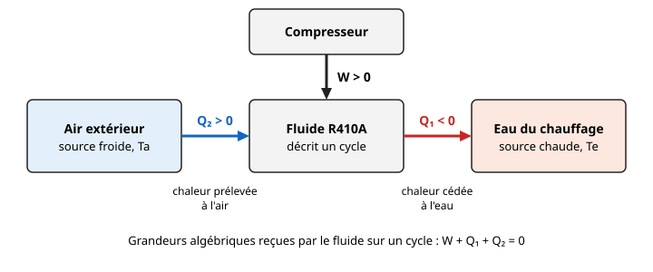
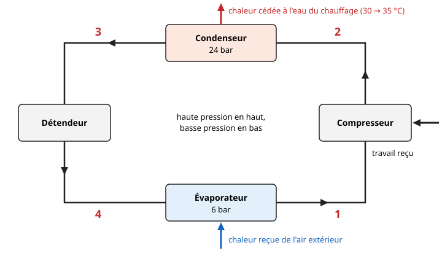
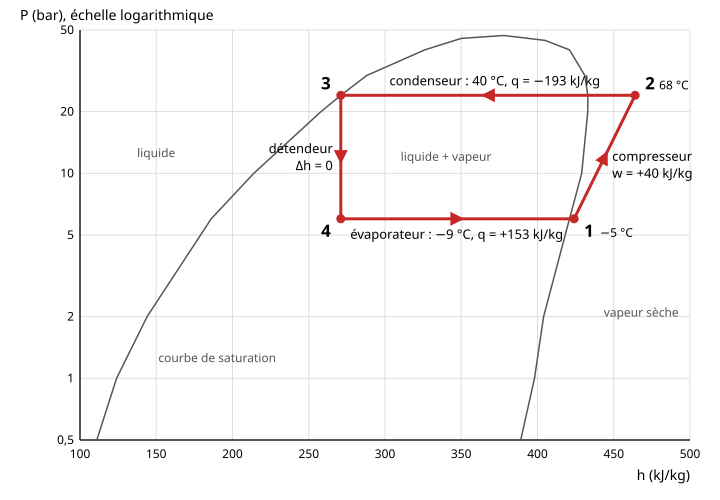

# Banque PT PT — Physique C - Thermodynamique 2010 · Corrigé brut

*Corrigé rédigé par IA, non officiel. Signalez toute erreur.*

**Rédaction** · modèle exact non renseigné (famille Claude) · effort non renseigné · vitesse non renseignée

Épreuve de 2 heures, calculatrice autorisée : étude d'une pompe à chaleur air/eau au fluide R410A, en 28 questions numérotées de 1 à 28 et réparties en quatre parties (coefficient de performance, principe de fonctionnement, étude du cycle, transfert thermique avec l'échangeur extérieur). Les 28 questions sont traitées. Le cycle est tracé sur le diagramme $(\ln P, h)$ du R410A fourni en annexe (page 6/6 du sujet) : toutes les valeurs numériques des parties II et III en sont lues, et le corrigé indique pour chacune où elle est lue. Convention : $w_i$ et $q$ sont des grandeurs massiques reçues par le fluide, comptées algébriquement.

**Valeurs lues sur le diagramme de l'annexe** (détail des lectures aux questions 10, 15, 16 et 17) :

| État | Situation | $P$ (bar) | $\theta$ (°C) | $h$ ($\mathrm{kJ\cdot kg^{-1}}$) | État physique |
|---|---|---|---|---|---|
| 1 | sortie de l'évaporateur, entrée du compresseur | 6 | $-5$ | 424 | vapeur sèche (surchauffe de 4 °C) |
| 2 | sortie du compresseur, entrée du condenseur | 24 | 68 | 464 | vapeur sèche |
| 3 | sortie du condenseur, entrée du détendeur | 24 | 40 | 271 | liquide saturant |
| 4 | sortie du détendeur, entrée de l'évaporateur | 6 | $-9$ | 271 | liquide + vapeur, $x \approx 0{,}36$ |

Les pressions sont lues sur l'échelle logarithmique de gauche, les enthalpies sur l'échelle horizontale (à $1$ ou $2\ \mathrm{kJ\cdot kg^{-1}}$ près), les températures par les isothermes et le titre par les isotitres. Seule hypothèse numérique ajoutée par le corrigé : la masse volumique de l'eau, $1{,}00\ \mathrm{kg\cdot L^{-1}}$, à la question 13.

[Sujet officiel (archive réunissant les deux parties de Physique C)](https://www.banquept.fr/documents/2010/phys_c_pt_2010.zip) · [Rapport du jury](https://www.banquept.fr/documents/ecrit/rapport/2010/rapport_phys_c_ecrit_2010.pdf)

## Partie I — COP d'une pompe à chaleur

### Question 1 — Transferts énergétiques, source chaude et source froide

Le système étudié est le fluide R410A, qui décrit un cycle. Les grandeurs $W$, $Q_1$ et $Q_2$ sont algébriques et **reçues par le fluide**.

- **Compresseur → fluide** : travail $W > 0$. C'est l'énergie payée (énergie électrique du moteur du compresseur).
- **Air extérieur → fluide** : transfert thermique $Q_2 > 0$. Le fluide prélève de la chaleur à l'air extérieur.
- **Fluide → eau du circuit de chauffage** : le fluide cède de la chaleur à l'eau, donc $Q_1 < 0$. C'est l'énergie utile.

**Source chaude et source froide.** La source chaude est celle dont la température est la plus élevée. L'eau du circuit de chauffage est entre $30$ et $35\ ^\circ\mathrm{C}$ et l'air extérieur, en période de chauffage, est bien plus froid : $T_e > T_a$.

**La source chaude est l'eau du circuit de chauffage, la source froide est l'air extérieur.**

Le rôle de la machine le confirme. Un transfert thermique spontané va du chaud vers le froid. La pompe à chaleur réalise le transfert inverse, de l'air froid vers l'eau chaude, ce qui n'est possible qu'en dépensant un travail $W > 0$ : c'est une machine réceptrice.

### Question 2 — Inégalité de Clausius

**Système.** Le fluide de la pompe à chaleur, système fermé, sur un cycle. Il échange $Q_1$ avec la source chaude à la température $T_1$ et $Q_2$ avec la source froide à la température $T_2$. Les deux sources sont des thermostats.

**Second principe.** Pour un système fermé,

$$\Delta S = S_{\text{éch}} + S_{\text{créée}}$$

avec $S_{\text{créée}} \geqslant 0$, nulle seulement si l'évolution est réversible.

**Entropie échangée.** Le fluide échange $Q_1$ avec un thermostat à $T_1$ et $Q_2$ avec un thermostat à $T_2$ :

$$S_{\text{éch}} = \frac{Q_1}{T_1} + \frac{Q_2}{T_2}$$

**Cycle.** L'entropie est une fonction d'état. Sur un cycle, l'état final du fluide est identique à l'état initial, donc $\Delta S = 0$.

On en déduit

$$\frac{Q_1}{T_1} + \frac{Q_2}{T_2} = -S_{\text{créée}}$$

$$\boxed{\frac{Q_1}{T_1} + \frac{Q_2}{T_2} \leqslant 0}$$

L'égalité correspond à un cycle réversible.

### Question 3 — Pompe à chaleur idéale et coefficient de performance

**Pompe à chaleur idéale.** C'est une machine dont le cycle est **réversible** : aucune entropie n'est créée. Il n'y a ni frottement ni perte de charge, et les échanges thermiques se font sans écart de température entre le fluide et la source (cycle de Carnot : deux isothermes aux températures des sources, deux adiabatiques réversibles). L'inégalité de Clausius devient une égalité.

**Définition du COP.** C'est le rapport de l'énergie utile (la chaleur cédée à la source chaude, $-Q_1 > 0$) à l'énergie payée (le travail $W > 0$) :

$$\mathrm{COP} = \frac{-Q_1}{W}$$

**Premier principe sur un cycle.** L'énergie interne est une fonction d'état, donc

$$W + Q_1 + Q_2 = 0$$

**Cas idéal.** L'égalité de Clausius donne

$$Q_2 = -\frac{T_2}{T_1}\,Q_1$$

En reportant dans le premier principe :

$$W = -Q_1 - Q_2 = -Q_1\left(1 - \frac{T_2}{T_1}\right)$$

$$\boxed{\mathrm{COP}_{\text{idéal}} = \frac{T_1}{T_1 - T_2}}$$

Les températures sont en kelvins. Comme $0 < T_1 - T_2 < T_1$, ce COP est toujours supérieur à 1.

**Pompe à chaleur réelle.** Le cycle est irréversible (frottements, pertes de charge, échanges thermiques sous un écart de température fini, détente irréversible dans le détendeur). L'inégalité de Clausius est stricte. Avec $Q_2 = -W - Q_1$ :

$$\frac{Q_1}{T_1} - \frac{W + Q_1}{T_2} < 0$$

$$-Q_1\left(\frac{1}{T_2} - \frac{1}{T_1}\right) < \frac{W}{T_2}$$

En multipliant par $T_2/W > 0$ :

$$\boxed{\mathrm{COP}_{\text{réel}} = \frac{-Q_1}{W} < \frac{T_1}{T_1 - T_2}}$$

**Le COP réel est plus faible** que le COP idéal : pour fournir la même chaleur, il faut dépenser un travail supplémentaire qui compense l'entropie créée.

### Question 4 — Influence de l'écart de température

Ici $T_1$ est la température de la source chaude (côté habitation) et $T_2$ celle de la source froide (extérieur). Le COP idéal s'écrit

$$\mathrm{COP}_{\text{idéal}} = \frac{T_1}{T_1 - T_2} = 1 + \frac{T_2}{T_1 - T_2}$$

À $T_1$ fixée, quand l'extérieur se refroidit, $T_2$ diminue et $T_1 - T_2$ augmente : le numérateur $T_2$ baisse et le dénominateur croît.

**Le COP diminue quand la différence entre la température intérieure et la température extérieure augmente.**

Interprétation : plus l'écart est grand, plus il est « coûteux » de faire remonter la chaleur de la source froide vers la source chaude. Si l'écart tendait vers zéro, le COP idéal tendrait vers l'infini (le transfert ne coûterait presque rien) ; si $T_2$ tendait vers zéro, le COP tendrait vers 1 (toute la chaleur viendrait du travail). C'est pour cette raison que la pompe à chaleur est la moins performante par grand froid, c'est-à-dire au moment où les besoins sont les plus forts.

Exemple : avec $T_1 = 308\ \mathrm{K}$, on trouve $\mathrm{COP}_{\text{idéal}} = 11$ pour $T_2 = 280\ \mathrm{K}$ et $6{,}4$ pour $T_2 = 260\ \mathrm{K}$ (valeurs de $T_2$ choisies par le corrigé pour illustrer).

### Question 5 — Place du condenseur

Dans le condenseur, le fluide passe de l'état vapeur à l'état liquide. La liquéfaction est **exothermique** : le fluide y **cède** de la chaleur au milieu avec lequel il est en contact ($q < 0$ pour le fluide).

Or, dans une pompe à chaleur, le fluide cède de la chaleur à la source chaude (question 1).

**Le condenseur est au contact de la source chaude, c'est-à-dire de l'eau du circuit de chauffage.** L'évaporateur, où la vaporisation endothermique fait recevoir de la chaleur au fluide, est au contact de la source froide (l'air extérieur).

Condition de fonctionnement : pour que la chaleur passe spontanément du fluide vers l'eau, la température de liquéfaction du fluide doit être supérieure à celle de l'eau. De même, la température de vaporisation doit être inférieure à celle de l'air extérieur. C'est le compresseur qui, en élevant la pression, élève la température de changement d'état.

### Question 6 — Intérêt d'un COP élevé, paramètres d'action

**On cherche le COP le plus élevé possible.** Le COP est le rapport de la chaleur fournie à l'habitation au travail payé : à besoin de chauffage donné, plus le COP est grand, plus la consommation électrique est faible. Un radiateur électrique a l'équivalent d'un COP de 1.

**Paramètres.** D'après $\mathrm{COP} \leqslant T_1/(T_1 - T_2)$, il faut réduire l'écart $T_1 - T_2$ et limiter les irréversibilités.

- **Abaisser la température de la source chaude.** C'est le paramètre réglable : on choisit une eau de chauffage à basse température (plancher chauffant ou radiateurs de grande surface alimentés vers $35\ ^\circ\mathrm{C}$, plutôt que des radiateurs à $60\ ^\circ\mathrm{C}$ ou plus).
- **Température de la source froide.** La température de l'air extérieur est imposée par la météo : on ne peut pas la régler. On peut en revanche choisir une source froide moins froide en hiver (sol ou nappe d'eau, de température plus élevée et plus stable que l'air).
- **Réduire les irréversibilités** pour s'approcher du COP idéal : grandes surfaces d'échange (faible écart de température entre le fluide et chaque source), dégivrage de l'évaporateur, compresseur de bon rendement, pertes de charge et fuites thermiques réduites.

### Question 7 — Pompe à chaleur air/eau et pompe à chaleur air/air

Les deux machines ont la même source froide (l'air extérieur). Elles diffèrent par le fluide qui reçoit la chaleur au condenseur : de l'eau pour l'une, l'air de l'habitation pour l'autre.

**Explication proposée.** L'échange thermique entre une paroi et de l'eau liquide est bien meilleur qu'entre une paroi et de l'air : le coefficient d'échange est beaucoup plus grand, et la capacité thermique volumique de l'eau est environ 3500 fois celle de l'air. Pour évacuer la même puissance :

- avec de l'eau, un faible écart de température entre le fluide qui se liquéfie et l'eau suffit. La température de liquéfaction peut rester proche de celle de l'eau (ici $40\ ^\circ\mathrm{C}$ pour une eau qui sort à $35\ ^\circ\mathrm{C}$) ;
- avec de l'air, il faut un écart de température plus grand entre le fluide et l'air, donc une température de liquéfaction, et une haute pression, plus élevées.

Le cycle de la pompe à chaleur air/air fonctionne donc entre des températures plus écartées : d'après la question 4, son COP est plus faible, et les irréversibilités d'échange thermique y sont plus fortes. S'y ajoute la consommation du ventilateur qui brasse l'air intérieur, alors qu'un petit circulateur suffit pour l'eau.

De plus, l'eau alimente des émetteurs de grande surface (plancher chauffant), qui chauffent la pièce avec une eau à basse température : la température de la source chaude vue par la machine est modérée.

## Partie II — Principe de fonctionnement

### Question 8 — Schéma de l'installation et numérotation des états

**Lecture du cycle sur le diagramme de l'annexe.** Le cycle est un quadrilatère : deux paliers horizontaux (isobares, à $24$ et $6$ bar environ), un segment vertical à gauche (isenthalpique) et un segment incliné à droite, le long d'une isentrope. L'état 1 est le coin inférieur droit : vapeur à basse pression, juste à droite de la courbe de saturation.

**Sens de parcours.** Une pompe à chaleur est une machine réceptrice : son cycle est parcouru dans le **sens antihoraire** dans ce diagramme. Depuis l'état 1, le fluide monte donc le long de l'isentrope :

- $1 \to 2$ : compression adiabatique réversible (isentropique) de la vapeur, dans le **compresseur** ;
- $2 \to 3$ : palier à haute pression, parcouru vers la gauche ($h$ diminue) : désurchauffe puis liquéfaction dans le **condenseur**, au contact de l'eau (question 5) ;
- $3 \to 4$ : chute de pression à enthalpie constante dans le **détendeur** ;
- $4 \to 1$ : palier à basse pression, parcouru vers la droite ($h$ augmente) : vaporisation puis légère surchauffe dans l'**évaporateur**, au contact de l'air extérieur.

Cohérence avec la question 5 : le condenseur cède de la chaleur à la source chaude, donc la liquéfaction se fait à la température la plus haute, c'est-à-dire sur le palier de haute pression.

**Schéma complété.** Le chiffre 1 du schéma de l'énoncé est placé sur la conduite qui relie le bloc du bas au bloc de droite. En disposant les échangeurs comme les paliers du diagramme (haute pression en haut, basse pression en bas), on obtient : **évaporateur en bas, compresseur à droite, condenseur en haut, détendeur à gauche**, le fluide circulant dans le sens antihoraire sur le schéma.

- état 1 : entre l'évaporateur et le compresseur ;
- état 2 : entre le compresseur et le condenseur ;
- état 3 : entre le condenseur et le détendeur ;
- état 4 : entre le détendeur et l'évaporateur.

Remarque : le schéma de l'énoncé n'indique pas de sens de circulation. L'autre disposition possible (évaporateur à droite, compresseur en bas, condenseur à gauche, détendeur en haut, circulation horaire) respecte aussi la position du chiffre 1 et le même ordre des organes ; le corrigé retient celle qui reproduit la disposition du diagramme.

### Question 9 — Premier principe pour un fluide en écoulement permanent

**Système.** Un élément de la machine (compresseur, échangeur ou détendeur) délimite un volume de contrôle : c'est un système **ouvert**. Le premier principe ne s'applique qu'à un système **fermé**. On construit donc le système fermé $\Sigma^*$ suivant, suivi entre les instants $t$ et $t + \mathrm{d}t$ :

- à l'instant $t$ : le fluide contenu dans l'élément, plus la masse $\mathrm{d}m_e$ qui va y entrer pendant $\mathrm{d}t$ ;
- à l'instant $t + \mathrm{d}t$ : le fluide contenu dans l'élément, plus la masse $\mathrm{d}m_s$ qui en est sortie pendant $\mathrm{d}t$.

**Hypothèse 1 : régime permanent.** La masse et l'énergie du fluide contenu dans l'élément ne dépendent pas du temps. La masse de $\Sigma^*$ se conserve, donc

$$\mathrm{d}m_e = \mathrm{d}m_s = \mathrm{d}m$$

**Variation d'énergie de $\Sigma^*$.** L'énergie du contenu de l'élément étant la même aux deux instants, il ne reste que la différence entre la tranche sortie et la tranche entrée. En notant $u$ l'énergie interne massique, $e_c$ et $e_p$ les énergies cinétique et potentielle massiques :

$$\mathrm{d}E = \mathrm{d}m\left[\left(u_s + e_{c,s} + e_{p,s}\right) - \left(u_e + e_{c,e} + e_{p,e}\right)\right]$$

**Énergie reçue par $\Sigma^*$ pendant $\mathrm{d}t$.**

- Travail des forces de pression en amont : le fluide amont pousse la tranche entrante, de volume $v_e\,\mathrm{d}m$, sous la pression $P_e$. Travail reçu : $+P_e v_e\,\mathrm{d}m$.
- Travail des forces de pression en aval : la tranche sortante, de volume $v_s\,\mathrm{d}m$, repousse le fluide aval sous la pression $P_s$. Travail reçu : $-P_s v_s\,\mathrm{d}m$.
- Travail fourni par les pièces mécaniques mobiles de l'élément : $w_i\,\mathrm{d}m$.
- Transfert thermique reçu à travers les parois de l'élément : $q\,\mathrm{d}m$.

**Premier principe appliqué à $\Sigma^*$.**

$$\mathrm{d}E = \left(P_e v_e - P_s v_s\right)\mathrm{d}m + w_i\,\mathrm{d}m + q\,\mathrm{d}m$$

En divisant par $\mathrm{d}m$ et en regroupant $u + Pv = h$ (enthalpie massique) :

$$(h_s - h_e) + (e_{c,s} - e_{c,e}) + (e_{p,s} - e_{p,e}) = w_i + q$$

**Hypothèse 2 : variations d'énergie cinétique et d'énergie potentielle de pesanteur négligeables** devant la variation d'enthalpie (quelques dizaines à quelques centaines de $\mathrm{kJ\cdot kg^{-1}}$ ici, alors qu'une vitesse de $10\ \mathrm{m\cdot s^{-1}}$ ne représente que $0{,}05\ \mathrm{kJ\cdot kg^{-1}}$ et une dénivellation de $1\ \mathrm{m}$ que $0{,}01\ \mathrm{kJ\cdot kg^{-1}}$). Il reste

$$\boxed{\Delta h = h_s - h_e = w_i + q}$$

**Statut de $w_i$ et de $q$.**

- $w_i$ est le **travail indiqué** (ou travail utile) massique : travail reçu par un kilogramme de fluide de la part des pièces mécaniques mobiles de l'élément. Il ne contient pas le travail des forces de pression d'admission et de refoulement, déjà compté dans $h$. Il est nul dans un élément sans pièce mobile.
- $q$ est le **transfert thermique massique** reçu par un kilogramme de fluide à la traversée de l'élément. Il est nul si l'élément est calorifugé.

Les deux sont des grandeurs algébriques, en $\mathrm{J\cdot kg^{-1}}$, reçues par le fluide. Ce ne sont pas des variations de fonctions d'état : elles dépendent de la transformation.

**Détendeur.** Le compresseur est le seul élément qui comporte des pièces mobiles : dans le détendeur, $w_i = 0$. Le détendeur est calorifugé : $q = 0$. Donc

$$\boxed{\Delta h = h_4 - h_3 = 0}$$

L'évolution dans le détendeur est **isenthalpique** (détente de Joule-Thomson) : sur le diagramme, le segment $3 \to 4$ est vertical.

### Question 10 — Travail massique reçu dans le compresseur

**Lecture du diagramme de l'annexe.** Les quatre sommets du cycle tracé en trait épais sont repérés à l'aide de l'échelle des pressions (à gauche, logarithmique) et de l'échelle des enthalpies (reportée en haut et en bas).

- Palier supérieur : il est situé entre les graduations $20$ et $30$ bar, à $P \approx 24\ \mathrm{bar}$. Il se superpose à l'isotherme $40\ ^\circ\mathrm{C}$ du domaine diphasé.
- Palier inférieur : sur la graduation $6\ \mathrm{bar}$, juste au-dessus de l'isotherme $-10\ ^\circ\mathrm{C}$ du domaine diphasé.
- État 1 (coin inférieur droit, repéré par le chiffre 1) : un peu à droite de la graduation $420$, soit $h_1 \approx 424\ \mathrm{kJ\cdot kg^{-1}}$.
- État 2 (coin supérieur droit) : un peu à droite de la graduation $460$, soit $h_2 \approx 464\ \mathrm{kJ\cdot kg^{-1}}$.
- États 3 et 4 (côté vertical gauche) : un peu à droite du milieu de l'intervalle $260$–$280$, soit $h_3 = h_4 \approx 271\ \mathrm{kJ\cdot kg^{-1}}$. Le sommet 3 est sur la courbe d'ébullition.

Une graduation de $20\ \mathrm{kJ\cdot kg^{-1}}$ occupe environ $9\ \mathrm{mm}$ sur l'annexe : chaque enthalpie est lue à $1$ ou $2\ \mathrm{kJ\cdot kg^{-1}}$ près.

**Élément.** Le fluide n'échange du travail avec des pièces mécaniques mobiles que dans le **compresseur**, seul élément qui en comporte (évolution $1 \to 2$).

**Signe.** Les pièces mobiles poussent le fluide pour le comprimer : le fluide **reçoit** du travail, $w_i > 0$. C'est cohérent avec une machine réceptrice.

**Valeur.** Le compresseur est calorifugé ($q = 0$). Le premier principe de la question 9 donne

$$w_i = h_2 - h_1$$

$$w_i \approx 464 - 424$$

$$\boxed{w_i \approx +40\ \mathrm{kJ\cdot kg^{-1}}}$$

Compte tenu de la précision de lecture, $w_i$ est connu à $3\ \mathrm{kJ\cdot kg^{-1}}$ près environ.

### Question 11 — Chaleur cédée dans le condenseur

**Élément.** Le fluide rejette de la chaleur dans le **condenseur** (évolution $2 \to 3$) : la vapeur surchauffée s'y refroidit jusqu'à $40\ ^\circ\mathrm{C}$, puis se liquéfie entièrement.

**Milieu extérieur.** C'est l'**eau du circuit de chauffage** (la source chaude), qui entre à $30\ ^\circ\mathrm{C}$ et ressort à $35\ ^\circ\mathrm{C}$.

**Valeur.** Le condenseur ne comporte pas de pièce mobile ($w_i = 0$). Le premier principe de la question 9 donne

$$q_{23} = h_3 - h_2$$

$$q_{23} \approx 271 - 464$$

$$\boxed{q_{23} \approx -193\ \mathrm{kJ\cdot kg^{-1}}}$$

Les valeurs $h_2 \approx 464$ et $h_3 \approx 271\ \mathrm{kJ\cdot kg^{-1}}$ sont les abscisses des deux extrémités du palier supérieur du cycle (question 10). Le signe négatif traduit une chaleur **cédée** par le fluide : chaque kilogramme de fluide fournit $193\ \mathrm{kJ}$ à l'eau.

### Question 12 — Chaleur reçue dans l'évaporateur

**Élément.** Le fluide reçoit de la chaleur dans l'**évaporateur** (évolution $4 \to 1$) : le liquide restant s'y vaporise à $-9\ ^\circ\mathrm{C}$, puis la vapeur est légèrement surchauffée.

**Milieu extérieur.** C'est l'**air extérieur** (la source froide).

**Valeur.** L'évaporateur ne comporte pas de pièce mobile ($w_i = 0$) :

$$q_{41} = h_1 - h_4$$

$$q_{41} \approx 424 - 271$$

$$\boxed{q_{41} \approx +153\ \mathrm{kJ\cdot kg^{-1}}}$$

Les valeurs $h_4 \approx 271$ et $h_1 \approx 424\ \mathrm{kJ\cdot kg^{-1}}$ sont les abscisses des deux extrémités du palier inférieur du cycle (question 10).

**Vérification.** Sur le cycle, $w_i + q_{23} + q_{41} = 40 - 193 + 153 = 0$ : le bilan d'énergie du cycle est respecté (il l'est par construction, puisque $h$ est une fonction d'état).

### Question 13 — Débits du fluide et de l'eau

**Débit massique du fluide.** La puissance de chauffage $\mathcal{P}_{ch} = 8\ \mathrm{kW}$ est la puissance thermique cédée par le fluide à l'eau dans le condenseur. Avec $D_m$ le débit massique du fluide :

$$\mathcal{P}_{ch} = D_m\,|q_{23}| = D_m\,(h_2 - h_3)$$

$$D_m = \frac{\mathcal{P}_{ch}}{h_2 - h_3}$$

$$D_m \approx \frac{8{,}0}{193}\ \mathrm{kg\cdot s^{-1}}$$

$$\boxed{D_m \approx 4{,}1\times 10^{-2}\ \mathrm{kg\cdot s^{-1}}}$$

soit environ $41\ \mathrm{g\cdot s^{-1}}$, ou $150\ \mathrm{kg\cdot h^{-1}}$.

**Débit massique de l'eau.** L'eau liquide traverse l'échangeur sans pièce mobile et sans changement d'état, en passant de $\theta_e = 30\ ^\circ\mathrm{C}$ à $\theta_s = 35\ ^\circ\mathrm{C}$. Le premier principe en écoulement permanent, appliqué à l'eau, donne $q_{eau} = \Delta h_{eau} = c\,(\theta_s - \theta_e)$. En supposant l'échangeur calorifugé vis-à-vis de l'extérieur, toute la chaleur cédée par le fluide est reçue par l'eau :

$$\mathcal{P}_{ch} = D_{eau}\,c\,(\theta_s - \theta_e)$$

$$D_{eau} = \frac{\mathcal{P}_{ch}}{c\,(\theta_s - \theta_e)}$$

Avec $c = 4{,}18\ \mathrm{J\cdot g^{-1}\cdot K^{-1}} = 4{,}18\ \mathrm{kJ\cdot kg^{-1}\cdot K^{-1}}$ :

$$D_{eau} = \frac{8{,}0}{4{,}18 \times 5}\ \mathrm{kg\cdot s^{-1}}$$

$$\boxed{D_{eau} \approx 0{,}38\ \mathrm{kg\cdot s^{-1}}}$$

**Débit volumique de l'eau.** L'énoncé ne donne pas la masse volumique de l'eau : le corrigé prend $\rho = 1{,}00\ \mathrm{kg\cdot L^{-1}}$ (valeur usuelle, exacte à moins de 1 % près vers $30\ ^\circ\mathrm{C}$).

$$D_v = \frac{D_{eau}}{\rho}$$

$$D_v \approx 0{,}383\ \mathrm{L\cdot s^{-1}} \times 3600\ \mathrm{s\cdot h^{-1}}$$

$$\boxed{D_v \approx 1{,}4\times 10^{3}\ \mathrm{L\cdot h^{-1}}}$$

Les deux débits massiques sont très différents : l'eau ne s'échauffe que de $5\ \mathrm{K}$ sans changer d'état ($21\ \mathrm{kJ\cdot kg^{-1}}$), alors que le fluide cède $193\ \mathrm{kJ\cdot kg^{-1}}$ en se liquéfiant.

### Question 14 — COP réel et puissance du compresseur

**COP.** Par définition (question 3), en grandeurs massiques :

$$\mathrm{COP} = \frac{-q_{23}}{w_i} = \frac{h_2 - h_3}{h_2 - h_1}$$

$$\mathrm{COP} \approx \frac{193}{40}$$

$$\boxed{\mathrm{COP} \approx 4{,}8}$$

La précision de lecture des enthalpies (question 10) laisse une incertitude d'environ $0{,}4$ sur cette valeur.

**Puissance consommée par le compresseur.**

$$\mathcal{P}_{comp} = D_m\,w_i = \frac{\mathcal{P}_{ch}}{\mathrm{COP}}$$

$$\mathcal{P}_{comp} \approx \frac{8{,}0}{4{,}8}\ \mathrm{kW}$$

$$\boxed{\mathcal{P}_{comp} \approx 1{,}7\ \mathrm{kW}}$$

Pour $1{,}7\ \mathrm{kW}$ payés, l'habitation reçoit $8\ \mathrm{kW}$ : les $6{,}3\ \mathrm{kW}$ restants sont prélevés à l'air extérieur ($D_m\,q_{41} \approx 0{,}0415 \times 153 \approx 6{,}3\ \mathrm{kW}$).

**Comparaison au COP idéal.** Entre les températures de changement d'état du fluide, $T_1 = 313\ \mathrm{K}$ ($40\ ^\circ\mathrm{C}$) et $T_2 = 264\ \mathrm{K}$ ($-9\ ^\circ\mathrm{C}$), une machine réversible aurait $\mathrm{COP}_{\text{idéal}} = 313/49 \approx 6{,}4$. Le COP du cycle étudié est plus faible, comme prévu à la question 3 : la détente dans le détendeur et le refroidissement de la vapeur surchauffée sont irréversibles.

## Partie III — Étude du cycle thermodynamique

### Question 15 — Sortie du compresseur, isothermes et loi de Laplace

**État en sortie de compresseur.** Le point 2 est à droite de la courbe de rosée : le fluide est une **vapeur sèche (surchauffée)**, à $24\ \mathrm{bar}$.

**Température.** Dans le domaine de la vapeur, les isothermes sont les courbes qui descendent vers la droite ; elles sont tracées de $10$ en $10\ ^\circ\mathrm{C}$ et cotées à leur extrémité inférieure (ligne « Température en °C »). On les identifie en partant de la courbe de rosée : l'isotherme $40\ ^\circ\mathrm{C}$ quitte la courbe de rosée sur le palier supérieur du cycle, celle de $50\ ^\circ\mathrm{C}$ plus haut, etc. Sur l'isobare $24\ \mathrm{bar}$, l'isotherme $60\ ^\circ\mathrm{C}$ passe à $h \approx 456\ \mathrm{kJ\cdot kg^{-1}}$ et l'isotherme $70\ ^\circ\mathrm{C}$ à $h \approx 466\ \mathrm{kJ\cdot kg^{-1}}$. Le point 2 ($h_2 \approx 464$) est entre les deux, plus près de la seconde :

$$\boxed{\theta_2 \approx 68\ ^\circ\mathrm{C}}$$

à $2$ ou $3\ ^\circ\mathrm{C}$ près.

**Isotherme d'un gaz parfait.** L'enthalpie d'un gaz parfait ne dépend que de la température (seconde loi de Joule). À température constante, $h$ est constante quelle que soit la pression : dans le diagramme $(\ln P, h)$, **l'isotherme d'un gaz parfait est une droite verticale**.

**Allure des isothermes du diagramme.**

- Dans la vapeur, à basse pression et loin de la courbe de saturation, les isothermes sont quasi verticales : la vapeur s'y comporte comme un gaz parfait.
- Quand la pression augmente et qu'on se rapproche de la courbe de rosée, elles s'inclinent vers la gauche : le fluide n'est plus un gaz parfait, les interactions entre molécules font diminuer $h$ quand $P$ augmente à température fixée.
- Dans le domaine diphasé, elles sont horizontales : pendant le changement d'état, la pression reste égale à la pression de vapeur saturante, qui ne dépend que de la température. Isothermes et isobares sont confondues.
- Dans le liquide, elles sont à nouveau presque verticales : l'enthalpie d'un liquide, très peu compressible, dépend très peu de la pression.

C'est l'allure donnée par le schéma sommaire de l'énoncé.

**Loi de Laplace en variables $(T, P)$.** On suppose le fluide gaz parfait de rapport $\gamma$ constant, et la compression adiabatique réversible, donc isentropique. Pour un kilogramme de gaz parfait, l'identité thermodynamique s'écrit

$$\mathrm{d}h = T\,\mathrm{d}s + v\,\mathrm{d}P$$

Avec $\mathrm{d}s = 0$, $\mathrm{d}h = c_p\,\mathrm{d}T$, $v = rT/P$ (où $r = R/M$) et $c_p = \gamma r/(\gamma - 1)$ :

$$\frac{\gamma r}{\gamma - 1}\,\mathrm{d}T = rT\,\frac{\mathrm{d}P}{P}$$

$$\frac{\mathrm{d}T}{T} = \frac{\gamma - 1}{\gamma}\,\frac{\mathrm{d}P}{P}$$

En intégrant entre l'entrée (état 1) et la sortie (état 2), $\gamma$ étant constant :

$$\boxed{\frac{T_2}{T_1} = \left(\frac{P_2}{P_1}\right)^{\frac{\gamma - 1}{\gamma}}}$$

soit $T^{\gamma} P^{1 - \gamma} = \text{constante}$, les températures étant en kelvins.

**Calcul de $\gamma$.**

$$\frac{\gamma - 1}{\gamma} = \frac{\ln(T_2/T_1)}{\ln(P_2/P_1)}$$

Valeurs lues sur le diagramme : $P_1 \approx 6\ \mathrm{bar}$, $P_2 \approx 24\ \mathrm{bar}$, $\theta_2 \approx 68\ ^\circ\mathrm{C}$ soit $T_2 \approx 341\ \mathrm{K}$. Pour l'état 1, le point est situé entre la courbe de rosée (où la température vaut $-9\ ^\circ\mathrm{C}$ à $6\ \mathrm{bar}$) et l'isotherme $0\ ^\circ\mathrm{C}$, à peu près à mi-distance : $\theta_1 \approx -5\ ^\circ\mathrm{C}$, soit $T_1 \approx 268\ \mathrm{K}$ (valeur cohérente avec le seuil de $-5\ ^\circ\mathrm{C}$ cité à la question 21).

$$\frac{\gamma - 1}{\gamma} \approx \frac{\ln(341/268)}{\ln 4} \approx \frac{0{,}241}{1{,}386} \approx 0{,}174$$

$$\gamma \approx \frac{1}{1 - 0{,}174}$$

$$\boxed{\gamma \approx 1{,}2}$$

Cette valeur, comprise entre 1 et 1,3, est plausible pour un fluide formé de molécules polyatomiques. Une erreur de $3\ ^\circ\mathrm{C}$ sur $\theta_2$ ne modifie $\gamma$ que de $0{,}01$.

### Question 16 — Condenseur : sens du transfert thermique et température de sortie

**Sens du transfert.** Dans le condenseur, la transformation **dégage de la chaleur** : le fluide en cède au milieu extérieur. Deux justifications concordantes :

- la liquéfaction d'une vapeur est exothermique (il faut retirer de l'énergie à la vapeur pour que les molécules se rapprochent et forment le liquide), et le refroidissement préalable de la vapeur surchauffée l'est aussi ;
- sur le diagramme, l'enthalpie massique du fluide diminue de $464$ à $271\ \mathrm{kJ\cdot kg^{-1}}$ sans travail indiqué : $q_{23} = h_3 - h_2 < 0$ (question 11).

**Température de sortie.** Le point 3 est situé sur la courbe d'ébullition (branche gauche de la courbe de saturation) : en sortie de condenseur, le fluide est un **liquide saturant**, à la température de changement d'état sous $24\ \mathrm{bar}$. Le palier supérieur du cycle se superpose à l'isotherme cotée $40$ dans le domaine diphasé :

$$\boxed{\theta_3 \approx 40\ ^\circ\mathrm{C}}$$

Cette température est supérieure à celle de l'eau en sortie d'échangeur ($35\ ^\circ\mathrm{C}$) : la chaleur passe bien du fluide vers l'eau.

### Question 17 — Titre en vapeur et température en sortie du détendeur

**Position du point 4.** La détente est isenthalpique : $h_4 = h_3 \approx 271\ \mathrm{kJ\cdot kg^{-1}}$. Le point 4, à $6\ \mathrm{bar}$, est à l'intérieur de la courbe de saturation : le fluide est un mélange liquide-vapeur.

**Titre massique en vapeur, par lecture directe.** Les courbes isotitres sont les courbes inclinées du domaine diphasé, qui convergent vers le point critique et sont cotées en bas du diagramme ($x = 0{,}10$ ; $0{,}20$ ; …). Le point 4 est entre les isotitres $0{,}30$ et $0{,}40$, un peu au-delà du milieu de l'intervalle : $x_4 \approx 0{,}36$.

**Vérification par le théorème des moments.** Sur le palier à $6\ \mathrm{bar}$, on lit l'enthalpie du liquide saturant, $h_\ell \approx 186\ \mathrm{kJ\cdot kg^{-1}}$ (intersection avec la courbe d'ébullition), et celle de la vapeur saturante, $h_v \approx 421\ \mathrm{kJ\cdot kg^{-1}}$ (intersection avec la courbe de rosée). L'enthalpie étant extensive, $h_4 = x_4 h_v + (1 - x_4) h_\ell$, d'où

$$x_4 = \frac{h_4 - h_\ell}{h_v - h_\ell}$$

$$x_4 \approx \frac{271 - 186}{421 - 186} = \frac{85}{235}$$

$$\boxed{x_4 \approx 0{,}36}$$

Plus du tiers du fluide s'est vaporisé pendant la détente.

**Température.** Dans le domaine diphasé, la température est celle du changement d'état sous $6\ \mathrm{bar}$. Le palier inférieur du cycle est juste au-dessus de l'isotherme cotée $-10$ (à environ un dixième de l'intervalle qui la sépare de l'isotherme $0$) :

$$\boxed{\theta_4 \approx -9\ ^\circ\mathrm{C}}$$

C'est la valeur citée par l'énoncé à la question 21.

### Question 18 — Rôle de la surchauffe

En sortie d'évaporateur, la vapeur est portée à $-5\ ^\circ\mathrm{C}$ alors que la vaporisation se termine à $-9\ ^\circ\mathrm{C}$ : la surchauffe est d'environ $4\ ^\circ\mathrm{C}$.

**Rôle.** Le fluide qui sort de l'évaporateur entre dans le compresseur. Celui-ci est conçu pour comprimer un gaz. Or un liquide est quasi incompressible : si des gouttelettes de liquide étaient aspirées (« coup de liquide »), la pression monterait brutalement dans la chambre de compression et les pièces mobiles (clapets, piston ou spirales) seraient endommagées ; le liquide diluerait de plus l'huile de lubrification.

Si le fluide sortait exactement à l'état de vapeur saturante, la moindre fluctuation (baisse de la température de l'air, givre, variation de débit) laisserait la vaporisation incomplète. La surchauffe est une **marge de sécurité** : une vapeur dont la température est supérieure de quelques degrés à la température de vaporisation ne contient à coup sûr plus de liquide. Elle garantit que le compresseur n'aspire que de la vapeur sèche.

Elle sert aussi au réglage : la température de la vapeur surchauffée, contrairement à celle du mélange diphasé, varie avec l'état du fluide ; le détendeur thermostatique ajuste le débit de fluide pour maintenir cette surchauffe.

### Question 19 — Isentrope d'un gaz parfait dans le diagramme (ln P, h)

**Équation.** Pour un gaz parfait de $\gamma$ constant, la seconde loi de Joule s'écrit, avec $c_p$ constant,

$$h = c_p\,T + h_0$$

où $h_0$ est une constante qui dépend de l'origine choisie pour les enthalpies. Le long d'une isentrope, la loi de Laplace de la question 15 donne, à partir d'un état de référence $(T_1, P_1)$ :

$$T = T_1\left(\frac{P}{P_1}\right)^{\frac{\gamma - 1}{\gamma}}$$

donc

$$h - h_0 = c_p T_1\left(\frac{P}{P_1}\right)^{\frac{\gamma - 1}{\gamma}}$$

En prenant le logarithme :

$$\boxed{\ln P = \frac{\gamma}{\gamma - 1}\,\ln\left(h - h_0\right) + \text{constante}}$$

**Allure.** Dans le diagramme $(\ln P, h)$, l'isentrope d'un gaz parfait est une **courbe logarithmique** : croissante (comprimer le gaz de façon isentropique augmente son enthalpie) et concave, sa pente diminuant quand $h$ augmente. La pente se calcule directement avec $\mathrm{d}h = v\,\mathrm{d}P$ à entropie constante :

$$\left(\frac{\partial \ln P}{\partial h}\right)_s = \frac{1}{Pv} = \frac{1}{rT}$$

Elle est d'autant plus faible que la température est élevée.

**Accord avec le diagramme.** Les isentropes tracées dans le domaine de la vapeur (cotées $s = 1{,}75$ à $2{,}50$) sont bien des courbes croissantes, concaves, de moins en moins pentues quand on se déplace vers les hautes températures (vers la droite) : l'accord est **qualitativement** bon. Il n'est pas quantitatif près de la courbe de saturation et à haute pression : les isothermes n'y sont pas verticales (question 15), le fluide n'y est donc pas un gaz parfait. Par ailleurs, le segment $1 \to 2$ est tracé en ligne droite par l'énoncé : c'est une approximation de l'isentrope voisine de $s = 1{,}85\ \mathrm{kJ\cdot kg^{-1}\cdot K^{-1}}$, dont la courbure est faible sur cet intervalle.

### Question 20 — Ce cycle peut-il être celui d'un climatiseur ?

**Oui, sur le principe.** Un climatiseur et une pompe à chaleur sont la même machine thermique réceptrice : le fluide décrit le même cycle (compression, liquéfaction, détente, vaporisation), prélève de la chaleur à une source froide et en cède à une source chaude. Seul change l'**effet utile** :

- pompe à chaleur : la chaleur cédée à la source chaude (l'habitation) ;
- climatiseur : la chaleur prélevée à la source froide, qui est alors l'air de la pièce à rafraîchir.

**Comment.** Il faut échanger le rôle des échangeurs par rapport à l'habitation : l'évaporateur est placé à l'intérieur (il refroidit l'air de la pièce) et le condenseur à l'extérieur (il rejette la chaleur dans l'air extérieur). Les machines dites réversibles le font sans rien déplacer, avec une vanne qui inverse le sens de circulation du fluide dans les échangeurs.

**Efficacité.** Pour ce cycle utilisé en climatiseur, l'efficacité serait

$$e = \frac{q_{41}}{w_i} \approx \frac{153}{40} \approx 3{,}8$$

**Limites.** Les niveaux de température de ce cycle conviennent mal à cet usage. Une liquéfaction à $40\ ^\circ\mathrm{C}$ n'évacue la chaleur que si l'air extérieur est nettement en dessous de $40\ ^\circ\mathrm{C}$ ; une vaporisation à $-9\ ^\circ\mathrm{C}$ est inutilement froide pour rafraîchir une pièce à une vingtaine de degrés (givrage de l'évaporateur, écart de température du cycle inutilement grand). Un climatiseur utiliserait le même type de cycle avec une température de vaporisation plus élevée, donc une meilleure efficacité.

### Question 21 — Limites de fonctionnement à basse température extérieure

**En dessous de $-9\ ^\circ\mathrm{C}$.** Dans l'évaporateur, le fluide se vaporise à $-9\ ^\circ\mathrm{C}$ (question 17). Il ne peut recevoir de la chaleur de l'air extérieur que si celui-ci est plus chaud que lui : un transfert thermique spontané va du chaud vers le froid. Si l'air est à moins de $-9\ ^\circ\mathrm{C}$, le fluide ne peut plus lui prendre de chaleur ; le transfert s'inverserait. Le fluide ne se vaporise plus, le cycle prévu ne peut pas être décrit : **l'installation ne fonctionne pas** avec ces réglages.

**En dessous de $-5\ ^\circ\mathrm{C}$.** Le fluide doit sortir de l'évaporateur à $-5\ ^\circ\mathrm{C}$ (état 1, question 15). Avec un air entre $-9$ et $-5\ ^\circ\mathrm{C}$ :

- la surchauffe jusqu'à $-5\ ^\circ\mathrm{C}$ est impossible, puisque le fluide ne peut pas devenir plus chaud que l'air qui le chauffe : la sécurité du compresseur n'est plus assurée (question 18) ;
- l'écart de température entre l'air et le fluide est très faible (moins de $4\ ^\circ\mathrm{C}$), or la puissance échangée lui est proportionnelle (loi de Newton, partie IV) : la puissance prélevée à l'air, donc la puissance de chauffage, s'effondre, ou le fluide ne se vaporise pas entièrement ;
- c'est en même temps le moment où les besoins de chauffage de l'habitation sont les plus grands, et où le givrage dégrade encore l'échange (partie IV).

La pompe à chaleur ne peut plus fournir seule les $8\ \mathrm{kW}$ : **un appoint (résistance électrique ou chaudière) est nécessaire**. C'est le fonctionnement « en relève de chaudière » évoqué dans l'introduction.

## Partie IV — Transfert thermique avec l'échangeur extérieur

### Question 22 — Effet de la couche de givre

**Pourquoi le transfert diminue.** Le givre est un mauvais conducteur de la chaleur : c'est de la glace poreuse, qui emprisonne de l'air. La couche de givre intercale donc, entre l'air et les plaques, une **résistance thermique supplémentaire**, en série avec celle de l'échange entre l'air et la surface (question 25). De plus, le givre obstrue peu à peu les passages entre les plaques : le débit d'air diminue, l'air circule moins bien au contact de la surface et l'échange par convection se dégrade (le coefficient d'échange passe de $K$ à $K_g < K$, question 27). Pour un même écart de température entre l'air et la paroi, la puissance transférée diminue.

**Pourquoi c'est préjudiciable.** La chaleur prélevée à l'air est l'une des deux contributions à la chaleur fournie à l'habitation ($|q_{23}| = q_{41} + w_i$). Si l'échange se dégrade :

- le fluide reçoit moins de chaleur dans l'évaporateur : il se vaporise incomplètement ou n'atteint plus la surchauffe prévue, ce qui met le compresseur en danger (question 18) ;
- pour maintenir le transfert, il faut un écart de température plus grand entre l'air et le fluide : la pression et la température de vaporisation baissent, l'écart de température du cycle augmente, le travail de compression par kilogramme augmente ;
- la puissance de chauffage et le COP diminuent, comme le montre la courbe de l'énoncé.

### Question 23 — Fin de la chute rapide du COP en dessous de 0 °C

**Lecture de la courbe de l'énoncé.** Le COP croît avec la température extérieure. La courbe comporte trois portions : une pente modérée au-dessus de $6\ ^\circ\mathrm{C}$, une pente nettement plus forte entre $0\ ^\circ\mathrm{C}$ et $6\ ^\circ\mathrm{C}$, puis à nouveau une pente modérée en dessous de $0\ ^\circ\mathrm{C}$. La baisse régulière sur toute la plage est celle de la question 4 (écart de température croissant). La chute supplémentaire entre $6\ ^\circ\mathrm{C}$ et $0\ ^\circ\mathrm{C}$ est due au givre.

**Explication proposée.**

- Au-dessus de $6\ ^\circ\mathrm{C}$ environ, les plaques de l'évaporateur, plus froides que l'air de quelques degrés, restent à une température positive : l'eau de l'air s'y condense sous forme liquide et s'écoule, il n'y a pas de givre.
- Entre $0\ ^\circ\mathrm{C}$ et $6\ ^\circ\mathrm{C}$, les plaques sont à une température négative alors que l'air, encore « doux », peut contenir beaucoup de vapeur d'eau : le givre se forme abondamment, et d'autant plus vite que l'air se refroidit.
- En dessous de $0\ ^\circ\mathrm{C}$, l'air froid ne contient presque plus de vapeur d'eau : la pression de vapeur saturante de l'eau diminue très vite avec la température, et l'humidité de l'air s'est déjà déposée (gelée, neige). Il y a peu d'eau à déposer sur les plaques : la couche de givre ne s'aggrave plus quand la température baisse.

En dessous de $0\ ^\circ\mathrm{C}$, il ne reste donc que la baisse régulière du COP liée à l'écart de température entre les sources.

### Question 24 — Dégivrage par inversion de cycle et par ventilation

**Inversion de cycle.** On inverse le sens de circulation du fluide dans les échangeurs : l'échangeur extérieur, qui était l'évaporateur, devient le condenseur. Le fluide chaud sortant du compresseur s'y liquéfie et **cède de la chaleur aux plaques**, dont la température devient positive : le givre fond et l'eau s'écoule. L'échangeur intérieur devient l'évaporateur : la chaleur nécessaire est prélevée à l'eau du circuit de chauffage, donc à l'installation, comme le souligne l'énoncé.

**Augmentation de la puissance du ventilateur.** Un débit d'air plus grand améliore l'échange par convection entre l'air et la surface des plaques ou du givre : le coefficient d'échange augmente. Pour une même puissance échangée, l'écart de température entre l'air et la surface diminue, donc la surface se rapproche de la température de l'air. Si l'air est à une température positive, la surface du givre repasse au-dessus de $0\ ^\circ\mathrm{C}$ et le givre fond ; pendant une inversion de cycle, le courant d'air aide aussi à évacuer l'eau de fonte.

**Effet sur le COP.** Les deux procédés ont un coût énergétique, et font baisser le COP moyen de l'installation :

- pendant l'inversion de cycle, le compresseur consomme du travail alors que la machine ne chauffe plus l'habitation et lui retire même de la chaleur ;
- le ventilateur consomme une puissance électrique supplémentaire, qui s'ajoute à l'énergie payée.

Cette baisse est cependant moindre que celle qu'entraînerait un évaporateur laissé couvert de givre : le dégivrage restaure le transfert thermique de l'évaporateur.

### Question 25 — Résistance thermique de la couche de givre

**Modèle.** Couche plane d'épaisseur $e$, de section $S$ et de conductivité thermique $\lambda_g$ ; conduction unidimensionnelle selon un axe $x$ perpendiculaire à la paroi ; régime stationnaire, sans source interne. Les deux faces sont aux températures $T(0)$ et $T(e)$.

**Loi de Fourier.** La densité de flux thermique vaut

$$j_{th} = -\lambda_g\,\frac{\mathrm{d}T}{\mathrm{d}x}$$

**Régime stationnaire.** Le bilan d'énergie d'une tranche comprise entre $x$ et $x + \mathrm{d}x$ impose que le flux $\Phi = j_{th}\,S$ soit le même à travers toute section : $j_{th}$ est uniforme. La température varie donc de façon affine :

$$\frac{\mathrm{d}T}{\mathrm{d}x} = \frac{T(e) - T(0)}{e}$$

Le flux thermique traversant la couche dans le sens des $x$ croissants vaut

$$\Phi = \frac{\lambda_g S}{e}\,\bigl(T(0) - T(e)\bigr)$$

**Résistance thermique.** Par définition, $T(0) - T(e) = R_g\,\Phi$, par analogie avec la loi d'Ohm (la différence de température joue le rôle de la tension, le flux thermique celui de l'intensité) :

$$\boxed{R_g = \frac{e}{\lambda_g S}}$$

Elle s'exprime en $\mathrm{K\cdot W^{-1}}$ et croît avec l'épaisseur du givre.

### Question 26 — Résistance thermique associée à la loi de Newton

La loi de Newton donne la puissance échangée entre la surface $S$ d'un corps à la température $T$ et l'air extérieur à la température $T_e$ :

$$|P| = K\,S\,|T - T_e|$$

L'écart de température est proportionnel à la puissance échangée. Par définition de la résistance thermique, $|T - T_e| = R\,|P|$, d'où

$$\boxed{R = \frac{1}{K S}}$$

Elle s'exprime en $\mathrm{K\cdot W^{-1}}$. Plus le coefficient d'échange $K$ ou la surface $S$ sont grands, plus cette résistance est faible : c'est la raison d'être des ailettes et du ventilateur de l'évaporateur.

### Question 27 — Rapport des puissances avec et sans givre

**Analogie électrique.** L'écart de température $|T_e - T_p|$ entre l'air extérieur et la paroi joue le rôle d'une tension ; il est fixé. La puissance thermique joue le rôle de l'intensité.

**Sans givre.** L'air échange directement avec la paroi, avec le coefficient $K$ : une seule résistance, $R = 1/(KS)$ (question 26).

$$P = \frac{|T_e - T_p|}{R} = K\,S\,|T_e - T_p|$$

**Avec givre.** La puissance traverse successivement l'interface entre l'air et le givre (coefficient $K_g$, résistance $1/(K_g S)$), puis la couche de givre par conduction (résistance $R_g = e/(\lambda_g S)$, question 25). Le contact entre le givre et la paroi est parfait : la face interne du givre est à la température $T_p$, sans résistance supplémentaire. En régime stationnaire, la même puissance traverse les deux résistances, qui sont donc **en série** :

$$R_{tot} = \frac{1}{K_g S} + \frac{e}{\lambda_g S}$$

$$P_g = \frac{|T_e - T_p|}{R_{tot}}$$

**Rapport.** L'écart de température et la section $S$ sont les mêmes dans les deux cas :

$$\frac{P_g}{P} = \frac{R}{R_{tot}} = \frac{\dfrac{1}{K}}{\dfrac{1}{K_g} + \dfrac{e}{\lambda_g}}$$

$$\boxed{\frac{P_g}{P} = \frac{K_g\,\lambda_g}{K\,(\lambda_g + K_g\,e)}}$$

Ce rapport est sans dimension ($K_g e$ et $\lambda_g$ sont tous deux en $\mathrm{W\cdot m^{-1}\cdot K^{-1}}$) et inférieur à 1 puisque $K_g < K$ : il décroît quand l'épaisseur $e$ augmente.

### Question 28 — Valeur du rapport à l'apparition du givre

« Dès qu'apparaît la couche de givre » : l'épaisseur est encore négligeable, $e \to 0$. La résistance de conduction $e/(\lambda_g S)$ est nulle et seul le changement de coefficient d'échange intervient :

$$\frac{P_g}{P} \xrightarrow[e \to 0]{} \frac{K_g}{K}$$

$$\frac{P_g}{P} = \frac{20}{100}$$

$$\boxed{\frac{P_g}{P} = 0{,}2}$$

Dès l'apparition du givre, la puissance thermique reçue par l'évaporateur est divisée par 5 : elle chute de 80 %.

**Rôle de l'épaisseur.** Le terme de conduction devient comparable au terme de surface quand $K_g\,e \approx \lambda_g$, soit pour $e \approx \lambda_g/K_g = 2/20 = 0{,}1\ \mathrm{m}$. Pour une couche de quelques millimètres, il est négligeable : avec $e = 5\ \mathrm{mm}$ (valeur choisie par le corrigé), $P_g/P = 0{,}2/(1 + 0{,}05) \approx 0{,}19$. Dans ce modèle, c'est donc la dégradation de l'échange de surface entre l'air et le givre, et non la conduction dans le givre, qui explique la chute brutale du transfert thermique, donc celle du COP observée sur la courbe de l'énoncé.
