# Banque PT 2010 — Sciences industrielles A · Corrigé guidé

*Corrigé rédigé par IA, non officiel. Signalez toute erreur.*

**Rédaction** · GPT-6.2 Astra Ultra · vitesse non renseignée · 27 novembre 2026

Le centre de fraisage Triptéor comporte trois bras parallèles et un poignet en série. Le sujet contient 31 pages numérotées, suivies d’une page blanche dans le PDF. Les 26 pages numérotées du cahier commencent à la troisième page de son PDF. Les renvois des éditions utilisent les pages des fichiers. Les questions 30 à 33 sont identifiées par leur texte et par le tableau de correspondance de la question 30.

[Sujet et cahier officiels](https://www.banquept.fr/documents/2010/si_a_pt_2010.zip) · [Rapport du jury](https://www.banquept.fr/documents/ecrit/rapport/2010/rapport_si_a_ecrit_2010.pdf)

Le jury demande d’expliquer les signes des rotations, de transporter les torseurs au même point et de comparer les trois temps de réponse en vitesse. Les lectures ci-dessous séparent le modèle dominant, la simulation plus complète et l’essai sur machine. Les valeurs lues dans les figures gardent une précision compatible avec leur résolution.

## B — Fonctions et liaisons de la machine

### Question 1 — Flux du diagramme SADT

> [!INDICATION]
> Suivre la pièce, l’outil, l’énergie et le fluide séparément. Distinguer moyen, commande et matière d’œuvre.

#### Solution

La table reçoit et immobilise la pièce brute. Le porte-outil reçoit l’outil neuf et le fixe. L’électro-broche transforme l’énergie électrique en puissance de coupe et met l’outil en rotation. Le poignet oriente cet outil. L’EXECHON impose le mouvement d’avance à l’outil orienté par rapport à la pièce immobilisée. La pompe distribue le lubrifiant neuf à la zone de coupe. L’usinage fournit pièce usinée, copeaux, lubrifiant usagé et outil à remplacer. La CFAO commande notamment vitesse, orientation et avance. L’opérateur ou le régleur commande la prise de pièce et d’outil, l’activation de la broche et le cycle. Les énergies auxiliaires vont aux axes et à la pompe.

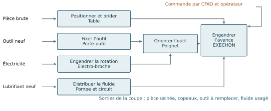

[Archive officielle, fichier sujet p. 9 · fichier cahier p. 3](https://www.banquept.fr/documents/2010/si_a_pt_2010.zip)

### Question 2 — Solutions du FAST

> [!INDICATION]
> Attribuer une solution à chaque verbe et exprimer la fonction des composants déjà nommés.

#### Solution

Les machines synchrones autopilotées transforment l’énergie électrique en énergie cinétique. L’EXECHON et le poignet guident ensemble l’outil par rapport au bâti : les trois bras déplacent le plateau et le poignet ajuste l’orientation. La table support de pièce assure le positionnement et le maintien de la pièce. L’électro-broche entraîne en rotation l’outil pour engendrer la puissance de coupe.

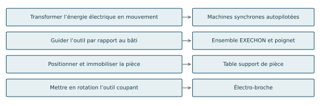

[Archive officielle, fichier sujet p. 9 · fichier cahier p. 3](https://www.banquept.fr/documents/2010/si_a_pt_2010.zip)

### Question 3 — Graphe des liaisons

> [!INDICATION]
> Parcourir chaque branche depuis le bâti avant d’ajouter les deux éléments en série.

#### Solution

Le dessin donne les quinze liaisons. Sur B1, les pivots du cardan ont les axes $(A_0,y_0)$ et $(A_0,x_{10})$, la glissière est parallèle à $z_{10}$ et le pivot terminal a pour axe $(A_4,x_4)$. Sur B3, remplacer A par C et 10 par 30. Sur B2, les deux pivots d’entrée sont $(B_0,x_0)$ et $(B_0,y_{20})$. Viennent le pivot longitudinal $(B_0,z_{20})$, la glissière parallèle à $z_{20}$ et le pivot $(B_4,y_4)$. Les pivots du poignet sont $(O_4,z_4)$ et $(O_5,x_{45})$.

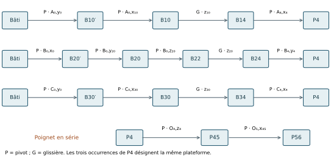

[Archive officielle, fichier sujet p. 9 · fichier cahier p. 4](https://www.banquept.fr/documents/2010/si_a_pt_2010.zip)

### Question 4 — Hyperstatisme

> [!INDICATION]
> Compter les cycles fermés et distinguer la mobilité du mécanisme de la somme des mobilités des liaisons.

#### Solution

Avec 14 solides bâti inclus, 15 liaisons à un degré de liberté et un graphe connexe, il y a $15-14+1=2$ cycles indépendants. Hors singularité, les trois axes pilotent trois mobilités de plateforme et le poignet en ajoute deux. Donc $m=5$ et $h=m+6\times2-15=2$. Les deux pivots en série du poignet n’introduisent aucun cycle.

## C — Arrêt d’urgence et contrôle d’un défaut simple

### Question 5 — Équations des contacteurs

> [!INDICATION]
> Suivre les branches en série puis les branches parallèles sur les folios 17 et 21. L’auto-maintien utilise l’état antérieur.

#### Solution

Sous tension de commande, $KAU=\overline{SB1}\,SA1$. Au folio 21, $KAMG^{+}=SA\,\overline{SB3}\,KAU\,[SB4\,KAP+KAMG]$. La clé autorise la commande, SB3 interrompt la branche commune et le contact de maintien de KAMG se place en parallèle de la série SB4 et KAP. Une action sur l’arrêt d’urgence fait tomber KAU.

[Archive officielle, fichier sujet p. 11 · fichier cahier p. 5](https://www.banquept.fr/documents/2010/si_a_pt_2010.zip)

### Question 6 — Alimentation des relais auxiliaires

> [!INDICATION]
> Le pont redresseur conserve la présence d’une différence de potentiel entre ses entrées.

#### Solution

$Y1=\overline{SB1a}\,\overline{SB1b}$. Les contacts de repos ferment chacun un conducteur d’alimentation du module. L’ouverture de l’un suffit à annuler la tension utile. Le redresseur transforme sa polarité en valeur absolue.

### Question 7 — Tables d’évolution en défaut simple

> [!INDICATION]
> À chaque phase conserver l’état du contact défaillant, puis suivre la chute de la seconde voie et le contrôle au réarmement.

#### Solution

Le tableau donne les états après stabilisation dans l’ordre $(KA1,KA2,KAU1,KAU2)$ ; chaque état final devient l’état initial de la phase suivante. Pour KA1 maintenu au travail, la seconde voie fait tomber les deux sorties en phase 2. En phase 4 le circuit de contrôle interdit le redémarrage. Pour KAU1 dont le contact reste au travail, KAU2 ouvre la chaîne d’autorisation en phase 2. Le retour de contrôle de KAU1 interdit le redémarrage en phase 4. La phase 3 est la levée de la demande d’arrêt, sans ordre de réarmement.

### Question 8 — Autorisation par deux voies

> [!INDICATION]
> Toute retombée d’une des voies doit ouvrir la chaîne d’autorisation.

#### Solution

Insérer fonctionnellement deux contacts normalement ouverts en série. L’autorisation est $KAU1\land KAU2$. Dans le modèle de défaut unique, si l’un reste exceptionnellement fermé lors de la demande, l’autre ouvre encore la chaîne. Le schéma présente la condition logique dans le cadre du cahier.

[Archive officielle, fichier sujet p. 12 · fichier cahier p. 7](https://www.banquept.fr/documents/2010/si_a_pt_2010.zip)

### Question 9 — Conformité de l’arrêt d’urgence

> [!INDICATION]
> Tester séparément la coupure immédiate et le refus de repartir en présence d’un défaut.

#### Solution

Pour chacune des deux défaillances simples examinées, la voie saine obtient l’arrêt et la discordance empêche la remise en service. La redondance simple et l’autocontrôle avec verrouillage demandés au tableau 4 sont ainsi satisfaits par le modèle étudié. Le folio simple de la question 5 ne présentait pas cette redondance.

## D.1 — Cinématique des trois bras

### Question 10 — Torseurs élémentaires de l’axe 1

> [!INDICATION]
> Écrire le vecteur rotation au-dessus de la vitesse du point indiqué. Lire le sens de la définition de chaque angle.

#### Solution

Notons $(\boldsymbol\omega;\boldsymbol v)_M$ le torseur réduit en M. Avec $W_1=\dot\theta_{10'}\boldsymbol y_0+\dot\theta_{10}\boldsymbol x_{10}$, on a $V_{10/0}=(W_1;0)_{A_0}$ et $V_{14/10}=(0;\dot\lambda_{14}\boldsymbol z_{10})_{A_0}$. Enfin $V_{4/14}=(-\dot\theta_{14}\boldsymbol x_4;0)_{A_4}$ car le tableau définit l’angle du repère 4 vers le repère 14.

[Archive officielle, fichier sujet p. 14 · fichier cahier p. 8](https://www.banquept.fr/documents/2010/si_a_pt_2010.zip)

### Question 11 — Torseur de plateforme par l’axe 1

> [!INDICATION]
> Transporter le premier torseur de A₀ à A₄ avant d’additionner.

#### Solution

La rotation est $W_{4/0}^{(1)}=W_1-\dot\theta_{14}\boldsymbol x_4$. La vitesse au point commun vaut $v_A=W_1\times(\lambda_{14}\boldsymbol z_{10})+\dot\lambda_{14}\boldsymbol z_{10}$. Ainsi $V_{4/0}^{(1)}=(W_{4/0}^{(1)};v_A)_{A_4}$. Le pivot terminal de rotation n’ajoute aucune vitesse en son centre.

### Question 12 — Torseur de plateforme par l’axe 3

> [!INDICATION]
> Conserver les axes de projection propres au bras 3.

#### Solution

Avec $W_3=\dot\theta_{30'}\boldsymbol y_0+\dot\theta_{30}\boldsymbol x_{30}$, on obtient $W_{4/0}^{(3)}=W_3-\dot\theta_{34}\boldsymbol x_4$ et $v_C=W_3\times(\lambda_{34}\boldsymbol z_{30})+\dot\lambda_{34}\boldsymbol z_{30}$. Le torseur cherché est $(W_{4/0}^{(3)};v_C)_{C_4}$.

### Question 13 — Quatre torseurs de l’axe 2

> [!INDICATION]
> Le pivot longitudinal et la glissière partagent la direction du bras.

#### Solution

Posons $W_2=\dot\theta_{20'}\boldsymbol x_0+\dot\theta_{20}\boldsymbol y_{20}$. On a $V_{20/0}=(W_2;0)_{B_0}$, $V_{22/20}=(\dot\theta_{22}\boldsymbol z_{20};0)_{B_0}$, $V_{24/22}=(0;\dot\lambda_{24}\boldsymbol z_{20})_{B_0}$ et $V_{4/24}=(-\dot\theta_{24}\boldsymbol y_4;0)_{B_4}$. Les deux points B₀ et B₄ sont sur l’axe du pivot longitudinal.

### Question 14 — Torseur de plateforme par l’axe 2

> [!INDICATION]
> Le produit vectoriel d’un vecteur axial par un bras de levier parallèle s’annule.

#### Solution

La somme des rotations vaut $W_{4/0}^{(2)}=W_2+\dot\theta_{22}\boldsymbol z_{20}-\dot\theta_{24}\boldsymbol y_4$. La vitesse au point B₄ vaut $v_B=W_2\times(\lambda_{24}\boldsymbol z_{20})+\dot\lambda_{24}\boldsymbol z_{20}$. Le pivot longitudinal contribue à la rotation mais sa contribution à la vitesse de B₄ est nulle.

### Question 15 — Fermeture cinématique

> [!INDICATION]
> Deux points d’un même solide ont un seul vecteur rotation et des vitesses reliées par le transport.

#### Solution

Les deux équations vectorielles sont $W_1-\dot\theta_{14}\boldsymbol x_4=W_3-\dot\theta_{34}\boldsymbol x_4=W$ et $v_C-v_A=W\times(2c_4\boldsymbol y_4)$. En y remplaçant $v_A$ et $v_C$ par les expressions des deux bras, cela donne $W_3\times\lambda_{34}\boldsymbol z_{30}+\dot\lambda_{34}\boldsymbol z_{30}-W_1\times\lambda_{14}\boldsymbol z_{10}-\dot\lambda_{14}\boldsymbol z_{10}=W\times2c_4\boldsymbol y_4$. Les produits vectoriels restent non développés comme demandé.

### Question 16 — Rôle du pivot longitudinal

> [!INDICATION]
> Considérer une orientation générale du plateau, au-delà de la translation particulière étudiée ensuite.

#### Solution

La rotation autour de la droite B₀B₄ laisse inchangée la longueur du bras et la position de son extrémité. Elle permet à son axe de pivot terminal de suivre l’orientation imposée par le plateau et les deux autres branches. Supprimer cette rotation imposerait une condition angulaire supplémentaire : certains mouvements utiles seraient empêchés ou imposeraient des déformations.

### Question 17 — Poignet articulé

> [!INDICATION]
> Compter les mobilités pilotées disponibles au niveau de l’outil.

#### Solution

Les trois translations de vis imposent trois coordonnées indépendantes du mouvement de plateforme. La direction d’outil demandée par la surface à fraiser doit aussi être réglée. Les deux axes du poignet apportent deux coordonnées d’orientation indépendantes et permettent de conserver la direction voulue malgré l’inclinaison de la plateforme. La rotation de coupe de la broche joue un autre rôle.

## D.2 — Puissances et inertie de l’axe 1

### Question 18 — Longueurs avant et après translation

> [!INDICATION]
> Écrire le segment de déplacement comme la différence de deux rayons vecteurs issus de A₀.

#### Solution

Avec $\lambda_i,\lambda_f$ les deux longueurs, $\overrightarrow{A_{4i}A_{4f}}=\lambda_f\boldsymbol z_f-\lambda_i\boldsymbol z_i=U\boldsymbol z_0$. Son carré donne $U^2=\lambda_i^2+\lambda_f^2-2\lambda_i\lambda_f\cos(\Delta\theta_{10})$. Le même déplacement vaut pour tout point de la plateforme en translation. Il s’agit de la loi des cosinus dans le triangle de la figure.

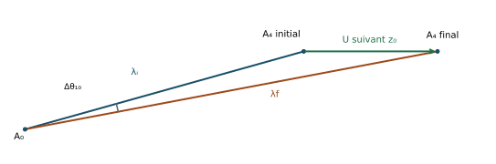

[Archive officielle, fichier sujet p. 17 · fichier cahier p. 12](https://www.banquept.fr/documents/2010/si_a_pt_2010.zip)

### Question 19 — Vitesse de translation et longueur de bras

> [!INDICATION]
> Préciser sur quel axe est projetée la variation géométrique et ce qui est gelé dans l’approximation.

#### Solution

Pour la translation guidée le long de $z_0$, la cote transversale de A₄ reste fixe : la vitesse axiale est la projection de la vitesse de A₄ sur le bras. Ainsi $\dot\lambda_{14}=\dot U\cos\theta_{10}$ et $\dot U=\dot\lambda_{14}/\cos\theta_{10}$ ; pour une petite course on évalue le cosinus à l’angle initial.

### Question 20 — Pas de la vis

> [!INDICATION]
> Lire la référence BRC 36×6 dans la documentation SKF et convertir les tours en radians.

#### Solution

Le pas d’avance est $P_h=6$ mm/tr. Dans le sens positif d’allongement, $\dot\lambda_{14}=k\,\omega_{\rm vis/B10}$ avec $k=P_h/(2\pi)=9,5493\times10^{-4}$ m/rad. Inverser le sens positif de rotation change le signe du rapport. La valeur 36 mm est le diamètre nominal.

### Question 21 — Puissance du poids du bras

> [!INDICATION]
> Les centres sur le premier élément sont fixes dans le modèle d’orientation gelée. Calculer le produit scalaire du poids et de la vitesse du second.

#### Solution

B10 et B10′ ont une puissance de pesanteur nulle. B14 glisse à $\dot\lambda_{14}\boldsymbol z_{10}$ dans le modèle où l’on néglige la rotation du bras. Sa puissance est $m_{14}g\dot\lambda_{14}\,\boldsymbol z_g\cdot\boldsymbol z_{10}=m_{14}g\dot\lambda_{14}\cos\theta_{10}/\sqrt2$. Ici $\boldsymbol z_g=(\boldsymbol z_0+\boldsymbol x_0)/\sqrt2$ et $\theta_{10'}=0$, donc $\boldsymbol x_0\cdot\boldsymbol z_{10}=0$.

### Question 22 — Puissance transmise par la plateforme

> [!INDICATION]
> Une force dotée d’un moment nul se transporte avec son moment ; pour une translation de la plateforme, le point choisi ne change pas la puissance.

#### Solution

Le tiers du poids de plateforme exerce $\boldsymbol F=(m_4/3)g\boldsymbol z_g$. Sur la trajectoire imposée, la vitesse du point A₄ est $\dot U\boldsymbol z_0$. Ainsi $\mathcal P_4=m_4g\dot U/(3\sqrt2)$, positive pour une descente dans le sens donné. Dans la convention projetée de Q19 on remplace $\dot U$ par $\dot\lambda_{14}\cos\theta_{10}$.

### Question 23 — Énergie-puissance ramenée au moteur

> [!INDICATION]
> Isoler l’axe 1 avec sa transmission et distinguer la charge de plateforme appliquée de l’inertie des solides effectivement isolés.

#### Solution

Dans le modèle angulaire gelé, l’énergie cinétique des masses translatées et des inerties tournantes est $E_c=J_{\rm ram}\omega^2/2$, avec $J_{\rm ram}=J_{\rm rot}+m_{\rm tr}k^2$. Si B14 seul est compté en translation, $m_{\rm tr}=m_{14}$ ; $J_{\rm rot}$ comprend les inerties de vis et de rotor effectivement retenues, ramenées à la rotation moteur. Les actions intérieures de liaisons parfaites ont une puissance totale nulle. Avec le seul système mécanique de l’axe, $J_{\rm ram}\omega\dot\omega=C_M\omega+\mathcal P_{14}+\mathcal P_4$. En posant $a=\dot U/\dot\lambda_{14}$ selon la convention retenue, on obtient $J_{\rm ram}\dot\omega=C_M+gk(m_{14}\cos\theta_{10}+m_4 a/3)/\sqrt2$.

## D.3 — Identification de la boucle de couple

### Question 24 — Identification de la boucle de couple

> [!INDICATION]
> Lire le rapport des plateaux puis le temps nécessaire pour parcourir 63,2 % de la variation. L’échelon commence à 0,50 ms.

#### Solution

Le gain est $K=2,91/3=0,97$. Le niveau $0,632\times2,91=1,84$ est atteint vers 0,65 ms, soit $\tau\simeq0,15$ ms après l’échelon. L’allure monotone donne $C/C_{\rm ref}=0,97/(1+1,5\times10^{-4}p)$, avec p en s⁻¹.

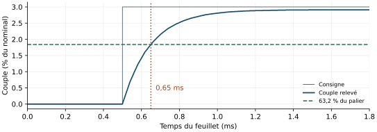

[Archive officielle, fichier sujet p. 20 · fichier cahier p. 15](https://www.banquept.fr/documents/2010/si_a_pt_2010.zip)

### Question 25 — Identification du retard

> [!INDICATION]
> Employer le même seuil en décalant le début de la réponse sans modifier sa constante de temps.

#### Solution

L’entrée est appliquée à 0,50 ms, le couple commence à évoluer vers 0,74 à 0,75 ms. Le passage à 1,84 a lieu vers 0,90 ms. En retenant le retard arrondi $d=0,25$ ms et la constante $\tau=0,15$ ms, $C/C_{\rm ref}=0,97e^{-0,00025p}/(1+0,00015p)$. L’incertitude de lecture d’une dizaine de microsecondes affecte surtout l’origine du départ.

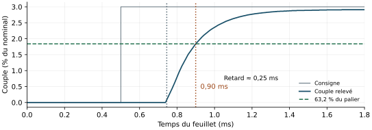

[Archive officielle, fichier sujet p. 20 · fichier cahier p. 16](https://www.banquept.fr/documents/2010/si_a_pt_2010.zip)

### Question 26 — Approximation rationnelle du retard

> [!INDICATION]
> Développer au premier ordre l’exponentielle du dénominateur pour obtenir un pôle stable.

#### Solution

On écrit $e^{-dp}=1/e^{dp}\simeq1/(1+dp)$ pour $|dp|\ll1$. D’où $H_C(p)\simeq0,97/[(1+0,00025p)(1+0,00015p)]$. Le pôle ajouté est $-1/d$.

### Question 27 — Bode asymptotique du couple

> [!INDICATION]
> Ordonner les deux ruptures et cumuler les contributions des pôles.

#### Solution

Les pulsations sont $\omega_1=4000$ et $\omega_2=6667$ rad/s. Le gain commence à $20\log_{10}(0,97)=-0,265$ dB puis décroît de 20 dB/décade entre les ruptures et de 40 dB/décade au-delà. Pour la phase asymptotique en paliers, les niveaux successifs sont $0°, -90°, -180°$. Avec la convention rectiligne continue, chaque pôle ajoute une rampe de −45°/décade entre $0,1\omega_i$ et $10\omega_i$, centrée à −45° sur sa rupture. Le graphique représente les deux conventions de phase.

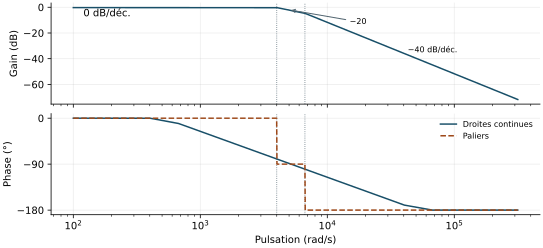

[Archive officielle, fichier sujet p. 21 · fichier cahier p. 17](https://www.banquept.fr/documents/2010/si_a_pt_2010.zip)

### Question 28 — Phase harmonique mesurée

> [!INDICATION]
> Déplier la phase au passage de −180° et convertir les hertz en radians par seconde pour la comparaison.

#### Solution

Sur la CN, le saut d’environ −180° à +180° traduit le repli de l’affichage. La phase déroulée continue de décroître entre 2 et 4 kHz, sous −180°. Celle du modèle à deux pôles tend vers −180° et reste au-dessus de cette limite à fréquence finie. Le retard réel contribue pour $-\omega d$ radians, tandis que son substitut à un pôle donne $-\arctan(\omega d)$. L’accord à basse fréquence ne préjuge pas de l’accord en haute fréquence.

## D.4 — Asservissement de vitesse

### Question 29 — Charge ramenée à l’arbre

> [!INDICATION]
> Appliquer la dynamique en rotation avec frottement visqueux.

#### Solution

$J_{\rm eq}\dot\Omega+f_{\rm eq}\Omega=C$. À conditions initiales nulles, $\Omega/C=(1/f_{\rm eq})/[1+(J_{\rm eq}/f_{\rm eq})p]=0,4/(1+0,004p)$. Le gain s’exprime en (rad/s)/(N·m), la constante de temps vaut 4 ms.

[Archive officielle, fichier sujet p. 22 · fichier cahier p. 18](https://www.banquept.fr/documents/2010/si_a_pt_2010.zip)

### Question 30 — Quadrature en rotation négative

> [!INDICATION]
> Repérer le front montant de A puis déplacer B d’un quart de période en avance.

#### Solution

Dans le sens négatif $B(t)=A(t+T/4)$. Si A monte à $t=0$, B est déjà à 1 et descend à $T/4$, tandis que A descend à $T/2$. Le chronogramme donne deux périodes.

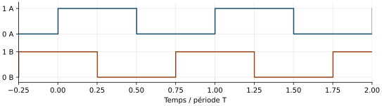

[Archive officielle, fichier sujet p. 22 · fichier cahier p. 18](https://www.banquept.fr/documents/2010/si_a_pt_2010.zip)

### Question 31 — Nombre de périodes du codeur

> [!INDICATION]
> Compter les fronts distincts sur un cycle des deux voies en quadrature.

#### Solution

Avec un décodage des deux flancs sur les deux voies, chaque période fournit quatre tops. Chaque piste donne $2048/4=512$ périodes par tour, soit 1024 fronts par voie et 2048 en tout.

### Question 32 — Sens de rotation sur bascule D

> [!INDICATION]
> Lire A au front montant de B quand B est en retard d’un quart de période.

#### Solution

Relier A à D et B à l’horloge active au front montant. En rotation positive, A est haut à la montée de B et la bascule mémorise 1. En rotation négative, A est bas à cet instant et la bascule mémorise 0. La valeur est définie après le premier front d’échantillonnage.

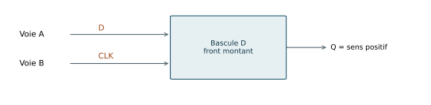

[Archive officielle, fichier sujet p. 22 · fichier cahier p. 19](https://www.banquept.fr/documents/2010/si_a_pt_2010.zip)

### Question 33 — Gain du capteur de vitesse

> [!INDICATION]
> Passer des tops par tour aux tops par radian avant de dériver la position mesurée.

#### Solution

$K_s=2048/(2\pi)=325,95$ tops/rad. Pour $n=K_s\theta$, la dérivée donne $\dot n=K_s\Omega$. Le gain de $\widehat\Omega/\Omega$ dans l’échelle de mesure du schéma est ainsi $K_s$. Si la CN exprime ensuite la vitesse en rad/s, elle doit appliquer le facteur réciproque.

### Question 34 — Deux modes dominants

> [!INDICATION]
> Comparer les constantes de temps des trois facteurs de la chaîne directe.

#### Solution

Le produit mécanique et couple vaut $0,4\times0,97/[(1+0,004p)(1+0,00025p)(1+0,00015p)]$. On conserve les deux constantes les plus longues et le gain statique, soit $\Omega/C_{\rm ref}\simeq0,388/[(1+0,004p)(1+0,00025p)]$. La voie de retour est le gain $K_s$. Les deux modes rapides étant peu séparés, cette réduction mérite une vérification expérimentale.

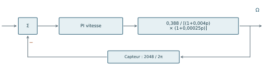

[Archive officielle, fichier sujet p. 22 · fichier cahier p. 19](https://www.banquept.fr/documents/2010/si_a_pt_2010.zip)

### Question 35 — Zéro du PI de vitesse

> [!INDICATION]
> Le pôle le plus lent est associé à la plus longue constante de temps.

#### Solution

Le zéro du correcteur $K_\Omega(1+T_\Omega p)/(T_\Omega p)$ vaut $-1/T_\Omega$. Le pôle mécanique est $-1/0,004=-250$ s⁻¹. Le choix est $T_\Omega=0,004$ s.

### Question 36 — Fermeture de la boucle de vitesse

> [!INDICATION]
> Simplifier le facteur mécanique avec le zéro du PI, puis boucler avec le capteur réel.

#### Solution

Après compensation, $G=0,388K_\Omega/[0,004p(1+0,00025p)]$. Avec $K_s=2048/(2\pi)$, $H_\Omega=G/(1+K_sG)$. Son numérateur normalisé vaut $1/K_s$ et son dénominateur est $1+[0,004/(0,388K_\Omega K_s)]p+[0,004\times0,00025/(0,388K_\Omega K_s)]p^2$. Le gain statique non unitaire vient des unités différentes de la référence numérique et de la vitesse angulaire.

### Question 37 — Réglage sans dépassement

> [!INDICATION]
> Pour un deuxième ordre sans zéro, la réponse monotone la plus rapide se trouve à l’amortissement critique.

#### Solution

Sur le modèle imposé, $2\zeta/\omega_0=3\times10^{-5}/K_\Omega$ et $1/\omega_0^2=8\times10^{-9}/K_\Omega$. En fixant $\zeta=1$, on trouve $K_\Omega=(3\times10^{-5})^2/(4\times8\times10^{-9})=0,028125$, soit **0,03** à deux décimales. Pour les vérifications, conserver la valeur critique avant arrondi.

### Question 38 — Pulsation naturelle

> [!INDICATION]
> Employer la valeur non arrondie donnant le pôle double.

#### Solution

$\omega_0=\sqrt{0,028125/(8\times10^{-9})}=1875$ rad/s, soit environ $1,9\times10^3$ rad/s. Avec 0,03 pris littéralement, la pulsation serait 1936 rad/s. Le modèle arrondi utilisé ultérieurement en position reprend 2000 rad/s.

### Question 39 — Temps réduit à l’amortissement critique

> [!INDICATION]
> Lire l’abaque à l’abscisse 1 et diviser l’ordonnée par la pulsation propre.

#### Solution

Pour $\zeta=1$, la réponse réduite est $1-(1+u)e^{-u}$, avec $u=\omega_0t$. La limite de la bande est franchie à $(1+u)e^{-u}=0,05$, soit $u=4,744$. L’abaque donne environ 4,7 à 4,8. Ainsi $t_{r5}=4,744/1875=2,53$ ms.

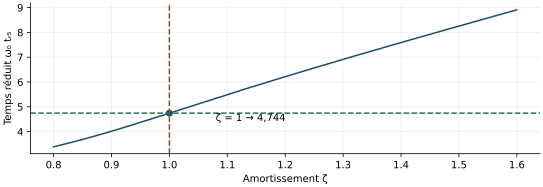

[Archive officielle, fichier sujet p. 23 · fichier cahier p. 21](https://www.banquept.fr/documents/2010/si_a_pt_2010.zip)

### Question 40 — Lecture sur le modèle complet

> [!INDICATION]
> Construire la bande à partir de la valeur finale de la courbe elle-même.

#### Solution

La graduation verticale du tracé donne un palier voisin de $3,07\times10^{-3}$ rad/s. Le seuil inférieur est donc voisin de $2,92\times10^{-3}$ rad/s. La courbe le franchit vers **1,9 ms** et reste ensuite dans la bande. Cette durée est plus courte que les 2,53 ms du modèle réduit.

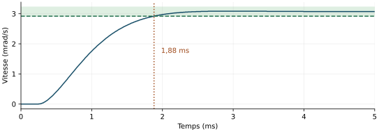

[Archive officielle, fichier sujet p. 24 · fichier cahier p. 21](https://www.banquept.fr/documents/2010/si_a_pt_2010.zip)

### Question 41 — Lecture sur le Triptéor

> [!INDICATION]
> Chercher la dernière entrée durable dans la bande en traits mixtes. Une première traversée peut être suivie d’une petite oscillation.

#### Solution

La base de temps est de 0,5 ms par division. Après les derniers passages près de la limite inférieure, l’essai est dans la bande à environ **2,2 ms** (environ 2,1 à 2,3 ms compte tenu du crénelage). On obtient donc environ 1,9 ms pour la simulation complète, 2,2 ms sur machine et 2,53 ms pour la réduction. Les trois conclusions sur la rapidité concordent, les courbes ne se superposent pas.

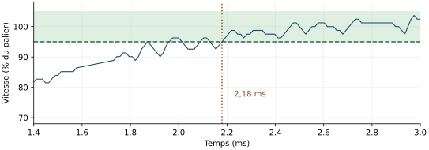

[Archive officielle, fichier sujet p. 25 · fichier cahier p. 22](https://www.banquept.fr/documents/2010/si_a_pt_2010.zip)

### Question 42 — Origine du dépassement

> [!INDICATION]
> Comparer le modèle du réglage avec les dynamiques réellement présentes.

#### Solution

Le choix critique donne un pôle double réel négatif et aucun zéro dans le transfert réduit : sa réponse indicielle est monotone. Le réglage n’avait donc pas pour objectif un dépassement. Le retard, le troisième mode supprimé et les effets d’échantillonnage modifient phase et amortissement de la boucle réelle. Les petites oscillations des essais sont compatibles avec ces simplifications.

### Question 43 — Validation du cahier des charges en vitesse

> [!INDICATION]
> Évaluer séparément synchronisme stationnaire, rapidité et dépassement.

#### Solution

Le PI contient un intégrateur et annule l’écart permanent au comparateur pour un échelon, sous boucle stable et hors saturation. Dans les unités du modèle, la sortie physique converge vers la référence divisée par $K_s$. L’essai satisfait $t_{r5}<3$ ms. Le dépassement visible contredit l’exigence stricte $D_1=0$ : l’ensemble des trois critères du tableau 5 n’est donc pas entièrement satisfait.

## E — Asservissement de position

### Question 44 — Blocs de la position

> [!INDICATION]
> Passer de rad/s à mm/min et de mm/min à mm en conservant la seconde comme unité de Laplace.

#### Solution

5000 tr/min donnent 30 000 mm/min, soit 6 mm/tour. De $\Omega$ à $V$ le bloc vaut $6\times60/(2\pi)=57,30$, arrondi à **60** avec la convention $2\pi\simeq6$ du sujet. De V à X le bloc est $1/(60p)$. La voie de retour, capteur et compensation réunis, vaut 1. Le schéma reprend cette convention pour les questions suivantes.

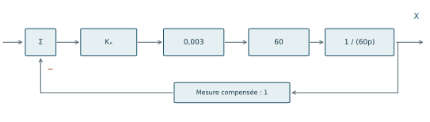

[Archive officielle, fichier sujet p. 27 · fichier cahier p. 23](https://www.banquept.fr/documents/2010/si_a_pt_2010.zip)

### Question 45 — Position avec vitesse assimilée à un gain

> [!INDICATION]
> Réunir les conversions et l’intégrateur puis fermer sur la position en millimètres.

#### Solution

En posant $a=0,003$, la chaîne directe est $aK_x/p$. D’où $X/X_{\rm ref}=aK_x/(p+aK_x)=1/[1+p/(aK_x)]$. La constante de temps de position est $1/(0,003K_x)$.

### Question 46 — Gain pour 40 millisecondes

> [!INDICATION]
> Pour un premier ordre, le facteur exact à 5 % est le logarithme de 20.

#### Solution

$\ln(20)/(0,003K_x)=0,040$ conduit à $K_x=24\,964$, soit environ $25\,000$ avec la règle des trois constantes de temps. Le transfert numérique est voisin de $1/(1+0,01333p)$. L’objectif de 40 ms est le point nominal retenu, assorti de la tolérance du tableau 6.

### Question 47 — Position avec une vitesse du deuxième ordre

> [!INDICATION]
> Conserver le dénominateur de vitesse lors de la fermeture de la boucle extérieure.

#### Solution

Avec $D_v=1+0,001p+2,5\times10^{-7}p^2$, la boucle ouverte est $0,003K_x/(pD_v)$. La forme canonique fermée vaut $1/[1+p/(0,003K_x)+0,001p^2/(0,003K_x)+2,5\times10^{-7}p^3/(0,003K_x)]$.

### Question 48 — Stabilité du troisième ordre

> [!INDICATION]
> Construire la première colonne de la table de Routh avant de conclure.

#### Solution

Pour le polynôme $2,5\times10^{-7}p^3+0,001p^2+p+0,003K_x$, les premières colonnes sont $2,5\times10^{-7}$, $0,001$, $1-(2,5\times10^{-7})(0,003K_x)/0,001$ et $0,003K_x$. Toutes sont strictement positives si $0<K_x<1,333\times10^6$. Le réglage proche de 25 000 appartient à cet intervalle.

### Question 49 — Mode dominant de position

> [!INDICATION]
> Comparer les durées de décroissance des trois racines données, en gardant le gain continu unitaire.

#### Solution

Les pôles −80, −1600 et −2400 s⁻¹ correspondent respectivement à 12,5, 0,625 et 0,417 ms. Le premier est vingt à trente fois plus lent. En remplaçant les deux facteurs rapides par 1 dans la plage de position, $H_X\simeq1/(1+0,0125p)$. On retrouve à environ 6 % près la constante de 13,33 ms obtenue en Q46.

### Question 50 — Erreur statique de position

> [!INDICATION]
> Exprimer l’erreur de boucle à partir du gain en boucle ouverte.

#### Solution

$E/X_{\rm ref}=1/(1+aK_x/p)=p/(p+aK_x)$. Pour un échelon unitaire, $\lim_{p\to0}pE(p)=0$ si $K_x>0$. L’erreur statique est nulle dans le modèle.

### Question 51 — Erreur en poursuite du proportionnel

> [!INDICATION]
> La rampe a pour transformée $1/p^2$ et sa pente est ici de 1 mm/s.

#### Solution

$\lim_{p\to0}pE(p)=1/(aK_x)\simeq0,01333$ mm, soit **13,3 µm**. L’échelon respecte la tolérance statique de 0,5 µm du tableau 6, mais la rampe dépasse le maximum de 10 µm. Pour une pente différente, l’erreur est proportionnelle à cette pente.

### Question 52 — Action intégrale et poursuite

> [!INDICATION]
> Compter les intégrateurs en boucle ouverte et vérifier que le système fermé reste stable.

#### Solution

Avec le PI, $L=aK_x(1+T_xp)/(T_xp^2)$. Le gain continu de $pL$ devient infini. Pour une rampe unité, $pE=1/[p(1+L)]\to0$. Le dénominateur fermé est $T_xp^2+aK_xT_xp+aK_x$, stable pour $T_x,K_x>0$ dans ce modèle simplifié.

### Question 53 — Saturation et accumulation

> [!INDICATION]
> Regarder ce que fait l’intégrateur si la vitesse demandée reste supérieure à la vitesse réalisable.

#### Solution

Pendant un déplacement long à vitesse maximale, l’écart persiste et l’intégrateur accumule une commande que l’actionneur ne peut fournir. À la sortie de saturation, cette réserve provoque retard de retour et dépassement. Un dispositif anti-emballement peut suspendre l’intégration lorsque la saturation et l’erreur poussent dans le même sens, ou réinjecter l’écart entre commande réellement appliquée et commande calculée.

### Question 54 — Phase de la correction intégrale

> [!INDICATION]
> Comparer le PI au gain proportionnel au voisinage du recouvrement.

#### Solution

Le PI ajoute une phase $\arctan(\omega T_x)-90°$, proche de −90° à très basse fréquence et de 0° à haute fréquence. Si le recouvrement intervient dans la zone de déphasage significatif, la marge de phase diminue et l’amortissement peut se dégrader. La boucle ouverte comporte désormais deux intégrations aux basses fréquences.

### Question 55 — Transfert avec anticipation de vitesse

> [!INDICATION]
> Les actions de la boucle proportionnelle et de la prédiction de vitesse se somment à l’entrée de la boucle interne.

#### Solution

Avec $V/\Omega_{\rm ref}=0,18$ et $X/V=1/(60p)$, posons $a=0,18/60=0,003$. On a $pX=a[K_x(X_{\rm ref}-X)+K_{av}pX_{\rm ref}]$. La forme canonique est $H_X=(1+(K_{av}/K_x)p)/(1+p/(aK_x))$. L’anticipation introduit un zéro sans déplacer le pôle du retour.

### Question 56 — Erreur de rampe avec anticipation

> [!INDICATION]
> Former $1-H_X$ avant d’appliquer le théorème de la valeur finale.

#### Solution

$1-H_X=(1-aK_{av})p/(p+aK_x)$. Pour une rampe unitaire en mm/s, $e_p=(1-aK_{av})/(aK_x)=(333,33-K_{av})/K_x$ mm. Le signe donnerait une avance si l’action anticipatrice était réglée trop forte.

### Question 57 — Valeur d’anticipation

> [!INDICATION]
> Annuler le numérateur de l’erreur au régime permanent.

#### Solution

$aK_{av}=1$ impose $K_{av}=60/0,18=333,33$ dans les unités du modèle, indépendant de $K_x$. Dans ce modèle idéal, le zéro compense même exactement le pôle de suivi de consigne et le transfert devient 1. Les perturbations et erreurs de modèle restent traitées par le retour.

### Question 58 — Filtre d’anticipation réalisable

> [!INDICATION]
> Lire sur la figure 32 les 95 % de l’amplitude de déplacement, puis comparer deux temps de réponse à 5 %.

#### Solution

Le déplacement va d’environ −939,8242 à −939,3242 mm, soit 0,5000 mm. Le seuil à 95 % est −939,3492 mm. Le dernier passage se lit vers **37 ms** depuis l’origine du graphe (environ 36 à 38 ms). Pour $K_{av}p/(1+T_fp)$, le filtre du premier ordre doit vérifier $\ln(20)T_f\le37/10$ ms, donc $T_f\lesssim1,23$ ms. **1,0 ms** est un choix convenable ; son propre temps de réponse vaut 3,00 ms.

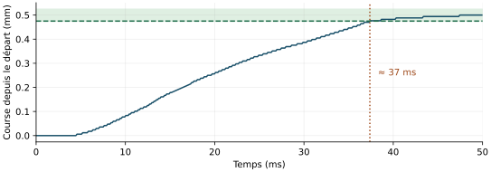

[Archive officielle, fichier sujet p. 31 · fichier cahier p. 28](https://www.banquept.fr/documents/2010/si_a_pt_2010.zip)

### Question 59 — Validation de la position

> [!INDICATION]
> Distinguer les critères lisibles sur l’échelon et ceux qu’évalue le modèle de poursuite.

#### Solution

Le graphe montre une réponse croissante sans dépassement visible, avec un temps de réponse voisin de 37 ms, compatible avec le nominal de 40 ms et sa tolérance de 20 %. Le modèle stable conserve un gain statique unitaire. Avec l’anticipation filtrée et $aK_{av}=1$, son erreur de rampe est nulle car le gain en basse fréquence du filtre reste 1. Le modèle satisfait donc les tolérances de 0,5 µm en statique et de 10 µm en poursuite.
