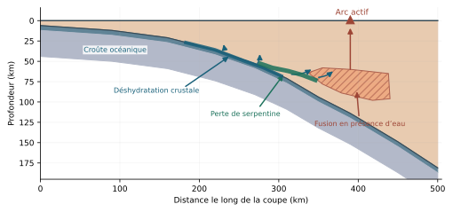
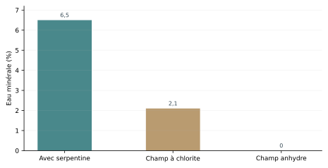
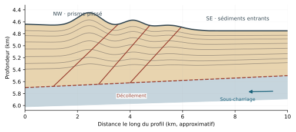
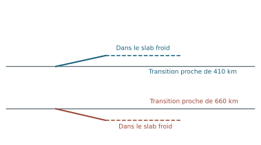
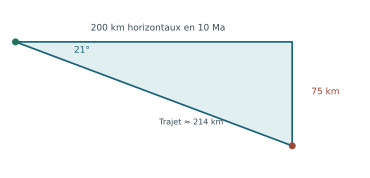

# ENS de Lyon — Second concours, Géosciences 2010 · Corrigé brut

*Corrigé rédigé par IA, non officiel.*

**Rédaction (tour 1)** · GPT-6.2 Astra Ultra · vitesse non renseignée

Les 19 questions et les 16 documents de l’original sont traités. Les reports des figures 7 et 11 sont fournis sous forme de coupes interprétatives. Les limites de réaction et les lectures cartographiques sont approximatives. L’archive officielle de 2010 ne rattache pas de rapport écrit à cette épreuve.

## 1. Reconnaître une subduction

### Question 1.1 — Identifier une plaque plongeante

Une fosse et un arc volcanique bordent la marge. Les hypocentres dessinent sous la plaque supérieure une bande inclinée, le plan de Wadati–Benioff, jusqu’à plusieurs centaines de kilomètres. La tomographie sismique y montre une anomalie de vitesse positive compatible avec une lithosphère froide. Les mesures géodésiques établissent la convergence. Les mécanismes au foyer des séismes superficiels d’interface indiquent un chevauchement. L’ensemble établit l’enfoncement de la lithosphère océanique.

## 2. Signatures du magmatisme d’arc

### Question 2.1 — Lire la lame mince

La roche contient de grands cristaux clairs tabulaires, dont certains présentent les macles polysynthétiques des plagioclases. Des cristaux bruns colorés et à clivages sont compatibles avec une amphibole, éventuellement accompagnée d’autres ferromagnésiens. Les grains opaques restent noirs. La pâte contient de nombreux microlites et des plages sombres. La texture microlitique porphyrique traduit une cristallisation commencée en profondeur puis un refroidissement rapide en surface. C’est une volcanite d’arc de composition intermédiaire, de la famille des andésites basaltiques à andésites. La figure 3 donne 52–58 % massiques de SiO₂, une plage dont la classification précise dépend aussi des alcalins.

### Question 2.2 — Signer une source d’arc

Les terres rares normalisées aux chondrites sont globalement plus enrichies à gauche, pour les terres rares légères, qu’à droite, pour les lourdes. Les profils des échantillons se ressemblent. Dans le spectre normalisé au N-MORB, les éléments mobiles en fluide comme Cs, Rb, Ba, Pb et Sr sont enrichis relativement aux éléments à fort potentiel ionique, avec un creux net en Nb et une dépression en Ti. Ce fractionnement est caractéristique d’un manteau de coin déjà appauvri ou de type mantellique, métasomatisé par des apports de la plaque subduite, éventuellement de ses sédiments. On ne peut pas calculer une proportion unique des sources avec ces profils.

### Question 2.3 — Éruption du Lascar

Un panache chargé de cendres s’élève et s’étale en volutes, tandis que des nuées plus basses se propagent sur les flancs. La photographie d’avril 1993 montre un dynamisme explosif avec colonne éruptive et courants pyroclastiques probablement liés à une déstabilisation de cette colonne. Un magma intermédiaire riche en volatils devient sursaturé en gaz pendant la décompression. Si sa viscosité et la rapidité de remontée empêchent un dégazage efficace, l’expansion des bulles fragmente le magma. La composition, la température, la cristallinité et l’alimentation modulent le phénomène.

## 3. Transfert des fluides et fusion

### Question 3.1 — Reporter deux domaines pétrologiques

À environ 20–35 kbar, le solidus de péridotite en présence d’eau libre est voisin de 1 000 °C. Dans le coin situé au-dessus de la croûte descendante, on hachure la portion dépassant ce seuil et alimentée en eau sous l’arc, vers l’abscisse 380–400 km. À cette abscisse, les domaines chauds se trouvent vers 60–100 km de profondeur, avant de retrouver la partie froide proche du slab. Le solide ne fond pas partout où T dépasse la courbe humide si l’eau manque.

La croûte basaltique suit un trajet pression–température plus froid que le cœur du coin. En passant des domaines riches en lawsonite et autres silicates hydratés aux assemblages plus pauvres en eau, elle cède un fluide. La sortie du champ de la lawsonite correspond, selon la pression, à une diminution d’environ 4,5 à 2,3 % ou 5,4 à 3,0 % d’eau liée. Plus loin la disparition de chlorite puis d’amphibole contribue encore à la déshydratation. On situe ces franchissements dans la bande crustale plongeante. La position est un intervalle car le haut et la base de cette bande ne suivent pas exactement le même trajet thermique.

### Question 3.2 — Hydrater le manteau sus-jacent

Le fluide moins dense remonte de la croûte dans la péridotite froide du toit. L’olivine et les pyroxènes peuvent former, entre autres, serpentine, chlorite et amphibole. Dans les champs les plus hydratés de la figure 5, jusqu’à environ 6,5 % en masse d’eau sont liés aux minéraux. Du manteau ainsi hydraté peut être entraîné vers des zones plus chaudes par la circulation du coin.

### Question 3.3 — Libération d’eau par la péridotite

La déstabilisation de la serpentine constitue un relais majeur. Vers 20–30 kbar et approximativement 650–720 °C, franchir par réchauffement la courbe Serp fait passer, par exemple, de 6,5 à environ 2,1 % d’eau liée. Une écriture schématique est serpentine → olivine + orthopyroxène + eau, la nature des phases dépendant de la composition. On reporte la réaction dans le coin hydraté, près du toit froid de la plaque et du côté plus chaud de la limite de stabilité. La chlorite et l’amphibole peuvent ensuite céder leur eau à plus haute température.

### Question 3.4 — Relier les deux grilles et la coupe thermique

La croûte océanique hydratée s’enfonce et se déshydrate. Une partie du fluide remonte directement et une autre est stockée dans les minéraux du coin froid. L’advection puis la déstabilisation de ces minéraux transfèrent l’eau vers une péridotite plus chaude. Le solidus hydraté y est franchi et une fusion partielle fournit des liquides mantelliques qui peuvent se différencier avant d’alimenter l’arc. La coupe indique le trajet des fluides avec des flèches, l’aire de fusion au-dessus du slab et le trajet ascendant des magmas.

### Question 3.5 — Volatils et dynamisme

En profondeur, l’eau abaisse le solidus de la péridotite et une partie se dissout dans le liquide produit. À la remontée, sa solubilité diminue et une phase gazeuse se sépare. Si cette phase reste piégée dans un liquide différencié, visqueux et chargé en cristaux, la surpression et l’expansion entraînent fragmentation, cendres et panaches. Un dégazage plus facile peut au contraire conduire à des phases effusives.

## 4. Le séisme chilien de 2010

### Question 4.1 — Mécanisme au foyer de Concepción

Le mécanisme du 27 février 2010 correspond à une faille inverse, à composante principale de chevauchement. Les directions nodales sont proches de la direction nord–sud à nord-nord-est de la marge. Le contexte sélectionne le plan faiblement incliné vers l’est, le long du contact où la plaque Nazca s’enfonce sous l’Amérique du Sud. Le raccourcissement est approximativement est–ouest. La plaque supérieure s’est déplacée vers la fosse par rapport à la plaque plongeante.

### Question 4.2 — Une perturbation sur la marée

Le marégraphe de Nuku Hiva montre d’abord la variation lente, proche de semi-diurne, de la marée. Le 27 février, dans la seconde partie de la journée selon l’axe du document, se superpose un train de vagues rapides de grande amplitude. Les extrêmes atteignent environ 4 à plus de 7 m sur l’échelle locale, soit plusieurs mètres de variation crête à creux. Les oscillations persistent en décroissant. La déformation brutale du fond océanique lors du chevauchement chilien a engendré un tsunami qui s’est propagé à travers le Pacifique jusqu’en Polynésie.

### Question 4.3 — Durée de recharge et lacunes sismiques

La portion centrale rompue en 2010 recouvre celle attribuée à 1835, soit environ 175 ans entre ces deux grands événements. Les segments voisins ont aussi rompu en 1906, 1928, 1960 ou 1985, sans reproduire exactement les mêmes contours. L’ordre de grandeur local est séculaire et la périodicité est irrégulière. Une interface bloquée peut continuer à accumuler de la déformation élastique pendant une longue période de faible sismicité. Avec la seule carte disponible en 2010, les segments couplés peu ou pas rompus récemment, notamment vers certaines ruptures de 1918–1922 plus au nord de la rupture de Maule, justifient une surveillance. Une telle carte ne fixe ni la date ni la position certaine du prochain grand événement.

## 5. La marge de Nankai

### Question 5.1 — Lire le profil de Nankai

Le fond marin se situe vers 4,5–4,8 km de profondeur. À droite, au SE, le remplissage sédimentaire présente des réflecteurs subhorizontaux. Vers le NW ils sont plissés, interrompus et répétés par plusieurs chevauchements inclinés vers le continent, à vergence vers la fosse. Des anticlinaux sont visibles au toit des écailles. Les chevauchements rejoignent un niveau relativement continu vers 5,5–5,7 km, interprété comme décollement basal. Des horizons plus profonds se poursuivent sous le prisme. La profondeur de réflecteurs donnée sur la figure ne permet pas d’identifier seule leur lithologie.

### Question 5.2 — Construire un prisme d’accrétion

À l’entrée de la subduction de Nankai, une partie de la couverture sédimentaire de la plaque plongeante est décollée et raclée. Le raccourcissement empile les écailles au front de la plaque supérieure, plisse les couches et épaissit le prisme d’accrétion. D’autres sédiments restent solidaires du plancher et sont entraînés sous le décollement.

## 6. Forces et transitions de phase

### Question 6.1 — Quelles forces dominent ?

La poussée à la dorsale résulte de la différence d’énergie potentielle entre lithosphère chaude et haute près de l’axe et lithosphère refroidie plus loin. La traction du slab résulte de la flottabilité négative d’une lithosphère océanique vieille, froide et dense. Les contraintes visqueuses basales dues à la convection peuvent entraîner une plaque ou freiner son mouvement selon la vitesse relative. Sur la carte, Pacifique, Nazca et Cocos se déplacent rapidement et sont bordées de longues zones de subduction. Afrique et Antarctique ont des vitesses plus faibles malgré des dorsales. La corrélation privilégie la traction des panneaux plongeants et les circulations qu’ils entraînent, sans isoler quantitativement chaque force.

### Question 6.2 — Transitions de phase du manteau

Les transformations de l’olivine en wadsleyite, puis en ringwoodite, augmentent la densité. Leurs frontières ont une pente de Clapeyron positive sur le diagramme. Dans le slab plus froid, les phases denses apparaissent à moindre pression, donc plus haut. Cela augmente le contraste de densité négatif pour la flottabilité et favorise la descente. Vers 660 km, la transition de la ringwoodite en bridgmanite (pérovskite silicatée dans le document) et ferropericlase (magnésiowüstite) a une pente négative. Elle est repoussée plus profond dans le slab froid. Entre les deux profondeurs de transition, le slab conserve la phase de pression moindre, relativement moins dense, ce qui s’oppose à sa pénétration. Une fois la transformation achevée, les phases du manteau inférieur sont plus denses.

## 7. Archives alpines

### Question 7.1 — Un témoin des Alpes

La roche compacte porte des cristaux rouges millimétriques, compatibles avec des grenats, dans une matrice verte riche en clinopyroxène sodique, classiquement l’omphacite. Cet assemblage est celui d’une éclogite. Une photographie ne remplace pas la détermination minéralogique, mais l’association et le contexte sont cohérents avec un ancien protolithe généralement basaltique ou gabbroïque, métamorphisé à haute pression. Il enregistre l’enfouissement de matériaux océaniques au cours de la fermeture du domaine alpin puis leur exhumation.

### Question 7.2 — Enfouir une croûte continentale flottante

Des roches continentales à 20 kbar et 500 °C témoignent de l’enfouissement froid de la marge continentale jusqu’à environ 75 km. Dans la grille, la transformation des feldspaths en assemblages plus denses porte la densité aux environs de 2,9 à ces conditions. Même autour de 3,0 à plus forte pression dans le domaine dessiné, la croûte granitique reste moins dense que le manteau, voisin de 3,3. Elle n’a donc pas, isolément, la flottabilité négative suffisante pour plonger spontanément. Solidaire de la lithosphère océanique descendante et du manteau lithosphérique, elle peut être entraînée en profondeur. Une séparation de lambeaux crustaux d’avec la partie dense permet leur remontée par flottabilité, accompagnée de mouvements tectoniques et de l’érosion des couvertures. Les massifs cristallins internes en sont des témoins exhumés.

### Question 7.3 — Cinématique de l’enfouissement

La vitesse verticale moyenne est $v_z=75\ \mathrm{km}/10\ \mathrm{Ma}=7,5$ mm/an, soit 0,75 cm/an. En assimilant la convergence horizontale de 2 cm/an à la composante horizontale de la trajectoire, le déplacement horizontal vaut 200 km. Le pendage moyen est $\theta=\arctan(75/200)\simeq21°$ et la vitesse le long du plan vaut $\sqrt{2^2+0,75^2}\simeq2,14$ cm/an. Si l’on nomme « vitesse de subduction » le taux d’enfouissement, celui-ci est la composante verticale déjà calculée. L’angle est une moyenne sur le trajet, sous l’hypothèse d’une convergence entièrement absorbée par ce mouvement.

