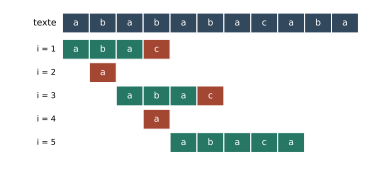
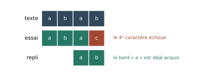
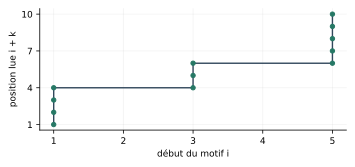

# ENS de Lyon · Second concours · Informatique 2010 — corrigé brut

*Corrigé rédigé par IA, non officiel. Signalez toute erreur.*

**Rédaction** · GPT-6.2 Astra Ultra · vitesse non renseignée · 25 novembre 2026

**Recherche de motifs.** Les indices commencent à 1. On note $m$ la longueur du motif non vide et $t$ celle du texte. L’énoncé définit l’occurrence pour des chaînes non vides. Pour un texte vide et un motif non vide, aucun départ ne convient.

## I. Spécification et mesure du coût

### Question 1.1 · Première occurrence

Dans $T=\mathtt{abdababc}$, les débuts en 1 et 4 donnent respectivement $\mathtt{abd}$ et $\mathtt{aba}$. Le facteur commençant en 6 est $\mathtt{abc}$. Les autres positions antérieures ne commencent pas par $\mathtt a$. La réponse est donc **6**.

### Question 1.2 · Compter les accès au texte

Cette mesure convient si le texte est volumineux ou coûteux à relire, si le motif et les tables utiles sont déjà disponibles en mémoire et si le travail entre deux lectures est borné par une constante. Elle facilite aussi la comparaison de recherches répétées avec le même motif. Elle devient insuffisante si, pour épargner une lecture, on effectue un long calcul sur le motif ou si le coût de construction d’une table domine une recherche unique. Un accès aléatoire et une lecture séquentielle peuvent en outre avoir des coûts matériels différents.

## II. Recherche naïve

### Question 2.1 · Tracer les comparaisons

Pour $T=\mathtt{abababacaba}$ et $M=\mathtt{abaca}$, la boucle se termine par échec avec les couples $(i,k)=(1,4),(2,1),(3,4),(4,1)$. Par exemple, au rang 1 les trois premières lettres concordent puis $M[4]=\mathtt c$ rencontre $T[4]=\mathtt b$. À l’alignement $i=5$, les cinq lettres concordent. Le couple au retour anticipé est $(5,5)$ et la fonction renvoie 5.



### Question 2.2 · Absence de dépassement

Posons $m=|M|\ge1$, $t=|T|\ge1$. Si $m>t$, la boucle externe est vide. Sinon $1\le i\le t-m+1$. Le premier test utilise $k=1$. Un échec arrête la boucle, un succès pour $k=m$ retourne immédiatement et seul un succès pour $k<m$ incrémente $k$. Tout test a donc $1\le k\le m$ et $1\le i+k-1\le(t-m+1)+m-1=t$.

### Question 2.3 · Texte aaaab

Les départs en 1, 2 et 3 consomment chacun deux accès, une égalité puis un échec. Le départ en 4 consomme deux accès fructueux. Le total est **8**.

### Question 2.4 · Texte formé de n lettres a puis b

Les $n$ alignements possibles commencent par $\mathtt a$. Les $n-1$ premiers échouent sur la deuxième lettre et le dernier réussit. Cela fait $2n$ accès. Pour $n=0$, le texte est trop court et la même formule donne zéro.

### Question 2.5 · Borne atteinte dans le pire cas

Si $1\le m\le t$, le nombre d’accès ne dépasse pas $m(t-m+1)$. Avec au moins deux lettres, prendre $T=\mathtt a^t$ et $M=\mathtt a^{m-1}\mathtt b$. Chaque alignement échoue exactement au dernier test, y compris pour $m=1$. Si $m>t$, le maximum est zéro. L’énoncé permet également un alphabet à une seule lettre. Alors, si $m\le t$, le premier alignement réussit nécessairement, et le vrai maximum est $m$.

## III. Recherche par transitions

### Question 3.1 · Longueur de l’état courant

$S[i]$ est la longueur d’un préfixe de $M$, donc $0\le S[i]\le m$. Il est également au plus égal à $i$ puisqu’il mesure un suffixe de $T[1\ldots i]$.

### Question 3.2 · Reconnaître une occurrence

Si $S[i]=m$, le suffixe de longueur $m$ se terminant en $i$ est $M$. Son début vaut $i-m+1$. Inversement une occurrence en $i-m+1$ fournit ce suffixe de longueur $m$ et 3.1 interdit d’en retenir un plus long.

### Question 3.3 · Première fin de motif

Pour $i=1,\ldots,t$, lire $S[i]$. Dès que $S[i]=m$, renvoyer $i-m+1$. Après le dernier indice, renvoyer 0. En vertu de 3.2 le tout premier succès est l’occurrence la plus à gauche. Il y a au plus $t$ accès à $S$ et aucun au texte déjà traité.

### Question 3.4 · Table des transitions de abaca

Les colonnes de la table correspondent au caractère ajouté.

| $q$ | $\mathtt a$ | $\mathtt b$ | $\mathtt c$ |
|---:|---:|---:|---:|
| 0 | 1 | 0 | 0 |
| 1 | 1 | 2 | 0 |
| 2 | 3 | 0 | 0 |
| 3 | 1 | 2 | 4 |
| 4 | 5 | 0 | 0 |
| 5 | 1 | 2 | 0 |

Par exemple $\mathtt{aba}\,\mathtt b$ finit par $\mathtt{ab}$, d’où la case $(3,\mathtt b)=2$. Après le motif entier, ajouter $\mathtt b$ conduit aussi à 2.

### Question 3.5 · Retirer puis rattacher la dernière lettre

(i) Posons $h=S[i+1]$ et $s=S[i]$. Si $h>0$, le préfixe $M[1\ldots h-1]$ est un suffixe de $T[1\ldots i]$, donc $h-1\le s$. Si $h=0$, l’inégalité est immédiate. Ainsi $h\le s+1$.

(ii) L’ancien suffixe de longueur $s$ est $M[1\ldots s]$. En y rattachant $T[i+1]$, on obtient les $s+1$ dernières lettres de $T[1\ldots i+1]$. Son suffixe de longueur $h$ est bien $M[1\ldots h]$ car $h\le s+1$.

### Question 3.6 · Récurrence

Posons $S[0]=0$. Pour $1\le j\le t$,

$$
S[j]=\operatorname{Trans}(M,S[j-1],T[j]).
$$

Par 3.5, le préfixe de longueur $S[j]$ est un suffixe admissible pour la transition. Réciproquement, toute réponse candidate pour la transition est un suffixe du suffixe terminé en $j$, donc un suffixe de $T[1\ldots j]$ et un préfixe de $M$. Sa longueur est au plus $S[j]$. Au premier rang, le raisonnement s’applique au mot vide initial.

### Question 3.7 · Construire le tableau des longueurs

Initialiser $q=0$. Pour $j=1,\ldots,t$, lire $x=T[j]$, remplacer $q$ par $\operatorname{Trans}(M,q,x)$ et écrire $S[j]=q$. À la fin, renvoyer $S$. La récurrence de 3.6 établit l’invariant $q=S[j]$ après le rang $j$. On lit le texte exactement $t$ fois et on utilise $t$ cases de sortie.

### Question 3.8 · Reconnaissance sans conserver S

Initialiser $q=0$. Pour $j$ de 1 à $t$, remplacer $q$ par $\operatorname{Trans}(M,q,T[j])$. Si $q=m$, renvoyer $j-m+1$. Si la boucle se termine, renvoyer 0. La correction découle de 3.2 et de l’invariant de 3.7. Il faut au plus $t$ lectures du texte et un espace de travail constant une fois la table de transitions disponible.

### Question 3.9 · Prétraiter les transitions

Ranger les transitions dans une matrice $D$ de $(m+1)|\Sigma|$ cases à colonnes indexées par les lettres. On décrit un calcul qui lit chacune des $m$ lettres de $M$ une seule fois. La ligne 0 contient des zéros sauf un 1 sous $M[1]$. Initialiser $f=0$, longueur du plus long bord propre de $M[1]$. Puis effectuer les opérations suivantes.

```text
pour q de 1 à m :
    D[q] ← une copie indépendante de D[f]
    si q < m :
        x ← M[q+1]
        D[q,x] ← q+1
        f ← D[f,x]
```

Au début du tour $q$, $f$ est le plus long bord propre du préfixe de longueur $q$. Si l’ajout de $x$ ne prolonge pas ce préfixe, toute réponse non vide, privée de sa dernière lettre, est un bord propre, donc un suffixe du bord maximal. La ligne $D[f]$ suffit alors à retrouver le maximum. Si $x=M[q+1]$, la ligne $q$ doit fournir $q+1$, mais la longueur du plus long **bord propre** du nouveau préfixe est précisément l’ancienne transition $D[f,x]$. Cela prouve l’invariant. Pour $q=m$, la dernière ligne est la simple copie. Le temps et la place nécessaires sont de l’ordre de $(m+1)|\Sigma|$ pour écrire la table, malgré les $m$ seules lectures du motif. Le coût unitaire de consultation suppose un index de lettre disponible en temps constant.

## IV. Algorithme de Knuth, Morris et Pratt

### Question 3.10 · Première discordance et décalage sûr

(i) La condition imprimée $i<t$ ne suffit pas. Par exemple, avec $T=\mathtt{aaa}$, $M=\mathtt{aaaa}$ et $i=2$, le texte finit avant toute discordance. Sous la condition $1\le i\le t-m+1$, si $i$ n’est pas une occurrence, il existe un premier caractère différent, et $k$ est précisément le nombre de caractères égaux qui le précèdent. Il est unique et vérifie $0\le k<m$. Plus généralement la même conclusion vaut dès qu’une discordance a été effectivement comparée avant la fin du texte, ce qui est l’usage de KMP.

(ii) Écrivons $n$ pour la longueur du plus long bord propre du bloc reconnu de longueur $k$ et prenons $n=0$ pour $k=0$. Si une occurrence commence en $j$ avec $i<j<i+k$, le chevauchement $T[j\ldots i+k-1]$ est un suffixe propre du bloc reconnu, également préfixe de $M$. Donc $i+k-j\le n$, soit $j\ge i+k-n$. Si $j\ge i+k$, la même borne vaut immédiatement.



### Question 3.11 · Table des bords propres

Pour $\mathtt a,\mathtt{ab},\mathtt{aba},\mathtt{abac},\mathtt{abaca}$, les plus longs bords propres sont respectivement le mot vide, le mot vide, $\mathtt a$, le mot vide, $\mathtt a$. Donc $SP[1\ldots5]=(0,0,1,0,1)$.

### Question 3.12 · Deux indices monotones

Le succès laisse $i$ inchangé et ajoute 1 à $i+k$. Un échec pour $k=0$ ajoute 1 aux deux quantités. Sur un échec pour $k>0$, le nouveau $i$ est $i+k-SP[k]>i$ car $SP[k]<k$, et le nouveau $k$ est $SP[k]$. Leur somme reste $i+k$. Les suites $i_p$ et $i_p+k_p$ sont ainsi croissantes au sens large.

### Question 3.13 · Croissances strictes

(i) La somme $i+k$ croît strictement exactement quand le test d’égalité de la ligne 7 réussit ou quand il échoue avec $k=0$ à la ligne 9. (ii) L’indice $i$ croît strictement exactement quand la ligne 7 échoue, que la ligne 9 réussisse ou non. Sur tout passage, au moins une des deux quantités croît strictement.

### Question 3.14 · Compter les lectures de KMP

Le potentiel $H=i+(i+k)$ vaut 2 au départ. Chaque tour l’augmente d’au moins 1 d’après 3.13. Pendant et juste après la boucle, $i\le i+k\le t+1$, car $i+k$ progresse d’au plus un à partir d’une valeur au plus $t$. Donc $H\le2(t+1)$. On obtient au plus $2t$ tours. La ligne 7 lit une seule case du texte par tour, d’où au plus $2t$ accès, même si une lettre est parfois relue.



### Question 3.15 · Conserver le préfixe déjà reconnu

Initialement $k=0$ et les deux mots comparés sont vides. Un succès prolonge le facteur reconnu de la même lettre dans $M$ et $T$. Un échec pour $k=0$ laisse une égalité entre mots vides. Pour $k>0$, le suffixe de longueur $SP[k]$ de l’ancien bloc reconnu est égal au préfixe de $M$ de cette longueur par définition d’un bord. Son nouveau début est $i+k-SP[k]$. L’égalité demandée est donc conservée dans les trois cas.

### Question 3.16 · Ne sauter aucune occurrence

Initialement aucune occurrence ne commence avant 1. Un succès conserve la même borne $i$. Un échec de la première lettre exclut le départ $i$ et autorise $i+1$. S’il y a une discordance après $k>0$ lettres, l’invariant de 3.15 et la preuve de 3.10(ii) montrent que toute occurrence strictement après $i$ commence au moins en $i+k-SP[k]$. L’échec exclut $i$ lui-même. Par récurrence toute occurrence demeure au moins égale au départ courant.

### Question 3.17 · Correction et terminaison

La terminaison découle de 3.14. Si $k=m$, l’invariant de 3.15 affirme que $i$ est une occurrence et celui de 3.16 que c’est la première. Sinon la garde de boucle est devenue fausse parce que $i+k=t+1$. Une occurrence à un départ $j\ge i$ aurait une fin $j+m-1\ge i+m-1\ge i+k=t+1$, hors du texte. Les départs antérieurs étant exclus par 3.16, la valeur 0 est justifiée. Réciproquement, s’il existe une occurrence, cette seconde issue est impossible et l’algorithme renvoie la première.
