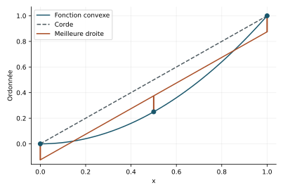

# ENS de Lyon — Second concours, mathématiques 2010 · Corrigé brut

*Corrigé rédigé par IA, non officiel. Signalez toute erreur.*

**Rédaction** · GPT-6.2 Astra Ultra · vitesse non renseignée · 25 novembre 2026

**Révision** · GPT-6.2 Astra Ultra · vitesse non renseignée · 26 novembre 2026

**Valeurs propres d’un produit et approximation uniforme.** Les valeurs propres sont numérotées dans l’ordre croissant. Les polynômes du second exercice sont de degré au plus $n$.

## 1.I. Quotients de Rayleigh

### Question 1.1

Par le théorème spectral, $A$ admet une base orthonormée $(v_1,\ldots,v_n)$ avec $Av_j=\lambda_jv_j$. Pour $x=\sum_jt_jv_j\ne0$,
$$R_A(x)=\frac{(Ax,x)}{\|x\|^2}=\frac{\sum_j\lambda_jt_j^2}{\sum_jt_j^2}.$$
C’est une moyenne pondérée de valeurs au moins égales à $\lambda_1$. Le minimum $\lambda_1$ est atteint en $v_1$.

### Question 1.2

La formule précédente donne $R_A(x)\le\lambda_n$, car chaque poids est positif ou nul et chaque $\lambda_j\le\lambda_n$. Le maximum vaut $\lambda_n$ puisqu’il est atteint en $v_n$.

### Question 1.3.a

Pour $H=\operatorname{Vect}(v_k,\ldots,v_n)$, $\dim H=n-k+1$. Ainsi $\dim(F\cap H)=\dim F+\dim H-\dim(F+H)\ge k+n-k+1-n=1$, ce qui fournit un vecteur non nul commun.

### Question 1.3.b

Sur $H$ la moyenne pondérée de 1.1 ne fait intervenir que $\lambda_k,\ldots,\lambda_n$. Par 3.a, tout $k$-plan $F$ contient un vecteur non nul de $H$, donc $\max_{F\setminus\{0\}}R_A\ge\lambda_k$. Ce maximum existe par compacité de la sphère unité de $F$. Sur le $k$-plan engendré par $v_1,\ldots,v_k$, il vaut exactement $\lambda_k$, atteint en $v_k$. Ainsi $\lambda_k=\min_{\dim F=k}\max_{x\in F\setminus\{0\}}R_A(x)$.

## 1.II. Racine carrée symétrique définie positive

### Question 1.4

Pour tout $v_j$ unitaire, $\lambda_j=(Av_j,v_j)>0$. Si $U$ est la matrice orthogonale des vecteurs propres, $B=U\operatorname{diag}(\sqrt{\lambda_1},\ldots,\sqrt{\lambda_n})U^t$ est réelle symétrique à valeurs propres positives, donc définie positive. Le produit redonne $B^2=A$.

### Question 1.5

Puisque $A=(B')^2$, $AB'=(B')^3=B'A$. Tout espace propre $E_\lambda$ de $A$ est donc stable par $B'$. La restriction y est symétrique définie positive et son carré y est $\lambda I$. Toutes ses valeurs propres sont alors $\sqrt\lambda$, si bien que sa diagonalisation orthogonale donne $B'|_{E_\lambda}=\sqrt\lambda I$. C’est aussi la restriction de $B$ ; les espaces propres engendrent l’espace entier. Donc $B'=B$.

## 1.III. Valeurs propres de produits

### Question 1.6

Posons $T=B^{1/2}$ et $S=TAT$. La matrice $T$ est symétrique inversible. On a $T(AB)T^{-1}=TAT=S$. Cette dernière matrice est symétrique et $(Sx,x)=(ATx,Tx)>0$ pour $x\ne0$. Par le théorème spectral, toutes ses valeurs propres, donc celles de $AB$, sont réelles strictement positives.

### Question 1.7

Pour $x\ne0$, $R_S(x)=R_A(Tx)R_B(x)$, car $\|Tx\|^2=(Bx,x)$. Par 1.1 et 1.2, et par positivité de $R_A$, on a
$$\lambda_1(B)R_A(Tx)\le R_S(x)\le\lambda_n(B)R_A(Tx).$$
Prenons les maxima sur chaque $i$-plan $F$, puis les minima sur ces plans. L’application $F\mapsto TF$ est une bijection des $i$-plans ; la formule de 3.b donne $\lambda_i(A)\lambda_1(B)\le\lambda_i(AB)\le\lambda_i(A)\lambda_n(B)$.

### Question 1.8

Oui. Posons $A_\varepsilon=A+\varepsilon I$ et $B_\varepsilon=B+\varepsilon I$ avec $\varepsilon>0$. Elles sont définies positives et $S_\varepsilon=B_\varepsilon^{1/2}A_\varepsilon B_\varepsilon^{1/2}$ converge vers $S=B^{1/2}AB^{1/2}$ ; pour la racine, cela se lit dans une base propre fixe de $B$. Les matrices sont symétriques. Par 3.b, $|\lambda_i(S_\varepsilon)-\lambda_i(S)|\le\|S_\varepsilon-S\|_{\mathrm{op}}\to0$. Les polynômes caractéristiques de $A_\varepsilon B_\varepsilon$ et $S_\varepsilon$ sont égaux par 6. Leurs coefficients étant continus en les entrées, $AB$ et $S$ ont encore le même polynôme caractéristique, même si $B$ est singulière. Les valeurs propres de $AB$ sont donc réelles positives ou nulles. Le passage à la limite dans 7 donne les mêmes inégalités, y compris aux valeurs propres nulles.

Une vérification directe de l’identité des polynômes caractéristiques utilise $\det(I-UV)=\det(I-VU)$ avec $U=AB^{1/2}$ et $V=B^{1/2}$. En remplaçant $U$ par $U/t$, on obtient $\det(tI-AB)=\det(tI-S)$ pour $t\ne0$, puis pour tout $t$ par identité polynomiale. On conserve ainsi toutes les multiplicités, même si $B$ a un noyau.

### Question 1.9

Gardons $S=TAT$ et $R_S(x)=R_A(Tx)R_B(x)$ pour $A,B$ définies positives. Notons $E_A^{\le j}$ le sous-espace engendré par les $j$ premiers vecteurs propres ordonnés de $A$, et $E_A^{\ge j}$ celui engendré par les vecteurs $j$ à $n$, avec des notations analogues pour $B$.

**Borne supérieure.** Si $j+\ell=i+n$, le sous-espace $T^{-1}E_A^{\le j}\cap E_B^{\le\ell}$ a dimension au moins $j+\ell-n=i$. Il contient un $i$-plan sur lequel $R_S\le\lambda_j(A)\lambda_\ell(B)$. Le minimum des maxima de 3.b donne cette borne pour $\lambda_i(AB)$.

**Borne inférieure.** Si $j+k=i+1$, le sous-espace $T^{-1}E_A^{\ge j}\cap E_B^{\ge k}$ a dimension au moins $n-j-k+2=n-i+1$. Tout $i$-plan le rencontre non trivialement ; au point d’intersection $R_S\ge\lambda_j(A)\lambda_k(B)$. Prendre le maximum sur chaque $i$-plan puis le minimum donne $\lambda_i(AB)\ge\lambda_j(A)\lambda_k(B)$. Les indices des deux bornes peuvent être choisis indépendamment ; en prenant $j=i$ des deux côtés, on retrouve 7.

## 2. Existence et unicité du polynôme de meilleure approximation

### Question 2.1

On prend $\mathcal P_n$ au sens de polynômes de degré **au plus $n$**, la précision de degré étant omise au bas de la page 3 de l’énoncé. Sur $[a,b]$, la norme uniforme est bien une norme sur cet espace car $a<b$. L’application $p\mapsto\|f-p\|_\infty$ est continue, même 1-lipschitzienne. Au-delà de la boule $\|p\|_\infty\le2\|f\|_\infty$, l’inégalité triangulaire donne $\|f-p\|_\infty>\|f\|_\infty$, valeur réalisée par $p=0$. Il suffit de minimiser sur cette boule fermée et bornée, compacte en dimension finie. Le minimum y est atteint en un $q_n$.

### Question 2.2

La fonction $x\mapsto|f(x)-q_n(x)|$ est continue sur le compact non vide $[a,b]$. Elle y atteint donc son maximum $M=\|f-q_n\|_\infty$.

### Question 2.3.a

Supposons que les seuls points de contact soient $x_1,\ldots,x_k$, avec $1\le k\le n+1$. Le polynôme de Lagrange
$$q(x)=\sum_{i=1}^k f(x_i)\prod_{h\ne i}\frac{x-x_h}{x_i-x_h}$$
a degré au plus $k-1\le n$ et prend bien $f(x_i)$ en chaque $x_i$. Si $M=0$, tout le segment est déjà constitué de points de contact : dans la contradiction envisagée on a donc $M>0$.

### Question 2.3.b

Pour $\varepsilon>0$, $V_\varepsilon=\{x\in[a,b]:|f(x)-q(x)|<\varepsilon\}$ est relativement ouvert, par continuité, et contient chacun des $x_i$ puisque l’erreur d’interpolation y est nulle.

### Question 2.3.c

Sur $V_\varepsilon$,
$$|f-q_t|=|(1-t)(f-q_n)+t(f-q)|\le(1-t)M+t\varepsilon.$$
Sur $K=[a,b]\setminus V_\varepsilon$, $|f-q_t|=|f-q_n+t(q_n-q)|\le\sup_K|f-q_n|+t\|q-q_n\|_\infty$ si $K$ est non vide. Si $K$ est vide, la première borne couvre déjà tout le segment.

### Question 2.3.d

Choisissons $0<\varepsilon<M$. Sur $V_\varepsilon$, la borne $(1-t)M+t\varepsilon$ est strictement inférieure à $M$ pour $t>0$. Si $K$ est non vide, il est compact et ne contient aucun des $x_i$. Son maximum $m=\max_K|f-q_n|$ vérifie donc $m<M$. Prenons $0<t<1$ si petit que $t\|q-q_n\|_\infty<M-m$. Les deux bornes sont alors strictement inférieures à $M$, donc $\|f-q_t\|_\infty<M$ alors que $q_t\in\mathcal P_n$. Cette contradiction prouve qu’il y a au moins $n+2$ points de contact distincts.

### Question 2.4

Si $p$ et $q$ réalisent le minimum $M$, leur moyenne $r=(p+q)/2$ vérifie $\|f-r\|_\infty\le M$ et est donc aussi optimale. En chacun de ses au moins $n+2$ points de contact, la moyenne de $f-p$ et $f-q$, deux nombres de $[-M,M]$, vaut $M$ ou $-M$. Les deux nombres doivent être égaux à cette même extrémité. Ainsi $p-q$ s’annule en $n+2$ points distincts ; comme son degré est au plus $n$, il est identiquement nul.

### Question 2.5

Si $m=\min f$ et $L=\max f$, toute constante $c$ a pour erreur $\max(|m-c|,|L-c|)$. Elle est au moins $(L-m)/2$ par l’inégalité triangulaire et atteint cette borne en $q_0=(m+L)/2$. C’est donc l’unique meilleure constante.

### Question 2.6

La droite cherchée se déduit de la corde $L(x)=f(a)+(x-a)(f(b)-f(a))/(b-a)$. Par convexité, $0\le L-f\le h$, où $h=\max_{[a,b]}(L-f)$. La droite $q_1=L-h/2$ réalise une erreur uniforme $h/2$. Si $h=0$, $f=L$ et la formule convient. Si $h>0$, le maximum est atteint en $c\in]a,b[$. L’erreur $f-q_1$ vaut $+h/2$ aux extrémités et $-h/2$ en $c$. Si une droite $p$ faisait strictement mieux, $p-q_1$ serait strictement positive en $a,b$ et strictement négative en $c$, ce qui est impossible pour une fonction affine. L’unicité résulte de 2.4.

Pour vérifier les trois contacts de la figure, $f(x)=x^2$ a pour corde $L(x)=x$. Le maximum de $x(1-x)$ est $1/4$ en $1/2$. On obtient donc $q_1(x)=x-1/8$, et les erreurs en $0,1/2,1$ valent respectivement $1/8,-1/8,1/8$.

