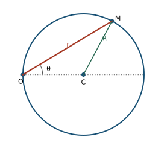
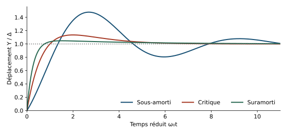
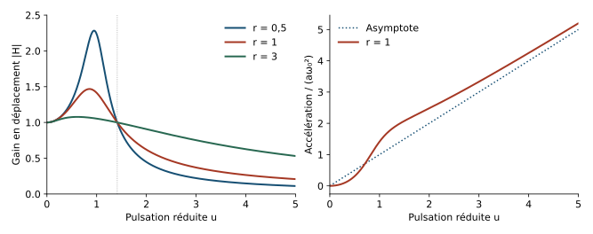

# ENS de Lyon, second concours 2010 — Physique · Corrigé brut

*Corrigé rédigé par IA, non officiel. Signalez toute erreur.*

**Rédaction** · GPT-6.2 Astra Ultra · vitesse non renseignée

**Couverture partielle.** Les questions II.11 et II.14 sur la conduite avec une cargaison explosive restent hors couverture. Les résultats sur le banc d’essai portent sur la réponse linéaire du système mécanique.

## I — Mouvement à force centrale

### Question I.1 — Dériver les vecteurs de la base

Le point a pour position $r\mathbf e_r+z\mathbf e_z$ dans un repère cylindrique. Comme $\dot{\mathbf e}_r=\dot\theta\mathbf e_\theta$ et $\dot{\mathbf e}_\theta=-\dot\theta\mathbf e_r$, la vitesse est $\dot r\mathbf e_r+r\dot\theta\mathbf e_\theta+\dot z\mathbf e_z$. Une seconde dérivation donne $a_r=\ddot r-r\dot\theta^2$, $a_\theta=r\ddot\theta+2\dot r\dot\theta$ et $a_z=\ddot z$.

### Question I.2 — Constante des aires

Le moment de la force centrale en $O$ est nul. Ainsi $\mathbf L_O=\mathbf{OM}\times m\mathbf v$ est constant. Pour un moment cinétique non nul, le mouvement a lieu dans le plan fixe perpendiculaire à $\mathbf L_O$. On le prend pour plan $z=0$. Son élément d’aire orientée est $d\mathcal A=\tfrac12r^2d\theta$, d’où $d\mathcal A/dt=\tfrac12r^2\dot\theta=C/2$ avec $C=L_{O,z}/m$ constant. Des durées égales correspondent à des aires égales. Pour le mouvement radial, $C=0$.

### Question I.3 — Formule de Binet

Sur un arc avec $r>0$ et $C\ne0$, posons $u=1/r$ et désignons par une prime la dérivée par rapport à $\theta$. On a $\dot\theta=Cu^2$, puis $\dot r=-(u'/u^2)\dot\theta=-Cu'$ et $\ddot r=-C^2u^2u''$. Enfin $r\dot\theta^2=C^2u^3$. L’accélération radiale vaut donc $a_r=-C^2u^2(u+u'')$.

### Question I.4 — Cercle passant par le centre de force

Dans le plan de la figure 1, le centre géométrique est en $(R,0)$ et $O$ est l’extrémité gauche du diamètre horizontal. L’équation $(x-R)^2+y^2=R^2$ devient $r^2-2Rr\cos\theta=0$. Pour les points distincts de $O$, $r=2R\cos\theta$ avec $-\pi/2<\theta<\pi/2$. Les extrémités angulaires ramènent à $O$, où l’angle polaire est indéterminé.

### Question I.5 — Loi de la force

Écrivons $u=b\sec\theta$ avec $b=1/(2R)$. Alors $u'=u\tan\theta$, $u''=u(\tan^2\theta+\sec^2\theta)$ et $u+u''=2u\sec^2\theta=8R^2u^3$. Par Binet et la deuxième loi de Newton, $f(r)=-8mC^2R^2/r^5$. La force est attractive et varie en $r^{-5}$ sur l’orbite observée. Elle est singulière en $O$. La valeur de $C$, et donc l’échelle de force, demande aussi une information temporelle. La construction géométrique n’autorise pas à poursuivre régulièrement le mouvement au point singulier.

## II — Suspension et analogie électrique

### Question II.1 — Compression statique

On compte les altitudes positivement vers le haut. Au repos, la force de l’amortisseur est nulle. Le ressort comprimé exerce une force verticale $k(l_0-l_{\rm eq})$ qui équilibre le poids $Mg$. D’où $l_{\rm eq}=l_0-Mg/k$.

### Question II.2 — Forces sur la masse

En projection ascendante, $F_z=-Mg-k(l-l_0)-\eta\dot l$. Avec l’égalité à l’équilibre, cela s’écrit $F_z=-k(l-l_{\rm eq})-\eta\dot l$. La force visqueuse dépend de la vitesse relative des deux bornes, $\dot l=\dot Y-\dot y$.

### Question II.3 — Équation avec excitation de la base

Substituer $l-l_{\rm eq}=Y-y$ dans $M\ddot Y=F_z$. On trouve $M\ddot Y+\eta\dot Y+kY=\eta\dot y+ky$. Dans la forme du sujet, $\tau=M/\eta$, $\omega_0^2=k/M$ et $f(y,\dot y)=\dot y/\tau+\omega_0^2y$. La pesanteur a servi à définir l’origine d’équilibre.

### Question II.4 — Nature de l’oscillateur

La force de rappel est linéaire en l’allongement, ce qui donne l’oscillateur harmonique de pulsation propre $\omega_0$ lorsque les autres termes sont absents. La force visqueuse dissipe de l’énergie et amortit le mouvement relatif. La base mobile entretient une excitation extérieure imposée. Selon l’amortissement, le retour libre à l’équilibre peut être oscillant ou apériodique.

### Question II.5 — Réponse exacte à l’échelon idéal de la figure 3

Pour une marche instantanée $y(t)=\Delta\,\mathcal H(t)$ et une masse initialement au repos, $Y$ est continue mais l’impulsion $\eta\dot y$ impose $\dot Y(0^+)=\eta\Delta/M>0$. Après le saut, l’équilibre est $Y=\Delta$. **La courbe b est possible** pour un amortissement inférieur au seuil critique, avec des oscillations qui s’atténuent. **La courbe c** part avec une tangente horizontale, incompatible avec le saut de vitesse pour $\eta>0$.

**La courbe a** paraît compatible avec un fort amortissement si l’on regarde seulement sa pente initiale et sa limite. Le modèle exact exige pourtant un dépassement, même en régime apériodique. Pour le vérifier, posons $X=Y-\Delta$ après la marche. Alors $M\ddot X+\eta\dot X+kX=0$, avec $X(0^+)=-\Delta$ et $\dot X(0^+)=\eta\Delta/M$. L’intégration de zéro à l’infini donne $-M\dot X(0^+)-\eta X(0^+)+k\int_0^\infty X\,dt=0$, donc $\int_0^\infty X\,dt=0$. Comme $X$ débute négatif, il devient positif avant de décroître vers zéro. L’approche monotone de la courbe a n’est donc pas la réponse exacte à la marche idéale. Le dessin de la figure ci-dessous montre aussi le faible dépassement du régime fortement amorti.

### Question II.6 — Fonction de transfert

Pour une excitation en $e^{i\omega t}$, les amplitudes complexes satisfont $(-M\omega^2+i\eta\omega+k)Y=(k+i\eta\omega)y$. Leur quotient est $H(\omega)=(k+i\eta\omega)/(k-M\omega^2+i\eta\omega)$. En régime permanent, la partie homogène transitoire s’est amortie.

### Question II.7 — Pulsation et amortissement réduits

Posons $u=\omega/\omega_0$ et $r=\eta/(M\omega_0)=\eta/\sqrt{kM}=1/(\omega_0\tau)$. Tous deux sont sans dimension. Diviser numérateur et dénominateur par $k$ donne $H=(1+iru)/(1-u^2+iru)=1/[1-u^2/(1+iru)]$.

### Question II.8 — Limites du gain et de la phase

Pour $u\to0$, $H\to1$. Le gain tend vers 1 et la phase vers zéro. Pour $u\to+\infty$ et $r>0$, $H\sim-ir/u$. Le gain tend vers zéro et la phase tend vers $-\pi/2$, en choisissant la phase continue issue de zéro.

### Question II.9 — Identifier les trois courbes

Le gain au carré vaut $[1+r^2u^2]/[(1-u^2)^2+r^2u^2]$. À $u=1$, il vaut $1+1/r^2$. Le plus grand pic du sujet, courbe **c**, correspond à $r=1/2$, le pic intermédiaire **b** à $r=1$ et le pic aplati **a** à $r=3$. Le renforcement autour de la pulsation propre est plus marqué à faible amortissement. Les courbes passent toutes par le gain 1 à $u=\sqrt2$. Dans la queue à grande pulsation, le gain est asymptotique à $r/u$ et la courbe a se trouve au-dessus des deux autres. Il s’agit d’un filtre mécanique passe-bas en déplacement.

### Question II.10 — De la périodicité spatiale à la périodicité temporelle

Pour le profil géométrique du sujet et $x=vt+x_0$, l’entrée vaut $y(t)=a\cos(2\pi vt/\lambda+2\pi x_0/\lambda)$. Sa pulsation est $\omega=2\pi|v|/\lambda$ en radians par seconde, et sa fréquence ordinaire est $|v|/\lambda$ en hertz.

### Question II.12 — Amplitude d’une accélération harmonique

Sur un banc d’essai sinusoïdal, écrivons $Y(t)=\operatorname{Re}(aH(\omega)e^{i\omega t})$. Deux dérivations donnent une amplitude complexe $-\omega^2 aH$. L’amplitude réelle positive de l’accélération mesurée sur la masse est ainsi $A_{\rm acc}=a\omega^2|H(\omega)|$. Ses unités sont des mètres par seconde carrée.

### Question II.13 — Réponse en accélération du banc

Lorsque $\omega\to0$, $A_{\rm acc}\sim a\omega^2\to0$. Lorsque $\omega\to+\infty$ avec $r>0$, le modèle donne $A_{\rm acc}\sim ar\omega_0\omega$. Pour $r=1$, la grandeur réduite tracée est $A_{\rm acc}/(a\omega_0^2)=u^2\sqrt{(1+u^2)/(1-u^2+u^4)}$. Elle part de zéro avec une tangente horizontale, vaut $\sqrt2$ en $u=1$ et tend vers l’asymptote de pente un. La divergence haute fréquence est celle du modèle idéal à contact permanent.

### Question II.15 — Diviseur d’impédances

Le circuit de la figure 5 comporte un courant unique si la sortie est mesurée à vide. La tension d’entrée vaut $I(Z_1+Z_2+Z_3)$ et la tension de sortie $I(Z_2+Z_3)$ avec les orientations dessinées. Ainsi $H=(Z_2+Z_3)/(Z_1+Z_2+Z_3)$.

### Question II.16 — Place des composants

Plaçons la bobine $Z_1=i\omega L$ dans la première position et la série résistance-condensateur entre les bornes de sortie. On peut choisir $Z_2=R$ et $Z_3=1/(i\omega C)$, ou permuter ces deux composants. Après multiplication par $i\omega C$, le quotient devient $(1+iRC\omega)/(1-LC\omega^2+iRC\omega)$, de la forme requise.

### Question II.17 — Relations d’équivalence

Comparer au rapport mécanique normalisé donne $LC=M/k=1/\omega_0^2$ et $RC=\eta/k=r/\omega_0$. Ces deux conditions sont suffisantes. Pour toute capacité positive choisie $C$, on peut prendre $L=M/(kC)$ et $R=\eta/(kC)$. Les unités de $LC$ et de $RC$ sont respectivement la seconde au carré et la seconde.
