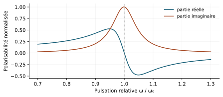
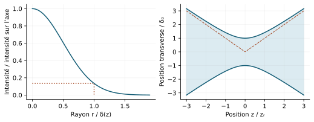
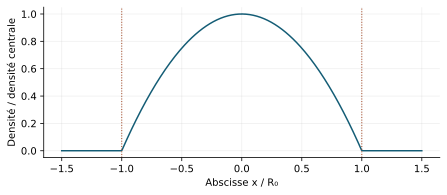
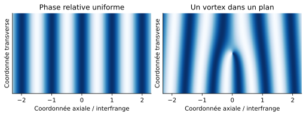

# ENS Paris PC 2010 — Physique PC1 · Corrigé guidé

*Corrigé rédigé par IA, non officiel. Signalez toute erreur.*

**Rédaction** · GPT-6.2 Astra Ultra · vitesse non renseignée

## Gaz quantiques à deux dimensions, de l’atome d’hydrogène aux vortex

## I.1 — Modèle de Bohr

### Question 1 — Attraction coulombienne

**Indication.** Le produit des charges du proton et de l’électron est négatif. Se donner une origine pour l’énergie potentielle.

Plaçons le proton à l’origine et notons $C=q_e^2/(4\pi\varepsilon_0)>0$. L’électron subit $\boldsymbol F=-C\boldsymbol e_r/r^2$. Avec $U(\infty)=0$, l’énergie associée est $U(r)=-C/r$, car $-\mathrm dU/\mathrm dr=-C/r^2$.

### Question 2 — Vitesse orbitale classique

**Indication.** Projeter le principe fondamental sur le rayon de l’orbite.

Pour une orbite circulaire, l’accélération est centripète, de norme $v^2/r$. L’équation radiale est $m_e v^2/r=C/r^2$, d’où $v=\sqrt{C/(m_e r)}$. À plus grand rayon, la vitesse est plus petite.

### Question 3 — Énergie en fonction du moment cinétique

**Indication.** Utiliser la dynamique circulaire pour éliminer la vitesse et garder $r$ jusqu’à l’écriture de $L^2$.

La relation précédente donne $E_c=C/(2r)$, et donc $E_m=E_c+U=-C/(2r)$. Puisque $L=m_e r v$, on a $L^2=m_e C r$. L’élimination de $r$ conduit à $E_m=-m_e C^2/(2L^2)=-m_e q_e^4/[2(4\pi\varepsilon_0)^2L^2]$.

### Question 4 — Instabilité de l’orbite classique

**Indication.** Une vitesse de norme constante peut avoir une dérivée vectorielle non nulle.

La direction de la vitesse change au cours du mouvement circulaire. L’électron, chargé et accéléré, rayonne d’après l’électromagnétisme classique. L’énergie de l’orbite diminuerait et le rayon se réduirait, ce qui est incompatible avec une orbite circulaire stable et avec la stabilité de l’atome.

### Question 5 — Niveaux autorisés par la règle de Bohr

**Indication.** Remplacer le moment cinétique dans les deux relations de la question 3.

En imposant $L=n\hbar$, $n=1,2,\ldots$, les rayons deviennent $r_n=n^2a_0$ avec $a_0=\hbar^2/(m_e C)$. Les énergies permises sont $E_n=-m_e C^2/(2\hbar^2 n^2)=E_1/n^2$. Elles sont négatives et s’accumulent vers l’énergie de l’électron libre, prise égale à zéro.

### Question 6 — Ordres de grandeur de l’état fondamental

**Indication.** Le rayon est donné directement par $L=\hbar$ et l’énergie par le potentiel à ce rayon divisé par deux.

Avec $|q_e|=1{,}60\times10^{-19}\ \mathrm C$, on a $C\simeq2{,}3\times10^{-28}\ \mathrm{J\,m}$. On trouve $a_0\simeq5{,}3\times10^{-11}\ \mathrm m$ et $E_1=-C/(2a_0)\simeq-2{,}2\times10^{-18}\ \mathrm J\simeq-13{,}6\ \mathrm{eV}$. Enfin $v_1=C/\hbar\simeq2{,}2\times10^6\ \mathrm{m\,s^{-1}}$, soit environ $0{,}0073c$. Le calcul non relativiste est cohérent.

### Question 7 — Photon de la transition fondamentale

**Indication.** Reprendre la différence de deux niveaux négatifs, puis passer de $h$ à $2\pi\hbar$.

Le premier état excité correspond à $n=2$. L’énergie absorbée est $E_2-E_1=3|E_1|/4=hc/\lambda$, donc $\lambda=4hc/(3|E_1|)$. En utilisant $|E_1|=C/(2a_0)$ et $C=\alpha\hbar c$, on obtient $\lambda/a_0=16\pi/(3\alpha)$.

### Question 8 — Échelle spatiale du champ à travers l’atome

**Indication.** Comparer les dimensions des deux grandeurs qui définissent $\alpha$, puis évaluer $2\pi a_0/\lambda$.

La grandeur $C$ a les mêmes unités que $\hbar c$, soit $\mathrm{J\,m}$. Le rapport $\alpha$ est sans dimension et vaut environ $1/137$. On en déduit $\lambda/a_0\simeq2{,}3\times10^3$ et $\lambda\simeq122\ \mathrm{nm}$. La phase du champ varie très peu à l’échelle de l’atome, ce qui justifie l’approximation dipolaire électrique.

## I.2 — Polarisabilité de l’atome

### Question 9 — Dimensions des coefficients du modèle élastique

**Indication.** Comparer chaque force à la masse multipliée par une accélération.

Dans $-m_e\omega_0^2\boldsymbol r$, $\omega_0^2$ transforme un déplacement en accélération. Dans $-m_e\gamma\boldsymbol v$, $\gamma$ transforme une vitesse en accélération. Ainsi $[\omega_0]=[\gamma]=\mathrm{s^{-1}}$. La première grandeur est une pulsation, la seconde un taux d’amortissement.

### Question 10 — Origine de l’amortissement

**Indication.** Relier la perte d’énergie mécanique à la lumière rayonnée par la charge accélérée.

Le dipôle oscillant rayonne. L’énergie électromagnétique emportée est prélevée sur son mouvement. Une force proportionnelle à $-\boldsymbol v$ modélise cette perte, puisque sa puissance $-m_e\gamma v^2$ est négative. Le modèle remplace par un terme effectif le mécanisme de réaction au rayonnement.

### Question 11 — Structure de l’onde excitatrice

**Indication.** Appliquer le rotationnel à l’exponentielle complexe et porter attention au signe de la dérivée temporelle.

Dans le vide, les équations de divergence imposent $\boldsymbol k\cdot\boldsymbol E=\boldsymbol k\cdot\boldsymbol B=0$. Avec la convention $e^{i(\boldsymbol k\cdot\boldsymbol r-\omega t)}$, la loi de Faraday donne $\boldsymbol k\times\boldsymbol E=\omega\boldsymbol B$. La dispersion $k=\omega/c$ conduit à $\boldsymbol B=\boldsymbol e_k\times\boldsymbol E/c$. Les champs sont transverses, en phase et leurs amplitudes vérifient $E_0/B_0=c$.

### Question 12 — Équation de l’électron forcé

**Indication.** Justifier indépendamment l’approximation spatiale et l’abandon de la partie magnétique de la force.

L’équation complète contient le rappel, l’amortissement et $q_e(\boldsymbol E+\dot{\boldsymbol r}\times\boldsymbol B)$. Le rapport de la force magnétique à la force électrique est au plus $v/c\ll1$. De plus $kr\ll1$ permet d’évaluer le champ au noyau. En prenant sa phase à l’origine pour référence, l’équation linéarisée devient
$$
\ddot{\boldsymbol r}+\gamma\dot{\boldsymbol r}+\omega_0^2\boldsymbol r
=\frac{q_e}{m_e}\boldsymbol E_0e^{-i\omega t}.
$$
La grandeur physique est la partie réelle de la solution.

### Question 13 — Polarisabilité complexe

**Indication.** Le signe de la charge intervient deux fois, dans la force et dans la définition du dipôle.

En régime forcé, la dérivée temporelle multiplie l’amplitude par $-i\omega$. Il s’ensuit $\boldsymbol r=q_e\boldsymbol E_0e^{-i\omega t}/[m_e(\omega_0^2-\omega^2-i\gamma\omega)]$. Le proton restant fixe, le moment dipolaire du système neutre est $\boldsymbol p=q_e\boldsymbol r$. Ainsi
$$
\chi(\omega)=\frac{q_e^2/m_e}{\omega_0^2-\omega^2-i\gamma\omega}.
$$
À pulsation nulle, la polarisabilité est positive.

### Question 14 — Parties dispersive et absorptive

**Indication.** Tracer d’abord les signes et les limites. À la résonance, le dénominateur de la polarisabilité est purement imaginaire.

Posons $B=q_e^2/m_e$, $u=\omega_0^2-\omega^2$ et $v=\gamma\omega$. En multipliant par le conjugué, $\chi'=Bu/(u^2+v^2)$ et $\chi''=Bv/(u^2+v^2)$. Pour $\omega>0$, $\chi''$ est positive et présente un pic voisin de $\omega_0$ en faible amortissement. La partie réelle est positive avant la résonance, s’annule en $\omega_0$ puis devient négative. Loin vers les hautes fréquences les deux composantes tendent vers zéro.

### Question 15 — Réponse loin de la largeur de résonance

**Indication.** Dans le rapport des deux parties, le dénominateur commun se simplifie.

Pour $\omega>0$, $|\chi'/\chi''|=|\omega_0^2-\omega^2|/(\gamma\omega)=|\Delta|(\omega_0+\omega)/(\gamma\omega)$. Si $|\Delta|\gg\gamma$, ce rapport est grand. Dans le voisinage relatif de la résonance ($|\Delta|\ll\omega_0$), il vaut approximativement $2|\Delta|/\gamma$.

### Question 16 — Puissance électrique moyenne

**Indication.** La vitesse du dipôle est en quadrature avec le dipôle, ce qui sélectionne la partie imaginaire de la réponse.

La puissance instantanée vaut $q_e\boldsymbol E\cdot\dot{\boldsymbol r}=\boldsymbol E\cdot\dot{\boldsymbol p}$. Pour deux champs harmoniques, la moyenne du produit réel vaut la moitié de la partie réelle du produit d’une amplitude par le conjugué de l’autre. Il vient $P=\tfrac12 E_0^2\operatorname{Re}(-i\omega\chi)=\tfrac12\omega E_0^2\chi''$. Son signe positif correspond à une puissance reçue par l’électron.

### Question 17 — Maximum de puissance et interprétation photonique

**Indication.** Diviser numérateur et dénominateur par $\omega^2$ avant de chercher l’extremum.

À amplitude de champ fixée,
$$
P=\frac{BE_0^2}{2}\,\frac{\gamma}{(\omega_0^2/\omega-\omega)^2+\gamma^2}.
$$
Le carré s’annule seulement à $\omega=\omega_0$ pour une fréquence positive, ce qui donne le maximum. Dans l’image photonique, le transfert d’énergie est maximal lorsque $\hbar\omega$ coïncide avec l’écart entre les niveaux de la transition. La durée de vie finie donne une largeur de résonance.

### Question 18 — Flux de l’onde incidente

**Indication.** Ne pas confondre l’amplitude du champ et sa valeur efficace.

Pour l’onde progressive vers $+z$, $\boldsymbol B=\boldsymbol e_z\times\boldsymbol E/c$. Le vecteur de Poynting instantané vaut $\boldsymbol E\times\boldsymbol B/\mu_0$. Comme $\langle E^2\rangle=E_0^2/2$ et $1/(\mu_0c)=\varepsilon_0c$, on trouve $\langle\boldsymbol R\rangle=(\varepsilon_0cE_0^2/2)\boldsymbol e_z$.

### Question 19 — Section efficace

**Indication.** Les deux facteurs $E_0^2/2$ doivent disparaître du rapport.

Le rapport d’une puissance (watts) à un flux surfacique (watts par mètre carré) est une aire. En utilisant les questions 16 et 18, on trouve $\sigma=P/R=\omega\chi''/(\varepsilon_0 c)$, en mètres carrés. Il s’agit de l’aire effective avec laquelle un atome prélève de l’énergie à l’onde incidente.

### Question 20 — Atténuation d’un faisceau dans une tranche

**Indication.** Comparer les puissances sur les deux faces de la tranche au prélèvement des atomes qu’elle contient.

La tranche de surface $\mathrm d^2S$ et d’épaisseur $\mathrm dz$ contient $n\,\mathrm d^2S\,\mathrm dz$ atomes. Chacun retire au faisceau la puissance $\sigma R$. Le bilan stationnaire donne $[R(z+\mathrm dz)-R(z)]\mathrm d^2S=-n\sigma R\,\mathrm d^2S\,\mathrm dz$. En divisant et en passant à la limite, $\partial_z R=-n\sigma R$. On suppose que les atomes répondent indépendamment et que le rayonnement diffusé n’est pas recompté dans le faisceau direct.

### Question 21 — Densité intégrée mesurée par transmission

**Indication.** Le logarithme de la transmission transforme l’atténuation exponentielle en densité de colonne.

À $x,y$ fixés et pour une section efficace connue, on intègre $\partial_z\ln R=-\sigma n$. Si $R_{\rm in}=R(x,y,-\infty)$ et $R_{\rm out}=R(x,y,+\infty)$, on obtient
$$
\overline n(x,y)=\int_{-\infty}^{+\infty}n\,\mathrm dz
=\frac1\sigma\ln\frac{R_{\rm in}}{R_{\rm out}} .
$$
Une image de référence sans nuage fournit $R_{\rm in}$ pixel par pixel. Le résultat est un nombre d’atomes par unité de surface.

### Question 22 — Dilution du nuage et expansion libre

**Indication.** Comparer la distance interatomique à la portée des interactions et préciser quelle condition supplémentaire contrôlerait rigoureusement la rareté des collisions.

Avec $10^6$ atomes dans une taille caractéristique $L\sim10\ \mu\mathrm m$, la densité est d’ordre $N/L^3\sim10^{21}\ \mathrm{m^{-3}}$. La distance moyenne $n^{-1/3}\sim10^{-7}\ \mathrm m$ dépasse largement une taille atomique, de l’ordre de $10^{-10}\ \mathrm m$. Le gaz est géométriquement dilué. Après extinction du piège, la dilution s’accentue rapidement et l’on modélise l’expansion relative dans le référentiel du centre du nuage comme balistique. L’uniformité de la pesanteur ne modifie que le mouvement du centre.
Pour chiffrer les collisions initiales il faudrait la section efficace élastique $\sigma_{\rm col}$, différente de la section optique de la question 19. Le critère d’un nuage balistique dès le lâcher serait $n\sigma_{\rm col}L\ll1$. La densité donnée établit l’éloignement des atomes et motive l’approximation, sans permettre d’évaluer à elle seule cette probabilité de collision.

### Question 23 — Température par temps de vol

**Indication.** Lire une largeur du pic plutôt que la plage entière de l’axe horizontal. Associer la même convention de largeur aux positions et aux vitesses.

Pour une distribution thermique de vitesse selon un axe, $\sigma_v^2=k_BT/m_{\rm Rb}$. Si les positions et vitesses initiales y sont décorrélées, $\sigma_x^2(t)=\sigma_x^2(0)+t^2\sigma_v^2$. La bosse de la figure 1, de largeur à mi-hauteur d’environ $0{,}45\ \mathrm{mm}$ d’après l’axe gradué, a un écart-type $\sigma_x\sim0{,}45/2{,}35\simeq0{,}19\ \mathrm{mm}$ en l’assimilant à une gaussienne. Cette largeur dépasse celle du nuage initial. Avec $t=20\ \mathrm{ms}$, $\sigma_v\sim10^{-2}\ \mathrm{m\,s^{-1}}$ et $T\sim m_{\rm Rb}\sigma_v^2/k_B\sim10^{-6}\ \mathrm K$. Le choix de la largeur sur le profil expérimental limite la précision.

## I.3 — Forces radiatives

### Question 24 — Force de Lorentz totale sur le dipôle

**Indication.** Développer le champ électrique à la position de l’électron autour de la position du noyau avant d’additionner les forces.

Écrivons les forces sur les deux charges de l’atome, le noyau étant au repos. Les termes électriques au centre s’annulent puisque la charge totale est nulle. Le premier terme spatial restant est $q_e(\boldsymbol r\cdot\nabla)\boldsymbol E=(\boldsymbol p\cdot\nabla)\boldsymbol E$. La force magnétique sur l’électron est $q_e\dot{\boldsymbol r}\times\boldsymbol B=\dot{\boldsymbol p}\times\boldsymbol B$. À l’ordre dipolaire, leur somme est la force demandée. Les forces internes se compensent pour l’atome entier.

### Question 25 — Moyenne d’une dérivée et loi de Faraday

**Indication.** Dériver le produit vectoriel en entier pour déplacer la dérivée temporelle du dipôle vers le champ magnétique.

Pour une période $T$, $\langle\dot A\rangle=[A(t+T)-A(t)]/T=0$. Appliquons ceci à $\boldsymbol p\times\boldsymbol B$. Il reste $\langle\dot{\boldsymbol p}\times\boldsymbol B\rangle=-\langle\boldsymbol p\times\partial_t\boldsymbol B\rangle$. Avec $\partial_t\boldsymbol B=-\nabla\times\boldsymbol E$, la force moyenne devient $\langle(\boldsymbol p\cdot\nabla)\boldsymbol E\rangle+\langle\boldsymbol p\times(\nabla\times\boldsymbol E)\rangle$.

### Question 26 — Force de gradient

**Indication.** Isoler une composante du gradient. La partie réelle de $\mathcal E^*\partial_i\mathcal E$ est la moitié de la dérivée de $|\mathcal E|^2$.

En composantes, la somme de la question 25 est $\langle F_i\rangle=\sum_j\langle p_j\partial_i E_j\rangle$. Notons $\mathcal E_j=E_{0j}e^{i\phi}$ l’amplitude spatiale. Loin de la raie, le dipôle est essentiellement en phase ou en opposition avec le champ et $p_j$ a pour amplitude $\chi'\mathcal E_j$. On obtient
$$
\langle F_i\rangle\simeq\frac{\chi'}2\operatorname{Re}\sum_j\mathcal E_j^*\partial_i\mathcal E_j
=\frac{\chi'}4\partial_i E_0^2.
$$
Le terme en $i\partial_i\phi$ est imaginaire. La contribution dissipative proportionnelle à $\chi''$ a été négligée dans l’approximation dispersive du problème.

### Question 27 — Potentiel dipolaire et signe du désaccord

**Indication.** Substituer la partie réelle du dipôle dans la force, puis identifier l’opposé d’un gradient.

Le champ induit un dipôle et agit sur ce dipôle lorsque son amplitude varie dans l’espace. Pour une fréquence fixée, $\langle\boldsymbol F\rangle=-\nabla E_p$ avec $E_p=-\chi' E_0^2/4$ à une constante près. Si $\gamma\ll|\Delta|\ll\omega_0$, $\omega_0^2-\omega^2\simeq-2\omega_0\Delta$ et $\chi'\simeq-q_e^2/(2m_e\omega_0\Delta)$. Ainsi
$$
E_p\simeq\frac{q_e^2E_0^2}{8m_e\omega_0\Delta}.
$$
Pour $\Delta<0$, une forte intensité crée un minimum d’énergie et attire les atomes. Pour $\Delta>0$, elle représente une barrière. Plus loin en fréquence, on conserve le dénominateur exact de $\chi'$.

## II.1 — Optique gaussienne

### Question 28 — Équation d’onde

**Indication.** Le rotationnel élimine le champ magnétique après emploi de la loi d’Ampère-Maxwell.

Dans le vide sans charge ni courant, $\nabla\times\boldsymbol E=-\partial_t\boldsymbol B$, $\nabla\times\boldsymbol B=c^{-2}\partial_t\boldsymbol E$ et $\nabla\cdot\boldsymbol E=0$. Prenons le rotationnel de la première égalité. La double rotation vaut $-\nabla^2\boldsymbol E$ et le second membre $-c^{-2}\partial_t^2\boldsymbol E$. D’où $\nabla^2\boldsymbol E-c^{-2}\partial_t^2\boldsymbol E=0$.

### Question 29 — Équation exacte de l’enveloppe

**Indication.** Ne pas omettre le terme croisé entre les deux dérivées en $z$.

Écrivons la composante polarisée $E_x=\mathcal E(x,y,z)e^{i(kz-\omega t)}$. La dérivée seconde en $z$ agit sur les deux facteurs et donne $\partial_z^2\mathcal E+2ik\partial_z\mathcal E-k^2\mathcal E$ après division par l’exponentielle. La dérivée temporelle compense le dernier terme car $k=\omega/c$. On obtient $\Delta_\perp\mathcal E+\partial_z^2\mathcal E+2ik\partial_z\mathcal E=0$.

### Question 30 — Approximation de propagation paraxiale

**Indication.** Comparer les ordres des dérivées de l’enveloppe, après avoir déjà retiré les oscillations de la porteuse.

L’intensité varie transversalement sur un rayon $w$ de faisceau. Elle change longitudinalement sur une distance $L_z$ bien plus longue, avec $w\gg\lambda$. Pour l’enveloppe, $|\partial_z^2\mathcal E|/|2k\partial_z\mathcal E|$ est d’ordre $1/(2kL_z)\ll1$ sur cette échelle. Il reste donc $2ik\partial_z\mathcal E+\Delta_\perp\mathcal E=0$. Les deux termes conservés donnent eux-mêmes $L_z$ de l’ordre de $kw^2$.

### Question 31 — Profil transverse et rayon à intensité fixée

**Indication.** Prendre le module carré de l’enveloppe avant de chercher la largeur.

Pour $q=q_r+iq_i$, la partie réelle de $1/q$ vaut $q_r/(q_r^2+q_i^2)$. Le profil lumineux vaut
$$
I(r,z)=I(0,z)\exp[-2kr^2q_r/(q_r^2+q_i^2)].
$$
C’est une gaussienne circulaire centrée sur l’axe pour $q_r>0$. L’égalité $I(\delta,z)=I(0,z)e^{-2}$ donne $\delta^2=(q_r^2+q_i^2)/(kq_r)$.

### Question 32 — Équations pour les paramètres du faisceau

**Indication.** Différencier par rapport à $x$ et $y$ puis regrouper les termes d’ordre zéro et deux en $r$.

Pour $\mathcal E=A e^{-kr^2/q}$, $\partial_z\mathcal E/\mathcal E=A'/A+kr^2q'/q^2$. Le laplacien transverse divisé par l’enveloppe vaut $-4k/q+4k^2r^2/q^2$. Dans l’équation paraxiale, le terme indépendant de $r$ donne $iA'-2A/q=0$. Le coefficient de $r^2$ impose $iq'+2=0$, puisque l’identité doit valoir à tout rayon.

### Question 33 — Origine au col du faisceau

**Indication.** Le choix d’un nouveau plan de référence peut annuler la partie imaginaire, qui varie linéairement avec $z$.

La deuxième équation donne $q'=2i$, donc $q=q(0)+2iz$. La partie réelle de $q$ est constante. En déplaçant l’origine au plan $z_*=-\operatorname{Im}q(0)/2$ de l’ancien repère, on a $q(z_*)=\operatorname{Re}q(0)>0$. Dans le nouveau repère, $q(z)=q_0+2iz$ avec $q_0$ réel. Le rayon y est minimal à $z=0$.

### Question 34 — Évolution de l’amplitude axiale

**Indication.** Comparer les dérivées logarithmiques de $A$ et $q$.

Comme $A'/A=-2i/q=-q'/q$, on a $(Aq)'=0$. En revenant à la valeur au foyer, $A(z)=A_0q_0/(q_0+2iz)=A_0/[1+2iz/q_0]$. La décroissance de son module traduit l’élargissement de la section éclairée.

### Question 35 — Rayon du faisceau

**Indication.** Remplacer d’abord $q_r$ et $q_i$ dans la largeur, puis exprimer $q_0$ par la largeur du col.

À $z=0$, la question 31 donne $\delta_0^2=q_0/k$. Posons $z_R=q_0/2=k\delta_0^2/2=\pi\delta_0^2/\lambda$. Pour tout $z$, $q_i=2z$ et
$$
\delta(z)=\delta_0\sqrt{1+(z/z_R)^2}.
$$
À une distance de Rayleigh, l’aire caractéristique du faisceau a doublé.

### Question 36 — Col et divergence angulaire

**Indication.** Extraire le terme dominant de la racine, puis interpréter la pente comme un angle.

Le rayon est pair en $z$, avec minimum $\delta_0$ et pente nulle au col. Pour $|z|\gg z_R$, $\delta\sim\delta_0|z|/z_R$. Les bords du faisceau sont asymptotiquement coniques, de demi-angle paraxial $\theta\simeq\delta_0/z_R=\lambda/(\pi\delta_0)$. À longueur d’onde donnée, une tache plus étroite au col donne une divergence plus grande.

### Question 37 — Exemple de distance de Rayleigh

**Indication.** Indiquer si la valeur typique retenue est un diamètre ou un rayon.

Un diamètre courant pour un petit faisceau visible non focalisé est de l’ordre du millimètre. Si $2\delta_0=1\ \mathrm{mm}$ et $\lambda=600\ \mathrm{nm}$, $z_R=\pi(0{,}5\times10^{-3})^2/(600\times10^{-9})\simeq1{,}3\ \mathrm m$. C’est un ordre de grandeur dépendant fortement du rayon, car $z_R\propto\delta_0^2$.

### Question 38 — Étendue du domaine quasi parallèle

**Indication.** Comparer la longueur de propagation à $z_R$ et la divergence à un radian, deux critères différents.

Pour $|z|\ll z_R$, $\delta/\delta_0\simeq1+z^2/(2z_R^2)$, de sorte que l’approximation d’un faisceau de section constante est raisonnable. À des distances comparables puis supérieures à $z_R$, le rayon s’élargit et finit par croître linéairement en $|z|$. L’angle reste faible pour $\delta_0\gg\lambda$, mais la tache augmente avec la distance.

### Question 39 — Cohérence de l’approximation lente

**Indication.** Exprimer les deux rapports d’échelles avec $k\delta_0$, puis vérifier lequel doit être grand.

L’échelle de variation longitudinale la plus courte près du col est $z_R$, et la transverse est $\delta_0$. On a $z_R/\delta_0=\pi\delta_0/\lambda\gg1$ pour un col large devant la longueur d’onde. De plus $1/(kz_R)=2/(k\delta_0)^2\ll1$, ce qui valide l’abandon de $\partial_z^2\mathcal E$. Un col de taille comparable à $\lambda$ sort de cette approximation et peut présenter des composantes longitudinales de champ appréciables.

### Question 40 — Champ magnétique paraxial

**Indication.** Identifier la dérivée qui fait apparaître le grand facteur $k$.

Le terme dominant dans le rotationnel du champ provient de $\partial_z e^{ikz}=ik e^{ikz}$ ; les dérivées de l’enveloppe sont plus faibles d’un facteur de l’ordre de $1/(k\delta_0)$ ou $1/(kz_R)$. Ainsi $\nabla\times\boldsymbol E\simeq ik\boldsymbol e_z\times\boldsymbol E$. Or la loi de Faraday impose $\nabla\times\boldsymbol E=i\omega\boldsymbol B$. Donc $\boldsymbol B\simeq\boldsymbol e_z\times\boldsymbol E/c$, dirigé selon $y$ si $\boldsymbol E$ est selon $x$.

### Question 41 — Flux énergétique local

**Indication.** Utiliser le module carré, car l’enveloppe $A(z)$ est complexe.

La moyenne temporelle vaut $\langle\boldsymbol R\rangle=\operatorname{Re}(\boldsymbol E\times\boldsymbol B^*)/(2\mu_0)$. À l’ordre paraxial dominant, elle vaut donc
$$
\langle\boldsymbol R\rangle\simeq\tfrac12\varepsilon_0c|A(z)|^2 e^{-2r^2/\delta(z)^2}\boldsymbol e_z.
$$
La section transverse reste gaussienne. Les faibles composantes radiales du flux relèvent de l’ordre angulaire suivant.

### Question 42 — Puissance totale

**Indication.** L’aire effective de la tache gaussienne pondérée par son intensité est $\pi\delta_0^2/2$.

Au foyer, intégrons le flux précédent sur le plan. L’élément d’aire vaut $2\pi r\,\mathrm dr$ après intégration azimutale, et $\int_0^\infty r e^{-2r^2/\delta_0^2}\mathrm dr=\delta_0^2/4$. Donc $P=\pi\varepsilon_0 c|A_0|^2\delta_0^2/4$. L’identité $|A(z)|^2\delta(z)^2=|A_0|^2\delta_0^2$ vérifie la conservation de cette puissance.

## II.2 — Piège dipolaire du rubidium

### Question 43 — Désaccord pour le rubidium

**Indication.** Une longueur d’onde plus grande correspond à une pulsation plus faible. Garder le signe de la différence.

Ici $\Delta=2\pi c(1/\lambda-1/\lambda_{\rm Rb})\simeq-6{,}45\times10^{14}\ \mathrm{s^{-1}}$. Ainsi $\Delta/\gamma_{\rm Rb}\simeq-1{,}6\times10^7$. La réponse est essentiellement dispersive. Le désaccord est rouge et l’énergie potentielle la plus basse se trouve là où l’intensité est la plus forte, au centre du col.

### Question 44 — Profondeur du puits

**Indication.** Distinguer l’énergie au fond du puits et sa profondeur positive.

Le potentiel est pris nul loin du faisceau. À son maximum d’intensité, l’énergie vaut $q_e^2|A_0|^2/(8m_e\omega_{0,\rm Rb}\Delta)<0$ dans l’approximation de la question 27. La profondeur positive est l’opposé de cette valeur. En remplaçant $|A_0|^2$ par $4P/(\pi\varepsilon_0 c\delta_0^2)$, on trouve
$$
\Delta E_p=\frac{q_e^2P}{2\pi\varepsilon_0m_e\delta_0^2c\omega_{0,\rm Rb}|\Delta|}.
$$

### Question 45 — Température compatible avec le confinement

**Indication.** Comparer deux énergies et garder en mémoire que les atomes thermiques ont une distribution de vitesses.

Les données conduisent à $\Delta E_p\simeq1{,}1\times10^{-27}\ \mathrm J$, soit $\Delta E_p/k_B\simeq7{,}8\times10^{-5}\ \mathrm K$. Pour un gaz parfait classique tridimensionnel, l’énergie cinétique moyenne est $3k_BT/2$. Son égalité à la profondeur correspond à $T\simeq5\times10^{-5}\ \mathrm K$. Pour garder la majeure partie des atomes, y compris une part significative de la distribution des vitesses, il faut descendre en dessous de cette échelle de quelques dizaines de microkelvins.

## II.3 — Réseau optique

### Question 46 — Somme des deux champs

**Indication.** Remplacer $z$ par $-z$ dans l’expression complète du deuxième faisceau avant d’additionner.

Choisissons les deux faisceaux de même polarisation et en phase au foyer, et $A_0$ réel. Notons $U(r,z)=A(z)\exp[-kr^2/q(z)]$ l’enveloppe du faisceau vers $+z$. Par symétrie $U(r,-z)=U(r,z)^*$. Le champ complexe total est donc
$$
\boldsymbol E=\{U(r,z)e^{ikz}+U(r,z)^*e^{-ikz}\}e^{-i\omega t}\boldsymbol e_x
=2|U|\cos[kz+\arg U]\,e^{-i\omega t}\boldsymbol e_x.
$$
Un déphasage constant entre faisceaux translaterait les plans d’intensité maximale.

### Question 47 — Périodicité du réseau optique

**Indication.** En additionnant deux amplitudes égales, l’éclairement maximal est quatre fois celui d’un seul faisceau.

Le potentiel est proportionnel au module carré du champ. Avec la profondeur d’un seul faisceau, on obtient
$$
E_p(r,z)=-4\Delta E_p\frac{\delta_0^2}{\delta(z)^2}e^{-2r^2/\delta(z)^2}
\cos^2[kz+\arg U(r,z)].
$$
Le facteur devant le cosinus est l’enveloppe. La phase de $U$ évolue lentement près de l’axe et du foyer. La période locale suivant $z$ est donc $\pi/k=\lambda/2\simeq0{,}53\ \mu\mathrm m$. Avec $\delta_0=100\ \mu\mathrm m$, $z_R\simeq2{,}95\ \mathrm{cm}$, soit plus de $5\times10^4$ périodes. À l’échelle d’un site, on peut figer l’enveloppe et sa phase.

### Question 48 — Approximation harmonique autour d’un ventre

**Indication.** Développer le potentiel de deux faisceaux et poser l’origine de l’énergie au fond avant d’identifier les courbures.

Autour d’un minimum du potentiel rouge, posons $z=0$ au ventre et supposons $r\ll\delta_0$, $k|z|\ll1$, ce que favorise une température basse. On a $e^{-2r^2/\delta_0^2}\simeq1-2r^2/\delta_0^2$ et $\cos^2(kz)\simeq1-k^2z^2$. Après soustraction de l’énergie du fond $-4\Delta E_p$,
$$
E_p-E_{\min}\simeq\frac{8\Delta E_p}{\delta_0^2}(x^2+y^2)+4\Delta E_p k^2z^2 .
$$
En identifiant aux termes $m_{\rm Rb}\omega_j^2x_j^2/2$, on trouve $\omega_x=\omega_y=\sqrt{16\Delta E_p/(m_{\rm Rb}\delta_0^2)}$ et $\omega_z=\sqrt{8\Delta E_p k^2/m_{\rm Rb}}$.

### Question 49 — Anisotropie du confinement

**Indication.** Comparer la période optique et le rayon transverse, qui sont les deux longueurs fixant les courbures.

Le rapport vaut $\omega_x/\omega_z=\sqrt2/(k\delta_0)\simeq2{,}4\times10^{-3}$. On trouve en ordre de grandeur $\omega_x\simeq3{,}5\times10^3\ \mathrm{s^{-1}}$ et $\omega_z\simeq1{,}4\times10^6\ \mathrm{s^{-1}}$. Le confinement axial, dû aux franges optiques, est beaucoup plus raide que le confinement transverse, dû à l’enveloppe.

### Question 50 — Gel du degré de liberté axial

**Indication.** Le passage d’une pulsation à une température nécessite à la fois $\hbar$ et $k_B$.

Deux niveaux axiaux successifs sont séparés de $\hbar\omega_z$. Pour que leur population excitée soit faible, il faut comparer des énergies et imposer $k_BT\ll\hbar\omega_z$. La température caractéristique vaut $T_z=\hbar\omega_z/k_B\simeq1{,}1\times10^{-5}\ \mathrm K$, soit environ $11\ \mu\mathrm K$. Au-dessous de cette échelle le mouvement axial est essentiellement dans son état fondamental et la dynamique à basse énergie se déroule dans le plan.

## III.1 — Équilibre thermodynamique

### Question 51 — Entropie d’un sous-système

**Indication.** Garder constants les « volumes » des deux régions bidimensionnelles, c’est-à-dire leurs aires.

À aire $V_i$ fixée, l’identité fondamentale de la région $i$ est $\mathrm dU_i=T_i\,\mathrm dS_i+\mu_i\,\mathrm dN_i$. En isolant la variation d’entropie, on obtient $\mathrm dS_i=\mathrm dU_i/T_i-(\mu_i/T_i)\mathrm dN_i$. Le potentiel chimique est ici défini par particule.

### Question 52 — Variation de l’entropie totale

**Indication.** Distinguer la production d’entropie pendant l’évolution et la variation virtuelle autour de l’état d’équilibre.

L’entropie est additive pour les régions à couplage faible, $\mathrm dS=\mathrm dS_1+\mathrm dS_2$. Le système total étant isolé, son entropie est maximale à l’équilibre pour les échanges internes permis. Sa variation au premier ordre est alors nulle pour toute variation admissible de $U_1,N_1$.

### Question 53 — Égalités à l’équilibre

**Indication.** Éliminer les variations de la deuxième région avant d’utiliser l’indépendance des deux échanges restants.

La conservation de l’énergie et des particules impose $\mathrm dU_2=-\mathrm dU_1$ et $\mathrm dN_2=-\mathrm dN_1$. La variation totale devient
$$
\mathrm dS=(1/T_1-1/T_2)\,\mathrm dU_1+(\mu_2/T_2-\mu_1/T_1)\,\mathrm dN_1 .
$$
Ces échanges d’énergie et de particules étant indépendants, leurs coefficients doivent s’annuler. On trouve d’abord $T_1=T_2$, puis $\mu_1=\mu_2$.

### Question 54 — Uniformité des variables intensives

**Indication.** Une égalité qui vaut entre toute paire de petits sous-systèmes est une condition d’uniformité.

On peut prendre pour régions deux éléments quelconques du nuage et refaire le raisonnement. Dès que chaleur et particules peuvent être échangées, $T$ et le potentiel chimique total $\mu$ sont uniformes à l’équilibre. L’énergie du potentiel extérieur doit être incluse dans ce dernier, ce qui autorise une densité locale variable.

## III.2 — Densité du gaz confiné

### Question 55 — Sens de l’équation d’état locale

**Indication.** Considérer l’introduction d’une particule dans une région plus ou moins dense et plus ou moins haute dans le potentiel.

Le potentiel chimique est l’énergie marginale d’ajout d’un atome à entropie et aire fixées, $\mu=(\partial U/\partial N)_{S,V}$. L’ajout au point $r$ coûte l’énergie de piégeage $E_p(r)$, et les interactions avec les atomes déjà présents coûtent $g n_{2D}(r)$ dans ce modèle. Pour $g>0$ ce deuxième terme augmente avec la densité, comme attendu pour une répulsion.

### Question 56 — Profil du nuage confiné

**Indication.** Fixer le bord du nuage là où ajouter une particule ne coûte plus que l’énergie du potentiel extérieur.

Dans la région occupée, $gn_{2D}=\mu-\kappa r^2/2$. La densité étant positive, on trouve pour $g,\kappa>0$
$$
n_{2D}(r)=\frac1g\max(\mu-\kappa r^2/2,0),\qquad R_0=\sqrt{2\mu/\kappa}.
$$
La densité est maximale au centre, s’annule au rayon $R_0$ puis reste nulle. Dans une coupe diamétrale, le profil est une parabole tronquée.

### Question 57 — Normalisation et potentiel chimique

**Indication.** La densité est définie par unité d’aire. Le jacobien contient un facteur $r$.

Intégrons la densité surfacique en coordonnées polaires,
$$
N=\frac{2\pi}{g}\int_0^{R_0}\left(\mu-\frac{\kappa r^2}{2}\right)r\,\mathrm dr
=\frac{2\pi}{g}\left(\frac{\mu R_0^2}{2}-\frac{\kappa R_0^4}{8}\right)
=\frac{\pi\mu^2}{g\kappa}.
$$
On retient $\mu=\sqrt{Ng\kappa/\pi}>0$. La densité centrale et le rayon augmentent avec le nombre d’atomes.

## III.3 — Interférences de matière

### Question 58 — Phases de propagation de deux ondes de matière

**Indication.** La vitesse et donc le vecteur d’onde ne sont pas les mêmes pour les deux points d’émission.

La particule issue de $M_\pm$ parcourt le déplacement axial $z\mp d/2$ en durée $t$, donc $v_\pm=(z\mp d/2)/t$ orienté selon $z$. Avec $q_\pm=mv_\pm/\hbar$ et $\omega_\pm=mv_\pm^2/(2\hbar)$, la phase acquise vaut
$$
\phi_\pm=q_\pm(z\mp d/2)-\omega_\pm t
=\frac{m(z\mp d/2)^2}{2\hbar t}.
$$
Le terme temporel divise par deux la valeur qu’on obtiendrait en ne retenant que le chemin spatial.

### Question 59 — Déphasage axial

**Indication.** Faire la différence des deux carrés avant toute approximation.

Avec la convention $\delta\phi=\phi_- -\phi_+$, les carrés de $z$ et $d/2$ disparaissent dans la différence. Il reste $\delta\phi=mzd/(\hbar t)$ puisque $(z+d/2)^2-(z-d/2)^2=2zd$. La convention inverse change le signe de la phase et laisse inchangées les positions des maxima du cosinus.

### Question 60 — Interfrange et écart initial

**Indication.** Lire l’espacement de centre à centre des franges, puis le comparer à l’échelle en bas à droite de la photographie.

Deux bandes brillantes consécutives correspondent à une augmentation de $2\pi$ de la phase relative. L’interfrange selon $z$ vaut $i=ht/(md)$. Sur la figure 2b, la distance entre deux maxima voisins est voisine de la barre de $20\ \mu\mathrm m$. Avec $t=12\ \mathrm{ms}$ et $m=1{,}45\times10^{-25}\ \mathrm{kg}$,
$$
d\simeq\frac{6{,}6\times10^{-34}\times0{,}012}{1{,}45\times10^{-25}\times20\times10^{-6}}\simeq2{,}7\ \mu\mathrm m.
$$
Les bandes, presque rectilignes dans cette image, indiquent une phase relative assez uniforme transversalement. Le calcul utilise les données de cette image expérimentale.

## III.4 — Circulation et vortex

### Question 61 — Courant de particules de Schrödinger

**Indication.** Former une dérivée temporelle du module carré puis identifier le flux d’une équation de continuité.

Multiplions l’équation de Schrödinger par $\psi^*$ et sa conjuguée par $\psi$, puis retranchons. Le potentiel réel se simplifie. Il reste $i\hbar\partial_t |\psi|^2=-(\hbar^2/2m)\nabla\cdot(\psi^*\nabla\psi-\psi\nabla\psi^*)$. Avec $\rho=N|\psi|^2$ cela donne
$$
\partial_t\rho+\nabla\cdot\boldsymbol j=0,\qquad
\boldsymbol j=\frac{N\hbar}{2mi}(\psi^*\nabla\psi-\psi\nabla\psi^*).
$$
Posons $\psi=|\psi|e^{i\chi}$. Les termes en gradient du module s’annulent dans le courant et $\boldsymbol j=\rho(\hbar/m)\nabla\chi$. L’équation exprime la conservation locale du nombre de particules. Le champ $\boldsymbol v=(\hbar/m)\nabla\chi$ est la vitesse du courant là où la densité est non nulle.

### Question 62 — Circulation sur un chemin ouvert

**Indication.** Prendre la différentielle de la phase sur le contour effectivement parcouru.

Le long d’un contour orienté allant de $A$ à $B$ et évitant les zéros de $\psi$, la phase peut être suivie continûment. Alors $\boldsymbol v\cdot\mathrm d\boldsymbol\ell=(\hbar/m)\,\mathrm d\chi$ et $\int_A^B\boldsymbol v\cdot\mathrm d\boldsymbol\ell=(\hbar/m)[\chi(B)-\chi(A)]$. Les phases des extrémités sont suivies sur la même branche le long du chemin.

### Question 63 — Monovaluation de la fonction d’onde

**Indication.** C’est l’exponentielle de la phase qui doit retrouver exactement sa valeur.

Lorsque le contour revient en $A$, le nombre complexe $\psi$ doit reprendre sa valeur, en particulier son facteur $e^{i\chi}$. Il faut donc $e^{i\Delta\chi}=1$, soit $\Delta\chi=2\pi n$ avec $n\in\mathbb Z$. La phase suivie continûment peut effectuer plusieurs tours même si le facteur complexe final est identique.

### Question 64 — Quantum de circulation

**Indication.** Identifier $2\pi\hbar$ à $h$ et conserver l’orientation du contour.

En reportant l’enroulement $2\pi n$ dans la question 62, $\Gamma_n=\oint\boldsymbol v\cdot\mathrm d\boldsymbol\ell=2\pi n\hbar/m=nh/m$. Le sens du parcours fixe le signe. Le quantum $h/m$ a la dimension d’une surface par unité de temps.

### Question 65 — Direction de la vitesse d’un vortex

**Indication.** La symétrie de rotation seule autoriserait aussi un écoulement radial. Utiliser le caractère de tourbillon sans source.

La symétrie de révolution impose que les composantes polaires dépendent seulement de $r$. Pour un vortex stationnaire sans source ni puits, le flux radial à travers tout cercle doit aussi être nul. Comme la vitesse radiale est la même tout le long du cercle, $2\pi r\rho(r)v_r=0$, donc $v_r=0$ là où le gaz est présent. L’écoulement est tangent aux cercles, $\boldsymbol v=v_\theta(r)\boldsymbol e_\theta$.

### Question 66 — Vitesse autour d’un vortex élémentaire

**Indication.** Choisir le contour circulaire sur lequel l’intégrande est constant.

Sur un cercle de rayon $r$, la tangente est $\boldsymbol e_\theta$ et $v_\theta$ est constant. Pour une circulation positive $h/m$, on trouve $2\pi r v_\theta=h/m$, donc $\boldsymbol v=\hbar\boldsymbol e_\theta/(mr)$. Cette loi s’applique hors du cœur, où la densité peut s’annuler et la phase devenir indéfinie.

### Question 67 — Enroulement angulaire de la phase

**Indication.** Identifier les composantes radiale et tangentielle séparément.

Dans la base polaire, $\nabla\chi=(\partial_r\chi)\boldsymbol e_r+(\partial_\theta\chi/r)\boldsymbol e_\theta$. La comparaison avec la question 66 impose $\partial_r\chi=0$ et $\partial_\theta\chi=1$. Ainsi $\chi=\theta+\chi_0$ modulo $2\pi$ pour le vortex orienté positivement.

### Question 68 — Défaut de franges

**Indication.** Un saut relatif de $\pi$ change le signe du terme d’interférence dans la densité mesurée.

À même rayon, une rotation de $\pi$ augmente la phase de $\pi$ et laisse le module de $\psi$ inchangé. La fonction d’onde est donc multipliée par $e^{i\pi}=-1$. Si un seul plan porte le vortex, ce signe s’ajoute à la phase d’interférence avec l’autre plan. Des côtés opposés du cœur, les maxima d’un côté se trouvent face aux minima de l’autre. Le décalage d’un demi-interfrange et la dislocation des bandes visibles sur la figure 2c sont la signature d’un enroulement de la phase relative. Cette observation permet de détecter un défaut de phase dans l’étude de la transition BKT.

