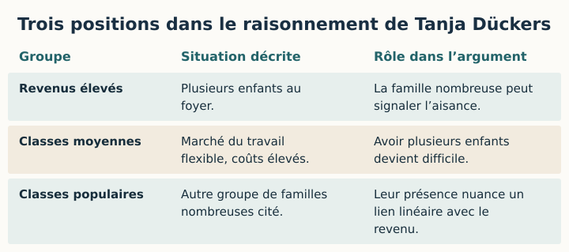

# ENS Rennes · D1 · Allemand 2010 — Corrigé guidé

*Corrigé rédigé par IA, non officiel. Signalez toute erreur.*

**Rédaction** · GPT-6.2 Astra Ultra · vitesse non renseignée

Le feuillet de l’École normale supérieure de Cachan est conservé dans les archives du concours D1 de Rennes. Tanja Dückers · Die Zeit · 16 décembre 2009.

## Version française

**L’enfant, ce produit de luxe**

Ces jeunes mères et ces jeunes pères qui, un latte macchiato à la main, poussent nonchalamment leur landau dans les rues du quartier berlinois de Prenzlauer Berg, volontiers surnommé « Pregnancy Hill », sont depuis longtemps devenus un cliché. Et pour cause. Les enfants font de plus en plus figure de signe extérieur de réussite. Chez ceux qui gagnent bien leur vie, la tendance est désormais d’avoir plusieurs enfants, à la différence des années quatre-vingt et quatre-vingt-dix, où d’autres signes indiquaient le rang social, mais certainement pas les enfants. On affiche ce qu’on a les moyens de s’offrir.

Les médias regorgent de précurseurs en la matière. Heidi Klum, qui a quatre enfants, Madonna, qui en a quatre également, et Angelina Jolie, qui en a six, allient richesse et joyeuse ribambelle d’enfants. Avoir des enfants et les élever, ce qui allait autrefois de soi, devient avec elles un numéro de variétés, un spectacle.

Chez les gens aisés aussi, les critères ont changé, et cela ne date pas du jour où Angelina Jolie ou Heidi Klum se sont montrées fièrement avec un bébé de plus. Les enfants permettent de concilier carrière et valeurs postmatérialistes si souvent invoquées. Mais, pour penser et agir en « postmatérialiste », encore faut-il pouvoir accoler un « post- » au mot « matériel », autrement dit avoir déjà surmonté la difficulté de s’assurer de quoi vivre.

Pour les classes moyennes, les exigences d’un marché du travail devenu plus flexible et une conjoncture économique difficile font de l’éducation des enfants une entreprise de plus en plus luxueuse. Dans cette catégorie de la population, on rencontre de plus en plus de personnes sans enfant ou de couples avec un seul enfant.

Voilà pourquoi ce sont principalement deux groupes socio-économiques qui, à l’heure actuelle, ont des enfants, et souvent beaucoup : ceux qu’on appelle les gens des classes populaires et, fait nouveau, ceux qui gagnent bien leur vie.

## Expression en allemand

Conséquences de la conjoncture économique sur les projets familiaux des jeunes couples · 100 mots.

Für junge Paare beeinflusst die wirtschaftliche Lage vor allem den Zeitpunkt einer Familiengründung. Wer nur einen befristeten Vertrag hat, weiß kaum, ob das Einkommen im nächsten Jahr für eine größere Wohnung reicht. Auch die Verteilung der Arbeit spielt eine Rolle. Wenn ein Elternteil lange aus dem Beruf aussteigen müsste, können beide den Kinderwunsch aufschieben, obwohl sie heute genug verdienen. Umgekehrt erleichtern verlässliche Betreuung und bezahlbare Wohnungen die Entscheidung, selbst bei einem bescheidenen Gehalt. Deshalb würde ich aus dem Einkommen allein keine Vorhersage ableiten. Wichtig ist, ob die Partner ihre Zukunft gemeinsam planen und sich dabei auf dauerhafte Unterstützung verlassen können.

*100 mots, comptés par espaces.*

## Comment construire la réponse

Décomposez le titre à partir de son dernier élément. *Gut* désigne ici un bien au sens économique. L’apposition française entre « enfant » et « produit de luxe » conserve la provocation qui donne sa portée à l’article. Le jury écarte « enfant de luxe », qui ne restitue pas ce bien susceptible de signaler le rang social. Dans *Kinderkriegen*, repérez le verbe *kriegen* (« avoir ») avant d’aborder le composé suivant, *Kinderaufziehen* (« élever des enfants »). Le second paragraphe porte sur deux actes ordinaires que les médias transforment en spectacle.

Dans le troisième paragraphe, retrouvez le noyau *nur diejenigen können…* puis rattachez-lui les deux relatives en *für die*. Il faut avoir assuré sa subsistance pour se dire au-delà des préoccupations matérielles. La chute distingue trois groupes, dont un fait contraste avec les deux autres. Le texte alterne « Angela » et « Angelina » pour la même actrice. La version conserve le nom usuel Angelina Jolie. Pour la réponse personnelle, distinguez le montant du revenu et sa prévisibilité. L’exemple du contrat à durée déterminée fournit un mécanisme précis et laisse toute sa place à la décision du couple.

[Feuillet original, p. 2](https://www.ens-rennes.fr/medias/fichier/se1a-10d1-langues_1421752516799-pdf#page=2) · [Rapport du jury, partie écrite](https://www.ens-rennes.fr/medias/fichier/reo1a_10d1_allem_1280151314053.pdf#page=1)
