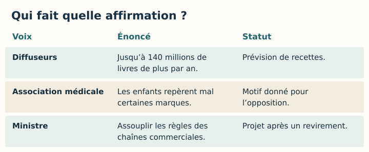

# ENS Rennes · D1 · Anglais 2010 — Corrigé guidé

*Corrigé rédigé par IA, non officiel. Signalez toute erreur.*

**Rédaction** · GPT-6.2 Astra Ultra · vitesse non renseignée

Le feuillet de l’École normale supérieure de Cachan est conservé dans les archives du concours D1 de Rennes. Adapté de The Guardian · 3 janvier 2010.

Le feuillet ne donne explicitement que la question d’expression. La traduction française complète de l’article est une proposition d’entraînement.

## Traduction en français pour l’entraînement

**Vive opposition au projet d’extension de la publicité à la télévision**

Des associations médicales, des syndicats enseignants et des organisations caritatives de défense de l’enfance s’opposent vivement au projet du gouvernement d’autoriser pour la première fois l’utilisation de produits à des fins commerciales dans les émissions de télévision.

Selon ses détracteurs, cette mesure, dont les diffuseurs attendent jusqu’à 140 millions de livres de recettes supplémentaires par an, aggravera l’obésité infantile et les problèmes liés à l’alcool et aux jeux d’argent. Elle dénaturera aussi les intrigues en récompensant les producteurs d’émissions qui donnent délibérément une grande visibilité à certains articles.

L’Association médicale britannique a écrit au ministère de la Culture, des Médias et des Sports pour lui faire part de sa ferme opposition. « Par sa nature même, le placement de produit permet d’intégrer la promotion commerciale aux émissions. Il brouille la distinction entre publicité et contenu éditorial et n’est pas toujours identifiable. Des études montrent que les enfants sont particulièrement réceptifs aux messages de marque intégrés aux émissions et que ces messages agissent à leur insu. »

La réglementation établie par l’Ofcom, l’autorité de régulation de l’audiovisuel, interdit actuellement le placement de produit. En mars dernier, le gouvernement avait exclu de lever cette interdiction. Puis, changeant de cap, le ministre de la Culture, Ben Bradshaw, a annoncé un projet d’assouplissement des règles pour aider les chaînes commerciales à surmonter le recul des recettes publicitaires. Les associations mobilisées ont dénoncé une décision destinée à « donner un gage aux diffuseurs et aux entreprises de l’agroalimentaire ».

## Expression en anglais

Responsabilité de la télévision dans les risques pour la santé · 100 mots maximum.

Television can contribute to health risks when it disguises a sales message as part of a story. A child who recognises a character may also remember the snack on the table without realising that someone paid to put it there. Yet exposure alone does not explain an individual’s health. Food prices, everyday routines and access to recreation matter too. Broadcasters should therefore identify commercial arrangements clearly and take particular care with programmes that attract children. They can also give viewers reliable information and show practical ways of staying healthy.

*89 mots, comptés par espaces.*

## Comment construire la réponse

Repérez trois voix. Les opposants anticipent des effets sur la santé et les intrigues. Les chaînes avancent une estimation de recettes. Le journaliste situe le revirement du gouvernement. Dans la deuxième phrase anglaise, *which broadcasters say…* attribue les 140 millions aux diffuseurs. La proposition principale continue après l’incise. Traduisez *up to* par « jusqu’à » et conservez *a year*. Ces deux expressions empêchent de prendre une borne supérieure annuelle pour un versement acquis.

Le passage entre guillemets a pour locuteur l’Association médicale britannique. *Embedded* décrit un message intégré au récit. *At a subconscious level* qualifie l’absence de prise de conscience chez le spectateur. Dans la question, *can* laisse place à une réponse qui évalue la responsabilité sans attribuer à la télévision toute la causalité. L’exemple de la collation met le mécanisme en scène. Le dernier mouvement tient compte de deux usages du média. La feuille anglaise imprime explicitement la question de 100 mots maximum. La traduction intégrale ci-dessus est proposée pour l’entraînement.

[Feuillet original, p. 3](https://www.ens-rennes.fr/medias/fichier/se1a-10d1-langues_1421752516799-pdf#page=3)
