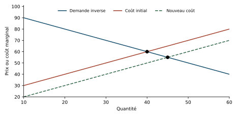
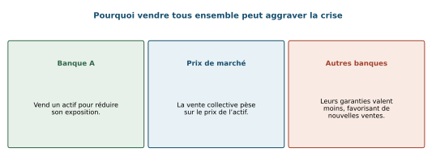

# ENS de Cachan D1 — Composition d’ordre économique 2010 · Corrigé brut

*Corrigé rédigé par IA, non officiel. Signalez toute erreur.*

**Lecture du rapport du jury** · GPT-6.2 Astra Ultra · vitesse non renseignée

**Rédaction** · GPT-6.2 Astra Ultra · vitesse non renseignée

## Les marchés constituent-ils encore un bon mécanisme de régulation économique ?

### Introduction

À l’automne 2008, plusieurs institutions financières ont voulu simultanément réduire leur exposition au risque. Une banque qui vend un actif renforce sa trésorerie. Si toutes le vendent ensemble, son prix chute et la valeur des garanties des emprunteurs diminue, ce qui peut provoquer de nouvelles ventes. Au même moment, la baisse du prix d’une matière première peut permettre à des entreprises de réduire leurs coûts et de produire davantage. Un prix peut donc amortir un choc sur un marché et l’amplifier sur un autre.

Un marché est un ensemble de règles et de lieux, éventuellement dématérialisés, où offreurs et demandeurs échangent un bien, un service ou un actif. La régulation économique désigne ici la capacité de ces échanges à coordonner des décisions, absorber un choc et rétablir une situation viable. Elle peut passer par les prix, les quantités, les stocks ou le crédit. « Bon » renvoie donc à plusieurs critères, l’efficacité de l’allocation, la stabilité et les effets pour les participants. En 2010, la crise donne sa force au mot « encore », mais le sujet inclut aussi les marchés de biens, le travail et la politique européenne de concurrence. Dans quelles conditions l’ajustement décentralisé peut-il satisfaire ces critères et de quel cadre a-t-il besoin lorsque ses propres réactions entretiennent le déséquilibre ?

### I. Les prix et la concurrence coordonnent les décisions lorsque le signal de rareté est pertinent

#### A. Les échanges permettent d’absorber des chocs localisés

Un gain de productivité réduit le coût marginal de produire un bien. En concurrence, à prix ancien les entreprises souhaitent offrir davantage. La baisse de prix accroît les achats et conduit à un nouvel équilibre. Si la demande inverse est $p=100-q$ et le coût marginal initial $20+q$, l’équilibre vérifie $100-q=20+q$, d’où $q=40$ et $p=60$. Après un progrès qui ramène le coût à $10+q$, on obtient $q=45$ et $p=55$. Les consommateurs acquièrent davantage à un prix plus faible. Les facteurs peuvent se déplacer vers les productions devenues plus rentables, à condition d’être mobiles et de disposer du temps nécessaire.

L’avantage de ce mécanisme est informationnel. Aucun producteur n’a besoin de connaître toutes les circonstances des autres producteurs pour réagir à son prix de vente. La concurrence discipline les surcoûts et permet, sous les hypothèses des théorèmes du bien-être, d’atteindre une allocation efficace au sens de Pareto. Le résultat suppose notamment que les prix reflètent les coûts et bénéfices pertinents et qu’aucun agent ne puisse manipuler le prix à son avantage. Même dans ce cas, la répartition initiale des ressources détermine qui peut exprimer une demande solvable. L’efficacité d’une réponse à un choc ne donne pas de verdict suffisant sur son équité.

#### B. Les institutions de concurrence rendent le signal plus fidèle

Sur un marché concentré, une entreprise ayant un pouvoir de marché peut restreindre l’offre afin de maintenir un prix supérieur au coût marginal. Reprenons le coût initial et la même demande. Un monopole à prix unique choisit $100-2q=20+q$, d’où $q\simeq26{,}7$, $p\simeq73{,}3$. Il vend toute la quantité offerte, mais des consommateurs valorisant une unité au-dessus de son coût ne peuvent l’obtenir. Un prix qui équilibre les transactions ne garantit donc pas un bon usage des ressources. La lutte contre les ententes et les abus de position dominante dans l’Union européenne vise à préserver la rivalité, sans exiger que chaque secteur compte le même nombre d’entreprises.

Une autre difficulté apparaît lorsque le prix omet un effet extérieur. Une usine peut réduire son prix en rejetant sans coût des nuisances subies en aval. La concurrence encourage ici des décisions qui ne couvrent pas le dommage. Un prélèvement sur l’émission ou un plafond avec droits échangeables peut faire entrer ce coût dans les arbitrages, si l’autorité peut mesurer les émissions et faire respecter la règle. Le marché continue de sélectionner les techniques les moins coûteuses, mais le cadre public détermine quelle rareté il faut faire payer. Cette articulation est plus précise qu’une opposition générale entre intervention et liberté des échanges.

### II. Les réactions collectives peuvent amplifier le choc et justifient des mécanismes de stabilisation

#### A. Les anticipations et les bilans fragilisent les marchés financiers

Les marchés financiers mobilisent l’épargne, répartissent les risques et font apparaître un prix des ressources futures. Le prix d’un actif dépend toutefois de revenus futurs incertains et d’anticipations sur sa valeur de revente. Si chacun pense pouvoir céder demain plus cher, les achats présents peuvent nourrir la hausse. Des écarts persistants sont possibles si arbitrer demande d’emprunter, de supporter des pertes intermédiaires et de tenir plus longtemps que le marché. Les incitations à suivre les autres et les asymétries d’information sont alors constitutives du mécanisme lui-même.

Dans une banque, une perte de valeur réduit les fonds propres disponibles pour une même dette. Pour restaurer son ratio, elle peut lever de nouveaux capitaux ou vendre des actifs. Si le financement devient difficile pour toutes, les ventes font baisser les cours et aggravent les bilans. Le raisonnement initial prudent au niveau individuel devient déstabilisant à l’échelle du système. La supervision prudentielle, des réserves de liquidité, la garantie des dépôts encadrée et l’intervention d’une banque centrale comme prêteur en dernier ressort peuvent limiter une panique. Ces règles doivent contenir l’aléa moral, faute de quoi une garantie trop large inciterait à prendre davantage de risque en temps normal.

#### B. Au niveau macroéconomique, l’ajustement peut porter durablement sur les quantités

Lorsque les ménages veulent épargner davantage et que les entreprises n’envisagent pas d’augmenter leurs investissements, la baisse de la demande réduit les ventes, les revenus et l’emploi. Si les prix sont rigides ou si la baisse du niveau général alourdit les dettes réelles, l’économie ne revient pas immédiatement au plein emploi. Chaque entreprise peut répondre rationnellement en réduisant sa production. La contraction simultanée des revenus limite ensuite les débouchés de toutes. Une politique monétaire moins restrictive ou des stabilisateurs budgétaires peuvent soutenir la dépense. Leur efficacité dépend des taux, de l’endettement et des capacités disponibles.

En économie ouverte, une partie de la demande supplémentaire se transforme en importations. Dans le modèle de Mundell-Fleming à forte mobilité des capitaux et à change flottant, l’appréciation peut aussi réduire les exportations nettes et amoindrir la relance budgétaire. Les mécanismes diffèrent sous un régime de change fixe ou dans une union monétaire. Coordonner des actions nationales peut limiter les réactions contradictoires sans supprimer toute incitation individuelle. Il convient enfin de comparer les dispositifs d’intervention eux-mêmes. Une règle de concurrence mal conçue ou une supervision incapable de percevoir le risque peut aussi échouer. Choisir une institution exige de confronter des résultats réalisables au regard des coûts d’information et d’exécution.

### Conclusion

Les marchés gardent une capacité de coordination précieuse lorsque les prix reflètent les raretés et que les agents peuvent ajuster leurs décisions. Ils perdent une partie de cette capacité si un pouvoir de marché déforme les prix, si un coût social reste extérieur aux échanges ou si une réaction simultanée nourrit la crise. La réglementation de la concurrence, la supervision et la stabilisation de la demande répondent à ces mécanismes distincts. La qualité d’une régulation se juge donc à la nature du choc, aux institutions et à la manière précise dont prix et quantités reviennent, ou non, à une situation soutenable.

[Sujet de la session](https://www.ens-rennes.fr/medias/fichier/se1a-10d1-dissertation_1421752506344-pdf) · [Rapport du jury](https://www.ens-rennes.fr/medias/fichier/ro_10d1economie_1283500378806.pdf)
