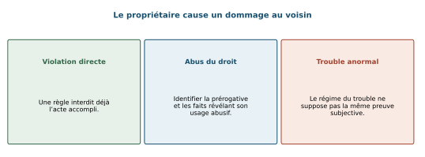
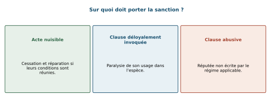

# ENS de Cachan D1 — Droit civil 2010 · Corrigé guidé

*Corrigé rédigé par IA, non officiel. Signalez toute erreur.*

**Lecture du rapport du jury** · GPT-6.2 Astra Ultra · vitesse non renseignée

**Rédaction** · GPT-6.2 Astra Ultra · vitesse non renseignée

## L’abus

### Introduction

> [!INDICATION]
> Identifier d’abord le droit ou le pouvoir dont l’auteur pourrait normalement se prévaloir. Cette recherche distingue immédiatement plusieurs situations qui ont seulement en commun de causer un dommage.

Un propriétaire est autorisé à se clore. S’il dresse un dispositif sans utilité pour lui dans le seul dessein de nuire à son voisin, peut-il répondre à toute demande de réparation en produisant son titre ? Dans Clément-Bayard du 3 août 1915, la chambre des requêtes a admis que l’exercice du droit de propriété pouvait dégénérer en abus. Un siècle de jurisprudence et de législation a étendu la question à l’exercice de prérogatives conventionnelles et au contenu de certains contrats.

L’abus suppose un dépassement dans l’exercice d’une prérogative, d’un pouvoir ou d’une faculté qu’une règle reconnaît par ailleurs. L’acte simplement accompli sans aucun droit relève d’abord de la violation de la règle qui l’interdit. Toute faute, tout dol et tout dommage ne sont donc pas des abus. L’intérêt de la notion tient précisément à la marge qui sépare une faculté valable de la manière inadmissible de s’en servir. Comment le juge et le législateur peuvent-ils tracer cette limite sans faire disparaître les droits dont ils disciplinent l’exercice ? Le critère varie selon la fonction de la prérogative. Les remèdes permettent ensuite d’ajuster la correction à la situation sans confondre exercice abusif et absence de droit.

### I. L’abus fait apparaître la limite interne d’une prérogative reconnue

#### A. Le droit de propriété illustre la différence entre titularité et exercice

> [!INDICATION]
> Dans l’affaire du propriétaire, relever un indice d’intention et un indice d’absence d’utilité. Comparer ensuite avec une nuisance émanant d’une activité utile.

L’article 544 du Code civil donne au propriétaire le droit de jouir et de disposer de la manière la plus absolue sous les réserves légales et réglementaires. Lorsque la loi interdit déjà directement un acte, le juge peut appliquer l’interdiction sans recourir à l’abus. L’affaire Clément-Bayard présente une difficulté supplémentaire. Le propriétaire avait placé sur son terrain des structures surmontées de pointes, sans utilité pour l’exploitation du fonds, afin de gêner le voisin qui utilisait des dirigeables. Le titulaire disposait bien de la maîtrise du terrain. L’absence d’utilité et le dessein exclusif de nuire révélaient un exercice fautif. La décision a notamment admis la suppression des pointes et l’indemnisation du dommage dans les conditions retenues.

L’intention malveillante est ici éclairée par des éléments objectifs de disposition des lieux et d’usage. Il ne s’ensuit pas que toute nuisance ou tout refus fait à un voisin équivaille à un abus. La théorie des troubles anormaux du voisinage, telle qu’elle résulte de la jurisprudence en 2010, peut conduire à réparer un trouble excédant les inconvénients normaux sans exiger de démontrer une intention de nuire. Deux actions relatives au même voisinage peuvent donc obéir à des conditions de fait et de preuve différentes. Si une clôture est utile et licite mais cause un trouble, il faut d’abord identifier le fondement que les éléments du dossier permettent réellement d’invoquer.

#### B. La finalité du pouvoir peut aussi imposer une limite objectivement vérifiable

> [!INDICATION]
> Comparer le devoir de conservation de la chose et le pouvoir de fixation du prix. Dans chaque cas, demander à quelle fin la prérogative a été reconnue.

L’usufruitier jouit de la chose d’autrui à charge d’en conserver la substance. L’article 618 permet la cessation de l’usufruit par l’abus de jouissance, notamment lorsque l’usufruitier dégrade le fonds ou le laisse dépérir faute d’entretien. Le problème n’est plus spécialement la volonté de blesser le nu-propriétaire. Les actes ou omissions contredisent la fonction même de la jouissance temporaire. Le tribunal dispose des solutions prévues par le texte, en tenant compte de la gravité des circonstances. Le comportement peut justifier une intervention plus énergique qu’une simple réparation ponctuelle si la conservation du bien reste menacée.

En droit des contrats, les arrêts d’assemblée plénière du 1er décembre 1995 sur les conventions-cadres illustrent une autre fonction. L’indétermination du prix des contrats ultérieurs ne détruit pas nécessairement la validité de la convention initiale, sous réserve des règles spéciales. La faculté laissée à une partie de fixer le prix peut toutefois être exercée de manière abusive, ouvrant, selon les conditions retenues, à résiliation ou indemnisation. Il faut examiner la mise en œuvre du pouvoir, le contexte et ses conséquences. On ne peut réduire cette jurisprudence à l’idée que tout prix élevé est interdit, ni transposer sa solution à tout contrat qui exige par un texte spécial un prix déterminé ou déterminable.

### II. L’encadrement de l’abus réunit des techniques de contrôle et des sanctions distinctes

#### A. La jurisprudence prévient la captation d’un pouvoir sans réécrire toute relation

> [!INDICATION]
> Séparer le choix de ne pas contracter, les circonstances de la rupture et les conditions d’une violence affectant le consentement.

L’article 1134, dans sa rédaction de 2010, confère force obligatoire aux conventions légalement formées et impose leur exécution de bonne foi. Un créancier peut disposer d’une clause destinée à protéger l’exécution de l’engagement et en faire un usage déloyal. Si, par sa conduite, il a empêché le paiement qu’il reproche ensuite au débiteur, le juge peut paralyser l’exercice déloyal d’une clause résolutoire dans les circonstances de l’espèce. La Cour de cassation rappelle cependant, le 10 juillet 2007, que la sanction de l’usage déloyal d’une prérogative contractuelle ne donne pas pouvoir de porter atteinte à la substance même des droits et obligations convenus.

Le contrôle n’abolit pas davantage les libertés dont il règle l’usage. Avant la conclusion, une rupture de pourparlers peut être fautive si les circonstances révèlent une déloyauté, sans que le seul refus de contracter devienne abusif. Dans les rapports économiques, l’exploitation abusive d’une situation de dépendance peut contribuer à caractériser une violence viciant le consentement dans les conditions exigeantes de la jurisprudence de l’époque. La simple inégalité économique entre les parties ne suffit pas. Il faut éviter de renommer « abus » tout consentement imparfait. Selon le fondement, le demandeur recherche soit réparation d’une faute dans l’exercice d’une liberté, soit annulation d’un contrat dont le consentement a été vicié.

#### B. La loi peut identifier le déséquilibre sans exiger la preuve d’une intention nuisible

> [!INDICATION]
> Demander si la difficulté vient de l’existence de la clause, de son usage dans l’espèce ou de la dégradation du bien. En déduire ce que la décision doit faire cesser.

En 2010, l’article L. 132-1 du Code de la consommation traite des clauses abusives dans les contrats conclus entre professionnels et non-professionnels ou consommateurs. Est en cause la clause qui a pour objet ou pour effet de créer, au détriment de l’autre partie, un déséquilibre significatif dans les droits et obligations. Le contrôle porte sur le contenu contractuel dans son contexte, avec des limites légales, notamment pour la définition de l’objet principal ou l’adéquation du prix à la prestation lorsque les clauses correspondantes sont rédigées clairement et de façon compréhensible. Le consommateur n’a pas à démontrer que le rédacteur a voulu personnellement lui nuire. La clause abusive est réputée non écrite et le contrat peut subsister s’il le peut sans elle.

La variété des remèdes éclaire l’unité limitée de la notion. L’acte dommageable d’un propriétaire peut justifier cessation et dommages-intérêts sur le terrain de la responsabilité, qui demande de relier faute, préjudice et causalité. L’abus de jouissance peut menacer le droit d’usufruit dans les conditions spéciales de l’article 618. L’usage abusif d’une clause peut être écarté pour un épisode sans que la clause soit illicite en elle-même. Une clause abusive pour son contenu, en revanche, est privée d’effet par le régime de consommation. Exiger une volonté malveillante pour tous ces cas priverait d’effet le contrôle du déséquilibre. Accorder systématiquement la nullité totale sacrifierait, à l’inverse, plus de droits que la protection poursuivie ne le nécessite.

### Conclusion

> [!INDICATION]
> Revenir à l’acte initialement permis et expliquer quel aspect précis du droit ou de son exercice est atteint par la solution.

L’abus corrige la distance entre une permission de principe et une pratique qui en détourne l’exercice ou en dépasse les limites. Il peut dépendre d’une intention révélée par les faits, de la fonction du droit ou d’un déséquilibre défini par la loi. La rigueur du contrôle tient au choix d’un critère propre à la situation et d’un remède proportionné à ce que le demandeur établit. Le titre du propriétaire reste valable après la suppression de pointes abusivement installées, comme le contrat de consommation peut continuer après l’éviction d’une clause.

[Sujet de la session](https://www.ens-rennes.fr/medias/fichier/se1a-10d1-droit-civil-_1421752511846-pdf) · [Rapport du jury](https://www.ens-rennes.fr/medias/fichier/re1a_10d1_droit_civil_1280150895411.pdf) · [Code civil en avril 2010](https://www.legifrance.gouv.fr/codes/texte_lc/LEGITEXT000006070721/2010-04-01/)
