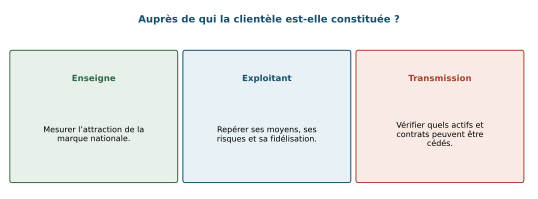
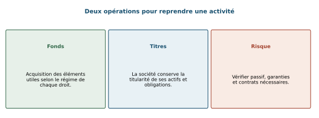

# ENS de Cachan D1 — Droit commercial 2010 · Corrigé brut

*Corrigé rédigé par IA, non officiel. Signalez toute erreur.*

**Lecture du rapport du jury** · GPT-6.2 Astra Ultra · vitesse non renseignée

**Rédaction** · GPT-6.2 Astra Ultra · vitesse non renseignée

## Les évolutions économiques et juridiques du début du XXIe siècle remettent-elles en cause la notion de fonds de commerce ?

### Introduction

Un franchisé exploite un magasin sous une enseigne nationale. Un autre commerçant vend les mêmes produits sur son propre site, sans local ouvert au public. Tous deux souhaitent céder ce qu’ils ont construit. Le premier ne possède pas la marque qui attire ses visiteurs, le second ne peut promettre au repreneur le passage de clients devant une vitrine. Peut-on néanmoins identifier dans chaque cas un fonds appartenant à l’exploitant ? Et la cession du fonds suffira-t-elle à transmettre tout le risque économique lié à l’activité ?

La loi du 17 mars 1909 a organisé des opérations portant sur le fonds. Le Code de commerce recodifié en 2000 en reprend le régime. Le fonds est une universalité de fait, réunissant des éléments mobiliers affectés à l’exploitation d’une clientèle propre. Il constitue un bien dans le patrimoine du commerçant. Il n’est à lui seul ni une personne ni un patrimoine comprenant normalement tout l’actif et le passif. Entre 2000 et le concours de 2010, les réseaux, le commerce électronique, les instruments de protection patrimoniale et la reconnaissance d’autres clientèles ont renouvelé les questions. Ces évolutions affaiblissent-elles le critère du fonds ou révèlent-elles surtout une limite qu’il a toujours eue ? La notion conserve sa capacité d’identifier et de transmettre une activité. La séparation des risques et la continuité des obligations demandent toutefois d’autres techniques.

### I. La clientèle permet au fonds de s’adapter lorsque changent les moyens de la conquérir

#### A. Le réseau et le numérique déplacent le problème du rattachement de la clientèle

Le fonds peut réunir le nom commercial, l’enseigne, le droit au bail, le matériel, les marchandises et des droits de propriété intellectuelle selon la situation de l’exploitation. Tous ces éléments ne sont pas indispensables à la fois. Un commerce de rue bénéficie de l’emplacement et de l’achalandage, un détaillant spécialisé des services qu’il dispense. L’existence d’une clientèle réelle et propre au commerçant distingue toutefois le fonds d’un simple regroupement de biens. Vendre des étagères, un ordinateur et un stock sans transmettre aucun moyen de conserver le courant d’affaires n’équivaut pas nécessairement à céder le fonds.

La franchise ne fait pas disparaître ce critère. Dans l’arrêt Trévisan du 27 mars 2002, la troisième chambre civile admet qu’à côté d’une clientèle nationale attachée à la notoriété de la marque, une clientèle locale puisse être établie grâce aux moyens mis en œuvre par le franchisé à ses risques et périls. Le régime des baux commerciaux peut alors bénéficier au franchisé titulaire de cette clientèle. Le raisonnement impose de vérifier sa réalité. Un exploitant dont chaque acheteur, chaque condition et chaque moyen de fidélisation dépendraient exclusivement d’un tiers ne pourrait se prévaloir des mêmes faits. De même, un site internet, un nom de domaine, une marque, des contrats logistiques et un fichier d’acheteurs peuvent contribuer à atteindre une clientèle. Le simple enregistrement du nom de domaine ne suffit pas. Il faut demander qui conclut les ventes, supporte les risques et peut maintenir la relation, dans le respect des droits des clients et de la protection des données.

#### B. La possibilité de transmettre ou de garantir la valeur de l’exploitation demeure nécessaire

Qu’un site prenne la place d’une boutique ne fait pas disparaître le besoin d’identifier l’objet d’une vente. Le régime de la cession protège les parties et les créanciers par des formalités de publicité et d’opposition prévues par le droit en vigueur en 2010. Le nantissement permet de donner en garantie des éléments du fonds compris dans son assiette légale ou conventionnelle selon les règles particulières. La location-gérance permet d’en confier l’exploitation à un tiers à ses risques. Toutes ces opérations exigent qu’on identifie les éléments dont dépend effectivement la clientèle et les droits dont le cédant peut disposer. Un licencié ne transmet pas automatiquement une marque qu’il n’a jamais possédée.

La diffusion du modèle au-delà du commerce révèle même la valeur d’une approche par l’organisation de moyens autour d’une clientèle ou d’une activité. La loi d’orientation agricole du 5 janvier 2006 permet à l’exploitant de créer un fonds agricole. Le fonds artisanal répond à une inspiration comparable. En matière libérale, l’arrêt du 7 novembre 2000 admet la cession de clientèle médicale à l’occasion de la constitution ou de la cession d’un fonds libéral d’exercice, à condition que soit sauvegardée la liberté de choix du patient. Reconnaître une valeur patrimoniale sous une telle réserve ne soumet pas le professionnel libéral au régime général de la vente d’un fonds de commerce. Ces analogies confortent la fonction de regroupement tout en maintenant les distinctions de statut et de régime.

### II. L’organisation de l’activité et la protection des créanciers révèlent les limites du fonds isolé

#### A. Une universalité de fait ne cloisonne pas l’actif et le passif de l’entrepreneur

Le fonds appartient au commerçant et figure à l’actif de son patrimoine. En principe les dettes et créances ne suivent pas globalement la vente du fonds par son seul effet. Il faut rechercher des conventions particulières ou une règle spéciale, par exemple celle qui organise le transfert des contrats de travail lorsque ses conditions sont réunies. L’immeuble dans lequel le propriétaire exploite son commerce ne devient pas un élément mobilier du fonds. Si l’exploitant individuel emprunte pour développer sa boutique en ligne, le fonds ne constitue pas par sa seule existence un compartiment exclusif offert au créancier professionnel. Les règles du droit de gage général restent applicables sous leurs exceptions.

Dans une économie où l’endettement et la défaillance sont des enjeux visibles, le législateur a développé des mécanismes qui répondent à cette autre question. La déclaration d’insaisissabilité issue de 2003, étendue en 2008 à certains biens fonciers non affectés à l’usage professionnel, protège sous conditions des biens personnels contre certaines créances professionnelles. La fiducie instituée en 2007 permet un transfert de biens dans un patrimoine fiduciaire séparé selon sa finalité et son régime. Le projet d’EIRL débattu au moment de l’écrit 2010 vise pour sa part un patrimoine d’affectation professionnel. La loi qui l’instaurera date du 15 juin 2010, après l’écrit. Le fonds peut faire partie de la masse affectée mais ne se confond pas avec celle-ci.

#### B. La concurrence des techniques patrimoniales modifie le rôle du fonds sans le supprimer

Un acquéreur qui achète les titres d’une société reprend le contrôle d’une personne qui demeure titulaire de ses droits et obligations. L’entreprise peut continuer avec les mêmes contrats, sous réserve notamment de clauses ou d’agréments particuliers. L’acquéreur supporte indirectement le risque du passif de la société et peut demander des garanties. Celui qui achète le fonds acquiert au contraire les éléments convenus ou transmis par la loi. L’étendue du passif repris n’est pas la même et les contrats essentiels doivent être vérifiés. Ces deux opérations restent pertinentes pour une boutique en réseau comme pour une entreprise de vente en ligne.

Des formes simplifiées d’exercice ou d’imposition peuvent faciliter l’activité individuelle, mais leur choix ne répond pas à la question de l’existence d’un courant d’affaires propre. Un professionnel sans clientèle réelle ne crée pas de fonds par simple déclaration, tandis qu’un exploitant modeste peut constituer un fonds précieux par son travail de fidélisation. La nouveauté économique oblige à mieux décrire le contenu, la cessibilité et les dépendances techniques des actifs incorporels. La nouveauté juridique oblige à ne plus demander au fonds de résoudre seul la protection du patrimoine et l’organisation du financement. Ces évolutions distinguent des fonctions que la boutique traditionnelle rendait plus faciles à confondre.

### Conclusion

Le début du XXIe siècle remet en cause l’identification intuitive du fonds à un magasin et à ses meubles. Il ne supprime ni le critère de la clientèle propre ni le besoin de regrouper les actifs qui rendent possible la poursuite du commerce. En revanche, la transmission du passif, l’entrée d’investisseurs et la protection des biens personnels relèvent d’institutions distinctes. La notion conserve donc son utilité si le juriste précise la fonction qu’il lui demande de remplir.

[Sujet de la session](https://www.ens-rennes.fr/medias/fichier/se1a-10d1-options-2010_1421752521892-pdf#page=2) · [Rapport du jury](https://www.ens-rennes.fr/medias/fichier/re1a_10d1_droit_commercial_1280151091409.pdf) · [Code civil en avril 2010](https://www.legifrance.gouv.fr/codes/texte_lc/LEGITEXT000006070721/2010-04-01/) · [Code de commerce en avril 2010](https://www.legifrance.gouv.fr/codes/texte_lc/LEGITEXT000005634379/2010-04-01/) · [Code rural en avril 2010](https://www.legifrance.gouv.fr/codes/texte_lc/LEGITEXT000006071367/2010-04-01/)
