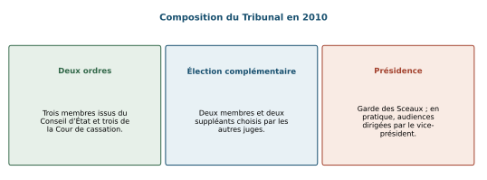

# ENS de Cachan D1 — Droit public 2010 · Corrigé brut

*Corrigé rédigé par IA, non officiel. Signalez toute erreur.*

**Lecture du rapport du jury** · GPT-6.2 Astra Ultra · vitesse non renseignée

**Rédaction** · GPT-6.2 Astra Ultra · vitesse non renseignée

## Le tribunal des conflits

### Introduction

Un justiciable recherche la réparation d’un dommage, mais le juge judiciaire lui répond que le litige relève du juge administratif. Si ce dernier se déclare ensuite incompétent, la coexistence de deux ordres de juridiction risque de laisser sans juge une demande que le droit protège. Le Tribunal des conflits a précisément pour mission de rendre la dualité juridictionnelle praticable. Ses fonctions ne se limitent pourtant pas à tracer une frontière abstraite. Dans certains cas exceptionnels, c’est le fond même de la demande qu’il doit juger pour éviter un déni de justice.

Créée en 1848 puis rétablie par la loi du 24 mai 1872, l’institution réunit des membres issus des deux ordres. Il convient d’en restituer l’organisation applicable en 2010. Elle garantit une solution de compétence commune sans créer une juridiction supérieure d’appel pour tous les litiges. Comment une juridiction paritaire peut-elle protéger la séparation des ordres tout en assurant que cette séparation n’empêche pas la justice ? Son organisation et ses modes de saisine arbitrent d’abord les conflits de compétence. Ses décisions contribuent ensuite à définir le droit administratif et, dans des conditions limitées, à assurer une issue effective au justiciable.

### I. Un juge commun aux deux ordres règle les conflits d’attribution

#### A. Une organisation paritaire historiquement assortie d’une présidence ministérielle

En 2010, l’article 25 de la loi de 1872 prévoit la présidence du garde des Sceaux, trois conseillers d’État en service ordinaire élus par leurs pairs, trois conseillers à la Cour de cassation désignés par leurs collègues, puis deux membres et deux suppléants élus par les autres juges dans les conditions du texte. En pratique, les membres supplémentaires sont choisis de manière à préserver l’équilibre des deux ordres. En dehors du ministre, la formation comprend ainsi huit membres titulaires. Le vice-président assure généralement la présidence des audiences. Le garde des Sceaux peut intervenir pour départager en cas de partage persistant des voix. Le droit applicable à l’époque conserve donc une intervention ministérielle exceptionnelle qui ne se réduit pas au fonctionnement ordinaire de la juridiction.

La parité a une justification institutionnelle. Confier à la seule Cour de cassation ou au seul Conseil d’État le dernier mot dans chaque conflit ferait dépendre le domaine d’un ordre de l’appréciation de son voisin. Une autorité commune peut rendre une décision qui oblige l’un et l’autre. La présence possible d’un membre du gouvernement au départage suscite toutefois une interrogation sur l’apparence de l’indépendance, particulièrement lorsque l’administration a un intérêt au litige. Cette critique doit être distinguée de la description exacte du droit de 2010. Le Tribunal ne surveille pas en général le bien-fondé des arrêts rendus par les autres cours suprêmes.

#### B. Des procédures différentes répondent aux empiètements et aux doubles refus

Dans le conflit positif, le préfet conteste la compétence d’une juridiction judiciaire au profit de l’autorité administrative dans les matières où cette procédure est admise. Il présente d’abord un déclinatoire de compétence motivé. Si le juge l’accueille, la difficulté est résolue. S’il le rejette, le préfet peut, dans le délai légal, élever le conflit par arrêté. La procédure judiciaire est suspendue et le Tribunal des conflits décide notamment de confirmer ou d’annuler l’arrêté. Ce mécanisme protège l’ordre administratif contre un empiètement judiciaire. Il n’existe pas une procédure symétrique par laquelle un préfet défendrait le juge judiciaire devant l’administration.

Le conflit négatif correspond à deux décisions d’incompétence des deux ordres à propos du même litige, chacune renvoyant en substance à l’autre. À côté du règlement de ce conflit lorsqu’il est constitué, le décret du 26 octobre 1849 modifié prévoit en 2010 un mécanisme préventif. Lorsqu’une décision devenue irrévocable a écarté la compétence d’un ordre et que la juridiction de l’autre ordre estime le premier compétent, elle doit renvoyer la difficulté au Tribunal des conflits au lieu d’ajouter un refus à un autre. Le Tribunal désigne l’ordre compétent et peut priver d’effet la décision d’incompétence qui faisait obstacle au jugement. Dans le cas de départ, le justiciable n’a ainsi pas à recommencer indéfiniment le parcours.

### II. Une jurisprudence de répartition qui contribue aussi à l’effectivité du droit

#### A. La prévention et la jurisprudence de principe précisent les domaines respectifs

Une difficulté sérieuse de compétence peut être soumise au Tribunal avant même qu’un conflit négatif soit constitué. En 2010, le mécanisme de l’article 35 du décret de 1849 est ouvert au Conseil d’État et à la Cour de cassation. Le juge suprême saisi d’un litige peut surseoir et renvoyer la question de compétence sérieuse mettant en jeu la séparation des autorités. Le Tribunal répond à cette question préjudicielle de compétence et la juridiction d’origine tire les conséquences de la réponse. Cette procédure facultative doit être distinguée du renvoi obligatoire de prévention après une décision irrévocable d’incompétence et d’une question préjudicielle de légalité portant sur un acte.

Pour savoir quel ordre est compétent, le Tribunal doit souvent qualifier l’activité et la nature de la relation. Dans Blanco du 8 février 1873, il rattache aux règles spéciales de la responsabilité de l’État pour le fonctionnement d’un service public la compétence administrative dans l’espèce. Il ne décide pas que toute activité publique relève sans exception du juge administratif. Dans Société commerciale de l’Ouest africain du 22 janvier 1921, le fonctionnement de certains services dans des conditions analogues à celles d’une entreprise privée conduit à la compétence judiciaire pour le litige en cause. En 1968, Époux Barbier attribue au juge administratif le contrôle des règlements relatifs à l’organisation même d’un service public industriel et commercial, y compris lorsqu’il est géré par une personne privée. L’objet exact de l’acte peut donc modifier l’ordre compétent au sein d’un même service.

#### B. Le règlement au fond reste exceptionnel face à un déni de justice

Deux juges peuvent chacun avoir statué valablement dans le champ de leur compétence et avoir rendu des décisions au fond dont la contrariété empêche le justiciable d’obtenir une réponse cohérente. Dans l’affaire Rosay, l’appréciation incompatible des responsabilités par les deux ordres a illustré ce risque. La loi du 20 avril 1932 permet de saisir le Tribunal des conflits lorsque des décisions définitives rendues par les juridictions des deux ordres, sur des litiges portant sur le même objet, présentent une contrariété conduisant à un déni de justice. Le Tribunal peut alors juger le fond. Deux raisonnements divergents sur des affaires étrangères l’une à l’autre ne suffisent donc pas. L’exception sert à résoudre un dommage juridictionnel concret.

Cette compétence complète la prévention des doubles refus. Dans la première situation le demandeur ne trouve aucun juge qui se reconnaisse compétent. Dans la seconde, plusieurs jugements existent mais leur combinaison le prive d’une issue juridiquement cohérente. Une institution qui ne pourrait que nommer l’ordre compétent serait impuissante à corriger la seconde situation. Inversement, ouvrir un recours au fond pour tout désaccord de jurisprudence transformerait le Tribunal en cour suprême générale et contredirait la dualité qu’il organise. Son autorité tient à la précision de ces portes d’entrée et à la force obligatoire de la solution dans le litige concerné.

### Conclusion

Le Tribunal des conflits est à la fois juge de la frontière entre les ordres et garant contre les impasses que cette frontière peut produire. Sa composition de 2010 organise une décision commune. Les conflits positif et négatif, les renvois préventifs et le recours issu de 1932 lui confient des offices distincts, de la désignation du juge à la décision au fond. C’est en les distinguant que l’on comprend comment il protège simultanément les compétences publiques et le droit du justiciable à une réponse.

[Sujet de la session](https://www.ens-rennes.fr/medias/fichier/se1a-10d1-options-2010_1421752521892-pdf#page=3) · [Rapport du jury](https://www.ens-rennes.fr/medias/fichier/re1a_10d1_droit_public_1280150962357.pdf) · [Constitution en avril 2010](https://www.legifrance.gouv.fr/loda/id/JORFTEXT000000571356/2010-04-01/) · [Tribunal des conflits, Blanco, 8 février 1873](https://www.conseil-etat.fr/fr/arianeweb/TC/decision/1873-02-08/00012) · [Tribunal des conflits, Époux Barbier, 15 janvier 1968](https://www.conseil-etat.fr/fr/arianeweb/TC/decision/1968-01-15/01908) · [Article 25 de la loi du 24 mai 1872 en 2010](https://www.legifrance.gouv.fr/loda/article_lc/LEGIARTI000006492511/2010-04-01)
