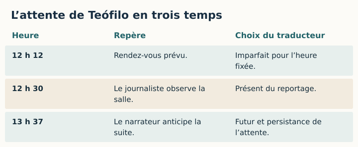

# ENS Rennes · D1 · Espagnol 2010 — Corrigé guidé

*Corrigé rédigé par IA, non officiel. Signalez toute erreur.*

**Rédaction** · GPT-6.2 Astra Ultra · vitesse non renseignée

Le feuillet de l’École normale supérieure de Cachan est conservé dans les archives du concours D1 de Rennes. D’après El País · 18 janvier 2010.

## Version française

**Des patients de première et de seconde zone**

À Aluche coexistent le meilleur et le pire centre de santé de Madrid. Las Águilas vient de recevoir un prix, tandis que Maqueda, vétuste et mal équipé, est à bout de capacité.

Teófilo López, 72 ans, attend son tour debout. Il est midi et demi et on peine à trouver une chaise libre. Teófilo ne s’en formalise même pas. Il avait rendez-vous à 12 h 12. À 13 h 37, il sera toujours là, debout, résigné. À quoi bon se fâcher, puisque c’est comme ça ?

Ce qu’on a sous les yeux, c’est un centre qui accueille beaucoup de patients dans peu de mètres carrés, mal équipé, mal ventilé, vétuste, saturé. Il y a trente ans, quand il a ouvert ses portes, les patients étaient ravis. Aujourd’hui, ils ne le sont plus et le gouvernement régional le considère comme prioritaire parmi les 55 centres qu’Esperanza Aguirre a promis de construire au cours de cette législature.

D’après les employés qui ont rencontré Esperanza Aguirre lors de sa visite à Maqueda, la présidente s’est entretenue avec plusieurs patients, en a embrassé plusieurs et a quitté le centre en disant qu’ils avaient raison et que la situation ne pouvait pas durer. « Le projet du centre est déjà prêt et nous espérons que l’appel d’offres sera lancé cette année », déclare une porte-parole de l’administration régionale de la santé. En réalité, voilà déjà un bon moment que ce projet dort dans l’un de ses bureaux. Plus d’un usager est venu se plaindre auprès du personnel. Pourquoi seraient-ils, eux, des patients de seconde zone, demandent-ils. « Ils nous disent qu’ils ont vu d’autres centres et se plaignent de subir une discrimination », explique une femme médecin. « Et ils ont raison. »

À deux kilomètres à peine de Maqueda, à trente minutes à pied, on entre dans un autre monde. Le centre de santé Las Águilas, construit en 1988, s’étend sur trois étages où se succèdent de vastes salles de consultation et des salles d’attente plus dégagées encore, à faire pâlir d’envie les professionnels de Maqueda.

## Expression en espagnol

Comparer la situation des services de santé et l’attitude des responsables politiques en Espagne et ailleurs · 100 mots minimum.

No creo que la desigualdad descrita sea exclusiva de España. Dos centros de una misma ciudad pueden depender de inversiones realizadas en momentos distintos y atender a poblaciones que han crecido a ritmos diferentes. Lo que sorprende en Aluche es la poca distancia que hay entre experiencias tan desiguales. Para el paciente que espera de pie, saber que se ha preparado un proyecto no equivale a tener una cita a tiempo. En Francia también se discute cómo garantizar el acceso a la atención médica donde los recursos son escasos. Una visita política puede servir para escuchar a los pacientes, pero debería permitirles conocer después el calendario de las obras y comprobar si se han cumplido los compromisos. La rendición de cuentas importa a ambos lados de la frontera.

*128 mots, comptés par espaces.*

## Comment construire la réponse

Suivez Teófilo à travers les trois heures imprimées. Il a rendez-vous à 12 h 12, il est midi et demi lors de l’observation, et le narrateur se projette jusqu’à 13 h 37. Le futur est essentiel. La question familière qui clôt le paragraphe donne brièvement à entendre la résignation du patient. Le jury attire l’attention sur *no da más de sí* et *es lo que hay*. La saturation du centre et la posture de Teófilo permettent de traduire chacune des expressions par son effet dans la scène.

Pour la visite de la présidente, le rapport attend des passés composés en français. La visite a eu lieu et sa promesse reste en suspens au moment où le journaliste écrit. *Licitar* annonce une mise en concurrence, une étape antérieure aux travaux. Dans la réponse, traitez les deux objets de la question, l’inégalité des équipements et l’attitude des responsables politiques. Comparez à partir d’un critère observable, tel le délai d’accès au soin ou la publication d’un calendrier, pour éviter de prêter un comportement uniforme à tout un pays.

[Feuillet original, p. 4](https://www.ens-rennes.fr/medias/fichier/se1a-10d1-langues_1421752516799-pdf#page=4) · [Rapport du jury, partie écrite](https://www.ens-rennes.fr/medias/fichier/reo1a_10d1_espagnol_1280151386872.pdf#page=1)
