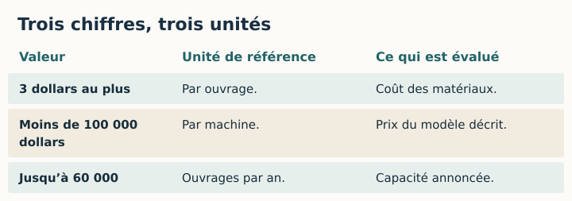

# ENS Rennes · D1 · Italien 2010 — Corrigé guidé

*Corrigé rédigé par IA, non officiel. Signalez toute erreur.*

**Rédaction** · GPT-6.2 Astra Ultra · vitesse non renseignée

Le feuillet de l’École normale supérieure de Cachan est conservé dans les archives du concours D1 de Rennes. Simone D’Ambrosio · texte adapté du Corriere della Sera · 17 septembre 2009.

## Version française

Si vous n’aimez pas vous abîmer les yeux devant un écran d’ordinateur et préférez savourer un bon livre en tournant les pages de vos propres mains, Google Books a pensé à vous. Grâce à l’accord conclu avec la société qui distribue la « machine à livres express », l’immense fonds de la plus vaste bibliothèque numérique publique au monde pourra en effet être facilement transféré sur papier.

Cette « machine à café littéraire », à laquelle le magazine *Time* a décerné en 2007 son prix de l’invention de l’année, vous permettra d’obtenir en une poignée de minutes une version imprimée du livre dont vous rêvez, depuis l’introuvable transcription d’un manuscrit qui n’a jamais été réimprimée jusqu’au livre de recettes du chef le plus recherché. Le tout avec une reliure pratique et une simple couverture rigide, pour un coût total des matériaux qui ne dépasse pas trois dollars. Avec une machine à un peu moins de cent mille dollars, sachant qu’il existe aussi des modèles moins coûteux, on pourra imprimer jusqu’à soixante mille ouvrages par an. Dès demain, en somme, plus de deux millions de livres du domaine public seront disponibles dans le catalogue à la demande. Il s’agira exclusivement d’ouvrages qui ne sont plus protégés par le droit d’auteur dans le pays où on les imprime.

## Expression en italien

Place de la culture numérique et de l’accès à Internet dans les études · 100 mots.

Per uno studente l’accesso a Internet può cambiare un’intera giornata di lavoro. Se la biblioteca è lontana, consultare un catalogo da casa permette di scegliere i libri prima del viaggio. Tuttavia, trovare subito una pagina non significa capirla. Occorre identificare l’autore, verificare la data e confrontare una fonte con un’altra. Per questo la cultura digitale comprende anche la capacità di fermarsi e leggere con attenzione. Una scuola può ridurre le disuguaglianze offrendo una connessione e spiegando come usarla. Il risultato migliore si ottiene quando lo studente combina liberamente strumenti diversi e sceglie quello più adatto alla domanda che vuole approfondire.

*100 mots, comptés par espaces.*

## Comment construire la réponse

Le texte de septembre 2009 fait une promesse au lecteur. Gardez les futurs *potrà*, *consentirà*, *saranno* et le repère « dès demain ». Dans *mai più ristampata*, l’accord féminin renvoie à *trascrizione*. « Qui n’a jamais été réimprimée » qualifie la transcription. L’image de la cafetière et le nom de la machine rapprochent le livre imprimé à la demande d’un objet préparé en quelques minutes.

Identifiez l’unité associée à chaque nombre. Les trois dollars se rapportent aux seuls matériaux. Les cent mille dollars concernent l’ordre de grandeur du prix de la machine, et les soixante mille ouvrages sa production annuelle maximale. Le domaine public s’apprécie dans le pays d’impression. Pour la réponse en italien, donnez un usage propre à l’accès au réseau, puis une compétence propre à la culture numérique. L’exemple de l’étudiant qui prépare une visite en bibliothèque fait apparaître les deux.

[Feuillet original, p. 5](https://www.ens-rennes.fr/medias/fichier/se1a-10d1-langues_1421752516799-pdf#page=5)
