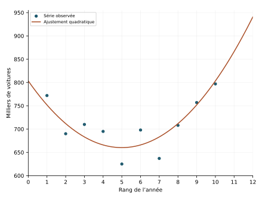

# ENS de Cachan D1 — Mathématiques appliquées et statistiques 2010 · Corrigé guidé

*Corrigé rédigé par IA, non officiel. Signalez toute erreur.*

**Rédaction** · GPT-6.2 Astra Ultra · vitesse non renseignée

**Révision** · GPT-6.2 Astra Ultra · vitesse non renseignée

Les neuf exercices couvrent des statistiques descriptives, deux modèles de tirage, une fonction de demande, une loi de Pareto, deux intégrales et une récurrence. Les hypothèses requises par les données de crédit et les restrictions du dernier exercice sont explicitées.

## Exercice 1. Logements et nombres de pièces

### Question 1.1

> [!INDICATION]
> Décrire ce que mesure la valeur entière associée à un logement.

#### Solution

Le caractère est le nombre de pièces du logement. C’est une variable quantitative discrète.

### Question 1.2

> [!INDICATION]
> Identifier la population décrite par le texte.

#### Solution

L’enquête porte sur les 540 logements de la ville, c’est-à-dire sur l’ensemble de la population annoncée. Il s’agit d’un recensement.

### Question 1.3

> [!INDICATION]
> Utiliser les effectifs cumulés pour les deux rangs centraux.

#### Solution

La moyenne pondérée vaut $\bar x=1515/540\simeq2{,}80556$ pièces. Les effectifs cumulés $25,235,425,505,535,540$ placent les rangs 270 et 271 à la valeur 3, donc la médiane est 3. La variance descriptive est $\sum N_i x_i^2/540-\bar x^2\simeq0{,}98997$ pièce² et l’écart-type vaut $0{,}99497$ pièce.

Le second moment repose sur la somme pondérée $25+4\times210+9\times190+16\times80+25\times30+36\times5=4\,785$. La variance exacte est donc $4\,785/540-(1\,515/540)^2=1283/1296$.

### Question 1.4

> [!INDICATION]
> Diviser l’effectif de chaque événement par 540.

#### Solution

La probabilité d’avoir deux pièces est $210/540=7/18$. Celle d’en avoir strictement plus de trois est $(80+30+5)/540=23/108$.

## Exercice 2. Quatre emprunteurs

### Question 2.1

> [!INDICATION]
> Écrire séparément « euros non remboursés / euros prêtés » et « nombre de clients défaillants / nombre de clients ». Vérifier sous quelle hypothèse ils peuvent donner le même paramètre.

#### Solution

Le calcul attendu par le jury suppose quatre clients indépendants, ayant chacun une probabilité $p=0{,}10$ de défaut. Le pourcentage des sommes impayées donné par le texte ne détermine ce paramètre individuel que moyennant une hypothèse supplémentaire sur les montants. Sous le modèle attendu, le nombre $X$ de défauts suit $\mathcal B(4,0{,}1)$ et $P(X=1)=4(0{,}1)(0{,}9)^3=0{,}2916$.

Par exemple, si neuf personnes remboursent chacune 100 euros et qu’une dixième ne rembourse rien sur 100 euros, le défaut concerne 10 % des sommes et des clients. Si une personne rembourse 900 euros tandis que neuf autres doivent à elles toutes 100 euros et ne remboursent rien, la fraction monétaire est toujours de 10 % mais 90 % des clients sont en défaut. Des montants identiques par emprunteur et un défaut portant sur la totalité du prêt rendraient l’identification immédiate.

### Question 2.2

> [!INDICATION]
> Reconnaître l’événement de zéro défaut.

#### Solution

Les quatre emprunteurs remboursent avec probabilité $P(X=0)=0{,}9^4=0{,}6561$.

### Question 2.3

> [!INDICATION]
> Compléter les deux cas de trois ou quatre défauts.

#### Solution

$P(X\le2)=1-4(0{,}1)^3(0{,}9)-(0{,}1)^4=0{,}9963$.

## Exercice 3. Production automobile

### Question 3.1

> [!INDICATION]
> Choisir comme abscisse le rang fourni et conserver le décalage de l’origine.

#### Solution

Aux rangs entiers 1 à 10, placer les ordonnées 772, 690, 710, 695, 625, 698, 637, 708, 757, 797, en milliers de voitures. Le cahier répète 2003 et omet 2005 dans la colonne civile. Les rangs, eux, sont consécutifs. Sur la copie l’origine est $(0,600)$, avec 2 cm par rang et 5 cm par centaine de milliers.

### Question 3.2

> [!INDICATION]
> Diviser les sommes de carrés et de produits par dix.

#### Solution

On trouve $\bar x=5{,}50$, $V_x=8{,}25$, $\bar y=708{,}90$, $V_y=2693{,}69$ et $C_{xy}=\sum x_iy_i/10-\bar x\bar y=29{,}15$.

### Question 3.3

> [!INDICATION]
> Relier la covariance au coefficient sans unité.

#### Solution

$r_{xy}=29{,}15/\sqrt{8{,}25\times2693{,}69}\simeq0{,}20$. La faible tendance linéaire concorde avec la forme en creux du nuage.

### Question 3.4

> [!INDICATION]
> Conserver l’appariement avec la production de chaque rang.

#### Solution

Pour $t_i=(x_i-5)^2$, les couples sont disposés dans l’ordre chronologique.

| Rang | 1 | 2 | 3 | 4 | 5 |
|---|---:|---:|---:|---:|---:|
| $t$ | 16 | 9 | 4 | 1 | 0 |
| $y$ | 772 | 690 | 710 | 695 | 625 |
| Rang | 6 | 7 | 8 | 9 | 10 |
| $t$ | 1 | 4 | 9 | 16 | 25 |
| $y$ | 698 | 637 | 708 | 757 | 797 |

### Question 3.5

> [!INDICATION]
> Réestimer une droite en utilisant la variable transformée.

#### Solution

On trouve $\bar t=8{,}50$, $V_t=61{,}05$ et $C_{ty}=349{,}55$. Ainsi $r_{ty}=C_{ty}/\sqrt{V_tV_y}\simeq0{,}86$. Les moindres carrés donnent $a=C_{ty}/V_t\simeq5{,}725635$ et $b=\bar y-a\bar t\simeq660{,}232105$. La droite est $\widehat y=5{,}73t+660{,}23$ au centième. L’amélioration sur la droite en $x$ est nette, avec environ $r^2\simeq74\,\%$ de variance expliquée.

### Question 3.6

> [!INDICATION]
> Remplacer t par sa définition.

#### Solution

La fonction d’ajustement est $f(x)=a(x-5)^2+b$, en milliers de voitures, avec les coefficients précédents.

### Question 3.7

> [!INDICATION]
> Identifier le sommet et les variations du carré.

#### Solution

$f'(x)=2a(x-5)$ avec $a>0$. La fonction décroît de $f(0)\simeq803{,}37$ à $f(5)\simeq660{,}23$, puis croît jusqu’à $f(12)\simeq940{,}79$. La figure de la question 3.1 trace cette parabole dans le repère du nuage.

### Question 3.8

> [!INDICATION]
> Associer l’année suivante au rang suivant.

#### Solution

2010 a le rang 11. Avec les coefficients non arrondis, $f(11)=36a+b\simeq866{,}35$ milliers, soit environ 866 355 voitures.

## Exercice 4. Deux établissements

### Question 4

> [!INDICATION]
> Reconstituer les deux masses salariales.

#### Solution

Le salaire moyen est $(500\times1805+800\times2231)/(500+800)\simeq2067{,}15$ euros. Chaque établissement intervient en proportion de son effectif.

## Exercice 5. Tirages avec ou sans remise

### Question 5.1

> [!INDICATION]
> Identifier les essais identiques indépendants.

#### Solution

Avec remise, $X\sim\mathcal B(15,8/20)$, d’où $\mathbb EX=15(2/5)=6$. La probabilité de six blanches est $p=\binom{15}{6}(2/5)^6(3/5)^9\simeq0{,}20660$.

### Question 5.2

> [!INDICATION]
> Compter les sous-ensembles de quinze boules ayant la composition requise.

#### Solution

Sans remise, le sous-ensemble tiré est uniforme. Il existe $\binom86\binom{12}9$ choix de six blanches et neuf noires. La probabilité est $q=\binom86\binom{12}9/\binom{20}{15}\simeq0{,}39732$.

### Question 5.3

> [!INDICATION]
> Pondérer les deux vraisemblances par les probabilités a priori.

#### Solution

Dans l’interprétation usuelle de la phrase, les deux protocoles sont équiprobables. En notant $S$ le protocole sans remise, la formule de Bayes donne $P(S\mid X=6)=(q/2)/(p/2+q/2)\simeq0{,}65790$. L’expression imprimée « avec ou sans remise » à la place de « avec remise » dans la première branche est ambiguë : prise littéralement comme la réunion des deux cas, elle imposerait $P(S)=1$ et rendrait le calcul trivial.

Avec une probabilité initiale quelconque $s=P(S)$, le même raisonnement donne $sq/[sq+(1-s)p]$. Lorsque $s=1/2$, le rapport de vraisemblances $q/p$ dépasse 1. L’observation de six blanches favorise alors le protocole sans remise et explique pourquoi la probabilité finale dépasse $1/2$.

## Exercice 6. Fonction de demande et élasticité

### Question 6.I.1

> [!INDICATION]
> Séparer le comportement de l’exponentielle aux deux infinis.

#### Solution

Pour $f(x)=(x+4)e^{-x/2}$, la limite en $-\infty$ est $-\infty$ car $x+4\to-\infty$ et le facteur positif tend vers $+\infty$. En $+\infty$, l’exponentielle au dénominateur domine $x+4$, donc la limite est 0.

### Question 6.I.2

> [!INDICATION]
> Dériver le produit et conserver le facteur exponentiel positif.

#### Solution

Pour tout réel, $f'(x)=e^{-x/2}-(x+4)e^{-x/2}/2=-(x+2)e^{-x/2}/2$. La fonction croît strictement jusqu’à $x=-2$, où elle atteint $2e$, puis décroît strictement vers 0.

### Question 6.I.3

> [!INDICATION]
> Étudier le signe de la seconde dérivée.

#### Solution

Une nouvelle dérivation donne $f''(x)=xe^{-x/2}/4$. La courbe est concave sur $]-\infty,0]$, convexe sur $[0,+\infty[$, avec point d’inflexion $(0,4)$.

### Question 6.I.4

> [!INDICATION]
> Évaluer la pente et l’ordonnée en zéro.

#### Solution

$f(0)=4$ et $f'(0)=-1$. La tangente est $y=4-x$.

### Question 6.II.1

> [!INDICATION]
> Convertir le prix en centaines et la quantité en unités.

#### Solution

Le prix de 200 euros donne $x=2$. La quantité exacte du modèle est $1000f(2)=6000/e$ objets, soit environ 2207 objets à l’unité près.

### Question 6.II.2

> [!INDICATION]
> Simplifier le facteur exponentiel dans le quotient.

#### Solution

L’élasticité modélisée est $\varepsilon(x)=xf'(x)/f(x)=-x(x+2)/(2(x+4))$, pour les prix $x\ge0$.

### Question 6.II.3

> [!INDICATION]
> Étudier séparément le prix nul et les prix strictement positifs.

#### Solution

Le dénominateur et le facteur $x+2$ sont strictement positifs sur $[0,+\infty[$. Ainsi $\varepsilon(0)=0$, puis $\varepsilon(x)<0$ pour tout $x>0$. À prix positif, une hausse du prix réduit la demande selon ce modèle.

## Exercice 7. Revenus et loi de Pareto

### Question 7.1

> [!INDICATION]
> Dériver une puissance négative du seuil.

#### Solution

Pour $R\ge R_0>0$, $F(R)=N[1-R_0^{3/2}R^{-3/2}]$ et $F'(R)=3NR_0^{3/2}/(2R^{5/2})$. C’est une densité d’effectif : un petit intervalle de largeur $h$ au seuil $R$ contient environ $F'(R)h$ personnes. La densité de probabilité est $F'/N$.

### Question 7.2

> [!INDICATION]
> Appliquer le théorème fondamental du calcul intégral.

#### Solution

Pour $a\ge R_0$, $I_1(a)=F(a)-F(R_0)=N[1-(R_0/a)^{3/2}]$.

### Question 7.3

> [!INDICATION]
> Faire tendre la borne supérieure vers l’infini.

#### Solution

$\int_{R_0}^{+\infty}F'(R)\,dR=\lim_{a\to\infty}I_1(a)=N$. Ce total était prévisible puisque tous les revenus de la population sont au moins égaux à $R_0$. Le nombre $N$ est la limite de l’intégrale à borne finie, dont la valeur dépend de $a$.

## Exercice 8. Deux intégrales

### Question 8.1

> [!INDICATION]
> Effectuer la combinaison avant d’intégrer.

#### Solution

Les dénominateurs sont identiques. Par linéarité,
$$I-3J=\int_0^{\ln16}\frac{e^x}{e^x+4}\,dx=[\ln(e^x+4)]_0^{\ln16}=\ln(20/5)=2\ln2.$$

### Question 8.2

> [!INDICATION]
> Simplifier l’intégrande de la somme.

#### Solution

Pour $I+J$, le numérateur vaut $e^x+3+1=e^x+4$. Donc $I+J=\int_0^{\ln16}1\,dx=4\ln2$.

### Question 8.3

> [!INDICATION]
> Éliminer une inconnue entre les deux égalités.

#### Solution

La soustraction de la première égalité à la seconde donne $4J=2\ln2$, soit $J=\frac12\ln2$. Puis $I=4\ln2-J=\frac72\ln2$.

## Exercice 9. Suite homographique

### Question 9.1

> [!INDICATION]
> Distinguer le domaine initial imprimé et le pôle de la fraction.

#### Solution

Le premier dénominateur s’annule pour $u_0=-2/5$. Or le texte impose $a=u_0\in\mathbb N$. Pour ces valeurs initiales, $u_n\ge0$ et $2+5u_n\ge2$ par récurrence : aucune valeur autorisée ne rend la suite indéfinie. Si l’on élargit aux réels, le pôle et ses antécédents donnent des défaillances ultérieures, précisées en 9.4.

### Question 9.2

> [!INDICATION]
> Déterminer l’image de zéro.

#### Solution

Pour $a=0$, la relation $u_{n+1}=3u_n/(2+5u_n)$ donne $u_n=0$ à tout rang.

### Question 9.3.a

> [!INDICATION]
> Inverser la récurrence pour un premier terme strictement positif.

#### Solution

Pour $a>0$, toutes les valeurs $u_n$ restent positives. On a $v_{n+1}=(2/3)v_n+5/3$. La stationnarité exige $b=(2/3)b+5/3$, donc $b=5$, valeur suffisante. Elle correspond à $a=1/5$. Ce cas formel n’appartient pas aux $a$ entiers annoncés. Si $a$ et $b=1/a$ doivent tous deux être entiers positifs, seule la paire $(1,1)$ est admissible initialement.

### Question 9.3.b

> [!INDICATION]
> Centrer la récurrence sur son point fixe.

#### Solution

On a $v_{n+1}-5=(2/3)(v_n-5)$, donc $v_n=5+(b-5)(2/3)^n$. Pour tout $b$ admissible, $v_n\to5$.

### Question 9.4

> [!INDICATION]
> Revenir au terme initial et examiner le signe du terme géométrique.

#### Solution

Pour $a>0$, $u_n=1/[5+(1/a-5)(2/3)^n]\to1/5$. Si $a>1/5$, la suite décroît strictement vers $1/5$ (cas de tous les entiers positifs). Si $0<a<1/5$, elle croît vers cette limite, et si $a=1/5$, elle est constante. Le cas $a=0$ donne la suite nulle. Dans le prolongement aux réels négatifs, un dénominateur finit par s’annuler exactement pour $a=1/[5(1-(3/2)^m)]$, $m\ge1$ : cela revient à annuler le dénominateur de la formule explicite au rang $m$.
