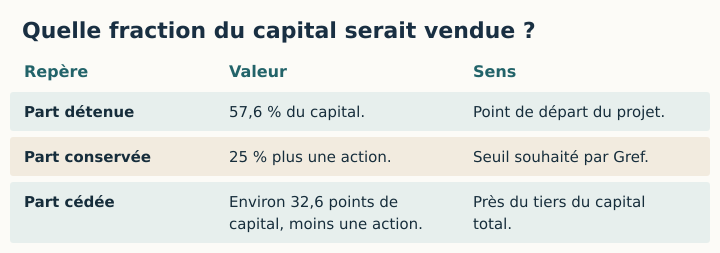

# ENS Rennes · D1 · Russe 2010 — Corrigé brut

*Corrigé rédigé par IA, non officiel. Signalez toute erreur.*

**Rédaction** · GPT-6.2 Astra Ultra · vitesse non renseignée

Le feuillet de l’École normale supérieure de Cachan est conservé dans les archives du concours D1 de Rennes. Pavel Arabov · Izvestia · 29 janvier 2010.

## Version française

**Les banques publiques pourraient être vendues**

Pour combler le déficit budgétaire, l’État entend examiner la possibilité de privatiser les actions qu’il détient dans la Sberbank et dans la banque VTB. La seule réduction de sa participation dans la Sberbank rapporterait au budget de 40 à 50 milliards de dollars. La préparation de la vente pourrait toutefois prendre plusieurs années.

« Commençons par la Sberbank », a déclaré German Gref, président du directoire de cette banque, ajoutant qu’il suffisait à l’État d’y conserver 25 % du capital plus une action. « Nous pouvons tout à fait réduire la participation de l’État dans la Sberbank et alimenter le budget. »

L’État détient actuellement 57,6 % des actions de la banque. Il pourrait donc s’agir de vendre à des investisseurs privés près du tiers de l’ensemble de ses actions.

Après la Sberbank, les participations publiques dans d’autres banques russes pourraient elles aussi être mises en vente. Le ministre russe des Finances, Alexeï Koudrine, a soutenu l’idée mais a proposé de prendre son temps, car la Bourse russe « n’a pas encore retrouvé son niveau d’avant la crise ».

Selon les experts, le passage des plus grandes banques russes aux mains du secteur privé présente plus d’avantages que d’inconvénients. Mais rien ne justifie particulièrement non plus de se hâter de les privatiser.

« Les actions des banques vont s’apprécier sur un horizon de quelques années. L’État a donc même intérêt à attendre un peu avant de vendre ses participations dans la Sberbank et VTB », explique Olga Izïoumova, gestionnaire de portefeuille de la société d’investissement Pilgrim Asset Management. « En tout état de cause, la vente de blocs d’actions de cette taille demandera beaucoup de temps. »

## Expression en russe

Donner son avis sur la vente des banques publiques. La version est notée sur 12 et la question sur 8. Aucune longueur imposée.

Я поддержал бы частичную продажу акций государственного банка, если бы условия сделки были прозрачными, а интересы вкладчиков были защищены. Такая продажа может принести деньги в бюджет, но этот доход государство получит лишь один раз. В дальнейшем оно будет получать меньшую долю прибыли банка. Важно также выбрать подходящий момент. Когда рынок еще не восстановился после кризиса, спешка может дорого обойтись налогоплательщикам. Кроме того, частный собственник не обязательно управляет банком лучше государственного. Нужны независимый надзор и понятные правила для всех участников. Поэтому я бы сравнил ожидаемую цену продажи с будущими доходами и заранее объяснил обществу, зачем государству сохранять определенную долю акций.

*99 mots, comptés par espaces.*

[Feuillet original, p. 6](https://www.ens-rennes.fr/medias/fichier/se1a-10d1-langues_1421752516799-pdf#page=6)
