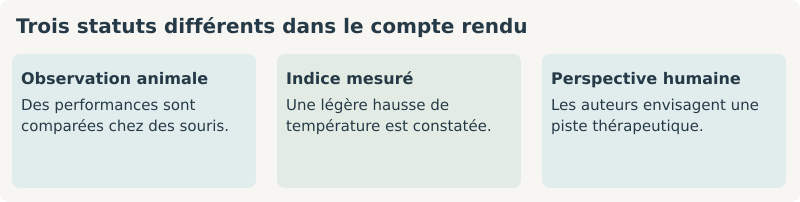

# ENS MP-PC — Allemand (LE2) 2010 · Corrigé brut

*Corrigé rédigé par IA, non officiel. Signalez toute erreur.*

**Lecture du rapport du jury** · GPT-6.2 Astra Ultra · vitesse non renseignée

**Rédaction** · GPT-6.2 Astra Ultra · vitesse non renseignée

## I. Version — 15 points

**Les ondes des téléphones portables peuvent-elles prévenir la maladie d’Alzheimer ?**

Au cours d’une expérience sur l’animal, des souris servant de modèles n’ont pas développé la maladie après avoir été exposées aux ondes des téléphones portables. Ce qui s’est alors passé dans le cerveau des animaux, les chercheurs l’ignorent encore.

Jusqu’à présent, les scientifiques n’ont pas pu établir clairement dans quelle mesure les ondes des téléphones portables sont nocives pour la santé. Dans les années quatre-vingt encore, beaucoup craignaient que l’usage de ces appareils ne provoque des maladies à grande échelle. Cela ne s’est pas produit. On sait toutefois aujourd’hui que le rayonnement émis par les appareils de téléphonie mobile agit sur les cellules du cerveau. Une expérience en laboratoire menée à l’université de Tampa, en Floride, donne à penser que cet effet pourrait aussi être bénéfique. Elle a livré un résultat surprenant. Les chercheurs de l’équipe de Gary Arendash y ont exposé des souris aux ondes des téléphones portables. Résultat : le rayonnement a empêché l’apparition de la maladie d’Alzheimer chez les animaux et, chez ceux qui étaient déjà atteints, il a atténué l’affection cérébrale. Selon les médecins, qui rendent compte de leurs travaux dans le *Journal of Alzheimer’s Disease*, le rayonnement a même amélioré la mémoire de souris en bonne santé. On ne sait pas encore précisément ce qui déclenche ces effets, ajoutent-ils. Ils estiment néanmoins que leurs résultats présentent aussi un intérêt pour l’être humain.

Les souris étaient installées dans des cages disposées autour d’une antenne. Celle-ci émettait un rayonnement électromagnétique courant en téléphonie mobile, à une fréquence de 918 mégahertz, à raison d’une heure deux fois par jour pendant sept à neuf mois. La dose de 0,25 watt par kilogramme correspondait, précisent les chercheurs, à celle à laquelle le cerveau humain est exposé lorsqu’on tient son portable contre l’oreille.

Chez les animaux plus âgés atteints de la maladie d’Alzheimer, les médecins ont même constaté qu’après plusieurs mois d’exposition au rayonnement, les souris obtenaient aux épreuves de performance des résultats aussi bons que des souris en parfaite santé. Il pourrait en découler un nouveau traitement efficace de la maladie d’Alzheimer. Les causes de ces effets doivent cependant faire l’objet de recherches plus poussées. À ce jour, la seule chose établie, selon les chercheurs, est que la température du cerveau des souris atteintes de la maladie d’Alzheimer a légèrement augmenté au cours de l’expérience.

*ZEIT ONLINE, dpa, janvier 2010.*

## II. Question — 5 points, 100 mots minimum

**Bisher wurde dem Mobiltelefon vorgeworfen, es sei gesundheitsschädlich und heute scheint es einen positiven Einfluss auf unser Gehirn zu haben (besseres Gedächtnis und Behandlung der Alzheimer-Krankheit). Was sollen wir davon halten?**

Ich würde die Ergebnisse ernst nehmen und zugleich genau fragen, was eigentlich nachgewiesen wurde. Die Forscher berichten, dass bestimmte Mäuse nach einer längeren Bestrahlung bei Gedächtnistests besser abschnitten. Diese Beobachtung ist interessant, gerade weil sie der früheren Befürchtung widerspricht, jede Wirkung der Strahlung müsse schädlich sein. Eine Veränderung in einem Versuch kann jedoch günstig aussehen, ohne dass sich daraus eine zuverlässige Behandlung für Menschen ableiten lässt.

Vor allem darf man das Tiermodell nicht mit der menschlichen Krankheit gleichsetzen. Ein gutes Testergebnis sagt auch noch nicht, wodurch die Verbesserung zustande kam oder wie lange sie anhält. Die im Artikel erwähnte leichte Erwärmung ist zunächst ein Befund, keine vollständige Erklärung. Ich würde daher weder die ältere Warnung noch die neue Hoffnung als endgültiges Urteil übernehmen. Überzeugender wären unabhängig bestätigte Ergebnisse und eine klare Prüfung der Frage, ob sich der beobachtete Effekt überhaupt auf Menschen übertragen lässt. Bis dahin bleibt der Bericht ein Anlass für weitere Forschung.

[Cahier de deux heures, p. 2](https://www.ens.psl.eu/IMG/file/concours/2010/MPI/mp-sujet-le2.pdf#page=2) · [Rapport du jury](https://www.ens.psl.eu/IMG/file/concours/2010/MPI/mp-ecrit-allemand-le2.pdf)
