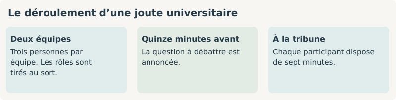

# ENS MP-PC — Allemand (LV1) 2010 · Corrigé brut

*Corrigé rédigé par IA, non officiel. Signalez toute erreur.*

**Rédaction** · GPT-6.2 Astra Ultra · vitesse non renseignée

## I. Version — 12 points

**Joutes oratoires. L’art de la dispute**

Ici, les opinions personnelles ne comptent pas. Au club de débat, seuls comptent les arguments qui tiennent la route. Les débatteurs doivent être capables de prendre parti pour ou contre n’importe quelle thèse. La tradition anglo-saxonne des joutes verbales s’est aussi implantée en Allemagne.

Les universités de langue allemande comptent actuellement 65 associations de ce genre et, de semestre en semestre, les étudiants sont toujours plus nombreux à vouloir apprendre à débattre en professionnels. « On y acquiert tout ce qu’on regroupe aujourd’hui sur les CV sous le terme de compétences relationnelles », explique Gudrun Lux, vice-présidente de la fédération des clubs de débat universitaires. « On apprend à structurer sa réflexion et à construire son argumentation. » À cela s’ajoute, dit-elle, le plaisir de la compétition. « Débattre, c’est de l’adrénaline à l’état pur. »

En Allemagne, cependant, le traditionnel « débat parlementaire à la britannique » a cédé la place à une discipline mise au point à Tübingen, le « débat parlementaire ouvert ». Deux équipes de trois personnes s’affrontent à chaque rencontre. Un tirage au sort désigne l’équipe du gouvernement, qui soutient la proposition, et celle de l’opposition, qui la combat. Dans cette compétition, il s’agit en effet de défendre l’opinion qui vous échoit, quelle que soit votre conviction personnelle. Le sujet est annoncé quinze minutes seulement avant le début du débat. Chaque participant dispose de sept minutes de parole.

Et où puise-t-on les connaissances nécessaires ? Qui s’y connaît aussi bien en astronomie lunaire qu’en droit d’auteur ? « Je crois qu’on en possède tout au plus un tiers en arrivant. Le reste, on l’apprend en débattant », déclare Thore Wojke, président du club. « Ici, ce n’est tout de même pas un rendez-vous de petits génies venus faire étalage de leur savoir. C’est un sport d’équipe, où l’on vient pour le plaisir d’argumenter. » La plupart des membres du club obtiennent à leurs examens oraux des résultats supérieurs à la moyenne. Wojke y voit « un heureux effet secondaire ».

Les étudiants en droit et les futurs responsables politiques ne sont pas les seuls à se donner rendez-vous dans les clubs pour débattre en professionnels. Au tournoi, les disciplines les plus diverses sont représentées, de la théologie à la gestion d’entreprise en passant par la philosophie.

*D’après Simone Kaiser, Spiegel Online, 10 septembre 2009.*

## II. Fänden Sie Debattierclubs an französischen Hochschulen sinnvoll ? — 8 points

Ich fände Debattierclubs an französischen Hochschulen sinnvoll, gerade weil Studierende in vielen Seminaren lange zuhören, bevor sie selbst das Wort ergreifen. Wer eine Behauptung in wenigen Minuten begründen muss, merkt schnell, wo ihm ein Beispiel oder ein logischer Schritt fehlt. Bei einer Debatte über kostenlose öffentliche Verkehrsmittel könnte etwa eine Studentin zuerst für den freien Zugang argumentieren und anschließend erklären, wie die Gemeinde das Angebot finanzieren soll. Der Rollenwechsel würde sie zwingen, den stärksten Einwand der Gegenseite ernst zu nehmen.

Allerdings kann ein Wettbewerb auch das falsche Verhalten belohnen. Ein selbstsicherer Redner klingt manchmal überzeugender als eine Teilnehmerin, die offen zugibt, dass ihr eine verlässliche Zahl fehlt. Deshalb sollte die Jury neben der sprachlichen Gewandtheit auch bewerten, ob jemand Belege richtig einordnet und auf eine Gegenfrage antwortet. Nach jeder Runde könnten beide Mannschaften gemeinsam eine Behauptung überprüfen, die während des Gesprächs umstritten blieb.

Wichtig wäre mir schließlich, dass Anfänger mitmachen können. Kleine Übungsrunden und eine wechselnde Sitzungsleitung würden verhindern, dass immer dieselben Stimmen das Gespräch bestimmen. So könnte aus der Freude am Wettstreit eine Fähigkeit entstehen, die auch außerhalb der Hochschule zählt: mit Menschen zu streiten, deren Ansicht man nicht teilt, und den eigenen Standpunkt zu ändern, wenn ihr Argument besser ist.

[Cahier de deux heures, p. 2](https://www.ens.psl.eu/IMG/file/concours/2010/MPI/mp-sujet-lv1.pdf#page=2)
