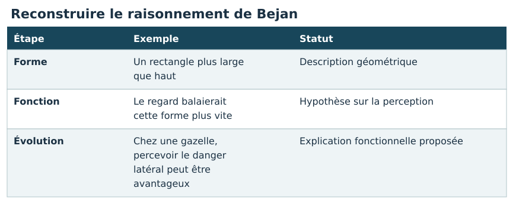

# ENS · MP-PC · Anglais (LE2) 2010 — Corrigé guidé

*Corrigé rédigé par IA, non officiel. Signalez toute erreur.*

**Rédaction** · GPT-6.2 Astra Ultra · vitesse non renseignée

Épreuve commune aux ENS de Paris et de Cachan. Durée totale de deux heures. Version sur 15 points et réponse en anglais d’au moins 100 mots sur 5 points. Le dictionnaire est interdit.

## I. Version française — Le mystère du nombre d’or élucidé

Les Égyptiens s’en seraient servis pour guider la construction des pyramides. L’architecture de l’Athènes antique aurait été conçue selon ce principe. Le personnage de fiction Robert Langdon, spécialiste des symboles à Harvard, a tenté d’en percer les mystères dans le roman *Da Vinci Code*.

Il s’agit du nombre d’or, une proportion géométrique – celle d’un rectangle dont la longueur vaut à peu près une fois et demie la largeur – dont on a avancé qu’elle serait la plus agréable à l’œil […]. Aujourd’hui, Adrian Bejan, ingénieur à l’université Duke, y a trouvé un point de départ particulièrement fécond pour réunir la vision, la pensée et le mouvement sous une même loi d’organisation de la nature. […]

Adrian Bejan pense savoir pourquoi le nombre d’or se retrouve partout : c’est lorsque l’image a la forme d’un rectangle d’or que les yeux la parcourent le plus vite. L’organisation naturelle qui relie la vision à la cognition s’expliquerait par la théorie suivante : les systèmes parcourus par des flux – des voies respiratoires des poumons jusqu’à la formation des deltas des fleuves – évoluent avec le temps de manière à faciliter toujours davantage ces écoulements. En 1996, Bejan a donné à ce principe le nom de « loi constructale ». […]

Selon Bejan, le monde s’organise essentiellement à l’horizontale. Pour les gazelles, par exemple, le danger vient surtout des côtés ou de l’arrière. Leur champ visuel a donc évolué de façon à s’étendre d’un côté à l’autre, plutôt que vers le haut ou vers le bas. « À mesure que les animaux développaient des organes de la vision, ils réduisaient au minimum le danger venu de l’avant et des côtés », explique Bejan. « Ainsi, globalement, les déplacements des animaux sur Terre sont devenus plus sûrs. La masse animale qui se déplace se ménage ses propres voies de circulation, efficaces et propices à la survie : elles sont plus rectilignes, avec moins d’obstacles et de prédateurs. » […]

Bejan attribue au nombre d’or une signification encore plus large. « La vision, la cognition et la locomotion forment un tout : voilà le principe qui organise les déplacements de tous les animaux sur Terre, déclare-t-il. Dans cette perspective, le phénomène du nombre d’or nous apporte l’idée que la régularité des formes et leur diversité coexistent et constituent l’une et l’autre des traits essentiels de l’organisation de la nature au fil de l’évolution. »

> [!INDICATION]
> « Supposedly », « is thought to » et « has been theorized » marquent tous une distance. L’ouverture du texte donne des exemples de croyances ; elle ne certifie pas que les bâtisseurs aient calculé le nombre d’or. L’approximation « une fois et demie » appartient au sujet et se conserve en version.

> [!INDICATION]
> Dans le dernier paragraphe, *design* désigne la manière dont des formes ou des déplacements s’organisent. Le mot *oneness* rapproche trois fonctions. Quant à *pattern*, il s’oppose ici à *diversity* et peut se rendre par « régularité des formes ».

## II. Mathematics and evolution

Mathematics and evolution are closely linked whenever a biological explanation makes a prediction that we can test. For instance, the shape of an animal’s visual field can be measured. If a gazelle gains an advantage from noticing movement at its sides, researchers can compare its field of vision with those of animals facing different risks. Geometry helps them state the prediction precisely. Statistics can then show how much variation there is within each group.

Yet finding a familiar ratio in nature does not explain how it arose. Several shapes may work almost equally well, and a trait may have been inherited from an ancestor that lived in a different environment. To assess Bejan’s proposal, I would measure scanning speeds for a range of rectangles and ask whether the same advantage occurs across species. Mathematics can turn an attractive idea into a demanding test. Evolutionary history is what gives the result its biological meaning.

> [!INDICATION]
> Le sujet demande *to what extent*. La réponse énonce une thèse, construit une comparaison que l’on pourrait tester et expose une limite. L’expérience proposée est une idée personnelle, non un résultat rapporté par l’article.

[Cahier LE2, p. 3](https://www.ens.psl.eu/IMG/file/concours/2010/MPI/mp-sujet-le2.pdf#page=3)
