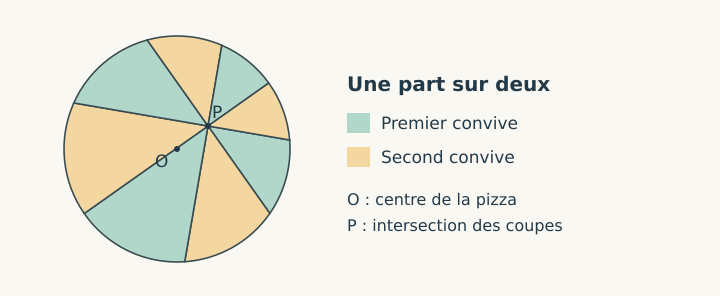

# ENS MP-PC — Anglais (LV1) 2010 · Corrigé guidé

*Corrigé rédigé par IA, non officiel. Signalez toute erreur.*

**Rédaction** · GPT-6.2 Astra Ultra · vitesse non renseignée

## I. Version — 12 points

> [!INDICATION]
> Dans la première phrase, *taxing* signifie « éprouvant ». L’adjectif prépare le contraste entre un choix de dessert anodin et le redoutable problème qui va occuper le déjeuner. Garder au passage sur le serveur sa valeur d’hypothèse.

**La manière idéale de découper une pizza**

Déjeuner avec un collègue devrait être un moment de détente. Le plus difficile devrait être de choisir ce que l’on va manger et boire, puis ce que l’on prendra comme dessert. Pour Rick Mabry et Paul Deiermann, les choses n’ont jamais été aussi simples. Impossible pour eux d’envisager de se partager une pizza, par exemple, sans se plonger tête la première dans les mathématiques de son découpage. « Nous déjeunions ensemble au moins une fois par semaine », raconte Mabry en se rappelant le début des années 1990, quand ils étaient tous les deux à l’université d’État de Louisiane, à Shreveport. « L’un de nous apportait un carnet et nous faisions des croquis pendant que notre repas refroidissait. »

Voici le problème qui les tracassait. Supposons que le serveur, débordé, découpe la pizza sans passer par son centre, mais que toutes les coupes, pratiquées d’un bord à l’autre, se croisent en un même point et que l’angle soit le même entre deux coupes voisines. Du fait de ce découpage décentré, les parts n’auront pas toutes la même taille. Si deux personnes prennent à tour de rôle des parts voisines en faisant le tour de la pizza, auront-elles finalement reçu des portions égales ? Et, dans le cas contraire, qui en aura le plus ?

On pourrait bien sûr estimer l’aire de chaque part, faire les additions puis en déduire la quantité reçue par chacun. Mais nos deux compères sont mathématiciens, et cela ne leur suffisait pas vraiment. Ils voulaient ramener le problème à quelques règles générales que l’on puisse démontrer, qui épargnent les calculs exacts et qui s’appliquent à tous les coups, quelle que soit la pizza circulaire. […]

« C’est curieux, chez certains mathématiciens, dit Mabry. Souvent, il nous est égal que les résultats aient des applications, tant ils sont beaux en eux-mêmes. » Il arrive que ces solutions à des problèmes de mathématiques abstraites refassent surface là où on ne les attendait pas. Ainsi, une curiosité mathématique du XIXᵉ siècle […] — une sorte de courbe fractale avant la lettre — a récemment refait son apparition comme modèle de la forme du génome humain.

*D’après New Scientist, 11 décembre 2009.*

> [!INDICATION]
> *Edge-to-edge* concerne l’étendue des coupes. *Off-centre* concerne leur point d’intersection. Ni l’une ni l’autre de ces expressions ne signifie que les angles au point d’intersection diffèrent. Le texte pose la question de l’égalité des aires totales et ne donne pas la règle dans cet extrait.

## II. Questions — 8 points

### 1. What image of mathematicians is given in this text?

The mathematicians are introduced as amusingly impractical lunch companions. Most people want a fair slice and a hot meal. Mabry and Deiermann are prepared to let the meal grow cold while they sketch the problem. Yet the anecdote also makes their work unusually approachable. They begin with a waiter and a pizza, rather than with an object that only a specialist could recognise. What sets them apart is what would count as an answer. Adding up the areas might settle a dispute at this table, but a convincing proof would settle every case covered by its assumptions. They also work together, testing ideas over a series of lunches. Mabry’s pleasure in a beautiful result gives this persistence a motive that is neither financial nor purely practical. His reference to “some mathematicians” keeps the portrait personal. The magazine invites us to enjoy this habit of mind without claiming that all mathematicians think alike.

### 2. To what extent should scientific research be aimed at getting direct applications?

When a water authority commissions a study to detect a contaminant, it is reasonable to ask whether the method works reliably at a price the authority can afford. The urgency of the problem helps determine what should be measured and when a useful answer is needed. Yet applying the same test to every grant would reward researchers for promising uses they cannot honestly predict. A mathematical model can acquire an application decades after the question that inspired it has been forgotten. The article’s example of an old curve finding a role in the study of the genome makes that time lag concrete.

I would therefore reserve funding for both defined practical problems and open inquiry. A team seeking an immediate remedy should state how the remedy will be tested. A team seeking a general result should explain its question, the limits of its assumptions and what would constitute real progress. There are good reasons to ask both groups to account for public money. They need not account for it by promising the same kind of outcome.

> [!INDICATION]
> La première question demande le portrait construit par ce récit. La seconde porte sur un choix de politique scientifique. Un même exemple peut servir deux fois à condition de changer sa fonction argumentative. Pour la seconde, préciser comment évaluer la recherche fondamentale empêche la liberté de recherche de devenir un simple slogan.

[Cahier de deux heures, p. 3](https://www.ens.psl.eu/IMG/file/concours/2010/MPI/mp-sujet-lv1.pdf#page=3)
